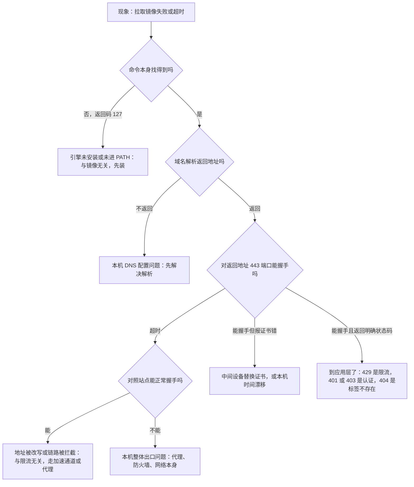

# 环境准备：Windows、macOS 与 Linux

> 按平台把引擎装上，并用四段定位法判断「拉不下镜像」到底卡在哪一段——含本机两轮真实读数、引擎自述报错，以及不依赖镜像仓库验证运行时的办法。

---

LLMS 索引： [llms.txt](/llms.txt)

---

> **实战落点**：示例链第①段 · 依赖跑起来（本篇是第①段的全部前置，第①段的任何命令都要先过本篇的七条判据）
> **示例版本**：本篇不产出示例文件；它产出「干净机器判定」——第①段的前置清单以本篇七条为准
> **前置依赖**：[/docs/00-导读/怎么用这个库/使用指南与主线八站地图/](/docs/00-导读/怎么用这个库/使用指南与主线八站地图/)
> **本篇产出物**：一份你自己机器的七行体检记录，据此判断能不能进示例链第①段；本篇同时给出一条**不依赖镜像仓库**的运行时验证路径
> **拓展接口**：本篇的「四段定位法」在 [/docs/07-运维手册/按故障域排错/磁盘占满与镜像拉取失败/](/docs/07-运维手册/按故障域排错/磁盘占满与镜像拉取失败/) 被穷尽为四条判据表；`--memory` 在容器内可见这件事在 5.3 被展开成控制组机制；「约一半物理内存」这条默认值本篇已实测，具体上限怎么设与其效果仍未实测
> **难度·耗时**：★☆☆ · 40 分钟（含动手检查 10 分钟；安装耗时取决于网络，不计入）
> **自测三题**：
> 1. 引擎装好、子系统就绪、容器也能跑，为什么第①段仍然可能跑不起来？
> 2. 域名解析五毫秒返回一个地址，为什么不能算「网络正常」？本机给出的两个证据是什么？
> 3. 为什么本篇要保留两轮读数，而不是只写最后那一轮？

## 为什么要先量自己的机器

一个真实场景：新人拿到文档，第一步是「跑一条命令看看能不能起来」，命令报错，于是他认定文档写错了。但报错文本里其实已经写明是三类完全不同的问题之一——他还没分清自己有没有装东西。

```text
「这条命令报 command not found」
「那说明你机器上根本没有它，不是命令写错了。」
「那我照文档下一步装好就行了吧？」
「先别。你现在装，等会儿再失败一次，你会分不清是装的过程失败还是文档失败。」
「所以要先做什么？」
「先把你现在有什么、网络能不能通记下来。装完再记一次。两次一对，问题自己就跳出来了。」
```

本篇在本机上把这段对话**实践了两遍**：2026-10-25 第一轮，2026-10-27 第二轮（装上引擎与子系统之后再测）。两次读数放在同一张表里看，才有意义——单看任何一轮，都得不出「安装到底改变了什么」的结论。

| 检查 | 第一轮 2026-10-25 | 第二轮 2026-10-27 | 这一对读数说明什么 |
|---|---|---|---|
| 引擎命令 | 不在 PATH，执行返回码 **127** | `C:\Users\webtu\AppData\Local\Programs\DockerDesktop\resources\bin\docker.exe`，`docker version` 返回码 0 | 安装动作确实改变了判定 |
| Linux 子系统 | `wsl.exe --status` 返回码 **50**：「未安装适用于 Linux 的 Windows 子系统」 | 返回码 **0**：默认分发 `docker-desktop`，默认版本 **2** | 子系统随桌面版引擎一起装上了，没有单独建 Linux 发行版 |
| 内核 | 无 | `6.18.54.1-microsoft-standard-WSL2` | 容器的内核来自 WSL2，不是 Windows 内核 |
| 镜像域名解析 | 解析到 `31.13.70.13`（5 ms），443 端口 **6006 ms 超时** | 解析到 `64.13.192.76`，443 端口 **6018 ms 超时** | **两轮都失败，且地址换了**——装引擎不解决这一条 |
| 对照站点 | `www.baidu.com` TCP 23 ms、TLS 42 ms 成功 | `www.baidu.com` 55 ms（对端 `153.3.238.127`）、`gitee.com` 83 ms（对端 `180.76.198.225`），均 200 OK | 出口一直是通的，两轮都通 |

> 💡 新人小结：装机前先做体检，像装修房子之前先测水电。你会先确认「水管有没有通到门口」，而不是把新买的水龙头装上后漏水，再怪水龙头质量问题。
> 对应到这里：门口水压 = 网络能不能连到镜像仓库；墙里的管线 = 操作系统提供的虚拟化与子系统支持；新水龙头 = 容器引擎本身。**顺序不能反**——先装龙头再测水压，漏水时你分不清是龙头坏还是管子没通。
> 本机这两轮读数正好是这个原则的实例：装完之后水压**依然**不通，如果不留第一轮读数，第二轮的失败就会被误当成「装坏了」。

## 三个平台各自要装什么

引擎不是一个单独的程序，它依赖平台提供隔离能力的机制。三个平台的依赖链完全不同，这是很多跨平台教程失效的原因。

| 平台 | 依赖什么 | 要装的东西 | 最容易卡在哪 |
|---|---|---|---|
| Windows 11 | 需要 Linux 子系统提供内核；引擎跑在子系统里 | 子系统 + 引擎桌面版 | 虚拟化在 BIOS 里被关；子系统已装但处于旧版本 |
| macOS（Apple 芯片） | 靠轻量虚拟机跑一个真正的 Linux 内核 | 桌面版引擎 | 把「本机是类 Unix」当成能直接跑容器——不能，内核不是 Linux |
| Linux | 直接用本机内核的命名空间与控制组 | 引擎本体 | 内核版本过旧；用户没加入引擎组，每条命令都要 sudo |

本机第二轮的 `docker info` 读数可以当作「Windows + WSL2 后端装对之后长什么样」的样板：

| 字段 | 读数 | 说明 |
|---|---|---|
| Server Version | `29.8.0`（Docker Desktop 4.91.0，build 239619） | 客户端与服务端同版本，API 1.56 |
| Kernel Version | `6.18.54.1-microsoft-standard-WSL2` | 内核来自 WSL2，名字里的 `microsoft-standard` 就是证据 |
| Operating System | `Docker Desktop (containerized)`，OSType `linux` | 容器是 Linux 容器 |
| Storage Driver | `overlayfs`，Cgroup Driver `cgroupfs`，**Cgroup Version 2** | 新引擎在 WSL2 上报 `overlayfs` 而不是老的 `overlay2`；控制组是 v2，这决定了后面读限制值的文件路径 |
| CPUs / Total Memory | 24 / **47.01 GiB** | 宿主物理内存 95.9 GB，引擎可见 47.01 GB ≈ **一半** |
| Docker Root Dir | `/var/lib/docker` | 磁盘治理与「撑满」类排错都从这里入手 |
| Name / Context | `docker-desktop` / `desktop-linux` | 引擎跑在那个 WSL 发行版里 |

两个常见误解要在这里点掉：

| 误解 | 事实 |
|---|---|
| macOS 类 Unix，所以能像 Linux 一样原生跑容器 | 不能。容器需要 Linux 内核特性，macOS 内核不提供，桌面版仍是起一个虚拟机 |
| Windows 装了引擎就等于有 Linux 内核 | 只在「Linux 容器」模式下成立，且依赖子系统；Windows 容器模式是另一套完全不同的东西，本库不覆盖 |

**本库统一以 Linux 容器语义讲解。** 涉及平台差异的地方会显式标注，比如宿主机地址解析、数据挂载的性能与权限表现。

## 装完之后怎么验（七条判据）

按顺序跑。每条都给「看到什么算过」，以及本机两轮的实测状态。

| # | 检查项 | 过 / 不过的判据 | 本机 2026-10-27 |
|---|---|---|---|
| 1 | 引擎命令存在 | `docker version` 返回码 0，客户端与服务端两段都有版本号 | **过**（Client 29.8.0 / Server 29.8.0） |
| 2 | 虚拟化与子系统就绪 | Windows：`wsl --status` 返回码 0 且默认版本为 2 | **过**（`docker-desktop`，版本 2） |
| 3 | 镜像域名解析**正确** | 解析出的地址能在 443 完成 TLS 握手；仅「能返回地址」不算过 | **直连仍不过**（`64.13.192.76`，6018 ms 超时）；走代理时该问句不再成立，见下一条 |
| 4 | 出口通畅（对照） | 至少一个对照站点 TCP 与 TLS 在几十毫秒量级成功 | **过**（55 ms / 83 ms，都 200） |
| 5 | 本机时钟可信 | 与公开服务器的 `Date` 偏差在秒级；证书有效期覆盖当前时间 | **过**（偏差 −0.1 秒，剩余 89 天） |
| 6 | 镜像获取通道可用 | 能拉成一个几 MB 的小镜像，或返回明确状态码而非超时 | **不过 → 过**：未配代理时返回码 1（`dial tcp …:443: connectex`）；配本机代理后 `hello-world` 与 `redis:7-alpine`、`mysql:8.4` 全部返回码 0 |
| 7 | 容器能跑起来 | 起一个容器能看到它执行并退出，参数与限制在容器内可见 | **过**（两条路径都验了：`FROM scratch` 自建镜像，以及公开镜像 `docker run --rm hello-world` 返回码 0） |

第 6 条那一行「不过 → 过」是本机状态的真实变化，不是判据变松：判据没动，是**通路**变了。同时注意第 3 条在配了代理之后**依然不过**——直连那个域名仍然拿到连不通的地址。这两件事合起来说明一个重要区别：**通道问题可以靠代理绕开，但不要去"修"解析本身**；把第 3 条当成必须修好的项，会白白去折腾本机 DNS。

**引擎可用 ≠ 能拉镜像**：这条判断在第 6 条不过的那几个小时里完全成立（第 1、2、7 条全过，第①段仍然跑不起来）；配上代理之后七条全过，第①段才真正具备起跑条件。

第 6 条的失败长这样（引擎自己吐出来的原文）：

```bash
$ docker pull hello-world ; echo "rc=$?"
Using default tag: latest
Error response from daemon: failed to resolve reference "docker.io/library/hello-world:latest":
failed to do request: Head "https://registry-1.docker.io/v2/library/hello-world/manifests/latest":
dialing registry-1.docker.io:443 container via direct connection because Docker Desktop has no
HTTPS proxy: connecting to registry-1.docker.io:443: dial tcp 64.13.192.76:443: connectex: A
connection attempt failed because the connected party did not properly respond after a period of
time, or established connection failed because connected host has failed to respond.
rc=1
```

这段文本里有两个可直接取用的信息：`dial tcp 64.13.192.76:443: connectex` 说明**失败在传输层**（连不上），不是应用层的拒绝；`because Docker Desktop has no HTTPS proxy` 说明**引擎没有配任何代理，走的是直连**。后者顺手回答「要不要配代理」这个问题——没配。

第 1 条在 Git Bash 里有个纯读取层面的坑：系统命令返回的是 **GBK 编码**的中文提示，直接看会是一段乱码字节，不像「未找到」的意思。同理 `wsl.exe` 的输出是 **UTF-16LE**。

```text
命令返回码 1，输出按 GBK 解码：信息: 用提供的模式无法找到文件。
wsl.exe --status 第一轮返回码 50，按 UTF-16LE 解码：未安装适用于 Linux 的 Windows 子系统……
第二轮返回码 0，同一解码：默认分发: docker-desktop | 默认版本: 2 | 当前计算机配置不支持 WSL1……
```

判据的读法要跟着调：**看返回码，不要靠肉眼看输出文本**。文本可能被编码破坏，返回码不会。上面那句「不支持 WSL1」也值得注意——它是 rc=0 成功输出里的一句附带提示，不是错误，别被它带偏去查 WSL1。

## 拉不下来该查哪一段：四段定位法

「拉取失败」在外层看是一条超时，实际可能是四个完全不同的位置。



本机两轮读数在这张图上的落点完全一致：**Q1 过 → Q2 返回 → Q3 超时 → Q4 通 → A3**。第 3、4 条一起看才能定到 A3，只有一条都不够。

**跨解析器对照这一招现在失效了，要如实记下来。** 第一轮我用三个解析器问同一个域名，得到三个不同地址（系统 `31.13.70.13`、`223.5.5.5` 给 `199.59.149.238`、`114.114.114.114` 给 `185.60.219.41`），而对照站点在两个解析器下答案一致，据此把「疑似被改写」钉成结论。第二轮再问那两个解析器，**UDP 53 端口直接超时**，这一招当场不可用。

失效之后还有两条更好拿的证据，本轮都用上了：

| 证据 | 本机读数 | 为什么它够用 |
|---|---|---|
| **同一个域名，答案随时间变** | 第一轮 `31.13.70.13`，第二轮 `64.13.192.76`；容器内第三次问，得到 `108.160.166.57` | 一个真·权威解析不会两天给三个不同、且全都连不通的地址；对照站点两轮都稳定给出 `153.3.238.x` 且能握手 |
| **引擎自述它连的是哪个地址** | 报错里写 `dial tcp 64.13.192.76:443`，与我在宿主上用 `getaddrinfo` 问到的**同一个地址** | 证明「宿主看到的」和「引擎实际连的」是一回事，排除「引擎走了另一条解析路径」这种解释 |

> 💡 新人小结：四段定位像查一根断掉的电线。从电表开始往家里量：先确认有没有电到门口，再确认墙上插座有没有电，最后才怀疑你插的那台机器坏了。每一段都要用**同一个已知能工作的电器**去试——那个电器就是「对照站点」。
> 对应到这里：对照站点的价值在于它能证明「量电的工具本身是好的」。没有它，你无法区分「目标不通」和「我的探测方法不通」，而这两者的读数长得一模一样。本机第二轮就差点栽在这上面：跨解析器那招超时了，如果不同时准备另外两条证据，就会被引导成「解析器全都挂了」的错误结论。

## 证书与时间：四段定位里最容易被跳过的一格

决策图里「能握手但报证书错」这一格要单独讲，因为它的**报错文本会把人引向完全错误的方向**：写着证书相关，人就去换证书或加跳过校验的开关，而实际成因常常是本机时钟。

本机方法：同时取服务器的 HTTP `Date` 头与本机 UTC，再读 TLS 证书有效期。

```bash
$ python -c "取服务器 Date 头、本机 UTC、TLS 证书有效期并比较"
www.baidu.com      对端 153.3.238.127   TCP+TLS 55 ms
    Date 偏差 -0.1 s | 证书剩余 89 天 | 状态行 HTTP/1.1 200 OK
gitee.com          对端 180.76.198.225  TCP+TLS 83 ms
    Date 偏差 -0.0 s | 证书剩余 116 天 | 状态行 HTTP/1.1 200 OK
```

| 观察 | 本机值 | 判据含义 |
|---|---|---|
| 本机与服务器的时间差 | −0.1 秒 / −0.0 秒 | 秒级以内属正常。偏差到**分钟级以上**就要查时钟同步，证书校验会开始随机失败 |
| 证书有效期是否覆盖当前时间 | 覆盖 | 本机时钟若跑到有效期之外，任何合法证书都会被判为无效 |
| 剩余天数 | 89 天 / 116 天 | 剩余极少时容易和「刚过期」混淆，到期前一周内的失败要优先查这一项 |

> 💡 新人小结：证书校验像过海关——海关看你护照上的日期，**如果你的手表慢了一年，你的护照就"过期"了**，哪怕海关的系统时间完全正确。修表比换护照便宜得多，但很多人先做了后者。
> 对应到这里：手表 = 本机系统时钟；护照有效期 = 证书的起止时间；海关系统 = 远端服务。所以遇到证书类报错，第一条检查动作是核对**本机时间**，而不是去动引擎的校验开关。

三种表现要分开处置，它们看着像同一件事：

| 表现 | 优先怀疑 | 一条验证动作 |
|---|---|---|
| 只在某些域名报证书错，浏览器访问同一地址正常 | 中间设备（公司出口网关）替换了证书 | 对比命令行与浏览器看到的证书签发链，不同就是被替换 |
| 所有 HTTPS 目标都报证书错 | 本机时钟漂移 | 比较本机 UTC 与任一公开服务器的 `Date` 头，看偏差量级 |
| 报的是超时而不是证书 | 链路问题，回到上一节的四段定位 | 先跑对照站点，确认出口通畅与否 |

最后一条要划清边界：**换证书或跳过校验不是解决方案**。跳过校验会让真正的中间人问题静默消失，本库不提供这类开关的用法。

## 不依赖镜像仓库，仍然验证运行时（第 7 条怎么过的）

第 6 条不过时，第 7 条看起来必然也没法测——没有镜像怎么起容器？可以不用仓库。用 `FROM scratch` 加一个本机交叉编译出来的静态 Linux 二进制，整条链路一次网络都不碰。

```bash
# 1) 交叉编译一个静态 Linux 二进制（本机 Go，不联网）
$ GOOS=linux GOARCH=amd64 CGO_ENABLED=0 GOTOOLCHAIN=local GOPROXY=off go build -trimpath -o demo .
$ ls -l demo
-rw-r--r-- 1 ... 3314972 Oct 27 07:52 demo          # 约 3.3 MB 静态二进制

# 2) 镜像描述文件：基础镜像是空的，唯一一层来自本机文件
$ cat Dockerfile
FROM scratch
COPY demo /demo
ENTRYPOINT ["/demo"]

# 3) 构建并运行，顺带把内存上限和主机名传进去
$ docker build -t proof:local .
$ docker run --rm --memory=64m --hostname proof-01 proof:local
```

容器里的真实自述：

```text
RUNTIME: 这是一个 FROM scratch 构建的镜像，未从任何仓库拉取过一层
hostname: proof-01
cgroup: 0::/
memory.max: 67108864
cpu.max: max 100000
resolv.conf: # Generated by Docker Engine.
nameserver 192.168.65.7
hosts(1 行): 127.0.0.1	localhost
容器内解析 registry-1.docker.io -> 108.160.166.57
容器内连 baidu:443 -> 成功
```

五个结论直接从这五行数出来：

| 读数 | 结论 |
|---|---|
| `hostname: proof-01` | `--hostname` 生效，UTS 隔离在工作（宿主不是这个名字） |
| `cgroup: 0::/` | 控制组是 **v2** 的统一层次；这决定了读限制值要去看 `/sys/fs/cgroup/<文件>`，不是 v1 的那套目录 |
| `memory.max: 67108864` | `--memory=64m` 被真实下发：64 MiB = 67,108,864 字节，分毫不差 |
| `cpu.max: max 100000` | 没设 CPU 上限时配额位是 `max`，周期 100000；想限核要显式传 `--cpus` |
| `nameserver 192.168.65.7`，注释写着 `Generated by Docker Engine` | 容器内 DNS 由引擎生成，指向桌面版内置的解析器，**不是**宿主 `resolv.conf` 的内容 |

还有一条副产品值得记：容器里解析同一个域名得到 `108.160.166.57`，与宿主的 `64.13.192.76` **不同**。所以「宿主解析被改写」这件事不能直接推定容器内的视图相同——排错时要分别问。

清理动作也是流程的一部分：`docker rmi proof:local` 卸镜像，`docker builder prune -f` 清构建缓存，最后 `docker system df` 复核。本机复核结果为 Images 0 / Containers 0 / Volumes 0，Build Cache 由 8.639 MB 降到 4.096 kB。

## Windows 与子系统的三处初始设置

装上之后有三件事不做，后面一定会踩。第一条本轮有了实测数据，另外两条仍未实测，标注照旧。

| 设置 | 为什么 | 不做会怎样 | 本机可复现性 |
|---|---|---|---|
| 给子系统设内存上限 | 子系统默认可以吃掉一半物理内存，且长期持有不释放 | 宿主内存被大量占用 | **默认值已实测**：引擎可见 47.01 GiB，宿主物理内存 95.9 GB，正好约一半。**设上限的具体操作与效果未实测**（本轮没改配置）。96 GB 这类机器上，把上限设到 8~16 GB 是合理起点 |
| 工程文件放在子系统内而不是 Windows 盘 | 跨系统挂载的文件操作性能远低于同一文件系统内 | 构建时大量小文件读写，耗时成倍增加 | 未实测 |
| 注意虚拟磁盘不自动回收 | 磁盘文件只会增长不会缩小，删除镜像不等于释放宿主空间 | 数据盘看起来「越用越小」，需要手动压缩流程 | 未实测。本机 C 盘 477 GB 总、316 GB 可用，容量不是当前瓶颈 |

这三处与更深的坑（子系统与桌面引擎的启停依赖、休眠后容器网络失效）在第七篇专门有一节，遇到时直接查那里。

## 代理与镜像通道

如果公司网络要求走代理，需要**两处**都配：桌面引擎的代理设置，以及子系统内部的 shell 代理。只配一处时会出现「浏览器能开网页但拉不下来」，这是最常见的半配状态。

```text
判断走了哪条路：
1) 引擎配置里有代理，命令行环境变量里没有 —— 引擎自己走代理，容器内进程不走
2) 只有环境变量有代理 —— 引擎不走，容器内构建时下载依赖会走
```

镜像通道分两类：公开镜像加速（改引擎的仓库地址配置），和私有仓库代理缓存（在自己机房里缓存一份，见 3.10）。选哪个是团队决定，**本库示例统一不假设你有可用加速通道**——所有需要拉镜像的步骤，都在该段的前置清单里写明「需要一条可用的镜像获取通道」，不静默依赖某个具体加速域名。

本库的示例之所以把"镜像获取通道"写进每段的前置清单而不静默依赖某个加速域名，就是因为本机第三轮之前正卡在这里：引擎与运行时全合格，第①段要的两个公共镜像却拉不到。配好代理后该条解除，见下一节。

## 打通通道：代理与加速器是两条路

第三轮（同日 2026-10-27，配了本机代理之后）把第 6 条解开了。先看**唯一变量是代理**这组对照：

```bash
$ curl -s -o /dev/null -w "%{http_code}" --max-time 12 https://registry-1.docker.io/v2/
000                     # 直连，12 秒后 curl 返回码 28（超时）

$ curl -x http://127.0.0.1:7890 -s -o /dev/null -w "%{http_code}" --max-time 15 https://registry-1.docker.io/v2/
401                     # 走代理，0.84 秒
```

`401` 是**成功信号**而不是失败：`/v2/` 这个端点在未认证时本来就该回 `{"errors":[{"code":"UNAUTHORIZED",…}]}`。真正说明问题的是它**答话了**，而直连那侧连 TCP 都没建起来。

引擎侧的可观测变化：

| 时点 | `docker info` 的代理段 | `docker pull hello-world` |
|---|---|---|
| 未配代理 | 无（报错原文写着 `because Docker Desktop has no HTTPS proxy`） | 返回码 1，`dial tcp 64.13.192.76:443: connectex` |
| 配代理后 | `HTTP Proxy: http.docker.internal:3128`、`HTTPS Proxy: http.docker.internal:3128`、`No Proxy: hubproxy.docker.internal` | 返回码 **0**，`Digest: sha256:11a3eb15…`，`Status: Downloaded newer image` |

拉取耗时与体积的真实读数：`redis:7-alpine` **5.3 秒**（57.8 MB）、`mysql:8.4` **22 秒**（1.12 GB）、`hello-world` 25.9 kB。

> 💡 新人小结：代理和加速器像两种不同的出门方式。代理是**绕一段路**走能通的桥，任何目的地都能到，但每次都要绕；加速器是**在你楼下建个前置仓**，常用的货直接就近取，货没备或者仓库挂了，你还是出不去。
> 对应到这里：代理改的是「引擎出网走哪条链路」，与目标无关，所以它对任意镜像都成立；加速器改的是「去哪个域名取镜像」，只对它缓存过的东西有效。两者可以叠加，但**排查时要把它们分开试**——先证明「走代理能通」，再谈要不要加速器。

三条判断口径：

| 情况 | 该配哪个 | 依据 |
|---|---|---|
| 直连超时（像本机第三轮之前） | 代理 | 连 TCP 都建不起来，加速器域名同样要靠出网能力，先解决通路 |
| 直连能通但很慢、或某些公共库限流 | 加速器 | 已到达应用层，问题在链路质量或配额 |
| 需要拉私有仓库的镜像 | 都不解决 | 那是认证与信任问题，见 3.10 与 7.6 的 401/403、X509 分支 |

一处需要诚实标注的边界：`http.docker.internal:3128` 是桌面版引擎的**内部代理入口**，它再把流量转给系统层配置的代理。本轮只观测到「配了之后引擎这段从无到有、拉取随即成功」这一对变化，**没有逐跳验证流量是怎么传到 `127.0.0.1:7890` 的**——那需要看桌面版设置项与流量落点。文档只写观测到的这一层。

## 第①段判据真跑通了（以及两次差点被骗的假结果）

有了通道，第①段那条判据就能真测。判据原文是：**容器删掉后数据仍在**。

Redis 侧：起一个挂命名卷的容器，宿主直接用协议写入（不借任何客户端），然后 `docker rm -f` 再重起。

```text
SET kb:proof round-1-value        -> +OK        （第一轮写入）
—— 删除容器并用同一个卷重新起 ——
KEYS kb:*                          -> *1  $8 kb:proof
GET kb:proof                       -> $13 round-1-value     # 上一轮写入的值活过一次删除
SET kb:proof persistence-check     -> +OK
—— 再次 docker rm -f 并重新创建 ——
GET kb:proof                       -> $17 persistence-check # 又活过一次
DBSIZE                             -> :1        |  INFO 里 aof_enabled:1  loading:0
```

MySQL 侧：同一套动作，判据换成 `SELECT`。

```text
写入两行 → id=1 before-delete / id=2 second-row，written_at = 2026-10-27 03:22:48
宿主 127.0.0.1:3307 连接成功 8 ms，并收到 MySQL 握手包，包里的版本串是 8.4.13
docker rm -f kb-p1-mysql          → 卷 kb-p1-mysqldata 仍在列表里
重起（同一个卷）→ 约 6 秒就绪
SELECT COUNT(*) FROM t_probe      → 2
SELECT * FROM t_probe             → 两行数据与时间戳原封不动
```

**这两次判定之前都被我自己的脚本骗过一回，值得单独记，因为它们比结论更容易复发：**

| 假结果 | 我的写法错在哪 | 症状 | 为什么会误判 |
|---|---|---|---|
| 以为 MySQL 数据没挂到卷上 | `-v kb-p1-mysqldata:/var/lib/dockervolume`，把 `/var/lib/mysql` 打错 | 挂载列表里出现两个卷：命名卷挂在那个不存在的路径上，另有一个**匿名卷**挂着 `/var/lib/mysql` | 容器照跑、`SELECT` 照出数据，看着完全正常。但那时删掉匿名卷才算丢数据，而我没有它的名义 → 测出来的"留存"毫无意义 |
| 以为 Redis 的键没留住 | 手写 RESP 时给了 `$3` 的长度前缀，而 key 是 8 字符的 `kb:proof` | 返回 `$-1`（nil）外加一条 `-ERR unknown command 'oof'` | `$-1` 长得太像"键不存在＝数据丢了"。实际是服务端按 3 字节读走 `kb:`，把剩下的 `proof` 当成新命令解析。**是客户端坏了，不是 Redis 坏了** |

两条教训合并成一句判据使用规矩：**测"数据留存"之前，先确认数据到底落在哪个卷上；拿到 nil / 空结果之前，先确认你的读法本身没错**（`INFO` 里的报错文本、挂载列表里的匿名卷，都是免费的真值来源）。

清理也是流程的一部分：本轮创建的 2 个容器、2 个命名卷、3 个镜像与构建缓存全部删除，`docker system df` 复核为 Images 0 / Containers 0 / Local Volumes 0 / Build Cache 0。删除前的占用规模可以当容量参考——两个卷一共 **218.4 MB**（MySQL 初始化数据目录就写了这么多），三个镜像合计 **1.176 GB**（其中 MySQL 一个就 1.12 GB）。

## 实战切入：把七行体检记录写下来

这一段是本篇的动手环节，落在示例链第①段之前。**产出物就是这七行**，它之后会成为第①段前置清单的一部分。

```bash
# 1. 引擎版本（看返回码，不看文本观感）
$ docker version --format '{{.Server.Version}}' ; echo "rc=$?"
# 2. 子系统状态（记得按 UTF-16 解码再读）
$ wsl.exe --status ; echo "rc=$?"
# 3. 镜像域名解析与连接
$ python -c "import socket;print(sorted({i[4][0] for i in socket.getaddrinfo('registry-1.docker.io',443)}))"
$ python -c "import socket,time;t=time.perf_counter();socket.create_connection(('registry-1.docker.io',443),timeout=6);print(round((time.perf_counter()-t)*1000))"
# 4. 对照站点：证明你的探测方法本身可用
$ python -c "import socket,time;t=time.perf_counter();socket.create_connection(('www.baidu.com',443),timeout=6);print(round((time.perf_counter()-t)*1000))"
# 5. 时钟与证书：比较 Date 头与本机 UTC
# 6. 拉取通道
$ docker pull hello-world ; echo "rc=$?"
# 7. 容器运行时（不依赖仓库，见上一节的 scratch 办法）
```

| 行 | 你的读数 | 本机 2026-10-27 的读数 |
|---|---|---|
| 1 | ____ | 返回码 0，`29.8.0` |
| 2 | ____ | 返回码 0，默认分发 `docker-desktop`，版本 2 |
| 3 | ____ | 解析到 `64.13.192.76`；443 连接 6018 ms 后超时 |
| 4 | ____ | `www.baidu.com` 55 ms 成功；`gitee.com` 83 ms 成功 |
| 5 | ____ | 与服务器偏差 −0.1 秒；证书剩余 89 天 |
| 6 | ____ | 未配代理：返回码 1，`dial tcp 64.13.192.76:443: connectex`；配本机代理后：返回码 **0**，`hello-world` 与 `redis:7-alpine`（5.3 s / 57.8 MB）、`mysql:8.4`（22 s / 1.12 GB）全部拉成 |
| 7 | ____ | 两条路径都过：`FROM scratch` 自建镜像在容器内读到 `memory.max=67108864`；公开镜像 `docker run --rm hello-world` 返回码 0 |

七行填完，分流按「哪几条不过」定：

| 结果 | 下一步 |
|---|---|
| 1 或 2 不过 | 先按你的平台装完再回来，**不要开始示例链第①段**，你会把环境问题当成文档问题 |
| 1、2 过，3 不过而 4 过 | 环境是好的，通道是坏的：配加速通道或代理。这属于第⑤段会重复出现的问题，记下你的解法 |
| 1、2、7 过而 6 不过 | 运行时可用但拿不到公共镜像：第①段开不了跑，先解第 6 条（本机第三轮之前正是这一格） |
| 七条全过 | 可以进 [/docs/02-核心操作/接上去/端口映射数据管理与权限时区/](/docs/02-核心操作/接上去/端口映射数据管理与权限时区/)，示例链第①段从那里开始（**本机现状即此格**） |

第 2、3 种情况值得强调：**它们的报错会长得和「引擎坏了」一模一样**（都是超时或失败）。如果不先量对照站点、不做第 7 条这种绕开仓库的验证，很多人会去重装引擎——重装改变不了链路，白花两小时。

## 常见误读

| 你可能的理解 | 实际情况 |
|---|---|
| 解析返回了 IP 就是网络正常 | 五毫秒返回一个不可达的地址，比不返回更具迷惑性。判据要落到「能不能握手」 |
| 超时就是镜像站限流 | 限流返回明确的 HTTP 状态码与文字，不会表现为 TCP 层超时。超时说明没到应用层 |
| 装完引擎就能直接跑示例链 | 还要有镜像获取通道。本机头两轮就是反例：引擎、子系统、运行时全合格，第①段仍跑不了，直到把代理配上 |
| 引擎装好意味着容器能跑 | 这是两件事，而且要分开判。本机在拉不到任何公共镜像的状态下，仍能用一条不碰仓库的路径证明运行时可用 |
| 配了代理，解析问题就"修好"了 | 没有。直连那个域名依旧拿到连不通的地址（本机第 3 条至今不过），只是引擎不再依赖那条直连路径。**别去折腾本机 DNS** |
| 数据挂在命名卷上就一定测得准 | 先确认数据真的落在那个卷。本机就写错过一次目标路径，Docker 顺手建了个匿名卷接走真实数据目录，容器照跑、查询照出，但那时的"留存"毫无意义 |
| 读到空结果就是数据丢了 | 先确认你的读法没错。手写协议时长度前缀写错，服务端会把余下字节当新命令，回一个 nil 外加一条怪错——看起来完全像"键不存在" |
| 加速器配了就一劳永逸 | 加速通道会失效或变更。每次「拉不下来」都重跑七行，而不是先怀疑文档 |
| 命令输出看不懂就是环境问题 | 先看返回码。Windows 上系统命令的中文输出常被编码破坏，返回码才是可靠信号 |
| 宿主解析到的地址就是容器看到的 | 不一定。本机同一次运行里宿主与容器各得到不同地址 |

## 要点总结

- 装之前先做七项体检，装之后再测一次：**两次读数的差**才是安装过程的结果，单次读数说明不了任何事。本篇两轮读数就摆在一起作证。
- 判据要落在**返回码与握手结果**上，不落在文本观感上。Windows 上编码会把中文提示毁掉；而五毫秒返回的假地址比超时报错更危险。
- 「拉不下来」分四段量：命令存在性、解析、握手、应用层状态码。**对照站点是这套方法里唯一能证明「探针没坏」的东西**。跨解析器对照这一招会因为 UDP 53 被封而失效，所以要备好另外两条证据（同一域名答案随时间变、引擎自述实连地址）。
- 引擎可用 ≠ 能拉镜像。第 7 条可以用 `FROM scratch` + 本机静态二进制在不碰仓库的情况下证明，顺带还能量出控制组 v2、`--memory` 的真实下发值和引擎自生成的容器 DNS。
- 本库所有示例都**不静默依赖具体加速域名**：镜像获取通道写进每段的前置清单，缺了就在本篇停下，不要边装边往下读。
- 子系统默认给引擎约一半物理内存这件事，本机已实测（47.01 GiB / 95.9 GB）；设上限的操作与效果仍未实测。

## 本篇未验证项

| 项 | 状态 | 原因 |
|---|---|---|
| 示例链第①段（起数据库与缓存两个容器） | **已验证** | Redis 键值与 MySQL 两行数据（含 `written_at` 时间戳）都在 `docker rm -f` 并挂同一命名卷重起后原样读回；宿主经 `127.0.0.1:3307` 拿到 MySQL 握手包并报出 `8.4.13` |
| 宿主用真实应用驱动连 MySQL | 未验证 | 本机没有应用工程，第①段的"IDE 里写入"这一环是用**容器内客户端 + 宿主协议级读写**替代证明的（Redis 那条是真完整，MySQL 只做到 TCP 与应用层握手）。要按判据原文跑需要贯穿示例先落地 |
| 第①段 README 的「自带前置」判据 | 未验证 | 示例目录尚未创建，无法在干净机器上复现该段前置清单 |
| WSL 内存上限的设置动作与效果 | 未实测 | 本轮只测了默认值（47.01 GiB）；没有改配置，故不给操作效果结论 |
| 跨盘符绑定挂载的性能差异 | 未实测 | 需要示例工程与两份对照数据，本轮未做 |
| 具体加速通道的可用性与选型 | 未验证 | 属团队决定（清单第十章开放项之一）。本篇只给「怎么判断你需要哪一类通道」，且本机走的是代理不是加速器 |
| 代理「只配一处」的半配状态 | 未验证 | 本机是一次配通即成功，没做出「浏览器通而引擎不通」的那一半读数；这条目前只有判断方法，没有实测样本 |
| 代理流量的逐跳走向 | 未验证 | 只观测到 `docker info` 的代理段由无变 `http.docker.internal:3128` 且拉取随即成功；未验证它怎么传到本机代理端口 |
| macOS 与 Linux 平台的任何读数 | 未验证 | 两轮测量都在同一台 Windows 11（10.0.26300，WSL2 内核 6.18.54.1）上完成，跨平台部分只有文档口径 |
| 引擎自述地址的归属与改写环节 | 未验证 | 已证「答案随时间变、宿主与容器不一致、443 不可达」，未核查这些地址归谁、在哪一跳被改写 |

---

反链：

- [使用指南、学习路径与贯穿示例总览](/docs/00-%E5%AF%BC%E8%AF%BB/%E6%80%8E%E4%B9%88%E7%94%A8%E8%BF%99%E4%B8%AA%E5%BA%93/%E4%BD%BF%E7%94%A8%E6%8C%87%E5%8D%97%E4%B8%8E%E4%B8%BB%E7%BA%BF%E5%85%AB%E7%AB%99%E5%9C%B0%E5%9B%BE/)
- [端口映射、数据管理与权限时区编码](/docs/02-%E6%A0%B8%E5%BF%83%E6%93%8D%E4%BD%9C/%E6%8E%A5%E4%B8%8A%E5%8E%BB/%E7%AB%AF%E5%8F%A3%E6%98%A0%E5%B0%84%E6%95%B0%E6%8D%AE%E7%AE%A1%E7%90%86%E4%B8%8E%E6%9D%83%E9%99%90%E6%97%B6%E5%8C%BA/)
- [为什么需要 Compose、语法基线与文件全字段参考](/docs/04-%E5%8D%95%E6%9C%BA%E7%BC%96%E6%8E%92/%E5%AE%9A%E4%B9%89/compose%E8%AF%AD%E6%B3%95%E5%9F%BA%E7%BA%BF%E4%B8%8E%E6%96%87%E4%BB%B6%E5%85%A8%E5%AD%97%E6%AE%B5%E5%8F%82%E8%80%83/)
- [常用命令、启动顺序控制与健康检查](/docs/04-%E5%8D%95%E6%9C%BA%E7%BC%96%E6%8E%92/%E5%90%AF%E5%81%9C/%E5%B8%B8%E7%94%A8%E5%91%BD%E4%BB%A4%E5%90%AF%E5%8A%A8%E9%A1%BA%E5%BA%8F%E4%B8%8E%E5%81%A5%E5%BA%B7%E6%A3%80%E6%9F%A5/)
