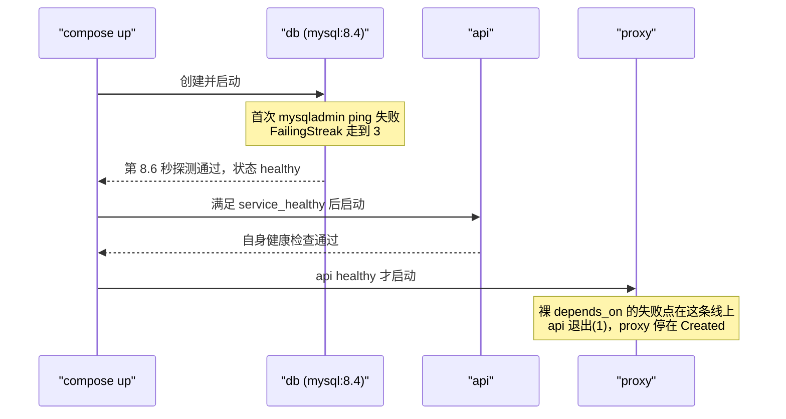

# 常用命令、启动顺序控制与健康检查

> up/down/ps/logs/exec/build 的真实语义与数据风险；depends_on 三种条件与健康检查优先级、探测命令集、start_period 怎么定。

---

LLMS 索引： [llms.txt](/llms.txt)

---

> **实战落点**：示例链第②段 · 一条命令起全栈（本篇负责「起起来之后怎么看清现场」，读数全部来自同一套 `示例/贯穿示例/` 栈）
> **示例版本**：需要 4.7~4.9 那三个 compose 文件；本篇不新产文件，只消费并验证它们的行为
> **前置依赖**：[/docs/04-单机编排/定义/Compose语法基线与文件全字段参考/](/docs/04-单机编排/定义/Compose语法基线与文件全字段参考/)、[/docs/02-核心操作/接上去/端口映射数据管理与权限时区/](/docs/02-核心操作/接上去/端口映射数据管理与权限时区/)、[/docs/00-导读/把环境搭好/环境准备/](/docs/00-导读/把环境搭好/环境准备/)
> **本篇产出物**：一张「命令 → 本机是否真跑过 → 读数」对照表；一条被证伪的写法（裸 `depends_on` 的失败日志与它的第二次假绿）；一套健康检查参数定法（含 MySQL 首次通过 8.6 秒的时间线）
> **拓展接口**：本篇的「健康门 + `--wait`」在 6.4 滚动更新里被推翻（换成就绪探针与流量摘除）；「`down -v` 删数据」在 7.2 症状索引里作为一条独立症状；「应用侧自己重连」这条在 6.6 CI 里被复用（CI 不用健康门，用一次性任务）
> **难度·耗时**：★★☆ · 50 分钟（含动手）
> **自测三题**：
> 1. `docker compose stop cache` 之后再改 `compose.yaml` 里 cache 的配置，`docker compose start cache` 会让改动生效吗？依据是什么？
> 2. `up` 报了 `dependency failed to start: container kb-p2-api-1 exited (1)`，此刻 `db` 容器是什么状态？
> 3. 同一个反面配置，第一次 `up` 失败、第二次 `up --wait` 全绿。这说明配置修好了吗？

## 为什么要先把命令分成四组，而不是背 `docker compose` 的参数表

一次真实的值班对话（场景是本地栈，不是生产，但错法一模一样）：

```text
「服务起不来，我 down 一下再 up。」
「等一下，你 down 有没有带 -v？」
「没有吧……带了会怎样？」
「数据没了。」
「那我改成 stop 再 start，总安全。」
「安全，但你刚才改了配置，stop/start 不会重建容器，改动不生效。」
「那 up 呢？up 会不会把我的库刷一遍？」
「不会，up 只做 diff。但它会不会重建，取决于配置有没有变——这个要会自己判断。」
「还有：它起不来到底是依赖没就绪，还是镜像构建失败？」
「看 ps 和 logs，别看心情。」
```

`docker compose` 有 30 个子命令，但新人真正需要的是先分清真意图：**看现场、改状态、动数据、动镜像**。这四组的后果等级不同，混用的代价就是上面那段对话。本篇把每一组里最常用、也最容易按错的那几条量清楚——每条都给本机读数，没跑过的会明确标出来。

> 💡 新人小结：**把 compose 想成「你对系统说的一句话」，而不是「一个终端里的按钮」**。`ps`/`logs`/`top` 是问，`up`/`stop`/`restart` 是要求改动，`down` 是拆，`down -v` 是拆完再倒垃圾，`build`/`pull`/`push` 是搬货。类比之后接机制：`up` 是幂等的「把实际状态收敛到文件声明的状态」，它自己决定要不要重建；`stop`/`start` 只动运行时状态，不重新计算配置差异——这就是「改了配置但 stop/start 不生效」的原因，下面第 4 节的表用端口读数把这条钉住。

## 命令族：30 条按用途分四组

下面的清单读自本机 `docker compose --help`（v5.5.1），「本轮」列标出这条命令在本次取数里**是否真的执行过**——没执行过的不给你编行为。

| 组 | 命令 | `--help` 里的一句话 | 本轮 |
|---|---|---|---|
| 看现场 | `ps` | List containers | 跑了 4 次，含 `--format` 与 `-a` |
| | `logs` | View output from containers | 跑了 3 次（`--tail`、`--timestamps`） |
| | `top` | Display the running processes | 跑了 |
| | `images` | List images used by the created containers | 跑了 |
| | `ls` | List running compose projects | 跑了 |
| | `port` | Print the public port for a port binding | 未跑 |
| | `stats` | Display a live stream of container(s) resource usage statistics | 未跑 |
| | `events` | Receive real time events from containers | 未跑 |
| | `config` | Parse, resolve and render compose file in canonical format | 跑了十几次，本篇主力 |
| 改状态 | `up` | Create and start containers | 跑了 6 次（冷/热/wait/no-recreate/force-recreate/scale） |
| | `start` / `stop` | Start / Stop services | 各跑了 2 次 |
| | `restart` | Restart service containers | 跑了 |
| | `kill` | Force stop service containers | 未跑 |
| | `pause` / `unpause` | Pause / Unpause services | 未跑 |
| | `rm` | Removes stopped service containers | 未跑 |
| | `create` | Creates containers for a service | 未跑 |
| | `run` | Run a one-off command on a service | 未跑 |
| | `exec` | Execute a command in a running container | 跑了 5 次 |
| | `attach` | Attach local standard input, output… | 未跑 |
| | `cp` | Copy files/folders between a service container and the local filesystem | 未跑 |
| | `wait` | Block until containers of all (or specified) services stop. | 未跑 |
| | `watch` | Watch build context for service and rebuild/refresh containers when files are updated | 跑了 2 次（两档） |
| 动数据 | `down` | Stop and remove containers, networks | 跑了 5 次（带与不带 profile、`-v`、`--remove-orphans`） |
| | `volumes` | List volumes | 跑了 1 次 |
| 动镜像 | `build` | Build or rebuild services | 跑了 2 次（缓存命中 / `--no-cache`） |
| | `pull` | Pull service images | 跑了 |
| | `push` / `publish` | Push service images / Publish compose application | 未跑 |
| | `commit` / `export` | Create a new image… / Export a service container's filesystem | 未跑 |
| 元命令 | `version` | Show the Docker Compose version information | 跑了 |
| | `bridge`（Management Command） | Convert compose files into another model | 未跑，用途未查 |

还有一条容易忽略的：`docker compose volumes`（**带 s**）。我按 `docker volume ls` 的直觉写了 `docker compose volume ls`，结果是用法帮助全文、`rc=1`：

```console
$ docker compose volume ls
Usage:  docker compose [OPTIONS] COMMAND
...
```

这条不是小事：脚本里如果只看「有没有打印出卷名」，一段用法帮助照样包含 `VOLUME` 字样，就会误判成成功。**命令报错时 rc≠0，要先看 rc**。

## `ps` 的四种读数与它们各自回答什么

同一套栈，`ps` 加不同参数回答的是不同问题。真实读数：

```console
$ docker compose ps
NAME            IMAGE               COMMAND                   SERVICE   CREATED          STATUS                    PORTS
kb-p2-api-1     kb-p2-api           "/usr/local/bin/api"      api       17 seconds ago   Up 5 seconds (healthy)    8080/tcp
kb-p2-cache-1   redis:7-alpine      "docker-entrypoint.s…"   cache     17 seconds ago   Up 16 seconds (healthy)   6379/tcp
kb-p2-db-1      mysql:8.4           "docker-entrypoint.s…"   db        17 seconds ago   Up 16 seconds (healthy)   127.0.0.1:3307->3306/tcp
kb-p2-proxy-1   nginx:1.27-alpine   "/docker-entrypoint.…"   proxy     16 seconds ago   Up Less than a second     0.0.0.0:8080->80/tcp, [::]:8080->80/tcp
kb-p2-web-1     kb-p2-web           "/docker-entrypoint.…"   web       17 seconds ago   Up 16 seconds             80/tcp
```

```console
$ docker compose ps --format "{{.Name}}\t{{.Service}}\t{{.Status}}\t{{.Health}}"
kb-p2-api-1     api     Up 6 seconds (healthy)        healthy
kb-p2-cache-1   cache   Up 16 seconds (healthy)       healthy
kb-p2-db-1      db      Up 16 seconds (healthy)       healthy
kb-p2-proxy-1   proxy   Up Less than a second
kb-p2-web-1     web     Up 16 seconds
```

| 想回答的问题 | 该看的列 | 读数里的陷阱 |
|---|---|---|
| 这个服务活着吗 | `State`（`running`/`exited`） | `Up Less than a second` 可能是刚被重建，不一定是第一次起 |
| 它「能用」吗 | `Health` | `Health` 空 = **没有健康检查**，不等于健康。上面 `proxy`/`web` 就是空，因为主干没给它们写 `healthcheck` |
| 端口到底落在宿主哪里 | `PORTS` | `0.0.0.0:8080->80/tcp` 与 `127.0.0.1:3307->3306/tcp` 暴露面不同（前者全网卡，后者只回环） |
| 它是不是我上次起的那个 | `CREATED` 对比 `STATUS` 里的 `Up` | `CREATED 17 seconds ago` + `Up 5 seconds` = 容器新建 17 秒、但进程只跑了 5 秒（重启过或是依赖后起的） |

`-a` 是把退出/未启动的也列出来，反面实验里全靠它：

```console
$ docker compose ps -a --format "{{.Name}}\t{{.Status}}"
kb-p2-api-1     Exited (1) 14 seconds ago
kb-p2-cache-1   Up 14 seconds (healthy)
kb-p2-db-1      Up 15 seconds (healthy)
kb-p2-proxy-1   Created
kb-p2-web-1     Up 15 seconds
```

`Created` 这一格值得停一下：`proxy` 从没启动过，因为它的 `depends_on` 里 `api` 需要 `service_healthy`，而 `api` 已经退出了。**依赖链的失败会往上冻结**，`ps -a` 是看清冻结边界的最快方法。

## `up` 的三个档位：改动什么时候才生效

用「`.env` 里把 `PROXY_PORT` 从 8080 改成 8085」这一件事当探针，同一个改动跑三种命令。判据不是「有没有报错」，而是 `docker inspect` 里的实际端口映射：

| 命令 | `proxy` 的宿主端口 | `Created` 时间戳 | `curl` 8085 |
|---|---|---|---|
| `up -d --no-recreate`（改了 `.env` 之后） | `8080` 不变 | 与改动前同一个 | `http=000`（连不上） |
| `up -d`（同一改动） | **`8085`** | 变新（日志里只有 `proxy` 出现 `Recreate`/`Recreated`） | `http=200` |
| `up -d --wait --force-recreate` | `8080`（已还原 `.env`） | 五个容器全部变新 | — |

三条读数说明三件事：

- **`--no-recreate` 是「只补缺，不改已有的」**。配置真的变了也不动现有容器，同时它仍然会跑健康等待（日志里出现 `Waiting`/`Healthy`）。用它来「避免重启我的长任务」是对的，但它不会告诉你「因此你的改动没生效」。
- **默认 `up` 做逐服务 diff**。只有 `proxy` 被重建，其余四个 `Running` 不动——这就是「改一个服务不要把整栈刷一遍」的机制依据，不是玄学。
- **`--force-recreate` 是「不管 diff 全部重建」**，代价实测：本机五个容器 `up -d --wait --force-recreate` 用时 **18.2 秒**，且重建严格按依赖顺序落地（`db`/`cache` 的 `StartedAt` 最早，`api` 晚 5.7 秒，`proxy` 最晚）。

`up` 的其它常用档位（读自 `up --help`，本轮未全部实测）：`--build`（起之前先构建）、`--abort-on-container-exit`（任一容器停止就停全部，与 `-d` 互斥）、`--exit-code-from <服务>`（把某个容器的退出码当命令退出码，隐含前者）、`--abort-on-container-failure`（只在失败退出时停）、`--always-recreate-deps`（连带重建依赖，与 `--no-recreate` 互斥）、`--attach` / `--attach-dependencies`（控制日志跟着打哪些服务）。

> [!warning]
> `up` 的退出码不等于「全栈可用」。带 `--wait` 时它等的是健康检查；不带 `--wait` 时它只要容器创建成功就可能返回 0。反过来，`--wait` 报 `rc=1` 也不一定是指令写坏了——下面「假绿」那节给了一条相反的例子。

## `down` 家族：`-v`、profile、`--rmi` 各自删了什么

`down` 的四个开关是正交的，混起来记就会出事。本机读数是：

| 写法 | 容器 | 网络 | 卷 | 读数摘要 |
|---|---|---|---|---|
| `down`（不带 `--profile`） | 只删模型里有的 `db`/`cache` | **删不掉** | 保留 | 用时 2.0 秒；`docker ps` 里 `api`/`web`/`proxy` 三个还在跑；日志出现 `Network kb-p2-net Resource is still in use` |
| `down --remove-orphans` | 按项目标签把全部容器删掉 | 删掉 | 保留 | 逐条 `Stopped`/`Removed`，末尾 `Network kb-p2-net Removed` |
| `down -v` | 同第一行（仍漏 profile） | 删不掉 | **删掉** | 用时 1.6 秒；`Volume kb-p2_dbdata Removed`；再 `up` 后 `ERROR 1146 … Table 'kbdemo.t_note' doesn't exist` |
| `down -v --rmi local` | 删 | 删 | 删 | 本轮只在一处收尾用过，效果由后续读数反证：那次实验（项目 `kbhcp`）构建出的 `kbhcp-s` 镜像在之后的 `docker images` 列表里不存在，而中间一步 `docker image prune -f --filter until=1h` 报的是 `Total reclaimed space: 0B`，所以不是被 prune 掉的 |

`--rmi` 的取值口径来自帮助文本（`local` 只删本项目构建出来的镜像，`all` 连 pulled 的镜像一起删）。`all` 这一档本轮没跑：拿 1.1 GB 的 `mysql:8.4` 做实验换回来的只是重拉时间，不值得。

> 💡 新人小结：**`down` 是退租，`-v` 是把家具扔掉，`--rmi` 是把搬家用的卡车也卖了，`--remove-orphans` 是「把这套房里所有还在住的人都请出去，不管合同上写没写名字」**。类比之后接机制：`--remove-orphans` 的依据是容器上的 `com.docker.compose.project` 标签，而 profile 只影响「本次命令的服务模型」，两者不是一回事——这就是「不带 profile 的 `down` 会漏容器，而带 `--remove-orphans` 就能收干净」的原因。

`docker compose ls` 是「这个 compose 项目现在被认为在跑什么」的账本，删干净之后它是空的：

```console
$ docker compose ls
 NAME                STATUS              CONFIG FILES
 kb-p2   running(5)  ...\compose.yaml,...\compose.override.yaml
```

`running(5)` 这个数还会告诉你 override 是否被自动合并（配置文件列了两个）。清理核对用的就是它。

## 空项目上的静默成功：判据要先检查前提

一组反面读数。项目里只有一个服务、但从未 `up` 过，逐条命令的结果：

```console
空项目 ps             rc=0  out='NAME      IMAGE     COMMAND   SERVICE   CREATED   STATUS    PORTS'
空项目 logs s         rc=0  out=''
空项目 stop           rc=0  out=''
空项目 restart s      rc=0  out=''
空项目 down           rc=0  out=''
```

五条全部 `rc=0`。也就是说：**「命令跑成功」在 compose 里几乎不提供信息量**，因为「没东西可操作」也是成功。脚本里写 `if docker compose ps; then echo OK`，会得到一个永远为真的分支。

对比之下，两类错误才是真的会红：

```console
$ docker compose logs --tail 1 nope
[rc=1] no such service: nope

$ docker compose volume ls
[rc=1] Usage:  docker compose [OPTIONS] COMMAND …
```

判据要写成「检查前置状态」而不是「检查命令返回值」。同一批取数里可用的两条硬判据是：`docker compose ps -a --format "{{.Status}}"` 的每一行都必须含 `healthy` 才算就绪；`up --wait` 之前先 `config --services` 确认服务数量符合预期。

## 启动顺序：三种依赖条件与它们的失败形状

`depends_on` 有两种书写形态，语义差别全在「等多久」。

**列表形态**（很多人以为它「等就绪」）：

```yaml
depends_on: [db, cache]
```

`config` 把它规范化成下面这样——这是理解全部后续现象的钥匙：

```json
"depends_on": {
  "cache": {"condition": "service_started", "required": true},
  "db":    {"condition": "service_started", "required": true}
}
```

`service_started` 只看**容器进程起没起**，不看服务能不能干活。本机把应用改成「依赖没就绪就主动退出」的样子（`STRICT=1`），跑出来的失败形状是：

```console
$ docker compose -f compose.yaml -f compose.badstart.yaml --profile app up -d
[rc=1] 用时 1.5 秒
 Container kb-p2-api-1 Started
 Container kb-p2-api-1 Waiting
 Container kb-p2-api-1 Error dependency api failed to start
dependency failed to start: container kb-p2-api-1 exited (1)

$ docker compose logs --timestamps api
api-1  | 2026-10-27T03:57:41.947697228Z 依赖未就绪，按 STRICT=1 退出： dial tcp 172.18.0.3:3306: connect: connection refused
```

那行日志是本篇最重要的一条读数：`172.18.0.3` 说明**服务名已经解析到 IP 了**（DNS 是通的），`connection refused` 说明 MySQL 还没开始监听。`service_started` 给的正是「容器起了但端口没开」这个中间态。

**健康门形态**（本篇示例用的就是这个）：

```yaml
depends_on:
  db: { condition: service_healthy }
  cache: { condition: service_healthy }
```

`up` 会等 `db` 的 `mysqladmin ping` 第一次成功再起 `api`。健康检查细节见下一节，这里关心顺序证据本身。

**一次性任务形态**（做迁移脚本用的）：

```yaml
depends_on:
  init: { condition: service_completed_successfully }
```

本机跑出来 `init` 先 `Exited`、`app` 才 `Started`，`up` 返回 0，`app` 确实读到了 `init` 写进共享卷的文件：

```console
 Container kbinit-init-1 Started
 Container kbinit-init-1 Waiting
 Container kbinit-init-1 Exited
 Container kbinit-app-1 Starting
 Container kbinit-app-1 Started
```

再加一个可选依赖的写法，失败也不挡路：

```yaml
depends_on:
  opt: { condition: service_completed_successfully, required: false }
```

```console
 Container kbreq-opt-1 Skipped: optional dependency "opt" didn't complete successfully: exit 3
time="…" level=warning msg="optional dependency \"opt\" didn't complete successfully: exit 3"
 Container kbreq-main-1 Starting
 Container kbreq-main-1 Started
```

`rc=0`，但有一行 warning。**`required: false` 是把「依赖失败」降级成「警告」**，用在「有更好、没有也能跑」的东西上（比如埋点、可选缓存）。用它就必须同时把 warning 打到人眼里，否则静默降级会变成第二天才发现的问题。

三种条件的取舍：

> 💡 新人小结：**`service_started` 像「人已经坐到工位上了」，`service_healthy` 像「人坐在工位上并且能接电话」，`service_completed_successfully` 像「开班前那次晨会必须开完，店才开始接客」**。类比之后接机制：Docker 只知道「容器进程在不在」，「能不能接电话」必须有人去问——那个「问」就是 `healthcheck.test` 里的探测命令；问不出来（探测失败）时，compose 有的参数（`condition`）会拒绝放行下游，有的参数（`required: false`）只留一行警告。所以「等不等得到」不是 compose 聪明，是**你写的探测命令真的能区分就绪与未就绪**。

| 方案 | 什么时候用 | 优点 | 代价 | 本轮证据 |
|---|---|---|---|---|
| `service_healthy` + 健康检查 | 依赖会「起了但没就绪」（数据库、缓存） | 顺序由工具保证，应用代码不用改 | 每个依赖都要写对探测命令，`start_period` 要给够；启动时间变长 | 冷启动 18.4 秒里等健康占了大头 |
| `service_started`（裸列表） | 依赖是「进程在就是可用」（静态站点） | 起得快 | 对数据库类依赖就是错误的期望 | 反面实验：`connection refused` |
| 应用侧自己重试/重连 | 生产更常用；或依赖不该阻塞启动 | 与编排解耦，恢复能力最强 | 要写代码，且必须有连接超时（否则卡死） | 实测：停 `db` → `api` 仍 `healthy` 且 `StartedAt` 不变，`{"db":"DOWN"}`；起回 `db` → 5 秒内 `{"db":"UP"}`，全程没重启 `api` |
| `service_completed_successfully` | 迁移/初始化脚本 | 表达「必须先跑完一件事」 | 一次性容器要自己退出，`restart` 策略别写 `always` | 上面 `kbinit` 的读数 |

### 同一个坏配置，第一次红、第二次绿

这是本轮最值得记住的一条。反面配置（`STRICT=1` + 裸 `depends_on`）第一次 `up` 失败之后，**什么都不改**再跑一次并加 `--wait`：

```console
$ docker compose -f compose.yaml -f compose.badstart.yaml --profile app up -d --wait
[rc=0]
 Container kb-p2-api-1 Started
 Container kb-p2-api-1 Waiting
 Container kb-p2-api-1 Healthy
 Container kb-p2-proxy-1 Starting
 Container kb-p2-proxy-1 Started
 …（全部 Healthy）
```

`rc=0`，全绿。**但配置仍然是错的**：第二次跑时 `db` 容器已经在上一轮失败里起了、并且已经初始化完（MySQL 首次探测通过要 8.6 秒，见下一节），`api` 起来时端口自然就通。`service_started` 的语义没变，变的是运气。

所以：**验证一个「顺序类修复」是否真的有效，要先 `down` 到干净状态**（保留卷可以，但所有容器都要重建），否则你测的是热缓存。第②段判据里那条「冷启动 18.4 秒 vs 热启动 7.1 秒」的差值，正好就是这个陷阱的量。



## 健康检查：两种写法、优先级与参数怎么定

写在哪里有两处，行为不同。本机用一个镜像自带 `HEALTHCHECK`、compose 又写了一份的服务量了优先级：

```dockerfile
HEALTHCHECK --interval=7s CMD ["/bin/dockercmd"]
```

```yaml
    healthcheck:
      test: ["CMD", "/bin/dockercmd", "--from-compose"]
      interval: 3s
```

运行时生效的是 compose 那份：

```console
$ docker inspect --format "{{json .Config.Healthcheck.Test}} | {{json .Config.Healthcheck.Interval}} | {{.State.Health.Status}}" kbhcp-s-1
["CMD","/bin/dockercmd","--from-compose"] | 3000000000 | healthy

$ docker image inspect --format "{{json .Config.Healthcheck}}" kbhcp-s
{"Test":["CMD","/bin/dockercmd"],"Interval":7000000000}
```

镜像里那份 7 秒的 `HEALTHCHECK` 仍然存在，只是被容器配置覆盖。三条边界要记住：

| 写法 | 结果 | 读数 |
|---|---|---|
| compose 写完整 `healthcheck` | 覆盖镜像的 | 上面那组 |
| compose 不写 | 用镜像自带的 | `adminer:4` 我没写健康检查，`up --wait` 里它是 `Healthy` |
| `healthcheck: {disable: true}` | 彻底关掉 | `inspect` 得到 `{"Test":["NONE"]}`，`.State.Health` 是 `null` |
| `healthcheck: {test: []}` | **不是**「永远失败」，是「没有检查」 | `config` 出来 `healthcheck={}`，`inspect` 的 `.Config.Healthcheck={}`、`.State.Health=null`；`ps` 的 `Health` 列是空 |

第四行容易读错：`test: []` 不报错、也不会让 `--wait` 失败，它只是让这一格变成「没有健康检查」。于是 `depends_on: {condition: service_healthy}` 会直接失败（没有检查就永远不可能 healthy），这是 7.2 里值得单列的一条症状。

### 探测命令集（本机跑过的）

| 目标 | 命令 | 本轮 |
|---|---|---|
| MySQL | `["CMD", "mysqladmin", "ping", "-h", "127.0.0.1", "-uroot", "-p${PW}"]` | 跑过，成功输出 `mysqld is alive` |
| Redis | `["CMD", "redis-cli", "ping"]` | 跑过 |
| HTTP 服务 | `["CMD", "wget", "-q", "-O", "-", "http://127.0.0.1:8080/api/health"]` | 跑过（alpine 自带 busybox wget，scratch 里没有） |
| PostgreSQL | `["CMD-SHELL", "pg_isready -U ${POSTGRES_USER}"]` | 本轮未跑（栈里没有 PG） |
| 只看进程活着 | `["CMD", "true"]` | 未跑，等价于「几乎不检查」，别在生产用 |

### `start_period` / `interval` / `retries` 怎么定

不要拍数字，量一次时间线。本机用一个不设 `start_period` 的 MySQL，`interval: 2s`，每 0.5 秒轮询一次 `docker inspect` 得到：

| 相对时刻 | `Health.Status` / `FailingStreak` |
|---|---|
| 0.4 秒 | `starting` / 0 |
| 2.6 秒 | `starting` / 1 |
| 4.8 秒 | `starting` / 2 |
| 7.0 秒 | `starting` / 3 |
| 8.6 秒 | `healthy` / 0 |

失败探测的输出长这样（`inspect .State.Health.Log` 的最后一条 `ExitCode` 已经是 0）：

```text
error: 'Can't connect to MySQL server on '127.0.0.1:3306' (111)'
Check that mysqld is running on 127.0.0.1 and that the port is 3306.
```

于是三条参数规则是实测推出来的，不是抄的：

- **`retries × interval` 必须大于「冷启动到真的能服务」的时间**，否则容器会被判 `unhealthy`。本机 MySQL 空库初始化到第一次 ping 通约 8.6 秒；示例里给的是 `interval: 5s, retries: 20` = 100 秒预算，够容纳带数据的恢复。
- **`start_period` 的用途是「这段时间内失败不计入 retries」**。示例给 MySQL `start_period: 20s`，是 8.6 秒的两倍余量；给 `api` 的是 `5s`，因为它只是起一个 Go 进程（本机实测起监听在 1 秒内）。
- **`timeout` 要小于 `interval`**，否则探测会叠加。示例是 `timeout: 3s / interval: 5s`。

永远失败的探测会怎样？本机用 `test: ["CMD", "false"]`、`interval: 2s`、`retries: 3` 量到：

```console
$ docker compose up -d --wait
[rc=1]
 Container kbbad-s-1 Started
 Container kbbad-s-1 Waiting
container kbbad-s-1 is unhealthy

$ docker inspect --format "{{.State.Status}} | {{json .State.Health}}" kbbad-s-1
running | {"Status":"unhealthy","FailingStreak":3,"Log":[ … 三条 ExitCode:1 … ]}
```

三个信息点：**容器一直是 `running`**（健康检查不会杀容器）、`--wait` 会失败并给出 `container <name> is unhealthy`、`Health.Log` 里保留最近三次探测的 `ExitCode` 与输出——排错时这是最短路径。杀容器是 `autoheal` 或编排系统的事，Docker 本身不做。

### 别把口令写进健康检查命令

`mysqladmin ping -p${PW}` 这种写法会被 compose 在加载阶段插值成明文，然后**跟着容器配置走**。本机对照量了两种写法：

| 写法 | `config` 输出里的 `healthcheck.test` | 含明文？ | `docker inspect` 里含明文？ |
|---|---|---|---|
| `-p${PW}` | `… -uroot -psecret-in-env` | 是 | 是 |
| `-p$$MYSQL_ROOT_PASSWORD` | `… -uroot -p$$MYSQL_ROOT_PASSWORD` | 否 | 是（`.Config.Env` 里那条 `MYSQL_ROOT_PASSWORD=secret-in-env` 还是明文） |
| 运行时容器里的实际命令 | — | — | 转义写法是 `-p$MYSQL_ROOT_PASSWORD`，由容器内 shell 展开 |

结论要精确：**`$$` 转义只把明文从 `config` 输出（CI 日志、`docker compose config` 存档）里拿掉，挡不住 `docker inspect`**。两种写法容器都能正常 `healthy`（本机各 11 秒）。真要不外泄，得让口令别出现在容器配置里——那是 6.3（secrets 与配置注入）的事，本篇只给判据：`docker inspect --format "{{json .Config.Healthcheck}}"` 与 `{{json .Config.Env}}` 两条命令都要跑，只看前者会漏。

## `--scale` 与健康门能不能共存

这是「起两个 api 会不会把依赖链搞坏」的实测。`docker compose --profile app up -d --scale api=2`：

```console
[rc=0]
 Container kb-p2-api-2 Creating
 Container kb-p2-api-2 Started
 Container kb-p2-api-2 Healthy
 Container kb-p2-api-1 Healthy

$ docker ps --filter label=com.docker.compose.service=api --format "{{.Names}} {{.Status}}"
kb-p2-api-2 Up 5 seconds (healthy) | kb-p2-api-1 Up 11 seconds (healthy)

$ curl -s http://127.0.0.1:8080/api/health
{"status":"UP","db":"UP","cache":"UP"}|http=200
```

`proxy` 仍然 200，因为 nginx 的 `proxy_pass http://api:8080` 走 Docker 内置 DNS，多副本时它自己会轮询解析到的多个 IP（机制，本轮未用两条不同响应体区分两个副本，所以「真的轮询到两个」这条没量到）。scale 的硬约束在别处：**有 `container_name`、或把宿主端口写死（没有 `-` 区间）的服务不能 scale**——本轮没造出这两个反例，标在本篇未验证项里。

## 实战切入：把这套命令当成体检单

这一段可以照着敲，每条都给「本机读数」作为预期值。用栈是 `示例/贯穿示例/`，先 `docker compose --profile app up -d --wait`。

| 步 | 命令 | 本机读数 | 判什么 |
|---|---|---|---|
| 1 | `docker compose config --services` | `cache`、`db` 两行（不带 profile） | 模型规模对不对，profile 有没有用反 |
| 2 | `docker compose --profile app config --services` | 五行：`cache db api web proxy` | 五个服务都在 |
| 3 | `docker compose --profile app up -d --wait` | 冷 18.4 秒 / 热 7.1 秒 | 依赖链能不能自己收敛 |
| 4 | `docker compose ps --format "{{.Service}} {{.Health}}"` | `api healthy`、`cache healthy`、`db healthy`、`proxy`（空）、`web`（空） | 空的格子是「没写检查」而不是「健康」 |
| 5 | `docker inspect --format "{{json .State.Health}}" kb-p2-db-1` | 最后一组探测 `ExitCode:0`，输出含 `mysqld is alive` | 探测命令真的在容器里跑通 |
| 6 | `curl -s http://127.0.0.1:8080/api/health` | `{"status":"UP","db":"UP","cache":"UP"}` | 经入口的端到端可用 |
| 7 | `docker compose stop db` 后重复第 6 步 | `{"status":"UP","db":"DOWN","cache":"UP"}`，`api` 未重启 | 应用侧是否有重连；爆炸半径 |
| 8 | `docker compose start db`，等 5 秒重复第 6 步 | `{"db":"UP"}`，`api` 的 `StartedAt` 不变 | 恢复不需要重启上游 |
| 9 | `docker compose down` 后 `docker ps --format "{{.Names}}"` | 仍列出 `api`/`web`/`proxy` | profile 陷阱是否被理解 |
| 10 | `docker compose --profile app down --remove-orphans` 后 `docker compose ls` | 空 | 项目账本干净 |

第 9、10 步是本篇的命令视角判据：**能解释第 9 步为什么漏，才算会用 `down`**。

## 常见误读

| 误读 | 实际 |
|---|---|
| 「`rc=0` 说明服务可用」 | 空项目上 `ps`/`logs`/`stop`/`down` 全 `rc=0`。可用要由 `--wait` + 健康检查 + 一次真实请求三件事共同保证 |
| 「`depends_on` 会等数据库就绪」 | 列表形态等于 `service_started`，等的是「进程起了」。日志里那句 `connection refused` 就是证据 |
| 「健康检查失败容器会被杀掉」 | `unhealthy` 只是状态标签，容器仍 `running`；杀掉要外部机制 |
| 「`test: []` 是让检查永远失败」 | 它是「没有检查」，`Health` 列为空，并且会让依赖它的 `service_healthy` 永远不满足 |
| 「`stop` 之后 `start` 会应用配置改动」 | 不重建容器就不重算配置。要改动生效用 `up -d`（逐服务 diff）或 `--force-recreate` |
| 「`--no-recreate` 是安全模式」 | 它只是不重建，不告诉你「因此改动没生效」 |
| 「`-v` 是更彻底的清理」 | `-v` 删 named volume，即数据。它的回执可能就是那条 `ERROR 1146` |
| 「Dockerfile 里的 HEALTHCHECK 优先」 | compose 写就覆盖镜像写；compose 不写才用镜像的 |
| 「`$$` 转义能防口令泄漏」 | 只防住 `config` 输出与日志落盘，`docker inspect` 的 `Env` 仍然明文 |
| 「第二次 `up` 绿了就是修好了」 | 本轮同一条坏配置第二次全绿，因为依赖已经热了。验证顺序修复要从干净状态起 |

## 要点总结

- 30 个子命令先分四组：看现场（`ps`/`logs`/`top`/`images`/`config`）、改状态（`up`/`stop`/`start`/`restart`/`exec`/`watch`）、动数据（`down`/`volumes`）、动镜像（`build`/`pull`）。后果等级不同，别混着记。
- `up` 做逐服务 diff：改 `.env` 端口只有 `proxy` 被重建；`--no-recreate` 让改动不生效但照样报 0；`--force-recreate` 本机 18.2 秒重建五容器并按依赖顺序落地。
- `down` 的三个开关正交：profile 决定作用范围、`-v` 删数据、`--remove-orphans` 按标签兜底。不带 profile 的 `down` 本机实测漏掉三个容器且网络删不掉（`Resource is still in use`）。
- 顺序控制的真相在 `config` 的规范化输出里：列表 = `service_started`，`condition: service_healthy` = 等探测通过，`service_completed_successfully` = 等一次性容器成功退出，`required: false` = 降级成警告。
- 反面实验给出两条：`service_started` 下应用会撞到 `connection refused`；同一条坏配置第二次 `up --wait` 全绿，说明**顺序类验证必须从干净状态起**。
- 健康检查：compose 覆盖镜像；`disable: true` → `{"Test":["NONE"]}`；`test: []` → 没有检查；探测失败只标 `unhealthy` 不杀容器；`retries × interval` 要大于冷启动时间，本机 MySQL 的实测是 8.6 秒首次通过（3 次失败探测）。
- 口令写进 `healthcheck` 会同时进 `config` 输出和容器配置；`$$` 转义只解决前者。查泄漏要 `Config.Healthcheck` 与 `Config.Env` 两条 `inspect` 都跑。
- `--scale api=2` 与健康门共存（本机两个副本都 `healthy`，入口仍 200）。

## 本篇未验证项

| 项 | 状态 | 说明 |
|---|---|---|
| `logs --follow` 的实时行为 | 未实测 | 只取到帮助文本（`-f, --follow`、`--since`、`--until`、`--no-log-prefix`、`--index`）；长会话在本轮会留下子进程句柄问题，值得单独跑 |
| `run` / `create` / `rm` / `cp` / `port` / `stats` / `kill` / `pause` | 未实测 | 清单里那张「本轮」列是命令族的全集，逐项标了跑过没有 |
| `down --rmi all` | 未跑 | 会删掉 1.1 GB 的 `mysql:8.4`，代价只是重拉时间，不值得用来换一个 already-known 的结论 |
| scale 的两个硬约束（`container_name`、写死宿主端口） | 未实测 | 机制结论，本轮没造反例；下一批补 |
| nginx 多副本是否真的轮询到两个 api | 未实测 | 需要让两个副本返回可区分内容，本轮的占位服务返回同一份 JSON |
| `service_healthy` 在被依赖方**没有**检查时的报错文本 | 未实测 | 只从 `test: []` 的读数推出「不可能满足」，没跑那条命令 |

---

反链：

- [多环境与扩展、开发期热重载与完整实战](/docs/04-%E5%8D%95%E6%9C%BA%E7%BC%96%E6%8E%92/%E6%97%A5%E5%B8%B8/%E5%A4%9A%E7%8E%AF%E5%A2%83%E7%83%AD%E9%87%8D%E8%BD%BD%E4%B8%8E%E4%BA%94%E6%9C%8D%E5%8A%A1%E5%AE%8C%E6%95%B4%E5%AE%9E%E6%88%98/)
