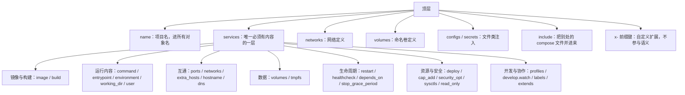

# 为什么需要 Compose、语法基线与文件全字段参考

> 从九参数的 docker run 到一份 compose.yaml；compose-spec 与已废弃字段、旧教程辨识、services 与顶层字段的逐条实测。

---

LLMS 索引： [llms.txt](/llms.txt)

---

> **实战落点**：示例链第②段 · 一条命令起全栈（本篇负责「第②段那份文件凭什么长这样」，为 4.7~4.9 的动手准备好语法基线）
> **示例版本**：消费 `示例/贯穿示例/compose.yaml`（本篇不产出文件，但每一条字段读数的来源都是它）；本篇的判据实验另外用了 10 份一次性最小样本，写在正文里可直接复制
> **前置依赖**：[/docs/02-核心操作/接上去/端口映射数据管理与权限时区/](/docs/02-核心操作/接上去/端口映射数据管理与权限时区/)、[/docs/02-核心操作/跑起来/镜像管理与容器生命周期/](/docs/02-核心操作/跑起来/镜像管理与容器生命周期/)、[/docs/00-导读/把环境搭好/环境准备/](/docs/00-导读/把环境搭好/环境准备/)
> **本篇产出物**：团队语法基线的一句话结论（并要求在 7.11 落地为唯一事实来源）；一张「哪些写错法会被 `config` 拦住、哪些不会」的实测表；一张 services 字段速查表，逐列标出本机是否验证过
> **拓展接口**：本篇的「`config` 是唯一的真相来源」这条判据在 4.7 多文件合并与 6.6 CI 里被反复复用；「已废弃 `version:` 字段」在 8.6 版本兼容矩阵里作为一条独立条目；「中文目录名导致项目名为空」在 7.2 症状索引里单列
> **难度·耗时**：★☆☆ · 40 分钟（读 + 三条动手判据）
> **自测三题**：
> 1. 为什么 `docker compose config` 输出的模型和你写进文件的内容不完全一样？举两个具体字段。
> 2. `version: "3.8"` 这一行现在会被拒绝吗？依据是什么？旧教程里还有哪三行属于同一类？
> 3. 一份文件放在中文目录里、没写 `name:`，报什么错？为什么？

## 为什么一条 `docker run` 到九个参数就撑不住了

第二篇里那条把 redis 跑起来的命令，是**单服务**的极限形态：

```console
$ docker run -d --name m-p1 -p 6380:6379 \
    -v mdata:/data --memory 512m --tz Asia/Shanghai \
    --health-cmd "redis-cli ping" --health-interval 5s \
    --health-retries 5 --health-start-period 20s \
    redis:7-alpine redis-server --appendonly yes
```

现在把第②段那个栈（web + api + MySQL + Redis + nginx 反向代理）用同样的方式写出来。下面是按 `compose.yaml` 逐条推出来的等价展开，**不是实测输出**——它是为了说明规模，行为判据都由后面的 compose 实测给出：

```bash
docker network create kb-p2-net
docker volume create kb-p2_dbdata
docker volume create kb-p2_cachedata

docker run -d --name db    --network kb-p2-net -v kb-p2_dbdata:/var/lib/mysql \
  -e MYSQL_ROOT_PASSWORD=… -e MYSQL_DATABASE=kbdemo \
  --health-cmd '…' --health-interval 5s --health-timeout 3s --health-retries 20 --health-start-period 20s \
  mysql:8.4
docker run -d --name cache --network kb-p2-net -v kb-p2_cachedata:/data \
  --health-cmd 'redis-cli ping' --health-interval 5s --health-timeout 2s --health-retries 10 \
  redis:7-alpine redis-server --appendonly yes
docker build -t kb-p2-api ./api
docker run -d --name api --network kb-p2-net -e DB_HOST=db -e REDIS_HOST=cache \
  --health-cmd '…' … kb-p2-api                     # ← 必须先等 db healthy，顺序得自己控
docker build -t kb-p2-web ./web
docker run -d --name web --network kb-p2-web kb-p2-web
docker run -d --name proxy --network kb-p2-net -p 8080:80 \
  -v $(pwd)/proxy/nginx.conf:/etc/nginx/conf.d/default.conf:ro \
  --depends-on api=healthy                          # ← 这条参数在 docker run 里并不存在
nginx:1.27-alpine
```

三个问题立刻出现：**顺序要人控**（`docker run` 没有「等依赖 healthy」这个参数）、**名字要人对**（网络别名、卷名前缀散在每条命令里）、**改一次要重放全部**（改个环境变量得记住它是第几条 run 的参数）。

Compose 换掉的正是这个方向：你写下**期望状态**，工具负责把它和实际状态做差集并收敛。这不是修辞——`up` 的行为在本机量过：改了 `.env` 里的端口再 `up -d`，只有那一个服务被 `Recreate`，其余四个报 `Running`（读数在 4.4/4.5 那篇）。

```mermaid
flowchart TB
    sub IMP["命令式：docker run"]
        R1["第 1 步：建网络"] --> R2["第 2 步：建卷"]
        R2 --> R3["第 3 步：起 db"]
        R3 --> R4["第 4 步：人肉确认 db 可用"]
        R4 --> R5["第 5 步：起 api"]
        R5 --> R6["第 6 步：改一个参数，从头重放"]
    end
    sub DEC["声明式：compose.yaml"]
        F1["一份文件写下期望状态"] --> F2["up：计算差集"]
        F2 --> F3["只动需要动的对象"]
        F3 --> F4["再 up 一次：几乎什么都不做"]
    end
    IMP -.->|"顺序、命名、重放都交给人"| HUMAN["人脑记账"]
    DEC -.->|"三项都交给模型"| TOOL["compose 的收敛循环"]
```

> 💡 新人小结：**`docker run` 是「每次开工前手动按十二个按钮」，`compose.yaml` 是「把工序单贴在机器上」**。按钮按错顺序，机器不启动但也不会告诉你为什么；工序单交给机器之后，机器自己按顺序按，而且每次开工前先对比「现在是不是已经按到位了」。类比之后接机制：工序单就是那份 YAML 描述的**期望模型**，按钮顺序是它的**依赖图**，对比动作是 `up` 的 diff——所以下面所有语法问题都可以还原成一句：「模型里这个字段声明的是什么，实际对象现在是什么」。

## 语法基线：三个名字、两种调用、一条已废弃字段

先把容易混的三个名词钉住：

| 名词 | 是什么 | 本机读数 |
|---|---|---|
| **compose-spec** | 文件格式的规范（一套 YAML 字段的定义与合并语义），语言无关 | 下面所有「字段能不能写、写错报什么」的行为都来自它的校验器 |
| **Docker Compose v2**（`docker compose`） | 规范的 Go 实现，作为 Docker CLI 插件 | `Docker Compose version v5.5.1` |
| **`docker-compose`（连字符）** | 老的 Python 实现的名字；现在这台机器上它指的是**同一个** v2 实现 | `where docker-compose` 指到 Docker Desktop 的 `resources\bin\docker-compose.exe`，`docker-compose version` 报的仍是 `Docker Compose version v5.5.1` |

这条读数很重要，因为它否定了一种常见的「新旧判断法」：**不要看到 `docker-compose` 这个写法就断定对方在用 v1**——在同一台机器上这两个名字可能指向同一个二进制。要判断实现与版本，只看 `version` 输出的字符串。

`version:` 顶层字段的现状是本机实测的：

```console
$ docker compose config --quiet           # 文件第一行写的是 version: "3.8"
[rc=0]
level=warning msg="…\compose.yaml: the attribute `version` is obsolete,
it will be ignored, please remove it to avoid potential confusion"
```

**不报错，只警告，并且明确说「会被忽略」**。所以旧教程里那行 `version: '3.7'` 拷过来照样能跑，但它已经不再选择任何语法版本——字段校验用的是当前实现自带的那一份 schema。这就是为什么「按 `version` 行判断这段配置属于哪个年代」这件事已经失效。

> 💡 新人小结：顶层那行 `version: "3.8"` 现在像**老地图上印的「1998 年测量」**——地图你照样能看，但那行字已经不决定地图画的是什么了；真正决定内容的是你手上这一版地图本身。类比之后接机制：决定「哪些字段合法」的是这台机器上 Compose 实现自带的那份 schema，`config` 只会告诉你「这一行我忽略了」，不会替你切回 3.8 的语义。所以判断一段配置新旧，要看**字段级信号**（有没有 `links`、`volumes_from`、`test: []` 这类），不是那行印章。

旧教程的辨识改看这几条信号，每条都给出「现在该怎么写」：

| 看到 | 大致年代/来源 | 现在的写法 | 依据 |
|---|---|---|---|
| 顶层 `version:` | v1 时代或早期 v2 | 删掉 | 本机 warning 原文 |
| `docker-compose up`（文档里的命令） | 可能是 v1，也可能只是旧写法 | 用 `docker compose`，并在同一台机器上核 `version` 字符串 | 上面那条 `where` 读数 |
| `links:` 字段、`--link` | bridge 默认网络时代的容器互通 | `networks:` + 服务名解析 | 第①段实测：自定义网络里服务名直接可解析 |
| `network_mode: default` | 旧文档里的「默认网络」写法 | 省略或用 `networks: [default]` | 本机未跑，属语法层提示 |
| `volumes_from:` | 用数据卷容器共享数据的旧模式 | 各自声明 named volume | 本轮卷读数 |
| `swarm` 专属的 `deploy.placement`/`update_config` 用在单机 compose | swarm 时代 | 单机上多半被忽略，要按实现确认 | 本轮未实测，见未验证项 |

**团队语法基线一句话结论**（这条要在 7.11 团队规范里落地成唯一事实来源，其它章节只链接不复述）：

> 统一用 `docker compose`（v2 实现）；文件名统一 `compose.yaml`，开发期覆盖写 `compose.override.yaml`；**不写顶层 `version:`**；顶层显式写 `name:`；口令一类的值一律走 `.env` 或注入，不进文件。

> [!note]
> 为什么必须写 `name:`：项目名会进容器名、网络名、卷名。Compose 用「第一个指定文件所在目录的**基本名**」当默认项目名，并把非法字符过滤掉。本机实测：把同样的文件放进一个中文命名的目录，`config` 直接失败——

```console
$ docker compose config --quiet      # 目录名是中文，文件里没有 name:
[rc=1] project name must not be empty

$ docker compose config --quiet      # 内容一字不改，只把目录换成 ASCII 名
[rc=0]
```

这条不是抽象风险：团队的仓库路径里出现「文档」「项目」这类中文目录名是常态，而报错文本 `project name must not be empty` 完全不提示「是目录名导致的」，新人会去查 YAML 语法。

## 一个 `compose.yaml` 分几层



`x-` 前缀与 `include` 是本机能确认「确实支持」的两条：

```console
# 顶层写 x-团队约定: &team {labels: {team: platform}}，服务里用 <<: *team
[rc=0]  services.a.labels = {"team": "platform"}
        config --format json 的顶层键 = ['name', 'networks', 'services', 'x-团队约定']
```

顶层键里 `x-团队约定` **被保留下来**，说明它是「合法但不参与语义」的容器；YAML 锚点（`&team` / `*team` / `<<:`）也照常生效。这两条组合起来就是团队里最常用的复用手法：用 `x-` 放一份「约定」，服务用锚点合并它（比如统一的 `labels`、`restart`、日志驱动）。

另外两条同样跑通的复用手段，语义差别要说清：

```console
# extends：从同目录另一个文件里的服务继承
[rc=0]  web = {"environment":{"EXTRA":"1","FROM":"override"},"image":"nginx:1.27-alpine", …}

# include：另一个文件整个并进当前项目
[rc=0]  config --services → inc-a main
```

`extends` 是**服务级继承**（继承来的字段与本地字段按同一套合并规则叠，上例里 `FROM` 被本地值 `override` 覆盖、`EXTRA` 新增、`image` 继承）；`include` 是**文件级并入**（那个文件里的服务、网络、卷都进当前模型）。选哪个的判断标准是「要不要改一部分」：要改就用 `extends`，只是拆分文件就用 `include`。

## services 字段速查（逐列标注本机是否验证）

这张表是 4.3 的产出物。「本机读数」列只填真跑出来的值，没跑的写「未跑」——不猜。

| 字段 | 一句话 | 本机读数 / 未跑说明 |
|---|---|---|
| `image` | 用哪个镜像 | `redis:7-alpine`、`mysql:8.4` 直接进模型；`docker compose images` 列出 `IMAGE ID` 与 `SIZE`（`mysql:8.4` 为 `1.1GB`） |
| `build` | 从 Dockerfile 构建 | 规范化成绝对路径的 `context` + `dockerfile`；产出镜像默认名 `kb-p2-api`（项目名-服务名），`25.6MB` |
| `command` / `entrypoint` | 覆盖镜像的启动命令 | 多文件合并时**整体替换**（不是追加） |
| `environment` | 环境变量（map 或 list 写法） | 合并结果 `{"DB_HOST":"db","LOG_LEVEL":"debug","REDIS_HOST":"cache"}`，同键后写胜 |
| `env_file` | 从文件注入环境 | 未跑（本轮只用 `.env` + 插值） |
| `ports` | 宿主端口映射 | 长写法规范化为 `{"mode":"ingress","host_ip":"127.0.0.1","target":3306,"published":"3307","protocol":"tcp"}`；`"99999-80"` 这种写不完整的区间报 `invalid containerPort: 99999-80` |
| `expose` | 只声明不外发 | 未跑 |
| `volumes` | 挂载 | 短写法 `dbdata:/var/lib/mysql` 变 `{"type":"volume","source":"dbdata","target":"/var/lib/mysql"}`；单段写法 `/tmp/x` **合法**（匿名卷，不报错） |
| `tmpfs` | 内存盘 | 未跑（第①篇量过容器内 `tmpfs` 是 `noexec`） |
| `networks` | 接哪些网络 | 列表写法 `[n1]` 与 override 的 `[n2]` 合并成**并集** `{"n1":null,"n2":null}` |
| `network_mode` | 单网络简写（`host`/`none`/`bridge`） | 未跑；与 `networks` 互斥 |
| `hostname` / `extra_hosts` / `dns` | 容器名与解析 | 未跑；内置 DNS 是 `127.0.0.11`（第②篇读数） |
| `depends_on` | 启动依赖 | 见 4.5：列表形态规范化成 `condition: service_started`，循环依赖报 `dependency cycle detected: a -> b -> a` |
| `healthcheck` | 就绪探测 | 见 4.6：compose 写就覆盖镜像；`disable: true` → `{"Test":["NONE"]}`；`test: []` → `healthcheck={}` |
| `restart` | 重启策略 | `restart: maybe` 被 `config` 放过（rc=0），到运行时才由 daemon 拒绝：`invalid restart policy: unknown policy 'maybe'; use one of 'no', 'always', 'on-failure', or 'unless-stopped'` |
| `profiles` | 哪些命令带上这个服务 | 不带 `--profile app` 时 `config --services` 只有 `cache db` |
| `develop.watch` | 开发期热重载 | 规范化成 `{"action":"sync+restart","path":…,"target":"/usr/share/nginx/html/index.html","exec":{"command":null}}`；三档代价见 4.8 |
| `labels` | 打标签 | 锚点合并可用（见上一节）；`com.docker.compose.*` 是 compose 自己的账本 |
| `container_name` | 固定容器名 | 未跑；注意它会**破坏 `--scale`**，本团队建议禁用（判据见 4.4） |
| `deploy` | 资源与更新策略 | 映射类**深合并**（`memory: 128m` 与 override 的 `cpus` 共存，`128m` 被规范化成 `134217728`） |
| `cap_add` / `cap_drop` / `security_opt` / `sysctls` / `read_only` | 安全收紧 | 未跑，归 5.2 与 6.3 |
| `user` / `group_add` / `ulimits` | 身份与限额 | 未跑，归 2.7 的 UID/GID 现象与 5.3 |
| `stop_grace_period` / `stop_signal` | 怎么被停 | 未跑 |
| `secrets` / `configs` | 注入文件 | `secrets: [pw]` 而顶层没声明 → `service "s" refers to undefined secret pw: invalid compose project` |
| `extends` | 服务级继承 | 见上一节读数 |

## 顶层四个键：`networks` / `volumes` / `configs` / `secrets`

`config --format json` 是看清楚这一层的唯一办法，因为**规范化会改你的名字**：

```console
$ docker compose --profile app config --format json   # 节选
  顶层 name    = kb-p2
  networks     = {"default": {"name": "kb-p2-net", "ipam": {}}}
  volumes      = {"cachedata": {"name": "kb-p2_cachedata"}, "dbdata": {"name": "kb-p2_dbdata"}}
```

| 键 | 作用 | 必须知道的落点 |
|---|---|---|
| `networks` | 定义网络；`default` 不写就自动建 | 本项目显式命名成 `kb-p2-net`，所以 `docker network ls` 里查得到它，不受前缀规则影响 |
| `volumes` | 定义命名卷 | 不写 `name:` 时**自动加项目前缀**：声明是 `dbdata`，实际叫 `kb-p2_dbdata`。手工 `docker volume rm` 按前缀名找 |
| `configs` | 注入配置文件（文本类） | 本轮未用；`services.*.configs` 引用未声明的 config 会像 secret 一样在加载期失败 |
| `secrets` | 注入敏感文件 | 未跑通用法，只跑到「引用未声明」的报错文本；生产写法归 6.3 |

前缀这条规则的副作用很实在：**同一个 `compose.yaml` 换 `-p` 或换目录名，会得到另一套卷**。这就是「换了个项目名，数据库怎么变空了」的机制解释（症状索引里值得单列）。要绑死就用 `name:`（卷/网络各自也能写 `name:`）。

## 哪些写错法会被拦住：`config` 的边界

`docker compose config --quiet` 是校验器（`--quiet` 只报问题不打印模型）。它的报错形状本机逐条量过，**这张表的价值在于它会给你「原来这条不拦」的反例**：

| 写法 | `config` | 报错原文（截取） | 何时才暴露 |
|---|---|---|---|
| 服务里多一个 `typo_field: x` | rc=1 | `validating <路径>: services.s additional properties 'typo_field' not allowed` | 加载期 |
| 顶层多一个 `random_top: 1` | rc=1 | `validating <路径>:  additional properties 'random_top' not allowed` | 加载期 |
| `ports: ["99999-80"]` | rc=1 | `invalid containerPort: 99999-80` | 加载期 |
| `depends_on: [ghost]`（服务不存在） | rc=1 | `service "s" depends on undefined service "ghost": invalid compose project` | 加载期 |
| `a→b→a` 循环依赖 | rc=1 | `dependency cycle detected: a -> b -> a` | 加载期（`--dry-run` 同样报） |
| `secrets: [pw]` 未声明 | rc=1 | `service "s" refers to undefined secret pw: invalid compose project` | 加载期 |
| 目录名非 ASCII 且无 `name:` | rc=1 | `project name must not be empty` | 加载期 |
| 顶层 `version: "3.8"` | **rc=0** | warning：`the attribute version is obsolete, it will be ignored…` | 不暴露（被忽略） |
| `restart: maybe` | **rc=0** | — | **运行时**，daemon 拒绝并列出合法值 |
| `healthcheck.test: []` | **rc=0** | — | 不报错，但等于「没有健康检查」；下游 `service_healthy` 会永远不满足 |
| `volumes: ["/tmp/x"]` | **rc=0** | — | 合法（匿名卷），不是错误 |
| `docker compose volume ls` | rc=1 | 一整段用法帮助 | 命令名写错（正确是 `volumes`） |

两条推论，是团队里最该教的：

- **「未知字段」会拦，「值不合法」不一定拦**。`restart: maybe` 这种拼进模型的错误值要等到容器创建才由 daemon 拒。所以 `config --quiet` 通过 ≠ 能 `up`。
- **「不报错」不等于「按你想要的方式生效」**。`test: []` 静默地让健康检查消失，`version:` 静默地被忽略。想确认语义，只有一条路：`config --format json` 看规范化后的模型。

`config` 本身也有几个能救命（或救 CI）的选项，读自 `config --help`：`--format yaml|json`、`--images`、`--networks`、`--models`、`--hash`（打印每个服务的配置哈希，判断「这个服务会不会被重建」的直接依据）、`--environment`（打印插值用的环境）、`--no-consistency`、`--lock-image-digests`（生成一份把镜像钉到 digest 的覆盖文件）。`--paths` 这一项**本机不存在**（`unknown flag: --paths`），网上有人用它当字段清单的写法已经过时。

> 💡 新人小结：**`config` 像「把口语需求整理成正式工单」的那道程序**——你说的是「大概这样」，工单上必须写死编号、负责人、时长，而且工单一旦生成，后面执行只看工单不看你的原话。类比之后接机制：YAML 里的 `dbdata` 变成 `kb-p2_dbdata`、`depends_on: [db]` 变成 `{condition: service_started, required: true}`、`128m` 变成 `134217728`，都是这道「整理」的产物。所以「我的文件里明明写了 X」永远不是证据，`config` 输出才是。

> [!tip]
> `.env` 缺失的真实失败形状（第②篇的插值规则在这里落地）。主干里写 `${DB_ROOT_PW:?在 .env 里设一个}`，把 `.env` 临时移走后：
> ```
> level=warning msg="The \"DB_ROOT_PW\" variable is not set. Defaulting to a blank string."
> error while interpolating services.db.environment.MYSQL_ROOT_PASSWORD:
>   required variable DB_ROOT_PW is missing a value: 在 .env 里设一个
> ```
> `:?` 后面那句自解释文案被原样打进报错——这是团队里该养的习惯：**每个必填变量都写一句「去哪儿设」**。普通 `${VAR}` 只会警告后按空串继续，MySQL 会拿空密码起，失败点在很后面。

## 实战切入：三条判据，十分钟内把基线钉死

这三条不是阅读练习，每条都有可核对的输出。

**判据一：确认你机器上这两个名字是不是同一个实现。**

```console
$ docker compose version
Docker Compose version v5.5.1
$ docker-compose version
Docker Compose version v5.5.1
```

预期：两行字符串一致。不一致的话（本机以外完全可能，比如另装了 v1 的独立包）先把 PATH 里谁赢查清楚再讨论语法。

**判据二：把「写错法」跑一遍，确认你的校验器会拦哪一种。**

```yaml
name: kbprobe
services:
  s:
    image: busybox:1.37
    restart: maybe
    typo_field: x
```

```console
$ docker compose config --quiet        # 期望 rc=1，只报 additional properties
$ # 把 typo_field 删掉再跑一次
$ docker compose config --quiet        # 期望 rc=0（version/restart 这类不拦）
$ docker compose up -d                 # 期望 rc=1，daemon 拒绝 restart policy
$ docker compose down
```

这条的价值是让新人亲自看到「`config` 绿了但起不来」。**这是本篇最容易被忽略的一条判据**：只跑第一条的人，会以为校验器什么都管。

**判据三：`config --format json` 里找到三个「被改过的名字」。**

对照自己的项目文件，逐条回答：卷的实际名字有没有项目前缀？`depends_on` 被展开成什么 `condition`？映射类资源名（网络）是什么？

```console
$ docker compose --profile app config --format json | python -c "import json,sys; d=json.load(sys.stdin); print(d['name']); print(list(d['volumes'].values())); print(list(d['services']['api']['depends_on'].items()))"
```

本机读数：`kb-p2`、`[{'name': 'kb-p2_cachedata'}, {'name': 'kb-p2_dbdata'}]`、`[('cache', {'condition': 'service_healthy', 'required': True}), ('db', {…})]`。

## 常见误读

| 误读 | 实际 |
|---|---|
| 「写了 `version: '3.8'` 就锁定了语法版本」 | 现在这行会被忽略并警告；schema 由实现决定 |
| 「`docker-compose` 这个写法就说明对方在用 v1」 | 本机两个名字指向同一个 v2 实现，版本串一致。判断要看 `version` 输出 |
| 「`config --quiet` 通过就能 `up`」 | `restart: maybe` 这条实测：`config` rc=0，`up` rc=1 |
| 「不报错就说明我写的字段生效了」 | `healthcheck.test: []`、`version:` 都是「不报错但改变语义」的例子 |
| 「声明的卷名就是磁盘上的卷名」 | 不写 `name:` 时实际名带项目前缀（`dbdata` → `kb-p2_dbdata`） |
| 「`environment` 写成 list 和写成 map 完全一样」 | 本轮全程用 map 写法，`config` 出来是 map；list 写法的规范化未跑，别当已验证 |
| 「`x-` 开头的键会被 Docker 解析」 | 它被保留在模型里但不参与语义，是给人看的约定 |
| 「目录名不影响项目」 | 中文目录名会让默认项目名被过滤成空，直接 `project name must not be empty` |
| 「`include` 和 `extends` 是一回事」 | 前者文件级并入、后者服务级继承，合并规则不同（上文的 `FROM: override` 是证据） |

## 要点总结

- Compose 的价值不是「少打字」，而是把**顺序、命名、重放**三件事从人脑转移到模型：`up` 做的是 diff 后的收敛，本机表现为只重建那一个端口变了的 `proxy`。
- 基线一句话：`docker compose`（v2，本机 v5.5.1）+ 文件名 `compose.yaml` + 开发覆盖 `compose.override.yaml` + **不写 `version:`** + **必写顶层 `name:`** + 口令走 `.env` 注入。
- `version:` 现在只给 warning 并被忽略；`docker-compose` 这个命令名在本机与 `docker compose` 是同一实现——辨识旧教程要靠字段级信号（`links`、`volumes_from`、`network_mode: default`），不能靠这两条。
- 顶层结构是 `name` / `services` / `networks` / `volumes` / `configs` / `secrets` / `include` / `x-*`；`x-*` 与 YAML 锚点、`extends`、`include` 四种复用手法本机都跑通。
- 名字会被规范化：卷加项目前缀、`depends_on` 展开成 `condition`、`128m` 变字节。**证据永远是 `config --format json`，不是源文件**。
- 校验器只拦「未知字段/引用不存在/名字非法」这一类；「值不合法」（`restart: maybe`）留给运行时，「静默改变语义」（`test: []`、`version:`）谁都不提醒。
- `.env` 缺失时 `${VAR:?文案}` 会硬失败并把文案打进报错；普通 `${VAR}` 只警告并按空串继续。

## 本篇未验证项

| 项 | 状态 | 说明 |
|---|---|---|
| `env_file`、`expose`、`network_mode`、`tmpfs`、`user`/`ulimits`、`stop_grace_period`、`cap_*` 等行为字段 | 未跑 | 速查表里逐项标了「未跑」；跑它们需要各自的实验设计，塞进本篇只会得到没有对照的读数 |
| `configs` / `secrets` 的正向用法 | 未跑 | 只跑到「引用未声明」的加载期报错；生产写法在 6.3 |
| `network_mode: default` 现在是否仍被接受 | 未跑 | 表里那条只作旧教程信号提示，不当结论用 |
| `deploy.placement` 等 swarm 字段在单机 compose 上的实际处理 | 未跑 | 需要真 swarm 或明确的忽略判据，本轮没有 |
| `environment` 的 list 写法规范化结果 | 未跑 | 本轮示例统一用 map |
| `docker compose config --lock-image-digests` 生成的覆盖文件长什么样 | 未跑 | 选项存在（读自 `--help`），产物形态待验 |
| v1（Python 实现）的行为差异 | 未测 | 本机没有 v1；本篇只做了一件事：证明这台机器上 `docker-compose` 这个名字不是 v1 |

---

反链：

- [常用命令、启动顺序控制与健康检查](/docs/04-%E5%8D%95%E6%9C%BA%E7%BC%96%E6%8E%92/%E5%90%AF%E5%81%9C/%E5%B8%B8%E7%94%A8%E5%91%BD%E4%BB%A4%E5%90%AF%E5%8A%A8%E9%A1%BA%E5%BA%8F%E4%B8%8E%E5%81%A5%E5%BA%B7%E6%A3%80%E6%9F%A5/)
- [多环境与扩展、开发期热重载与完整实战](/docs/04-%E5%8D%95%E6%9C%BA%E7%BC%96%E6%8E%92/%E6%97%A5%E5%B8%B8/%E5%A4%9A%E7%8E%AF%E5%A2%83%E7%83%AD%E9%87%8D%E8%BD%BD%E4%B8%8E%E4%BA%94%E6%9C%8D%E5%8A%A1%E5%AE%8C%E6%95%B4%E5%AE%9E%E6%88%98/)
