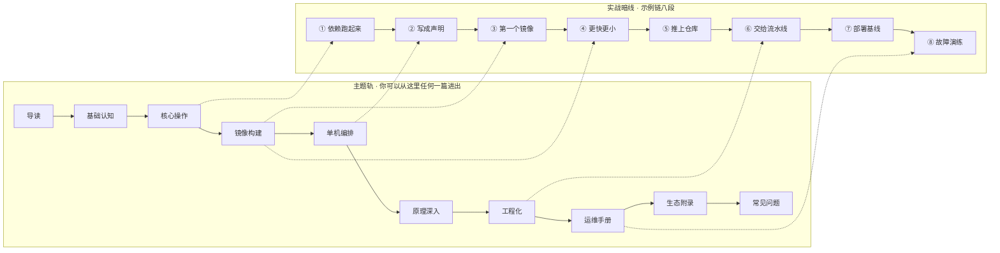

> **实战落点**：示例链第①段 · 依赖跑起来（本篇的实战切入用它，但不要求你已跑完前序任何一步）
> **示例版本**：`示例/贯穿示例/段1-依赖跑起来/README.md`（链首，可从 0 独立起步；本篇不产出示例文件）
> **前置依赖**：无
> **本篇产出物**：一份你自己机器的体检记录（命令在不在、子系统在不在、镜像域名解析对不对，共三条筛查；完整七条在环境准备），以及由此判定的入口——本机 2026-10-27 的第二轮落点是「引擎可用但仍拉不到镜像」，不是「可以开跑」
> **拓展接口**：本篇的「主题轨为主、暗线为辅」结论在 0.5 写作要求里被扩展成文档体裁；「先量机器」的三步在 [/docs/00-导读/把环境搭好/环境准备/](/docs/00-导读/把环境搭好/环境准备/) 被穷尽展开
> **难度·耗时**：★☆☆ · 25 分钟（含动手自检 5 分钟）
> **自测三题**：
> 1. 你只想解决「容器里连不上宿主机的服务」，该走哪条轨、进哪一篇？为什么不是按编号读？
> 2. 实战暗线既然不是阅读路线，它保证的是什么？
> 3. 为什么「按编号从 0.1 读到 9.4」会被明确不推荐？它丢掉的是哪一样东西？

## 为什么要先读这一页

去年有个应届生领到一台新笔记本，第一天做了这件事：他打开一个文档站的目录，从第一篇第一个字开始往下读，读到第四篇时已经是下午四点，然后开始装 MySQL——因为他觉得「后面总会讲到」。晚上他发了条消息：

```text
「文档我读了大半，为什么还是跑不起来我们的服务？」
「你读到讲 volume 那一节了吗？」
「还没有，我在读镜像分层。」
「那你今天缺的其实是第二节里的两条 docker run。」
```

这条对话暴露的不是他笨，而是**文档给了他一条顺序，却没给他在顺序里定位自己的能力**。三种读法都会以不同方式失败：

| 读法 | 表面理由 | 实际会发生什么 | 这个库怎么治 |
|---|---|---|---|
| 按编号从头读 | 「系统地学」 | 在无关章节上花掉当天最清醒的两小时，动手时间永远排在后面 | 明确不推荐；编号只保证引用稳定，不承诺阅读顺序 |
| 按搜索跳读 | 「我只要这个答案」 | 拿到一条命令，不知道为什么，换个场景就失效 | 每篇头部的「前置依赖」与「本篇产出物」告诉你缺什么、能拿到什么 |
| 问同事 | 最快 | 每个人给的顺序不一样，且没有沉淀 | 团队规范集中在 7.11，是**唯一事实来源**，别处只链接不复述 |

> 💡 新人小结：这个库像一座开架图书馆。书按主题分区上架（基础认知、镜像构建、运维手册……），你可以直接走向需要的区；每个书脊上贴着一张小条，写「读这本书前你得先懂哪两本」「读完你能带走什么」。**编号是索书号，不是借阅顺序**——图书馆从没要求任何人从 001 号开始读。
> 对应到这个库：分区 = 十个主题篇；书脊小条 = 每篇第一屏的七项头部契约；索书号 = 章节编号。而「实战暗线」是馆方的一条**装修动线**：它规定每本书里的动手例子该长在哪一步，不是给读者规划的参观路线。

## 这个库是怎么组织的

两条轨，主副分明：

- **主题轨**是主干。十个分类按读者的认知顺序排列——先知道为什么需要它，再会跑起来，再会造镜像，再会编排，再问原理，再上生产，最后是会坏的东西怎么修。你可以通读，也可以只查其中一篇。
- **实战暗线**是副。所有动手例子共用同一个项目（一个 Spring Boot 后端 + 一个 Vue3 前端 + MySQL + Redis + nginx），它从「本机装不上依赖」一路生长到「出事能查、查完留痕」，共八段。**它是示例资产的生长骨架，不是你的阅读路线。**

这个定位不是从一开始就定下来的，中间走过一条弯路，值得记下来免得再走：

| 方案 | 当时的想法 | 代价 | 结局 |
|---|---|---|---|
| 主线（v2.0） | 给新人一条完整的路，按段通读最不容易迷路 | 与「按主题学习」抢路径；读者要同时维护两套顺序；查一个知识点时被迫关心它在链条第几节 | **放弃**。它把「我为什么要现在读它」的回答绑死在链条位置上 |
| 只做增量补章节（v1.2 原样） | 骨架不动，缺什么补什么，最省事 | 并列知识点越来越多，60 篇涨到 80 篇时每篇更孤立 | **放弃**。这是原病灶 |
| 主题为主 + 实战为暗线（现行） | 主题轨管阅读，暗线管例子的组织 | 必须另立判据保证例子不断链——于是有下面的「从 0 完整性三条」 | **采用** |

被放弃的方案不是没价值的：主线那条路对「完全不知道该问什么」的人仍然有用，它被保留成 0.2 里的一条**推荐路径**（7 天上手线），只是不再是唯一入口。



读这张图的正确方式：上面一路是**你的入口**，下面一路是**例子的生长顺序**。虚线只说明「这一篇的动手例子会用到那一段的产物」，不代表你要先走完。

> 💡 新人小结：暗线像一家餐厅后厨的出菜顺序——凉菜先上、热菜随后、汤压轴。作为客人你点菜不受这个顺序约束（你可以只要汤），但它确实存在，因为**如果汤先出、凉菜后出，那桌菜就坏了**。
> 对应到这个库：你点菜 = 按主题查阅；后厨出菜顺序 = 示例链八段；「汤先出会坏」= 后一段的示例若覆盖了前一段的产物，前后对照就再也复现不了。所以下面三条判据是硬的。

### 示例链的从 0 完整性三条

暗线不再承担阅读路线后，「跟着例子从零做完」这件事不能再靠顺序保证，只能独立可判：

| # | 判据 | 具体要求 | 谁来验 |
|---|---|---|---|
| 1 | 每段自带全部前置 | 该段跑通所需的引擎版本、JDK/Node 版本、初始数据、机器要求，全写在该段的 `README` 里；**禁止出现「按前面几步的准备」** | 在一台没跑过任何段的机器上，只看这一段 README 跑一遍；跑不通即不合格 |
| 2 | 后段不覆盖前段产物 | 演进用新文件表达（`Dockerfile.v1` 与 `.v2` 并存，开发用 `compose.dev.yaml`、生产用 `compose.prod.yaml`） | 逐段检出、逐段构建 |
| 3 | 跳级自检成立 | 第 N 段声明的前置，必须能被第 1 到 N-1 段的产出满足；需要段外操作时，该段 README 必须显式写出这一步 | 脚本比对前置清单与产出清单 |

第 3 条有个反直觉的设计值得先说：链上**不是每段都依赖前段**。示例后端的 `api-service` 自带完整源码，你可以在完全没跑过前两段的情况下直接从第③段起步——因为「造镜像」这个主题需要的是一个可构建的工程，不是一个已经跑起来的开发环境。如果每段都硬咬住前一段，暗线就会以另一种形式变回主线。

## 头部契约七项各自解决什么

每篇正文第一屏都有这七行。它不是装饰，每一项都在堵一个具体的失败：

| 项 | 它回答的问题 | 缺了会怎样 |
|---|---|---|
| 实战落点 | 本篇的动手例子挂在示例链哪一段 | 例子变成与主题无关的综合大作业，读者抄不动 |
| 示例版本 | 用到哪个文件的哪一版、承前自哪一段 | 演进链断了也看不出来，前后对照复现不了 |
| 前置依赖 | 读这篇前必须会什么（最多 3 个） | 读者在缺前置的情况下硬读，产生「讲了但没懂」 |
| 本篇产出物 | 读完手上多了什么可验证的东西 | 「理解了原理」这种无法验收，学与不学看不出差别 |
| 拓展接口 | 本篇的结论后面被谁复用、被谁推翻 | 基础篇的简化结论被后面悄悄改掉，读者以为前面写错了 |
| 难度·耗时 | 要不要现在读、要留多久 | 排期靠猜，新人按阅读速度估时间，一算就崩 |
| 自测三题 | 我是不是真读完了 | 眼睛划过一遍就当会了 |

「拓展接口」这项值得多说一句，因为它是这个库**允许基础内容不写全**的前提。基础篇可以只给一个够用的简化说法，条件是它必须自己声明在哪里会被修正。比如基础那几篇说「容器内存限制就是容器能用的内存上限」，这在单机开发里够用；到运行基线那篇要修正成「限制值还决定了 JVM 默认堆的推算」，并且要写明这是修正而不是前面写错。

## 该按什么顺序读

### 七天上手（给第一次接触容器的人）

| 天 | 做什么 | 进哪一篇 | 当天结束时的判据 |
|---|---|---|---|
| 1 | 装环境并跑通两条验证命令 | 环境准备 | `docker version` 客户端与服务端都有读数；`hello-world` 打出欢迎文本 |
| 2 | 把两个依赖服务跑起来，本地程序连上它们 | 端口映射、数据管理与权限时区 | 删掉容器再起，之前的数据还在 |
| 3 | 把昨天的长命令改写成一份声明文件 | 多环境热重载与五服务完整实战 | 一条命令起全栈，状态全部 healthy |
| 4 | 给手上那个服务写第一份镜像描述文件 | Dockerfile 指令全解与构建上下文 | 换一个没装开发环境的同事能构建出可用镜像 |
| 5 | 让构建变快变小 | 分层缓存多阶段构建与镜像瘦身 | 交出体积与重建耗时的前后对照数字 |
| 6 | 打标签推到仓库，再从仓库拉回来 | BuildKit私有仓库标签策略与构建排错 | 本地镜像删光后仍能起；标签能反查到提交号 |
| 7 | 制造一次故障并修好它 | 容器起不来与网络不通 | 能回答「下次同样的告警，第一条命令敲什么」 |

### 三十天进阶

第 8~14 天补原理按需部分（联合文件系统、资源限制与 Cgroups、网络底层），第 15~21 天走交付链路与运行基线（CI 与安全基线 → 日志与资源限制 → 监控与备份容灾 → 生产形态与回滚），第 22~30 天读运维手册全篇并**回填团队规范**。**判断你是否需要读原理篇的唯一依据是触发条件**：

| 原理篇章节 | 什么时候该读 |
|---|---|
| 联合文件系统与镜像分层 | 想真正弄懂「分层为什么能省空间」——建议在示例链第④段之前 |
| 容器本质、Namespace 与 Cgroups | 遇到退出码 137，或要设资源限制——第⑦段前必读 |
| 网络底层实现、跨主机网络、运行时生态与无 root 容器 | 网络排错排到「容器之间通、但出不去外网」，或要看清 `docker run` 底下到底是哪几层、评估 Kubernetes / Podman |

原理深入板块的 8 章至此也全部落地：**5.1~5.3 讲「一个被框住的进程」，5.4 讲「它的根文件系统怎么叠出来」，5.5~5.8 讲「包怎么进出、谁把它拉起、以什么身份拉起」**。这一篇的用法与前两篇不同——它不给你操作步骤，只给你「读数从哪个命名空间来的」这类判据，凡在本库别处看到「本机读不到」，先回这一篇的 5.5 与 5.7 看是不是站错了视图。

运维手册板块的 11 章现在已全部落地，按用途分三层，**读的顺序与查的顺序不同**：

| 层 | 篇 | 什么时候用 |
|---|---|---|
| 按故障域查因 | 容器起不来与网络不通、磁盘占满与镜像拉取失败 | 想知道「为什么会这样」，要读机制与读数 |
| 按平台与性能查法 | Windows 与 WSL2 + 性能排查 + runbook + 复盘库 | 慢/涨这类没有报错的现象，以及出事当值的动作 |
| 按现成入口查 | 命令速查症状索引与团队规范 | **值班手边那一张**：一条报错 → 一个去处；要定规矩也在这 |

三十天的收尾动作是具体的：把你团队的镜像命名、标签策略、`compose.yaml` 约定与评审 checklist **对照 7.11 那一节改一遍**——那一节是全库唯一事实来源，别在别的文档里再写一份。

### 按角色

| 角色 | 必读 | 按需 | 可以跳过 |
|---|---|---|---|
| 后端（Java/Node） | 核心操作、镜像构建、单机编排 | 原理按需、运行基线 | 生态地图 |
| 前端 | 镜像构建的多阶段部分、单机编排的热重载 | 命令速查 | 资源限制细节 |
| 运维 / 值班 | 运维手册全篇、运行基线 | **手边常开：命令速查与症状索引那一篇**；备份容灾、监控 | 前端构建 |

> 💡 新人小结：路径表像导航软件的三种模式——「最短时间」「少换乘」「避开高速」。同一张路网，三种目标函数给三条不同路线，**它们都对，只是回答的问题不同**。
> 对应到这个库：七天线 = 最短时间（尽快能干活）；三十天 = 少换乘（知识成体系，中间不跳步）；角色表 = 避开高速（只走你职责范围内的那段）。所以别问「哪条路正确」，问「我这次要到达什么」。

## 贯穿示例总览

| 段 | 这一段新增什么能力 | 主要落在这几篇 | 闭合判据（怎么算这一段做完了） |
|---|---|---|---|
| ① | 本机不装数据库与缓存，用两个容器顶替 | 端口映射数据管理与权限时区、容器生命周期 | 删容器再起数据仍在；本地进程能查到容器里写入的行 |
| ② | 把九参数命令变成一条声明式启动 | Compose语法基线与文件全字段参考、多环境热重载与五服务完整实战 | 一条命令起全栈且全部健康；重启后数据仍在 |
| ③ | 后端服务有了自己的镜像 | Dockerfile指令全解与构建上下文 | 换一台没装 JDK 的机器能构建出可用镜像 |
| ④ | 镜像变小、构建变快 | 分层缓存多阶段构建与镜像瘦身 | 交出体积 / 重建耗时 / 缓存命中层数三个前后数字 |
| ⑤ | 镜像有地方放，且有版本可追 | BuildKit私有仓库标签策略与构建排错 | 删光本地镜像仍能起；标签能反查提交号 |
| ⑥ | 构建交给机器，人不再手工 | CI/CD 中的 Docker 与安全基线 | 改一行代码自动出镜像；**故意写坏一条指令，检查必须变红** |
| ⑦ | 部署面有资源上限、日志轮转与回滚 | 日志资源限制部署策略与回滚、监控最小集与备份容灾 | 压力打到内存时容器被限住而宿主机不被拖垮；回滚成功 |
| ⑧ | 出事时查得到、查完留得下 | 容器起不来与网络不通、磁盘占满与镜像拉取失败 | 三份复盘各自能回答「第一条命令敲什么」 |

团队当前还在本地开发阶段，第⑦、⑧段明确是**演练**：所有故障由我们自己构造，复盘库里把「构造事故」与将来的「真实事故」分栏存放，避免把演练当成经验沉淀。

## 实战切入：先量你自己的机器

这一段是本篇的动手环节，它落在示例链第①段的最前面——**在你跑第①段之前，先确认你脚下是不是实地**。三条检查都在本机可跑。这台机器在 2026-10-25 与 2026-10-27 各测过一轮，两轮结果放在一起才说明问题：

```bash
# 第一轮 2026-10-25
$ command -v docker || echo "docker NOT on PATH"
docker NOT on PATH                          # 返回码 127
$ wsl.exe --status
未安装适用于 Linux 的 Windows 子系统。可通过运行 “wsl.exe --install” 进行安装。
                                            # 返回码 50，输出是 UTF-16LE，要先解码

# 第二轮 2026-10-27（装了桌面版引擎之后）
$ docker version --format '{{.Server.Version}}' ; echo "rc=$?"
29.8.0
rc=0
$ wsl.exe --status ; echo "rc=$?"
默认分发: docker-desktop
默认版本: 2
                                            # 返回码 0
```

`wsl.exe` 的输出是 **UTF-16LE**，直接在 Git Bash 里看是一段乱码字节，必须先按 UTF-16 解码才能读到文本——这不是容器工具的问题，但会挡住你判断到底装没装。**看返回码，不要靠肉眼看输出**：第一轮那个 rc=50 和第二轮的 rc=0 才是可信信号。顺带一条：成功输出里可能夹着「当前计算机配置不支持 WSL1」这样的提示，它是说明不是错误，别被它带偏。

第三条检查最有意思，也最容易被误判：**能解析不等于解析对了**。

```bash
$ python -c "import socket;print(sorted({i[4][0] for i in socket.getaddrinfo('registry-1.docker.io',443)}))"
['31.13.70.13']     # 第一轮，5 毫秒返回，看着完全健康
['64.13.192.76']    # 第二轮，同一个域名，另一个地址
```

紧接着对它发起连接，两轮都是六秒超时，而对照站点两轮都很快：

```text
TCP 443 → registry-1.docker.io   超时（第一轮 6006 ms / 第二轮 6018 ms）
对照 www.baidu.com              成功（23 ms → 55 ms，两轮都是 200）
对照 gitee.com                  成功（29 ms → 83 ms，两轮都是 200）
```

第一轮我还用过另一招：换解析器问同一个域名，当时得到三个不同地址（系统 `31.13.70.13`、`223.5.5.5` 给 `199.59.149.238`、`114.114.114.114` 给 `185.60.219.41`），而对照站点在两个解析器下答案一致。**这一招第二轮失效了**——那两个解析器的 UDP 53 直接超时。所以判据要换成两条仍然拿得到的证据：

| 证据 | 本机读数 | 为什么够用 |
|---|---|---|
| 同一域名答案随时间变 | 宿主两轮各得一个地址；第二轮**容器内**第三次问得到 `108.160.166.57`，与前两个都不同 | 权威解析不会两天给三个全都连不通的地址；对照站点两轮稳定 |
| 引擎自述它实际连的是哪个地址 | `docker pull` 的报错里写着 `dial tcp 64.13.192.76:443: connectex`，与宿主 `getaddrinfo` 的结果**同一个地址** | 排除「引擎走了另一条解析路径」，也排除应用层拒绝——失败在传输层 |

判据落在这里：所以「拉不下来」的第一定位动作不是换加速器，而是先分清你卡在哪一段。这条自查的完整展开（七条判据、四段定位图、以及**不依赖镜像仓库验证运行时**的办法）在 [/docs/00-导读/把环境搭好/环境准备/](/docs/00-导读/把环境搭好/环境准备/)。

三轮检查跑完，按结果分流：

| 结果组合 | 你该进的地方 | 不该进的地方 |
|---|---|---|
| 第 1、2 条任一失败（像第一轮） | 环境准备，从装开始 | 不要开始读示例链第①段，你会把环境问题当成文档问题 |
| 1、2 过但解析与拉取不过（像第二轮） | 环境准备的「打通通道：代理与加速器」一节 | **仍然不要开第①段**。引擎可用不等于能拉镜像 |
| 七条全过（本机第三轮起即此格） | 示例链第①段，落位在端口映射数据管理与权限时区 | 不必通读导读剩下的部分 |
| 全过但只想知道某个参数 | 命令速查症状索引与团队规范 | 不要按编号顺序读 |

## 这个库不包含什么

边界要说在前面，否则读者会把它当容器技术的全集，在错误的地方来查正确的东西：

| 不含 | 到哪去 | 为什么不放进来 |
|---|---|---|
| Kubernetes 的具体操作 | [/docs/08-生态与附录/生态坐标/容器生态地图与Kubernetes衔接/](/docs/08-生态与附录/生态坐标/容器生态地图与Kubernetes衔接/) 的 8.2 —— 只讲到「为什么单机不够」为止，并给概念对照表与学习路线 | 编排面的知识体量与本库同级，混在一起两边都写不透；本库的职责是让单机动线闭环（那篇里连「本机有没有 `compose → K8s` 的转换路」都是实测的：这台机器的 Compose v5.5.1 没有） |
| 云厂商托管服务的控制台操作 | 各云厂商自己的文档 | 控制台界面变动频繁，写进库里的第二个月就开始腐烂 |
| 服务网格、无服务器等下游议题 | 同一篇的 8.1 给一句话定位与引入时机（本机 `istioctl`/`linkerd`/`consul`/`envoy` 全部不存在，所以只给判据不给步骤） | 它们各自的判据与本库不同，放在一起会误导「现在就该上」 |
| 某个业务系统的部署手册 | 该系统的仓库内文档 | 业务相关的拓扑与密钥不属于通用知识库 |
| 引擎与依赖的「最新版本」 | 8.6 版本与兼容矩阵，按 as-of 日期给现查命令 | 钉死版本数字的文档必然滞后；库里只写「怎么现查」与「已知不兼容组合」 |

还有一条隐含边界：本库的命令例子统一在 **Linux 容器语义**下讲解，Windows 容器的使用极少见且差异大，遇到时按「不适用」处理而不是硬套——这条在 Windows 与 WSL2 那一节会具体展开。

## 怎么把问题问到能答的程度

同一个故障，两种问法，得到的帮助差别很大。这不是态度问题，而是**信息结构**问题：排错手册按「症状 → 判据 → 命令 → 根因」组织，你的提问也要落到这四列里。

| 问法 | 实际效果 |
|---|---|
| 「Docker 起不来了怎么办」 | 无法定位。范围覆盖十个故障域，只能反问一串问题 |
| 「容器起来 3 秒就退了，`ps -a` 显示退出码 137，宿主机内存还剩很多」 | 一次命中。退出码 + 时间特征 + 已排除项，直接进对应那一行 |

值班可用的最小提问模板，四条信息按顺序给：

```text
1. 症状：一条现象描述 + 原始报错文本（不要转述，原文粘贴）
2. 范围：影响单个容器 / 整个宿主机 / 整个集群
3. 已排除：已经查过并否定的假设（这比「我试了什么」更有信息量）
4. 环境：引擎版本、宿主系统、是否近期变更过
```

第 3 条最容易被省，也最值钱——它决定了别人要不要重复你已经走过的路。这一模板与 7.2 症状索引是同一套思路：**按现象检索，而不是按原因检索**，因为在出事的当下你并不知道原因。

## 常见误读

| 你可能的理解 | 实际情况 |
|---|---|
| 「实战暗线」意味着正文里的例子可以随便举 | 不对。暗线的例子**必须**来自贯穿示例的真实一段，不能是虚构项目 |
| 编号顺序就是推荐阅读顺序 | 编号只保证引用稳定。顺序由每篇的「前置依赖」决定 |
| 七天表是排期承诺 | 那是路径，不是工时；耗时数字目前是估算，正文写完后按实测回填 |
| 每篇都能独立读 | 头部契约列出的前置是硬要求；「能进出」指入口自由，不是内容无前置 |
| 基础篇故意留白是写得不全 | 恰恰相反。基础篇必须显式声明「本篇不覆盖什么、交给哪一篇」，留白才是合格 |
| 第⑦⑧段的复盘是生产事故 | 是演练构造的。复盘库里两类分开标注 |

## 本篇不覆盖什么

按 W6 的规矩，本篇**故意不讲**的东西逐条点名去处——写「不覆盖」不是免责声明，是防止你在这一篇里找不存在的答案：

- 这台机器怎么装、代理与镜像通道怎么配 → 见 **0.3**（`docker version` 那七条体检判据在那一篇逐条跑，本篇只给入口）
- 名词的权威定义（镜像、容器、仓库、digest 各是什么）→ 见 **1.2** 与 **8.4**（`RepoDigests` 这类词的完整解释只在 8.4 那一张表里）
- 具体命令的读法与报错原文 → 见 **7.1** 与 **7.2**（`docker compose` 的子命令清单与「一条报错 → 一个去处」的索引在那儿）
- Kubernetes 与跨主机编排怎么学 → 见 **8.2**（`kompose` 在本机的可得性、以及「K8s 操作另开库」这条边界声明都在那一篇）
- 写进这个库的规矩本身（头部契约、问题驱动四段、新人小结）→ 见 **0.5**（`拓展接口` 这一项的定义在那一篇）

## 要点总结

- 主题轨是主干，实战暗线是副；暗线管例子的组织与生长顺序，**不规定你的阅读路线**。
- 暗线化之后「例子从 0 做完」必须有独立判据，就是那三条：自带前置、不覆盖前段、跳级自检。
- 每篇第一屏的七项头部契约是这套库的承重件：它把「递进」从章节顺序的隐含属性，变成每篇自己声明的显式属性。
- 「拓展接口」是基础内容允许简化的前提——**基础篇可以不给全，但必须自己声明在哪里被修正**，否则读者会把修正当成前文写错。
- 上手前先量三样：命令在不在、子系统在不在、镜像域名解析对不对。**DNS 秒回不构成「解析正常」的证据**；而两轮读数又补了一条同样重要的：**引擎可用不等于能拉镜像**——本机第二轮引擎与子系统都合格，第①段仍开不了跑，直到第三轮配上代理才解开。别把「通道不通」误判成「引擎坏了」去重装。
- 读数要**留两轮**。只保留最后那一轮，就再也得不出「安装到底改变了什么」，也会把「一直不通」误判成「被这次安装弄坏了」。
- 三条路径（七天 / 三十天 / 按角色）都对，它们回答的问题不同；先确定你要到达什么，再选路。

## 本篇未验证项

| 项 | 状态 | 原因 |
|---|---|---|
| 示例链第①段完整跑通 | **已验证** | 配好代理后第 6 条解除。Redis 键值与 MySQL 两行数据（含时间戳）都在 `docker rm -f` 后挂同一命名卷重起时原样读回；宿主经 `127.0.0.1:3307` 还拿到了 MySQL 握手包。完整读数在环境准备那篇 |
| 容器运行时本身是否可用 | **已验证**（两条路径） | 不依赖仓库的一条：`FROM scratch` + 本机静态二进制，`--memory=64m` 在容器内读到 `67108864`；依赖仓库的一条：`docker run --rm hello-world` 返回码 0 |
| 第①段 README 的「自带前置」判据 | 未验证 | 示例目录尚未创建，判据一无法在干净机器上复现——第①段能跑不等于它已按判据一的形态交付 |
| 七天天数的实际耗时 | 估算值 | 28 篇里目前只写完导读 3 篇，天数分配依据章节权重而非实测读数 |
| 地址被改写的归因（谁改的、在哪一跳） | 未验证 | 已证三条事实：同一域名两轮加容器内共得三个不同地址、443 不可达、对照站点两轮稳定。跨解析器对照那一招在第二轮因 UDP 53 超时已不可用，未核查这些地址的归属 |
| 浏览器端的渲染与离线搜索命中 | 未验证 | 本轮只做结构与内容校验，渲染类判据需要真实浏览器目测 |
