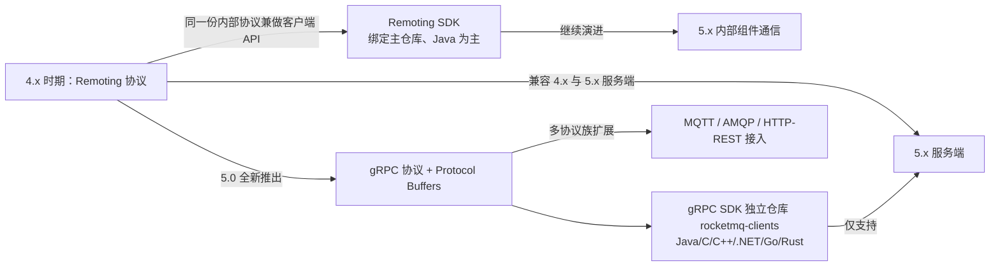
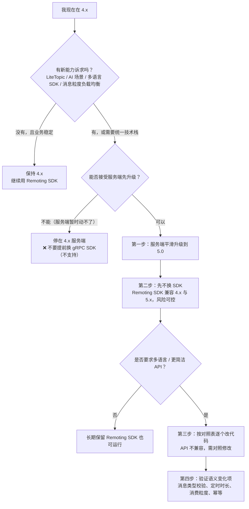

## 为什么需要「先分清 4.x 与 5.0」？（痛点引入）

三个真实会发生的事故场景：

1. 团队的服务端还跑在 4.9.x，新同事照着 5.0 文档加了 `rocketmq-client-java` 依赖，代码写完编译通过、启动就连不上——gRPC SDK 仅支持 5.x 服务端。
2. 服务端已经升到 5.0，客户端仍是 4.x 的 Remoting SDK，运维发现「同一个队列只被一个消费者消费」，加消费者超过队列数就开始空转——消息粒度负载均衡只对 5.0 SDK 的 PushConsumer/SimpleConsumer 生效，3.x/4.x 的 Remoting 协议 SDK 仍是队列粒度。
3. 老系统把「普通消息」和「事务消息」发进同一个 Topic，升级 5.0 后事务消息开始被拒——5.0 起支持强制校验消息类型，每个主题只允许发送一种消息类型，且该功能默认开启。

这三件事的根因是同一个：**4.x 与 5.0 不是「同一产品的两个版本号」，而是概念口径、通信协议、消费语义三处同时变过**。选型与迁移前必须先对齐口径，否则文档读起来句句都对，写下去处处报错。

| 不区分版本会踩的坑 | 具体表现 | 正确判断依据 |
|--------------------|----------|--------------|
| SDK 与服务端版本不匹配 | gRPC SDK 连 4.x 服务端不通 | 官方：gRPC SDK 仅支持版本大于等于 5.0 的服务端 |
| 以为换 SDK 只是换依赖 | 升级后编译失败、API 找不到 | 官方：gRPC SDK 与 Remoting SDK API 不兼容，需对照修改代码 |
| 用 4.x 消费语义理解 5.0 | 找不到「广播消费模式」开关、消费者超过队列数行为不同 | 5.0 用消费组间广播 + 消费组内共享的组合表达，负载均衡改为消息粒度 |
| 一个 Topic 混多种消息类型 | 5.0 上部分消息发送被拒 | 5.0 起每个 Topic 只允许一种消息类型，强制校验默认开启 |
| 沿用延时级别做定时 | 迁移后定时精度与最大时长对不上 | 4.x 用 `DelayTimeLevel` 级别，5.x 用毫秒级定时时间（最大 40 天） |
| 仍设置生产者分组 | 迁移后无处可配或被忽略 | 5.x 起生产者匿名，无需管理 ProducerGroup |

> ### 💡 新人小结：把 4.x → 5.0 想成「燃油车换电车」
>
> 同一张路网（还是发消息、订阅、消费），但三件事同时变了：
>
> - 补能方式变了：加油站（NameServer 地址直连）换成充电桩网络（Proxy 接入点）；
> - 仪表盘操作变了：挡把（Remoting SDK 的 API）换成单踏板（gRPC SDK 的 API），不能靠肌肉记忆直接开；
> - 保养项目变了：机油机滤（Broker 主备手工配 brokerId）换成电池热管理（Controller 自动分配）。
>
> 一句话总结：**车还是那台车，但「怎么开、怎么接、怎么修」的口径换了一套。**
>
> **所以：迁移评估的第一步是「我用的哪套口径」，不是「我怎么少改几行」。**

**学习路线图**

```text
4.x 旧口径 → 5.0 新口径 → 语义变化点 → 两代协议 SDK → 旧/新写法对照 → 迁移决策与清单
概念定义     领域模型     换名/换义     Remoting/gRPC   最小案例       是否上 5.0
```

本文覆盖「概念口径对照、SDK 协议差异、迁移决策与清单」。具体的参数硬限制数值清单（命名长度、消息大小、重试次数、TPS 等）以〈使用限制与参数约束〉为唯一出处，本文不重复列值；各消息类型的发送代码、消费重试策略细节属于「消息类型与发送」「消费行为」板块，本文只在差异处点名。

---

## 术语表

| 术语 | 全称 | 通俗含义（用自己的话） | 在本文中的角色 |
|------|------|------------------------|----------------|
| SDK | Software Development Kit | 客户端开发包，业务代码里用来收发的那套库 | 全文的主线：两代 SDK 差异 |
| Remoting 协议 | 远程通信协议（RocketMQ 内部组件间默认协议） | RocketMQ 早期自研的二进制通信协议，客户端 SDK 与内部组件共用 | 旧一代协议 |
| gRPC | Google Remote Procedure Call | 跨语言的 RPC 框架，5.0 用来做客户端与服务端通信 | 新一代协议 |
| Protocol Buffers | Protobuf，序列化与 IDL 工具 | 定义接口与报文格式的标准工具，5.x 用它替代 4.x 旧协议 | gRPC SDK 的地基 |
| Proxy | 代理层 | 5.x 的无状态接入层，客户端连它、由它转发到 Broker | 架构差异与「接入点」概念的来源 |
| 接入点（Endpoints） | 客户端连接服务端的地址 | 5.x 侧替代「NameServer 地址」的客户端配置项 | 客户端配置口径变化 |
| API | Application Programming Interface | 编程接口 | 两代 SDK 不兼容的对象 |
| RIP | RocketMQ Improvement Proposal | 社区提案编号，用于记录设计决策 | 上游给出 gRPC API 设计的出处链接 |
| 领域模型 | Domain Model | 产品把自己拆成的那几类对象及其关系 | 5.0 的概念组织方式 |
| MessageView | 消息视图 | 面向开发者的消息**只读**接口，不能改消息本身 | 5.x 消息不可变性的落点 |
| ConsumeResult | 消费结果 | 消费监听器返回「成功/失败」的结果枚举 | 5.x PushConsumer 的可靠性边界 |
| ConsumerGroup | 消费者分组（消费组） | 一组消费逻辑相同的消费者的逻辑分组 | 4.x/5.0 都有，但 5.x 承载了更多配置 |
| ProducerGroup | 生产者分组 | 4.x 用来归类生产者的分组 | 5.x 起废弃 |
| MessageQueue | 队列 | Topic 的分区单元 | 4.x 队列粒度负载均衡的主体 |
| MessageGroup | 消息分组 | 5.x 顺序消息的分组标识（如订单号、用户号） | 顺序语义的载体 |
| DelayTimeLevel | 消息延时级别 | 4.x 用「级别」表示延时，0 为不延时 | 与 5.x 定时时间的对照物 |
| WaitStoreMsgOK | 是否落盘后再应答 | 4.x 消息属性，控制服务端落盘后才回响应 | 4.x 可靠性开关旧口径 |
| AllocateMessageQueueStrategy | 队列分配策略 | 4.x 消费组内如何把队列分给消费者的可替换算法接口 | 4.x 负载均衡旧口径 |
| 重平衡（Rebalance） | 重新分配 | 消费者上下线后重新计算分配结果的过程 | 少量重复消息的成因 |
| 消费位点 | ConsumerOffset | 某个消费组在某个队列上「读到哪了」 | 4.x/5.0 语义有差 |
| 消费不可见时间 | Invisible Time | SimpleConsumer 场景下「这条消息我先拿着，别人别碰」的时长 | 5.x 新增概念 |
| ACL | Access Control List，访问控制列表 | 权限控制；5.x 限制表里的 Credentials 指 AK/SK/Token | 迁移时凭据口径 |
| AK / SK | AccessKey ID / AccessKey Secret | 访问凭据的用户名与密码对 | 5.x 限制项之一 |
| LiteTopic | 轻量主题 | 5.x 为 AI 会话设计的极低开销通道 | 4.x 没有的能力 |
| FIFO | First In First Out | 先进先出，顺序消息 | 两代口径的表述差异点 |
| SQL92 | Structured Query Language 1992 | 用类 SQL 表达式做消息过滤 | 4.x 表中已列为 RocketMQ 能力 |
| Tag | 消息标签 | Topic 之下的二级分类与过滤依据 | 4.x 旧口径核心概念之一 |
| Keys | 消息索引键 | 业务关键字，服务端建哈希索引用来查消息 | 4.x 旧口径核心概念之一 |

---

## 4.x 旧口径完整保留：生产者侧基本概念

> 以下是 4.x 文档的原始定义，作为「旧口径」逐条保留。即使 5.x 的说法已变，读老代码、老运维手册、老告警时仍以这套口径为准。

### 消息（Message）

4.x 文档给出 RocketMQ 的消息构成非常简单：

- **topic**：表示要发送的消息的主题；
- **body**：表示消息的存储内容；
- **properties**：表示消息属性；
- **transactionId**：会在事务消息中使用。


Message 可以设置的属性值包括（4.x 原始属性表，逐行保留）：

| 字段名 | 默认值 | 必要性 | 说明 |
|:------:|--------|--------|------|
| Topic | null | 必填 | 消息所属 topic 的名称 |
| Body | null | 必填 | 消息体 |
| Tags | null | 选填 | 消息标签，方便服务器过滤使用。目前只支持每个消息设置一个 |
| Keys | null | 选填 | 代表这条消息的业务关键词 |
| Flag | 0 | 选填 | 完全由应用来设置，RocketMQ 不做干预 |
| DelayTimeLevel | 0 | 选填 | 消息延时级别，0 表示不延时，大于 0 会延时特定的时间才会被消费 |
| WaitStoreMsgOK | true | 选填 | 表示消息是否在服务器落盘后才返回应答 |

4.x 还明确了两条属性纪律：

- **Tag 与延时都走 Properties 机制**：不管是 Tag 过滤还是延迟消息等都会利用 Properties 消息属性机制，这些特殊信息使用了系统保留的属性 Key，设置自定义属性时需要避免和系统属性 Key 冲突。
- **Keys 是哈希索引**：服务器会根据 keys 创建哈希索引，设置后可以在 Console 系统根据 Topic、Keys 来查询消息；由于是哈希索引，请尽可能保证 key 唯一，例如订单号、商品 Id 等。

4.x 列出的系统保留属性 Key 全集（共 37 个，自定义属性不得占用）：

```text
TRACE_ON、MSG_REGION、KEYS、TAGS、DELAY、RETRY_TOPIC、REAL_TOPIC、REAL_QID、TRAN_MSG、
PGROUP、MIN_OFFSET、MAX_OFFSET、BUYER_ID、ORIGIN_MESSAGE_ID、TRANSFER_FLAG、CORRECTION_FLAG、
MQ2_FLAG、RECONSUME_TIME、UNIQ_KEY、MAX_RECONSUME_TIMES、CONSUME_START_TIME、POP_CK、
POP_CK_OFFSET、1ST_POP_TIME、TRAN_PREPARED_QUEUE_OFFSET、DUP_INFO、EXTEND_UNIQ_INFO、
INSTANCE_ID、CORRELATION_ID、REPLY_TO_CLIENT、TTL、ARRIVE_TIME、PUSH_REPLY_TIME、CLUSTER、
MSG_TYPE、INNER_MULTI_QUEUE_OFFSET、_BORNHOST
```

对应到代码，4.x 的旧写法（上游原文示例）：

```java
// ========== 推荐写法（4.x 旧口径）：用业务上唯一的外部键做 Keys ==========
// 订单Id
String orderId = "20034568923546";
message.setKeys(orderId);   // Broker 端按 keys 建哈希索引
// 运行结果: 可在 Console 按 Topic + Keys 查询到这条消息及其被谁消费（4.x《基本概念》原文口径）

// ========== 不推荐写法 ❌ ==========
// ❌ 用「商品分类名」当 Keys：同一分类会重复出现在多条消息上，哈希冲突后按 key 查询会命中一批消息，
//    上游要求「尽可能保证 key 唯一，例如订单号、商品 Id」。
message.setKeys("electronic");
// ❌ 把系统保留属性 Key 当自定义属性名：会与 Tag/延时等机制冲突
message.putUserProperty("TAGS", "some-value");
```

参数解释：`setKeys` 写入的就是属性表里的 `Keys` 字段（默认 `null`、选填）；`orderId` 必须是业务上唯一的外键；`putUserProperty` 的键名要避开上面那 37 个保留 Key，否则会覆盖系统语义。

### Tag：一级分类与二级分类

Topic 与 Tag 都是业务上用来归类的标识，区别在于 **Topic 是一级分类，Tag 可以理解为二级分类**；使用 Tag 可以实现对 Topic 中的消息进行过滤。

- Topic：消息主题，通过 Topic 对不同的业务消息进行分类；
- Tag：消息标签，用来进一步区分某个 Topic 下的消息分类，消息从生产者发出即带上的属性。


什么时候该用 Topic、什么时候该用 Tag？4.x 给出四条判断依据（逐条保留）：

| 判断维度 | 4.x 结论 | 上游举的例子 |
|----------|----------|--------------|
| 消息类型是否一致 | 不同消息类型使用不同的 Topic，**无法通过 Tag 区分** | 普通消息、事务消息、定时（延时）消息、顺序消息 |
| 业务是否相关联 | 没有直接关联的用不同 Topic；同一业务域内的子集用 Tag | 淘宝交易消息 vs 京东物流消息用不同 Topic；天猫交易的电器/女装/化妆品订单可用 Tag |
| 消息优先级是否一致 | 不同优先级的消息用不同的 Topic | 盒马必须小时内送达、天猫超市 24 小时内、淘宝物流相对更慢 |
| 消息量级是否相当 | 量级差异大的要拆 Topic | 量小但实时性高的消息与万亿量级消息同 Topic，可能因等待过长而「饿死」 |

总的来说：不同 Topic 之间的消息没有必然联系，而 Tag 用来区分同一个 Topic 下相互关联的消息，例如全集和子集的关系、流程先后的关系。

> [!NOTE] 版本适用：4.x 的「消息类型不要混在一个 Topic」是运维建议；5.0 起这条升级为服务端强制校验——每个主题 Topic 只允许发送一种消息类型的消息，且强制校验功能默认开启（同时上游声明保证向下兼容 4.x 版本行为）。迁移前必须先把混发 Topic 拆开。

### Keys

Apache RocketMQ 每个消息可以在业务层面设置唯一标识码 `keys` 字段，方便将来定位消息丢失问题。Broker 端会为每个消息创建索引（哈希索引），应用可以通过 topic、key 来查询这条消息内容，以及消息被谁消费。由于是哈希索引，务必保证 key 尽可能唯一，以避免潜在的哈希冲突。

### 队列（MessageQueue）

为了支持高并发和水平扩展，需要对 Topic 进行分区，在 RocketMQ 中这被称为队列：一个 Topic 可能有多个队列，并且可能分布在不同的 Broker 上。


4.x 对位点的定义（旧口径）：一般来说一条消息，如果没有重复发送（比如因为服务端没有响应而进行重试），则只会存在于 Topic 的其中一个队列中；消息在队列中按照先进先出的原则存储；每条消息有自己的位点；每个队列会统计当前消息的总条数，称为最大位点 MaxOffset；队列起始位置对应的位置叫做起始位点 MinOffset。队列可以提升消息发送和消费的并发度。

### 生产者（Producer）

生产者就是消息的发送者。Apache RocketMQ 拥有丰富的消息类型，可以支持不同的应用场景，在不同的场景中需要使用不同的消息进行发送。4.x 给的四个场景（旧口径）：

| 场景 | 需要的消息能力 | 4.x 描述 |
|------|----------------|----------|
| 电商交易超时未支付关单 | 延时消息 | 订单创建时发送一条延时消息，30 分钟以后投递给消费者，消费者判断订单是否已支付，未支付则关单 |
| 同一订单消息保持顺序 | 顺序消息 | 业务上要求同一订单的消息保持严格顺序 |
| 日志处理 | 批量消息 | 可以接受较大发送延迟，但对吞吐量要求很高，希望每秒处理百万条日志 |
| 银行扣款 + 短信通知一致 | 事务消息 | 保持上游扣款操作和下游短信通知一致 |

4.x 还留了一条明确警告：**生产环境中不同消息类型需要使用不同的主题，不要在同一个主题内使用多种消息类型**，以避免运维过程中的风险和错误。

---

## 4.x 旧口径完整保留：消费者侧基本概念

消息通过生产者发送到某一个 Topic，如果需要订阅该 Topic 并消费里面的消息，就要创建对应的消费者进行消费。4.x 在讲使用方法之前先讲**消费组、消费位点、推和拉**。

### 消费者与消费组

消息系统的重要作用之一是削峰填谷。以电商大促为例，如果下游消费者消费能力不足，大量瞬时流量进入后会堆积在服务端：消息的端到端延迟（从发送到被消费的时间）增加，对服务端而言一直消费历史数据还会产生冷读。因此需要增加消费能力——除了优化消息消费时间，最简单的方式就是扩容消费者。

但**是否随意增加消费者就能提升消费能力？前提是先理解消费组**。如果多个消费者设置了相同的 Consumer Group，就认为这些消费者在同一个消费组内。Apache RocketMQ 有两种消费模式：

| 消费模式 | 4.x 定义 | 效果 | 扩容是否能提升消费能力 |
|----------|----------|------|------------------------|
| 集群消费模式 | RocketMQ 认为任意一条消息只需要被消费组内的任意一个消费者处理 | 整个消费组收到 Topic 的全量消息，组内消费者分担 | 可以，通过扩缩消费者数量提升或降低消费能力 |
| 广播消费模式 | RocketMQ 会将每条消息推送给消费组所有的消费者，保证消息至少被每个消费者消费一次 | 组内每个消费者都收到订阅 Topic 的全量消息 | 不可以，即使扩缩消费者数量也无法提升或降低消费能力 |


> [!NOTE] 版本适用：5.0 的领域模型不再把「广播/集群」当成消费组上的一个模式开关，而是改由**消费者分组与消费者的组合**表达：每个消费分组只初始化唯一一个消费者、多个分组订阅相同消息 → 消费组间广播消费（可用于网关推送、配置推送）；每个分组下初始化多个消费者共同分担消息 → 消费组内共享消费（可用于微服务解耦）。消费组间广播场景下每个分组内只有一个消费者，因此不涉及消费者负载均衡。

### 负载均衡

集群模式下同一个消费组内的消费者会分担收到的全量消息，分配策略是怎样的？扩容消费者是否一定能提升消费能力？

Apache RocketMQ 提供了多种集群模式下的分配策略，包括**平均分配策略、机房优先分配策略、一致性 hash 分配策略**等，可以通过代码设置相应的负载均衡策略：

```java
// ========== 推荐写法（4.x 旧口径）：显式声明分配策略，语义与默认一致 ==========
consumer.setAllocateMessageQueueStrategy(new AllocateMessageQueueAveragely());
// 参数: AllocateMessageQueueAveragely = 平均分配策略（4.x 的默认策略，也是最常见的策略）
// 运行结果: 消费组内的消费者按类似分页的策略均摊消费，队列被平摊到各实例

// ========== 不推荐写法 ❌ ==========
// ❌ 不评估队列数就一味增加消费者：当 Topic 的总队列数小于消费者数量时，
//    消费者将分配不到队列，即使消费者再多也无法提升消费能力（4.x 概念文档原文）。
// ❌ 把不同分配策略混用在同一消费组的不同实例上：组内分配结果会互相打架。
```

参数解释：`setAllocateMessageQueueStrategy` 接收一个 `AllocateMessageQueueStrategy` 实现；`AllocateMessageQueueAveragely` 即平均分配，是 4.x 默认策略；换策略只换实现类，不改消费逻辑。

平均分配下可以通过增加消费者数量提高消费并行度，官方用三张连续图说明扩容过程：


解读：这三张图对应上游的两句话——「平均分配的算法下，可以通过增加消费者的数量来提高消费的并行度」（前两图），以及「Topic 的总队列数小于消费者的数量时，消费者将分配不到队列，即使消费者再多也无法提升消费能力」（第三图）。这条边界是 4.x 队列粒度语义的直接结果，5.x 消息粒度负载均衡不再受它约束（见下文差异点与兼容性矩阵）。

### 消费位点


4.x 的旧口径（保留原意）：

- 每个队列都会记录自己的最小位点、最大位点；
- 针对消费组还有消费位点的概念：**集群模式下消费位点由客户端提交给服务端保存；广播模式下消费位点由客户端自己保存**；
- 一般情况下消费位点正常更新，不会出现消息重复；但如果消费者发生崩溃或有新的消费者加入群组，就会触发重平衡，重平衡完成后每个消费者可能分配到新的队列而不是之前处理的队列；
- 为了继续之前的工作，消费者需要读取每个队列最后一次提交的消费位点，然后从该位点继续拉取；由于客户端提交给服务端的消费位点并不是实时的，所以重平衡可能导致**消息少量重复**。

> [!NOTE] 版本适用：5.0 把消费位点表述为「按每个消费者分组记录消费过的最新一条消息的位点」（消费位点 ConsumerOffset），并区分消息位点 MessageQueueOffset（消息到达服务端的先后顺序形成的 Long 型坐标）。幂等要求不因版本而变：重平衡、扩缩容都会触发重新负载均衡，下游消费逻辑必须做消息幂等去重。

### 推、拉与长轮询

MQ 的消费模式大致分为两种：推 Push 与拉 Pull。

| 模式 | 机制 | 优点 | 风险 |
|------|------|------|------|
| Push | 服务端主动推送消息给客户端 | 及时性较好 | 客户端没做好流控时，服务端推送大量消息会导致客户端堆积甚至崩溃 |
| Pull | 客户端主动到服务端取数据 | 客户端可依据自己的消费能力消费 | 拉取频率需自行控制：拉太频繁造成服务端与客户端压力，拉太慢造成消费不及时 |

4.x《基础概念》在「推、拉和长轮询」这一节给出的结论只有一句：Apache RocketMQ 既提供了 Push 模式也提供了 Pull 模式；该节正文未展开长轮询的实现细节。长轮询在 5.0 文档中的落点是 PushConsumer 的内部原理：SDK 内置一个长轮询线程，先把消息异步拉取到 SDK 内置的缓存队列，再分别提交到消费线程触发监听器执行本地消费——也就是说 5.x 的「Push」实现本身就是「长轮询 + 本地缓存 + 消费线程池」的组合。

> ### 💡 新人小结：位点是书签，重平衡是换人继续读
>
> 把队列想成一本很长的小说，消费位点就是「这一组读者读到第几页」的书签：
>
> - 集群模式：一个读书会共用书签，记在图书馆（服务端）那里；
> - 广播模式：每个会员自己夹书签，记在自己家（客户端本地）；
> - 会员进出（扩缩容、崩溃）→ 重新分工，每人翻开图书馆记的书签继续读；
> - 书签不是实时更新的，所以换人接手时可能重复读几百字——这就是「少量消息重复」的由来。
>
> **一句话总结：只要接受「书签不是实时的」，就会自然理解为什么消费逻辑必须做幂等。**

---

## 概念对照表：4.x 术语 ↔ 5.0 领域模型术语

| 概念 | 4.x 旧口径 | 5.0 领域模型口径 | 语义是否变化 |
|------|-----------|------------------|--------------|
| 主题 | Topic，一类消息的集合，订阅的基本单位 | 主题（Topic）：消息传输和存储的顶层容器，通过 TopicName 唯一标识 | 名称不变，定义更形式化 |
| 队列 | 队列（MessageQueue），为写入水平扩展而对 Topic 分区，可分布在多个 Broker | 队列（MessageQueue）：消息存储和传输的实际容器、最小存储单元，通过 QueueId 唯一标识，类比其它消息队列的「分区」 | 不变，术语对齐「分区」 |
| 消息体 | body：消息的存储内容 | 消息负载：业务实际报文，生产者序列化后按二进制字节传输 | 换名（body → 负载） |
| 消息属性 | properties：消息属性，含 37 个系统保留 Key | 系统保留属性 + 业务自定义属性（字符串键值对）两级划分 | 结构变了 |
| 标签 | Tags，目前只支持每个消息设置一个 | 过滤标签 Tag（可选），约束一条消息仅支持设置一个标签 | 一致 |
| 索引键 | Keys，服务器据 keys 建哈希索引，Console 按 Topic+Keys 查询 | 消息索引（MessageKey）/ 索引 Key 列表（可选），由生产者客户端定义 | 换名（Keys → MessageKey），且 5.x 表述为「列表」 |
| 延时 | DelayTimeLevel，延时级别，0 不延时 | 定时时间：毫秒级时间戳，消息类型 Delay；最大可设置定时时长 40 天 | **语义变了** |
| 顺序 | 「同一订单的消息保持严格顺序」的场景描述 | 消息类型 FIFO，通过 MessageGroup 标记一组消息的先后顺序 | 显式化为 MessageGroup |
| 事务 | transactionId 在事务消息中使用 | 事务检查器（TransactionChecker）+ 事务状态（TransactionResolution：提交/回滚/未决），消息类型 Transaction | 概念拆得更细 |
| 落盘应答 | WaitStoreMsgOK，是否落盘后才返回应答 | 上游 5.0 文档未给出同名属性 | 旧口径保留，5.x 侧无对应描述 |
| 发送方式 | 同步发送、异步发送、顺序发送、单向发送 | 生产者文档列出的发送方式为同步传输与异步传输；顺序改由消息类型 FIFO 表达 | 表述收敛 |
| 消息类型 | 普通/事务/定时（延时）/顺序消息按场景区分，建议不同 Topic 不同消息类型 | 消息类型（MessageType）：Normal、FIFO、Delay、Transaction；5.0 起每个 Topic 只允许一种消息类型，强制校验默认开启 | **从建议变成校验** |
| 生产者 | 负责生产消息，一般由业务系统负责 | 生产者（Producer）：构建并传输消息到服务端的运行实体；轻量级、匿名、无身份 | **ProducerGroup 废弃** |
| 生产者分组 | ProducerGroup（配置项 PGROUP 为保留属性 Key） | 5.x 起生产者匿名，无需管理 ProducerGroup；历史已使用的生产者分组可以废弃，不再设置且不影响当前业务 | **废弃** |
| 消费组 | 多个消费者设置相同 Consumer Group 即属同一消费组 | 消费者分组（ConsumerGroup）：承载多个消费行为一致的消费者的负载均衡分组；不是运行实体，是逻辑资源 | 名称不变，**承载配置变多** |
| 消费模式 | 集群消费模式 / 广播消费模式 | 消费组间广播消费 + 消费组内共享消费（由分组与消费者的组合表达） | **表述与实现方式变了** |
| 消费者 | 从 Broker 拉取消息并提供给应用程序；拉取式消费 / 推动式消费 | 消费者（Consumer）：接收并处理消息的运行实体，必须关联一个消费者分组；类型为 PushConsumer / SimpleConsumer / PullConsumer | 类型体系重建 |
| 4.x 消费者类名 | DefaultPushConsumer、DefaultPullConsumer、LitePullConsumer、PullConsumer | PushConsumer、SimpleConsumer、PullConsumer（PullConsumer 仅推荐流处理框架场景集成） | 换名 |
| 负载均衡 | 组内按队列分配：平均 / 机房优先 / 一致性 hash，可 `setAllocateMessageQueueStrategy` | 消息粒度负载均衡（PushConsumer、SimpleConsumer 默认且仅使用）与队列粒度负载均衡（PullConsumer 默认） | **粒度变了** |
| 位点 | 消费位点：集群模式由客户端提交服务端保存，广播模式客户端自保存 | 消息位点（MessageQueueOffset）与消费位点（ConsumerOffset）分离；按消费者分组记录 | 拆分并统一由服务端记录 |
| 消息读视图 | 无对应概念（Message 可直接改） | 消息视图（MessageView）：只读接口，不能对消息本身做修改 | **新增** |
| 消费结果 | 由消费监听返回值/异常触发重试 | ConsumeResult：SUCCESS / FAILURE；非预期异常按消费失败处理 | 显式化 |
| 重试 | 消费重试（4.x 概念文档未在本节给出具体次数） | 消费重试策略在消费者分组中统一定义，含最大重试次数与重试间隔；重试间隔仅 PushConsumer 类型有效 | 归属位置变了 |
| 死信 | 与重试配套 | 超过最大重试次数后投递至死信队列或丢弃（在消费者分组的重试策略中配置） | 归入分组配置 |
| 订阅 | 消费者订阅 Topic + Tag 过滤表达式 | 订阅关系（Subscription）：消息过滤、重试、消费进度的规则配置，以消费组粒度管理，除过滤表达式外都持久化 | **新增持久化语义** |
| 客户端连接地址 | NameServer 地址（`namesrvAddr` / 环境变量 `NAMESRV_ADDR`） | 接入点信息（必选），建议使用域名避免 IP，防止节点变更无法热点迁移 | **口径变了** |
| 身份 | 4.x 概念页未强调客户端身份 | 客户端 ID（ClientId）由 SDK 自动生成，集群内全局唯一，主要用于日志查看与问题定位，不支持修改 | 新增 |
| 预绑定 | 无对应概念 | 生产者「预绑定主题列表」（事务消息必须设置）；消费者「预绑定订阅关系列表」（初始化阶段做权限与合法性校验） | **新增** |
| 消息轨迹 | 4.x 对比表中列为 Supported 能力 | 消息轨迹：由链路各相关节点的时间、地点等数据汇聚成的完整链路信息 | 定义形式化 |

### 哪些是「只是换名字」，哪些是「语义真的变了」

这张表是迁移评估的核心：换名字只需对照改代码；语义变了则可能改变线上行为，必须逐个验证。

| 变化类型 | 条目 | 迁移动作 |
|----------|------|----------|
| 换名字，语义一致 | Tags → 过滤标签 Tag；Keys → 消息索引 MessageKey；body → 消息负载 | 对照改 API，行为不变 |
| 新增概念，老代码没有 | MessageView、ConsumeResult、ClientId、预绑定主题/订阅列表、消费不可见时间 | 需要在 5.x SDK 里显式配置 |
| 废弃概念 | ProducerGroup（5.x 起生产者匿名） | 可以废弃不再设置，不影响当前业务 |
| 语义变化，风险最高 | 消息类型强制校验（每 Topic 一种类型）；延时级别 → 毫秒时间戳定时（40 天上限）；广播/集群模式 → 分组组合；队列粒度 → 消息粒度负载均衡；消费行为从客户端设置 → 消费分组统一配置；消息不可变性（中转必须重建消息） | 逐项做回归验证，不能只改依赖 |

---

## 两代协议 SDK：Remoting 与 gRPC

Apache RocketMQ 项目自诞生之初演进到当前 5.x 版本，根据底层通信协议的差异主要支持两个系列的客户端 SDK：**Remoting 协议**与 **gRPC 协议**。

- **Remoting 协议**作为早期组件间默认通信协议，内置的客户端 SDK 一直和主仓库同步演进迭代；它以绑定仓库的方式伴随服务端代码版本迭代，主要支持 Java 为主的语言。
- **gRPC 协议**自 5.0 版本全新推出，旨在以云原生主流技术演进更加轻量、标准、易扩展的客户端与服务端通信协议；gRPC 协议 SDK 以独立仓库 RocketMQ Clients 方式演进，客户端与服务端之间相对解耦，遵循 RocketMQ API 协议接口约定。



下图说明一件事：**协议决定客户端能连哪代服务端**。Remoting SDK 可以连 4.x 与 5.x，gRPC SDK 只能连 5.x。

### SDK 差异对比（上游表格逐行保留）

| 对比项 | Remoting 协议 SDK | gRPC 协议 SDK |
|--------|-------------------|---------------|
| 多语言支持 | Java为主，其他语言为第三方仓库实现 | Java/C/C++/.NET/Go/Rust，其他语言迭代中<br>详情参考 [rocketmq-clients](https://github.com/apache/rocketmq-clients) |
| 接口范围 | Producer<br>PushConsumer<br>PullConsumer<br>LitePullConsumer<br>Admin | Producer<br>PushConsumer（仅Java）<br>SimpleConsumer<br>PullConsumer（进行中） |
| 兼容版本 | 兼容4.x、5.x版本服务端 | 仅支持5.x 版本服务端 |
| 演进方向 | Remoting协议主要作为服务端内部组件通信演进 | gRPC协议作为轻量化多语言客户端首选，后续逐步推广补齐所有能力 |

### Remoting 协议 SDK 的仓库口径

Remoting 协议 SDK 使用 RocketMQ 内部组件的 Remoting 通信协议，一方面用于服务内部组件的通信，另一方面也支持客户端收发消息和管控操作的 API 通信；它和服务端主仓库同步演进迭代。官方给出的语言与仓库：

| 语言 | ReleaseNote | SDK 仓库 |
|------|-------------|----------|
| Java | [主仓库版本列表](https://github.com/apache/rocketmq/releases) | [主仓库地址](https://github.com/apache/rocketmq) |
| Go | [主仓库版本列表](https://github.com/apache/rocketmq-client-go/releases) | [主仓库地址](https://github.com/apache/rocketmq-client-go) |

### gRPC 协议 SDK 的设计目标

gRPC 协议 SDK 自 Apache RocketMQ 5.0 版本起提供，旨在给出包含 Java、C++、C#、Golang、JavaScript、Rust 在内的主流编程语言的云原生客户端解决方案；它遵从 `rocketmq-apis` 约束，使用 Protocol Buffers 和 gRPC 替代了 4.x 的旧有协议。官方列出的四项优势：

- 接口简洁性更好，易理解，不易错误使用；
- 接口确定性设计更完善，参数、异常类型明确；
- 接口不可变性设计，避免透传、漏传参数和信息导致的业务异常；
- 多语言支持更完善，由于 gRPC 协议的多语言优势，可以更低成本演进出行为一致的多语言 SDK。

设计思考与演进方向记录在 RIP-37: New and Unified APIs 与 RIP-39: Support gRPC protocol 两份提案中。

> [!NOTE] 版本适用：上游两篇文档给出的「gRPC SDK 支持语言」清单不完全一致——《SDK 概览》正文写 Java、C++、C#、Golang、JavaScript、Rust，同页对比表写 Java/C/C++/.NET/Go/Rust（其他语言迭代中），《5.0 为什么选择 RocketMQ》写 Java、Go、C++、Rust、Python、Node.js。以 `rocketmq-clients` 仓库的 features and status 为准，不要拿任一句话当完整清单。

### 如何快速判断自己在用哪一代 SDK

官方给出两条判定方法，落到构建文件与代码包路径上：

```xml
<!-- ========== Remoting 协议 SDK（artifactId = rocketmq-client） ========== -->
<dependency>
  <artifactId>rocketmq-client</artifactId>     <!-- 仓库坐标为 rocketmq-client → Remoting 协议 -->
</dependency>

<!-- ========== gRPC 协议 SDK（artifactId = rocketmq-client-java） ========== -->
<dependency>
  <artifactId>rocketmq-client-java</artifactId> <!-- 坐标为 rocketmq-client-java → gRPC 协议 -->
</dependency>

<!-- ❌ 不推荐：服务端仍是 4.x，却换成 rocketmq-client-java -->
<!-- 官方明确：不支持；gRPC SDK 仅支持版本大于等于 5.0 的服务端，建议先平滑升级服务端再更换 SDK -->
```

```java
// ========== 方法二：看代码包 / 类路径中的关键字 ==========
import org.apache.rocketmq.client.remoting.*;   // 包路径含 remoting 关键字 → Remoting 协议 SDK
// 输出: 判断结果为 Remoting 协议 SDK

// ========== 推荐：gRPC 协议 SDK 的入口对象组织方式（5.x） ==========
ClientServiceProvider provider = ClientServiceProvider.loadService();
// 包路径不含 remoting 关键字 → 判定为 gRPC 协议 SDK
// 输出: provider 就绪，可用 provider.newProducerBuilder()/newPushConsumerBuilder() 构建客户端
```

参数解释：判定方法一「仓库坐标」——Java 语言下 `rocketmq-client` 为 Remoting 协议、`rocketmq-client-java` 为 gRPC 协议，其他语言也是 `rocketmq-client-{language}` 的命名格式；判定方法二「关键字」——代码包、类路径中包含 `remoting` 关键字则为 Remoting 协议 SDK，否则为 gRPC 协议 SDK。`ClientServiceProvider.loadService()` 是 5.x gRPC SDK 的入口工厂。

### 旧写法与新写法：同一场景的对照最小案例

场景统一为：**消费者加入同一个消费组、订阅同一个主题（上游示例主题为 `TopicTest` / `YourTopic`），处理成功后提交消费进度**。两案各保留上游原样的占位名，逐行对照时看结构而非看字符串。

旧方案（4.x Remoting 协议口径，代码取自上游 4.x《Push 消费》示例，类名与方法名保持原样）：

```java
// 说明：上游 4.x《Push 消费》示例未给出 import 语句，此处不臆造包名，
//       类名与方法名（DefaultMQPushConsumer / MessageListenerConcurrently /
//       ConsumeConcurrentlyStatus / MessageModel / AllocateMessageQueueAveragely）均按上游原样。
public class Consumer {
    public static void main(String[] args) throws InterruptedException, MQClientException {
        // 初始化 consumer，并设置 consumer group name（同名即属同一消费组）
        DefaultMQPushConsumer consumer = new DefaultMQPushConsumer("please_rename_unique_group_name");

        // 设置 NameServer 地址（4.x 的客户端寻址方式）
        consumer.setNamesrvAddr("localhost:9876");
        // 订阅一个或多个 topic，并指定 tag 过滤条件，这里 * 表示接收所有 tag 的消息
        consumer.subscribe("TopicTest", "*");
        // 4.x 的消费模式开关：集群（默认，组内分担消费）或广播（组内每个消费者都消费全量）
        consumer.setMessageModel(MessageModel.CLUSTERING);
        // 集群模式下组内如何分摊队列，策略也写在客户端
        consumer.setAllocateMessageQueueStrategy(new AllocateMessageQueueAveragely());
        // 注册回调接口处理从 Broker 收到的消息：并发消费用 MessageListenerConcurrently
        consumer.registerMessageListener(new MessageListenerConcurrently() {
            @Override
            public ConsumeConcurrentlyStatus consumeMessage(List<MessageExt> msgs, ConsumeConcurrentlyContext context) {
                System.out.printf("%s Receive New Messages: %s %n", Thread.currentThread().getName(), msgs);
                // 返回消费状态：CONSUME_SUCCESS 为消费成功；RECONSUME_LATER 表示失败、稍后重新消费
                return ConsumeConcurrentlyStatus.CONSUME_SUCCESS;
            }
        });
        consumer.start();
        System.out.printf("Consumer Started.%n");
        // 输出: Consumer Started.
        // 运行结果（旧口径）: 组内按「队列」粒度分配，每个队列只被一个消费者消费；
        //                    消费者数超过队列数时，多出的实例分配不到队列。
    }
}

// ========== 不推荐写法 ❌ ==========
// ❌ 消费失败时抛异常而不是返回 RECONSUME_LATER——上游接口的 javadoc 明确 not recommend to throw exception，
//    推荐返回 ConsumeConcurrentlyStatus.RECONSUME_LATER。
// ❌ 广播模式下指望「加消费者提升消费能力」——广播语义下每个消费者都要消费全量消息。
// consumer.setMessageModel(MessageModel.BROADCASTING);   // 切到广播：组内每个消费者都拿到全量消息
```

参数解释：`DefaultMQPushConsumer` 构造函数接收 ConsumerGroupName，4.x 文档明确「同一个消费组的 ConsumerGroupName 相同，这是判断消费者是否属于同一消费组的重要属性」；`setNamesrvAddr` 是 4.x 客户端寻址入口（`9876` 为上游示例中的 NameServer 端口）；`subscribe(topic, tagExpression)` 的第二个参数是 Tag 过滤表达式，`*` 表示接收所有 tag；`setMessageModel` 取 `MessageModel.CLUSTERING`（默认，组内分担消费）或 `MessageModel.BROADCASTING`（组内每个消费者消费全量）；`setAllocateMessageQueueStrategy` 设置队列分配策略；`registerMessageListener` 接收 `MessageListener` 实现，并发消费用 `MessageListenerConcurrently`；回调返回 `ConsumeConcurrentlyStatus.CONSUME_SUCCESS` 表示成功、`RECONSUME_LATER` 表示失败重投；`msgs.size() >= 1`，批大小由 `DefaultMQPushConsumer.consumeMessageBatchMaxSize`（默认 1）控制。

新方案（5.x gRPC 协议口径，上游《消费者分类》示例）：

```java
import org.apache.rocketmq.client.apis.ClientConfiguration;          // 接入点与凭据配置
import org.apache.rocketmq.client.apis.ClientServiceProvider;        // SDK 入口工厂
import org.apache.rocketmq.client.apis.consumer.ConsumeResult;       // 消费结果：SUCCESS / FAILURE
import org.apache.rocketmq.client.apis.consumer.FilterExpression;    // 过滤表达式对象
import org.apache.rocketmq.client.apis.consumer.FilterExpressionType;// 过滤类型枚举，上游示例使用 TAG
import org.apache.rocketmq.client.apis.consumer.PushConsumer;        // 5.x 推式消费者
// 说明：上游示例未给出 MessageView、MessageListener、java.util.Collections、
//       java.time.Duration 等类型的 import 全路径，此处不臆造包名，保持与上游一致。

// 5.x 新写法骨架：消费组只是「身份」，投递顺序/重试策略/订阅关系统一由分组管理
ClientServiceProvider provider = ClientServiceProvider.loadService();
String topic = "YourTopic";
FilterExpression filterExpression = new FilterExpression("YourFilterTag", FilterExpressionType.TAG);
PushConsumer pushConsumer = provider.newPushConsumerBuilder()
    .setConsumerGroup("YourConsumerGroup")                                  // 设置消费者分组
    .setClientConfiguration(ClientConfiguration.newBuilder()
        .setEndpoints("YourEndpoint").build())                              // 设置接入点（替代 NameServer 地址）
    .setSubscriptionExpressions(Collections.singletonMap(topic, filterExpression)) // 预绑定的订阅关系
    .setMessageListener(new MessageListener() {
        @Override
        public ConsumeResult consume(MessageView messageView) {              // 只读消息视图
            System.out.println(messageView);
            return ConsumeResult.SUCCESS;                                   // 消费结果，服务端据此更新进度
        }
    })
    .build();
// 运行结果（新口径）: PushConsumer 使用消息粒度负载均衡，同一队列的消息可被组内多个消费者分摊，
//                   无需关注队列数与消费者数的相对关系；消费监听器必须同步返回结果。
```

如果消息处理时长不可控，5.x 的对应形态是 SimpleConsumer——由业务主动拉取并 ACK：

```java
SimpleConsumer simpleConsumer = provider.newSimpleConsumerBuilder()
        .setConsumerGroup("YourConsumerGroup")
        .setClientConfiguration(ClientConfiguration.newBuilder().setEndpoints("YourEndpoint").build())
        .setSubscriptionExpressions(Collections.singletonMap(topic, filterExpression))
        .setAwaitDuration(Duration.ofSeconds(1))      // 从服务端接受消息的最大等待时间
        .build();
List<MessageView> messageViewList = simpleConsumer.receive(10, Duration.ofSeconds(30)); // 批量取 10 条，处理窗口 30 秒
messageViewList.forEach(messageView -> {
    System.out.println(messageView);
    simpleConsumer.ack(messageView);                 // 处理完成后必须主动 ACK 提交消费结果
});
// 运行结果: receive 返回最多 10 条只读消息；未 ACK 的消息在消费不可见时间到期后可被重新获取。
```

参数解释：`setAwaitDuration` 是等待服务端返回消息的最长等待时间；`receive(maxMessageNum, invisibleDuration)` 的两个参数分别是单次批量拉取条数与消费不可见时间（消息处理耗时 + 失败后重试间隔的总时长）；处理失败时不需要显式「 nack」，只要不回复 ACK，就会在消费不可见时间到达后进入重试；`ChangeInvisibleDuration` 接口可在需要延长处理时长时修改该值。

### 逐维度对比分析

| 对比维度 | 旧方案（4.x Remoting SDK） | 当前方案（5.x gRPC SDK） |
|----------|----------------------------|--------------------------|
| 写法差异（代码量、复杂度） | 订阅表达式是字符串，如 `consumer.subscribe("TagFilterTest", "TagA\|\|TagB")`；分配策略、消费模式、批大小等在客户端逐个 set；消费监听返回 `ConsumeConcurrentlyStatus` | 通过 builder 链式装配；过滤用 `FilterExpression` 对象；监听器返回 `ConsumeResult`；无需设置队列分配策略 |
| 接口范围 | Producer、PushConsumer、PullConsumer、LitePullConsumer、Admin | Producer、PushConsumer（仅 Java）、SimpleConsumer、PullConsumer（进行中） |
| 行为差异（消费分摊） | 队列粒度负载均衡：每个队列只被一个消费者消费，队列数决定并行上限 | 消息粒度负载均衡：同一队列消息可被多消费者分摊，分摊更均衡，无需关注队列数 |
| 行为差异（消息可变性） | 3.x/4.x 消息不可变性没有强约束，可直接修改收到的消息 | 消息不可变，消费端拿到的是只读 MessageView，中转需重新初始化消息 |
| 多语言与一致性 | 以 Java 为主，其他语言由第三方仓库实现 | 官方多语言 SDK，行为一致性更好 |
| 可靠性（异常语义） | 由客户端接口定义消费行为，同组一致性要业务自己保证 | 参数、异常类型明确；消费行为由消费者分组统一获取 |
| 迁移成本与兼容性风险 | 兼容 4.x 与 5.x 服务端，可先升服务端不换 SDK，风险最低 | 与 Remoting SDK API 不兼容，需对照修改代码；不能直连 4.x 服务端 |
| 旧方案仍适用的场景 | 服务端仍是 4.x；需要 Admin 管控接口；需要 LitePullConsumer 的队列级流式消费；多语言团队里非 Java 端暂无对应能力 | 全新业务系统接入 RocketMQ（官方推荐），追求云原生、多语言一致性与更简洁接口 |

### 官方选型问答（保留原文结论）

| 问题 | 官方回答 |
|------|----------|
| 服务端版本是 4.x 版本，是否可以使用 gRPC SDK？ | 不支持；gRPC SDK 仅支持版本大于等于 5.0 的服务端，建议先平滑升级服务端到 5.0 再更换 SDK |
| 从 Remoting SDK 更换到 gRPC SDK 是否需要修改代码？ | 需要；gRPC SDK 重新优化设计了客户端 API，和 Remoting SDK API 并不兼容，因此需要对照修改代码 |
| 新业务使用 RocketMQ 推荐使用什么 SDK？ | 全新业务系统接入 RocketMQ 推荐使用 gRPC SDK，可以获得更好的使用体验和多语言环境支持 |

> ### 💡 新人小结：Remoting 是「厂里发的老对讲机」，gRPC 是「全国通用的工单二维码」
>
> - Remoting SDK 像工厂自研对讲机：和厂内设备同一套协议、天然好用，但只有发 Java 那款；老厂（4.x 服务端）新厂（5.x 服务端）都能通话。
> - gRPC SDK 像统一标准工单码：Protocol Buffers 就是「印刷格式」，`rocketmq-apis` 就是「工单模板」，各家语言（Java/C/C++/.NET/Go/Rust）印出来的单子长得一样。
> - 但二维码只能在新厂（5.x）扫——老厂门口没有扫码机（gRPC SDK 仅支持 5.x 服务端）。
> - 换扫码工单不是把旧单子塞进去：字段布局不一样，得按模板重写（API 不兼容，需对照修改代码）。
>
> **一句话总结：先换厂的扫码机（升服务端），再换手里的单子（换 SDK），顺序反了就直接不通。**

---

## 迁移决策：要不要上 5.0，动什么

下图是决策树（含分支，因此用 Mermaid 而非文本箭头）：



解读：路径上最重要的一条是「先升服务端、再换 SDK」，这是上游给出的官方顺序；第二步（服务端升到 5.0 后暂时保留 Remoting SDK）能把「基础设施变更」和「业务代码变更」拆成两次可回滚的发布，是风险最低的走法。

### 兼容性矩阵

| 服务端版本 | 客户端 SDK | 是否可用 | 依据 |
|------------|-----------|----------|------|
| 4.x | Remoting 协议 SDK | ✅ 原生组合 | Remoting SDK 兼容 4.x、5.x 版本服务端 |
| 4.x | gRPC 协议 SDK | ❌ 不支持 | gRPC SDK 仅支持 5.x 版本服务端；官方建议先平滑升级服务端 |
| 5.x | Remoting 协议 SDK | ✅ 可用，但语义以客户端为准 | 服务端 5.x + 历史版本 SDK 时，消费者的消费逻辑以消费者客户端接口的设置为准；Remoting 协议 SDK 仍使用队列粒度负载均衡 |
| 5.x | gRPC 协议 SDK | ✅ 官方推荐（新业务） | gRPC 协议作为轻量化多语言客户端首选，后续逐步推广补齐所有能力 |

### 迁移检查清单

| 序号 | 检查项 | 不通过的后果 | 出处口径 |
|------|--------|--------------|----------|
| 1 | 每个 Topic 是否只承载一种消息类型 | 5.0 强制校验，混发会被拒（校验默认开启） | 5.0 基本概念（MessageType） |
| 2 | 延时消息是否从 `DelayTimeLevel` 改为毫秒级定时时间 | 迁移后延时语义与最大时长对不上（定时最大 40 天） | 4.x 属性表 + 5.0 消息属性 |
| 3 | 是否还依赖 ProducerGroup 做归类 | 5.x 生产者匿名，该概念废弃（历史设置可移除且不影响业务） | 5.0 生产者版本兼容性 |
| 4 | 同一消费组内是否混用不同消费者类型 | 生产环境相同 ConsumerGroup 下严禁混用 PullConsumer 与其他两种消费者，否则消费异常 | 5.0 消费者分类 |
| 5 | 是否按「队列数 ≥ 消费者数」规划消费者 | 换到 PushConsumer/SimpleConsumer 后是消息粒度，无需关注队列数；仍用 4.x SDK 则边界不变 | 5.0 消费者负载均衡 |
| 6 | 消费逻辑是否做了幂等去重 | 扩缩容、上下线触发重平衡，可能出现少量重复消息 | 4.x 消费位点 + 5.0 负载均衡使用建议 |
| 7 | 是否有「收到消息后修改再转发」的中转逻辑 | 5.x 消息不可变、消费端为只读 MessageView，必须重新初始化消息 | 5.0 消息使用建议 |
| 8 | 投递顺序、重试策略写在哪里 | 5.x 由消费者分组统一配置（重试间隔仅 PushConsumer 有效），客户端不再逐实例设置 | 5.0 消费者分组内部属性 |
| 9 | 客户端配置是否从 NameServer 地址改为接入点 | 5.x 接入点为必选项，且建议使用域名避免 IP | 5.0 生产者/消费者内部属性 |
| 10 | 事务消息是否设置预绑定主题列表 | 5.x 事务消息场景下必须设置，且需与事务检查器配合使用 | 5.0 生产者预绑定主题列表 |
| 11 | 消费组数量是否膨胀 | 自动创建消费组建议仅测试环境使用，生产环境勿打开；建议一个消费组消费不超过 10 个主题 | 5.0 消费者分组使用建议 |
| 12 | 服务端是否具备 Proxy 接入方式 | 5.x 采用无状态 Proxy 层与存算分离架构，客户端连接入点而非直连 NameServer 语义 | 5.0 为什么选择 RocketMQ |

### 常见排查线索

| 症状 | 先怀疑什么 | 核实方法 |
|------|-----------|----------|
| 客户端启动即连接失败 | 服务端版本与 SDK 是否匹配 | 看依赖坐标：`rocketmq-client` / `rocketmq-client-java` |
| 发送消息被拒 | 该 Topic 的消息类型是否与消息类型不一致 | 核对 Topic 已用消息类型与发送的消息类型 |
| 消费不到消息 / 部分实例空转 | 仍在用队列粒度分配，队列数小于消费者数 | 比对 Topic 队列数与组内消费者数 |
| 消息重复消费 | 重平衡或消费位点提交非实时；消费耗时过长 | 检查消费逻辑幂等；PushConsumer 场景控制消费耗时，必要时改 SimpleConsumer |
| 消费失败后未按预期重试 | PushConsumer 监听器是否异步分发、提前返回成功 | 未在处理完成前返回 SUCCESS 时服务端无法感知失败，不会重试 |
| 定时消息时间与预期不符 | 是否把级别值当作时间戳 | 4.x `DelayTimeLevel` 与 5.x 毫秒时间戳是两套语义 |
| 消息内容被意外改动 | 4.x 老代码直接改消息对象再中转 | 5.x 必须用 MessageBuilder 从原消息重建 |

---

## 要点总结

1. **两代文档不是新旧版本号的差别，而是三处口径同时变**：领域概念（匿名生产者、消息类型强校验、订阅关系持久化）、通信协议（Remoting ↔ gRPC + Protocol Buffers）、消费语义（队列粒度 ↔ 消息粒度负载均衡、消费行为从客户端移到消费组）。
2. **4.x 的旧口径必须整套保留**：消息四要素（topic/body/properties/transactionId）、7 个可设属性、37 个系统保留属性 Key、Tag 与 Topic 的四条划分依据、Keys 的哈希索引与唯一性要求、MinOffset/MaxOffset、消费位点在集群/广播下的两种存储位置、平均分配等三种策略。
3. **SDK 与服务端有硬兼容约束**：gRPC SDK 仅支持 5.x 服务端；Remoting SDK 兼容 4.x 与 5.x；换 gRPC SDK 必须对照改代码；官方给出的顺序是先平滑升级服务端、再换 SDK。
4. **语义变化项是回归测试的重点**：消息类型强校验（默认开启）、`DelayTimeLevel` → 毫秒定时时间（最大 40 天）、ProducerGroup 废弃、广播/集群 → 分组间广播与组内共享、消息不可变（只读 MessageView）、重试间隔仅 PushConsumer 有效、消费逻辑在 5.x 服务端 + 历史 SDK 时以客户端设置为准。
5. **不变的是纪律**：无论哪一代，重平衡与扩缩容都可能造成少量重复，消费幂等是必须的；队列数与消费者数的关系只在队列粒度语义下才需要规划。

---

> ### 💡 新人小结：4.x 与 5.0 学完了，记住这 5 点
>
> 1. **先判代再读文档**：看依赖坐标（`rocketmq-client` = Remoting，`rocketmq-client-java` = gRPC）和包路径里有没有 `remoting` 关键字，比看标题可靠。
> 2. **升级顺序只有一个正确解**：服务端先升到 5.0 → Remoting SDK 先不动 → 需要多语言与更简洁 API 时再换 gRPC SDK 并对照改代码。
> 3. **两类变化分开对待**：换名字的对照改完就没事；换语义的（消息类型校验、定时时间、负载粒度、消息不可变）必须做业务回归。
> 4. **消费组承载的东西变多了**：5.x 的投递顺序、重试策略、订阅关系都在分组上统一配置，同组内消费者行为天然一致；老代码里逐实例设置的写法要迁到分组配置。
> 5. **幂等不是版本要求，是消息队列常识**：书签不实时、重平衡会换人接手，这个事实 4.x 与 5.0 都成立，别把它当成升级带来的新问题。
