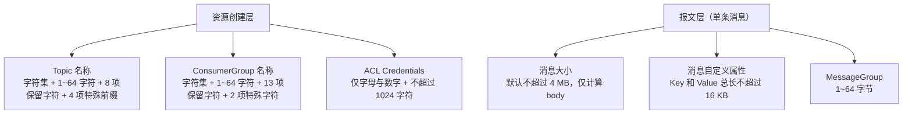
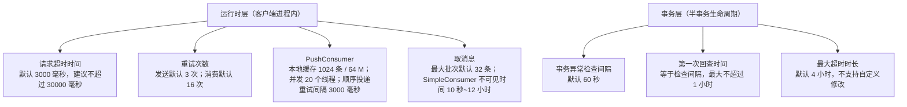
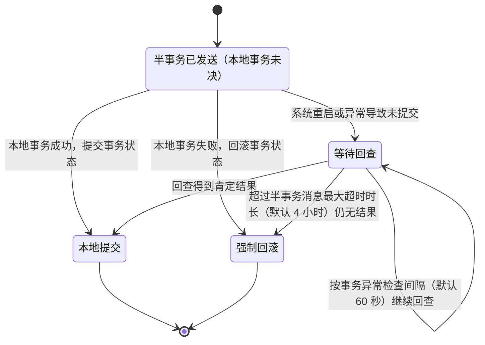

## 为什么需要「使用限制与参数约束」？（痛点引入）

三个在灰度环境才会暴露的问题：

1. 压测时消息发送偶发被拒，日志里看不出原因——事后核对是 Topic 名称超过了 64 个字符：上游明确「字符过长可能会导致消息收发被拒绝」。
2. 一个消费者实例把堆内存吃满——PushConsumer 会在 SDK 本地缓存消息，默认最大缓存 1024 条、最大缓存大小 64 M，缓存量与大小应设置在内存允许的范围内。
3. 消费失败后系统被打爆——消息消费重试次数默认 16 次，重试次数过大容易造成系统压力过量增加；而消息发送重试默认 3 次且「取值范围无限制」，把发送重试调到很大就会阻塞业务线程。

限制清单的价值在于：这些数值不是「经验值」，而是官方给出的默认值与建议范围。写代码前先按清单体检一遍参数，比线上出问题再反推便宜得多。

| 不看限制的代价 | 具体表现 | 对应限制项 |
|----------------|----------|-----------|
| 命名冲突 | Topic/Group 使用保留字符或特殊前缀，系统解析异常 | Topic 名称、ConsumerGroup 名称 |
| 消息被拒 | 名称长度超过 1~64 个字符，收发可能被拒绝 | Topic 名称、ConsumerGroup 名称 |
| 大包传输 | 单条消息超过 4 MB，传输失败或压力过大 | 消息大小 |
| 属性被覆盖 | 自定义属性 Key 撞上系统保留属性 Key | 消息自定义属性 |
| 线程长时间阻塞 | 请求超时时间设得过大，同步调用一直等 | 请求超时时间 |
| 重试风暴 | 重试次数调过大，系统压力过量增加 | 消息发送重试次数、消息消费重试次数 |
| 事务悬挂 | 半事务消息超时未返回结果被强制回滚 | 半事务消息最大超时时长 |
| 内存溢出 | 本地缓存条数/大小超出内存允许范围 | PushConsumer 本地缓存 |
| 大批量重复 | 一次拉取消息数量过大，消费失败时造成大批量消息重复 | 获取消息最大批次 |
| 不可见时间过短 | 消息还没处理完就到了重试窗口，出现重复消费 | SimpleConsumer 最大不可见时间 |

> ### 💡 新人小结：限制清单就是小区门口的「限高限重杆」
>
> 把 RocketMQ 的各项参数限制想成仓库与道路上的物理限位：
>
> - 限高杆（消息大小 4 MB）：不是建议，是过不去就真过不去；
> - 门牌号规则（Topic/Group 命名）：编错号，快递（消息）直接投不了，还会和「物业专用编号」（系统保留字符）撞号；
> - 电梯载重（PushConsumer 本地缓存 1024 条 / 64 M）：超载不是慢一点，是停摆；
> - 等候时长（请求超时 3000 毫秒）：你在门口等多久才走，是本地行为，等太久就把你这个人（线程）占住了；
> - 退货次数上限（消费重试 16 次）：退太多会把仓库压垮。
>
> **一句话总结：默认值是「设计载重」，建议范围是「别超的刻度」，超限行为是「过不去时会怎样」。**

**学习路线图**

```text
命名类限制 → 报文类限制 → 超时与重试 → 事务与半事务 → 消费端运行时 → 超限行为与体检
保留字符     大小/属性     默认值        回查/超时      缓存/并发/批次   排查清单
```

本文完整落地 5.0《参数约束和建议》一表的**全部 17 个参数行**，按「主题与分组 / 消息体与属性 / 超时与重试 / 事务与半事务 / 消费端运行时」五个维度重排，数值与说明逐字保留；文末「17 项参数落位核对」表用于逐行比对。各参数的调优背景见〈基本最佳实践、订阅一致性与 JVM 调优〉，重试策略的阶梯取值见〈消费重试与死信队列〉，本文只讲限制本身。

---

## 术语表

| 术语 | 全称 | 通俗含义（用自己的话） | 在本文中的角色 |
|------|------|------------------------|----------------|
| Topic | 主题 | 一类消息的集合，消息收发的基本单位 | 命名限制的主体 |
| ConsumerGroup | 消费者分组（消费组） | 一组消费行为相同的消费者的逻辑分组 | 命名限制的主体 |
| ACL | Access Control List，访问控制列表 | 权限体系；这里的 Credentials 指它使用的凭据 | 凭据字符与长度限制 |
| AK | AccessKey ID | 凭据里的「用户名」部分 | ACL Credentials 限制项 |
| SK | AccessKey Secret | 凭据里的「密码」部分 | ACL Credentials 限制项 |
| Token | 令牌 | 有时效的认证凭据 | ACL Credentials 限制项 |
| 消息体 / Body | Message Body | 真正的业务报文字节 | 大小限制的计量对象 |
| 消息自定义属性 | User Property | 业务自己塞进消息的键值对 | 长度与保留 Key 限制 |
| 系统保留属性 Key | Reserved Property Key | 被 Tag、延时、重试等机制占用的属性名 | 自定义属性要避让 |
| MessageGroup | 消息分组 | 顺序消息的分组标识，一组内保持先后顺序 | 长度限制项 |
| 请求超时时间 | Request Timeout | 客户端本地同步调用愿意等多久 | 默认值与建议上限 |
| 消息发送重试 | Send Retry | SDK 内置的发送失败重试 | 默认次数与阻塞风险 |
| 消息消费重试 | Consume Retry | 消费失败后服务端重新投递 | 默认次数与压力风险 |
| 半事务消息 | Half Message | 已发送但本地事务结果未定、还不能被消费的事务消息 | 回查与超时限制的主体 |
| 事务异常检查间隔 | Transaction Check Interval | 生产者客户端多久回查一次事务状态 | 默认 60 秒 |
| 回查 | Transaction Check | 服务端/客户端反向确认本地事务成没成功 | 第一次回查时间限制 |
| PushConsumer | 推式消费者 | 5.x 由 SDK 托管拉取与回调的消费者类型 | 本地缓存、重试间隔、并发度限制 |
| SimpleConsumer | 简单消费者 | 5.x 由业务主动 receive/ack 的消费者类型 | 消费不可见时间限制 |
| 消费不可见时间 | Invisible Duration | 消息被取走后对其他消费者不可见的时长，等于处理时长 + 失败后重试间隔 | 最小 10 秒 / 最大 12 小时 |
| 死信队列 | Dead Letter Queue，DLQ | 重试耗尽后消息的去处 | 与消费重试次数联动 |
| TPS | Transactions Per Second | 每秒处理量，衡量吞吐 | 上游限制表未给出该行的数值（见文末说明） |

---

## 约束的三个层次

约束分四层，各层卡的位置不同。下图是前两层（创建资源时与发送单条消息时）：



解读（上图）：左侧一分支的三项在**创建资源或首次收发**时判定，写错会直接触发「特殊字符会导致系统解析出现异常」「字符过长可能会导致消息收发被拒绝」；右侧一分支的三项在**每条消息发送**时判定，超限的处置方向是拆分负载或改传 URL，而不是调大限制。

下图是后两层（客户端进程内与事务异常路径）：



解读：四类约束的**失败时机**不同，这决定了它们由谁负责。命名类在创建资源或首次收发时就暴露，属于开发规范；报文类在每条消息发送时判定，属于业务数据结构设计；运行时类只在客户端进程内生效，属于容量与线程模型设计；事务类只在异常场景（系统重启、未提交）才生效，属于兜底与监控设计。

---

## 一、主题与分组：命名与凭据限制

下表逐字保留上游 5.0《参数约束和建议》对应行。

| 参数 | 建议范围 | 说明 |
|------|----------|------|
| Topic名称 | 字符建议：字母a~z或A~Z、数字0~9以及下划线（_）、短划线（-）和百分号（%）。<br>长度建议：1~64个字符。<br>系统保留字符：Topic名称不允许使用以下保留字符或含有特殊前缀的字符命名。<br>保留字符：TBW102、BenchmarkTest、SELF_TEST_TOPIC、OFFSET_MOVED_EVENT、SCHEDULE_TOPIC_XXXX、RMQ_SYS_TRANS_HALF_TOPIC、RMQ_SYS_TRACE_TOPIC、RMQ_SYS_TRANS_OP_HALF_TOPIC<br>特殊前缀：rmq_sys_、%RETRY%_、%DLQ%_、rocketmq-broker- | Topic命名应该尽量使用简短、常用的字符，避免使用特殊字符。特殊字符会导致系统解析出现异常，字符过长可能会导致消息收发被拒绝。 |
| ConsumerGroup名称 | 字符建议：支持字母a~z或A~Z、数字0~9以及下划线（_）、短划线（-）和百分号（%）。<br>长度建议：1~64个字符。<br>系统保留字符：ConsumerGroup不允许使用以下保留字符或含有特殊前缀的字符命名。<br>保留字符：DEFAULT_CONSUMER、DEFAULT_PRODUCER、TOOLS_CONSUMER、FILTERSRV_CONSUMER、__MONITOR_CONSUMER、CLIENT_INNER_PRODUCER、SELF_TEST_P_GROUP、SELF_TEST_C_GROUP、CID_ONS-HTTP-PROXY、CID_ONSAPI_PERMISSION、CID_ONSAPI_OWNER、CID_ONSAPI_PULL、CID_RMQ_SYS_TRANS<br>特殊字符：CID_RMQ_SYS_、CID_HOUSEKEEPING | 无。 |
| ACL Credentials | 字符建议：AK（AccessKey ID）、SK（AccessKey Secret）和Token仅支持字母a~z或A~Z、数字0~9。<br>长度建议：不超过1024个字符。 | 无。 |

保留名与特殊前缀逐字列出，方便直接对照复制：

```text
Topic 保留字符（8 项）：
TBW102  BenchmarkTest  SELF_TEST_TOPIC  OFFSET_MOVED_EVENT  SCHEDULE_TOPIC_XXXX
RMQ_SYS_TRANS_HALF_TOPIC  RMQ_SYS_TRACE_TOPIC  RMQ_SYS_TRANS_OP_HALF_TOPIC

Topic 特殊前缀（4 项）：
rmq_sys_   %RETRY%_   %DLQ%_   rocketmq-broker-

ConsumerGroup 保留字符（13 项）：
DEFAULT_CONSUMER  DEFAULT_PRODUCER  TOOLS_CONSUMER  FILTERSRV_CONSUMER  __MONITOR_CONSUMER
CLIENT_INNER_PRODUCER  SELF_TEST_P_GROUP  SELF_TEST_C_GROUP  CID_ONS-HTTP-PROXY
CID_ONSAPI_PERMISSION  CID_ONSAPI_OWNER  CID_ONSAPI_PULL  CID_RMQ_SYS_TRANS

ConsumerGroup 特殊字符（2 项）：
CID_RMQ_SYS_   CID_HOUSEKEEPING
```

命名规则用一段可运行的体检脚本落地最直观，三个用例分别对应「合法 / 保留字 / 超长」：

```python
# Topic 命名体检：字符集、长度 1~64、保留字符与特殊前缀（全部依据 5.0《参数约束和建议》原文）
import re

RESERVED_TOPIC = {"TBW102", "BenchmarkTest", "SELF_TEST_TOPIC", "OFFSET_MOVED_EVENT",
                  "SCHEDULE_TOPIC_XXXX", "RMQ_SYS_TRANS_HALF_TOPIC", "RMQ_SYS_TRACE_TOPIC",
                  "RMQ_SYS_TRANS_OP_HALF_TOPIC"}
PREFIX_TOPIC = ("rmq_sys_", "%RETRY%_", "%DLQ%_", "rocketmq-broker-")
CHAR_OK = re.compile(r"^[A-Za-z0-9_%\-]+$")   # 允许集：字母 a~z 或 A~Z、数字 0~9、下划线、短划线、百分号

def check_topic(name):
    if not CHAR_OK.match(name):
        return "REJECT 含允许集之外的字符"
    if not (1 <= len(name) <= 64):
        return f"REJECT 长度 {len(name)} 不在 1~64 个字符内，可能导致消息收发被拒绝"
    if name in RESERVED_TOPIC:
        return "REJECT 命中系统保留字符"
    if name.startswith(PREFIX_TOPIC):
        return "REJECT 命中特殊前缀"
    return "OK"

for t in ["OrderCreated", "TBW102", "a" * 65, "%RETRY%_OrderCreated"]:
    print(t, "->", check_topic(t))
# 输出: OrderCreated -> OK
# 输出: TBW102 -> REJECT 命中系统保留字符
# 输出: aaaaaaaaaaaaaaaaaaaaaaaaaaaaaaaaaaaaaaaaaaaaaaaaaaaaaaaaaaaaaaaaa -> REJECT 长度 65 不在 1~64 个字符内，可能导致消息收发被拒绝
# 输出: %RETRY%_OrderCreated -> REJECT 命中特殊前缀
```

参数解释：`CHAR_OK` 对应上游字符建议（字母、数字、下划线 `_`、短划线 `-`、百分号 `%`）；`1 <= len(name) <= 64` 对应长度建议 1~64 个字符；`RESERVED_TOPIC` 与 `PREFIX_TOPIC` 分别对应 8 项保留字符与 4 项特殊前缀；ConsumerGroup 的校验把这两组集合换成上面的 13 项保留字符与 2 项特殊字符即可，规则同构。

| 场景 | 写法 | 判定 |
|------|------|------|
| ✅ 推荐 | `OrderCreated`、`order-created`（简短、常用字符，长度在 1~64 内） | 符合「尽量使用简短、常用的字符，避免使用特殊字符」 |
| ✅ 推荐 | 顺序消息分组键用业务唯一标识，长度控制在 1~64 字节内 | 符合 MessageGroup 建议 |
| ❌ 不推荐 | `TBW102`、`SCHEDULE_TOPIC_XXXX` 等业务 Topic 名 | 命中系统保留字符，系统解析可能出现异常 |
| ❌ 不推荐 | `%RETRY%mytopic`、`rmq_sys_xxx`、`rocketmq-broker-1` 作为自定义名 | 命中特殊前缀/特殊字符 |
| ❌ 不推荐 | 用 65 个字符以上的长名描述业务 | 长度超过建议范围，可能被拒绝收发 |

> ### 💡 新人小结：保留字符就是「物业办公室的门牌号」
>
> - 小区里的门牌号可以自编，但「物业办公室」「配电房」这类编号是内部预留的，住户不能占用——对应 `TBW102`、`SELF_TEST_TOPIC` 等保留字符；
> - 楼道里带「设备间-」前缀的房间是内部用的，名字以它开头就会被误认——对应 `rmq_sys_`、`%RETRY%_`、`%DLQ%_`、`rocketmq-broker-` 这些特殊前缀；
> - 门牌号超过 64 位，快递单打印不下，直接不投——对应长度建议与「字符过长可能会导致消息收发被拒绝」。
>
> **一句话总结：命名规则不是审美问题，是「能不能被系统认出来」的问题。**

---

## 二、消息体与属性限制

| 参数 | 建议范围 | 说明 |
|------|----------|------|
| 消息大小 | 默认值：不超过4 MB。不涉及消息压缩，仅计算消息体body的大小。<br>取值范围：建议不超过4 MB。 | 消息传输应尽量压缩和控制负载大小，避免超大文件传输。若消息大小不满足限制要求，可以尝试分割消息或使用OSS存储，用消息传输URL。 |
| 消息自定义属性 | 字符限制：所有可见字符。<br>长度建议：属性的Key和Value总长度不超过16 KB。<br>系统保留属性：不允许使用以下保留属性作为自定义属性的Key。保留属性Key | 无。 |
| MessageGroup | 字符限制：所有可见字符。<br>长度建议：1~64字节。 | MessageGroup是顺序消息的分组标识。一般设置为需要保证顺序的一组消息标识，例如订单ID、用户ID等。 |

两条需要交叉核对的事实：

- **4 MB 的计量口径**：上游限制表明确「不涉及消息压缩，仅计算消息体 body 的大小」，所以属性与 Key 的长度不计入这 4 MB；而 16 KB 的限制针对的是「属性的 Key 和 Value 总长度」，两者是相互独立的两块空间。
- **按消息类型区分的更细上限**：5.0《消息（Message）》在行为约束中写明「消息大小不得超过其类型所对应的限制，否则消息会发送失败」，并给出系统默认的最大限制——普通和顺序消息 4 MB、事务和定时或延时消息 64 KB。

> [!NOTE] 版本适用：以上数值来自 5.0 文档。「默认不超过 4 MB」出现在 5.0 限制表；「按消息类型区分 4 MB / 64 KB」出现在 5.0 消息属性文档的行为约束小节。两处口径并非矛盾（前者是通用默认建议，后者按消息类型给出更细限制），写方案时按你要发的消息类型取更严格的那个。

```python
# 报文层三项限制体检（数值全部取自 5.0《参数约束和建议》与《消息（Message）》）
MB, KB = 1024 * 1024, 1024

def check_message(body_bytes, props_kv_bytes, message_group, msg_type="Normal"):
    # hard: 5.0《消息》按消息类型给出的系统默认上限；普通/顺序 4 MB 与限制表「默认不超过 4 MB」一致
    hard = {"Normal": 4 * MB, "FIFO": 4 * MB, "Transaction": 64 * KB, "Delay": 64 * KB}
    if body_bytes > hard[msg_type]:          # 消息大小：仅计算消息体 body，不涉及消息压缩
        return f"REJECT body={body_bytes} 超过 {msg_type} 类型上限 {hard[msg_type]}"
    if props_kv_bytes > 16 * KB:             # 自定义属性：Key 和 Value 总长度不超过 16 KB
        return f"REJECT 属性 Key+Value 总长 {props_kv_bytes} 超过 16 KB"
    gb = len(message_group.encode("utf-8"))  # MessageGroup：长度建议 1~64 字节
    if not (1 <= gb <= 64):
        return f"REJECT MessageGroup {gb} 字节，不在 1~64 字节内"
    return "OK"

print(check_message(3 * MB, 2 * KB, "order-20034568923546", "Normal"))
print(check_message(5 * MB, 2 * KB, "order-1", "Normal"))
print(check_message(100 * KB, 2 * KB, "order-1", "Transaction"))
print(check_message(1 * MB, 20 * KB, "order-1", "Normal"))
print(check_message(1 * MB, 2 * KB, "g" * 65, "FIFO"))
# 输出: OK
# 输出: REJECT body=5242880 超过 Normal 类型上限 4194304
# 输出: REJECT body=102400 超过 Transaction 类型上限 65536
# 输出: REJECT 属性 Key+Value 总长 20480 超过 16 KB
# 输出: REJECT MessageGroup 65 字节，不在 1~64 字节内
```

参数解释：`body_bytes` 只统计消息体字节数（压缩与属性不计入，限制表原文为「不涉及消息压缩，仅计算消息体body的大小」）；`hard` 映射的是 5.0 消息属性文档按类型给出的上限（普通/顺序 4 MB，事务/定时或延时 64 KB），其中普通与顺序的 4 MB 与限制表的默认值同值；`props_kv_bytes` 是自定义属性 Key 与 Value 的总长，上限 16 KB，且 Key 不得使用系统保留属性；`message_group` 按 UTF-8 字节数判定 1~64 字节，语义是顺序消息的分组标识，上游建议用订单 ID、用户 ID 这类需要保证顺序的一组消息标识。

| 超限后的处置 | 上游给出的做法 | 适用限制 |
|--------------|----------------|----------|
| 消息太大 | 尝试分割消息，或使用 OSS 存储、消息里传 URL | 消息大小 4 MB |
| 属性太长 | 上游未给出拆分策略，仅给出「Key 和 Value 总长度不超过 16 KB」的范围约束 | 消息自定义属性 |
| 分组标识过长 | 上游未给出超限行为，仅给出「1~64 字节」建议与用订单 ID、用户 ID 的设置建议 | MessageGroup |

---

## 三、超时与重试限制

| 参数 | 建议范围 | 说明 |
|------|----------|------|
| 请求超时时间 | 默认值：3000毫秒。<br>取值范围：该参数为客户端本地行为，取值范围建议不要超过30000毫秒。 | 请求超时时间是客户端本地同步调用的等待时间，请根据实际应用设置合理的取值，避免线程阻塞时间过长。 |
| 消息发送重试次数 | 默认值：3次。<br>取值范围：无限制。 | 消息发送重试是客户端SDK内置的重试策略，对应用不可见，建议取值不要过大，避免阻塞业务线程。如果消息达到最大重试次数后还未发送成功，建议业务侧做好兜底处理，保证消息可靠性。 |
| 消息消费重试次数 | 默认值：16次。 | 消费重试次数应根据实际业务需求设置合理的参数值，避免使用重试进行无限触发。重试次数过大容易造成系统压力过量增加。 |

「客户端本地行为」这五个字很关键：请求超时时间控制的是**本进程这一次同步调用愿意等多久**，不是服务端的处理时限。把它调到很大，代价是业务线程被占住的时间变长。

```python
# 客户端参数体检：超时与两个重试次数（默认值与建议范围均取自 5.0 限制表）
def audit(timeout_ms, send_retry, consume_retry):
    out = []
    if timeout_ms is None:
        out.append(f"请求超时时间 使用默认值 3000 毫秒")
    elif timeout_ms > 30000:
        out.append(f"请求超时时间 {timeout_ms} 毫秒 超过建议上限 30000 毫秒，会造成长时间线程阻塞")
    else:
        out.append(f"请求超时时间 {timeout_ms} 毫秒 在建议范围内（默认 3000 毫秒）")

    if send_retry is None:
        out.append("消息发送重试次数 使用默认值 3 次（SDK 内置、对应用不可见；取值范围无限制，建议不要过大）")
    elif send_retry > 3:
        out.append(f"消息发送重试次数 {send_retry} 大于默认 3 次，需评估是否阻塞业务线程，并准备兜底")
    else:
        out.append(f"消息发送重试次数 {send_retry} 次 OK")

    if consume_retry is None:
        out.append("消息消费重试次数 使用默认值 16 次")
    elif consume_retry > 16:
        out.append(f"消息消费重试次数 {consume_retry} 大于默认 16 次，重试过多会过量增加系统压力")
    else:
        out.append(f"消息消费重试次数 {consume_retry} 次 OK")
    return out

for line in audit(None, None, None):
    print(line)
for line in audit(60000, 10, 32):
    print("调整值 ->", line)
# 输出: 请求超时时间 使用默认值 3000 毫秒
# 输出: 消息发送重试次数 使用默认值 3 次（SDK 内置、对应用不可见；取值范围无限制，建议不要过大）
# 输出: 消息消费重试次数 使用默认值 16 次
# 调整值 -> 请求超时时间 60000 毫秒 超过建议上限 30000 毫秒，会造成长时间线程阻塞
# 调整值 -> 消息发送重试次数 10 大于默认 3 次，需评估是否阻塞业务线程，并准备兜底
# 调整值 -> 消息消费重试次数 32 大于默认 16 次，重试过多会过量增加系统压力
```

参数解释：三个入参分别对应「请求超时时间」「消息发送重试次数」「消息消费重试次数」；传 `None` 表示不显式设置、走默认值（3000 毫秒 / 3 次 / 16 次）；发送重试的「取值范围：无限制」是上游原文，但同格建议「取值不要过大，避免阻塞业务线程」，并把「达到最大重试次数后还未发送成功」时的责任交回业务侧兜底；消费重试没有给出取值范围，只给出「避免使用重试进行无限触发」。

✅ 推荐：超时按实际调用耗时设置并保留余量，发送重试保持默认，达到上限后业务侧兜底（记录并人工/自动补偿）。
❌ 不推荐：靠「把重试次数调到很大」来表达「必须发出去」的意图——上游明确反对使用重试进行无限触发。

---

## 四、事务与半事务限制

| 参数 | 建议范围 | 说明 |
|------|----------|------|
| 事务异常检查间隔 | 默认值：60秒。 | 事务异常检查间隔指的是，半事务消息因系统重启或异常情况导致没有提交，生产者客户端会按照该间隔时间进行事务状态回查。间隔时长不建议设置过短，否则频繁的回查调用会影响系统性能。 |
| 半事务消息第一次回查时间 | 默认值：取值等于[事务异常检查间隔]<br>最大限制：不超过1小时。 | 无。 |
| 半事务消息最大超时时长 | 默认值：4小时。<br>取值范围：不支持自定义修改。 | 半事务消息因系统重启或异常情况导致没有提交，生产者客户端会按照事务异常检查间隔时间进行回查，若超过半事务消息超时时长后没有返回结果，半事务消息将会被强制回滚。您可以通过监控该指标避免异常事务。 |

这三个参数只在异常路径上生效——正常提交的事务走不到回查。下图把「谁在什么时候做什么」画清楚：



解读：三条数值构成一条时间线。第一次回查发生在「事务异常检查间隔」之后（默认值取值等于事务异常检查间隔，最大限制不超过 1 小时）；随后每隔一个检查间隔继续回查（默认 60 秒，不建议设置过短，否则频繁回查调用会影响系统性能）；累计到最大超时时长（默认 4 小时，且不支持自定义修改）还没有返回结果，半事务消息就被强制回滚。上游同时建议**通过监控该指标避免异常事务**——也就是把「有消息进入等待回查」这件事做成告警项，而不是等它被回滚后才发现。

> [!NOTE] 版本适用：5.0 领域模型要求事务消息的生产者**必须**设置预绑定主题列表，并与事务检查器（TransactionChecker）配合使用；4.x 生产者属性表里对应的字段是 `transactionId`（会在事务消息中使用）。迁移到 5.x 时事务消息的 Topic 需一并列入预绑定列表，否则故障重启后旧事务消息的回查覆盖不到。

| 参数 | 默认值 | 可调范围 | 超限/调错的表现（上游口径） |
|------|--------|----------|------------------------------|
| 事务异常检查间隔 | 60 秒 | 上游未给出范围，仅给出「不建议设置过短」 | 设置过短 → 频繁回查调用会影响系统性能 |
| 半事务消息第一次回查时间 | 取值等于事务异常检查间隔 | 最大限制：不超过 1 小时 | 上游未给出超限行为 |
| 半事务消息最大超时时长 | 4 小时 | 不支持自定义修改 | 超过该时长仍无返回结果 → 半事务消息被强制回滚 |

---

## 五、消费端运行时限制

| 参数 | 建议范围 | 说明 |
|------|----------|------|
| PushConsumer本地缓存 | 默认值：<br>最大缓存数量：1024条。<br>最大缓存大小：64 M。<br>取值范围：支持用户自定义设置，无限制。 | 消费者类型为PushConsumer时，为提高消费者吞吐量和性能，客户端会在SDK本地缓存部分消息。缓存的消息的数量和大小应设置在系统内存允许的范围内。 |
| PushConsumer重试间隔时长 | 默认值：<br>非顺序性投递：间隔时间阶梯变化，具体取值，请参见PushConsumer消费重试策略。<br>顺序性投递：3000毫秒。 | 无。 |
| PushConsumer消费并发度 | 默认值：20个线程。 | 无。 |
| 获取消息最大批次 | 默认值：32条。 | 消费者从服务端获取消息时，一次获取到最大消息条数。建议按照实际业务设置合理的参数值，一次获取消息数量过大容易在消费失败时造成大批量消息重复。 |
| SimpleConsumer最大不可见时间 | 默认值：用户必填参数，无默认值。<br>取值范围建议：最小10秒；最大12小时。 | 消费不可见时间指的是消息处理+失败后重试间隔的总时长，建议设置时取值比实际需要耗费的时间稍微长一些。 |

这五项的相互关系是：**并发度（20 个线程）决定同时处理多少条消息，本地缓存（1024 条 / 64 M）决定 SDK 会先囤多少，单次最大批次（32 条）决定一次取多少，不可见时间决定取走的消息多久后要被别人接手。**任何一项单独调大而不匹配其它项，都会在消费失败或内存两个方向上放大后果。

```java
// ========== 推荐写法：SimpleConsumer 的不可见时间取「实际耗时 + 一点余量」 ==========
List<MessageView> messageViewList = simpleConsumer.receive(10, Duration.ofSeconds(30));
// 参数一 maxMessageNum=10：本次批量获取的消息条数，须落在「一次获取最大消息条数」之内（默认上限 32 条）
// 参数二 invisibleDuration=30 秒：消费不可见时间，满足最小 10 秒、最大 12 小时的建议范围
// 该参数无默认值，属于用户必填参数
// 输出: 返回最多 10 条只读消息；未 ack 的消息在 30 秒后可被重新获取

// ========== 不推荐写法 ❌ ==========
// ❌ 不可见时间 5 秒：低于建议最小值 10 秒，消息还没处理完就可能进入重试窗口，造成重复消费
// List<MessageView> bad = simpleConsumer.receive(10, Duration.ofSeconds(5));
// ❌ 单批次拉到远大于 32 条：一次获取消息数量过大，消费失败时造成大批量消息重复
```

参数解释：`receive(maxMessageNum, invisibleDuration)` 的第一个参数对应「获取消息最大批次」（默认值 32 条），第二个参数对应「SimpleConsumer 最大不可见时间」（必填、无默认值，建议最小 10 秒、最大 12 小时）；不可见时间是「消息处理 + 失败后重试间隔」的总时长，所以取值应比实际需要耗费的时间稍微长一些；处理成功时调用 `ack(messageView)` 提交结果，处理失败时无需额外操作，不回复 ACK 即可在不可见时间到期后进入重试。

| 运行时项 | 默认值 | 建议/取值范围 | 调错的后果（上游原文口径） |
|----------|--------|---------------|-----------------------------|
| PushConsumer 本地缓存条数 | 1024 条 | 支持用户自定义设置，无限制 | 缓存数量与大小应设置在系统内存允许的范围内 |
| PushConsumer 本地缓存大小 | 64 M | 支持用户自定义设置，无限制 | 同上 |
| PushConsumer 消费并发度 | 20 个线程 | 上游未给出范围 | 上游未给出 |
| PushConsumer 重试间隔（顺序性投递） | 3000 毫秒 | 上游未给出范围 | 上游未给出 |
| PushConsumer 重试间隔（非顺序性投递） | 间隔时间阶梯变化，具体取值请参见 PushConsumer 消费重试策略 | 见对应策略文档 | 上游未给出 |
| 获取消息最大批次 | 32 条 | 上游未给出范围，建议按实际业务设置 | 一次获取消息数量过大，消费失败时造成大批量消息重复 |
| SimpleConsumer 最大不可见时间 | 必填，无默认值 | 最小 10 秒；最大 12 小时 | 取值应比实际需要耗时稍长，否则处理未完即进入重试 |
| 请求超时时间 | 3000 毫秒 | 建议不超过 30000 毫秒 | 线程阻塞时间过长 |

---

## 超限行为速查：哪些有明确依据，哪些没有

「超限会怎样」是这份清单最常被追问的部分。下表按上游依据逐条如实标注，没有依据的一律写「上游未给出」，不做推定。

| 参数 | 上游是否给出超限行为 | 依据原文（截取） |
|------|----------------------|------------------|
| Topic名称 | 已给出 | 特殊字符会导致系统解析出现异常，字符过长可能会导致消息收发被拒绝。 |
| ConsumerGroup名称 | 未给出（说明栏原文为「无。」） | 无。 |
| ACL Credentials | 未给出（说明栏原文为「无。」） | 无。 |
| 请求超时时间 | 已给出（风险描述） | 请根据实际应用设置合理的取值，避免线程阻塞时间过长。 |
| 消息大小 | 已给出 | 消息传输应尽量压缩和控制负载大小，避免超大文件传输；若消息大小不满足限制要求，可以尝试分割消息或使用OSS存储，用消息传输URL。（5.0《消息》行为约束另述：消息大小不得超过其类型所对应的限制，否则消息会发送失败。） |
| 消息自定义属性 | 未给出（说明栏原文为「无。」） | 无。 |
| MessageGroup | 未给出（说明栏仅给用途） | MessageGroup是顺序消息的分组标识…… |
| 消息发送重试次数 | 已给出 | 如果消息达到最大重试次数后还未发送成功，建议业务侧做好兜底处理，保证消息可靠性。 |
| 消息消费重试次数 | 已给出（风险描述） | 重试次数过大容易造成系统压力过量增加。 |
| 事务异常检查间隔 | 已给出（风险描述） | 间隔时长不建议设置过短，否则频繁的回查调用会影响系统性能。 |
| 半事务消息第一次回查时间 | 未给出（说明栏原文为「无。」） | 无。 |
| 半事务消息最大超时时长 | 已给出 | 若超过半事务消息超时时长后没有返回结果，半事务消息将会被强制回滚。 |
| PushConsumer本地缓存 | 已给出约束方向 | 缓存的消息的数量和大小应设置在系统内存允许的范围内。 |
| PushConsumer重试间隔时长 | 未给出（说明栏原文为「无。」） | 无。 |
| PushConsumer消费并发度 | 未给出（说明栏原文为「无。」） | 无。 |
| 获取消息最大批次 | 已给出 | 一次获取消息数量过大容易在消费失败时造成大批量消息重复。 |
| SimpleConsumer最大不可见时间 | 已给出建议方向 | 建议设置时取值比实际需要耗费的时间稍微长一些。 |

统计口径：17 个参数行中，说明栏原文为「无。」的有 6 行——ConsumerGroup名称、ACL Credentials、消息自定义属性、半事务消息第一次回查时间、PushConsumer重试间隔时长、PushConsumer消费并发度。这 6 行的超限行为一律标注「上游未给出」，其余 11 行给出了明确的风险描述或处置建议。

> [!NOTE] 版本适用：本文所有数值来自 5.0《参数约束和建议》与 5.0《消息（Message）》。4.x 文档体系没有对应的这一整张限制表；4.x 侧对属性的约束以「系统保留属性 Key 集合」的形式给出（37 个，见〈4.x 与 5.0 的差异及迁移选型〉），与 5.0 的「消息自定义属性不允许使用保留属性 Key」是同一条纪律的两种表述。

---

## 17 项参数落位核对

本文与上游一一对应的核验表：上游 5.0《参数约束和建议》共 17 个参数行，本文按维度重排后仍为 17 个参数行。

| 序号 | 上游参数行 | 本文所在小节 | 关键数值 |
|------|-----------|--------------|----------|
| 1 | Topic名称 | 一、主题与分组 | 1~64 个字符；8 项保留字符；4 项特殊前缀 |
| 2 | ConsumerGroup名称 | 一、主题与分组 | 1~64 个字符；13 项保留字符；2 项特殊字符 |
| 3 | ACL Credentials | 一、主题与分组 | 字母与数字；不超过 1024 个字符 |
| 4 | 请求超时时间 | 三、超时与重试 | 默认 3000 毫秒；建议不超过 30000 毫秒 |
| 5 | 消息大小 | 二、消息体与属性 | 默认与建议均不超过 4 MB；仅算 body |
| 6 | 消息自定义属性 | 二、消息体与属性 | 所有可见字符；Key+Value 总长不超过 16 KB |
| 7 | MessageGroup | 二、消息体与属性 | 所有可见字符；1~64 字节 |
| 8 | 消息发送重试次数 | 三、超时与重试 | 默认 3 次；取值范围无限制 |
| 9 | 消息消费重试次数 | 三、超时与重试 | 默认 16 次 |
| 10 | 事务异常检查间隔 | 四、事务与半事务 | 默认 60 秒 |
| 11 | 半事务消息第一次回查时间 | 四、事务与半事务 | 默认等于事务异常检查间隔；最大不超过 1 小时 |
| 12 | 半事务消息最大超时时长 | 四、事务与半事务 | 默认 4 小时；不支持自定义修改 |
| 13 | PushConsumer本地缓存 | 五、消费端运行时 | 最大缓存 1024 条；最大缓存大小 64 M；支持自定义、无限制 |
| 14 | PushConsumer重试间隔时长 | 五、消费端运行时 | 非顺序投递阶梯变化；顺序投递 3000 毫秒 |
| 15 | PushConsumer消费并发度 | 五、消费端运行时 | 默认 20 个线程 |
| 16 | 获取消息最大批次 | 五、消费端运行时 | 默认 32 条 |
| 17 | SimpleConsumer最大不可见时间 | 五、消费端运行时 | 必填无默认值；最小 10 秒、最大 12 小时 |

关于任务里提到的「吞吐与连接」「定时与延时」两个维度：上游这张 17 行的表里**没有** TPS/连接数的独立参数行，也**没有**定时消息时长或定时精度的行——与时间相关的行是超时与重试（请求超时时间、两级重试次数）以及事务回查（三项）。定时/延时消息的上限（最大可设置定时时长 40 天）出现在 5.0《消息（Message）》的「定时时间（可选）」属性约束里，本文不把它当限制表行处理，只在〈4.x 与 5.0 的差异及迁移选型〉的对照表中作为语义变化项出现。

---

## 排查清单：从现象倒推限制项

| 现象 | 先查哪几项 | 判定依据 |
|------|-----------|----------|
| 发送被拒且无明显异常 | Topic 名称长度与字符、消息大小 | 字符过长可能会导致消息收发被拒绝；消息大小不得超过类型对应限制 |
| 消息收发结果诡异、解析异常 | Topic/Group 是否用了保留字符或特殊前缀 | 特殊字符会导致系统解析出现异常 |
| 属性读取到意料之外的值 | 自定义属性 Key 是否撞上系统保留属性 Key | 不允许使用保留属性作为自定义属性的 Key |
| 消费端频繁 Full GC / OOM | PushConsumer 本地缓存条数与大小 | 缓存数量与大小应设置在系统内存允许的范围内 |
| 消费失败后重复量激增 | 获取消息最大批次、消费重试次数 | 一次获取消息数量过大容易在消费失败时造成大批量消息重复；重试次数过大造成系统压力过量增加 |
| 同一批消息反复被拉到 | SimpleConsumer 不可见时间 | 不可见时间是「处理 + 失败后重试间隔」总时长，应比实际耗时稍长 |
| 上游调用线程池被打满 | 请求超时时间、消息发送重试次数 | 超时是本地同步调用的等待时间；发送重试会阻塞业务线程 |
| 事务消息莫名丢失 | 事务异常检查间隔、半事务最大超时时长 | 超过超时时长仍无返回结果会被强制回滚 |
| 回查调用过于频繁 | 事务异常检查间隔是否过短 | 间隔时长不建议设置过短，否则频繁回查影响系统性能 |

---

## 要点总结

1. **命名类限制是「能被识别」的前提**：Topic 与 ConsumerGroup 都是 1~64 个字符、字符集为字母/数字/下划线/短划线/百分号，并各自有一份保留名与前缀清单（Topic 8 项保留字符 + 4 项特殊前缀；ConsumerGroup 13 项保留字符 + 2 项特殊字符）；Topic 的说明栏还点明了后果——特殊字符导致解析异常，字符过长可能导致收发被拒绝。
2. **报文类限制要分清计量对象**：4 MB 只算消息体 body、不涉及压缩；自定义属性 Key+Value 总长 16 KB；MessageGroup 1~64 字节；5.0 消息属性文档还按类型收紧为「普通/顺序 4 MB、事务/定时或延时 64 KB」，按更严的取。
3. **超时与重试是「本地代价」**：请求超时默认 3000 毫秒、建议不超过 30000 毫秒；发送重试默认 3 次且对应用不可见，调到很大就靠业务侧兜底；消费重试默认 16 次，过大就变成压力放大器。
4. **事务三项只在异常路径生效，且默认值构成时间线**：检查间隔 60 秒 → 第一次回查等于检查间隔且最大不超过 1 小时 → 最大超时 4 小时（不支持自定义修改），超时无结果即强制回滚；上游建议把该指标纳入监控。
5. **消费端四项互相牵连**：本地缓存 1024 条 / 64 M、并发 20 线程、单次最大批次 32 条、SimpleConsumer 不可见时间必填（10 秒~12 小时）；调整任何一项都要同时问「失败时的重复面有多大」和「进程内存扛不扛得住」。

---

> ### 💡 新人小结：使用限制学完了，记住这 5 点
>
> 1. **先跑一遍命名体检**：把 1~64 字符与保留名清单写进 CI 或代码评审清单，比线上排查「解析异常」划算。
> 2. **大报文不要塞进消息**：4 MB 只算 body，超了就按上游建议做拆分或改传 OSS 的 URL。
> 3. **默认值不等于推荐值，但它是唯一有据可依的值**：3000 毫秒、3 次、16 次、60 秒、4 小时、1024 条、64 M、20 线程、32 条——改任何一个都要能说出理由和代价。
> 4. **重试是放大器不是保险丝**：发送与消费两侧的重试都会放大压力，真正的可靠性由业务侧兜底与监控提供。
> 5. **没有依据的不要编**：上游说明栏写「无。」的 6 行，超限行为就标注「上游未给出」，用监控与灰度去验证，而不是靠推测下结论。
