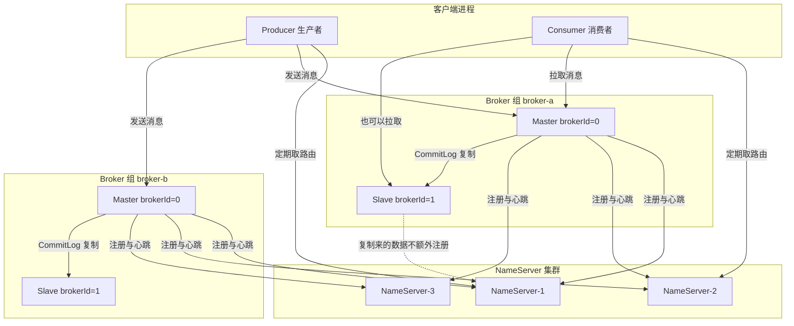
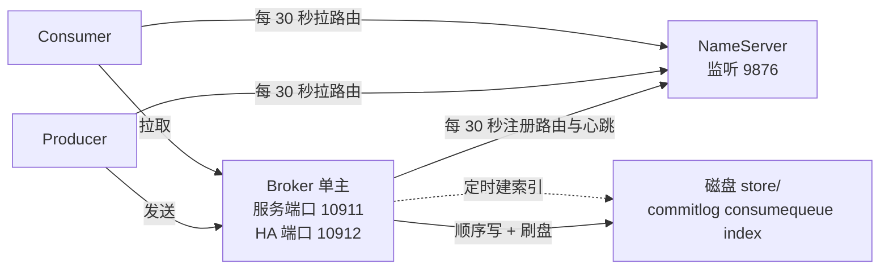
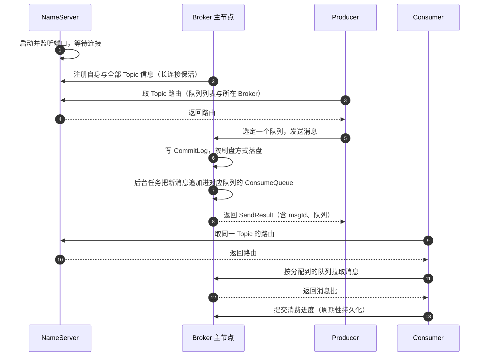
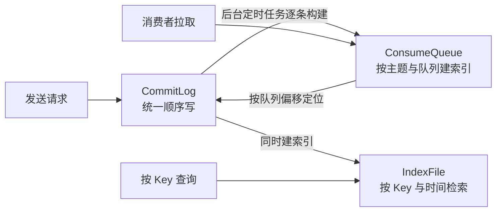
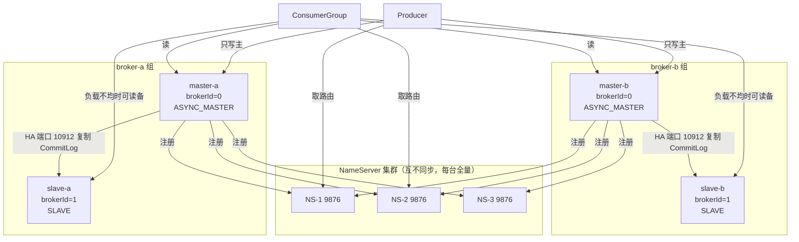
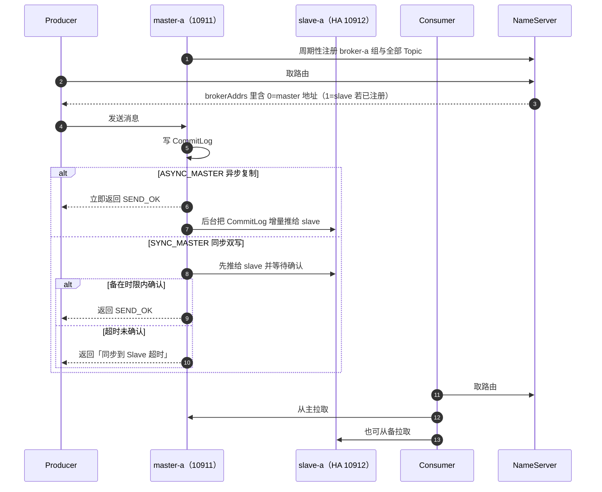

## 为什么要先把组件表摊开，再谈部署？（痛点引入）

集群出了问题，运维和开发说的往往不是同一种语言：

- 开发说「发送超时了」，运维去看 Broker 一切正常，最后发现是客户端拿到的路由里写着 `192.168.1.5:10911`，而那个 IP 在容器网络里根本不通；
- 有人说「主从已经配好了，主挂了备会自动顶上」，实际 4.x 的主从配对里备节点只能读，主机宕机后备机**不会**自动变主；
- 有人把 NameServer 集群当注册中心用，配了 3 台却担心「数据不一致」，而 4.x 的 NameServer 各实例之间**根本不同步**，每台都是全量；
- 有人删了 Broker 机器上的 `store/commitlog` 目录来「清磁盘」，顺手把 `consumequeue` 留下了，结果队列偏移全部错乱。

这四件事的共同根源是：组件职责、连接方向、数据落盘位置这三张地图没在脑子里建立起来。本文就是把这张地图画清楚——先给组件清单与职责，再分别走通**单机部署**与**生产主从部署（master-a + slave-a、master-b + slave-b）**两套架构下的通信流程。所有结论都区分两类来源：一类来自官方文档，正文按上游仓库相对路径标注出处；一类来自本机 4.9.8 发行包的实测，原样贴出命令与回显。

> ### 💡 新人小结：先记住「一个目录、一个仓库、两种人」
>
> 把 4.x 集群想成一个物流网络：
>
> - **NameServer 是查询台**：只回答「这个主题在哪些仓库、有几个门位」，它自己不存货，也不和别的查询台对账；
> - **Broker 是仓库**：真正把包裹（消息）写进货架（磁盘文件），并保证自己宕机重启后货还在；
> - **Producer 是寄件人**、**Consumer 是取件人**：两者都不直接认识仓库，都先问查询台要地址，再和仓库建立连接；
> - **Master/Slave 是同一仓库的主货架和副本货架**：它们靠「同名 + 不同编号」配对，编号 0 是主，非 0 是从。
>
> 后面所有流程图，都是这四个角色之间来回发消息的过程。

**学习路线**

```text
组件清单与职责 → 单机部署：拓扑与收发全流程 → 存储文件族（数据落在哪）
→ 生产主从部署：配对规则、拓扑、复制流程、四种发送状态
→ 部署形态取舍对照 → 4.9.8 与 5.0 的组件差异 → 常见误区自检 → 要点总结
```

---

## 组件清单：4.9.8 里到底有哪些角色

官方文档把部署架构拆成四大部分：生产者 Producer、消费者 Consumer、名字服务器 NameServer、代理服务器 Broker（出处：`docs/00-introduction/02whatis.md`「RocketMQ的部署模型」一节）。这张表是理解一切流程的地基。

| 组件 | 在本文中的角色 | 职责（上游口径） | 有没有状态 | 崩了会怎样 |
|------|----------------|------------------|------------|------------|
| NameServer | 路由注册中心 | 「一个简单的 Topic 路由注册中心，支持 Topic、Broker 的动态注册与发现」，两大功能：Broker 管理（含心跳检测存活）、路由信息管理 | 几乎无状态，实例间无信息同步 | 客户端向其余 NameServer 取路由；整集群全挂时，已建连接的客户端仍能按缓存路由收发（缓存过期后失效） |
| Broker（Master） | 消息仓库主节点 | 「主要负责消息的存储、投递和查询以及服务高可用保证」 | 有状态，数据落盘 | 该节点上未被消费的消息在恢复前不可订阅（多主无备模式的官方缺点） |
| Broker（Slave） | 消息仓库副本 | 与 Master 同名配对，接收主节点的 CommitLog 复制；Consumer 可以直接从它订阅 | 有状态，数据是主节点的副本 | 只影响冗余度与读能力，不影响写入 |
| Producer | 消息投递方 | 通过负载均衡模块选择 Broker 集群队列投递，支持快速失败与重试；完全无状态 | 无状态 | 应用自身的事，集群不受影响 |
| Consumer | 消息接收方 | 支持推/拉两种模式、集群/广播两种消费方式；可从 Master 或 Slave 订阅 | 有状态的是**消费进度**，持久化在 Broker 侧 | 进度未提交成功时会重复消费，故业务必须幂等 |
| ConsumerGroup | 消费并行与容灾单位 | 同组实例负载均衡分配队列；组间互相独立 | 概念实体 | 队列数决定同组可并行的实例上限 |
| Topic / MessageQueue | 逻辑分类 / 物理分区 | Topic 是订阅的基本单位；为写入与消费的横向扩展把 Topic 分成队列 | 队列数存在 Broker 配置里 | 队列数变更会影响顺序语义与负载均衡 |
| mqadmin（Admin） | 运维入口 | 主题/集群/Broker 的创建、查询、改配置，命令行工具（详见命令行工具篇） | 无常驻状态，一条命令一个进程 | 只影响运维操作，不影响消息链路 |
| Dashboard / Exporter | 控制台 / 指标出口 | 4.x 部署文档另有「可视化控制台」与「Prometheus 指标导出」两篇 | 旁路组件 | 只影响可观测性 |

组件关系一图收拢。实线是「谁主动连谁」，虚线是「谁从谁那里读信息」：



读这张图要注意三件事，都能在官方文档里对上：

1. **Broker 向集群里的每一台 NameServer 注册**，不是随便挑一台（「每个 Broker 与 NameServer 集群中的所有节点建立长连接，定时注册 Topic 信息到所有 NameServer」，出处：`docs/00-introduction/02whatis.md`）。所以每台 NameServer 都持有全量路由，任意一台下线不影响发现。
2. **Producer 与 Consumer 只连其中一台 NameServer** 取路由，之后直接与 Broker 建长连接；Producer 向 Master 发，Consumer 可以既从 Master 也从 Slave 读（同出处「部署模型小结」）。
3. **Slave 不额外注册路由**——路由里的 Broker 组由主节点上报，备节点的地址出现在该组 `brokerAddrs` 映射里（这一条本文在单机节先给实测结构，再在主从节说明如何解读）。

| 上游文档 | 能查到什么 |
|----------|------------|
| `docs/00-introduction/02whatis.md` | 四大角色职责、部署模型小结、集群工作流程五步 |
| `docs/04-deployment/01deploy.md` | 四种部署形态、启动顺序、Broker 与 Slave 的配对规则 |
| `docs/05-bestPractice/01bestpractice.md` | 四种发送状态语义、`brokerIP1`/`brokerIP2` 含义、角色与刷盘方式的取舍 |
| `docs/06-parameterConfiguration/02server.md` | `brokerRole`/`brokerId`/`flushDiskType` 等键的默认值与有效值 |
| `docs/06-parameterConfiguration/01local.md` | 客户端路由轮询与心跳周期 |
| `docs/05-bestPractice/02dledger.md` | DLedger 自动选主形态的配置项 |

---

## 单机部署：一个 NameServer + 一个 Broker

这是最小可跑架构，也是本机当前的形态（一个 NameServer 进程 + 一个 Broker 进程，`brokerId=0`、`brokerRole=ASYNC_MASTER`、没有备节点）。官方快速开始走的就是这条路（出处：`docs/01-quickstart/01quickstart.md`）。



### 一次收发的完整时序



流程里的每一步都能在官方文档「集群工作流程」段落找到对应说法：启动 NameServer → 启动 Broker 并注册（心跳包含当前 Broker 信息与所有 Topic 信息）→ 创建 Topic（可指定落在哪些 Broker，也可发送时自动创建）→ 生产者先连一台 NameServer 取路由、轮询队列列表选一个队列、再与队列所在 Broker 建长连接发送 → 消费者同样先取路由再直连 Broker 消费（出处：`docs/00-introduction/02whatis.md`）。

周期数值不是推测，客户端侧的默认值在参数文档里写着：

| 周期 | 默认值 | 作用 | 出处 |
|------|--------|------|------|
| `pollNameServerInterval` | 30000 毫秒 | 客户端向 NameServer 拉路由的间隔 | `docs/06-parameterConfiguration/01local.md` |
| `heartbeatBrokerInterval` | 30000 毫秒 | 客户端向 Broker 发注册心跳的间隔 | 同上 |
| `persistConsumerOffsetInterval` | 5000 毫秒 | 消费者向 Broker 持久化消费进度的间隔 | 同上 |
| Broker 侧注册周期 | 上游客户端/服务端参数表未单列该键 | 本文改用行为证据：见下方 namesrv.log 的 30 秒节拍 | 实测 |

### 实测证据：本机这一台单机部署长什么样

四个角度交叉验证，全部原样回贴。

**一、进程与端口归属。** `jps` 只列 JVM，`netstat` 把端口钉到 pid：

```text
$ jps -l
28160 org.apache.rocketmq.namesrv.NamesrvStartup
29044 org.apache.rocketmq.broker.BrokerStartup

$ netstat -ano | grep LISTEN | grep -E "9876|10911|10912"
  TCP    0.0.0.0:9876     LISTENING   28160
  TCP    0.0.0.0:10911    LISTENING   29044
  TCP    0.0.0.0:10912    LISTENING   29044
```

三个端口的分工：`9876` 是 NameServer 的路由服务端口；`10911` 是 Broker 的业务端口（`listenPort`，官方定义为「接受客户端连接的监听端口」，出处：`docs/05-bestPractice/01bestpractice.md`）；`10912` 是 HA 端口，即 `haListenPort`，专供 Slave 同步（见下文主从节）。**注意 10912 在单机（无备）时也在监听**：主节点一起来就准备好接受备节点连接，这是它随时可以被配成主从的原因。

**二、Broker 的注册节拍。** NameServer 日志里，同一个 Broker 组的注册记录严格 30 秒一条：

```text
$ grep -a "master address change" ~/logs/rocketmqlogs/namesrv.log | tail -3
2026-10-18 01:08:50 INFO RemotingExecutorThread_1 - cluster [DefaultCluster] brokerName [X] master address change from 192.168.3.103:10911 to 192.168.3.103:10911
2026-10-18 01:09:20 INFO RemotingExecutorThread_3 - cluster [DefaultCluster] brokerName [X] master address change from 192.168.3.103:10911 to 192.168.3.103:10911
2026-10-18 01:09:50 INFO RemotingExecutorThread_4 - cluster [DefaultCluster] brokerName [X] master address change from 192.168.3.103:10911 to 192.168.3.103:10911
```

01:08:50 → 01:09:20 → 01:09:50，间隔 30 秒整，全文件共 366 条同类记录。「from 与 to 完全相同」正是周期性重复注册的痕迹，不是主地址真的变了。Broker 下线时也会留痕：

```text
2026-10-17 23:15:34 INFO RemotingExecutorThread_8 - unregisterBroker, remove name from brokerAddrTable OK, X
2026-10-17 23:15:34 INFO RemotingExecutorThread_8 - unregisterBroker, remove cluster from clusterAddrTable DefaultCluster
```

这两行说明 NameServer 的路由信息是**靠心跳维持的临时账本**（`brokerAddrTable`、`clusterAddrTable`），不是持久化配置：Broker 一掉线，条目立刻被摘。

**三、路由数据的真实结构。** `mqadmin topicRoute` 的返回是理解一切发现机制的钥匙：

```text
$ bash bin/mqadmin.sh topicRoute -n 127.0.0.1:9876 -t TP_ORDER_SEQ
{
	"brokerDatas":[
		{
			"brokerAddrs":{0:"192.168.3.103:10911"
			},
			"brokerName":"X",
			"cluster":"DefaultCluster"
		}
	],
	"filterServerTable":{},
	"queueDatas":[
		{
			"brokerName":"X",
			"perm":6,
			"readQueueNums":4,
			"topicSysFlag":0,
			"writeQueueNums":4
		}
	]
}
```

`brokerAddrs` 是个**以 brokerId 为键的映射**：本机只有一个主节点，所以只有 `{0:"..."}`。配了备之后，同一个键映射里会多出 `1` 这一项——这正是「一个 Master 对应多个 Slave、按 brokerId 区分」这条规则在路由数据里的落点。`queueDatas` 给出该主题在这组 Broker 上的读写队列数与权限（`perm=6` 表示可读写）。

**四、集群视图。** `mqadmin clusterList` 把「谁在跑、什么版本、TPS、磁盘余量」压成一行：

```text
$ bash bin/mqadmin.sh clusterList -n 127.0.0.1:9876
DefaultCluster    X    0    192.168.3.103:10911    V4_9_8    0.00(0,0ms)    0.00(0,0ms)    0    497849.73    0.3100
```

第三列 `0` 就是 `brokerId`：单机部署下这一行就是集群的全部。版本串 `V4_9_8` 与发行包一致，等于给本文所有结论钉了版本锚。

> ### 💡 新人小结：为什么「只配 127.0.0.1:9876」也能连上 Broker
>
> 上面那堆回显里有个容易忽略的关键差异：客户端连的是 `127.0.0.1:9876`，但路由里返回的 Broker 地址是 **`192.168.3.103:10911`**，不是 `127.0.0.1`。
>
> 原因是 NameServer 只做目录，客户端拿到路由后是**按 Broker 自己上报的地址**去建连接的。Broker 上报哪个 IP 由 `brokerIP1` 决定（官方定义：「Broker 服务地址」，出处：`docs/06-parameterConfiguration/02server.md`）；本机没显式配置它，Broker 就选了本机局域网 IP。
>
> 于是坑来了：同一台机器上的应用能连（因为 `192.168.3.103` 也通），但跨网络、进容器、或者对方只放行回环地址时就会出现「NameServer 连得上、消息发不出去」。排查这类问题时先看 `topicRoute` 回显里的地址，再判断那个地址在你这边是否可达，比翻客户端日志快得多。

---

## 数据落在哪：CommitLog、ConsumeQueue、IndexFile

Broker 的「存储、投递、查询」职责要落到具体文件上才能理解。本机 `storePathRootDir` 下的实际目录（`storePathRootDir` 由参数配置，本机回显是 `C:Userswebtustore`，即用户目录下的 `store`）：

```text
$ ls ~/store
abort  checkpoint  commitlog  config  consumequeue  index  lock

$ ls ~/store/commitlog
00000000000000000000
00000000001073741824

$ ls ~/store/consumequeue
%RETRY%stock-idempotent-group
RMQ_SYS_TRANS_HALF_TOPIC
RMQ_SYS_TRANS_OP_HALF_TOPIC
SCHEDULE_TOPIC_XXXX
TP_DELIVERY_SHIPPED
TP_ORDER_CREATED
TP_ORDER_PAID
TP_ORDER_SEQ
TP_ORDER_TIMEOUT
TP_STOCK_DEDUCTED
TP_STOCK_RELEASE
TP_STOCK_REPLENISH

$ ls ~/store/index
20261017234241732
```

| 文件族 | 目录 | 命名规则（本机观测） | 承担的动作 | 相关参数（出处：`docs/06-parameterConfiguration/02server.md`） |
|--------|------|----------------------|------------|----------------------------------------------------------------|
| CommitLog | `store/commitlog` | 21 位零填充的**起始偏移量**：第二个文件是 `00000000001073741824` = 1 GiB | 所有主题的消息统一顺序追加，是唯一的物理写载体 | `mappedFileSizeCommitLog`（本机实测 1073741824，官方最佳实践表写「1024*1024*1024(1G)」）、`flushDiskType`、`flushIntervalCommitLog`=500 |
| ConsumeQueue | `store/consumequeue/<主题>/<队列号>` | 按主题分目录、按队列分子目录 | 消费用的逻辑队列索引，把「某队列的第 N 条」指向 CommitLog 位置 | `flushIntervalConsumeQueue`=1000、`flushConsumeQueueLeastPages`=2、`enableConsumeQueueExt`=false |
| IndexFile | `store/index` | 按**创建时刻**命名：`20261017234241732` | 支持按消息 Key、时间区间检索消息 | 详见查询类文档 |
| 检查点与元数据 | `checkpoint`、`abort`、`config`、`lock` | 固定文件名 | 记录各队列与刷盘位点、异常中止标记、订阅组与 Topic 配置、单实例锁 | 崩溃恢复与清理相关 |

写读路径的关系：



这份目录里有三个「意料之外、细想合理」的东西值得点出来，因为它们直接把前几篇的行为落到磁盘上：

- `SCHEDULE_TOPIC_XXXX`：4.x 的 18 档延时消息并不待在原主题队列里，而是被搬到这个内部主题按档位分队列存放，到点再投回原主题。这就是「延时期内原队列看不到待消费记录」的物理原因。
- `RMQ_SYS_TRANS_HALF_TOPIC` 与 `RMQ_SYS_TRANS_OP_HALF_TOPIC`：事务消息的半消息与操作状态各占一个内部主题。半消息提交前对消费者不可见，靠这两个目录里的记录支撑回查判定。
- `%RETRY%stock-idempotent-group`：重试队列以消费组名命名、且归属于该组而不是主题。所以「消费失败重试」是按组隔离的，同主题的另一个组不受影响。

本机 `messageDelayLevel` 的实测值与这 18 档一一对应：

```text
$ grep messageDelayLevel brokerconf_live.txt
messageDelayLevel = 1s 5s 10s 30s 1m 2m 3m 4m 5m 6m 7m 8m 9m 10m 20m 30m 1h 2h
```

---

## 生产 HA 部署：master-a + slave-a、master-b + slave-b

### 配对规则：同名的 Broker 组

官方文档把规则写得很短，但它是整套 HA 的根：

> 以上 Broker 与 Slave 配对是通过指定相同的 BrokerName 参数来配对，Master 的 BrokerId 必须是 0，Slave 的 BrokerId 必须是大于 0 的数。另外一个 Master 下面可以挂载多个 Slave，同一 Master 下的多个 Slave 通过指定不同的 BrokerId 来区分。（出处：`docs/04-deployment/01deploy.md`）

> Master 与 Slave 的对应关系通过指定相同的 BrokerName，不同的 BrokerId 来定义，BrokerId 为 0 表示 Master，非 0 表示 Slave。Master 也可以部署多个。（出处：`docs/00-introduction/02whatis.md`）

于是「master-a + slave-a、master-b + slave-b」这套两主两从的拓扑，配置层面就是四个 properties 文件，而 4.9.8 发行包里**已经把示例配好了**：

```text
$ ls conf/2m-2s-async
broker-a.properties  broker-a-s.properties  broker-b.properties  broker-b-s.properties

$ grep -v "^#" conf/2m-2s-async/broker-a.properties | grep -v "^$"
brokerClusterName=DefaultCluster
brokerName=broker-a
brokerId=0
deleteWhen=04
fileReservedTime=48
brokerRole=ASYNC_MASTER
flushDiskType=ASYNC_FLUSH

$ grep -v "^#" conf/2m-2s-async/broker-a-s.properties | grep -v "^$"
brokerClusterName=DefaultCluster
brokerName=broker-a
brokerId=1
deleteWhen=04
fileReservedTime=48
brokerRole=SLAVE
flushDiskType=ASYNC_FLUSH
```

逐行读这四份文件的差别，就能把配对规则看死：

| 文件 | brokerClusterName | brokerName | brokerId | brokerRole | 角色 |
|------|-------------------|------------|----------|------------|------|
| `broker-a.properties` | DefaultCluster | broker-a | 0 | ASYNC_MASTER | a 组主 |
| `broker-a-s.properties` | DefaultCluster | broker-a | **1** | **SLAVE** | a 组备 |
| `broker-b.properties` | DefaultCluster | broker-b | 0 | ASYNC_MASTER | b 组主 |
| `broker-b-s.properties` | DefaultCluster | broker-b | 1 | SLAVE | b 组备 |

主与备的 `brokerName` **完全相同**（broker-a），只有 `brokerId` 与 `brokerRole` 不同；两组之间靠 `brokerName` 区分。`2m-2s-sync/` 目录下的四份文件与此唯一的区别是把主节点角色换成 `SYNC_MASTER`（本机实测两份文件对比即得）。

### 拓扑与连接方向



四个要点，每条都有出处或实测：

1. **只有主节点注册路由。** 上例里向 NameServer 注册的是 master-a 与 master-b；备节点的地址由主节点上报的组信息带出，出现在路由的 `brokerAddrs` 映射里（结构见单机节实测）。
2. **写入只进主。** Producer 选队列后向该队列所在组的 Master 发送；备节点不接受写入。
3. **读取可以从备。** Consumer「既可以从 Master 订阅消息，也可以从 Slave 订阅消息」（出处：`docs/00-introduction/02whatis.md`）。是否倾向读备由 `slaveReadEnable` 控制，本机实测值 `false`（在跑的 4.9.8 上）；**该键的语义与默认值口径在 4.x 服务端参数表中未列出**，本文只报实测值与开关名，不解释其内部判定条件。
4. **复制走 HA 端口。** `brokerIP2` 的定义就是「BrokerHAIP 地址，供 slave 同步消息的地址」（出处：`docs/06-parameterConfiguration/02server.md`）；本机 `haListenPort` 实测 10912 且 `netstat` 显示与 10911 同属一个 Broker 进程。

### 一次发送在主从架构下的时序



三种 Master 配置下客户端能看到的状态语义，官方写得最清楚（出处：`docs/05-bestPractice/01bestpractice.md`）：

| 状态 | 含义 | 触发条件 | 消息是否已进内存队列 |
|------|------|----------|----------------------|
| 发送成功 | 可靠性的下限 | 默认配置 ASYNC_MASTER + ASYNC_FLUSH 下即返回 | 是 |
| 刷盘超时 | 「消息发送成功但是服务器刷盘超时」 | `flushDiskType=SYNC_FLUSH` 且未在同步刷盘时间内完成（官方称默认 5s；本机 `syncFlushTimeout=5000` 实测一致） | 是，宕机才丢 |
| 同步到 Slave 超时 | 「消息发送成功，但是服务器同步到 Slave 时超时」 | `SYNC_MASTER` 且从节点未在同步时间内完成同步 | 是，宕机才丢 |
| Slave 不可用 | 「消息发送成功，但是此时 Slave 不可用」 | `SYNC_MASTER` 但**根本没配 Slave** | 已在 Master，Master 宕机才丢 |

这张表有个反直觉但极实用的推论：**配了 SYNC_MASTER 却没配从节点，比压根不用 SYNC_MASTER 更容易看到异常状态**。官方对可靠性的建议也直接：要求严格时用 SYNC_MASTER + SLAVE，要求不高用 ASYNC_MASTER + SLAVE，仅测试可选只部署 Master（出处：`docs/05-bestPractice/01bestpractice.md`）。

### 主挂了会发生什么

这是最容易听错的一条。官方对两种主从模式的表述是：

| 模式 | 主宕机时消费者的行为 | 备能否自动升主 | 性能与丢失 |
|------|----------------------|----------------|-------------|
| 多副本异步复制 | 「Master 宕机后，消费者仍然可以从 Slave 消费，而且此过程对应用透明，不需要人工干预」 | 不能（本文未观测到自动切换；需人工把备改配为主重启） | 主备有毫秒级短暂延迟；Master 宕机且磁盘损坏时丢少量消息 |
| 多副本同步双写 | 消息无延迟，服务与数据可用性都高 | 「目前版本在主节点宕机后，备机不能自动切换为主机」（官方原话） | 性能比异步复制略低（官方称大约 10%） |

出处均为 `docs/04-deployment/01deploy.md`。也就是说：**4.x 的原生主从解决的是「读可用性 + 数据冗余」，不解决「写可用性自动恢复」**。要写侧自动切换，得换 DLedger 形态——`conf/dledger/` 里同样带了现成的三节点示例配置：

```properties
brokerClusterName = RaftCluster
brokerName=RaftNode00
listenPort=30911
namesrvAddr=127.0.0.1:9876
storePathRootDir=/tmp/rmqstore/node00
storePathCommitLog=/tmp/rmqstore/node00/commitlog
enableDLegerCommitLog=true
dLegerGroup=RaftNode00
dLegerPeers=n0-127.0.0.1:40911;n1-127.0.0.1:40912;n2-127.0.0.1:40913
dLegerSelfId=n0
sendMessageThreadPoolNums=16
```

注意这份配置里**没有 `brokerId`，也没有 `brokerRole`**——角色由 Raft 选主决定，这正是它与 2M2S 静态配对的根本区别（配置项含义见 `docs/05-bestPractice/02dledger.md`）。本机未部署 DLedger 集群，故本节只给配置形态与差异，不给运行读数。

> ### 💡 新人小结：主从不是「备份机器」，是「同名同卷的两份货架」
>
> 常见误解是把 slave 当成定期备份。实际上 4.x 的复制是**持续增量**：主节点每写入一段 CommitLog 就通过 HA 通道推给备节点，所以两边的文件族长得一模一样（`commitlog`、`consumequeue`、`index`）。
>
> 由此推出三条实操判断：
>
> - 主节点上 `store` 目录满，备节点同样满——主从不解决容量问题；
> - 想让备「追上」主，靠的是复制本身，不是重启；主备位点差异要读各自的进度记录，不要用「重启大法」；
> - 备份需求（跨机房、可回滚的历史副本）得靠外部快照或数据订阅工具，不能指望 `brokerId=1` 这台机器。

---

## 部署形态对照：从单机到生产

| 形态 | 官方配置目录 | 每主题最少 Broker 组 | 单点风险 | 写可用性 | 主宕机读可用性 | 适用 |
|------|--------------|----------------------|----------|----------|----------------|------|
| 单机（本文本机） | `conf/broker.conf` | 1 | 有，宕机即全不可用 | 无冗余 | 无备可读 | 本地开发与功能验证 |
| 多主无备 | `conf/2m-noslave/` | 2 组以上 | 组级单点 | 磁盘 RAID10 下官方认为消息不丢（异步刷盘丢少量、同步刷盘一条不丢） | 不可用：宕机组的消息在恢复前不可订阅 | 追求吞吐、可容忍短时不可订阅 |
| 多主多从异步复制 | `conf/2m-2s-async/` | 2 组主各带 1 备 | 组内无单点（读） | 主宕机丢少量（磁盘损坏时） | 可，且对应用透明 | 生产常用默认选择 |
| 多主多从同步双写 | `conf/2m-2s-sync/` | 2 组主各带 1 备 | 无数据与服务单点 | 消息无延迟 | 可，但备不能自动升主 | 可靠性优先、可接受约 10% 性能损失 |
| DLedger 自动容灾 | `conf/dledger/` | 每组 3 节点 | 由 Raft 多数派保证 | 多副本同步 | 自动选主 | 需要写侧自动切换 |

出处：前四行来自 `docs/04-deployment/01deploy.md` 的四个小节标题与优缺点原文；第五行来自 `docs/05-bestPractice/02dledger.md`。各形态的启动顺序官方都写成同一句话：**先启动 NameServer，再启动 Broker**；生产环境的 NameServer 建议起 3 个（出处：`docs/04-deployment/01deploy.md`）。多个 NameServer 时 Broker 启动命令的 `-n` 参数用分号分隔地址，例如 `192.168.1.1:9876;192.161.2:9876`（同出处）。

NameServer 无状态、可任意扩缩这一点，值得用「失联演练」的角度再确认一次：每台 NameServer 都持有全量路由，因此某台下线时客户端只是少了一个可问的目录，不需要任何数据迁移；Broker 也会继续向其余节点注册同样的内容。这是官方为什么允许「某个 NameServer 因某种原因下线了，客户端仍然可以向其它 NameServer 获取路由信息」的结构原因（出处：`docs/00-introduction/02whatis.md`）。

---

## 4.9.8 与 5.0 的组件差异：本文哪些结论不能直接搬

5.0 的部署文档开头就写：「Apache RocketMQ 5.0 版本完成基本消息收发，包括 NameServer、Broker、**Proxy** 组件」，并按 Proxy 与 Broker 是否同进程分为 Local 模式与 Cluster 模式；Local 模式下「Broker 和 Proxy 是同进程部署，只是在原有 Broker 的配置基础上新增 Proxy 的简易配置就可以运行」（出处：`docs/04-deployment/01deploy.md`）。本文讲的是 4.9.8，必须把这条差异钉死，否则会把三件不同的事混成一件。

| 概念 | 4.9.8（本文范围） | 5.0 | 迁移时要注意 |
|------|-------------------|-----|--------------|
| Proxy 组件 | 发行包内**不存在**：`lib/` 下只有 acl、broker、client、common、namesrv、remoting、store 七个自研 jar，没有任何 proxy 包 | 独立组件，Local 或 Cluster 模式 | 别按 5.0 文档找 `mqproxy`，4.9.8 的 `bin/` 里只有 `mqnamesrv`、`mqbroker`、`mqadmin`、`mqshutdown` 与 DLedger 系列脚本 |
| 客户端接入 | 客户端直连 Broker 的 `listenPort` | 客户端可经 Proxy 接入 | 4.9.8 里路由返回的必须是客户端可达的 Broker 地址（见上文 `brokerIP1` 那节） |
| 定时消息 | 只有 18 档延时（`messageDelayLevel` 实测 18 项），无定时轮 | 支持任意时间戳定时 | 同一份代码在 4.9.8 上「定时」会静默变成立刻投递，详见《定时消息》 |
| 主从与选主 | 原生静态主从（备不自动升主）或 DLedger | 另有自动容灾体系 | 从 4.x 静态主从迁到 5.0 需重新核对 `brokerName`/`brokerId` 与角色语义 |
| 存储文件族 | `commitlog`/`consumequeue`/`index` + 内部主题目录（本机实测） | 同一套二级组织：官方描述为「统一的物理日志队列和轻量化逻辑队列的二级组织方式」 | 结论可迁移，但 5.0 的存储参数表另成体系，不要混用默认值 |

官方配图「RocketMQ部署架构」与本文的组件关系 mermaid 可互为对照，图是上游原图、流程与端口数据是本文实测：


---

## 常见误区自检

| 想当然的说法 | 实际机制 | 依据 |
|--------------|----------|------|
| 「NameServer 集群要做数据同步，所以我得保证它们网络互通」 | 各实例间相互不进行信息同步，Broker 向每台注册、每台都有全量路由 | `docs/00-introduction/02whatis.md` |
| 「配了 slave 就等于高可用，主挂了不用管」 | 原生主从下备机不能自动切换为主机；读可用但写需要人工介入或换 DLedger | `docs/04-deployment/01deploy.md` |
| 「客户端连不上是因为 NameServer 挂了」 | 先查路由里 Broker 上报的地址是否可达，`brokerIP1` 选错 IP 是更常见原因 | `topicRoute` 实测回显 + `docs/06-parameterConfiguration/02server.md` |
| 「消息在延时期间还留在原主题队列里」 | 被搬进内部主题 `SCHEDULE_TOPIC_XXXX` 按档位存放 | `store/consumequeue` 目录实测 |
| 「重试队列挂在主题下」 | 目录名是 `%RETRY%<消费组名>`，按组隔离 | `store/consumequeue` 目录实测 |
| 「事务消息发送失败就会写进半消息主题」 | 半消息本身就是通过内部主题承载的，`RMQ_SYS_TRANS_HALF_TOPIC` 与 OP 主题共同支撑回查判定 | `store/consumequeue` 目录实测 |
| 「消费进度存在客户端本地」 | 进度是消费者周期性提交到 Broker 的（默认 5000 毫秒），所以换实例不会从头消费 | `docs/06-parameterConfiguration/01local.md` |
| 「同步刷盘和同步复制是一回事」 | 一个决定「落盘才应答」，一个决定「复制到备才应答」，两者可独立组合 | `docs/05-bestPractice/01bestpractice.md` |

---

## 要点总结

1. **四大角色一张图**：NameServer 是只答路由的无状态目录（实例间不同步、每台全量），Broker 是存投查一体的仓库，Producer 无状态只写主，Consumer 可读主也可读备；mqadmin 与 Dashboard 属运维旁路。出处集中在 `docs/00-introduction/02whatis.md`。
2. **单机部署就是「一次注册 + 两次取路由」**：Broker 每 30 秒向 NameServer 重复注册（本机 namesrv.log 的 01:08:50 / 01:09:20 / 01:09:50 三连即为证据），客户端 `pollNameServerInterval` 默认 30000 毫秒，进度提交默认 5000 毫秒。三端口分工明确：9876 路由、10911 业务、10912 HA，本机实测 10912 在无备时同样监听。
3. **路由数据的结构就是配对规则的落点**：`brokerAddrs` 以 brokerId 为键（本机只有 `{0:...}`，因为无备），`queueDatas` 给读写队列数与权限；主从配对 = 相同 `brokerName` + `brokerId` 0 与非 0。
4. **存储三兄弟各司其职**：CommitLog 统一顺序写、文件名就是起始偏移量（本机第二个文件 `00000000001073741824`，正好等于 `mappedFileSizeCommitLog`=1 GiB）；ConsumeQueue 按主题/队列建索引供消费定位；IndexFile 按创建时刻命名供查询。内部主题目录（`SCHEDULE_TOPIC_XXXX`、两个事务半消息主题、`%RETRY%<组>`）把延时、事务、重试三种行为的物理位置一次性摊开。
5. **生产 HA 用发行包自带的 2m-2s-async / 2m-2s-sync 就是标准答案**：a/b 两组、每组一主一备，四个 properties 只差 `brokerName`、`brokerId` 与 `brokerRole`。异步复制读侧对应用透明、主宕机丢少量；同步双写无数据与服务单点但备不自动升主、性能约低 10%；写侧自动切换要走 DLedger。
6. **版本边界要标死**：4.9.8 没有 Proxy（`lib/` 实测无该 jar、`bin/` 无 `mqproxy`），定时只有 18 档，`brokerIP2` 才是主从同步用的地址；把 5.0 的部署文档直接套到 4.9.8 上，会在组件清单、定时语义与接入路径三处同时出错。

**下一步读什么**：命令行工具篇讲怎么查与改这些路由；配置参考篇讲每个键的默认值与有效值；《定时消息》《事务消息》两篇讲内部主题目录对应的行为链；《Spring Boot 实战集成》专题讲这套架构在应用侧怎么用起来。

---

## 本文技术事实的出处清单

| 类型 | 具体出处 |
|------|----------|
| 官方文档（上游仓库 `apache/rocketmq-site` 分支 `new-official-website`） | `docs/00-introduction/02whatis.md`、`docs/01-quickstart/01quickstart.md`、`docs/04-deployment/01deploy.md`、`docs/05-bestPractice/01bestpractice.md`、`docs/05-bestPractice/02dledger.md`、`docs/06-parameterConfiguration/01local.md`、`docs/06-parameterConfiguration/02server.md`、`versioned_docs/version-5.0/04-featureBehavior/11messagestorepolicy.md` |
| 官方配图 | `static/picture/RocketMQ部署架构.png`（正文以绝对路径引用） |
| 4.9.8 发行包实物 | `conf/broker.conf`、`conf/2m-2s-async/`、`conf/2m-2s-sync/`、`conf/2m-noslave/`、`conf/dledger/`、`bin/`、`lib/` |
| 本机运行时证据 | `jps -l`、`netstat -ano`、`~/logs/rocketmqlogs/namesrv.log`、`~/logs/rocketmqlogs/store.log`、`mqadmin topicRoute/clusterList/getBrokerConfig` 回显、`~/store` 目录列表 |
