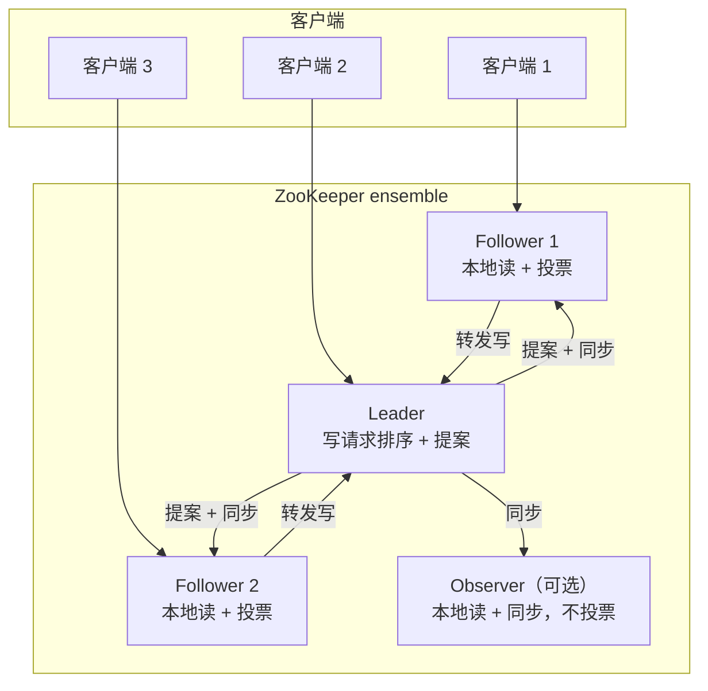
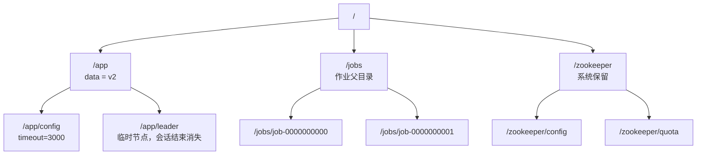
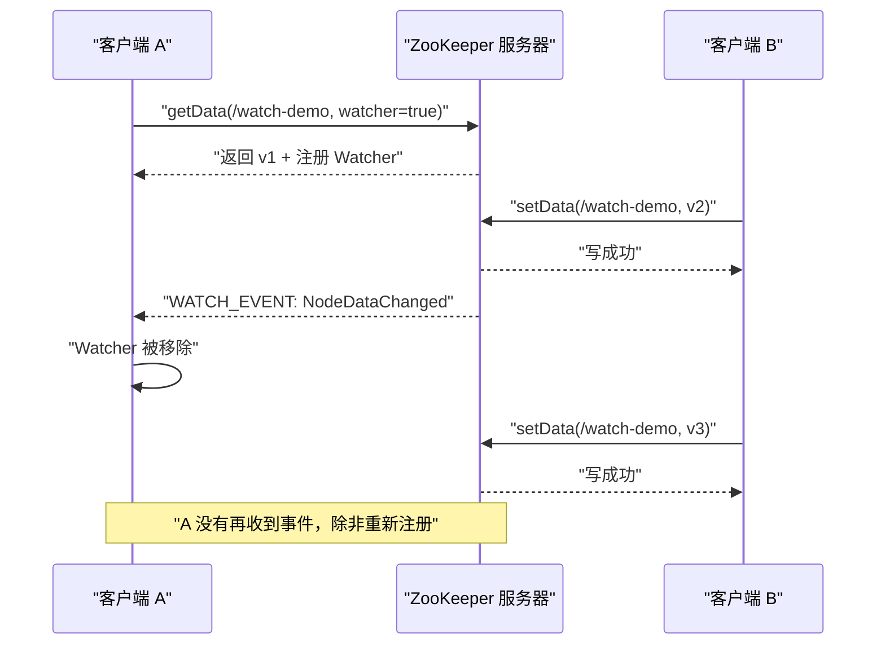
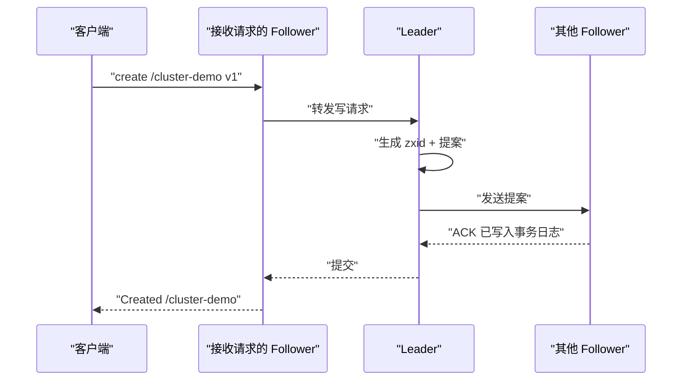
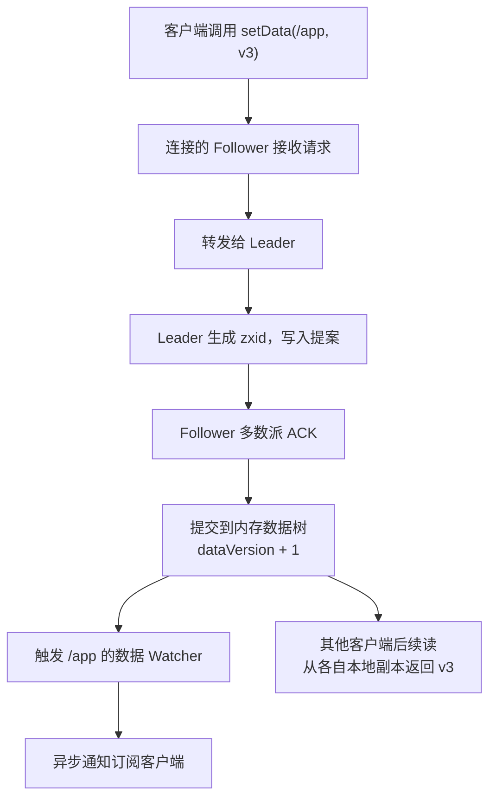

## 为什么先理解架构与数据模型？

很多 ZooKeeper 的“玄学问题”，最后都能回到两个基础问题上：

- **这个数据到底存在哪里？** 是存在我连接的这台服务器上，还是整个 ensemble 共享？为什么换一台服务器还能读到？
- **这个节点什么时候会消失？** 我创建了一个临时节点，客户端进程还在，为什么它没了？或者客户端已经崩了，为什么它还在？

如果一上来就背命令，很容易把 ZooKeeper 当成“一个可以按路径读写的 Redis”：能存能取，但说不清版本号、会话、Watcher、临时节点之间的关系。一旦出现“节点重复创建”“锁没有释放”“Watcher 只触发一次”这类问题，就只能靠猜。

先把架构和数据模型建立起来，后面的安装、集群、监控都会顺很多。本文用一棵 znode 树串起六个概念：路径、数据、stat、会话、Watcher、ensemble。

| 只记命令时的困惑 | 理解模型后的判断 |
|------------------|------------------|
| 为什么 `ls /` 会多出 `/zookeeper`？ | 那是服务端保留的系统子树，不是用户创建的 |
| 为什么同一个路径换台机器读，数据一样？ | 所有服务器复制同一份数据树，读由本地副本服务 |
| 为什么临时节点会自己消失？ | 它绑定会话，会话结束（关闭或超时）就删除 |
| 为什么第二次修改没有触发 Watcher？ | 标准 Watcher 是一次性的，触发后即移除 |
| 为什么 `stat` 里有三个 zxid？ | 分别记录创建、最后修改、最后修改子节点 |

> ### 💡 新人小结：把 ZooKeeper 想成一棵“会同步的档案树”
>
> - 每个文件夹（znode）里既可以放一张纸（data），也可以继续放子文件夹（children）。
> - 每个文件夹上贴着一张登记卡（stat），写着谁建的、什么时候改的、改过几次。
> - 档案树由多个人同时保管（ensemble），只要多数保管员在，你看到的就是同一棵树。
> - 你借阅时留的“有变化通知我”便签（Watcher），只提醒一次；想看下一次变化，要再留一张。
>
> **ZooKeeper 的数据模型 = 树形路径 + 小份数据 + 版本登记卡 + 会话生命周期 + 一次性通知。**

**学习路线图**

```
架构角色 → 数据树 → stat → 节点类型 → 会话 → Watcher → 读写路径 → 一致性
谁在干活   长什么样   怎么记账   什么时候消失  生命线   怎么通知   写怎么排队   能保证什么
```

---

## 角色：Client、Leader、Follower、Observer

ZooKeeper 的服务器角色不复杂，但每个角色的职责边界很重要：

| 角色 | 是否处理客户端请求 | 是否参与投票 | 主要职责 |
|------|--------------------|--------------|----------|
| Client | 不适用 | 不适用 | 建立 TCP 会话、发请求、收响应和 Watcher 事件 |
| Leader | 是（默认） | 是 | 接收写请求、生成提案、排序、推动多数派确认 |
| Follower | 是 | 是 | 服务本地读、把写转发给 Leader、参与选举和提案确认 |
| Observer | 是 | 否 | 服务读请求、同步 Leader 状态，但不参与投票，用来扩展读能力 |

几个容易混淆的点：

- **客户端只连接一台服务器**，但这台服务器不一定是 Leader。客户端库会根据连接串选择服务器，断线后自动换下一台。
- **写请求可以由任意服务器接收**，但最终要转发给 Leader 排序。你在 Follower 上执行 `create`，并不代表数据只写到了这台 Follower。
- **Leader 默认也接受客户端连接**。官方参数 `leaderServes` 默认是 `yes`；如果希望 Leader 专注协调，可以设为 `no`，代价是读能力少一台。
- **Observer 不参与投票**，所以增加 Observer 不会提高选举/写入的多数派门槛，但可以分担读流量。三节点最小集群通常不需要 Observer，读压力大时再考虑。



三节点 ensemble 的多数派是 2：Leader 加任意一个 Follower 确认，写就能提交。三台中坏一台，仍然有 2 台，可以继续选主和写入；坏两台只剩 1 台，没有多数派，服务会停止接受写。这个边界在集群文章里会用真实故障演示。

---

## 数据树：znode 不是普通文件

ZooKeeper 的命名空间和文件系统很像：路径从 `/` 开始，用 `/` 分隔，每个节点由完整路径唯一标识。但它和文件系统有两个关键区别：

1. **一个节点既可以有数据，也可以有子节点**。普通文件系统里，文件通常不能当目录用；znode 可以。
2. **数据主要放在内存里**，适合小份的协调数据，不适合大对象。官方建议数据保持在 KB 级；客户端和服务端会做大小检查，单个 znode 的数据不应接近 1 MB。


一个典型的应用树可能长这样：



几个路径规则来自官方文档，写代码时很容易踩：

- 路径必须是绝对路径，以 `/` 开头；ZooKeeper 不支持相对路径。
- `.` 和 `..` 不能单独作为路径元素，`/a/b/./c` 和 `/a/b/../c` 都是非法的。
- 空字符 `\u0000` 不能出现在路径里。
- `zookeeper` 是保留字，用户不能创建名为 `/zookeeper` 的根级节点；系统会用这棵子树保存配置、配额等内部数据。
- 路径中的中文和 Unicode 字符可以使用，但要注意客户端、终端和日志的编码一致性。本文示例统一使用 ASCII 路径，避免在不同终端里出现乱码。

| 操作 | 作用在谁身上 | 是否会改变子节点列表 |
|------|--------------|----------------------|
| `create /a/b` | 在 `/a` 下创建 `b` | 会，`/a` 的 `cversion` 和 `pZxid` 变化 |
| `set /a/b` | 修改 `/a/b` 的 data | 不会，`/a` 的子节点列表不变 |
| `delete /a/b` | 删除 `/a/b` | 会，父节点的子节点列表变化 |
| `get /a/b` | 读取 `/a/b` 的 data 和 stat | 不会 |
| `ls /a` | 读取 `/a` 的子节点名 | 不会 |

> ### 💡 新人小结：znode 像“带抽屉的文件夹”
>
> - 文件夹本身可以贴一张说明纸（data），也可以继续放子文件夹（children）。
> - 你打开文件夹看说明纸，不会改变里面的东西（读）；换一张说明纸，也不会影响子文件夹（写 data）。
> - 但增加或拿走一个子文件夹，父文件夹的“目录清单”就变了（cversion/pZxid）。
>
> **读 data 和改 children 是两条不同的变更线，stat 会分别记账。**

---

## stat：一个 znode 的“登记卡”

每个 znode 都维护一个 stat 结构。它不是业务数据，而是关于这个节点的元数据。理解 stat，是理解版本号、条件更新和排障的基础。

先用真实输出看一张登记卡。下面是对 `/app` 执行 `stat` 的结果，采集时 `/app/leader` 这个临时子节点还在：

```text
cZxid = 0x2
ctime = Sun Oct 25 20:49:30 CST 2026
mZxid = 0xf
mtime = Sun Oct 25 20:49:40 CST 2026
pZxid = 0x4
cversion = 1
dataVersion = 1
aclVersion = 0
ephemeralOwner = 0x0
dataLength = 2
numChildren = 1
```

逐个字段解释：

| 字段 | 含义 | 在这份输出里怎么读 |
|------|------|--------------------|
| `cZxid` | 创建这个 znode 的事务 ID | `0x2`，说明它是本实例早期创建的 |
| `ctime` | 创建时间 | 2026-10-25 20:49:30 |
| `mZxid` | 最后一次修改 data 的事务 ID | `0xf`，对应一次 `set /app v2` |
| `mtime` | 最后一次修改 data 的时间 | 2026-10-25 20:49:40 |
| `pZxid` | 最后一次修改子节点列表的事务 ID | `0x4`，对应创建 `/app/leader` |
| `cversion` | 子节点列表变更次数 | `1`，因为创建过一个子节点 |
| `dataVersion` | data 变更次数 | `1`，从 `v1` 改成 `v2` |
| `aclVersion` | ACL 变更次数 | `0`，没有改过权限 |
| `ephemeralOwner` | 临时节点的所有者会话 ID；持久节点为 0 | `0x0`，所以 `/app` 是持久节点 |
| `dataLength` | data 的字节数 | `2`，即字符串 `v2` 的长度 |
| `numChildren` | 当前子节点数量 | `1`，当时 `/app/leader` 还在 |

再看临时节点 `/app/leader` 的 stat：

```text
cZxid = 0x4
ctime = Sun Oct 25 20:49:31 CST 2026
mZxid = 0x4
mtime = Sun Oct 25 20:49:31 CST 2026
pZxid = 0x4
cversion = 0
dataVersion = 0
aclVersion = 0
ephemeralOwner = 0x10001b840d10001
dataLength = 6
numChildren = 0
```

`ephemeralOwner` 不是 0，而是 `0x10001b840d10001`，说明它属于某个会话。这个十六进制值就是会话 ID；会话结束时，服务端会把这个会话拥有的临时节点一并删除。

| 版本字段 | 什么时候增加 | 典型用途 |
|----------|--------------|----------|
| `dataVersion` | data 被 `set` 成功 | 条件更新：只允许在某个版本上修改 |
| `cversion` | 子节点被创建或删除 | 判断目录结构是否变化 |
| `aclVersion` | ACL 被 `setAcl` 成功 | 权限变更审计 |

ZooKeeper 的 `set` 可以带版本号（CLI 里是 `set -v <version>`）。如果传入的版本和当前 `dataVersion` 不一致，更新会失败。这是一种乐观锁：多个客户端同时读同一个版本，只有一个能写成功，其他客户端需要重新读取再决定。

---

## 节点类型：生命周期与命名规则

ZooKeeper 的节点类型由“持久/临时”和“普通/顺序”两个维度组合而成，另外还有容器节点和 TTL 节点两个扩展类型。

| 类型 | CLI 创建方式 | 生命周期 | 典型用途 |
|------|--------------|----------|----------|
| 持久节点 | `create /path data` | 只有显式删除才消失 | 配置、目录、元数据 |
| 临时节点 | `create -e /path data` | 创建它的会话结束时自动删除 | 在线实例、租约、临时占用 |
| 持久顺序节点 | `create -s /path data` | 持久，名字尾部追加 10 位序号 | 队列、任务编号 |
| 临时顺序节点 | `create -s -e /path data` | 会话结束删除，名字带序号 | 选主、分布式锁 |
| 容器节点 | `create -c /path data` | 最后一个子节点删除后，可能被服务端回收 | 动态分组的父目录 |
| TTL 节点 | `create -t <ttl> /path data` | 持久节点，超过 TTL 未修改且无子节点时可能被回收 | 带过期时间的元数据 |

几个必须记住的约束：

- **临时节点不能有子节点**。所以选主、锁、服务注册通常用“持久父目录 + 临时子节点”的结构。
- **顺序节点的序号由父节点维护**，格式是 `%010d`，即 10 位零填充。序号在父节点范围内唯一，不是全局唯一。
- 顺序计数器是有符号 32 位整数，超过 2147483647 后会溢出为负数。正常业务很难达到这个量级，但设计长期运行的任务编号时要意识到这个边界。
- 容器节点从 3.6.0 开始支持；TTL 节点也从 3.6.0 开始支持，并且默认关闭，需要设置系统属性 `zookeeper.extendedTypesEnabled=true` 才能创建。不要在默认配置下假设 TTL 节点可用。

我们实际创建顺序节点时，父节点 `/jobs` 先被创建，然后连续创建两个子节点，得到：

```text
Created /jobs
Created /jobs/job-0000000000
Created /jobs/job-0000000001
```

序号从 `0000000000` 开始，是因为父节点 `/jobs` 之前没有其他子节点参与过顺序分配。父节点每创建一个子节点，内部计数器就会推进；这也是为什么在已有子节点的父目录下创建顺序节点，序号不一定是 0。

> ### 💡 新人小结：临时节点是“带门禁的访客卡”
>
> - 你刷卡进门，前台给你一张访客卡（临时节点），卡上有你的会话编号（ephemeralOwner）。
> - 你在楼里时，卡有效；你离开（会话关闭）或超时未刷卡（会话过期），卡自动失效。
> - 访客卡不能开出一间“长期办公室”（临时节点不能有子节点），要长期使用请办正式门禁（持久节点）。
>
> **临时节点表达“我还在”，不是“我永久存在”；它的生命周期跟着会话，不跟着进程的某次请求。**

---

## 会话：临时节点的生命线

客户端连接 ZooKeeper 时，会创建一个会话。会话是一个 64 位数字，客户端在重连到其他服务器时会带上会话 ID 和密码，让新服务器认出“还是同一个会话”。

会话超时不是客户端单方面决定的。客户端提出一个期望值，服务端返回它能接受的值。官方规则是：超时时间最小为 `2 × tickTime`，最大为 `20 × tickTime`。我们的测试配置 `tickTime=2000`，所以启动日志里出现：

```text
minSessionTimeout set to 4000 ms
maxSessionTimeout set to 40000 ms
```

zkCli 默认请求 30000 ms，服务端协商后返回 30000 ms。下面的真实输出展示了会话建立的过程：

```text
Session establishment complete on server 127.0.0.1/127.0.0.1:2182,
session id = 0x10001b840d10002, negotiated timeout = 30000
```

会话有三种常见状态：

| 状态 | 含义 | 临时节点会怎样 |
|------|------|----------------|
| CONNECTED | 客户端与某台服务器保持连接，心跳正常 | 保留 |
| DISCONNECTED | TCP 连接断开，客户端正在尝试重连 | 暂时保留，取决于会话是否超时 |
| EXPIRED / CLOSED | 会话过期或被显式关闭 | 服务端删除该会话拥有的全部临时节点 |

这里有一个容易误解的点：**进程退出不等于会话立刻结束**。如果客户端没有正常调用 `close()`，服务端要等到会话超时才会清理。我们用一次性 zkCli 创建临时节点时观察到了这个过程：

```text
2026-10-25 20:50:03,094 [myid:] - INFO [SessionTracker:o.a.z.s.ZooKeeperServer@643]
  - Expiring session 0x10001b840d10001, timeout of 30000ms exceeded
```

对应的 transaction log 里能看到关闭会话时携带的临时节点路径：

```text
2026/10/25 CST 20:50:03 session 0x10001b840d10001 cxid 0x0 zxid 0x19 closeSession v{'/app/leader}
```

这条记录很值得记住：`closeSession` 的 `v{...}` 部分列出了该会话拥有的临时节点。会话一结束，这些节点就被删除。反过来，如果客户端正常调用 `close()`，清理会更及时；如果客户端进程被强杀，就要等超时。

| 现象 | 可能原因 | 排查方向 |
|------|----------|----------|
| 临时节点一直不消失 | 客户端进程还活着，或会话未超时 | 查 `dump` 的会话列表、看服务端 Expiring 日志 |
| 临时节点突然消失 | 会话超时、网络分区、客户端被重启 | 查会话超时配置、客户端 GC/网络、服务端日志 |
| 重连后会话变成 Expired | 断线时间超过协商超时 | 客户端需要重新建会话并重建临时节点 |
| 同一会话出现两台客户端 | 会话 ID/密码被复制使用 | 官方不鼓励共享会话；这属于错误用法 |

---

## Watcher：一次性的变更通知

Watcher 是 ZooKeeper 的推送机制：客户端在读取时可以顺便注册一个 Watcher，当节点发生变化时，服务端把事件发给客户端。标准 Watcher 有三个关键语义：

1. **一次性触发**：事件触发后，Watcher 被移除；想继续监听，需要重新注册。
2. **异步发送**：事件在服务端触发后异步发给客户端，不保证“写成功”和“事件到达”同时发生。
3. **有顺序保证**：客户端不会在看到事件之前看到它监听的那次变更；不同客户端看到事件的时刻可以不同，但顺序一致。

Watcher 分两类：

| 类别 | 由哪些读操作注册 | 触发事件 | 典型用途 |
|------|------------------|----------|----------|
| 数据 Watcher | `getData`、`exists` | 节点创建、删除、data 变更 | 配置变更、节点上线/下线 |
| 子节点 Watcher | `getChildren` | 子节点列表变化 | 服务发现、任务队列 |

官方对触发关系有一个容易记错的细节：成功的 `create` 会触发“被创建节点的数据 Watcher”以及“父节点的子节点 Watcher”；成功的 `delete` 会触发被删除节点的数据 Watcher 和子节点 Watcher，以及父节点的子节点 Watcher。理解这一点，才能解释为什么有时你只监听了父目录，却收到了子节点变化的事件。

我们用官方 Java 客户端做了一个最小验证：客户端 A 对 `/watch-demo` 注册数据 Watcher，客户端 B 修改数据；第一次修改触发 `NodeDataChanged`，第二次修改没有新事件，因为 A 没有重新注册。

```text
CLIENT_A_CONNECTED session=0x10001b840d10011
CREATE /watch-demo data=v1
WATCH_REGISTERED path=/watch-demo current=v1
CLIENT_B_CONNECTED session=0x10001b840d10012
SET /watch-demo data=v2 version=-1
WATCH_EVENT type=NodeDataChanged path=/watch-demo state=SyncConnected
WATCH_FIRED_WITHIN_5S=true
SET /watch-demo data=v3 again (no new watch)
WATCH_EVENTS_AFTER_SECOND_SET=0
```



3.6.0 起还支持**持久 Watcher**（persistent watch），触发后不会移除，并且可以递归监听子节点。它用 `addWatch()` 注册，用 `removeWatches()` 删除。持久 Watcher 适合需要持续感知变化的场景，但不改变“事件不携带数据内容”的事实：收到事件后仍然要重新读取当前值。

> ### 💡 新人小结：Watcher 是“一次性门铃”，不是“监控录像”
>
> - 门铃按一次响一次，响完就复位；想听下一次，要再按（重新注册）。
> - 你不在家时门铃不会替你录像；回来要自己检查门口（重连后全量读取）。
> - 不同住户听到门铃的时间可能不同，但物业的登记顺序是统一的（顺序保证）。
>
> **Watcher 负责提醒“变化发生了”，不负责保存“变化历史”，也不负责把新值送到你手里。**

---

## 读写路径：为什么读快、写慢

ZooKeeper 的读写路径不对称，这是它性能特征的根源。

**读路径**：客户端连接一台服务器，读请求由这台服务器的本地数据树直接返回。它不需要广播，也不需要 Leader 参与。因此增加 Follower 可以线性扩展读能力，读多写少的场景表现最好。

**写路径**：写请求可以发给任意服务器，但最终要转发给 Leader。Leader 给提案分配 zxid，发给 Follower；多数派把提案写入本地事务日志后，Leader 提交，客户端收到成功。写延迟因此包含一次 quorum 往返，通常明显高于本地读。



我们在三节点集群上验证了这条路径：通过 Follower（2182）创建 `/cluster-demo`，从 Leader（2183）和另一个 Follower（2184）都能读到；再通过 Follower（2184）修改，Follower（2182）读到新值。真实输出如下：

```text
===== create /cluster-demo v1 via 2182 (follower) =====
Created /cluster-demo

===== get /cluster-demo via 2183 (leader) =====
v1

===== get /cluster-demo via 2184 (follower) =====
v1

===== set /cluster-demo v2 via 2184 (follower) =====
（set 成功时没有额外输出）

===== get /cluster-demo via 2182 (follower) =====
v2
```

写入顺序由 zxid 表达。三节点集群刚选完主时，Leader 的 `srvr` 输出里能看到：

```text
Zxid: 0x100000000
Mode: leader
```

杀掉 Leader 后，新 Leader 的 zxid 进入下一个 epoch：

```text
Zxid: 0x200000000
Mode: leader
```

`0x100000000` 和 `0x200000000` 的低 32 位都是 0，表示新 epoch 的起点；高 32 位从 1 变成 2，表示换了一次领导任期。这个编码方式让“旧 Leader 的未提交提案”可以被新 Leader 识别并丢弃，从而避免两个 Leader 同时生效。

| 路径 | 经过 Leader 吗 | 需要多数派确认吗 | 延迟主要来自 |
|------|----------------|------------------|--------------|
| 读 | 不需要 | 不需要 | 本地内存访问与网络 |
| 写 | 需要 | 需要 | quorum 网络往返 + 磁盘写入事务日志 |
| 会话创建/关闭 | 需要（全局会话） | 需要 | 多数派确认 |
| Watcher 注册 | 不需要 | 不需要 | 本地服务器维护 |

---

## 一致性：能保证什么，不能保证什么

ZooKeeper 的保证可以概括为“写有全序、读有边界”：

| 保证 | 具体含义 | 工程上的用法 |
|------|----------|--------------|
| 顺序一致性 | 同一客户端的更新按发送顺序生效 | 客户端可以依赖自己的写顺序 |
| 原子性 | 更新要么成功，要么失败 | 不会读到写了一半的 data |
| 单一系统视图 | 客户端换服务器后看到同一份逻辑状态 | 故障切换不会看到“另一个世界” |
| 可靠性 | 已生效的更新会持续保留 | 不会因为换主丢已提交的写 |
| 时效性 | 客户端状态在一定时间范围内最新 | 不是强实时，跨客户端有传播窗口 |

需要特别注意“跨客户端读”的边界：客户端 A 写入后，客户端 B 可能短暂读到旧值。ZooKeeper 不保证所有客户端在同一时刻看到同一版本。需要“写完立刻读到”的场景，可以用 `sync` 把当前服务器的视图同步到 Leader，或者用版本号做条件读/条件写，而不是假设全局实时。

---

## 把概念串起来：一次配置变更的完整旅程

最后用一张图把本文的概念串起来。假设客户端要修改 `/app` 的配置：



这条旅程里有五个观察点：

1. **写入口不一定是 Leader**：客户端连到 Follower 也能写，Follower 会转发。
2. **zxid 是全局顺序**：所有写请求在 Leader 处排队，拿到唯一编号。
3. **多数派确认才提交**：少数派写入不会被承认，避免脑裂。
4. **stat 版本递增**：`dataVersion` 增加，客户端可以用版本做条件更新。
5. **Watcher 异步通知**：通知到达时间不等于写成功时间，收到通知后要重新读。

---

## 要点总结

1. **四种角色各司其职**：Client 只连一台服务器；Leader 负责写排序；Follower 参与投票并提供本地读；Observer 只扩展读、不投票。
2. **znode 是树上的节点**：既能存 data 也能有 children；路径必须绝对；`/zookeeper` 是系统保留子树；数据应保持 KB 级。
3. **stat 是节点的登记卡**：`cZxid/mZxid/pZxid` 分别记录创建、改 data、改 children；三个版本号支撑条件更新与审计。
4. **会话决定临时节点寿命**：会话关闭或超时会删除该会话拥有的临时节点；进程退出但未 close 时，要等会话超时。
5. **标准 Watcher 是一次性的**：触发后移除，事件异步送达；持久 Watcher 从 3.6.0 起可用，但仍然只通知变化、不携带新值。
6. **读写路径不对称**：读本地、写 Leader + 多数派；这决定了 ZooKeeper 适合读多写少的协调场景。

---

> ### 💡 新人小结：架构与数据模型学完了，记住这 4 点
>
> 1. **一棵树、两种内容**：每个 znode 既有 data 也有 children，读 data 和改 children 是两条变更线。
> 2. **会话是临时节点的生命线**：节点消失的时间点，由会话关闭或超时决定，不由进程退出决定。
> 3. **写要多数派，读可以本地**：所以 ZooKeeper 读多写少时最舒服，写多时先算 quorum 往返。
> 4. **Watcher 只提醒一次**：收到事件先重新读数据，再决定下一步；断线重连后做一次全量校准。
