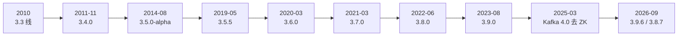
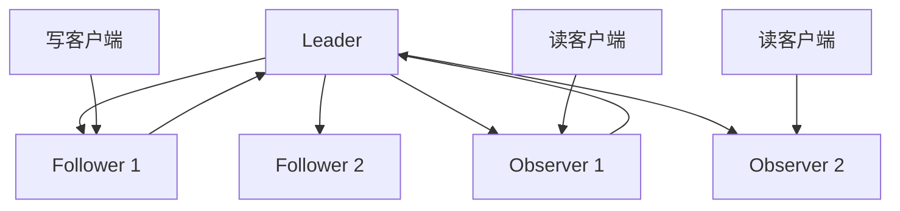
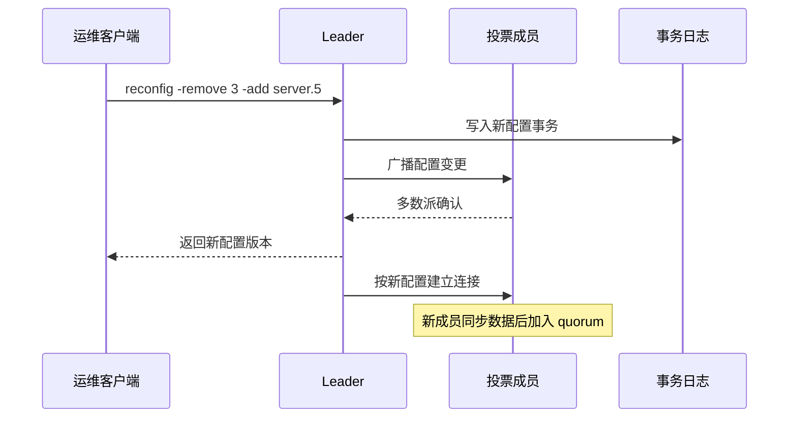
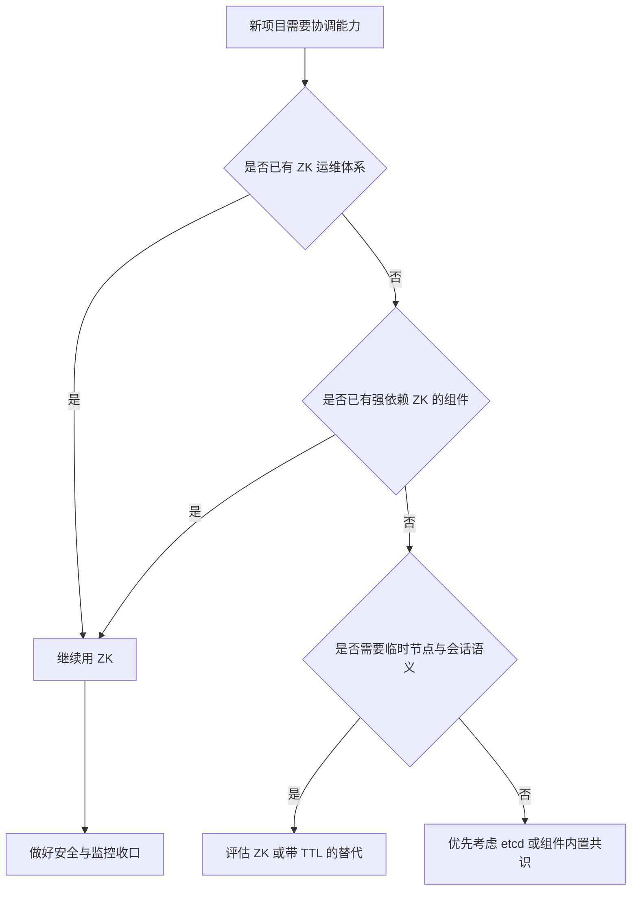

ZooKeeper 的版本号不是营销节奏，而是一份运维问题的修复记录。3.5 解决“改集群配置必须停机”，3.6 解决“Watch 触发一次就没了”，3.7 和 3.8 补齐配额、认证与监控，3.9 继续加管理接口并处理安全漏洞。每一次变更都能对应到一个真实的使用痛点，也都留下了新的约束。

这一篇不逐条抄 Release Notes，而是挑出真正改变使用方式的节点，回答三个问题：**当时遇到了什么问题、ZooKeeper 怎么处理、处理之后又付出了什么代价**。最后讨论 Kafka 4.0 去掉 ZooKeeper 之后，它今天到底处在什么位置。

## 为什么版本史比版本号更有用？

因为版本号只能告诉你“新”，版本史能告诉你“为什么新”。

假设你接手一个 3.4 集群，看到 3.5 引入了动态成员变更，你可能第一反应是“那就升级”。但版本史会提醒你：3.5 线从 alpha 到稳定版走了近五年，升级前还必须先到 3.4.6，而且早期的 reconfig 甚至没有开关。这些信息不在版本号里，却直接决定升级风险。

💡 新人小结：读版本史时，不要只记“哪个版本加了什么功能”，要记“这个功能替代了哪种旧操作，旧操作曾经造成什么问题”。后者才是选型和升级的依据。

## 一张时间线：从 3.3 到 3.9.6

先把主线铺开。下表中的早期日期以 Maven Central 制品时间为排序依据，和官方公告日可能相差几天；近期版本以官方发布页和安全公告为准。

| 时间 | 版本 | 关键变化 | 解决的问题 |
|------|------|----------|------------|
| 2010 | 3.3 线 | Observer 角色进入使用 | 增加读容量，同时避免投票成员膨胀 |
| 2011-11 | 3.4.0 | multi 操作进入客户端 API | 多个 znode 的更新需要原子提交 |
| 2014-08 | 3.5.0-alpha | 动态成员变更进入主线 | 改集群成员必须滚动重启 |
| 2019-05 | 3.5.5 | 3.5 线首个稳定版 | 让动态成员变更可用于生产 |
| 2020-03 | 3.6.0 | 持久递归 Watch、可插拔指标、审计日志 | 一次性 Watch 反复注册，监控接口不统一 |
| 2021-03 | 3.7.0 | 配额强制、whoami、C/Perl SASL | 配额看得见但拦不住，客户端身份难确认 |
| 2022-06 | 3.8.0 | 配额指标、故障注入框架 | 配额与监控缺少可观测性 |
| 2023-08 | 3.9.0 | AdminServer 快照 API、Watch zxid | 管理面缺少快照导出与事件定位 |
| 2025-03 | Kafka 4.0 | 首次完全不依赖 ZooKeeper | Kafka 的元数据与控制器自包含 |
| 2026-09 | 3.9.6 / 3.8.7 | 修复多项安全漏洞 | 当前维护线的安全补丁 |



这张时间线有两个明显的特征。第一，**3.5 线拉得特别长**：2014 年就有 alpha，直到 2019 年才有 3.5.5 稳定版。第二，**2020 年之后节奏变快**：3.6、3.7、3.8、3.9 基本保持每年一个小版本，安全补丁则持续到 2026 年。

这两个特征背后是两种不同的工作：前者在改协议和集群配置模型，后者在补安全、监控和运维接口。前者风险高、周期长；后者可以小步快跑。

## 3.3 到 3.4：先把“协调材料”补齐

### Observer：读扩展与投票成本分开

ZooKeeper 的写请求需要多数派确认。这个规则带来高可用，也带来一个副作用：**投票成员越多，写请求要等的确认越多**。如果只是为了增加读容量而不断加服务器，写性能反而可能下降。

Observer 的思路是把“参与投票的成员”和“只读数据的成员”分开：

| 角色 | 处理读 | 处理写 | 参与选举与投票 | 典型用途 |
|------|--------|--------|----------------|----------|
| Leader | 是 | 是，负责排序 | 是 | 集群唯一的写入口 |
| Follower | 是 | 转发给 Leader | 是 | 组成多数派 |
| Observer | 是 | 转发给 Leader | 否 | 扩容读能力、跨机房部署 |



Observer 不参与投票，所以增加 Observer 不会改变 quorum 的大小；Observer 故障也不会影响集群的可用性。官方文档把这一点讲得很清楚：Observer 的功能与 Follower 类似，但它们只接收投票结果，不参与达成一致的协议过程。

Observer 的具体引入版本在社区资料里常写作 3.3.0；官方 3.4 发行包的 Release Notes 已经把它作为既有角色，并附有 Observers Guide。本文按“3.3 线出现”表述，不把社区口径写成一手公告。

代价是：Observer 可能看到稍旧的数据，因为它不参与写确认；跨机房部署时，网络延迟仍然存在，只是不再把整个 quorum 拖进跨机房往返。

### multi：多个 znode 的原子更新

3.4.0 之前，客户端一次只能可靠地更新一个 znode。业务如果需要“创建任务节点、更新索引节点、写入状态节点”同时成功或同时失败，就得自己在客户端做补偿。补偿逻辑很难写对，尤其是在客户端崩溃或重试时。

3.4.0 的 multi 操作把这些更新打包成一个原子请求：要么全部成功，要么全部失败。它没有改变 ZooKeeper 的数据模型，但改变了客户端表达事务的方式。

3.4.1 的 Release Notes 还提到过 server-side read-only mode，并明确标注“没有充分测试，生产环境避免使用”。这是一个很好的历史注脚：**不是所有出现在 Release Notes 里的能力都等于生产承诺**。读旧文档时，看到 “experimental” 或 “not thoroughly tested”，要把它当成风险提示，而不是功能清单。

## 3.5：动态成员变更，把停机操作变成事务

### 旧世界：改配置靠滚动重启

3.5.0 之前，ZooKeeper 的成员关系和大部分配置参数在启动时加载，运行期不可变。扩容、缩容、换端口、调整 Observer 角色，都要改配置文件、重启进程，再祈祷滚动过程中不要出现不一致。

官方动态重配置文档对这段历史的描述很直接：滚动重启是一种“手工密集且容易出错”的操作，在生产中造成过数据丢失和配置不一致。这个描述之所以重要，是因为它承认了问题不是“操作麻烦”，而是**会破坏正确性**。

| 操作 | 3.5.0 之前 | 3.5.0 之后 |
|------|------------|------------|
| 增加一个参与投票的节点 | 改配置，逐台重启 | 提交一条 reconfig 事务 |
| 把 Follower 改成 Observer | 改配置并重启 | 在 reconfig 中修改角色 |
| 修改 quorum 端口 | 全集群停机窗口 | 动态提交新配置 |
| 调整 quorum 系统 | 基本不可行 | 通过 reconfig 指定新配置 |
| 操作期间客户端 | 可能中断或看到不一致 | 不需要停止客户端操作 |

### 新世界：reconfig 是一条事务

官方文档给出的增量 reconfig 语法如下。这是官方示例，不是在本机实例上执行的输出；真正的生产操作要先确认权限、备份动态配置文件，并在测试集群演练。

```text
reconfig -remove 3 -add server.5=125.23.63.23:1234:1235;1236
```

它的含义是：从当前配置中移除服务器 3，加入服务器 5，并指定它的 quorum 端口与客户端端口。多个变更可以用逗号分隔，一次提交。



### 代价：它不是一条“免费”的升级路径

动态成员变更解决了停机问题，但引入了几层新的复杂度：

1. **升级路径有前提**。官方文档明确说，运行中的集群升级到 3.5.0 之前，应先把集群升级到 3.4.6。跳过这个中间版本，风险不在 reconfig 本身，而在旧版本的兼容性。
2. **早期版本没有开关**。3.5.0 起、3.5.3 之前，没有办法关闭动态重配置。也就是说，任何能调用 reconfig 的客户端都可能改集群配置。后来的版本才引入 `reconfigEnabled` 与权限控制。
3. **配置变更也是事务**。它要经过 Leader 排序、多数派确认和日志落盘，所以它不是“瞬时生效”的魔法；在网络不稳时，reconfig 可能失败或需要重试。
4. **发布周期很长**。从 3.5.0-alpha 到 3.5.5 稳定版，经历了 3 个 alpha、2 个 beta，跨度接近五年。这说明改集群配置模型的代价远高于加一个客户端 API。

💡 新人小结：动态成员变更的价值不只是“少重启几次”，而是把集群配置从“启动参数”变成“可审计的事务”。但它的前提是版本兼容、权限控制和充分演练，不能把它当成无风险的在线操作。

## 3.6：持久 Watcher 与可观测性

### 一次性 Watch 的重复注册问题

ZooKeeper 的标准 Watch 是一次性的：事件触发后，Watch 被移除，客户端如果还想继续观察，必须重新注册。这个设计很轻量，但在高频变化或大量客户端场景下，会产生两个问题：

- 客户端要在回调里再次注册，代码容易漏掉；
- 每次变化都要重新发请求，增加服务端和网络负担。

3.6.0 引入了持久 Watch 与持久递归 Watch：触发后不移除，直到客户端显式移除；递归模式还会覆盖注册节点下的子节点变化。官方 Programmer's Guide 把它标为 “New in 3.6.0”。

| 能力 | 一次性 Watch | 持久 Watch | 持久递归 Watch |
|------|--------------|------------|----------------|
| 触发后是否移除 | 是 | 否 | 否 |
| 是否覆盖子节点 | 否 | 否 | 是 |
| 客户端是否要反复注册 | 是 | 否 | 否 |
| 适用场景 | 单次配置变更 | 持续关注一个节点 | 持续关注整棵子树 |

代价是事件量可能上升，客户端要自己控制 Watch 的数量和生命周期。持久不等于“无限”，它仍然受服务端资源和客户端处理能力约束。

### 监控从“四字命令”走向标准接口

3.6.0 还加入了可插拔指标系统与 Prometheus 集成，3.7/3.8 继续补配额指标和告警文档。这个变化解决的是另一个运维痛点：**早期的监控主要靠四字命令，输出是给人看的文本，不适合被指标系统稳定采集**。

| 变化 | 旧方式 | 新方式 | 影响 |
|------|--------|--------|------|
| 指标采集 | 四字命令文本 | 可插拔 MetricsProvider | 可以接 Prometheus 等系统 |
| 审计 | 应用日志 | 服务端审计日志 | 敏感操作可追溯 |
| 快照触发 | 固定事务数 | 可按日志大小触发 | 大事务场景更可控 |
| Observer 扩展 | 只能挂在 Leader 下 | Follower 也可承载 Observer | 拓扑更灵活 |

这些变化没有改变 ZooKeeper 的核心协议，但改变了它作为“生产基础设施”的可用性。一个不能稳定监控、不能审计、不能控制快照节奏的协调服务，很难进入严肃的生产环境。

## 3.7 与 3.8：安全、配额与运维能力补齐

### 3.7：让配额真正拦得住

3.7.0 的一个关键变化是配额强制。此前配额更像“统计与告警”，到了 3.7 才真正对超出配额的写入施加限制。同一版本还加入了 `whoami` API、C 与 Perl 客户端的 SASL 支持、多 superUser、quorum SASL 主机名规范化等能力。

这些变化的共同方向是：**把“能跑”推进到“能管”**。在多租户或共享集群里，如果没有配额强制，一个业务写爆 znode 数量就会拖垮其他业务；如果没有 `whoami`，排障时很难确认当前会话到底是谁。

### 3.8：补指标、补测试工具

3.8.0 的新特性不算多，主要是配额指标暴露、故障注入框架和监控告警文档。它更像一条“把 3.7 的能力补完整”的维护线。3.8.1 到 3.8.7 则主要是 Bug 修复和安全补丁。

这里要注意一个常见误解：**版本号变大不等于核心模型变了**。3.8 没有改 ZAB，也没有改 znode 语义；它改的是可观测性、测试能力和安全边界。选型时不要把“3.8 性能更强”当成无条件结论，具体收益要看你的负载和修复项。

### 安全不是默认开启的

ZooKeeper 官方安全页把安全模型写得很直白：它面向可信网络，不建议直接暴露到互联网；新集群默认没有传输加密、没有对等认证，znode 也常常是可读写的。TLS、SASL、ACL 都需要显式开启。

| 控制 | 默认状态 | 常见风险 | 处理方式 |
|------|----------|----------|----------|
| 传输加密 | 关闭 | 明文传输会话与数据 | 开启 TLS |
| 客户端认证 | 无 | 任何人都能连上客户端端口 | 使用 digest、SASL 或 mTLS |
| znode ACL | 常为 OPEN_ACL_UNSAFE | 任意客户端可读写 | 应用创建节点时设置 ACL |
| ACL 递归 | 不递归 | 父节点 ACL 保护不了子节点 | 逐节点设置 |
| AdminServer | 常被暴露 | IP 伪造、未授权访问 | 限制网络、配置可信代理 |

官方安全页还特别提醒：AdminServer 默认会信任 `X-Forwarded-For`，攻击者可以伪造这个头来绕过基于 IP 的控制（CVE-2024-51504）。这类问题的根源不是某一个参数写错，而是**默认假设“内网可信”**。如果你的 ZooKeeper 暴露在不可信网络里，必须把安全当成一套组合拳，而不是打开一个开关。

💡 新人小结：ZooKeeper 的安全默认值面向可信内网。生产环境至少要同时考虑网络隔离、TLS、认证、ACL 和 AdminServer 收口；只开其中一项，通常不等于安全。

## 3.9 与 3.10-SNAPSHOT：维护线还在走

### 3.9：管理面补快照与事件定位

3.9.0 增加了 AdminServer 的快照导出 API，以及把触发 WatchEvent 的 zxid 传给客户端的能力。前者让运维可以在不直接拷贝数据目录的情况下拿到快照，后者让客户端更容易判断事件对应的事务位置。

这些不是“改变世界”的功能，但对排障很有价值。ZooKeeper 的老用户都知道，出问题时最缺的往往不是“有没有数据”，而是“这个事件对应哪个事务、我能不能在不碰磁盘的情况下拿到一致快照”。

### 2026 年的安全补丁：维护线仍在工作

2026 年 9 月，3.9.6 与 3.8.7 发布，修复了多项安全问题。官方安全页列出的几个代表性漏洞如下：

| CVE | 严重级别 | 问题 | 影响版本 | 修复版本 |
|-----|----------|------|----------|----------|
| CVE-2026-79993 | critical | `deleteContainer` 操作缺少 ACL 检查，可删除空持久节点 | 3.9.0–3.9.5、3.8.0–3.8.6 | 3.9.6、3.8.7 |
| CVE-2026-59739 | critical | SetWatches 重连重放导致信息泄露 | 3.9.0–3.9.5、3.8.0–3.8.6 | 3.9.6、3.8.7 |
| CVE-2026-84439 | important | 审计日志字段注入 | 3.9.0–3.9.5、3.8.0–3.8.6 | 3.9.6、3.8.7 |
| CVE-2026-84501 | moderate | 操作日志换行注入 | 3.9.0–3.9.5、3.8.0–3.8.6 | 3.9.6、3.8.7 |

这些漏洞说明两件事。第一，ZooKeeper 仍然在被认真维护；第二，**“内网服务”不等于“没有安全问题”**。一个能连上客户端端口的攻击者，可能不需要合法账号就能触发 ACL 绕过或信息泄露。

### 3.10 还没有正式发布

截至 2026 年 10 月，官方发布页的 current 是 3.9.6，stable 是 3.8.7；3.7 已于 2024 年 2 月 EOL，3.5 和 3.6 更早 EOL。GitHub 仓库的 master 分支 POM 是 `3.10.0-SNAPSHOT`，仓库里也能看到 3.9.7、3.8.8 这样的维护分支。

这意味着：

- **3.10 在开发线上存在，但没有正式发布**，不能把 SNAPSHOT 当成可用版本；
- 3.9 与 3.8 仍然是实际可部署的两条线；
- 维护分支的存在说明社区还在为旧线出补丁，但不代表会加新功能。

💡 新人小结：看到 `3.10.0-SNAPSHOT` 不要兴奋，也不要恐慌。SNAPSHOT 是开发中的代码，不是发布承诺；生产选型应看官方发布页的 current/stable，而不是仓库主干的版本号。

## 生态位置：Kafka 的离开，不等于 ZooKeeper 的终局

### Kafka 4.0 为什么去掉 ZooKeeper

2025 年 3 月 18 日，Apache Kafka 4.0 发布。官方公告称这是第一个完全不依赖 ZooKeeper 的重大版本，默认运行在 KRaft 模式下。它给出的理由很具体：简化部署、消除维护独立 ZooKeeper 集群的复杂度、降低运维开销、提升可扩展性，并统一安全模型。

公告还专门感谢了 ZooKeeper 社区，承认 ZooKeeper 多年来是 Kafka 的支柱。这个态度很重要：**Kafka 的离开不是对 ZooKeeper 的否定，而是 Kafka 选择把元数据和控制器收进自己的 Raft 实现**。

Kafka 的离开确实改变了一个事实：过去很多团队是因为“上 Kafka 必须装 ZooKeeper”才第一次接触 ZooKeeper；现在这条入口变窄了。新项目如果只需要 Kafka，完全可以直接用 KRaft，不必再维护一个独立的 ZooKeeper 集群。

### 但 ZooKeeper 仍然有它的位置

ZooKeeper 的剩余场景不需要用“情怀”解释，它们有具体的工程理由：

| 场景 | 继续使用 ZooKeeper 的理由 | 可能的替代方案 |
|------|---------------------------|----------------|
| 已有 Hadoop/HBase 集群 | 组件原生依赖 ZK，改造成本高 | 跟随组件自身路线升级 |
| Dubbo 注册中心 | 接口级/应用级节点模型成熟，运维经验多 | Nacos、etcd 等 |
| 需要临时节点与会话语义 | 会话断开自动清理，模式简单 | 基于 Raft 的租约与 TTL |
| 需要严格的写全序 | Zab 经过长期生产验证 | etcd、Consul 等共识系统 |
| 已有运维体系与监控 | 4lw、AdminServer、JMX、Prometheus 都能接 | 重新建设监控与告警 |



这张图不是“标准答案”，而是一个决策顺序：**先看存量依赖，再看语义需求，最后才看新鲜度**。ZooKeeper 不是新项目的默认选项，但它仍然是一个可靠的选项，尤其是在已有 HBase、Hadoop、Dubbo 或大量运维经验的团队里。

### 一个容易忽略的事实

ZooKeeper 的生态位置正在从“所有分布式系统的默认协调层”变成“特定系统的成熟协调层”。这不等于衰退，而是基础设施市场的正常分化：新系统更倾向于内置 Raft，老系统继续使用经过验证的外部协调服务。

对使用者来说，真正重要的不是“ZooKeeper 会不会消失”，而是**你现在这套系统是否还依赖它的语义**。如果依赖，就把它维护好；如果不依赖，就不必为了“技术栈统一”再引入它。

## 未来展望：三个更可能发生的方向

以下判断基于公开的版本线、仓库状态和生态变化，不是官方的路线图承诺。

### 方向一：维护线优先，3.10 慢慢来

官方发布页只列 current 与 stable 两条线，3.10 仍停留在 SNAPSHOT。结合 2026 年的安全补丁节奏，更可能发生的是：**3.9/3.8 继续出安全与关键修复，3.10 在准备好之后再发布**。对生产团队来说，这意味着不必等 3.10 才能获得安全修复；3.9.6 与 3.8.7 就是当前应跟的版本。

### 方向二：安全默认值继续收紧

从 3.7 的配额强制、3.8 的指标补齐，到 2026 年连续修复 ACL 绕过、日志注入、信息泄露，方向很清楚：**ZooKeeper 会继续把“内网可信”的假设往外推，要求使用者显式配置安全**。未来更值得关注的不是新 API，而是 TLS、SASL、ACL、AdminServer 收口的默认行为是否变化。

### 方向三：角色分化，而不是全面替代

Kafka 4.0 的离开是一个标志性事件，但它不会让 HBase、Dubbo 或已有 Hadoop 集群立刻迁移。更可能的格局是：

- **新系统**：优先选择内置 Raft 或 etcd 这类与部署平台更贴近的方案；
- **存量系统**：继续使用 ZooKeeper，直到组件自身完成替代；
- **ZooKeeper 自身**：成为“少量元数据、强顺序、成熟运维”的专用协调层，而不是所有场景的默认答案。

| 趋势 | 公开证据 | 对使用者的建议 |
|------|----------|----------------|
| 双线维护 | 官方发布页 current 3.9.6 / stable 3.8.7 | 生产跟 3.9.x 或 3.8.x 的安全补丁 |
| 3.10 开发中 | master POM 为 3.10.0-SNAPSHOT | 不把 SNAPSHOT 当生产版本 |
| 安全驱动升级 | 2026 年多个 CVE 修复 | 建立版本与 CVE 跟踪机制 |
| 生态分化 | Kafka 4.0 移除 ZK | 新项目按语义需求选型，不盲目跟风 |

💡 新人小结：ZooKeeper 的未来不是“会不会被取代”的二选一，而是“在哪些场景继续用它”的分化。对学习者来说，ZooKeeper 仍然值得学，因为它把分布式协调的经典问题压缩成了一个可运行的系统；对团队来说，是否继续用，要看依赖和语义，而不是看热度。

## 对今天的学习者：把版本史变成选型清单

如果你正在选版本，可以把上面的历史压缩成一张检查表：

| 你的情况 | 建议 | 原因 |
|----------|------|------|
| 新生产集群 | 优先 3.9.6 或 3.8.7 | 当前维护线，包含 2026 年安全修复 |
| 还在 3.7 | 规划升级到 3.8/3.9 | 3.7 已于 2024-02 EOL |
| 还在 3.5/3.6 | 先评估组件兼容性，再逐级升级 | 两条线都已 EOL，缺少安全补丁 |
| 需要动态扩缩容 | 确认版本支持 reconfig，并配置权限 | 3.5 起支持，但早期版本没有开关 |
| 需要持续监听子树 | 确认客户端与服务端都支持 3.6+ | 持久递归 Watch 是新 API |
| 暴露在不可信网络 | 不要直接暴露，先做安全收口 | 默认无 TLS、无认证、ACL 常为开放 |

升级时不要只看服务端版本，还要看客户端兼容性。官方发布页明确说明：3.9.x 客户端可以与 3.5.x 到 3.8.x 服务端通信，但前提是不使用服务端不存在的新 API。这个前提很容易被忽略，尤其是在客户端和服务端分开升级的团队里。

## 要点总结

- 3.5 的核心是动态成员变更：把“改配置靠滚动重启”变成一条可审计的 reconfig 事务，但升级路径长、早期版本没有开关。
- 3.6 的核心是持久 Watcher 与可观测性：解决一次性 Watch 反复注册的问题，补上可插拔指标、审计与快照控制。
- 3.7/3.8 的重点是配额、认证、监控与安全边界；3.9 补管理面快照和事件定位，并在 2026 年继续出安全补丁。
- 当前官方发布线是 3.9.6（current）与 3.8.7（stable）；3.10 只有 SNAPSHOT，没有正式发布。
- Kafka 4.0 在 2025 年 3 月移除 ZooKeeper，这是生态分化的重要节点，但不等于 ZooKeeper 立即失去所有场景。
- 选型时先看存量依赖与语义需求，再看版本维护线；升级时同时检查服务端、客户端与安全配置。

## 参考资料

- Apache ZooKeeper 官方发布页：`https://zookeeper.apache.org/releases.html`
- Apache ZooKeeper 官方安全页：`https://zookeeper.apache.org/security.html`
- Apache ZooKeeper 动态重配置文档：`https://zookeeper.apache.org/doc/current/zookeeperReconfig.html`
- Apache ZooKeeper 3.4.0、3.5.0、3.6.0、3.7.0、3.8.0、3.9.0 Release Notes
- Apache ZooKeeper Programmer's Guide：持久递归 Watch 的 “New in 3.6.0” 说明
- Apache ZooKeeper GitHub 主干 POM：`3.10.0-SNAPSHOT`
- Apache Kafka 4.0.0 发布公告（2025-03-18）：首个完全不依赖 ZooKeeper 的重大版本
- 官方发布页的 EOL 公告：3.5（2022-06）、3.6（2022-12）、3.7（2024-02）

版本日期与安全公告可能随官方页面更新而变化；涉及生产升级时，以官方发布页、Release Notes 和安全页的当前内容为准。
