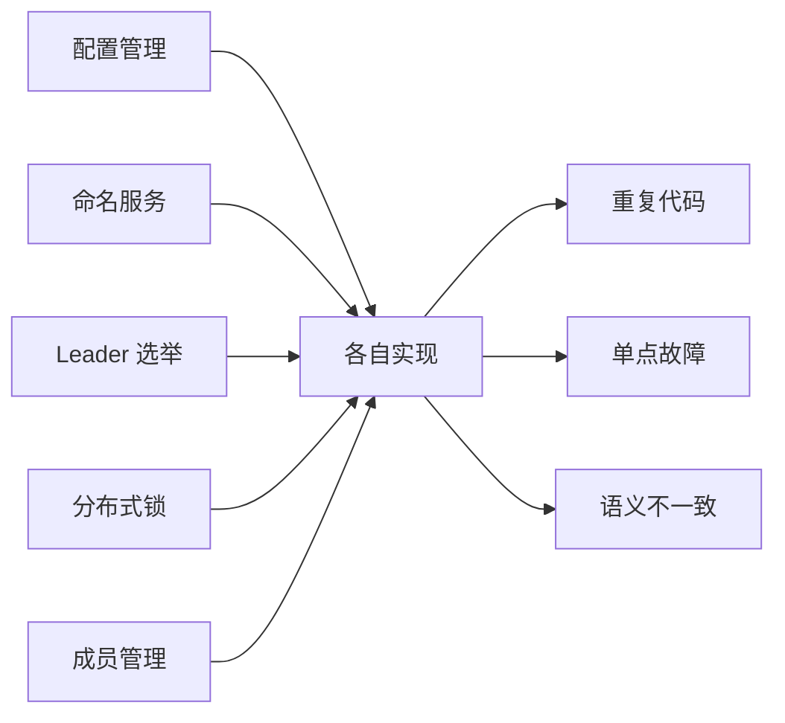
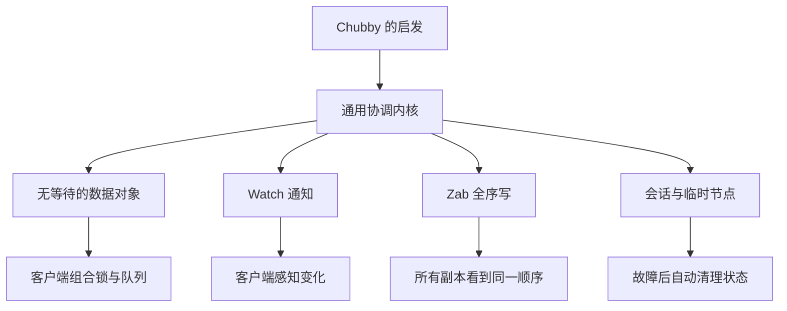
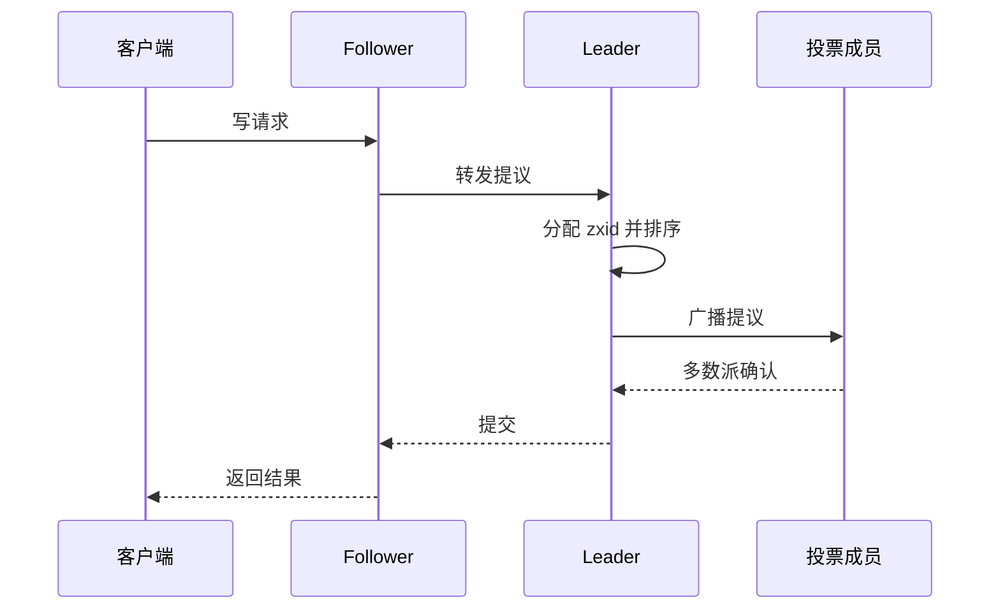
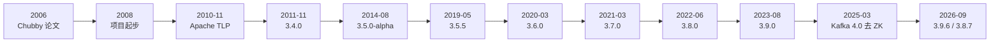

ZooKeeper 今天看起来像一个“理所当然存在”的基础设施：一个树形命名空间、几种节点类型、Watch 通知和一套选主协议。但把这些设计放回 2000 年代中期的背景，会发现它们并不是从抽象原则推出来的，而是被一类非常具体的问题逼出来的：**同一个分布式协调需求，被不同团队反复实现，而且每个实现都可能有单点故障、竞态和语义差异**。

这一篇讲“前生”：ZooKeeper 为什么会出现、最初想解决什么、从 Chubby 借了什么又没有照抄什么，以及它如何从 Yahoo! 的内部项目走进 Apache。

## 为什么先讲历史，而不是先背 API？

因为 ZooKeeper 的很多“怪”设计，都是历史问题的答案。

例如，为什么它只提供一组很小的数据操作，而不直接提供“分布式锁”接口？为什么客户端要自己处理会话和临时节点？为什么 Watch 是一次性触发？为什么写请求必须经过 Leader，读请求却可以在本地完成？如果只背 API，这些问题会变成记忆负担；如果知道它最初面对的是“多个系统各自造协调轮子”的局面，这些选择就会连成一条线。

💡 新人小结：学习 ZooKeeper 时，先问“它在替谁解决什么重复问题”，再问“这个 API 为什么这样设计”。历史不是八卦，它是理解设计约束的捷径。

## 2000 年代中期：每个团队都在造自己的协调轮子

在大型分布式系统里，有一类需求会反复出现：

| 需求 | 典型问题 | 如果每个系统各自实现 |
|------|----------|----------------------|
| 配置管理 | 配置改了，哪些节点已经生效 | 每个系统一套推送与版本逻辑 |
| 命名与服务发现 | 服务地址变化后，调用方怎么找到新地址 | 每个系统一套注册表与健康检查 |
| Leader 选举 | 主节点挂了，谁接替 | 每个系统一套选举算法与超时处理 |
| 分布式锁 | 多个进程如何互斥访问共享资源 | 每个系统一套锁协议与失效处理 |
| 集群成员管理 | 哪些节点还活着，哪些已经离开 | 每个系统一套心跳与成员视图 |

这些需求单独看都不算特别难，难的是**把它们做对**：网络会分区，进程会假死，时钟不可靠，客户端会重连，旧主节点可能在醒来后继续发号施令。每个团队都实现一遍，意味着每个团队都要重新踩一遍这些坑，而且不同系统的语义还不一致。



ZooKeeper 项目动机的通行叙述是：Yahoo! 内部有多个大型系统都需要类似的协调能力，各自维护一套组件，既重复又容易留下单点。与其让每个团队继续造轮子，不如做一个**通用的、无单点的协调服务**，把最难的共识与失效处理收进一个内核，业务系统只使用简单的原语。

ZooKeeper 由 Yahoo! Research 团队推动，早期论文作者与官方文档中的开发团队都指向 Yahoo! Research；它最初服务的不是某一个产品，而是 Yahoo! 内部一组需要协调的系统。这个出身决定了它的设计优先级：先保证协调语义正确、故障后能恢复，再追求单点性能数字。

这个判断在今天仍然成立。你可以在 Kubernetes、etcd、Consul 等系统里看到同一种思路：把“协调”从业务进程中抽出来，交给一个专门的基础设施组件。

## Chubby 给出了方向，但 ZooKeeper 没有照抄

2006 年，Google 发表了 Chubby 的论文，描述一个面向松耦合分布式系统的锁服务。Chubby 的关键价值不在于“锁”这个动作本身，而在于它证明了：**一个高可用的、粗粒度的锁服务，可以作为许多分布式系统的协调基础**。主节点选举、配置发布、成员管理，都可以建立在这种服务之上。

ZooKeeper 受了 Chubby 的启发，但做了一个重要转向：**不把“锁”作为服务端 API，而是提供一组无等待的数据对象，让客户端自己组合出锁、队列、屏障等原语**。

| 维度 | Chubby 的取向 | ZooKeeper 的取向 |
|------|---------------|------------------|
| 核心抽象 | 粗粒度锁与可靠小文件 | 树形命名空间中的 znode |
| 客户端阻塞 | 提供锁语义，客户端可能等待 | API 不提供阻塞锁，客户端组合原语 |
| 缓存一致性 | 服务端管理客户端缓存与租约 | 用 Watch 通知客户端缓存失效 |
| 扩展方式 | 以锁服务为中心 | 以数据模型和 Watch 为中心 |
| 设计目标 | 让协调变得可靠 | 让开发者能构造自己的协调原语 |

“无等待”容易被误解。它不是说整个系统永远不会等待，而是说 **ZooKeeper 暴露的数据操作本身不包含“抢锁后阻塞”的语义**。写请求仍然要经过 Leader 排序，客户端仍然可能因为网络而重试；但服务端不会把一个客户端挂在某个锁上，也不会因为一个慢客户端而阻塞其他客户端。

这带来一个很实际的结果：ZooKeeper 的 API 很小，但可以用它拼出很多原语。锁、Leader 选举、队列、屏障，都是在客户端按照约定使用 znode 的结果，而不是服务端内置的五个独立服务。



💡 新人小结：ZooKeeper 不是“开箱即用的分布式锁”，而是“做分布式锁的材料”。理解这一点，才不会在 API 里寻找一个并不存在的 `lock()` 方法。

## 一个常见误读：它是 Chubby 的“开源实现”吗？

中文资料里经常出现一句话：“ZooKeeper 是 Google Chubby 的开源实现。”这个说法抓住了灵感来源，但容易误导。

更准确的说法是：**ZooKeeper 是一个受 Chubby 启发的通用协调服务，不是把 Chubby 的锁服务原样重写一遍**。两者都关心高可用、顺序和故障恢复，但 API 与使用方式差别很大。

| 比较项 | Chubby | ZooKeeper |
|--------|--------|-----------|
| 对外核心 | 粗粒度锁与小文件 | 树形 znode 与数据操作 |
| 客户端是否直接拿锁 | 是 | 否，客户端用节点组合锁 |
| 变更通知 | 缓存与租约机制 | Watch 机制 |
| 一致性重点 | 锁与文件访问 | 写全序、会话 FIFO |
| 开源关系 | Google 内部服务 | Apache 独立开源项目 |

为什么这个区别重要？因为如果你把 ZooKeeper 当成“Chubby 的开源版”，就会期待它提供现成的锁语义、租约续期和会话级缓存管理。实际上，ZooKeeper 把这些责任交给了客户端模式：临时节点负责会话生命周期，顺序节点负责排队，Watch 负责通知，锁的公平性和重入性由客户端代码保证。

这也解释了后来 Curator 这类客户端库为什么有价值：它们不是“让 ZooKeeper 变成 Chubby”，而是把 ZooKeeper 的原始材料封装成更接近业务语义的锁、选举和缓存工具。

## 最初要解决的问题：把协调抽成一个通用内核

ZooKeeper 的论文把它定位为一个协调分布式应用进程的服务，目标是提供一个简单、高性能的内核，让开发者在其上构建更复杂的协调原语。它融合了组消息、共享寄存器和分布式锁服务的元素，但不是把三者各做一个模块，而是用一个统一的数据模型承载它们。

这个内核最初要同时满足四件事：

| 目标 | 具体含义 | 今天的对应设计 |
|------|----------|----------------|
| 简单 | 客户端只看到少量数据操作 | create、get、set、delete、exists、getChildren |
| 有序 | 所有客户端看到一致的更新顺序 | Leader 统一分配 zxid，Zab 广播 |
| 可靠 | 少数节点故障不影响整体 | 多数派 quorum、会话与临时节点 |
| 可组合 | 能构造锁、选举、队列等原语 | 顺序节点、临时节点、Watch 的组合 |

一个最小的使用示意如下。它不是本机的执行输出，而是帮助你建立“数据模型如何承载协调语义”的直觉：

```bash
# 写入一份配置
create /app/config "v1"

# 监听配置变化；标准 Watch 触发一次后需要重新注册
get -w /app/config

# 创建一个临时节点，会话结束后自动删除
create -e /app/leader "node-a"
```

这三条命令分别对应了配置、通知和成员身份。把它们组合起来，就能实现“谁持有临时节点谁是 Leader”“配置变化后通知所有观察者”“会话断开后自动释放锁”等模式。

这里的关键不是命令本身，而是三个设计决定：

1. **数据放在树形命名空间里**，所以配置、服务、锁可以共享同一套路径语义。
2. **临时节点的生命周期绑定会话**，所以进程崩溃后不需要额外的清理协议。
3. **Watch 只负责通知“发生了变化”**，不传输完整数据，客户端收到通知后自己重新读取。

## 三个关键设计决定

把 ZooKeeper 的设计压缩成三句话，可以写成下面这张表：

| 决定 | 当时的替代方案 | 带来的后果 |
|------|----------------|------------|
| 暴露小的数据 API，不内置锁 | 为每种协调需求做一个服务 | API 简单、可组合，但客户端要理解模式 |
| 写请求全序，读请求本地 | 所有读写都走共识 | 读吞吐高，但读可能看到稍旧的状态 |
| 用 Watch 通知缓存失效 | 服务端管理客户端缓存与租约 | 客户端参与更多，但服务端不被慢客户端拖住 |

这三条决定彼此咬合。没有全序写，临时节点和 Watch 就无法形成可靠的协调语义；没有本地读，ZooKeeper 很难支撑读多写少的协调负载；没有 Watch，客户端就只能轮询，服务端会被大量无意义的读请求压垮。

也正因为如此，ZooKeeper 的“一致性”需要分开看：**写是线性一致的，读可能看到稍旧的值，客户端会话提供 FIFO 顺序**。这不是一句“强一致”能概括的，后文讲数据模型时会展开。

## 一次写请求与一次读请求分别发生什么

把设计决定放回请求路径，会更容易理解它们为什么彼此咬合。

### 写请求：先到 Leader，再等多数派

客户端可以连任意一台服务器。如果连到 Follower，Follower 会把写请求转发给 Leader；Leader 给请求分配一个递增的 zxid，广播给投票成员，收到多数派确认后再提交。



这条路径解释了三个现象：

- 写吞吐受 quorum 大小、磁盘 fsync 和网络往返影响；
- Leader 是写路径上的瓶颈，也是故障恢复的中心；
- 写请求成功返回时，更新已经被多数派接受，不会因为随后的一次选举而丢失。

### 读请求：本地执行，可能看到旧值

读请求不需要经过 Leader。客户端连接的服务器可以直接从本地内存数据库返回数据，所以读吞吐可以随服务器数量扩展。但这也意味着：如果客户端先写后读，且读请求落到了一个还没同步完的 Follower，它可能看到旧值。

ZooKeeper 用两个机制处理这个问题：

1. **会话的 FIFO 顺序**：同一个客户端会话内的请求按发送顺序执行，客户端不会看到自己刚写的更新被“倒回去”。
2. **`sync` 操作**：如果业务必须读到最新值，可以先调用 `sync`，等待当前服务器追上 Leader 的最新状态，再读。

这也是为什么“ZooKeeper 是强一致”这句话需要加限定。它在写路径上提供线性一致，在跨客户端的读路径上并不保证每次都读到最新值。很多生产问题不是 ZooKeeper 不工作，而是使用者把“本地读”误当成了“全局最新读”。

💡 新人小结：部署 ZooKeeper 时，先分清你的业务需要“写后读到自己的更新”还是“任何时刻都读到全局最新值”。前者靠会话顺序通常够用，后者需要显式 `sync` 或重新设计读路径。

## 从 Yahoo! 内部到 Apache：一条有据可查的时间线

ZooKeeper 的早期历史常被讲成一段创业故事，但能落到官方材料上的节点其实很清楚：

| 时间 | 事件 | 证据口径 |
|------|------|----------|
| 2006 | Google 发表 Chubby 论文 | OSDI 2006 论文 |
| 2008 | ZooKeeper 项目起步，后来成为 Hadoop 的子项目 | Apache ZooKeeper 主干 POM 的 `inceptionYear` 为 2008；Apache 董事会决议称其为 “Apache Hadoop ZooKeeper sub-project” |
| 2010-11-17 | Apache 董事会决议建立 Apache ZooKeeper PMC | Apache 董事会会议纪要原文 |
| 2011-11 | 3.4.0 发布，multi 操作进入客户端 API | 3.4.0 Release Notes 与 Maven Central 制品时间 |
| 2014-08 | 3.5.0-alpha 发布，动态成员变更开始进入主线 | 3.5.0 Release Notes 与 Maven Central 制品时间 |
| 2019-05 | 3.5.5 发布，3.5 线终于有了稳定版 | Maven Central 制品时间 |
| 2020-03 | 3.6.0 发布，持久递归 Watch 与可插拔指标进入主线 | 3.6.0 Release Notes |
| 2021-03 | 3.7.0 发布，配额强制与 SASL 能力补齐 | 3.7.0 Release Notes |
| 2022-06 | 3.8.0 发布 | 官方发布页与版本归档 |
| 2023-08 | 3.9.0 发布 | 官方发布页与版本归档 |
| 2025-03 | Kafka 4.0 发布，首次完全不依赖 ZooKeeper | Apache Kafka 4.0 发布公告 |
| 2026-09 | 3.9.6 与 3.8.7 发布，修复多项安全问题 | 官方发布页与安全公告 |
| 2026-10 | 主干 POM 为 3.10.0-SNAPSHOT，3.10 尚未正式发布 | Apache ZooKeeper GitHub 主干 POM |



这张表里最值得停顿一下的是 2010 年 11 月 17 日。Apache 董事会会议纪要写得很直接：决议建立一个名为 “Apache ZooKeeper Project” 的 PMC，负责分布式系统协调相关软件；同时把 “Apache Hadoop ZooKeeper sub-project” 的职责迁移过去。也就是说，ZooKeeper 不是一开始就独立立项，而是从 Hadoop 生态里长出来，随后被 Apache 正式承认为顶级项目。

### 命名趣闻：动物园管理员

社区里广泛流传一个命名故事：Yahoo! 内部很多项目用动物命名，有人说“再这样下去这里就成动物园了”，于是负责协调这些组件的服务被叫作 ZooKeeper，也就是“动物园管理员”。

这个故事在《从 Paxos 到 ZooKeeper》和多篇社区文章里都能看到，但我没有找到 Apache 官方的一手会议记录来证实每一句对话。因此，本页把它当作**社区趣闻**，不作为项目事实。可以确定的是，ZooKeeper 的定位确实是“管理一组分布式组件之间的协调关系”，这个名字与它的职责非常贴合。

## 早期生产场景：它先在 Yahoo! 的哪些系统里证明自己

ZooKeeper 不是先写论文再找场景。官方文档记录了它在 Yahoo! 内部的早期使用：

| 系统 | ZooKeeper 承担的角色 | 说明 |
|------|----------------------|------|
| Yahoo! Message Broker | 协调与故障恢复 | 一个管理数千个主题的发布订阅系统 |
| Yahoo! 爬虫的 Fetching Service | 协调与故障恢复 | 抓取服务的节点协作 |
| Yahoo! 广告系统 | 可靠服务的基础 | 多个广告系统用它做协调 |

这些场景有一个共同点：**协调数据量不大，但对“顺序、可靠、故障后自动恢复”非常敏感**。这正好落在 ZooKeeper 的设计区间里。它不是用来存业务大数据的，而是用来存“谁在什么时候该做什么”的少量元数据。

这也是为什么 ZooKeeper 的 znode 不适合存大对象，为什么默认限制请求大小，为什么它的性能故事通常是“读多写少”。这些限制不是后来才发现的，而是从早期使用场景里就确定下来的边界。

💡 新人小结：ZooKeeper 的“小数据、强顺序、读多写少”不是缺陷，而是定位。把它当配置中心、注册中心、选主服务都合适；把它当通用数据库或大对象存储，就会撞上它本来就没打算解决的限制。

## 历史留下的四个“惯性”

理解历史之后，再看今天的使用方式，会发现很多“惯性”仍然在影响我们：

| 历史决定 | 今天的表现 | 你需要注意什么 |
|----------|------------|----------------|
| 数据模型模仿文件系统 | 路径是核心，节点有版本和 ACL | 路径设计就是命名空间设计，不要随意改 |
| 会话绑定临时节点 | 进程崩溃后节点自动消失 | 会话超时时间会影响故障发现速度 |
| Watch 一次性触发 | 客户端必须重新注册 | 高频变化场景要考虑持久 Watch 或轮询 |
| 写请求走 Leader | 写吞吐受 quorum 与磁盘影响 | 不要把高频业务写放大到 ZooKeeper |

这些惯性也解释了 ZooKeeper 在后来的版本里为什么要做动态成员变更、持久 Watch、可插拔指标和安全加固：**它不是在一个空白的理想环境里演进，而是在守住已有语义的前提下，一点点修补早期设计留下的边界**。

下一篇会沿着 3.3 到 3.9.6 的版本线，看看这些修补具体发生在哪些节点、每次变更付出了什么代价，以及 Kafka 4.0 去掉 ZooKeeper 之后，它今天的生态位置发生了什么变化。

## 资料说明

本页涉及的官方材料与时间口径：

- Apache ZooKeeper 主干 POM：`inceptionYear=2008`，`https://github.com/apache/zookeeper/blob/master/pom.xml`
- Apache 董事会 2010-11-17 会议纪要：建立 Apache ZooKeeper PMC，迁移 Hadoop ZooKeeper 子项目
- Apache ZooKeeper 官方文档 `zookeeperOver.html`：早期在 Yahoo! 的使用场景
- Apache ZooKeeper 官方发布页：`https://zookeeper.apache.org/releases.html`
- Apache ZooKeeper 3.4.0、3.5.0、3.6.0、3.7.0 Release Notes
- Hunt, P., Konar, M., Junqueira, F., Reed, B. ZooKeeper: Wait-free Coordination for Internet-scale Systems. USENIX ATC 2010
- Burrows, M. The Chubby Lock Service for Loosely-Coupled Distributed Systems. OSDI 2006

早期版本的精确日期以 Maven Central 制品时间为排序依据，和官方公告日可能相差几天；正文只用它说明先后顺序，不把制品时间冒充为发布公告时间。

## 要点总结

- ZooKeeper 的起点不是“做一个分布式数据库”，而是把重复出现、容易做错的协调需求收进一个通用内核。
- 它受 Chubby 启发，但没有把锁作为服务端 API，而是提供无等待的数据对象，让客户端组合出锁、选举、队列等原语。
- 三个关键设计决定是：小数据 API、写请求全序加本地读、Watch 通知缓存失效。
- 2008 年项目起步，2010 年 11 月 Apache 董事会决议建立 ZooKeeper PMC，完成从 Hadoop 子项目到顶级项目的迁移。
- 早期在 Yahoo! Message Broker、爬虫抓取服务和广告系统中的使用，验证了“小数据、强顺序、读多写少”的定位。
- 今天遇到的许多边界，都能在早期设计里找到原因；理解这些原因，比记住 API 列表更有用。
