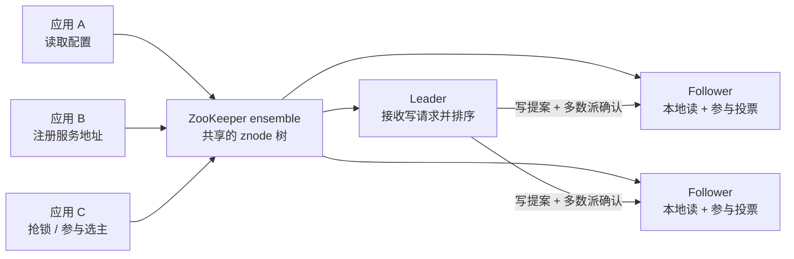
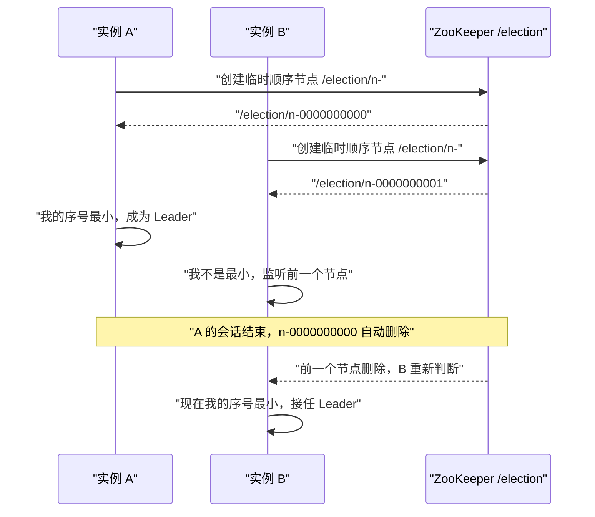
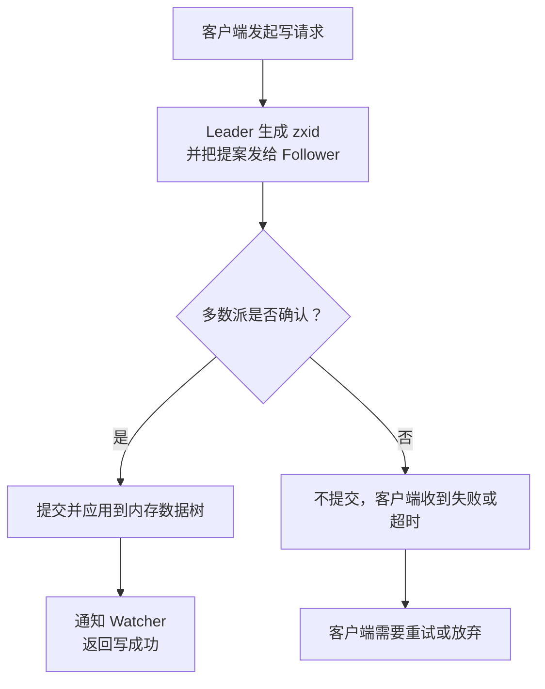

## 为什么需要 ZooKeeper？（四场线上事故的共同根源）

凌晨两点，值班同学被三条告警同时叫醒：支付服务连不上数据库、订单服务把流量打到了已经下线的机器、风控服务两台实例都认为自己是主节点。把日志翻完才发现，三件事的根因是同一个：**没有一个所有进程都信得过的“共享事实来源”**。

先看几个分布式系统里反复出现的场景：

- 配置改错一个地址，十台机器里只有三台生效，另外七台继续连接旧地址。运维只能一台台登录去改，改完还不知道有没有漏。
- 服务扩容后，新实例的地址要通知所有调用方。调用方各自维护一份列表，更新时间不一致，流量就会打到已下线的实例。
- 两个任务同时启动，都判断“当前没有主节点”，于是同时把自己提升为主，开始重复处理同一批订单。
- 两个进程争抢同一把锁，都先查“锁不存在”，再写入自己的名字。两个写操作都成功，临界区里同时进了两个人。

这些问题的共同点不是“代码写错了”，而是**多个进程在没有共享状态的情况下，试图对同一件事达成一致**。只靠本地内存、数据库轮询或者“约定一个时间点”，都无法可靠解决：数据库可能被不同事务隔离级别影响，时间点会被时钟漂移打破，轮询窗口内也可能发生两次修改。

| 没有协调服务时的做法 | 看起来能用，实际会怎样 | 有了 ZooKeeper 之后 |
|----------------------|------------------------|---------------------|
| 配置文件复制到每台机器 | 改漏一台就出现“部分生效”，排查时无法确认版本 | 配置放在一个 znode 上，客户端读取并注册 Watcher，变更一次通知所有订阅者 |
| 调用方各自缓存服务地址 | 列表版本不一致，扩容/缩容期间流量打空 | 实例把临时节点注册到统一目录，断线后节点自动消失 |
| 用数据库唯一索引抢主 | 数据库故障时选主也停摆，事务和会话边界难对齐 | 用临时顺序节点 + 最小序号判断主节点，会话结束自动释放 |
| 自己实现分布式锁 | 锁超时、续期、误删、惊群，每个细节都能出事故 | 用顺序节点排队，前一个节点删除时通知后一个，语义清晰 |

> ### 💡 新人小结：ZooKeeper 到底像什么？
>
> 把 ZooKeeper 想象成小区门口的一块「公共公告板 + 门禁登记处」：
> - 公告板上的每一张纸就是一个 znode，纸上可以写内容，也可以按目录继续贴子公告。
> - 谁想看公告，就在纸上留一个「有变化叫我」的便签，这就是 Watcher。
> - 访客登记时写的是「临时访客」，人一走（会话结束），登记自动失效，这就是临时节点。
> - 公告板由多个人同时维护，只要多数人还在，公告就不会丢，这就是 ensemble 的多数派。
>
> **ZooKeeper 不是数据库，它是一块所有进程都认可、并且能主动通知变化的共享公告板。**

**学习路线图**

```
痛点 → 定位与关键词 → 四类协调问题 → 一致性保证 → 不适用边界 → 真实案例 → 最小体验
为什么  它是什么      配置/命名/成员/选主   读到什么   什么时候别用   谁在用      亲手试一次
```

---

## ZooKeeper 是什么：一句话与五个关键词

Apache ZooKeeper 是一个**分布式的开源协调服务**。它对外提供一组很简单的原语，让分布式应用可以在上面实现同步、配置维护、分组和命名等更高层的服务。它使用类似文件系统的树形命名空间，数据保存在内存中，并以 ensemble（多台服务器组成的集群）的方式复制。

这句话里有五个关键词，先逐个拆开：

| 关键词 | 白话解释 | 在系统里的落点 |
|--------|----------|----------------|
| 协调服务 | 不是业务数据库，也不是消息队列，而是帮多个进程“对齐状态”的基础设施 | 配置、命名、成员、选主、锁、队列等场景 |
| 树形命名空间 | 所有数据挂在 `/` 开始的路径下，像文件目录一样可以层层展开 | znode 树，例如 `/app/config`、`/services/order/instance-1` |
| znode | 树上的一个节点，既能存数据，也能有子节点 | 配置文件、实例地址、锁序号、选主标记都放在 znode 上 |
| 内存 | 数据主要放在内存里，读操作通常很快 | 适合读多写少的协调数据，不适合当大对象存储 |
| ensemble | 多台服务器共同保存同一份状态，多数派存活即可提供服务 | 3 节点、5 节点集群；Leader 处理写，Follower 处理读与投票 |

ZooKeeper 的定位可以从官方的一句话里读出来：它为分布式应用提供协调能力，让应用不必从零实现同步、配置维护、分组和命名。它要解决的是“协调”这件事本身，而不是替应用存业务数据。



上图只画了三个服务端，是因为三节点是最小推荐规模：能容忍一台机器故障，仍然保持多数派。客户端只连接其中一台服务器，但这台服务器不一定是 Leader；写请求会被转发给 Leader，读请求则由当前连接的服务器本地返回。

> ### 💡 新人小结：为什么“读本地、写 Leader”很重要？
>
> 想象一个三人小组共同维护一块白板：
> - 每个人手里都有一份白板复印件，看内容（读）直接看自己的复印件，速度快。
> - 要改白板（写），必须交给组长统一编号，再让至少两个人确认，避免两个人同时改出两个版本。
> - 组长就是 Leader，组员就是 Follower，编号就是 zxid。
>
> **读可以分散，写必须集中排序；这就是 ZooKeeper 既能扛读、又能保证顺序的原因。**

---

## 它解决的四个经典协调问题

### 问题一：配置要“一次修改，处处生效”

最朴素的做法是把配置写进每台机器的本地文件。机器少的时候还能靠脚本分发，机器一多，配置版本就会分叉：有人改了 A 参数，有人改了 B 参数，最后没有任何一台机器的配置是完全一致的。

ZooKeeper 的做法是把配置放进一个 znode，所有客户端读取同一个路径。需要感知变化的客户端再注册一个 Watcher，配置被 `set` 时收到通知，重新读取即可。

```bash
# 把数据库连接串写进一个 znode（真实输出）
zkCli.cmd -server 127.0.0.1:2182 create /app v1
# Created /app

zkCli.cmd -server 127.0.0.1:2182 get /app
# v1

zkCli.cmd -server 127.0.0.1:2182 set /app v2
# （set 成功时没有额外输出，这是正常现象）

zkCli.cmd -server 127.0.0.1:2182 get /app
# v2
```

| 设计点 | 说明 | 工程上的好处 |
|--------|------|--------------|
| 单一事实来源 | 所有客户端读同一个路径 | 不再出现“这台机器还是旧配置”的争论 |
| 原子读写 | 一次写入替换全部数据 | 不会读到写了一半的配置 |
| Watcher 通知 | 变更时主动通知订阅者 | 不必高频轮询，降低延迟和数据库压力 |
| 版本号 | 每次写入让 `dataVersion` 增加 | 可以用版本做条件更新，避免覆盖别人的修改 |

### 问题二：服务地址要能自动上下线

服务发现的核心不是“存一份地址列表”，而是“实例挂了之后，列表要自动变”。如果地址是手工维护的，扩容和缩容就永远慢半拍。

ZooKeeper 用**临时节点**表达“我还在线”：实例启动时创建 `/services/order/instance-1`，会话断开或超时后，这个节点会被服务端删除。调用方只需要 watch 父节点的子节点列表，就能在实例上下线时收到通知。

```text
/services/order/instance-1   ← 临时节点，实例 1 在线
/services/order/instance-2   ← 临时节点，实例 2 在线
```

| 节点类型 | 生命周期由谁决定 | 适合表达什么 |
|----------|------------------|--------------|
| 持久节点 | 只有显式删除才消失 | 配置、目录、元数据 |
| 临时节点 | 创建它的会话结束就消失 | 在线实例、租约、临时占用 |
| 顺序节点 | 持久或临时，名字尾部带自增序号 | 排队、选主、锁 |
| 容器节点 | 最后一个子节点删除后，可能被服务端回收 | 动态分组的父目录 |

临时节点不能有子节点，这是官方明确限制的。原因很直接：如果临时节点可以有子节点，父节点随会话消失时，子节点该不该一起消失、其他会话创建的孙节点怎么处理，都会变成难以收敛的状态。需要层级时，用“持久父目录 + 临时子节点”的组合。

### 问题三：多个实例要选出一个主

选主（Leader Election）是分布式系统里最容易写错的一类逻辑。常见错误是“先查有没有主，再写自己是主”，这两个操作之间有一个窗口，两个实例都可能成功。

ZooKeeper 的经典做法是让每个候选者创建一个**临时顺序节点**，序号最小的那个就是 Leader。序号由父节点统一分配，天然有全序；临时节点保证候选者掉线后自动退出，不会留下“幽灵主节点”。



| 常见错误做法 | 失败点 | ZooKeeper 的改进 |
|--------------|--------|------------------|
| 查一次“主是否存在”，再写入自己 | 两个实例可能同时通过检查 | 创建顺序节点是原子操作，序号由服务端分配 |
| 用固定节点 + 超时时间 | 时钟漂移、GC 停顿会让判断失真 | 用会话而不是本地时间判断存活 |
| 主节点挂了靠人工切换 | 恢复时间长，容易切错 | 临时节点消失后，候选者按序号自动接任 |
| 所有候选者都监听主节点 | 主节点变化时产生惊群 | 只监听前一个节点，形成链式唤醒 |

### 问题四：临界区要互斥，还要能排队

分布式锁和选主是同一类问题的两种说法：选主是“只允许一个长期持有”，锁是“只允许一个在临界区内”。ZooKeeper 的顺序节点可以同时表达“互斥”和“公平排队”：

1. 每个竞争者创建 `/locks/order/n-` 顺序节点。
2. 序号最小者获得锁。
3. 其他竞争者 watch 自己前一个节点，而不是 watch 整个目录。
4. 前一个节点删除时，后一个被唤醒，重新判断自己是否最小。

这样做的好处是**避免惊群**：锁释放时只有下一个排队者被通知，而不是所有等待者同时醒来抢锁。

> ### 💡 新人小结：顺序节点为什么能当排队号？
>
> 去银行办业务时，你在取号机按一下，机器给你一张带序号的票：
> - 票号由机器统一发，不会两个人拿到同一个号。
> - 你只需要盯着“当前叫到几号”，不用挤到柜台前问。
> - 过号或人走了，票自然作废，不影响后面的人。
>
> **顺序节点就是 ZooKeeper 的取号机：父节点发号，序号全序，临时节点负责“人走票废”。**

---

## ZooKeeper 给了哪些保证

ZooKeeper 之所以能作为协调基础，不只是因为它“存了数据”，而是因为它对读写顺序给出了明确保证。官方列出的五条保证如下：

| 保证 | 白话解释 | 对你的影响 |
|------|----------|------------|
| 顺序一致性（Sequential Consistency） | 同一个客户端发出的更新，会按发送顺序生效 | 客户端先写 A 再写 B，其他客户端不会先看到 B |
| 原子性（Atomicity） | 更新要么全部成功，要么全部失败 | 不会出现“写了一半”的 znode 数据 |
| 单一系统视图（Single System Image） | 客户端无论连到哪台服务器，看到的都是同一份逻辑状态 | 故障切换后不会突然看到旧数据 |
| 可靠性（Reliability） | 一次更新生效后，会一直保留到被下一次更新覆盖 | 不会因为换了一台服务器就丢写 |
| 时效性（Timeliness） | 客户端看到的状态在一定时间范围内是最新的 | 不是强实时，但边界可预期 |

这些保证直接决定了 ZooKeeper 适合做什么、不适合做什么。比如“顺序一致性”让它可以做选主和锁；“原子性”让配置不会被读到半成品；“单一系统视图”让客户端可以放心地在服务器之间切换。

但要注意：**ZooKeeper 不保证跨客户端的实时同步**。客户端 A 写入后，客户端 B 可能需要过一小段时间才能看到；如果 B 先读到了旧值，这是允许的。需要“写完立刻读到”的场景，应该由客户端自己用 `sync` 或版本号来约束，而不是假设 ZooKeeper 是强实时数据库。



上图里的 `zxid` 是 ZooKeeper 事务编号：高 32 位是 epoch（每次换 Leader 递增），低 32 位是计数器。它把“第几次领导任期里的第几个事务”编码进一个 64 位数字，因此可以比较先后。三节点集群里看到的 `Zxid: 0x100000000` 表示第 1 个 epoch 的起点，换主后变成 `0x200000000`，这不是数据量突然变大，而是 epoch 进位。

---

## ZooKeeper 不做什么：边界比功能更重要

很多事故不是“不会用 ZooKeeper”，而是“把 ZooKeeper 用在了它不擅长的地方”。下面这些边界，建议在方案评审时就写清楚：

| 需求 | 为什么不适合直接压在 ZooKeeper 上 | 更稳妥的做法 |
|------|-----------------------------------|--------------|
| 存图片、视频、大 JSON | znode 数据主要放内存；客户端和服务端对数据大小有检查，官方建议协调数据保持在 KB 级 | 大对象放对象存储/NFS/HDFS，znode 只存路径或指针 |
| 当高吞吐消息队列 | 写请求要经过 Leader 和多数派确认，吞吐与延迟不适合海量消息 | 用 Kafka、Pulsar 等消息系统；ZooKeeper 只做元数据协调 |
| 当通用数据库查询 | 没有表、索引、SQL、复杂事务，只有按路径读写 | 用关系型或文档数据库 |
| 存频繁变化的业务计数 | 每次写都要走一致性协议，热点 znode 会成为瓶颈 | 用 Redis/数据库计数，ZooKeeper 只存协调状态 |
| 跨地域强一致低延迟 | 写延迟受 quorum 网络往返影响，跨地域部署会放大 | ensemble 尽量同机房/低延迟网络，异地做只读或独立集群 |
| 需要复杂权限模型 | ACL 是路径级的粗粒度模型，不是完整的 RBAC | 业务侧做权限，ZooKeeper ACL 只保护协调数据 |

还有一个常被忽略的边界：**ZooKeeper 不是“注册中心产品”**。它提供了做服务发现所需的原语，但服务注册的语义、健康检查、灰度、控制台、权限审批，需要应用框架或平台来封装。Spring Cloud Zookeeper、Curator 这类项目做的就是这层封装；直接拿 zkCli 手工维护服务列表，短期能跑，长期一定会被运维成本拖垮。

> ### 💡 新人小结：什么时候不该用 ZooKeeper？
>
> 把 ZooKeeper 想象成小区的公告板，而不是仓库：
> - 公告板适合贴“门禁密码改了”“今天停水”“谁在值班”这类小而重要的信息。
> - 你不会把自家的家具搬到公告板上，也不会让公告板承担快递分拣。
> - 公告板需要多数管理员同时在场才能更新，所以别把它放到跨城市的两个小区之间做实时同步。
>
> **判断标准：数据小、读多写少、需要所有进程看到同一份事实——满足这三条再考虑 ZooKeeper。**

---

## 谁在用 ZooKeeper：官方用例里的真实系统

ZooKeeper 的官方 Use Cases 页面列出了一批实际使用者。下面挑几个有代表性的，看看它们把 ZooKeeper 放在了什么位置：

| 系统 | 用 ZooKeeper 做什么 | 对应本文的哪个抽象 |
|------|---------------------|--------------------|
| Apache Accumulo | 保存用户、表配置与进程/tablet 的运行状态，支撑无单点架构 | 配置管理 + 成员状态 |
| Apache BookKeeper | 保存 ledger、bookie 等元数据，作为元数据存储服务 | 元数据 + 命名 |
| Neo4j High Availability | 写主选举、读从协调 | 选主 + 成员管理 |
| Spring Cloud Zookeeper | 服务发现与分布式配置 | 命名 + 配置 |
| Eclipse Gyrex | 节点成员管理、作业协调、锁服务、简单队列 | 成员 + 锁 + 队列 |

这些系统的共同点是：**ZooKeeper 存的是“小、关键、需要顺序”的协调数据，而不是业务正文**。一旦你发现自己想往 znode 里塞大量业务数据，或者想用它承接每秒数万次写入，就应该停下来重新评估。

---

## 一个最小可感知的例子：配置变了，谁会被通知？

概念说得再多，不如看一眼真实的通知过程。下面这段输出来自本机 3.8.7 临时实例：客户端 A 在 `/watch-demo` 上注册 Watcher，客户端 B 修改数据，A 收到 `NodeDataChanged`。

```text
CLIENT_A_CONNECTED session=0x10001b840d10011
CREATE /watch-demo data=v1
WATCH_REGISTERED path=/watch-demo current=v1
CLIENT_B_CONNECTED session=0x10001b840d10012
SET /watch-demo data=v2 version=-1
WATCH_EVENT type=NodeDataChanged path=/watch-demo state=SyncConnected
WATCH_FIRED_WITHIN_5S=true
SET /watch-demo data=v3 again (no new watch)
WATCH_EVENTS_AFTER_SECOND_SET=0
```

这段输出里有两个关键点：

1. **通知是异步的**：B 的 `set` 返回成功，不代表 A 已经处理完通知。A 在自己的事件线程里收到 `WATCH_EVENT`，两个客户端看到事件的时刻可以不同。
2. **Watcher 是一次性的**：第一次 `set` 触发了通知，第二次 `set` 没有再触发，因为 A 没有重新注册。想要持续监听，必须在每次事件后重新 `get -w`，或者使用 3.6.0 起支持的持久 Watcher。

| 你看到的现象 | 背后的机制 | 写代码时要注意 |
|--------------|------------|----------------|
| `set` 成功但 Watcher 还没收到 | 通知异步发送，网络有延迟 | 不要把“通知到达”当成写成功的条件 |
| 第二次修改没有通知 | 标准 Watcher 触发一次后即被移除 | 事件回调里重新注册，或改用持久 Watcher |
| 断线重连后收到事件 | 客户端会重新注册已有 Watcher | 处理 `SyncConnected` 与 `Expired` 状态 |
| 连接断开期间可能漏事件 | 断连时 Watcher 不会送达 | 重连后主动做一次全量读取，别只依赖通知 |

> ### 💡 新人小结：Watcher 像门口的门铃，不是监控录像
>
> - 门铃按一次响一次，响完就复位；想再听，需要再按（重新注册）。
> - 你不在家时门铃不会替你录像，回来要自己检查门口（重连后全量读）。
> - 门铃只告诉你“有人来过”，不告诉你“来了几次、做了什么”（事件类型有限）。
>
> **Watcher 负责“提醒你变化发生了”，不负责“保存变化历史”。**

---

## 要点总结

1. **ZooKeeper 的定位是协调，不是存储**：它用 znode 树保存小份、关键、需要顺序的共享状态，解决配置、命名、成员、选主、锁、队列等协调问题。
2. **核心抽象只有几个**：znode、会话、Watcher、顺序节点、临时节点；把这几个组合起来，就能表达大多数分布式协调模式。
3. **读写路径不对称**：读由本地副本服务，写要经过 Leader 和多数派确认；因此它读多写少时表现最好，官方给的典型读写比约为 10:1。
4. **多数派是可用性的边界**：三节点容忍一台故障，五节点容忍两台；少于多数派时，集群不会继续接受写，也不会选出新 Leader。
5. **边界比功能更重要**：不要把 ZooKeeper 当数据库、大对象存储或高吞吐消息队列；数据小、读多写少、需要统一事实，才是它的舒适区。

---

> ### 💡 新人小结：这一篇学完，记住这 4 点
>
> 1. **先问“要不要共享事实”**：多个进程需要对同一件事达成一致时，才轮到 ZooKeeper 出场。
> 2. **再问“数据大不大、写多不多”**：小、读多写少才合适；大对象和高频写请换存储。
> 3. **临时节点表达“我还在”**：服务发现、选主、租约都靠它，会话结束节点就消失。
> 4. **Watcher 是提醒，不是历史**：收到通知要重新读数据，断线重连后要主动全量校准。
