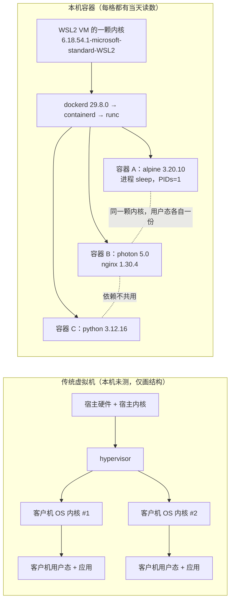

> **本章清单原语（逐字承接）**
> **清单项标题（清单原话）**：为什么需要容器
>
> 章节号：1.1 ｜ 所属篇：01-基础认知（第一篇 基础认知）
> 主线站 · 难度 · 耗时：— · ★☆☆ · 25m
> 前置依赖：—
> 变更标记：**相对 v1.2 变更（重排/合并/迁移）**——本篇合并了原 1.1 与原 1.2 的内容。
>
> **内容要点与产出物**：合并原 1.1 + 1.2：环境不一致·依赖冲突·部署慢三大痛点及容器化如何逐一解决；容器与虚拟机的架构图和性能/隔离性/启动速度对比表；常见误解澄清。▸ 产出：能用自己的话说清「为什么不是虚拟机」。

> **实战落点**：全库第一篇文章，也是 01 板块的第一篇。它不教任何命令用法，只回答一件事：**你现在的做法到底卡在哪，容器换掉了哪一块**。读完这一篇应该能用自己的话说清「为什么不是虚拟机」——这句话不是口号，本篇给了三个可当场做的动作（问内核、塞进第二个解释器、掐表）来支撑它。下一篇 [1.2 核心概念与架构总览](/docs/01-基础认知/为什么是容器/核心概念与架构总览/) 才讲"由哪几块拼成"，再下一篇才是第一次动手（1.3）。
> **本机基线（as-of 2026-10-29，本篇每个数字都是当天现量，前缀 `kb33_`）**：Engine/CLI `29.8.0`、API `1.56`、`Platform = Docker Desktop 4.91.0 (239619)`、`Name=docker-desktop`、`KernelVersion=6.18.54.1-microsoft-standard-WSL2`、`NCPU=24`、`MemTotal=50475270144`；容器内 `uname -r` 与引擎所在发行版**同一串**；`docker run --rm busybox:1.37 echo hi` 三次墙钟 `0.426 / 0.461 / 0.417` 秒；`create` `0.105` 秒、`start` `0.183` 秒、`Created→StartedAt` ≈ `0.0998` 秒；镜像体量 `busybox 6,767,335 字节 / 1 层`、`alpine 12,102,484 / 1`、`nginx 73,574,743 / 8`、`python 74,097,630 / 4`、`node 239,050,910 / 4`、`mysql 1,102,884,141 / 10`；开工与收尾基线一致：**容器 16 / 卷 15 / 网络 5**。
> **前置依赖**：无（本篇是全库起点）。往下接：[/docs/01-基础认知/为什么是容器/核心概念与架构总览/](/docs/01-基础认知/为什么是容器/核心概念与架构总览/)（1.2：镜像/容器/仓库与 Client-Server 那条链）、[/docs/01-基础认知/第一次动手/第一次运行容器与图形化工具/](/docs/01-基础认知/第一次动手/第一次运行容器与图形化工具/)（1.3：第一次真的跑一个）、[/docs/05-原理深入/隔离与资源/容器本质Namespace与Cgroups/](/docs/05-原理深入/隔离与资源/容器本质Namespace与Cgroups/)（5.1~5.2：本篇"共享内核"这句话背后的 namespace 与 cgroup 机制）、[/docs/00-导读/把环境搭好/环境准备/](/docs/00-导读/把环境搭好/环境准备/)（0.3：Windows 上这台引擎怎么装出来的）。
> **本篇产出物**：**七张表 + 一张架构图 + 一个能当场做完的三动作清单**（表数与形态数由脚本现读：本篇 `wc -l` **265 行**、11 个 H2、新人小结 5 处、1 张 mermaid、6 个带语言代码块、**7 个表格块 / 25 对表格行**）。三张主表是「三大痛点 → 容器化动的是哪一块 → 本机读数」、「容器与虚拟机的逐项对比（**虚拟机那一列本机没证据，留空并标未验证**）」、「常见误解 → 真相 → 本机怎么一句话验掉」，另四张是"容器里像机器的四样"、"两种 cat 的报错措辞"、"掐表分段"、"未验证项"；架构图是一张 `flowchart LR`，把"虚拟机各自带一份内核"与"本机所有容器共用 VM 那一颗内核"画成两条回路；三动作是问内核、塞第二个解释器、掐表。**这一篇没有配套脚本**——它的所有读数都来自本批配套取数脚本（`Y1b_为什么需要容器.py`、`Y1c_隔离相同点.py` 等，属仓库暂存件、不随站点发布），正文只印它吐出的原文。
> **难度·耗时**：★☆☆ · 25m（读 + 把三个动作各做一遍；第三个动作要掐表，别只看数字）
> **拓展接口**：本篇"共享内核"这条结论在 5.1 被**精确化**（不是"没有隔离"，而是隔离靠 namespace + cgroup 且默认不全开）；"启动快"这条在 5.3 被**加条件**（快的是调度，不是配额；`--memory` 只限内存不限磁盘）；"依赖打包进镜像"在 3.5/3.7 被**反过来用**（层与多阶段构建）；"部署物分量"那格在 10.1/10.2 被**换成落点问题**（镜像层、可写层、卷是三个不同的地方）；**回指 10-存储专题**：[/docs/10-存储专题/基础/存储是什么与为什么会出现/](/docs/10-存储专题/基础/存储是什么与为什么会出现/)（10.1）。

## 为什么要先问"为什么不是虚拟机"

新人第一次听容器，几乎都会自动补一句"就是个轻量虚拟机吧"。**这句话一旦留下，后面所有判断都会歪**：

- 会以为容器有自己的内核，于是去容器里装杀毒软件、装驱动、担心内核版本；
- 会以为隔离强度等于虚拟机，于是把两个互不信任的服务放同一台引擎上；
- 会以为"重启容器 = 重启系统"，于是给它配几分钟的启动等待与健康检查宽限；
- 会觉得容器镜像应该和 VM 镜像一样大，于是看到 6 MB 的 busybox 反而不敢用。

所以第一篇的目的不是夸容器好，而是**把"它到底是什么"钉死在一句可以被当场验证的话上**：

> **容器是一个被 namespace 与 cgroup 圈起来的普通 Linux 进程，它用的就是宿主（本机是那台 VM）的内核。**

本篇接下来的全部内容，就是给这句话补上三个可操作的动作，以及它换掉了哪三件让人头疼的事。

> 💡 新人小结：容器不是"小虚拟机"，而是**一个被管住的用户进程**。类比到这里要立刻说清失效的地方：同一个用户进程被管住之后仍然共用这台机器的内核，而虚拟机里跑的是一套独立内核——差别不在"轻不轻"，在**内核是谁的**。

## 三大痛点：容器化到底动的是哪一块

清单给这一篇的三条主线是**环境不一致、依赖冲突、部署慢**。下表每一格的"本机读数"都是当天量出来的原文，没有一条是转述。

| 痛点 | 你实际遇到的样子 | 容器化动的是哪一块 | 本机读数（2026-10-29） | 指回 |
|---|---|---|---|---|
| 环境不一致 | "在我机器上是好的"——同一份代码在不同机器上行为不同 | 把**用户态环境**（发行版、包、解释器、配置）一起打包；内核不带 | `alpine:3.20` 容器内 `cat /etc/alpine-release` → `3.20.10`；`nginx:1.27-alpine` 内 → `3.21.3`：**同一台机器上两个容器各有各的用户态** | [/docs/02-核心操作/跑起来/镜像管理与容器生命周期/](/docs/02-核心操作/跑起来/镜像管理与容器生命周期/) |
| 依赖冲突 | 项目 A 要 Python 3.12、项目 B 要 3.9；或者一个要 OpenSSL 3.5.8 另一个要 3.5.7 | 依赖**不共用系统目录**，各在各的镜像里；同一软件两个版本可以并存 | `python:3.12-alpine python -V` → `Python 3.12.16`；`mysql:8.4` 里 `openssl version` → `OpenSSL 3.5.8 25 Aug 2026`，`adminer:4` 里 → `OpenSSL 3.5.7 9 Jun 2026`（同一宿主并存） | [/docs/03-镜像构建/写出来/Dockerfile指令全解与构建上下文/](/docs/03-镜像构建/写出来/Dockerfile指令全解与构建上下文/) |
| 部署慢 | 新机器要先装运行环境、装依赖、调配置，一步错就重来 | 部署物 = **一个带层的内容 + 一句启动命令**，装环境这一步被镜像吃掉了 | `docker run --rm busybox:1.37 echo hi` 三次 `0.426 / 0.461 / 0.417` 秒；`docker create` `0.105` 秒、`docker start` `0.183` 秒，引擎记的 `Created → StartedAt` 差 ≈ **0.0998 秒** | [/docs/02-核心操作/跑起来/镜像管理与容器生命周期/](/docs/02-核心操作/跑起来/镜像管理与容器生命周期/) |

**第二条那一列有个额外收获**：`mysql:8.4` 里 `cat /etc/debian_version` 报 `No such file or directory`，而它的 `Config.Env` 写着 `MYSQL_VERSION=8.4.13-1.el9`。也就是说**官方 MySQL 镜像在这台机器上已经不是 Debian 基础**（`.el9` 是 Oracle Linux 的包）。这条读数的用处很实际：如果你还在按"Debian 系"给 MySQL 容器写装包脚本，它一上去就会失败——**别猜基础镜像是什么，`docker exec <容器> cat /etc/os-release` 当场问**。

### 依赖真的没打进镜像时，报的是什么

上面第一行说"依赖打包进镜像"，反过来也成立：**没打包进去就没有，且报错非常直白**。本机对照：

```bash
# 有：解释器在镜像里
docker run --rm python:3.12-alpine python -V
# → Python 3.12.16

# 没有：裸 alpine 里既没有 python 也没有 node
docker run --rm alpine:3.20 sh -c 'python -V; node -v'
# → sh: python: not found
# → sh: node: not found      （rc=127）

# 另一套运行时也在同一台机器上并存
docker run --rm node:22-alpine node -v                       # → v22.23.4
docker run --rm eclipse-temurin:21-jre-alpine sh -c 'java -version 2>&1 | head -2'
# → openjdk version "21.0.12.1" 2026-08-18 LTS
```

这三条命令合起来就是一句可复述的结论：**容器里没有的东西，不会因为你宿主上装了就出现**。新人最常见的困惑"我本机装了 Python 容器里怎么找不到"，答案就在这里——容器看到的用户态是镜像那一套，跟你装了什么无关。

> 💡 新人小结：把痛点表读成三句可操作的话——**"在我机器上好的"要问镜像里有没有**；**版本打架要问两个容器是不是共用同一套目录**（不共用）；**部署慢要问这一步到底是在装环境还是在起进程**（前者被镜像吃掉了，后者才是 `start`）。

## 容器与虚拟机：哪些格子本机有证据，哪些没有

这张表是全库最容易被写歪的一张，因为网上流传的版本大多是"凭概念填的"。**规则：没有本机证据的格子就留空并说明，不填"大约几百毫秒""通常几个 GB"这种没有出处的数**。

| 维度 | 容器（本机现量） | 传统虚拟机（**本机没有可对照的第二层 VM，此列不填数字**） | 这一格怎么自己验 |
|---|---|---|---|
| 内核 | 容器内 `uname -r` = `6.18.54.1-microsoft-standard-WSL2`，与 `wsl -d docker-desktop -u root -e uname -r` **同一串** | 需要独立内核（本机无法当场测量） | 在容器里跑 `uname -r`，与引擎所在发行版比对 |
| 用户态 | `alpine:3.20` → `3.20.10`；`nginx:1.27-alpine` → `3.21.3`；`goharbor/nginx-photon:v2.14.6` → `VMware Photon OS 5.0` | 一套完整发行版 | `cat /etc/os-release` |
| 启动 | `run --rm` 三次 `0.417~0.461` 秒；`create→start` 的引擎时间戳差 `0.0998` 秒 | 未测 | 本篇末尾「掐表」那一节 |
| 内存记账 | `docker stats --no-stream` 一帧 `Mem=1.82MiB / 47.01GiB`（**分母是 VM 的配额，不是容器的**）、`PIDs=1` | 未测 | 起一只容器看 stats 的分母 |
| 部署物体量 | busybox `6,767,335` 字节 / 1 层；nginx `73,574,743` / 8；mysql `1,102,884,141` / 10 | 未测 | `docker image inspect --format '{{.Size}} {{len .RootFS.Layers}}'` |
| 隔离机制 | namespace + cgroup（**机制在 5.1~5.3 逐条量过**：`docker info` 的 `SecurityOptions=["name=seccomp,profile=builtin","name=cgroupns"]`） | 由 hypervisor 提供 | 见 [/docs/05-原理深入/隔离与资源/容器本质Namespace与Cgroups/](/docs/05-原理深入/隔离与资源/容器本质Namespace与Cgroups/) |

**为什么敢在"内核"这一行写死、在"启动"这一行留空？** 因为内核那条我当场读到了两份相同字符串；启动那一列我要的是**同一台机器上的传统 VM** 的对照数，而这台机器上读不到：

```text
wsl --list --verbose            → 只有一个发行版：docker-desktop   Running   2
Hyper-V 模块数                  → 0
C:\Program Files 里 VMware/VirtualBox/Hyper/QEMU 命中 → 0
docker-machine 是否存在         → False
```

于是结论是：**"容器比虚拟机启动快几个数量级"这句话在本篇不给倍数**——快的这一侧有秒表，慢的那一侧本机没有测量条件。倍数留在未验证项，起手式也写在下面。

> 💡 新人小结：这张表的正确读法是**先问"这一格谁量的"**。内核行、启动行、体量行都有当天的原文；虚拟机那一列是空的，空得有原因（本机没第二层 VM）。看到一张填满数字的对比表，反而要先怀疑它。

## 一张图：两种"隔离"差在哪



图里三处刻意写成"本机读数"的东西：内核字符串只有一份、两个 nginx 版本来自两个不同基础镜像、`PIDs=1` 说明"一个容器就是一个进程树"。**虚拟机那一侧只画结构不画数字**，与上一张表的留空口径一致。

### "共享内核"的另一面：默认并不安全到可以互不信任

这句话常被读反：既然共用内核，是不是就没有隔离？**有隔离，但隔离的强度和边界是本机可读的**：

1. `docker info` 现读 `SecurityOptions=["name=seccomp,profile=builtin","name=cgroupns"]`——**默认走内置 seccomp 档**，不是"什么都不拦"，也不是"全拦"。
2. `DefaultRuntime=runc`、`Runtimes` 里是 `io.containerd.runc.v2`，其 OCI 特性串里 `ociVersionMax":"1.3.0"`，且 `linux.namespaces` 列出 `cgroup ipc mount network pid time user uts`——**namespace 的种类是可以当场数出来的**。
3. 真正的强度问题在 5.1~5.3 逐条量：本机默认**不开** user namespace（`uid_map` 是全范围映射），容器里默认是 root，`--privileged` 会把这些一圈圈放开。

**所以正确的一句话是**：容器之间靠 namespace 分开视图、靠 cgroup 限配额、靠 seccomp 挡系统调用，但它们共用一颗内核——**内核漏洞的爆炸半径是整台机器，不是单个容器**。这也是 8.x 那篇反复说的"隔离强度被高估会导致安全决策错"。

## 掐表：本篇的三个当场动作

这三个动作就是「产出：能用自己的话说清为什么不是虚拟机」的验收方式。**每个动作都只要一条命令**，都可以当场重做。

### 动作一：问内核是谁的

```bash
docker run --rm alpine:3.20 uname -r
wsl -d docker-desktop -u root -e uname -r
```

当天两次输出都是 `6.18.54.1-microsoft-standard-WSL2`。**相同 = 容器没有自己的内核**；如果你哪天读到两个不同的字符串，说明你的引擎形态变了（比如换成了 Linux 裸机或另一个 VM），本篇的结论要按那台机器重问一次。

### 动作二：把一个"本机没有的东西"塞进容器

```bash
docker run --rm alpine:3.20 sh -c 'python -V; node -v'   # rc=127，两条 not found
docker run --rm python:3.12-alpine python -V             # → Python 3.12.16
```

前者证明**宿主装了不算**，后者证明**装了就随镜像走**。这两条合起来才是"依赖打包"的完整说法，单跑一条容易得出相反结论。

### 动作三：掐表，并知道自己在量什么

| 量的是哪一段 | 命令 | 当天读数 | 这段包含什么 |
|---|---|---|---|
| 起 + 跑 + 退出 + 清理 | `docker run --rm busybox:1.37 echo hi` | `0.426 / 0.461 / 0.417` 秒 | CLI 往返、建容器、起进程、等退出、删容器 |
| 只创建 | `docker create --name kb33_y1b_c1 busybox:1.37 sh -c "sleep 4"` | `0.105` 秒 | 不含起进程 |
| 只起 | `docker start kb33_y1b_c1` | `0.183` 秒 | 含 shim 拉起、namespace 建立 |
| 引擎自己记的调度 | `Created=…422676203Z` → `StartedAt=…522464544Z` | ≈ `0.0998` 秒 | **不含 CLI 往返**，这才是"内核层起一个进程"的量级 |

**为什么最后那一行最诚实**：`0.42 秒` 里大头是 CLI 与守护进程来回说话；`0.0998 秒` 是引擎自己盖的时间戳之差。新人拿 `run` 的墙钟去和"VM 启动要几分钟"比，比的是两个不同层次的东西——**要对比就要都取引擎时间戳**。计时器也要自证：本篇用的是调用侧的单调时钟（Python `time.monotonic()`）与引擎时间戳两种口径，两个口径的读数都在表里，别混着用。

> 💡 新人小结：三个动作对应三句结论——**内核是宿主的**（读同一个字符串）；**依赖是镜像的**（装了才算，宿主装不算）；**快是调度层面的快**（0.0998 秒这种数字才谈得上"起进程"，0.42 秒里掺了往返）。

## 它确实"像一台机器"的那几样——但每一样都是自己那份

说容器不是虚拟机，不等于它"什么都没有"。下面四样是每个容器**各自一份**的，本机当场读得到：

```bash
docker run --rm --name kb33_y1c_h alpine:3.20 \
  sh -c 'hostname; cat /proc/1/cmdline | tr "\0" " "; echo; cat /etc/hosts; cat /etc/resolv.conf'
```

| 项目 | 当天读到的原文 | 这一行在说什么 |
|---|---|---|
| 主机名 | `6bd58b8feb5b` | **就是容器 ID 的前 12 位**，不是宿主名；`hostname` 是 UTS namespace 给的 |
| 容器自己的 PID 1 | `/proc/1/cmdline` → `sh -c hostname; cat /proc/1/cmdline …` | **容器里的 1 号进程就是你那条命令**——这条在 7.3 与 9.4 会被反复用到（PID 1 的信号行为特殊） |
| `/etc/hosts` | `127.0.0.1 localhost` … 末行 `172.17.0.3 6bd58b8feb5b` | 引擎把"主机名 → 容器 IP"写进了这份文件，容器看不到宿主那条 |
| `/etc/resolv.conf` | `# Generated by Docker Engine.` + `nameserver 192.168.65.7` | DNS 由引擎生成、指向 VM 内的解析器（`192.168.65.x` 这一族见 5.5） |

还有一条**顺手量到的反面证据**：同一批里我对刚跑完的这只容器执行 `docker inspect --format {{.Config.Hostname}} kb33_y1c_h`，得到 `rc=1` 与原文 `error: no such object: kb33_y1c_h`。原因是命令带了 `--rm`——**跑完就连对象一起没了**，`inspect` 自然找不到。新人常把这一步的失败读成"容器没起来"，其实它已经跑完并正常退出了（`--rm` 的适用与危险在 2.2 首讲）。

> 💡 新人小结：容器给的"像机器"的部分是**视图**（主机名、hosts、DNS、进程号从 1 开始），不给的部分是**内核**。所以"看起来独立"和"真的独立"是两件事，本篇的整条论证就在拆这一对。

## 打包不是万能：同一个镜像里塞两个 Python，谁赢看 PATH

上面那条"依赖打进镜像"很容易被读成"打进镜像就万事大吉"。本机现场做了这个实验：

```bash
# 动之前：/usr/local/bin 里是官方镜像自带的那套（python -> python3 -> python3.12）
docker run --rm python:3.12-alpine sh -c 'which -a python python3'
# → /usr/local/bin/python
# → /usr/local/bin/python3

# 装一个发行版里的 python3（能装成：rc_apk=0，墙钟 4.935 秒，说明容器当天能出网）
docker run --rm python:3.12-alpine sh -c 'apk add --no-cache python3 >/dev/null 2>&1; echo rc_apk=$?; which -a python python3; python -V; python3 -V'
# → rc_apk=0
# → /usr/local/bin/python   /usr/bin/python
# → /usr/local/bin/python3  /usr/bin/python3
# → Python 3.12.16          （python -V 与 python3 -V 都还是它）
```

三件事一次说清：

1. **多版本可以在同一镜像里共存**（`/usr/local/bin` 与 `/usr/bin` 各一套），这没有魔法，就是两份文件；
2. **谁被执行的规则是 `PATH` 顺序**，不是"新装的那个覆盖旧的"——`apk` 装完之后 `python -V` 仍然是 `/usr/local/bin` 那套 3.12.16；
3. 因此**镜像解决的是"跨机器一致"，不解决"同一镜像内多版本随意切换"**。真要两个版本并存且都能明确选到，写法只有两种：把 `PATH` 写死（或用绝对路径），或者**分成两个容器/两个阶段**（后者是 3.7 多阶段构建的动机之一）。

顺带一条同族证据：**跨镜像的差异会体现在报错措辞上**。同一个"读不到 `/etc/debian_version`"，两种用户态给的是两种句子——

| 镜像 | 原文 | 为什么措辞不同 |
|---|---|---|
| `alpine:3.20` | `cat: can't open '/etc/debian_version': No such file or directory` | BusyBox `cat` 的说法 |
| `mysql:8.4` | `cat: /etc/debian_version: No such file or directory` | GNU coreutils `cat` 的说法 |

这一格的实际用处：**排错时先认"这是哪个用户态在说话"**，再判断故障。7.2 那张症状索引里"同一条命令在不同镜像里报不同字"就是这一类。

## 常见误解澄清

| 误解 | 真相 | 本机一句话验掉 |
|---|---|---|
| "容器是迷你虚拟机" | 是被圈起来的普通进程，共用内核 | 容器内 `uname -r` 与发行版一致 |
| "容器里能装驱动/内核模块" | 内核不是你的，模块也不归你装 | 见 5.1 的 `lsmod` 与 `--privileged` 边界 |
| "宿主装了 Python，容器就能用" | 用户态各一份，宿主装了不算 | `alpine:3.20 sh -c 'python -V'` → `not found` |
| "6 MB 的镜像不可能跑得起来" | 那正是 busybox 的全部：`6,767,335` 字节 / 1 层 | `docker image inspect --format '{{.Size}} {{len .RootFS.Layers}}' busybox:1.37` |
| "容器启动慢是因为镜像大" | 大的是拉取；起进程那一段与体量关系不大 | `nginx`（73 MB / 8 层）与 `busybox`（6.7 MB / 1 层）的 `run` 墙钟都是同一量级 |
| "镜像和虚拟机镜像是一类东西" | 镜像是**一叠只读层 + 启动配置**，不是装好的磁盘 | `docker history` 与 10.1 的层落点 |
| "容器隔离≈虚拟机隔离" | 共用内核 ⇒ 内核漏洞爆炸半径是整机 | `docker info --format '{{json .SecurityOptions}}'` 看默认档 |
| "重启容器要等很久，健康检查放宽点" | 起进程是 0.1 秒级，等久了通常是应用自己在初始化 | 时间戳差 `0.0998` 秒 vs 应用启动耗时（见 4.6 健康检查） |
| "容器里没有主机名、hosts、DNS 这些" | 有，而且是各自一份 | `docker run --rm alpine:3.20 sh -c 'hostname; cat /etc/hosts'` → 主机名就是容器 ID |
| "把东西装进镜像就一定能选到" | 同一镜像里可以有两套，**谁被执行由 `PATH` 决定** | `python:3.12-alpine` 里 `apk add python3` 后 `which -a python` 给两个路径，而 `python -V` 仍是 3.12.16 |

## 本篇不覆盖什么

- namespace 与 cgroup 的具体种类、默认开了哪些 → 见 5.1、5.2（本篇只给"共用一颗内核、隔离靠这两样"这个结论）
- 镜像分层的写时复制机制 → 见 5.4（本篇只给"层数与体量"的读数）
- 容器与 VM 的**性能倍数** → 本机没有第二层 VM 可测，列未验证项；起手式见下节
- 编排、多容器组网与调度 → 见 04、05 板块（本篇只谈单只容器的存在方式）
- 安全加固与逃逸面 → 见 6.2（本篇只说"共用内核"这一条带来的边界）
- 镜像怎么构建出来 → 见 03 板块（本篇只把成品镜像当给定物来量）

## 未验证项

| 项 | 为什么没验 | 想验怎么起手 |
|---|---|---|
| **容器 vs 虚拟机的启动/内存倍数** | 本机没有可对照的第二层 VM：`wsl --list --verbose` 只有 `docker-desktop`，Hyper-V 模块数 `0`，`C:\Program Files` 里 VMware/VirtualBox/QEMU 命中 `0`，`docker-machine` 不存在。装一台 VM 属改本机环境，不在本批 | 在一次性机器上装一台最小 Linux VM，取 `boot` 到 ssh 可用的墙钟与空闲 RSS，同一台机器上跑同规格容器取同样两个数；两个数都要给测量方法与次数 |
| "同一镜像在不同 CPU 架构上的差别" | 本机只有一种架构：所有 `docker image inspect` 都报 `OS/Arch=linux/amd64` | 在 arm64 机器上对同一 tag 跑 `docker image inspect --format '{{.Os}}/{{.Architecture}}'`，或本机用 `--platform` 拉一份 arm64 清单并观察解不开的原因（见 7.6） |
| 部署慢的**端到端**对比（传统方式 vs 容器） | 需要一个真实的老部署脚本作对照物，本库没有留这份资产 | 拿一条现成的手工部署脚本（装运行环境 → 装依赖 → 配服务），与同服务的 compose 冷启动各做 3 次，报墙钟与失败点；口径写清是否含镜像拉取 |
| 层数与启动耗时的关系 | 表里只给了"体量大 ≠ 起得慢"的一个对照（busybox 1 层 vs nginx 8 层，`run` 墙钟同量级），没做单变量实验 | 构造同基础、层数递增（1/4/8/16）的镜像系列，固定同样的 `CMD`，比 `create` 与 `start` 两段的墙钟 |
| **`mysql:8.4` 基础发行版变更的影响面** | 本篇只读到 `Config.Env` 里 `MYSQL_VERSION=8.4.13-1.el9` 与 `/etc/debian_version` 不存在，没有继续验证包管理器行为 | `docker exec <容器> cat /etc/os-release` + `rpm -q --whatprovides …` 与 `apt-get -v` 各试一次，把"官方镜像基础变了"这件事登记进 3.x 与 6.x 相关篇 |
| 本机 `run --rm` 墙钟的稳定区间 | 只跑了三次（`0.417~0.461` 秒），够写"当天读数"，不够写"典型耗时" | 同一命令跑 30 次取分位数，并注明当时是否有别的负载（本批同时有 Harbor 与并行会话的容器在跑） |
| **容器里的 `apk add` 走的是哪条网络通路** | 本篇只读到它成功了（`rc_apk=0`、4.935 秒），没区分它是直连、走 VM 的 `http.docker.internal:3128` 还是走别的解析器；`resolv.conf` 那条 `nameserver 192.168.65.7` 只证引擎生成了这份文件 | 在一次性容器里分别设与不设 `HTTP_PROXY` 跑同一条 `apk add`，比对成功与否与耗时；结论按 0.3/批 24 那条「判通路要分层问」的口径写（宿主侧与容器侧不是一回事） |

## 要点总结

1. **一句话答案**：容器是被 namespace 与 cgroup 圈起来的普通进程，**内核是宿主的**——这句话可以用一条 `uname -r` 当场验掉，本篇就是这么写的。
2. **三大痛点各自动的是不同东西**：环境不一致动"用户态打包"、依赖冲突动"目录不共用"、部署慢动"把装环境这步从部署里拿走"；混淆它们会让你在错的层面优化。
3. **对比表要敢留空**：本机没有第二层 VM，所以虚拟机那一列没有数字。**"容器比 VM 快几个数量级"这句在本库没有依据**，快的一侧有秒表、慢的一侧没有。
4. **计时要分口径**：`run --rm` 的 `0.42 秒` 含 CLI 往返；引擎时间戳差 `0.0998 秒` 才是"起一个进程"的量级——**引用数字必须带上是哪一段**。
5. **镜像体量与层数是可查的**：`6,767,335 字节 / 1 层`（busybox）到 `1,102,884,141 字节 / 10 层`（mysql）；**别按 tag 个数估体积，也别说"6 MB 跑不起来"**。
6. **共享内核的代价是安全边界**：默认 `seccomp=builtin` + `cgroupns`，但内核漏洞的爆炸半径是整机；这一条把"能不能把互不信任的服务放同一台引擎"这个问题留给 6.2 回答。
