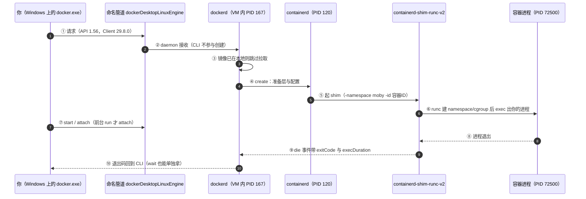

> **本章清单原语（逐字承接，两章合一篇）**
> **清单项标题（清单原话）**：核心概念与架构总览 ／ 新人必备术语20词
>
> 章节号：1.2 ／ 1.5 ｜ 所属篇：01-基础认知（第一篇 基础认知）
> 主线站 · 难度 · 耗时：① · ★☆☆ · 35m（1.2）／① · ★☆☆ · 20m（1.5）
> 前置依赖：1.2 依赖 1.1；1.5 依赖 1.2
> 变更标记：**1.2 相对 v1.2 变更（重排/合并/迁移）**——它合并了原 1.3 与原 1.4；**1.5 相对 v1.2 新增**。
>
> **内容要点与产出物**：
> 1.2 ——合并原 1.3 + 1.4：镜像/容器/仓库、registry·repository·tag 的关系、镜像命名规则拆解；Client-Server 模型（docker CLI ↔ dockerd ↔ containerd）；「`docker run` 背后发生了什么」时序图。
> 1.5 ——从 8.4 全量术语表抽出第一周必须先认识的 20 个词，每条一句话解释 + 指回详解章节。**必须与 8.4 同源生成**，避免两处漂移。

> **实战落点**：01 板块的第二篇。1.1 只回答"为什么不是虚拟机"，这一篇给的是**坐标**：一个引用字符串怎么读、一条命令经过谁、一次 `docker run` 在哪几层落地。它同时收下 1.5——清单要求这 20 个词**从 8.4 抽**，所以本篇末尾那张表就是 8.4 的一个受控子集，由本批配套脚本验"逐字一致"，不是一张手抄的表。往后每一篇（2.x 的命令、3.x 的构建、5.x 的机制、10.x 的落点）都用这套坐标说话。
> **本机基线（as-of 2026-10-29，本篇所有读数当天现量，前缀 `kb33_`）**：`docker version` → Client `29.8.0` / API `1.56`，Server `29.8.0` / API `1.56`，`Server.OsArch=linux/amd64`，`Kernel=6.18.54.1-microsoft-standard-WSL2`，`Platform="Docker Desktop 4.91.0 (239619)"`；`docker info` → `Name=docker-desktop`、`RootDir=/var/lib/docker`、`Driver=overlayfs`、`DefaultRuntime=runc`、`Runtimes` 里是 `io.containerd.runc.v2`、`NCPU=24`、`MemTotal=50475270144`、`Containers=16 Running=16`、`Images=36`、`SecurityOptions=["name=seccomp,profile=builtin","name=cgroupns"]`；当前 context → `desktop-linux`，端点 `npipe:////./pipe/dockerDesktopLinuxEngine`；开工与收尾基线一致：**容器 16 / 卷 15 / 网络 5**。
> **前置依赖**：[/docs/01-基础认知/为什么是容器/为什么需要容器/](/docs/01-基础认知/为什么是容器/为什么需要容器/)（1.1：容器是进程不是 VM，本篇不再重复论证）、[/docs/00-导读/把环境搭好/环境准备/](/docs/00-导读/把环境搭好/环境准备/)（0.3：这台 Desktop 与 WSL2 怎么装的）、[/docs/01-基础认知/第一次动手/第一次运行容器与图形化工具/](/docs/01-基础认知/第一次动手/第一次运行容器与图形化工具/)（1.3/1.4：命令与面板都读同一个 daemon，`docker context`、`npipe` 两条的详解在那儿）、[/docs/05-原理深入/网络与运行时/网络底层跨主机方案与运行时生态/](/docs/05-原理深入/网络与运行时/网络底层跨主机方案与运行时生态/)（5.7：`containerd`、`shim`、`runc` 这条链的机制详解）、[/docs/08-生态与附录/查阅件/术语表参考资料与版本兼容矩阵/](/docs/08-生态与附录/查阅件/术语表参考资料与版本兼容矩阵/)（8.4：**本篇 20 词的来源**，全量 71 条）。
> **本篇产出物**：① 一张**命名规则拆解表**（五种真实引用，各段是什么、当天 `docker image inspect` 原文）；② 一张**Client-Server 四段链路表**（每一段配一条当场能跑的命令与读数，含 `docker manifest inspect` 走不通这条反证）；③ 一张 **`docker run` 时序图**（mermaid `sequenceDiagram`，每一步都对应一条事件或时间戳，不画没量过的箭头）；④ **1.5 的 20 词表**，它是 8.4 的子集，由本批配套对账脚本 `术语子集对账.py`（属仓库暂存件、不随站点发布）验三件事：**词在不在 8.4、指回是否与 8.4 同一条、解释是否逐字一致**，现值 `8.4 全量 = 71 条 | 1.5 词行 = 20 | PASS=20`、`--selftest` **五条坏样本 5/5 被抓到，且词数判据可红**（成对：假词、错指回、改解释、改中文对照四种必须抓到，同时一条逐字摘自 8.4 的真行必须判 PASS，否则就只是换了个「永远红」的摆设）。**这一步当场抓到 8.4 缺 `container` 与 `repository` 两个词**——按 8.4 自己定的连带义务补进去，`术语行` 由 69 → **71**，补完复跑 `术语对账.py` 现读 `术语行 = 71 | PASS=71`。**本篇自身形态数（脚本现读）**：`wc -l` **271 行** · 11 个 H2 · 新人小结 4 处 · 1 张 mermaid · 6 个带语言代码块 · **9 个表格块 / 38 对表格行**。
> **难度·耗时**：1.2 ★☆☆ · 35m／1.5 ★☆☆ · 20m（1.5 是查表，但第一次读请逐条点开指回那篇）
> **拓展接口**：命名规则那格在 3.10/3.11（推私有仓库、标签策略）被第二次使用；`digest` 与 `tag` 的取舍在 9.4 那条「为什么禁止 latest」被复用；Client-Server 那条链在 5.7（运行时生态）被**加一层**（还有 `containerd` 的快照器与 `runc` 之外的运行时）；`docker run` 时序里"create 与 start 是两步"这句在 2.2 被**首讲并展开**（本篇只给架构视角，不抢它的首讲）；20 词表与 8.4 的同源关系是**双向义务**——改 8.4 的措辞必须重跑 1.5。

## 为什么要先建立坐标，再学命令

1.1 之后读者会遇到第一件事：**命令背下来了，但引用字符串读不懂**。`localhost:8443/kbdemo/api:0.6.0-g5104a20` 这一串里哪一段是仓库、哪一段是标签；`docker pull` 报 `no such host` 时该改哪一段；为什么同一份内容有两个名字。这些都不是命令问题，是**坐标问题**。

本篇给的坐标有三层，正好对应三个常被混用的词：

```text
registry（仓库服务器）  →  repository（命名空间里的一个镜像名）  →  tag / digest（这一个名字的某一份内容）
```

**混用的代价本机就能演示**：本篇现读 `alpine:3.20` 与 `localhost:8443/kbdemo/probe:1` 是同一个镜像 ID `sha256:d9e853e87e55…`，`kbdemo/api` 的三个 tag 共用一个 ID `sha256:39493a2349ec…`。分不清这三层的人会用 `docker images` 的行数估体积（三行≠三份），也会在"删标签"时以为删了内容。

> 💡 新人小结：**registry 是一台服务器，repository 是它上面的一个名字，tag 是这个名字下的一个指针，digest 才是内容本身**。四句话能背下来不算懂，本篇末尾的"三个动作"就是把这四句话各撞一次。

## 镜像、容器、仓库三者是什么关系

这是 W6.1 第 1 项（**首讲就在本篇**），读者必须能回答"容器删了镜像还在不在"。本机不是嘴上回答，是当场做：

```bash
docker run --name kb33_y3_rel alpine:3.20 true          # 跑一只，立刻退出
docker images --filter reference=alpine:3.20 --format '{{.Repository}}:{{.Tag}} ID={{.ID}}'
# → alpine:3.20 ID=d9e853e87e55                     （删之前先证它在）
docker rm kb33_y3_rel
docker ps -a --filter name=kb33_y3_rel --format '{{.Names}} {{.Status}}'
# → （空）                                          容器对象已经没了
docker images --filter reference=alpine:3.20 --format '{{.Repository}}:{{.Tag}} ID={{.ID}}'
# → alpine:3.20 ID=d9e853e87e55                     镜像仍在，ID 一字未变
```

| 三者 | 它是什么 | 谁的生命周期更长 | 本机证据 |
|---|---|---|---|
| 镜像（image） | 一叠**只读层 + 启动配置**，内容寻址 | 比任何容器都长，直到你 `rmi` | 上面那一串：删容器之后 `alpine:3.20` 仍在、`ID` 不变 |
| 容器（container） | **镜像跑起来的那个实例**：一个进程 + 自己的 namespace 视图与 cgroup 配额 | 短；`docker rm` 之后对象就没了 | `docker ps -a` 里查不到，而镜像的 `Config.Cmd` 还在那儿 |
| 仓库（registry / repository） | 存镜像的地方：registry 是服务端，repository 是它里面的名字 | 与本地是否存在该镜像无关 | 本库 Harbor 现读 `localhost:8443/v2/_catalog` 里有 `kbdemo/api`，`docker images` 里也有本地那份 |

**这里最容易记反的一条**：容器和镜像**不是**"进程和程序文件"那种一一对应——同一个镜像可以同时起十只容器，各自有独立可写层；而"删容器会不会删数据"是另一件事（可写层会没，卷不会），详解在 10.2 与 2.2。

### 顺手撞到的两个真相

做上面那串实验时，另外两件事同时被量到了：

1. **`docker rmi` 删的是名字，不是内容**。本篇给同一 ID 造了个临时名字 `localhost:8443/kbdemo/kb33-untag:test`，再 `docker rmi` 它 → 原文只有一行 `Untagged: localhost:8443/kbdemo/kb33-untag:test`，`alpine:3.20` 照样在。
2. **被运行中的容器占用时，`docker rmi alpine:3.20` 也照样返回 rc=0 并打印 `Untagged: alpine:3.20`**。我原本预期它会被拒绝——实测不是：**被拒绝的是"删内容"，"摘掉这个 tag"这一步并不拒绝**。这次实验当场把基线里的 `alpine:3.20` 摘掉了，靠同一 ID 的另一个名字无损还原（`docker tag localhost:8443/kbdemo/probe:1 alpine:3.20` → ID 仍是 `d9e853e87e55`、`25.8MB`，没有重新拉取）。**教训写进了台账：删名字之前要先想清楚还有没有别的名字挂着同一 ID，摘 tag 这一步不会替你把关。**

> 💡 新人小结：`rmi` 之后看不到 ≠ 内容被删；`rm` 之后看不到 = 那个容器对象真没了。**判断"东西还在不在"要看 ID，不要看名字列表少了一行**。

## 命名规则：五种真实引用，各段是什么

清单要求"镜像命名规则拆解（含端口式仓库名）"（W6.1 第 2、3 项首讲）。**规则只有一条**：从左往右读，第一段是"有没有写服务器"的分水岭。

```text
[服务器地址[:端口]/]命名空间/名字[:tag | @sha256:摘要]
```

| 本机真实引用 | 服务器（registry） | repository | tag | 当天 `docker image inspect` 原文（节选） |
|---|---|---|---|---|
| `alpine:3.20` | **省略**＝默认 Hub（`docker.io`） | `library/alpine`（`library/` 也省略） | `3.20` | `Id=sha256:d9e853e87e55…`、`RepoTags=["alpine:3.20","localhost:8443/kbdemo/probe:1"]`、`DIGEST=sha256:d9e853e87e55…` |
| `mysql:8.4` | 默认 Hub | `library/mysql` | `8.4` | `Id=sha256:76f03588…`、`RepoDigests=["mysql@sha256:76f03588…"]`、`Layers=10`、`Size=1102884141` |
| `nginx:1.27-alpine` | 默认 Hub | `library/nginx` | `1.27-alpine` | `Cmd=["nginx","-g","daemon off;"]`、`Entrypoint=["/docker-entrypoint.sh"]`、`ExposedPorts={"80/tcp":{}}`、`Layers=8` |
| `localhost:8443/kbdemo/api:0.6.0` | **`localhost:8443`**（带端口的私有 registry，本库 Harbor） | `kbdemo/api` | `0.6.0` | `RepoDigests=["localhost:8443/kbdemo/api@sha256:39493a2349ec…"]`、`Id=sha256:39493a2349ec…` |
| `docker.1ms.run/library/hello-world:latest` | `docker.1ms.run`（加速站） | `library/hello-world` | `latest` | `RepoDigests=["docker.1ms.run/library/hello-world@sha256:c567b231f656…78ef","hello-world@sha256:c567b231f656…78ef"]`、`Size=20399` |

**三条可直接用推论**（都是上表读出来的，不是背的）：

1. **第一段含 `.` 或 `:` 才算服务器**。`localhost:8443/…` 与 `docker.1ms.run/…` 都是服务器；`kbdemo/api` 这种没有点没有冒号的第一段是**命名空间**，不是主机名——把 `myrepo/app` 当成"我的仓库里的 app"是新人的典型误读。
2. **同一份内容可以有很多名字，但 ID 只有一个**。表里 `alpine:3.20` 那行的 `RepoTags` 一次列出两个名字；`kbdemo/api` 的 `0.6.0`、`stable`、`0.6.0-g5104a20` 三个 tag 共用 `39493a2349ec`。**tag 数量不等于内容份数。**
3. **digest 才是内容地址**。本机能读到 `RepoDigests` 与 `Id` 的摘要段**完全相同**（上表每一行都是如此，包括 `DIGEST` 列），这不是通用规律而是这台引擎的记录方式；**要拿真正的仓库清单摘要得用 `docker manifest inspect`，而它在本机不通**（见下一节）——所以本篇对"为什么两者相同"只登记现象、标未验证，不编原因。

## Client-Server：一条命令经过谁（以及哪条不经过）

W6.1 第 4 项：读者要能回答"**谁在真正创建容器**"。本机答案分四段，每段都有读数：

| 段 | 是谁 | 当天读数 | 怎么自己验 |
|---|---|---|---|
| ① CLI | Windows 侧的 `docker.exe`（客户端，带自己的 API 版本） | `Client.Version=29.8.0 Client.API=1.56` | `docker version --format '{{json .Client}}'` |
| ② 入口 | 命名管道，由 context 决定 | `desktop-linux` → `npipe:////./pipe/dockerDesktopLinuxEngine`；`docker context inspect --format '{{json .Endpoints}}'` → `{"docker":{"Host":"npipe:////./pipe/dockerDesktopLinuxEngine","SkipTLSVerify":false}}` | `docker context ls` |
| ③ daemon | VM 里的 `dockerd` | `/proc` 走链：`pid=167 ppid=62 comm=dockerd`，cmdline 是 `/usr/local/bin/dockerd --config-file …`；`docker info` 报 `Name=docker-desktop`、`ServerVersion=29.8.0` | 见下面「看不见的那一层」 |
| ④ 运行时 | `containerd` → `containerd-shim-runc-v2` → `runc` | `pid=120 ppid=62 comm=containerd`，cmdline `/usr/bin/containerd --config /etc/containerd/containerd.toml`；`Runtimes={"io.containerd.runc.v2":{"path":"runc",…}}`、`DefaultRuntime=runc` | `docker info --format '{{json .Runtimes}}'` |

**"谁创建容器"的标准答案**：CLI 只是把请求写进命名管道；真正创建的是 VM 里的 `dockerd`，它把活交给 `containerd`，`containerd` 起一个 `containerd-shim-runc-v2` 进程，`runc` 负责建 namespace/cgroup 并 `exec` 你的进程。**daemon 挂了，你所有的 `docker` 命令都会挂**——这句话的依据就是②那一条：`docker` 命令没有本地后备路径。

### 最好的反证：`manifest inspect` 不走 daemon

同一条 CLI 家族里，**有的子命令问 daemon，有的自己直连 registry**。本机当天两条一起读：

```bash
docker pull hello-world:latest
# → Status: Image is up to date for hello-world:latest   rc=0，墙钟 2.070 s（走清单解析）
docker manifest inspect mysql:8.4
# → rc=1，墙钟 30.142 s
# → failed to configure transport: error pinging v2 registry:
#   Get "https://registry-1.docker.io/v2/": context deadline exceeded
```

`pull` 成功而 `manifest inspect` 超时 30 秒——**因为后者由 CLI 自己发 HTTP**，而本机的通路是挂在 VM 内 daemon 上的代理（`http.docker.internal:3128`，批 24 已量）。这条对照是"Client-Server"最实用的版本：**报错先分清是 daemon 给的还是 CLI 自己给的**，否则你会去重启一个根本没参与请求的服务。

### 看不见的那一层：`wsl` 落点在容器进程之外

想直接看见"容器的那个进程"，最直觉的做法是进 `wsl -d docker-desktop` 去读 `/proc/<PID>`。**本机这条路是断的**：

```text
docker inspect --format '{{.State.Pid}}' <容器>   → 71886
wsl -d docker-desktop -u root -e sh -c 'cat /proc/71886/comm'
                                                 → cat: can't open '/proc/71886/comm': No such file or directory
```

同一次调用里，`dockerd`、`containerd`、`containerd-shim` 都读得到——**说明容器主进程在更深的 PID namespace 里，而 `wsl -e` 落的那层看不见它**。改用 `--pid=host` 的观察者一次就通了：

```bash
docker run --rm --pid=host alpine:3.20 sh -c 'for d in /proc/[0-9]*; do … done'
# HIT pid=72500 ppid=72476 comm=sleep   args=sleep 90
# HIT pid=72476 ppid=1  comm=containerd-shim  args=/usr/bin/containerd-shim-runc-v2 -namespace moby -id d4a…
```

链条于是完整：**容器里的 `sleep`（72500）← `containerd-shim-runc-v2`（72476）← initd（1）**。顺带两条同类边界：那个发行版里的 `ps` 是 BusyBox 版（`ps -p` 报 `unrecognized option: p`，`ps -eo …` 直接吐空但 rc=0），`containerd`/`runc` 在该 shell 里 `not found`，而 `/proc` 里的 cmdline 明明写着 `/usr/local/bin/dockerd …`——**"读不到"要先证探的地方存在**（与 1.4 那篇的 nsenter 对照实验同源）。

> 💡 新人小结：这一节最值得记的不是链路本身，而是**三条"看不见"**：`wsl` 看不见容器进程、BusyBox 的 `ps` 悄悄吐空、`manifest` 命令不经过 daemon。**遇到"没有读数"时先怀疑读法，再怀疑事实。**

## `docker run` 背后发生了什么（时序图）

图里每一步都对应本机一条事件或一个时间戳，没有画没量过的箭头。



**对应的本机原文**（同一只容器，`busybox:1.37 sh -c 'echo started; sleep 2; echo done'`）：

| 步 | 证据 | 读数 |
|---|---|---|
| ④ create | `docker create` 墙钟 | `0.105` 秒（另一轮 `0.109` 秒） |
| ⑥ 起进程 | 引擎时间戳差 `Created → StartedAt` | `10:36:43.686359571Z → 10:36:43.780458486Z` = **94.1 ms** |
| ⑤ shim | `--pid=host` 观察者 | 父进程 `ppid=72476` 是 `containerd-shim-runc-v2 -namespace moby -id d4a…` |
| ⑧⑨ 退出 | `docker events` 的 `die` 属性 | `{"exitCode":"0","execDuration":"2","image":"busybox:1.37","name":"kb33_y2f_e"}` |
| 全程 | 事件序列（`--until` 放宽后再取一次） | `create` → `start` → `die` → **`destroy`（只在 `rm` 之后出现）** |
| ⑦⑩ 输出与码 | `docker logs` / `docker wait` | `started` `done`；`wait` 返回 `0` |

**"create 与 start 是两步"在这里第一次出现，但它的语义首讲在 2.2**——本篇只从架构角度确认引擎确实分两次记录（两条事件、两个时刻）。

### 抄下来会用错的四条格式坑

画这张图时踩到的，都是 CLI 侧的真实报错，值得单独列：

| 命令片段 | 结果原文 | 结论 |
|---|---|---|
| `docker events --format '{{.TimeNs}} …'` | `rc=64` `can't evaluate field TimeNs in type *events.Message` | 这个版本没有 `TimeNs` 字段 |
| `docker events --format '{{.Time.UnixNano}} …'` | `can't evaluate field UnixNano in type int64` | `.Time` 已经是**整数秒**，不能再点方法 |
| `docker info --format '{{.Store}}'` | `can't evaluate field Store in type system.dockerInfo` | 想看的字段未必存在；先 `--format '{{json .}}'` 探一次 |
| `docker pull --disable …` | `rc=125` `unknown flag: --disable` | 旗标不在子命令上就会整条拒绝（**rc=125 不等于"命令跑了但失败"**，见 7.3） |

## 1.5 第一周必须认识的 20 个词

这张表**不是手抄**：每行的"一句话解释"与"指回"都逐字取自 8.4，由本批配套脚本 `术语子集对账.py` 验三件事——**词 ∈ 8.4、指回与 8.4 同一条、解释逐字一致**。它当场撞出的第一个问题就是：**8.4 原本没有 `container` 与 `repository`**——一个 Docker 术语表缺了这两个最基础的词。按 8.4 自己规定的连带义务补进去之后 `术语行` 从 69 变成 **71**，本表才是它的合法子集；判据现读 `8.4 全量 = 71 条 | 1.5 词行 = 20 | PASS=20`，`--selftest` 五条坏样本 5/5。**注意这条判据的方向是双向的**：改 8.4 的措辞会让 1.5 立刻红（解释不再逐字一致），改 1.5 加一个 8.4 没有的词也会立刻红——这才是清单那句「必须与 8.4 同源生成」的落地形态。

| 词 | 中文对照 | 一句话解释（摘自 8.4） | 指回 |
|---|---|---|---|
| image | 镜像 | 只读层叠加出来的可分发物，内容寻址 | [/docs/02-核心操作/跑起来/镜像管理与容器生命周期/](/docs/02-核心操作/跑起来/镜像管理与容器生命周期/) |
| container | 容器 | **镜像跑起来的那个实例**：一份进程 + 自己的 namespace 视图与 cgroup 配额，删掉它不影响镜像 | [/docs/01-基础认知/为什么是容器/核心概念与架构总览/](/docs/01-基础认知/为什么是容器/核心概念与架构总览/) |
| repository | 镜像仓 | registry 里按名字分开的命名空间（官方镜像那个名字就是它），仓下面才是标签；`library/nginx` 与 `nginx` 指的是同一个仓 | [/docs/01-基础认知/为什么是容器/核心概念与架构总览/](/docs/01-基础认知/为什么是容器/核心概念与架构总览/) |
| registry | 镜像仓库 | 推拉与鉴权的那一端，私有化后是本库的交付闸门 | [/docs/03-镜像构建/交出去/BuildKit私有仓库标签策略与构建排错/](/docs/03-镜像构建/交出去/BuildKit私有仓库标签策略与构建排错/) |
| tag | 标签 | 人的可读指针，可变；不可变引用是 digest | [/docs/03-镜像构建/交出去/BuildKit私有仓库标签策略与构建排错/](/docs/03-镜像构建/交出去/BuildKit私有仓库标签策略与构建排错/) |
| digest | 镜像摘要 | `sha256:` 内容地址，标签会变它不变 | [/docs/03-镜像构建/交出去/BuildKit私有仓库标签策略与构建排错/](/docs/03-镜像构建/交出去/BuildKit私有仓库标签策略与构建排错/) |
| layer | 镜像层 | 一次 `RUN`/`COPY` 产生的差异内容，共享即省空间 | [/docs/05-原理深入/隔离与资源/联合文件系统与镜像分层/](/docs/05-原理深入/隔离与资源/联合文件系统与镜像分层/) |
| writable layer | 可写层 | 这次运行的差异层，随 `docker rm` 一起消失 | [/docs/10-存储专题/落点与生命周期/容器启动停止与存储的关系/](/docs/10-存储专题/落点与生命周期/容器启动停止与存储的关系/) |
| named volume | 命名卷 | 由引擎管理、名字归你的独立数据对象 | [/docs/10-存储专题/基础/五种存储形式的原理与取舍/](/docs/10-存储专题/基础/五种存储形式的原理与取舍/) |
| bind mount | 绑定挂载 | 把宿主路径贴进容器，实时双向，不做预填充 | [/docs/10-存储专题/基础/五种存储形式的原理与取舍/](/docs/10-存储专题/基础/五种存储形式的原理与取舍/) |
| tmpfs | 内存文件系统 | 快且不留，算进容器内存配额 | [/docs/10-存储专题/基础/五种存储形式的原理与取舍/](/docs/10-存储专题/基础/五种存储形式的原理与取舍/) |
| port mapping | 端口映射 | `-p` 把宿主端口 DNAT 到容器端口 | [/docs/02-核心操作/接上去/端口映射数据管理与权限时区/](/docs/02-核心操作/接上去/端口映射数据管理与权限时区/) |
| healthcheck | 健康检查 | 引擎按命令返回值判定容器可用性的机制 | [/docs/04-单机编排/启停/常用命令启动顺序与健康检查/](/docs/04-单机编排/启停/常用命令启动顺序与健康检查/) |
| build context | 构建上下文 | `docker build` 时从当前目录打包发给 daemon 的全部内容 | [/docs/03-镜像构建/写出来/Dockerfile指令全解与构建上下文/](/docs/03-镜像构建/写出来/Dockerfile指令全解与构建上下文/) |
| CMD / ENTRYPOINT | 默认命令 / 入口 | 前者可被覆盖，后者定义容器怎么起，二者拼成最终进程 | [/docs/03-镜像构建/写出来/Dockerfile指令全解与构建上下文/](/docs/03-镜像构建/写出来/Dockerfile指令全解与构建上下文/) |
| env / ARG | 环境变量 / 构建参数 | 前者进运行时，后者只活在构建期，别混用 | [/docs/03-镜像构建/写出来/Dockerfile指令全解与构建上下文/](/docs/03-镜像构建/写出来/Dockerfile指令全解与构建上下文/) |
| Docker Desktop | 桌面版 | 把引擎跑在 WSL2/Hyper-V 虚拟机里的发行形态 | [/docs/00-导读/把环境搭好/环境准备/](/docs/00-导读/把环境搭好/环境准备/) |
| WSL2 | Windows 子系统 2 | 本机 Linux 内核与引擎宿主，VM 里那套目录都在它身上 | [/docs/00-导读/把环境搭好/环境准备/](/docs/00-导读/把环境搭好/环境准备/) |
| npipe / 命名管道 | Windows 侧的 daemon 入口 | `npipe:////./pipe/dockerDesktopLinuxEngine` 这类地址；面板、CLI、VM 都挂在它上面 | [/docs/01-基础认知/第一次动手/第一次运行容器与图形化工具/](/docs/01-基础认知/第一次动手/第一次运行容器与图形化工具/) |
| docker context | 上下文 | CLI 当前把请求发给哪一个 daemon；面板与命令行之所以能对上，是因为它们用的是同一条 | [/docs/01-基础认知/第一次动手/第一次运行容器与图形化工具/](/docs/01-基础认知/第一次动手/第一次运行容器与图形化工具/) |

**为什么是这 20 个**：判据只有一条——**第一周内读者会在命令里、报错里或别人嘴里撞到**。`seccomp`、`cgroup v2`、`prefill`、`snapshotter`、`9p` 这些都在 8.4 里，但那是第 5、10 板块才需要；`copy-up`、`whiteout` 同理。**完整词表见 8.4（现读 71 条），本表是它的子集**，两处漂移由脚本拦。

> 💡 新人小结：查这张表的正确方式是**先认词再点指回**——解释只负责让你认出报错里的那个词，真正的用法在指回那篇。别把 20 个词背完就以为会用了。

## 三个动作：把坐标撞一遍

| 动作 | 命令 | 当天读数 | 撞的是什么 |
|---|---|---|---|
| 一、读一段引用 | `docker image inspect --format '{{.Id}} {{json .RepoTags}}' alpine:3.20` | `sha256:d9e853e87e55…` + **两个名字** | "一个镜像可以有多个名字"不是修辞 |
| 二、问 daemon 是谁 | `docker info --format 'Name={{.Name}} RootDir={{.DockerRootDir}} DefaultRuntime={{.DefaultRuntime}}'` | `Name=docker-desktop`、`RootDir=/var/lib/docker`、`DefaultRuntime=runc` | 你连的是 VM，不是本机 Linux |
| 三、找容器的父进程 | `docker inspect --format '{{.State.Pid}}' <容器>` + `docker run --rm --pid=host alpine:3.20 sh -c '…'` | 父是 `containerd-shim-runc-v2 -namespace moby -id <容器ID>` | **创建容器的是那串进程，不是 `docker.exe`** |

## 常见误读

| 误读 | 真相 | 本机一句话验掉 |
|---|---|---|
| "`localhost:8443/kbdemo/api` 里 `kbdemo` 是服务器" | 服务器是 `localhost:8443`，`kbdemo` 是命名空间 | `docker image inspect --format '{{json .RepoTags}}'` 看整串 |
| "`docker images` 有 3 行就是 3 份镜像" | 三个 tag 共用一个 ID，只有一份内容 | 表里那三个 `kbdemo/api` tag 同 `39493a2349ec` |
| "删标签就是删内容" | `rmi` 先摘名字；只有没人引用时才会删层 | `Untagged: …` 之后 `docker images` 仍能看到另一个名字 |
| "命令行工具坏了才重启 Docker Desktop" | CLI 不创建任何东西，daemon 才是 | `docker manifest inspect` 超时 30 s 而 `docker pull` 正常——两条根本不走同一条路 |
| "`wsl -d docker-desktop` 里能看见容器进程" | 看不见（`/proc/<PID>` 不存在），要 `--pid=host` | `cat /proc/71886/comm` 报 `No such file or directory` |
| "`ps` 在那里能列进程" | 那个 `ps` 是 BusyBox 的，`-p` 直接报错、`-eo` 吐空却 rc=0 | `readlink -f $(which ps)` → `/bin/busybox` |
| "1.5 这张表可以手抄一份到别处" | 抄了就漂移；本表由 `术语子集对账.py` 与 8.4 锁死 | 词数、指回、解释三者任一不同源就会红 |

## 本篇不覆盖什么

- `docker run` 的 `create` 与 `start` 各自改哪一段状态、`--rm` 的危险 → 见 2.2（本篇只给"引擎分两次记录"这一层）
- 退出码语义（0/1/125/126/127/137/143） → 见 7.3（首讲），本篇只在格式坑里点了一次 `rc=125`
- namespace 与 cgroup 的具体机制 → 见 5.1、5.2；`runc` 到底做了什么系统调用 → 见 5.7（本篇只在链路表里点了一次它的名字）
- `containerd` 的快照器与运行时生态（`runsc`/`kata` 等） → 见 5.7
- 推送、鉴权与标签策略（`registry` 那一端的完整行为） → 见 3.10、3.11
- 镜像层与可写层的文件系统实现（overlayfs、`whiteout`） → 见 5.4、10.1

## 未验证项

| 项 | 为什么没验 | 想验怎么起手 |
|---|---|---|
| **本机 `RepoDigests` 的摘要段为什么与 `Id` 相同** | 五种引用（Hub、加速站、Harbor）当天都是这个形状，但成因未量：`docker manifest inspect` 在本机不通（30.142 s 超时），拿不到仓库清单摘要做对照 | 在能出网的环境里对同一 tag 跑 `docker manifest inspect -v` 与 `docker buildx imagetools inspect`，把清单摘要与 `Id` 并列；结论按 digest 落，不按 tag |
| `dockerd` 的具体启动参数全貌 | `/proc/167/cmdline` 只截读了前若干字符（`--config-file …`），完整参数串在本篇未展开；改 daemon 配置属禁止动作 | 只读取 `/proc/167/cmdline` 全文并逐参数对照 `docker daemon --help`，不改任何配置文件 |
| 那次 `rmi` 摘掉 `alpine:3.20` 时，**层到底什么时候才被删** | 本篇只证了"摘名字不删内容"（另一个名字仍在、`25.8MB` 仍在）；"最后一个名字被摘 + 无容器引用"那一步没做，做它要真删本地镜像 | 用一次性镜像（`docker build` 造的 `kb33-tmp`）走完整序列：两个 tag → 摘一个 → 摘最后一个 → `docker system df` 前后对照，全程不碰基线镜像 |
| **`--pid=host` 观察者的边界**（是否所有命名空间都能看见） | 本篇只用它读 `/proc`，没系统比较 `--pid=host` 与 `nsenter -t 1 -m` 两种读法（1.4 用过后者） | 同一只容器分别用两种读法取 PID 与 cmdline，记录差异并解释为什么需要 `--privileged` |
| 时序图里 ③「镜像已在本地则跳过拉取」的**拉取分支** | 本篇所有实验都用本机已有镜像，没有真实的新镜像拉取分段计时（示例链①里有 `redis` 5.3 秒、`mysql` 22.0 秒的历史登记） | 拉一个本地没有的小镜像，分段计 `pull` 与 `run`；与本篇的 `create/start` 数字并列，别合并成一个"启动耗时" |
| 20 个词的选择是否有第二人验证 | 判据只能保证"与 8.4 同源"，**不能保证这 20 个词就是最该先学的 20 个**（选择依据只写了"第一周会撞到"） | 找一位新人按 0.1→1.3 读一遍，登记他实际撞到而本表没有的词；据此换词并重跑同源判据 |

## 要点总结

1. **三层坐标先建好**：registry（服务器）→ repository（名字）→ tag/digest（指针与内容）。本机证据是"两个名字同一个 ID"和"三个 tag 同一个 ID"。
2. **删容器不删镜像**：`docker rm` 之后 `alpine:3.20` 的 ID 一字未变；反过来 `rmi` 先摘的是**名字**，而且**摘名字这一步不会被运行中的容器拦住**——这是本篇现场撞到、也现场还原的一件事。
3. **真正创建容器的是 VM 里那串进程**：`dockerd`（PID 167）→ `containerd`（PID 120）→ `containerd-shim-runc-v2`（父于 initd）→ 容器进程；`docker top`/`--pid=host` 才看得见，`wsl` 那一层看不见。
4. **同一条 CLI 里两种通路**：`pull` 问 daemon（成功），`manifest inspect` 自己直连 registry（30 秒超时）——**报错先归层再动手**，这是 7.x 整套排错方法的第一块砖。
5. **时序可以逐格核对**：`create` `0.105` 秒、`Created→StartedAt` `94.1 ms`、`die` 带 `exitCode=0 execDuration=2`、`destroy` 只在 `rm` 之后。**画进图里的每一步都应当有这样一个读数。**
6. **1.5 是 8.4 的子集而不是抄本**：`术语子集对账.py` 验词、验指回、验解释逐字一致；它一上线就抓到 8.4 缺 `container` 与 `repository`，`术语行` 因此 69 → 71。**改 8.4 的措辞，必须重跑这条判据。**
