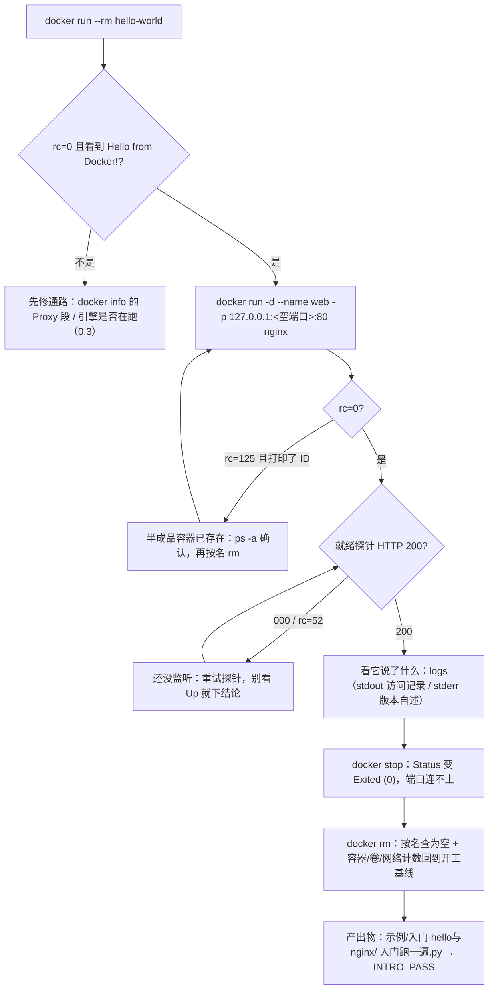

> **本章清单原语（逐字承接）**
> **清单项标题（清单原话）**：第一次运行容器 / 图形化工具
>
> 章节号：1.3 / 1.4 ｜ 所属篇：01-基础认知（第一篇 基础认知）
> 主线站 · 难度 · 耗时：① · ★☆☆ · 30m（1.3）／— · ★☆☆ · 20m（1.4）
> 前置依赖：1.3 依赖 0.3、1.2；1.4 依赖 1.3
> 变更标记：**1.3 相对 v1.2 变更（重排/合并/迁移）**——它原来是清单的 1.5，v1.2 把它提前到 1.3，好让「主线站①从本篇开始」这件事真的能开始；**1.4 在 v1.2 无变更标记行**。
>
> **内容要点与产出物**：原 1.5 提前：hello-world 走读、运行 nginx 并浏览器访问、`ps` / `logs` 初体验。**主线站①从本篇开始**。▸ 产出：`示例/入门-hello与nginx/` 跑通。Docker Desktop 面板、Portainer 入门；明确「**图形工具能做什么、不能替代什么**」，**避免新人只会点按钮**。

> **实战落点**：01 板块的第三篇，也是**全库第一处「动手」**。前面 1.1、1.2 讲的是"为什么要有容器、容器由哪几块拼成"，读者到这里已经能听懂术语但还没碰过引擎；这一篇之后就进入段①（`示例/贯穿示例/段1-依赖跑起来/`），所以它的任务很窄：**让读者的第一条命令真的返回一个 0，并且知道自己在看什么**。1.4 挂在同一篇里，是因为新人装完 Desktop 一定会先点面板——**面板不是另一套系统，它读的就是这篇那几行命令背后的同一个 daemon**，这一点必须和第一次动手同时讲，否则就成了"先学按钮再学命令"。
> **本机基线（as-of 2026-10-29，全部现查得到）**：Engine/CLI 都是 `29.8.0`、API `1.56`（下界 `1.40`）、`Platform = Docker Desktop 4.91.0 (239619)`；Desktop 装在 **`C:\Users\webtu\AppData\Local\Programs\DockerDesktop`**（不是默认的 `C:\Program Files\Docker\Docker`，见 1.4 第一格）；宿主进程 8 个、命名管道里含 `docker` 的 31 条、`settings-store.json` 8 个顶层键；数据盘 `docker_data.vhdx` = 20,479,737,856 字节（19.07 GiB）；本轮开工与收尾基线一致：**容器 16 / 卷 15 / 网络 5**。
> **前置依赖**：[/docs/00-导读/把环境搭好/环境准备/](/docs/00-导读/把环境搭好/环境准备/)（0.3：把引擎装好、代理与通路都在这儿量的，本篇的 `docker pull` 通路直接沿用它的结论）、[/docs/01-基础认知/为什么是容器/核心概念与架构总览/](/docs/01-基础认知/为什么是容器/核心概念与架构总览/)（1.2：镜像/容器/仓库这套坐标，本篇不再复述名词）、[/docs/02-核心操作/跑起来/镜像管理与容器生命周期/](/docs/02-核心操作/跑起来/镜像管理与容器生命周期/)（2.1~2.2：把本篇"起一只、看一眼、删掉"扩成完整生命周期与导入导出）、[/docs/10-存储专题/落点与生命周期/容器启动停止与存储的关系/](/docs/10-存储专题/落点与生命周期/容器启动停止与存储的关系/)（10.2：本篇 stop 那一格背后的机制）、[/docs/07-运维手册/检索与规矩/命令速查症状索引与团队规范/](/docs/07-运维手册/检索与规矩/命令速查症状索引与团队规范/)（7.1：本篇每一条命令的存在性判据出处）、[/docs/08-生态与附录/查阅件/术语表参考资料与版本兼容矩阵/](/docs/08-生态与附录/查阅件/术语表参考资料与版本兼容矩阵/)（8.4：「绑定挂载 / 命名卷 / 可写层」这些词的中文对照与指回）。
> **本篇产出物**：`Docker知识库/示例/入门-hello与nginx/`（**`入门跑一遍.py` + `README.md`**）。脚本是**会自己失败的判据**：先跑 `--selftest`，**五条坏样本必须 5/5 被抓到**（标记写错、把没人监听的端口当 200、访问前后日志行数没变却判"变了"、残留列表里还留着名字、把 stderr 与 stdout 两个流对调），然后主流程才允许出绿；主跑现值 `checks=18 AUTO_PASS=17 MANUAL=1 FAIL=0` → `INTRO_PASS`，开工与收尾的容器/卷/网络计数一字不差（16/15/5）。**这一篇的正文不写"应该能看到什么"，只写这台机器真读到的原文**——包括一条脚本第一次跑就红在自己身上的判据（C9，见「日志有两个流」那一节）。
> **难度·耗时**：1.3 ★☆☆ · 30m／1.4 ★☆☆ · 20m（1.4 比 1.3 短，但它需要你把面板打开对照着读）
> **拓展接口**：1.3 的 stop/rm 两格是 10.2「容器启停与存储」的入口；1.4 的「两个流」「Mountpoint 要站对命名空间」两格分别接 7.2 症状索引与 10.2 落点验证；`docker extension ls` 与 `docker desktop version` 这两条的存在性判据接 8.1 生态地图那张表；面板与 CLI 同源这条线索止于 0.3（Desktop 的安装与通路），不在本篇展开 VM 结构。
> **自测三题**：
> 1. 你的 `docker run -d --name web -p 18080:80 nginx` 返回 `rc=125` 并且**打印了一个容器 ID**。这条命令算成功还是失败？现在这台机器上有没有多出什么东西？下一步做什么？
> 2. `docker logs <容器>` 里，nginx 的访问记录和它的版本自述**不在同一个流**里。这个差别会让你写出什么样的错判据？（本篇的 C9 第一次就是红的）
> 3. 面板里能看到某个容器，命令行 `docker ps` 却看不见——**在什么配置下会真的发生**？本篇 1.4 哪一格读数能用来排除它？

## 为什么要从「跑一个什么都不做的容器」开始

因为它是**唯一一条能把"引擎通不通"这件事单独问出来的命令**。`hello-world` 不接端口、不读文件、不写卷，
它跑完只做一件事：把「客户端找到 daemon → daemon 拉到镜像 → daemon 起容器 → 输出流回客户端」这四步
原样打印给你看。任何一步坏了，你看到的原文就不一样——所以它适合当第一篇动手的第一条，
也**只**适合当第一条：它证明不了你的应用能跑。

第二条要解决的问题完全不同：**hello-world 一出生就退出，你永远来不及"看"**。所以 1.3 的真正内容不是
`hello-world`，而是**一个会一直活着的进程**（nginx）+ **三种看它的方式**（`ps` 看状态、`logs` 看它说了什么、
访问它验证它真的在服务）。这三件事分开看都不难，混在一起看就会出新手最常见的三个误判：

| 新手心里的问题 | 只看 `docker run` 的输出能不能答 | 该看哪个 |
|---|---|---|
| 「命令成功了吗」 | 能，但只回答到 `rc`；`rc=125` 时它同时还打印了容器 ID（见下文那格原文） | `docker ps -a` 的 `State` |
| 「它在服务了吗」 | **不能**——`Up` 只说明进程活着，不说明端口后面有人应 | 就绪探针（`curl` 拿 200） |
| 「它到底是谁在跑」 | 不能 | `docker logs` 的自报行 + `docker inspect` 的 `Cmd` |

> 💡 新人小结：这一节的正确用法是**把三条命令分开问**。`docker run` 只回答"起没起"，`docker ps` 回答"还在不在"，
> `curl` 回答"能不能服务"。**不要用上一条命令的结果去替下一条背书**——本篇后面每一个红过的判据都是这么红的。

## 1.3 第一次运行容器：三条命令，逐条读原文

下面是本批在**这台机器**上真跑过的三条（端口是现挑的，你重跑会拿到别的号，这不影响结论）。

```bash
# ① 只看引擎通不通：一次性容器，跑完就走
docker run --rm hello-world

# ② 起一个会一直活着的容器（只绑回环，避免占用别人的对外端口）
docker run -d --name kb31_web -p 127.0.0.1:18501:80 nginx:1.27-alpine

# ③ 三种看法：状态 / 它说了什么 / 它是不是真的在服务
docker ps --filter name=kb31_web --format 'ID={{.ID}} Status={{.Status}} Ports={{.Ports}}'
docker logs kb31_web
curl -s -o /dev/null -m 10 -w '%{http_code}\n' http://127.0.0.1:18501/
```

### 第一条：hello-world 到底做了什么

它的输出不是装饰，是**四步自述**（本机原文，逐字）：

```
Hello from Docker!
This message shows that your installation appears to be working correctly.

To generate this message, Docker took the following steps:
 1. The Docker client contacted the Docker daemon.
 2. The Docker daemon pulled the "hello-world" image from the Docker Hub.
    (amd64)
 3. The Docker daemon created a new container from that image which runs the
    executable that produces the output you are currently reading.
 4. The Docker daemon streamed that output to the Docker client, which sent it
    to your terminal.
```

把这段话和两条只读命令对上，才知道它真的只是"跑了一个可执行文件"：

| 问法 | 本机现读 | 读出来的事实 |
|---|---|---|
| `docker history --no-trunc hello-world` | `CMD ["/hello"]` / `COPY hello / # buildkit` | 整个镜像就是一层「拷进去一个 `/hello`」+ 一条把它设为命令的元数据 |
| `docker inspect --format 'Entrypoint={{json .Config.Entrypoint}} Cmd={{json .Config.Cmd}} User={{.Config.User}} WorkingDir={{.Config.WorkingDir}} OsArch={{.Os}}/{{.Architecture}}' hello-world` | `Entrypoint=null Cmd=["/hello"] User= WorkingDir=/ OsArch=linux/amd64` | 没有入口脚本、不是 root 之外的用户、工作目录是 `/` |
| `docker images --format '{{.Repository}}:{{.Tag}} {{.Size}}'` | `hello-world:latest 25.9kB` | 小到可以直接读全，适合当第一个"我的镜像列表里多了一行" |

### 「拉镜像」这件事在这台机器上有两条通路，别把它们混成一条

本批出现了一次值得记住的**自我更正**：台账从批 18 起就写着「Hub 直连 `HTTP=000`」，
而本批 `docker run --rm hello-world` 却**真的从 Hub 拉成功了**：

| 谁在问 | 命令/探针 | 本机现读 |
|---|---|---|
| 引擎（daemon，在 VM 里） | `docker run --rm hello-world` | `Unable to find image 'hello-world:latest' locally` → `latest: Pulling from library/hello-world` → `Digest: sha256:c567b231f656…78ef` → `Status: Downloaded newer image` → `rc=0` |
| 宿主 shell（Windows 侧） | `curl -s -o /dev/null -m 15 -w '%{http_code}' https://hub.docker.com/v2/` | `HTTP=000`，curl `rc=28`（超时）；`https://registry-1.docker.io/v2/` 同样 `000` |

两条都对，因为**它们不是同一条通路**：`docker info` 里写着引擎侧走
`HTTP Proxy: http.docker.internal:3128` / `HTTPS Proxy: http.docker.internal:3128` / `No Proxy: hubproxy.docker.internal`，
这是 Desktop 给 VM 内 daemon 用的代理；宿主的 `curl` 不吃它。所以：

- **判"镜像能不能拉"只能问 daemon**（`docker pull` 或 `docker run`），不能用宿主的 `curl` 码当结论；
- 反过来，**判"文档站打不打得开"才用宿主 `curl`**（8.5 那张可达性表就是这个用途）。

还有一个顺手能看到的差别：本机同时存在两份 `hello-world`——
`docker.1ms.run/library/hello-world:latest`（镜像加速站内联，`digest=<none>`）与
`hello-world:latest`（Hub，`digest=sha256:c567b231f656…`），**两者的镜像 ID 都是 `c567b231f656`**。
同一份内容、两个入口；tag 会变，ID 与 digest 才对得上账（这条在 3.11 标签策略里展开）。

> 💡 新人小结：记住一句话就够了——**「拉不到镜像」是 daemon 的事，「打不开网页」是你 shell 的事**。
> 本批就是靠这条把一条旧台账记录读对了方向，而不是把它当错误删掉。

## 第二条之后：`ps`、`logs`、`stats`、`events` 各回答哪一个问题

`docker run -d` 返回的那串十六进制是**容器 ID**（本机 `b2106166ca9a…`），此时它只证明"容器被创建了"。
剩下的四个命令是四种不同的问法：

| 命令 | 它回答的问题 | 本机读数（同一只 nginx） | 它**不**回答的 |
|---|---|---|---|
| `docker ps --format 'ID={{.ID}} Status={{.Status}} Ports={{.Ports}}'` | 有没有人替你把这个端口贴到宿主上 | `Status=Up 1 second`、`Ports=127.0.0.1:18501->80/tcp` | 里面是不是真的在服务 |
| `docker logs` | 容器自己说了什么 | stdout：入口脚本 8 行 + 两条 `GET / … 200 615 "curl/8.21.0"`；stderr：`nginx/1.27.5`、`OS: Linux 6.18.54.1-microsoft-standard-WSL2`、24 个 worker 进程（30~53） | 它在容器外能不能被访问到 |
| `docker stats --no-stream` | 此刻它吃了多少 | `cpu=0.00% mem=21.34MiB / 47.01GiB net=2.59kB / 3.18kB block=9.7MB / 8.19kB pid=25` | 历史上有没有峰值（单帧采样） |
| `docker events --since <绝对 epoch> --until <绝对 epoch>` | 这轮引擎都对它做了什么动作 | `create kb31_web` / `start kb31_web` 两条 | 为什么发生（要配合日志） |

两条容易看错的字段，本机都有对照：

- **`{{.RunningFor}}` 与 `{{.Status}}` 不是一回事**：同一次查询里分别是 `2 seconds ago` 与 `Up 1 second`，
  一个是"什么时候起的"，一个是"当前状态串"。写脚本要的是后者。
- **日志里的时间是 UTC**：本机墙钟 `11:29:01`，容器 access log 写 `[29/Oct/2026:03:29:03 +0000]`，
  `docker logs --timestamps` 前缀又写成 `2026-10-29T03:29:03.976028787Z`。**同一条日志两种时间格式、都比本机早 8 小时**。
  拿日志时间跟宿主事件对齐之前先换算（时区这件事在 2.9 权限时区那节有专门处理）。

## 日志有两个流，判据只搜一个就会红——本篇自己踩过

这是本篇最实在的一条：**nginx 的 access log 在 stdout，它的版本自述在 stderr**。
本批第一版产出物脚本里，"从日志里读 nginx 版本"这条判据**只读了 stdout**，于是当场 FAIL：

```
  [PASS] C8   日志里能看到那次请求的 UA 标记
  [FAIL] C9   日志自报版本（没读到）
```

`docker logs` 默认把两个流合并打印，所以你**在终端里看不出这个区别**；一旦用脚本分别取 stdout/stderr，
区别立刻咬人。修的时候还踩到第二层：**"stdout 里没有 `nginx/` 这个词"是错的**——入口脚本会打印
`/etc/nginx/conf.d/default.conf`，里面就带 `nginx/`。所以判据的形状要钉到 `nginx/\d+\.\d+`，
并把"access log 的标记只在 stdout、版本行只在 stderr"做成一条**能红的分流判据**（坏样本 5：把两个流对调喂进去）。
修完之后主跑才是现在这样：

```
SELFTEST=PASS 抓到 5/5 条坏样本
  [PASS] C9   日志自报版本（nginx/1.27，在 stderr 那一半）
  [PASS] C9b  分流判据（版本行只在 stderr、access log 只在 stdout）：True
汇总：checks=18 AUTO_PASS=17 MANUAL=1 FAIL=0
INTRO_PASS
```

**"服务通不通"同理不能靠 `Up` 断言**。本批的就绪探针第一次拿到的是：

```
### 就绪探针第 1 次  rc=52   000
### 就绪探针第 2 次  rc=23   200
```

两个细节都要写下来才不会误读：`000` 那次的 `rc=52` 是"连接被重置/没人应答"，**这不是 nginx 坏了，是它还没监听**；
第二次的 `rc=23` 看着像失败，其实 `HTTP=200` 已经拿到了——Windows 版 `curl` 在 `-o /dev/null` 时会报写错误（这条在 7.8 已登记）。
**判据要读 `%{http_code}`，不能读 `rc`。**

> 💡 新人小结：一条判据在**它被写进脚本之前**先想清楚"什么情况下它会红"。
> 想不出坏样本的检查，就别让它以 PASS 的形式进正文——本篇 C16（浏览器与 curl 看到同一页）就是这么处理的：
> **它永远标 MANUAL**。

## 停与删：两条命令，外加一条「删完确实连不上」

```bash
docker stop kb31_web     # 本机墙钟 0.45 秒（nginx 会优雅退出，不给 -t 时用默认宽限）
curl -s -m 8 -o /dev/null -w '%{http_code}' http://127.0.0.1:18501/   # → 000（curl rc=7）
docker ps -a --filter name=kb31_web --format 'state={{.State}} exited={{.Status}}'
                         # → state=exited  exited=Exited (0) 2 seconds ago
docker rm kb31_web       # → 输出容器名，rc=0
docker ps -aq --filter name=kb31_web   # → 空
```

三条要记的事实：

1. **`stop` 不删容器**。它只是让进程退出，`docker ps` 就看不见它了，要 `docker ps -a` 才数得到——
   新手常在这里以为"东西没了"，其实退出码、日志、可写层都还在（可写层归 10.2 管）。
2. **退出码在 `Status` 串里**：`Exited (0)` 的 `0` 是 nginx 收到 `SIGTERM` 后正常收尾。
   非 0、137、`Restarting` 的读法在 7.3 那张退出码表里穷尽。
3. **`rm` 之后必须回读"按名查为空"**，并且**要有一个"连不上"的正向断言**。
   本批的收尾断言是 `容器 16 / 卷 15 / 网络 5` 回到开工基线、`kb31` 前缀零条——
   **只 `rm` 不回读，等于没清**。

## 第一次动手必撞的原文：先认字，再谈修法

这一段是全篇最"值钱"的部分，因为**新人卡住的位置几乎都在这里**，而网上的修法常常是对着另一个版本的报错说的。
以下每条都是本批真拿到的原文。

| 你怎么敲 | 引擎回什么（逐字） | rc | 真正该做的下一步 |
|---|---|---|---|
| 同一个宿主端口起两只 | `docker: Error response from daemon: failed to set up container networking: driver failed programming external connectivity on endpoint kb31_p2 (…): Bind for 127.0.0.1:18501 failed: port is already allocated` | **125**，而且**先打印了一个容器 ID** | 先 `docker ps -a --filter name=kb31_p2` 看它是不是留下了半成品，再 `docker rm` 掉，最后换端口 |
| 把镜像名当容器里存在的命令 | `/docker-entrypoint.sh: exec: line 47: no-such-command-here: not found` | 127 | 镜像的入口脚本会 `exec` 你给的参数；先确认那个可执行文件在不在镜像里（`docker run --rm <镜像> ls /usr/local/bin`） |
| `docker run --rm nginx -c "exit 0"` | `/docker-entrypoint.sh: exec: line 47: illegal option -c` | 2 | 你以为在跑 shell，其实在跑 `nginx -c`（`-c` 是 nginx 的配置路径参数）。要 shell 就 `docker run -it --rm <镜像> sh` |
| 在没有终端的地方 `docker run -it` | `cannot attach stdin to a TTY-enabled container because stdin is not a terminal` | 1 | CI/脚本里去掉 `-t`（或给 `-T`），`-it` 只在交互终端用 |
| `docker logs <不存在的名字>` | `Error response from daemon: No such container: kb31_not_exist` | 1 | 名字与 ID 都能用，但**先用 `docker ps -a --format '{{.Names}}'` 问一遍**，别凭记忆 |
| 对正在跑的容器 `docker rm kb31_p1` | `Error response from daemon: cannot remove container "kb31_p1": container is running: stop the container before removing or force remove` | 1 | 明确知道要连进程一起没就 `rm -f`；想留日志先 `stop` 再 `rm` |
| `docker rmi no/such/image:tag` | `Error response from daemon: No such image: no/such/image:tag` | 1 | `rmi` 收的是本地镜像引用；先 `docker images` 核对 tag |
| `docker exec <distroless 容器> sh -c 'ls /data'` | `OCI runtime exec failed: exec failed: unable to start container process: exec: "sh": executable file not found in $PATH` | 127 | **镜像里没 shell 是设计，不是坏了**。要看它的数据得绕路（见 1.4 卷那一格） |

> 💡 新人小结：这张表里只有一条有"标准答案"，其余都在教同一件事——**先读原文，再动手**。
> 同一类症状在别的版本上措辞可能不同（本库的症状索引每条都带取证轮次，原因就在这）。

## 第一次动手的完整回路（图）



## 1.4 图形化工具：面板不是另一套系统

先把结论钉在这条**可核对的事实**上：`docker context ls` 现读两行——

```
default          npipe:////./pipe/docker_engine           false
desktop-linux    npipe:////./pipe/dockerDesktopLinuxEngine   true
```

当前生效的是 `desktop-linux` 那条，指向一根**命名管道**。同一时刻，`docker version` 的 `Server.Platform.Name`
是 `"Docker Desktop 4.91.0 (239619)"`。**面板和 CLI 是同一个 daemon 的两个前端**——这就是"面板看到的
和命令行列出的对不上"这件事**默认不该发生**的原因；真对不上时，第一嫌疑是 context 被切走了
（`docker context use` 改的是当前指向，改回来即可，不用重启任何东西）。

这台机器上，这根管子外面能数到的东西：

| 面 | 本机现读 | 为什么值得看它 |
|---|---|---|
| 安装位置 | `C:\Program Files\Docker\Docker` **不存在**；`where docker.exe` → `C:\Users\webtu\AppData\Local\Programs\DockerDesktop\resources\bin\docker.exe` | 「Desktop 一定在 Program Files」是**会带错方向的默认假设**；反查可执行文件才是可靠办法 |
| `resources\bin` | **10 项**：`docker.exe` 44,785,072 B、`kubectl.exe` 61,029,296 B、`docker-compose.exe` 33,039,792 B、`com.docker.sailor.exe` 13,482,928 B、三个 `docker-credential-*`、`extension-admin.exe` 11,243,952 B，另有 `docker`/`docker-compose` 两个 1,359 B 的包装脚本 | 这一行是"CLI 从哪来"的实物清单（也是 8.1 存在性判据的用武之地：`kubectl.exe` 在，但**没有集群可连**） |
| 宿主进程 | **8 个**：`com.docker.backend`×2、`com.docker.build`、`Docker Desktop`×4、`docker-agent`，`StartTime` 都在 2026-10-27 07:44~07:45 | 面板进程和后端进程是分开的；"面板关了引擎还在"这件事在这里能直接看到 |
| 命名管道 | 系统里管道 223 条，含 `docker` 的 **31 条**（`dockerDesktopLinuxEngine`、`docker_engine`、`dockerHTTPProxy`、`dockerStats`、`dockerVolume`、`dockerDnsForwarder`、`dockerExtensionManagerAPI` 等） | 每一项都能对上面板里的一个功能面；排查"面板某页全空"时，这些名字是抓手 |
| 设置文件 | `%APPDATA%\Docker\settings-store.json` 存在，**8 个顶层键**（`AutoStart`、`DisplayedOnboarding`、`EnableDockerAI`、`InferenceCanUseGPUVariant`、`LastContainerdSnapshotterEnable`、`LicenseTermsVersion`、`SettingsVersion`、`UseContainerdSnapshotter`）；`settings.json` **不存在** | 面板上大部分开关最终落在这个文件里。**本库只读它，一个字没改** |
| 数据盘 | `%LOCALAPPDATA%\Docker\wsl\disk\docker_data.vhdx` = **20,479,737,856 字节（19.07 GiB）**；同目录 `main\ext4.vhdx` = 100,663,296 字节 | 「删容器为什么没还磁盘」的物理答案在这里（机制见 7.7 / 10.2） |
| 扩展与 Dev Environments | `docker extension ls` → rc=1：`extensions disabled in settings, select 'enable Docker extensions' if you want to use them`；`%LOCALAPPDATA%\Docker\extensions` **不存在**；`docker desktop version` → `Docker Desktop CLI plugin version: v0.4.4` | 报错原文**直接告诉你去哪一项打开**——这是图形化工具少数"比命令行更省事"的时刻之一 |

### Portainer 真跑一次：它证明了什么，又没证明什么

清单里 1.4 点的第二个名字是 Portainer。本批**真把它拉起来、读了它、再删干净**（前缀 `kb31`，
容器 + 卷 + 镜像全按下名清；收尾复现 `容器 16 / 卷 15 / 网络 5`）。

| 问它 | 本机现读 |
|---|---|
| 拉的是什么 | `portainer/portainer-ce:latest`，`Digest: sha256:3609c307943b…e96e`，`Size 201MB` |
| 它自己是什么 | 日志：`starting Portainer \| version=2.45.3 build_number=41 go_version=go1.26.10 image_tag=2.45.3-linux-amd64` |
| 镜像元数据 | `Entrypoint=["/portainer"] Cmd=null ExposedPorts={"8000/tcp","9000/tcp","9443/tcp"} Vol={"/data":{}}` |
| 起得来吗 | `Up`；就绪探针第一次 `rc=35 / 000`（TLS 还没起），第二次 **`200`**（HTTPS 端），HTTP 端也回 `200` |
| 未登录能拿到什么 | `curl -sk https://127.0.0.1:18702/api/system/version` → `{"message":"A valid authorization token is missing","details":"Unauthorized"}` |
| 首屏是什么 | 浏览器落在 `#!/init/admin`，四个字段：`Username` / `Password` / `Confirm password` / `Setup token`，按钮 `Create user` |
| 它自己生成了什么 | 日志：`no cert files found, generating self signed SSL certificates`、`encryption key file not present \| filename=/run/secrets/portainer`、`setup_token=<日志里印出的一串，本批已随容器删除，正文不复述>` |

**本批刻意没做的一件事**：没有在那个界面里创建管理员、**更没有把 Portainer 接到这台机器的引擎上**。
它一旦连上 daemon，就成了一个能对你共享引擎写操作的第三方前端——这已经超出"图形化工具入门"的范围，
属于改共享环境，得单独点名。所以下面这些**明确标未验证**：面板里容器列表长什么样、日志页怎么显示、
点「停止」之后 `Status` 的措辞。

**但它意外教了本篇一件真事**：Portainer 镜像里没有 `sh`，`docker exec` 直接
`exec: "sh": executable file not found in $PATH`（rc=127）。要看它写在卷里的东西，命令行这条路是断的，
只能绕到卷本身——这就把「面板的数据放在哪」这个问题**用一台真机器**问了出来：

```bash
docker volume inspect kb31_port_data --format '{{.Mountpoint}}'
# → /var/lib/docker/volumes/kb31_port_data/_data      ← 这是「引擎命名空间里」的路径
```

然后本批踩了一个非常典型的坑，值得原样记下来：

| 读法 | 命令 | 本机结果 | 结论 |
|---|---|---|---|
| A（错的那条） | `wsl -d docker-desktop -e ls -l /var/lib/docker/volumes/kb31_vol/_data` | `ls: …: No such file or directory`，rc=1；而同一格里 `ls … \| grep -c socket` 还回了 **`0`** | 「看不到」**不等于**「里面没有」；那条 `0` 是**假读数** |
| B（对的那条） | `docker run --rm --privileged --pid=host alpine:3.20 nsenter -t 1 -m -- sh -c 'ls -l <Mountpoint>; cat <Mountpoint>/marker.txt'` | `-rw-r--r-- 1 root root 14 Oct 29 03:39 marker.txt`，内容 `kb31-marker-1`，rc=0 | 同一个路径，**站进引擎自己的 mount namespace 才看得见** |
| 为什么会这样 | `wsl -d docker-desktop -e sh -c 'ls /var/lib/docker/'` | `ls: /var/lib/docker/: No such file or directory`；该发行版根上是 `bin dev disk-stats.json docker-desktop-user-distro etc home init lib …` | `docker-desktop` 这个发行版的默认视图里根本没有 `/var/lib/docker`——与 7.7「在 wsl 里读不到桥与 NAT 规则」是**同一类错位**，不是软件限制 |

> 💡 新人小结：这一格是本篇最想让你带走的东西。**图形工具、命令行、以及"我 ls 了一下没看到"，
> 三者都可能站在不同的视角里看同一个对象**。带标记的对照实验（写一个只有本轮存在的文件，两种读法各跑一遍）
> 是唯一能把「没看见」和「没有」分开的办法。

## 图形工具能做什么、不能替代什么

| 场景 | 面板顺不顺手 | 为什么（本篇本机依据） |
|---|---|---|
| 「我起了一只容器，想确认它在不在」 | 顺手 | 面板与 CLI 同一个 context/同一根管道，读数应当一致（若不一致，先查 `docker context ls`） |
| 看某个容器的实时日志、点按钮停/启/进终端 | 顺手 | 这些动作背后都是 `docker logs` / `stop` / `exec`，`docker events` 里能看见同样的动作（本批现读 `create` / `start`） |
| **在 CI 里、SSH 里、脚本里做同样的事** | 帮不上 | 面板没有可调用入口；本篇的产出物是 `入门跑一遍.py`，靠的是 CLI |
| **判断"这次失败是不是真的失败"** | 帮不上，甚至会误导 | 本批两条现成例子：`curl` 的 `rc=23` 但 `HTTP=200`；`wsl` 里 `ls` 报「目录不存在」但文件真的存在。**面板不给你 `rc`，也不给你原文** |
| 「这台机器的磁盘什么时候被镜像吃满」 | 只给一半 | 面板能看体积，但**归还不归还**是 `docker_data.vhdx` 那层的事（19.07 GiB 现值 / 7.7 / 10.2） |
| 排错时"猜是哪一层坏了" | 帮不上 | 排错要的是原文与计数器（7.3 退出码、5.5 那一跳被哪条规则丢），这些只在命令行里 |

一句话：**面板是同一份状态的另一种显示，不是另一种能力**。
所以本篇的顺序是「先命令行、后面板」，清单里 1.4 依赖 1.3 就是这个意思——**避免新人只会点按钮**。

> 💡 新人小结：给自己定一条规矩：**任何在面板里做完的操作，都能用一条命令把结果复述出来**。
> 复述不出来的那一格，就是你还没懂的那一格。

## 常见误读

| 误读 | 本批的反证 |
|---|---|
| 「`docker run` 返回了就说明容器起好了」 | 端口冲突那次 `rc=125`，**却先打印了一个容器 ID**：半成品容器已经在 `ps -a` 里 |
| 「状态是 `Up` 就说明服务能用」 | 就绪探针第一次 `000`（`rc=52`）；`Up` 与"有人监听"之间要自己插一次 HTTP 问 |
| 「`curl` 返回非 0 就是访问失败」 | Windows 版 `curl -o /dev/null` 报 `rc=23` 而 `HTTP=200`；判据读 `%{http_code}` |
| 「日志里没读到版本，就是容器没打印」 | 版本行在 **stderr**，access log 在 **stdout**；只搜一个流就永远读不到（本篇 C9 第一次就是红的） |
| 「Desktop 一定装在 `C:\Program Files\Docker\Docker`」 | 本机那个路径**不存在**；真实位置靠 `where docker.exe` 反查到 `AppData\Local\Programs\DockerDesktop` |
| 「面板和命令行看到的是两套数据」 | `docker context ls` 现读当前 context 指向 `npipe:////./pipe/dockerDesktopLinuxEngine`，与 CLI 同一个 daemon |
| 「`ls` 那个卷目录报不存在，说明卷是空的」 | 站错命名空间而已：同一份带标记的文件，`nsenter -t 1 -m` 进引擎视图就 `cat` 得出来 |
| 「Portainer 装完就能替你管这台机器」 | 未登录时它的 API 只回 `Unauthorized`；要让它管引擎得**主动接线**，本批刻意没接（见未验证项） |

## 本篇不覆盖什么

按 W6 的规矩，本篇**故意不讲**的东西逐条点名去处——写「不覆盖」不是免责声明，是防止你在这一篇里找不存在的答案：

- 镜像怎么构建出来、Dockerfile 每条指令的语义 → 见 **3.1**（`COPY` 与构建上下文的规矩在那一篇）
- 挂载的落点与数据的生命周期 → 见 **10.3** 与 **10.4**（`Mountpoint` 在 VM 侧到底是哪个目录、停容器之后谁还在，那两篇逐条取证）
- 网络不通与端口冲突的分段排查 → 见 **7.4**（`分段排查` 那张顺序表在那一篇，本篇只到「浏览器打不打得开」）
- 面板内部的行为清单（列表、日志窗口、按钮语义）→ 见「本篇未验证项」（`Portainer` 建管理员那一步刻意没做，所以整组没读数）
- Desktop 底下那台 VM 的结构 → 见 **7.7**（`wsl` 视图为什么读不到卷目录，在那一篇做成了对照实验）

## 要点总结

1. **1.3 的三条命令各管各的问题**：`run` 问"起没起"、`ps` 问"还在不在"、`curl` 问"能不能服务"、`logs` 问"它说了什么"。任何一格都别用上一格的结果替它背书。
2. **拉镜像要问 daemon，不要问你的 shell**：本机 `docker run` 从 Hub 拉成功（`Status: Downloaded newer image`、digest `sha256:c567b231f656…`），而宿主 `curl https://hub.docker.com/v2/` 是 `HTTP=000 rc=28`——因为代理挂在引擎侧（`http.docker.internal:3128`），不在宿主侧。
3. **失败会留东西**：`rc=125` 的 `docker run -d` 仍然创建了容器；所以每一条实验都要**按记下的名字**收尾并回读（本篇的收尾判据是"计数回到开工基线 16/15/5 + `kb31` 前缀零条"）。
4. **日志有两个流，时间全是 UTC**：`nginx/1.27.5` 那行在 stderr、访问记录在 stdout；`docker logs --timestamps` 给 RFC3339，容器内自述给 Apache 格式，两者都比本机墙钟早 8 小时。
5. **判据必须能红，坏样本要现造**：产出物 `入门跑一遍.py` 先 `--selftest`（5/5 被抓到）才允许出绿，主跑 `checks=18 AUTO_PASS=17 MANUAL=1 FAIL=0`；C16（浏览器与 curl 同一页）永远标 MANUAL。
6. **面板是同一份状态的另一种显示**：`resources\bin` 十个文件、31 条命名管道、8 个进程、`settings-store.json` 8 键、`docker_data.vhdx` 19.07 GiB——每一项都能在命令行里复述；复述不出来的那一格就是你还没懂的那一格。
7. **图形工具不能替代的是"原文与退出码"**：本批两条现成反例（`rc=23` 却 200；`ls` 报不存在却在另一个 ns 里读得到）都只能靠命令行看穿。

## 本篇未验证项

| 项 | 为什么没验 | 想验怎么起手 |
|---|---|---|
| Portainer 面板内的容器列表、日志页、按钮效果 | **刻意不接**：那需要创建管理员并把它连到共享引擎上，属于改共享环境，要单独点名 | 在一台一次性机器上装：给它**独立的** daemon（不是这台 Desktop）接线；把 `docker events` 开在旁边，逐条比对面板动作与事件名的对应关系 |
| Docker Desktop 面板各页的**界面文字**与本机后端的逐项对应 | 面板是原生窗口，本会话没有对它截图取证；正文只写了「能在文件系统/进程/管道里数到的」那部分 | 手工开面板对照本篇 §1.4 那张表逐页勾；勾不上的项就留在未验证，别补成"应该长这样" |
| `docker desktop` 子命令的其它能力（除 `version`） | 本批只跑了 `docker desktop version`（现读 v0.4.4），其余子命令没试 | `docker desktop --help` 取全清单，再按 7.1 的存在性判据逐条 `--help` 回读，注意「rc=0 会骗人」那条 |
| Extensions 面板在本机的可用面 | `docker extension ls` 现读 rc=1「disabled in settings」，`%LOCALAPPDATA%\Docker\extensions` 不存在 | 要验得先在面板里开那个开关（改共享环境）；开完复跑 `docker extension ls` 并记下前后原文差别 |
| Kubernetes 面板项 | 与本篇无关且 8.1 已量过：引擎根里五个 K8s 二进制全是指向不存在目录的断链、`settings-store.json` 无相关键 | 见 [/docs/08-生态与附录/生态坐标/容器生态地图与Kubernetes衔接/](/docs/08-生态与附录/生态坐标/容器生态地图与Kubernetes衔接/) |
| 「浏览器与 curl 看到同一页」的自动断言 | 脚本没法替你眼；本篇靠人工 + 容器侧 UA 日志两条一起判 | 已经做到的部分：C8 断言日志里出现本次请求的 UA 串；剩下的那一格在脚本里永远标 MANUAL |
