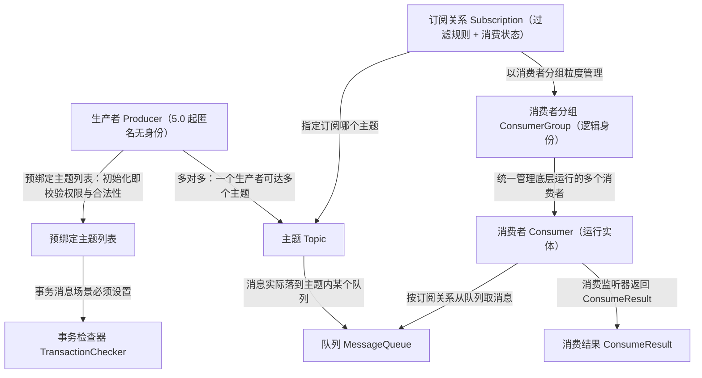
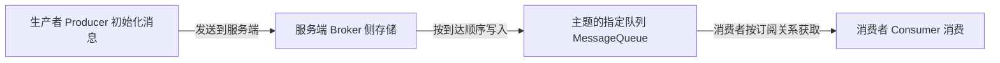
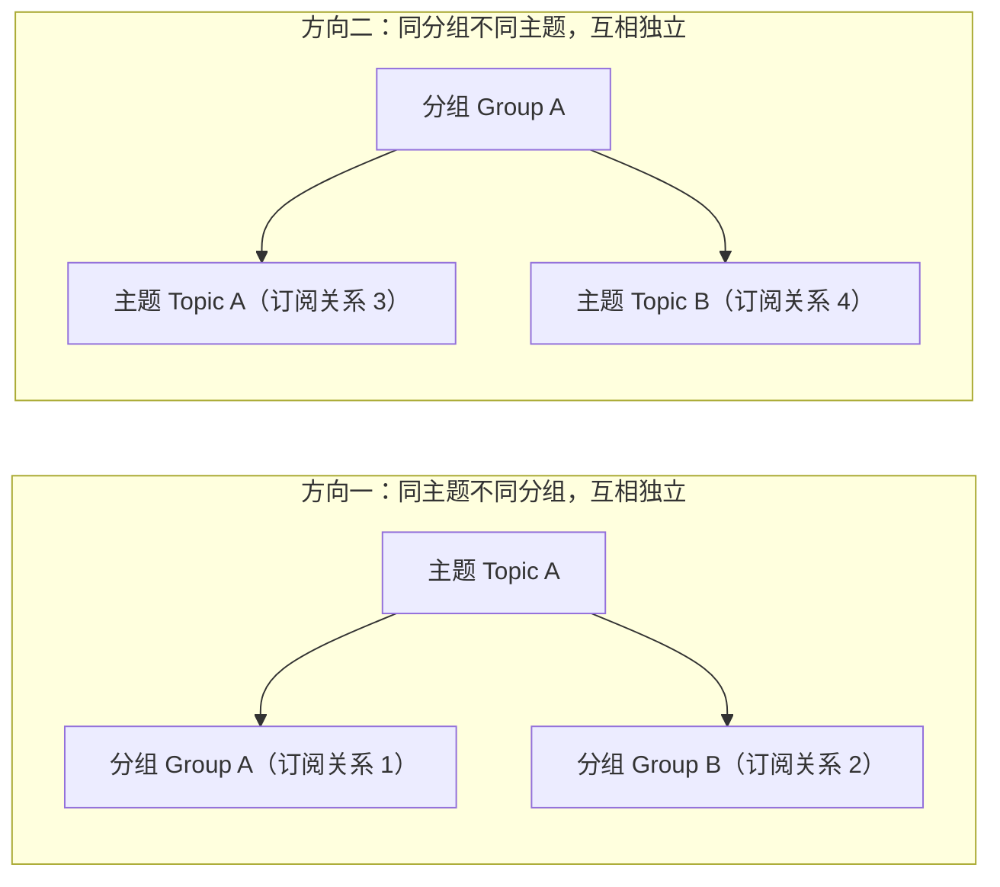
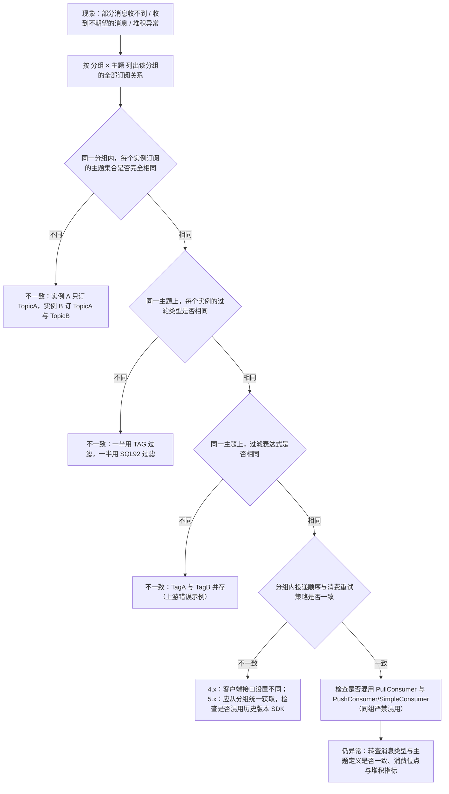

## 为什么需要消费者分组与订阅关系？（痛点引入）

RocketMQ 的线上事故里，「订阅关系不一致」是被反复点名的那一类。它的现场通常是这样的：

1. **灰度发布把消息弄丢了。** 老版本消费者订阅 `TagA`，新版本改成订阅 `TagB`，两边共用同一个消费者分组。发布后监控显示消费 TPS 正常、堆积为 0，但业务侧发现「物流通知一条都没收到」——因为同一分组内订阅关系冲突，服务端按分组粒度管理规则，部分消息消费异常。
2. **一个进程起了 8 个相同配置的消费者。** 开发把消费者分组当线程池用，扩容效果几乎没有：消费者分组是承载「消费行为一致的消费者」的负载均衡分组，同一份配置多开实例只增加负载均衡的抖动。
3. **删掉了生产者分组却发现事务消息不回了。** 5.0 起生产者是匿名的、无需管理生产者分组（ProducerGroup），但事务检查器与预绑定主题列表必须成对设置，迁移时只删了分组没补这两项，半事务消息的回查就断了。
4. **同一分组里混用 PullConsumer 和 PushConsumer。** 消费行为异常，且很难第一时间归因到「消费者类型混用」。

| 维度 | 不明白「分组承载订阅与进度」时的痛苦 | 明白之后的做法 |
|------|--------------------------------------|----------------|
| 发布变更 | 改订阅表达式像改本地代码一样随意 | 把订阅关系当成分组级别的契约，全组一致才发布 |
| 扩容 | 加实例、加进程盲试 | 同一分组内多实例做水平扩展；本地运行配置只管线程与并发 |
| 进度恢复 | 以为消费者离线就丢进度 | 服务端持久化订阅关系与消费进度，重新上线可继续消费 |
| 故障定位 | 只盯单个消费者实例排查 | 按「分组 → 订阅关系 → 主题」的粒度核对规则 |
| 版本迁移 | 死死保留 ProducerGroup 与老命名规则 | 5.0 生产者匿名；消费行为改由分组统一下发 |

> ### 💡 新人小结：四个角色到底是什么关系？
>
> 把消费侧想象成「一个家庭的快递取件」：
> - 消费者分组（ConsumerGroup）= **户口**：户口登记了「取哪些件、件取几次算完、失败怎么重试」，它不是活人，是一个逻辑身份。
> - 消费者（Consumer）= **家里真正下楼取件的人**：可以有多个人分摊，但他们的取件规则必须完全一样。
> - 订阅关系（Subscription）= **户口里登记的取件规则清单**：按「户口 × 货架分区（主题）」一条条记，还记着「读到第几格了」。
> - 生产者（Producer）= **寄件人**：5.0 里寄件人是匿名的，驿站不认寄件人身份，只认包裹上的分区牌。
>
> **订阅与进度都挂在「户口」上，不在「人」身上——这一条想通了，大部分消费事故都能提前避免。**

**学习路线图**（本文按四个对象逐个走完「定义 → 内部属性 → 行为约束 → 版本兼容性 → 使用建议」五层，最后合并讲订阅关系一致性）

```
Producer 五层 → ConsumerGroup 五层 → Consumer 五层 → Subscription 五层 → 一致性判定与排查
匿名与预绑定   身份与统一行为      实例与监听器      过滤与进度           ✅/❌ 对照 + 流程图
```

---

## 四对象关系总览：谁承载订阅，谁承载进度

下图是生产侧与消费侧四个角色在领域模型中的挂关系（箭头指向「被引用／被管理」的一方）：



图后解读，直接回答「谁承载订阅、谁承载进度」：

| 问题 | 结论 | 依据（上游口径） |
|------|------|------------------|
| 订阅关系由谁承载？ | **消费者分组**。订阅关系以消费组粒度进行管理，由消费者动态注册到消费者分组中，服务端持久化订阅关系并匹配消息的消费进度 | 订阅关系是发布订阅模型中消息过滤、重试、消费进度的规则配置，以消费组粒度管理 |
| 消费进度由谁承载？ | **消费者分组**。服务端基于每个消费者分组记录消费过的最新一条消息的位点，即消费位点 | 一条消息被某个消费者消费完成后不会立即从队列中删除 |
| 消费者实例承载什么？ | 只承载**运行**：从服务端取消息、转成业务可理解的信息处理，并返回消费结果 | 消费者是消费消息的运行实体，必须被指定到某一个消费组中 |
| 生产者实例承载什么？ | 承载**发送行为**：发送方式、批量发送、事务行为；不提供消费侧身份 | 在消息生产者中可以定义发送方式、批量发送、事务行为 |
| 订阅关系会不会重启就丢？ | 不会（除过滤表达式外）。订阅关系除过滤表达式之外都是持久化的，即服务端重启或请求断开，订阅关系依然保留 | 领域模型概述对订阅关系的说明 |

推论：**换消费者实例不影响进度，换消费者分组等于换一个身份（进度从零开始）**。这也解释了为什么「新下游只需新建一个消费者分组」是发布订阅模型的标准动作。

---

## 生产者（Producer）：五层拆解

### 定义

生产者是 RocketMQ 系统中用来构建并传输消息到服务端的运行实体，通常被集成在业务系统中，将业务消息按要求封装成消息并发送至服务端。在消息生产者中，可以定义如下传输行为：

- **发送方式**：生产者可通过 API 接口设置消息发送的方式，RocketMQ 支持同步传输和异步传输（单向／Oneway 发送与三种发送语义的完整对比见本分类第一篇《领域模型全景与通信方式》）。
- **批量发送**：生产者可通过 API 接口设置消息批量传输的方式，例如批量发送的消息条数或消息大小。
- **事务行为**：RocketMQ 支持事务消息，对于事务消息需要生产者配合进行事务检查等行为保障事务的最终一致性。

生产者和主题的关系为**多对多**：同一个生产者可以向多个主题发送消息，对于平台类场景如果需要发送消息到多个主题，并不需要创建多个生产者；同一个主题也可以接收多个生产者的消息，以此可以实现生产者性能的水平扩展和容灾。

### 模型关系

上游生产者篇给出的是「生产者 → 服务端 → 消费者」的三步流程；下图把它画成一条链，标出每一步的承载对象：



| 步骤 | 上游原文口径 | 本步骤里谁是主角 |
|------|--------------|------------------|
| 1 | 消息由生产者初始化并发送到服务端 | 生产者（决定发送方式、批量、事务行为） |
| 2 | 消息按照到达服务端的顺序存储到主题的指定队列中 | 队列（决定顺序性作用域与并发度） |
| 3 | 消费者按照指定的订阅关系从服务端中获取消息并消费 | 订阅关系（决定哪些消息投给哪个分组） |

### 内部属性

| 属性 | 定义 | 取值／来源 | 必选性与约束 |
|------|------|------------|--------------|
| 客户端 ID | 生产者客户端的标识，用于区分不同的生产者，集群内全局唯一 | 由 RocketMQ 的 SDK 自动生成 | 主要用于日志查看、问题定位等运维场景，**不支持修改** |
| 接入点信息 | 连接服务端的接入地址，用于识别服务端集群 | 由使用者配置 | **必选**；必须按格式配置，建议使用域名，避免使用 IP 地址，防止节点变更无法进行热点迁移 |
| 身份认证信息 | 客户端用于身份验证的凭证信息 | 由使用者配置 | **可选**；仅在服务端开启身份识别和认证时需要传输 |
| 请求超时时间 | 客户端网络请求调用的超时时间 | 默认值 3000 毫秒；该参数为客户端本地行为，取值范围建议不要超过 30000 毫秒 | **可选**；应按实际应用设置合理取值，避免线程阻塞时间过长 |
| 预绑定主题列表 | 生产者需要将消息发送到的目标主题列表 | 由使用者在初始化阶段声明 | 事务消息**必须设置**；非事务消息**建议设置** |
| 事务检查器 | 事务消息机制中，为保证异常场景下事务的最终一致性，生产者需要主动实现事务检查器的接口 | 由业务方实现 | 发送事务消息时**必须设置**，且需要和预绑定主题列表一起配合使用 |
| 发送重试策略 | 生产者在消息发送失败时的重试策略 | 由客户端 SDK 内置策略与配置控制 | 消息发送重试是客户端 SDK 内置的重试策略，对应用不可见，建议取值不要过大，避免阻塞业务线程 |

预绑定主题列表为什么对事务消息是「必须」：事务消息场景下，生产者在故障、重启恢复时，需要检查事务消息的主题中是否有未提交的事务消息，避免生产者发送新消息后，主题中的旧事务消息一直处于未提交状态造成业务延迟。对非事务消息，服务端会在生产者初始化时根据预绑定主题列表检查目标主题的访问权限和合法性，而不需要等到应用启动后再检查；若未设置，或后续消息发送的目标主题动态变更，RocketMQ 会对目标主题进行动态补充检验。

```properties
# ========== ✅ 推荐写法：生产者初始化阶段落实的四项属性（属性名照上游内部属性口径） ==========
# 接入点信息（必选）        ：连接服务端的接入地址，必须按格式配置；建议使用域名，避免使用 IP 地址，防止节点变更无法进行热点迁移
# 请求超时时间（可选）      ：默认值 3000 毫秒；该参数为客户端本地行为，取值范围建议不要超过 30000 毫秒
# 预绑定主题列表（事务必选）：OrderTopic,LogisticsTopic —— 服务端在初始化阶段即检查目标主题的访问权限和合法性
# 事务检查器（事务必选）    ：由业务方实现，用于本地事务检查与异常事务恢复；必须与预绑定主题列表一起配合使用
# 输出: 主题权限或合法性存在性问题时，在初始化阶段就暴露，而不是等业务第一条消息发出去才失败
```

```properties
# ========== ❌ 不推荐写法（仅展示）：三处典型配置错误 ==========
# 接入点信息              ：直接填 IP 地址（形如「某内网 IP:端口」）  # 节点变更时无法进行热点迁移，上游明确要求建议使用域名、避免使用 IP 地址
# 请求超时时间            ：超过 30000 毫秒的取值                    # 请求超时是客户端本地同步调用的等待时间，会造成线程长时间阻塞
# 预绑定主题列表／事务检查器：均不设置却发送事务消息                   # 故障或重启恢复后无法回查主题中未提交的事务消息，旧事务消息一直悬置造成业务延迟
```

参数解释：上面两块配置清单的四项属性名（接入点信息、请求超时时间、预绑定主题列表、事务检查器）与必选／可选标注，均来自 5.0 生产者篇的「内部属性」小节；数值（默认 3000 毫秒、建议不超过 30000 毫秒）来自上游「参数约束和建议」表。上游未给出这些属性在各语言 SDK 中的具体设置方法名与配置文件键名，因此本文只按属性口径书写，不推测可编译签名。

### 行为约束

生产者的约束体现在「多对多」与「事务两件套」上：一个生产者可发多个主题、一个主题可有多个生产者（性能水平扩展与容灾）；一旦选择发送事务消息，预绑定主题列表与事务检查器必须同时设置。

### 版本兼容性

| 对比维度 | 服务端 3.x / 4.x | 服务端 5.x |
|----------|------------------|------------|
| 生产者身份 | 需要管理生产者分组（ProducerGroup） | **生产者是匿名的，无需管理生产者分组** |
| 已有 ProducerGroup 的处理 | 必填项 | 可以废弃无需再设置，且不会对当前业务产生影响 |
| 官方建议 | — | 不再依赖生产者分组做业务区分 |

> [!NOTE] 版本适用：生产者匿名是 5.x 的行为
> RocketMQ 服务端 5.x 版本开始，生产者是匿名的，无需管理生产者分组（ProducerGroup）；对于历史版本服务端 3.x 和 4.x 版本，已经使用的生产者分组可以废弃无需再设置，且不会对当前业务产生影响。

### 使用建议

**不建议单一进程创建大量生产者。** 生产者和主题是多对多的关系，支持同一个生产者向多个主题发送消息。对于生产者的创建和初始化，建议遵循**够用即可、最大化复用**原则：如果有需要发送消息到多个主题的场景，无需为每个主题都创建一个生产者。

**不建议频繁创建和销毁生产者。** 生产者是可以重复利用的底层资源，**类似数据库的连接池**。因此不需要在每次发送消息时动态创建生产者、且在发送结束后销毁生产者：这样频繁的创建销毁会在服务端产生大量短连接请求，严重影响系统性能。

```java
// ========== 正确示例：生产者建一次，循环复用，最后统一 shutdown ==========
Producer p = ProducerBuilder.build();
for (int i = 0; i < n; i++) {
    Message m = MessageBuilder.build();
    p.send(m);
}
p.shutdown();
// 输出: 整个循环复用同一连接与客户端资源，服务端不会看到成批的短连接

// ========== 典型错误示例（仅展示）：每条消息建一个生产者 ==========
// for (int i = 0; i < n; i++) {
//     Producer p = ProducerBuilder.build();
//     Message m = MessageBuilder.build();
//     p.send(m);
//     p.shutdown();
// }
// 输出: 服务端产生大量短连接请求，系统性能被创建/销毁开销吃掉
```

---

## 消费者分组（ConsumerGroup）：五层拆解

### 定义

消费者分组是 RocketMQ 系统中承载多个消费行为一致的消费者的**负载均衡分组**。和消费者不同，消费者分组并不是运行实体，而是一个**逻辑资源**：通过消费者分组内初始化多个消费者实现消费性能的水平扩展以及高可用容灾。

在消费者分组中，统一定义以下消费行为，同一分组下的多个消费者将按照分组内统一的消费行为和负载均衡策略消费消息：

- **订阅关系**：RocketMQ 以消费者分组的粒度管理订阅关系，实现订阅关系的管理和追溯。
- **投递顺序性**：服务端将消息投递给消费者消费时，支持顺序投递和并发投递，投递方式在消费者分组中统一配置。
- **消费重试策略**：消费者消费消息失败时的重试策略，包括重试次数、死信队列设置等。

### 内部属性

| 属性 | 定义 | 取值 | 约束 |
|------|------|------|------|
| 消费者分组名称 | 消费者分组的名称，用于区分不同的消费者分组，集群内全局唯一 | 由用户设置并创建 | 命名规范见上游参数约束：字符支持字母 a~z 或 A~Z、数字 0~9 以及下划线（_）、短划线（-）和百分号（%），长度建议 1~64 个字符；另有系统保留字符与特殊前缀不可用 |
| 投递顺序性 | 消费者消费消息时，服务端向消费者客户端投递消息的顺序；提供顺序投递和并发投递两种方式 | **默认投递方式为并发投递** | 同一分组内所有消费者的投递顺序必须相同 |
| 消费重试策略 | 消费者消费消息失败时系统的重试策略：失败后按重试策略将指定消息投递给消费者重新消费 | 包括最大重试次数（超过最大重试次数还没被成功消费，消息将被投递至死信队列或丢弃）与重试间隔（服务端重新投递消息的间隔时间）；消息消费重试次数默认值 16 次 | **重试间隔仅在 PushConsumer 消费类型下有效** |
| 订阅关系 | 当前消费者分组关联的订阅关系集合，包括消费者订阅的主题以及消息的过滤规则等 | 由消费者动态注册到消费者分组中 | 服务端会持久化订阅关系并匹配消息的消费进度 |

> ### 💡 新人小结：为什么「重试间隔只对 PushConsumer 有效」？
>
> 把重试想成「取件失败后驿站什么时候再喊你一次」：
> - PushConsumer 像**装了门铃的家庭**：人在家、门铃由驿站按固定节奏再按一次，所以「间隔多久再按」是驿站能控制的参数。
> - SimpleConsumer 像**自己下楼取件的人**：什么时候再来取由你决定（通过消费不可见时间控制消息处理时长），所以「重试间隔」这个预设节奏对它不适用。
>
> **一句话：谁掌控取件节奏，间隔参数就归谁管；分组级配置只对「服务端主导节奏」的消费者类型生效。**

### 行为约束

在领域模型中，消费者的管理通过消费者分组实现，同一分组内的消费者共同分摊消息进行消费。因此，为了保证分组内消息的正常负载和消费，RocketMQ 要求同一分组下的所有消费者以下消费行为保持一致：

- **投递顺序**
- **消费重试策略**

### 版本兼容性

| 对比维度 | 服务端 3.x / 4.x 历史版本 | 服务端 5.x |
|----------|--------------------------|------------|
| 投递顺序、消费重试策略的定义位置 | 由消费者客户端接口定义，需要自己在客户端设置时保证同分组一致 | 从关联的消费者分组中统一获取 |
| 客户端是否需要关注一致性 | 需要，靠人工保证 | 同一分组内所有消费者的消费行为必然一致，客户端无需关注 |
| 5.x 服务端 + 历史版本 SDK 的组合 | 消费逻辑以**消费者客户端接口的设置**为准 | 同上（这是一条容易忽略的兼容边界） |

> [!NOTE] 版本适用：混版本组合的判定优先级
> 若你使用 RocketMQ 服务端 5.x 版本、客户端使用历史版本 SDK，则消费者的消费逻辑以消费者客户端接口的设置为准。也就是说「分组统一下发」不是无条件的，它取决于客户端版本能否走 5.x 的行为获取路径。

### 使用建议

**按照业务合理拆分分组。** 消费者和主题是多对多的关系，对于消费者分组的拆分设计建议遵循以下原则：

| 原则 | 上游要求 | 反面做法 |
|------|----------|----------|
| 消费者的投递顺序一致 | 同一消费者分组下所有消费者的消费投递顺序相同，统一都是顺序投递或并发投递，不同业务场景不能混用消费者分组 | 顺序业务与并发业务共用一个分组 |
| 消费者业务类型一致 | 一般消费者分组和主题对应；不同业务域对消息消费的要求不同（例如消息过滤属性、消费重试策略不同），因此不同业务域主题的消费建议使用不同消费者分组 | 一个消费者分组消费超过 10 个主题 |

**消费者分组管理尽量避免自动化机制。** 在 RocketMQ 架构中，消费分组属于状态管理类的逻辑资源，每个消费分组都会涉及关联的消费状态、堆积信息、可观测指标和监控采集数据，因此生产环境需要严格管理消费者分组资源，请勿随意进行增、删、改、查操作。RocketMQ 虽然提供了自动创建消费者分组的功能，但建议仅在测试环境使用，生产环境请勿打开，避免产生大量消费者分组、无法管理和回收，且浪费系统资源。

---

## 消费者（Consumer）：五层拆解

### 定义

消费者是 RocketMQ 中用来接收并处理消息的运行实体，通常被集成在业务系统中，从服务端获取消息，并将消息转化成业务可理解的信息，供业务逻辑处理。在消息消费端，可以定义如下传输行为：

- **消费者身份**：消费者必须关联一个指定的消费者分组，以获取分组内统一定义的行为配置和消费状态。
- **消费者类型**：RocketMQ 面向不同的开发场景提供了多样的消费者类型，包括 PushConsumer 类型、SimpleConsumer 类型、PullConsumer 类型（仅推荐流处理场景使用）等。
- **消费者本地运行配置**：根据不同的消费者类型，控制消费者客户端本地的运行配置，例如消费者客户端的线程数、消费并发度等，实现不同的传输效果。

### 模型关系

在领域模型中，消费者的位置和流程如下（下图同时给出消费侧链路：分组管理订阅、实例从队列取消息）：


1. 消息由生产者初始化并发送到服务端。
2. 消息按照到达服务端的顺序存储到主题的指定队列中。
3. 消费者按照指定的订阅关系从服务端中获取消息并消费。

### 内部属性

| 属性 | 定义 | 取值 | 约束 |
|------|------|------|------|
| 消费者分组名称 | 当前消费者关联的消费者分组名称，通过分组获取消费行为 | 消费者分组为逻辑资源，需要提前通过控制台或 OpenAPI 创建 | 消费者必须关联到指定的消费者分组 |
| 客户端 ID | 消费者客户端的标识，用于区分不同的消费者，集群内全局唯一 | 由 RocketMQ 的 SDK 自动生成 | 主要用于日志查看、问题定位等运维场景，**不支持修改** |
| 通信参数 | 接入点信息（必选，建议使用域名、避免 IP）、身份认证信息（可选，仅在服务端开启身份识别和认证时需要传输）、请求超时时间（可选，默认 3000 毫秒，建议不超过 30000 毫秒） | 由使用者配置 | 与生产者侧同口径 |
| 预绑定订阅关系列表 | 指定消费者的订阅关系列表；服务端可在消费者初始化阶段，根据预绑定的订阅关系列表对目标主题进行权限及合法性校验，无需等到应用启动后才能校验 | 建议在消费者初始化阶段明确订阅关系即要订阅的主题列表 | 若未设置，或订阅的主题动态变更，服务端会对目标主题进行动态补充校验 |
| 消费监听器 | 服务端将消息推送给消费者后，消费者调用消息消费逻辑的监听器 | 由消费者客户端本地配置 | 使用 **PushConsumer** 类型的消费者消费消息时，消费者客户端**必须设置消费监听器** |

消费者类型之间的差异（照上游消费者分类表逐行保留）：

| 对比项 | PushConsumer | SimpleConsumer | PullConsumer |
|--------|--------------|----------------|--------------|
| 接口方式 | 使用监听器回调接口返回消费结果，消费者仅允许在监听器范围内处理消费逻辑 | 业务方自行实现消息处理，并主动调用接口返回消费结果 | 业务方自行按队列拉取消息，并可选择性地提交消费结果 |
| 消费并发度管理 | 由 SDK 管理消费并发度 | 由业务方消费逻辑自行管理消费线程 | 由业务方消费逻辑自行管理消费线程 |
| 负载均衡粒度 | 5.0 SDK 是消息粒度，更均衡；早期版本是队列维度 | 消息粒度，更均衡 | 队列粒度，吞吐攒批性能更好，但容易不均衡 |
| 接口灵活度 | 高度封装，不够灵活 | 原子接口，可灵活自定义 | 原子接口，可灵活自定义 |
| 适用场景 | 适用于无自定义流程的业务消息开发场景 | 适用于需要高度自定义业务流程的业务开发场景 | 仅推荐在流处理框架场景下集成使用 |

与本地运行相关的默认值（上游参数约束表）：

| 参数 | 默认值 | 说明 |
|------|--------|------|
| PushConsumer 本地缓存 | 最大缓存数量 1024 条；最大缓存大小 64 M | PushConsumer 类型下为提高消费者吞吐量和性能，客户端会在 SDK 本地缓存部分消息；缓存的消息数量和大小应设置在系统内存允许的范围内 |
| PushConsumer 消费并发度 | 20 个线程 | 对应「消费者本地运行配置」中的线程数与消费并发度 |
| 获取消息最大批次 | 32 条 | 消费者从服务端获取消息时一次获取到的最大消息条数；一次获取消息数量过大容易在消费失败时造成大批量消息重复 |
| PushConsumer 重试间隔时长 | 非顺序性投递：间隔时间阶梯变化；顺序性投递：3000 毫秒 | 与分组级「消费重试策略」的重试间隔同一条约束（仅 PushConsumer 有效） |
| SimpleConsumer 最大不可见时间 | 用户必填参数，无默认值；取值范围建议最小 10 秒、最大 12 小时 | 消费不可见时间指消息处理 + 失败后重试间隔的总时长，建议取值比实际需要耗费的时间稍微长一些 |

```java
// ========== 推荐写法：PushConsumer 三件套（分组 + 订阅表达式 + 监听器） ==========
ClientServiceProvider provider = ClientServiceProvider.loadService();
String topic = "YourTopic";
FilterExpression filterExpression = new FilterExpression("YourFilterTag", FilterExpressionType.TAG);
PushConsumer pushConsumer = provider.newPushConsumerBuilder()
    .setConsumerGroup("YourConsumerGroup")                 // 消费者必须关联一个指定的消费者分组
    .setClientConfiguration(ClientConfiguration.newBuilder().setEndpoints("YourEndpoint").build()) // 接入点：建议域名，避免 IP
    .setSubscriptionExpressions(Collections.singletonMap(topic, filterExpression)) // 预绑定订阅关系：初始化阶段即校验权限与合法性
    .setMessageListener(new MessageListener() {            // PushConsumer 必须设置消费监听器
        @Override
        public ConsumeResult consume(MessageView messageView) { // 消费端拿到的是只读消息视图
            // 消费消息并返回处理结果：同步处理完再返回，不外抛到其它线程
            return ConsumeResult.SUCCESS;
        }
    })
    .build();
// 输出: 监听器返回 ConsumeResult.SUCCESS 表示该消息处理成功，服务端按消费结果更新消费进度；
//       返回 ConsumeResult.FAILURE 表示处理失败，按消费重试逻辑判断是否进行重试消费；
//       若监听器抛异常等非预期失败，同样按消费失败处理。

// ========== 不推荐写法（仅展示） ==========
// ❌ 在监听器里把消息丢给自己的线程池后立即 return SUCCESS：消息未处理完就返回成功，服务端无法感知失败，不会重试
// ❌ 不给 PushConsumer 设置消费监听器：上游约束是 PushConsumer 类型必须设置消费监听器
```

### 行为约束

与消费者分组同一条约束：同一分组下的所有消费者必须保持**投递顺序**、**消费重试策略**一致；在 5.x 中这两项从分组统一获取，因此实例侧无法各写各的。此外，生产环境中相同的 ConsumerGroup 下**严禁混用 PullConsumer 和其他两种消费者**，否则会导致消息消费异常。

### 版本兼容性

| 对比维度 | 服务端 3.x / 4.x 历史版本 | 服务端 5.x |
|----------|--------------------------|------------|
| 投递顺序／重试策略来源 | 消费者客户端接口定义，需人工保证同组一致 | 从关联的消费者分组统一获取 |
| 客户端是否需要关注一致性 | 需要 | 同组行为必然一致，客户端无需关注 |
| 负载均衡粒度 | 早期版本按队列维度 | 5.0 SDK 按消息粒度，更均衡 |
| 5.x 服务端 + 历史 SDK | — | 消费逻辑以消费者客户端接口的设置为准 |

### 使用建议

**不建议在单一进程内创建大量消费者。** 消费者在通信协议层面支持非阻塞传输模式，网络通信效率较高，并且支持多线程并发访问。因此大部分场景下，**单一进程内同一个消费分组只需要初始化唯一的一个消费者即可**，开发过程中应避免以相同的配置初始化多个消费者。

**不建议频繁创建和销毁消费者。** 消费者是可以重复利用的底层资源，类似数据库的连接池；不需要在每次接收消息时动态创建消费者、且在消费完成后销毁消费者，这样频繁地创建销毁会在服务端产生大量短连接请求，严重影响系统性能。

```java
// ========== 正确示例：消费者建一次，循环消费，最后统一 shutdown ==========
Consumer c = ConsumerBuilder.build();
for (int i = 0; i < n; i++) {
    Message m = c.receive();
    //process message
}
c.shutdown();
// 输出: 单一进程内同一分组只有 1 个消费者实例，负载均衡拓扑稳定

// ========== 典型错误示例（仅展示）：每次收消息都重建消费者 ==========
// for (int i = 0; i < n; i++) {
//     Consumer c = ConsumerBuilder.build();
//     Message m = c.receive();
//     //process message
//     c.shutdown();
// }
// 输出: 服务端出现大量短连接；消费者频繁上下线，分组反复做负载均衡调整
```

---

## 订阅关系（Subscription）：五层拆解

### 定义

订阅关系是 RocketMQ 系统中消费者获取消息、处理消息的规则和状态配置。订阅关系由**消费者分组动态注册到服务端系统**，并在后续的消息传输中按照订阅关系定义的过滤规则进行消息匹配和消费进度维护。

通过配置订阅关系，可控制如下传输行为：

- **消息过滤规则**：用于控制消费者在消费消息时选择主题内的哪些消息进行消费；设置消费过滤规则可以高效地过滤消费者需要的消息集合，灵活根据不同的业务场景设置不同的消息接收范围。
- **消费状态**：RocketMQ 服务端默认提供订阅关系持久化的能力，即消费者分组在服务端注册订阅关系后，当消费者离线并再次上线后，可以获取离线前的消费进度并继续消费。

### 订阅关系判断原则

RocketMQ 的订阅关系按照**消费者分组和主题粒度**设计，因此一个订阅关系指的是「指定某个消费者分组对于某个主题的订阅」。两个独立方向如下：



| 判断场景 | 结论 | 上游说明 |
|----------|------|----------|
| Group A 与 Group B 分别以不同订阅关系订阅同一个 Topic A | 两个订阅关系互相独立，可以各自定义、不受影响 | 不同消费者分组对于同一个主题的订阅相互独立 |
| Group A 同时订阅 Topic A 与 Topic B | Topic A 为一个订阅关系，Topic B 为另一个订阅关系，两者相互独立 | 同一个消费者分组对于不同主题的订阅也相互独立 |
| 同一分组内的多个消费者订阅不一致 | **不允许**：会出现消费冲突，导致部分消息消费异常 | 订阅关系一致的行为约束 |


在领域模型中的流程位置：消息由生产者初始化并发送到服务端；消息按照到达服务端的顺序存储到主题的指定队列中；消费者按照指定的订阅关系从服务端中获取消息并消费。

### 内部属性

| 属性 | 定义 | 取值 | 约束／说明 |
|------|------|------|------------|
| 过滤类型 | 消息过滤规则的类型；设置后系统按过滤规则匹配主题中的消息，只把符合条件的消息投递给消费者，实现消息的再次分类 | TAG 过滤：按照 Tag 字符串进行全文过滤匹配；SQL92 过滤：按照 SQL 语法对消息属性进行过滤匹配 | 一条消息仅支持设置一个 Tag；Tag 使用可见字符，建议长度不超过 128 字符 |
| 过滤表达式 | 自定义的过滤规则表达式 | 单 Tag 匹配写目标 Tag；多 Tag 匹配为或关系，多个 Tag 之间用两个竖线隔开；全部匹配用星号；SQL92 场景为 SQL92 语法表达式 | 计算与匹配在 RocketMQ 的服务端完成；表达式异常或计算结果为 null／非布尔类型时，消息默认被过滤，不会投递给消费者 |

两种过滤类型的选择（上游消息过滤文档对比表）：

| 对比项 | Tag 标签过滤 | SQL 属性过滤 |
|--------|--------------|--------------|
| 过滤目标 | 消息的 Tag 标签 | 消息的属性，包括用户自定义属性以及系统属性（Tag 是一种系统属性） |
| 过滤能力 | 精准匹配 | SQL 语法匹配 |
| 适用场景 | 简单过滤场景、计算逻辑简单轻量 | 复杂过滤场景、计算逻辑较复杂 |

### 行为约束：订阅关系一致

RocketMQ 是按照消费者分组粒度管理订阅关系，因此**同一消费者分组内的消费者在消费逻辑上必须保持一致**，否则会出现消费冲突，导致部分消息消费异常。上游给出的正误示例：

```java
// ========== ✅ 正确示例：同组内订阅关系完全一致 ==========
// Consumer c1
Consumer c1 = ConsumerBuilder.build(groupA);
c1.subscribe(topicA, "TagA");
// Consumer c2
Consumer c2 = ConsumerBuilder.build(groupA);
c2.subscribe(topicA, "TagA");
// 输出: Group A 对 topicA 只有一个订阅关系，两个实例分摊消息，进度按分组统一推进

// ========== ❌ 错误示例：同组内订阅表达式不同 ==========
// Consumer c1
Consumer c1 = ConsumerBuilder.build(groupA);
c1.subscribe(topicA, "TagA");
// Consumer c2
Consumer c2 = ConsumerBuilder.build(groupA);
c2.subscribe(topicA, "TagB");
// 输出: 订阅关系冲突（同一分组对同一主题出现两个不同过滤表达式），会出现消费冲突，导致部分消息消费异常
```

过滤表达式属于订阅关系的一部分：领域模型规定，同一消费者分组内的多个消费者的订阅关系（**包括过滤表达式**）必须保持一致，否则可能会导致部分消息消费不到。

> [!WARNING] 一个例外：Lite 类型主题
> 轻量主题场景下订阅关系一致性被弱化——同一 Group 下每个消费者可订阅不同的 LiteTopic 集合，Group 的限制弱化；这是「排他消费（一个会话只被一个消费者处理）」的产品设计，不是可以随意让同组订阅不一致的口子。普通类型主题仍然要求同组订阅关系一致，且该能力需要服务端 5.5.0 及以上、RocketMQ gRPC 客户端 5.1.0 及以上。

### 版本兼容性

上游订阅关系篇没有单列「版本兼容性」小节，本文只汇总可在其它上游条目中核对到的版本事实：

| 事实 | 4.x / 3.x | 5.x |
|------|-----------|-----|
| 订阅关系中「投递顺序、消费重试策略」这两项行为的来源 | 由消费者客户端接口定义，需要业务自己保证同组一致 | 从关联的消费者分组统一获取（分组级统一定义） |
| 强制校验消息类型（决定一个主题能承载哪种订阅） | 不支持 | 支持且默认开启，混类型订阅同一主题会撞到发送校验 |
| 订阅关系一致性是否可被弱化 | 4.x 未提供二级容器 | LiteTopic（服务端 5.5.0+、gRPC 客户端 5.1.0+）可让同组订阅不同 LiteTopic 集合 |
| 消费者类型混用 | 4.x 消费者模型口径不同，不适用本条 | 相同 ConsumerGroup 下严禁混用 PullConsumer 和其他两种消费者，否则会导致消息消费异常 |

### 使用建议

**建议不要频繁修改订阅关系。** 在领域模型中，订阅关系关联了过滤规则、消费进度等元数据和相关配置，同时系统需要保证消费者分组下的所有消费者的消费行为、消费逻辑、负载策略等一致，整体运算逻辑比较复杂。因此不建议在生产环境中通过频繁修改订阅关系来实现业务逻辑的变更，这样可能会导致客户端一直处于负载均衡调整和变更的过程，从而影响消息接收。

落地这条建议的最小流程（每一步都能回看正文的判据）：

```
变更订阅前:  确认新表达式与同组所有实例一致 → 与分组投递顺序/重试策略不冲突 → 目标主题消息类型一致
变更方式:    整组一次性发布（同组实例同一时刻只有一个订阅关系），避免滚动期出现两套表达式
变更后核对:  分组级消费进度是否连续、是否出现「部分消息消费不到」、是否长期处于负载均衡调整
```

---

## 订阅关系一致的判定与排查流程

下图是「怀疑订阅关系不一致」时的排查顺序：先按分组 × 主题确定有几个订阅关系，再逐维度比对。



排查对照清单：

| 检查项 | 一致的表现 | 不一致的信号 | 出处口径 |
|--------|------------|--------------|----------|
| 订阅的主题集合 | 同组所有实例订阅同一组主题 | 实例间主题集合有差集 | 订阅关系按分组和主题粒度设计 |
| 过滤类型 | 同主题同组内统一为 TAG 或统一为 SQL92 | 混合两种类型 | 订阅关系内部属性：过滤类型 |
| 过滤表达式 | 全部实例上报同一表达式 | 同组出现两套表达式 | 领域模型规定订阅关系包括过滤表达式必须一致 |
| 投递顺序 | 全组同为顺序投递或同为并发投递 | 组内混用不同业务场景 | 消费者分组内部属性与行为约束；上游建议不同业务场景不能混用消费者分组 |
| 消费重试策略 | 全组同一重试次数与间隔 | 4.x 下由各实例自行设置产生差异 | 重试策略在分组内统一定义；重试间隔仅 PushConsumer 有效 |
| 消费者类型 | 同组内不出现 PullConsumer 与另两类共存 | 消息消费异常且难归因 | 相同 ConsumerGroup 下严禁混用 PullConsumer 和其他两种消费者 |
| 分组规模 | 分组与主题基本对应 | 一个分组消费超过 10 个主题 | 消费者分组使用建议 |

> ### 💡 新人小结：判定「订阅关系是否一致」像查什么？
>
> 像查「一个户口下所有人的取件规则页是不是同一张」：
> - 只看纸面：规则页（订阅关系）是**按户口 × 货架分区**各一张，不是按人头一张张发。
> - 一户多张：订了两个主题就是两张规则页，互不干涉。
> - 两户同货架：别的户口在同一分区上写的规则，和你毫无关系，改它不影响你。
> - 最危险的情况：同一户口里，A 写了「只取 TagA」、B 写了「只取 TagB」——驿站只会按一张纸执行，另一张纸上的件就没人管。
>
> **订阅关系不一致不是「报错」，而是「有些消息悄悄没人消费」，这就是它成为高发事故的原因。**

---

## 术语表

| 术语 | 全称 | 含义（用自己的话） | 在本文中的角色 |
|------|------|--------------------|----------------|
| Producer | 生产者 | 构建并传输消息到服务端的运行实体；5.0 起匿名无身份 | 生产侧唯一角色，承载发送方式／批量／事务行为 |
| ProducerGroup | 生产者分组 | 4.x 时代用来归类一组生产者的标识 | 5.x 已无需管理，本文用于版本对比 |
| Topic | 主题 | 消息传输与存储的分组容器，标识同一类业务逻辑的消息 | 生产者多对多发送的目标、订阅关系的一端 |
| MessageQueue | 队列 | 消息存储和传输的实际容器，也是最小存储单元 | 生产者实际写入、消费者实际读取的对象 |
| LiteTopic | 轻量主题 | Lite 类型主题下的二级容器，标识同一业务下不同子类（会话、任务等） | 订阅关系一致性弱化的唯一例外 |
| Message | 消息 | 最小数据传输单元，发送与存储后即不可变 | 生产者构造的对象 |
| MessageView | 消息视图 | 面向开发视角的消息只读接口，可读属性与负载、不可修改 | 消费监听器的入参类型 |
| Consumer | 消费者 | 接收并处理消息的运行实体，必须归属某个消费者分组 | 进程内的实际执行体 |
| ConsumerGroup | 消费者分组 | 承载多个消费行为一致的消费者的负载均衡分组；逻辑资源而非运行实体 | 订阅与进度的承载者 |
| Subscription | 订阅关系 | 消费者获取与处理消息的规则和状态配置，按分组 × 主题粒度存在 | 本文的核心判定对象 |
| FilterExpression | 过滤表达式 | 订阅关系里那条自定义规则（单 Tag／多 Tag 或关系／星号全匹配／SQL92） | 订阅一致性最容易撞车的字段 |
| TAG 过滤 | Tag 标签过滤 | 按 Tag 字符串做全文精准匹配 | 简单过滤场景 |
| SQL92 | SQL92 语法过滤 | 按 SQL 语法对消息属性做过滤匹配 | 复杂过滤场景；表达式计算异常或为 null 时消息默认被过滤 |
| PushConsumer | 推送型消费者 | 高度封装，靠消费监听器回调返回结果，SDK 管并发与重试 | 本文主示例；重试间隔只对它有效 |
| SimpleConsumer | 简单消费者 | 原子接口，业务主动 receive 与 ack，自定义消费线程 | 处理时长不可控场景；有最大不可见时间参数 |
| PullConsumer | 拉取型消费者 | 业务自行按队列拉取并按需提交结果 | 仅推荐流处理框架；同组严禁与另两类混用 |
| ConsumeResult | 消费结果 | 监听器处理完成后返回的结果，标识本次消息是否正确处理，含成功与失败 | 服务端更新进度与触发重试的依据 |
| ConsumerOffset | 消费位点 | 服务端按每个消费者分组记录的「已消费到的最新一条消息的位点」 | 「进度挂在分组上」的直接证据 |
| TransactionChecker | 事务检查器 | 生产者侧用于本地事务检查与异常事务恢复的监听器，应通过业务侧数据状态判断事务消息状态 | 必须与预绑定主题列表配套 |
| 预绑定主题列表 | 生产者属性 | 生产者要发送的目标主题清单，初始化阶段即校验权限与合法性 | 事务消息必须设置 |
| 预绑定订阅关系列表 | 消费者属性 | 消费者初始化阶段声明的订阅清单 | 把订阅问题提前到启动期暴露 |
| 接入点 | Endpoint／接入点信息 | 连接服务端的接入地址，用于识别服务端集群 | 必选项；建议域名而非 IP |
| ClientId | 客户端 ID | SDK 自动生成的客户端标识，集群内全局唯一，不可修改 | 日志与问题定位用 |
| DLQ | 死信队列 | 超过最大重试次数仍未被成功消费时，消息被投递至死信队列或丢弃 | 重试策略的终点分支 |
| ACL | Access Control List，访问控制 | 上游以「服务端开启身份识别和认证」描述这一开关，并在参数约束表中以 ACL Credentials 给出 AK（AccessKey ID）、SK（AccessKey Secret）和 Token 的长度限制（不超过 1024 个字符） | 决定生产者的「身份认证信息」是否需要传输 |

---

## 要点总结

1. **订阅与进度都在消费者分组上**：订阅关系以消费组粒度管理、由消费者动态注册、服务端持久化（除过滤表达式外）；消费位点也按分组记录。实例只是执行体，换实例不丢进度，换分组等于换身份。
2. **生产者匿名，但事务不是免费的**：5.x 起无需 ProducerGroup；而一旦发事务消息，预绑定主题列表与事务检查器必须同时设置，否则重启恢复时无法回查未提交的事务消息。
3. **分组是「行为契约」而不是「线程池」**：分组统一定义订阅关系、投递顺序性（默认并发投递）、消费重试策略（重试间隔仅 PushConsumer 有效，消费重试次数默认 16 次），并要求同组实例的投递顺序与重试策略一致；不同业务域主题建议用不同分组，避免一个分组消费超过 10 个主题。
4. **实例侧遵守复用原则**：单一进程内同一分组通常只需一个消费者；生产者与消费者都像数据库连接池一样复用，频繁创建销毁会在服务端产生大量短连接请求。
5. **订阅关系一致的判定顺序**：先按「分组 × 主题」数清有几张订阅关系，再逐项比对主题集合、过滤类型、过滤表达式、投递顺序、消费重试策略、消费者类型是否混用；LiteTopic 是唯一被产品弱化了该约束的场景，且需要服务端 5.5.0+ 与 gRPC 客户端 5.1.0+。
6. **变更要整组一次生效**：不要在滚动发布期让同组出现两套表达式，也不要靠频繁修改订阅关系来改业务逻辑，否则客户端会一直处于负载均衡调整和变更过程中，影响消息接收。

---

> ### 💡 新人小结：生产者、消费者与订阅分组学完了，记住这 5 点
>
> 1. **户口与人是两回事**：ConsumerGroup 是逻辑身份（承载订阅与进度），Consumer 是下楼取件的人（承载运行与监听器）。
> 2. **同组规则只有一张纸**：主题集合、过滤类型、过滤表达式、投递顺序、重试策略五项全一致才叫一致；不一致的后果不是报错，而是有些消息悄悄没人消费。
> 3. **寄件人 5.0 起匿名**：ProducerGroup 可以废弃且不影当前业务；但事务消息必须补齐预绑定主题列表与事务检查器。
> 4. **客户端资源要复用**：一个进程、一个分组，一个消费者就够；连接池式的建了又拆只会给服务端制造短连接风暴。
> 5. **混版本要格外小心**：5.x 服务端 + 历史 SDK 时，消费逻辑以客户端接口设置为准；同组混用 PullConsumer 与其他两类是明令禁止的。
