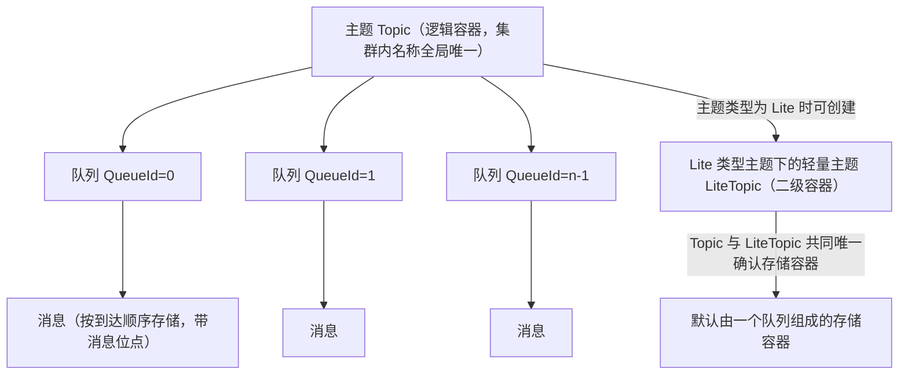
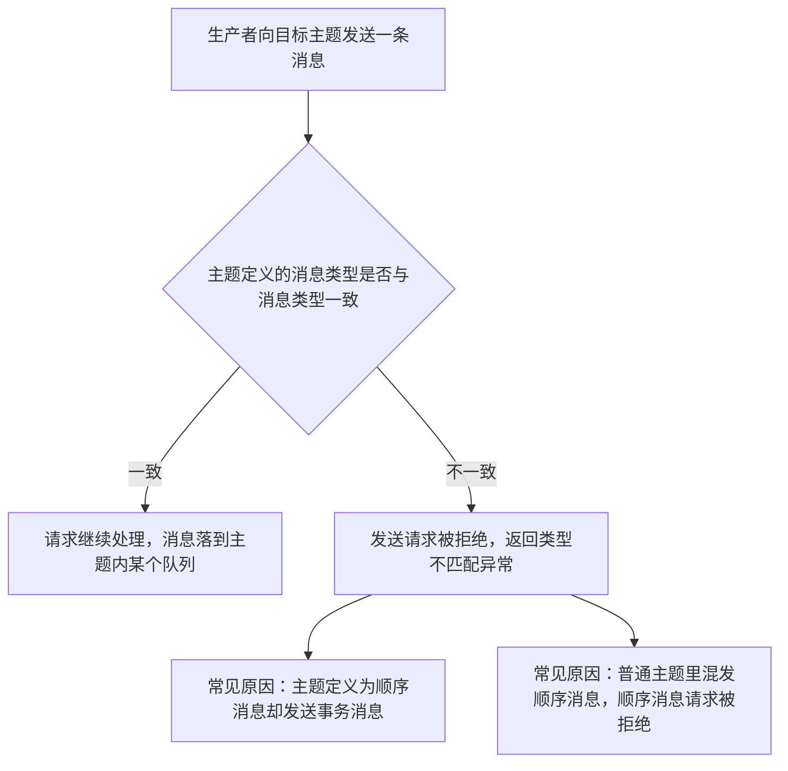
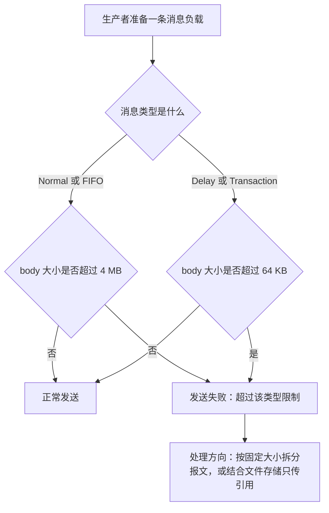

## 为什么需要主题、队列与消息模型？（痛点引入）

「消息往哪儿放、怎么放、放多大」这三件事，决定了 RocketMQ 集群是好事还是灾难。真实项目里最常见的四个事故现场：

1. **一个主题装所有**：交易、物流、积分消息全塞进 `TRADE_TOPIC`。结果物流下游想按类型过滤却拿不到干净数据，运维想做独立限流却无从下手，一个业务的堆积把别人的消费进度一起拖死。
2. **每个用户一个主题**：为了「隔离」按用户 ID 建了八万个主题，管控元数据暴涨，集群元数据加载变慢，最后没人敢删。
3. **顺序错乱**：把顺序消息和普通消息混发到同一个主题，5.0 直接返回类型不匹配异常；而在历史版本里，混发不会报错，只会在线上表现为「同一订单的消息乱序」。
4. **超大报文**：把 8 MB 的图片 Base64 塞进消息体，发送直接失败；换成事务消息后按 64 KB 的限制更是早早撞墙，业务侧完全没有兜底。

| 维度 | 不理解这三层结构时的痛苦 | 理解之后的做法 |
|------|--------------------------|----------------|
| 隔离设计 | 用「改代码」给新业务让路，主题越堆越乱 | 主题做一级隔离、LiteTopic 做二级隔离、Tag 与属性做过滤 |
| 扩容设计 | 加机器不知道有没有用，吞吐仍上不去 | 改队列数量实现水平扩缩容；队列数按「少用够用」设置 |
| 顺序保证 | 以为「发出去的顺序」等于「消费顺序」 | 顺序性在队列内生效，用 MessageGroup 标记需要保序的一组消息 |
| 回溯能力 | 消费错了只能等数据重新产生 | 队列是流式存储，任意位点可读取任意数量消息 |
| 报文设计 | 大对象直接塞消息体，发送随机失败 | 按消息类型的大小限制提前拆分或改走文件存储 |

> ### 💡 新人小结：主题、队列、消息到底是什么关系？
>
> 把这套结构想象成「快递驿站的三层物理结构」：
> - 主题（Topic）= 驿站墙上的**分区牌**（「淘系件区」），它是逻辑归类，本身不装包裹。
> - 队列（MessageQueue）= 分区牌下面的**传送带**，包裹真正落在传送带上；带子越长越多，吞吐越高。
> - 消息（Message）= 一个个**密封包裹**：里面是负载（body），外面贴着面单（Topic、消息 ID、位点、Tag、Key、属性）。
> - 位点（Offset）= 传送带上的**刻度**，记录包裹落在第几格；消费进度就是「我读到第几格了」。
>
> **一句话：主题负责身份与隔离，队列负责存储与扩展，消息负责承载不可变的事实。**

**学习路线图**（本文按四个对象逐个走完「定义 → 内部属性 → 行为约束 → 版本兼容性 → 使用建议」五层）

```
Topic 五层 → LiteTopic 五层 → MessageQueue 五层 → Message 与 MessageView → 选型与排查
一级隔离     二级隔离           实际存储与扩展        承载与限制              谁承担什么
```

---

## 主题（Topic）：五层拆解

### 定义

主题是 Apache RocketMQ 中消息传输和存储的顶层容器，用于标识同一类业务逻辑的消息。主题的作用主要有两个：

- **定义数据的分类隔离**：在 RocketMQ 的方案设计中，建议将不同业务类型的数据拆分到不同的主题中管理，通过主题实现存储的隔离性和订阅隔离性。
- **定义数据的身份和权限**：RocketMQ 的消息本身是匿名无身份的，同一分类的消息使用相同的主题来做身份识别和权限管理。

### 模型关系

在整个 RocketMQ 的领域模型中，主题所处的流程和位置如下：


主题是 RocketMQ 的顶层存储，所有消息资源的定义都在主题内部完成，但**主题是一个逻辑概念，并不是实际的消息容器**。主题内部由多个队列组成，消息的存储和水平扩展能力最终是由队列实现的；针对主题的所有约束和属性设置，最终也是通过主题内部的队列来实现。

下图是主题、轻量主题、队列与消息四者的层级关系（Lite 类型主题才存在二级容器）：



图后解读：普通主题的直接组成单元是队列，一个主题内包含一个或多个队列；当主题类型为 Lite 时，可以在主题之下创建轻量主题，由 Topic 和 LiteTopic **共同**唯一确认消息的存储容器，且每个这样的存储容器默认由一个队列组成。

### 内部属性

| 属性 | 定义 | 取值 | 约束 |
|------|------|------|------|
| 主题名称 | 主题的名称，用于标识主题，主题名称集群内全局唯一 | 由用户创建主题时定义 | 字符与长度限制见下表（上游参数约束表） |
| 队列列表 | 队列作为主题的组成单元，是消息存储的实际容器；一个主题内包含一个或多个队列，消息实际存储在主题的各队列内 | 系统根据队列数量给主题分配队列，队列数量创建主题时定义 | 一个主题内至少包含一个队列 |
| 消息类型 | 主题所支持的消息类型 | 创建主题时选择消息类型：Normal / FIFO / Delay / Transaction（Lite 类型见下一节） | 5.0 起每个主题只允许发送一种消息类型的消息，强制校验功能默认开启 |

主题名称的硬约束（照上游「参数约束和建议」表逐条列出）：

| 约束项 | 上游给出的取值范围 |
|--------|--------------------|
| 允许字符 | 字母 a~z 或 A~Z、数字 0~9，以及下划线（_）、短划线（-）和百分号（%） |
| 长度 | 1~64 个字符 |
| 系统保留字符（不允许使用） | TBW102、BenchmarkTest、SELF_TEST_TOPIC、OFFSET_MOVED_EVENT、SCHEDULE_TOPIC_XXXX、RMQ_SYS_TRANS_HALF_TOPIC、RMQ_SYS_TRACE_TOPIC、RMQ_SYS_TRANS_OP_HALF_TOPIC |
| 特殊前缀（不允许使用） | rmq_sys_、%RETRY%_、%DLQ%_、rocketmq-broker- |
| 官方建议 | 命名尽量使用简短、常用的字符，避免使用特殊字符：特殊字符会导致系统解析出现异常，字符过长可能会导致消息收发被拒绝 |

主题支持的消息类型及其语义：

| 消息类型 | 对应消息 | 语义（上游原文口径） | 该类型消息的大小限制 |
|----------|----------|----------------------|----------------------|
| Normal | 普通消息 | 消息本身无特殊语义，消息之间也没有任何关联 | 4 MB |
| FIFO | 顺序消息 | 通过消息分组 MessageGroup 标记一组特定消息的先后顺序，可保证投递顺序严格按发送顺序 | 4 MB |
| Delay | 定时/延时消息 | 通过指定延时时间控制消息生产后不要立即投递，而是在延时间隔后才对消费者可见 | 64 KB |
| Transaction | 事务消息 | 支持分布式事务消息，支持应用数据库更新和消息调用的事务一致性保障 | 64 KB |

上表是上游「主题（Topic）」篇列出的**消息类型**全集。此外 5.0 还有「**Lite 类型的主题**」这一主题形态：主题为 Lite 类型时可在其下创建轻量主题（LiteTopic），用于同一业务下不同子类粒度的隔离；上游未针对 Lite 单独给出消息大小限制，因此按其负载所属消息类型的限制执行。两者的关系见下一节。

### 行为约束

RocketMQ 5.x 版本支持将消息类型拆分到主题中进行独立运维和处理，因此系统会对发送的消息类型和主题定义的消息类型进行**强制校验**，校验不通过则消息发送请求会被拒绝，并返回类型不匹配异常。校验原则有两条：

- **消息类型必须一致**：发送的消息的类型，必须和目标主题定义的消息类型一致。
- **主题类型必须单一**：每个主题只支持一种消息类型，不允许将多种类型的消息发送到同一个主题中。

下图是这条约束的判定流程：



上游给出的两个典型错误场景，逐条对应上图：

| 错误场景 | 上游描述 | 结果 |
|----------|----------|------|
| 发送的消息类型不匹配 | 创建主题时消息类型定义为顺序消息，发送消息时发送事务消息到该主题中 | 消息发送请求被拒绝，并返回类型不匹配异常 |
| 单一消息主题混用 | 创建主题时消息类型定义为普通消息，发送消息时同时发送普通消息和顺序消息到该主题中 | 顺序消息的发送请求被拒绝，并返回类型不匹配异常 |

> [!NOTE] 版本适用：强制校验只在 5.x 服务端存在
> 消息类型的强制校验，仅 RocketMQ 服务端 5.x 版本支持，且**默认开启**，推荐部署时打开配置。
> RocketMQ 服务端 4.x 和 3.x 历史版本的 SDK 不支持强制校验，您需要自己保证消息类型一致；如果使用的服务端版本为历史版本，建议升级到 RocketMQ 服务端 5.x 版本。

### 版本兼容性

| 对比维度 | 服务端 4.x / 3.x 历史版本 | 服务端 5.x |
|----------|--------------------------|------------|
| 消息类型强制校验 | 不支持，需要业务自己保证消息类型一致 | 支持，且默认开启 |
| 同一主题混用多种类型 | 不报错，风险留在线上（不同消息类型需使用不同主题，避免运维过程中的风险和错误） | 直接拒绝并返回类型不匹配异常 |
| 创建主题时声明类型 | 由业务约定保证 | 通过主题属性参数声明，见下方 `mqadmin` 示例 |
| 官方建议 | 升级到 5.x 服务端 | 部署时保持强制校验开启 |

### 使用示例

RocketMQ 5.0 版本下创建主题操作推荐使用 `mqadmin` 工具，需要注意的是，对于消息类型需要通过属性参数添加：

```shell
# ========== ✅ 推荐写法：显式声明主题的消息类型 ==========
sh mqadmin updateTopic -n <nameserver_address> -t <topic_name> -c <cluster_name> -a +message.type=<message_type>

# message_type 按消息类型设置为 Normal / FIFO / Delay / Transaction
# 输出: 上游未给出该命令的标准输出样例，本文不编造；可核对的行为是
#       主题按声明类型创建后，向它发送其它类型的消息会被拒绝并返回类型不匹配异常

# ========== 不推荐写法（仅展示） ==========
# ❌ 一个主题里既发普通消息又发顺序消息：顺序消息的发送请求会被拒绝并返回类型不匹配异常
# ❌ 把 message_type 当成「注释」不填，指望运行期自己区分类型：不设置时默认就是 Normal 类型
```

参数解释：

| 参数 | 含义 | 备注 |
|------|------|------|
| `-n` | NameServer 地址 | 上游示例为占位符 `<nameserver_address>` |
| `-t` | 主题名称 | 需符合上文 1~64 字符、允许字符与保留字符的规则 |
| `-c` | 集群名称 | 上游示例为占位符 `<cluster_name>` |
| `-a +message.type=<message_type>` | 以属性参数方式追加主题的消息类型 | 不设置时主题为 Normal 类型；这是上游明确「消息类型需要通过属性参数添加」的那一项 |

### 使用建议

**按业务分类合理拆分主题。** RocketMQ 的主题拆分设计应遵循大类统一原则，即将相同业务域内同一功能属性的消息划分为同一主题。拆分粒度可以从三个角度考虑：

| 判据 | 上游要求 | 正确做法 |
|------|----------|----------|
| 消息类型是否一致 | 不同类型的消息，如顺序消息和普通消息需要使用不同的主题 | 顺序类与普通类各自建主题 |
| 消息业务是否关联 | 业务没有直接关联要用不同主题（淘宝交易消息与盒马物流消息）；同属淘宝交易的女装订单与男装订单可用同一主题 | 一级按业务域，二级用 Tag 或属性 |
| 消息量级是否一样 | 数量级不同或时效性不同的业务消息建议使用不同主题：消息量很小但时效性要求很强的业务，与万亿级消息量的业务同主题会增加消息等待时长 | 小流量高时效业务单独建主题 |

- **正确拆分示例**（上游原文场景）：线上商品购买场景下，订单交易如订单创建、支付、取消等流程消息使用一个主题，物流相关消息使用一个主题，积分管理相关消息使用一个主题。
- **错误拆分示例**：
  - 拆分粒度过粗：会导致业务隔离性差，不利于独立运维和故障处理。例如所有交易消息和物流消息都共用一个主题。
  - 拆分粒度过细：会消耗大量主题资源，造成系统负载过重。例如按照用户 ID 区分，每个用户 ID 使用一个主题。

**单一主题只收发一种类型消息，避免混用。** 主题的设计原则是通过主题隔离业务，不同业务逻辑的消息建议使用不同的主题；同一业务逻辑消息的类型都相同，因此对于指定主题，应该只收发同一种类型的消息。

**主题管理尽量避免自动化机制。** 在 RocketMQ 架构中，主题属于顶层资源和容器，拥有独立的权限管理、可观测性指标采集和监控等能力，创建和管理主题会占用一定的系统资源，因此生产环境需要严格管理主题资源，请勿随意进行增、删、改、查操作。RocketMQ 虽然提供了自动创建主题的功能，但建议仅在测试环境使用，生产环境请勿打开，避免产生大量垃圾主题、无法管理和回收并浪费系统资源。

---

## 轻量主题（LiteTopic）：五层拆解

### 定义

轻量主题是 RocketMQ 中消息传输和存储的**二级容器**，用于标识同一类业务逻辑下不同子类（例如不同会话、任务等粒度）的消息。作用有两个：

- **实现排他性消费，定义数据的二级隔离**：建议将不同子类的数据拆分到不同的轻量主题中管理，通过轻量主题实现更细致的存储隔离性和订阅隔离性。
- **定义数据的身份和权限**：在基于主题的身份识别和权限管理基础上，可以通过轻量主题进一步细分用户的身份与权限。

### 模型关系

- 主题是消息传输和存储的顶层容器。当类型为 Lite 类型时，Topic 下可创建轻量主题（LiteTopic），由 Topic 和 LiteTopic **共同**唯一确认消息的存储容器。
- 当类型为 Lite 类型时，每个存储容器默认由一个队列组成。

### 内部属性

| 属性 | 定义 | 取值 | 约束 |
|------|------|------|------|
| 轻量主题名称 | 轻量主题的名称，用于标识轻量主题，名称在**所属主题内**全局唯一 | 当主题类型为 Lite 时，用户对 message 进行了 setLiteTopic，如对应的轻量主题不存在，系统会自动创建 | 上游指向「参数限制」条目，本文不重复推测具体长度值 |
| 过期时间 expiration | 当轻量主题距离最近一次消息写入时间超过过期时间后，该轻量主题会被自动删除。删除是指释放轻量主题占用的个数，即占用总数 -1 | 当创建主题类型为 Lite 时，可以设置 expiration 值 | 同上，具体取值范围见上游参数限制条目 |

```java
// ========== ✅ 推荐写法：Lite 类型主题下用 setLiteTopic 指定二级容器 ==========
Message message = messageBuilder.setTopic("AgentSessionTopic")
    // 方法名 setLiteTopic 与「主题类型为 Lite 时由用户设置」的语义均照上游 03-domainModel/03litetopic.md
    .setLiteTopic("session-2026-1001") // 该轻量主题不存在时，系统会自动创建
    .setBody("delta payload".getBytes()) // 消息负载由生产者负责序列化编码，按二进制字节传输
    .build();
// 输出: 消息写入 AgentSessionTopic 下名为 session-2026-1001 的轻量主题；
//       该容器默认由一个队列组成，容器内消息顺序存储。

// ========== 不推荐写法（仅展示） ==========
// ❌ 主题类型不是 Lite 时，指望用 setLiteTopic 自动获得二级容器：
//    上游只描述了「主题类型为 Lite 时」的行为，非 Lite 主题没有二级容器（普通类型主题为「无二级主题资源」）
// ❌ 忘记设置 expiration，把 LiteTopic 当普通主题长期累积：
//    轻量主题的自动删除依赖 expiration（持续无新消息发送后自动删除），未设置时无法回收
```

参数解释：`setTopic` 指定顶层容器（必填），`setLiteTopic` 指定二级容器名（主题为 Lite 类型时生效），`setBody` 传入按二进制字节传输的业务报文。上游未给出 Lite 类型主题的完整创建命令与 expiration 的参数名清单，本文只按已给出的事实描述：创建 Lite 类型主题时可设置 expiration 值。

### 版本兼容性

- 服务端版本：**5.5.0 版本及以上**。
- 客户端版本：**RocketMQ gRPC 5.1.0 版本及以上**。

> [!NOTE] 版本适用：LiteTopic 是「双端版本都要够」的能力
> 只升级服务端不升级 gRPC 客户端，或只换客户端不动服务端，都无法使用轻量主题；这与消息类型强制校验（只需服务端 5.x）不同。

### 轻量类型主题与普通类型主题的差异（上游专节，逐行保留）

| 场景 | 对比项 | 轻量类型主题 | 普通类型主题 |
|------|--------|--------------|--------------|
| 消息存储 | 一级主题 | 相同。都需要预先创建主题资源。 | 相同。都需要预先创建主题资源。 |
| 消息存储 | 二级主题 | 可以在 Topic 下创建百万量级的二级主题资源 LiteTopic，该二级资源有许多新特性。 | 无二级主题资源。 |
| 消息存储 | 自动化生命周期管理 | 二级主题 LiteTopic 的生命周期可以自动化管理：自动创建（发送或订阅时如不存在则自动创建）；自动删除（设置 expiration 时间，持续无新消息发送后会自动删除）。 | 无 |
| 消息存储 | 顺序性 | 每个 LiteTopic 只创建一个队列，同一个队列中的消息存储是顺序的。 | 会创建多个队列，只有分区顺序 Topic。 |
| 消息存储 | 收发并发 TPS 上限 | 由于只有一个队列，每个 LiteTopic 的 TPS 上限是有限的。但 Topic 下可以创建百万量级的 LiteTopic，总 TPS 的上限可以根据 LiteTopic 的增加而增加。 | Topic 的 TPS 可以根据队列数量和集群机器节点数量横向扩容。 |
| 消息消费 | 订阅关系一致性 | 可以不一致。同一 Group 下，每个消费者可订阅不同的 LiteTopic 集合，Group 的限制弱化。 | 需要一致。同一 Group 下，每个消费者的订阅关系需要保持一致，共享目标主题下的消息。 |
| 消息消费 | 顺序性 | 顺序消费，一个 LiteTopic 下的消息只能被一个消费者线程处理。 | 可选择并发消费或顺序消费。 |
| 消息消费 | 动态订阅 | 每个消费者可以动态增加或删除指定某个 LiteTopic 的订阅。 | 无 |
| 消息消费 | 单个消费者可以订阅的 LiteTopic 的数量 | 每个消费者可以订阅千量级的 LiteTopic。 | 无 |
| 可观测 | Metrics 指标数据 | 有消息堆积量指标，无消息处理滞后时间指标。 | 有消息堆积量指标，有消息处理滞后时间指标。 |
| 可观测 | 消息轨迹 | 相同 | 相同 |

### 使用建议（由差异表可直接读出的选型判据）

| 你的诉求 | 该选哪种容器 | 依据（差异表中的行） |
|----------|--------------|----------------------|
| 会话、任务、单智能体这类「子类粒度」的排他消费 | Lite 类型主题 + LiteTopic | 二级主题、自动化生命周期管理、订阅关系可不一致、动态订阅 |
| 高吞吐且需要横向扩容的业务主题 | 普通类型主题 | 一级主题的 TPS 可根据队列数量和集群节点数横向扩容 |
| 强依赖「消息处理滞后时间」指标做告警 | 普通类型主题 | 轻量类型主题无消息处理滞后时间指标 |
| 需要并发消费提升吞吐 | 普通类型主题 | 轻量类型主题下同一 LiteTopic 的消息只能被一个消费者线程处理 |
| 主题数量会随业务子类爆炸（十万到百万级） | Lite 类型主题 | 可在 Topic 下创建百万量级 LiteTopic，且可自动创建、自动删除 |

> ### 💡 新人小结：LiteTopic 与普通 Topic 的区别像什么？
>
> 把普通主题想成「驿站按业务设的固定货架」，LiteTopic 就是「货架上按住户临时开的小格口」：
> - 小格口**用得着就自动开**（发送或订阅时不存在则自动创建）。
> - **长期不用就自动收走**（超过 expiration 无新消息写入即删除，占用总数 -1）。
> - 每个小格口只有**一条迷你传送带**（一个队列），单格口吞吐有限，但格口够多，总量随格口数增长。
> - 取件规则**各家可以不一样**（同组内订阅不同 LiteTopic 集合，Group 的一致性限制被弱化）。
>
> **普通主题的格口是钉死的，LiteTopic 的格口是活的——这就是它一切差异的根因。**

---

## 队列（MessageQueue）：五层拆解

### 定义

队列是 RocketMQ 中消息存储和传输的实际容器，也是 RocketMQ 消息的最小存储单元。所有主题都是由多个队列组成，以此实现队列数量的水平拆分和队列内部的流式存储。队列通过 QueueId 来做唯一标识和区分。

队列的两个核心作用：

- **存储顺序性**：队列天然具备顺序性，即消息按照进入队列的顺序写入存储，同一队列间的消息天然存在顺序关系，队列头部为最早写入的消息，队列尾部为最新写入的消息。消息在队列中的位置和消息之间的顺序通过位点（Offset）进行标记管理。
- **流式操作语义**：RocketMQ 基于队列的存储模型可确保消息从任意位点读取任意数量的消息，以此实现类似聚合读取、回溯读取等特性；这些特性是 RabbitMQ、ActiveMQ 等非队列存储模型不具备的。

### 模型关系

在整个 RocketMQ 的领域模型中，队列所处的流程和位置如下：


RocketMQ 默认提供消息可靠存储机制，所有发送成功的消息都被持久化存储到队列中，配合生产者和消费者客户端的调用可实现至少投递一次的可靠性语义。RocketMQ 队列模型和 Kafka 的分区（Partition）模型类似：在消息收发模型中，队列属于主题的一部分，虽然所有的消息资源以主题粒度管理，但**实际的操作实现是面向队列**——例如生产者指定某个主题、向主题发送消息，实际消息发送到的是该主题下的某个队列中。RocketMQ 中通过修改队列数量，以此实现横向的水平扩容和缩容。

4.x 文档对同一结构的补充（含位点口径），可与上图对照：


| 概念 | 含义（4.x 基本概念文档口径） | 与 5.0 队列模型的关系 |
|------|------------------------------|----------------------|
| 分区 | 为支持高并发和水平扩展，需要对 Topic 进行分区，在 RocketMQ 中这被称为队列；一个 Topic 可能有多个队列，并且可能分布在不同的 Broker 上 | 5.0 沿用「队列 = 实际存储单元」，并明确可通过修改队列数量水平扩缩容 |
| 单队列归属 | 如果没有重复发送（比如因为服务端没有响应而进行重试），一条消息只会存在于 Topic 的其中一个队列中 | 对应 5.0 中「消息按到达服务端的先后顺序存储在指定主题的多个队列中」 |
| MaxOffset | 每个队列会统计当前消息的总条数，称为最大位点 | 与 5.0 的消息位点（MessageQueueOffset）同一坐标轴的上界口径 |
| MinOffset | 队列起始位置对应的位置叫做起始位点 | 决定可回溯的下界 |
| 并发作用 | 队列可以提升消息发送和消费的并发度 | 与 5.0「队列数量的水平拆分」一致 |

### 内部属性

队列的内部属性是**读写权限**：表示当前队列是否可以读写数据，由服务端定义。

| 枚举值 | 状态 | 允许读 | 允许写 | 说明 |
|--------|------|--------|--------|------|
| 6 | 读写状态 | 是 | 是 | 当前队列允许读取消息和写入消息 |
| 4 | 只读状态 | 是 | 否 | 当前队列只允许读取消息，不允许写入消息 |
| 2 | 只写状态 | 否 | 是 | 当前队列只允许写入消息，不允许读取消息 |
| 0 | 不可读写状态 | 否 | 否 | 当前队列不允许读取消息和写入消息 |

约束：队列的读写权限属于**运维侧操作，不建议频繁修改**。按枚举语义可以直接读出每个值的含义：4（只读）表示存量消息仍可被读走、但不再接受写入；0 表示完全关闭。上游只给到「由服务端定义、属运维侧操作、不建议频繁修改」这一层，具体何时切换由集群运维流程决定。

### 行为约束

每个主题下会由一到多个队列来存储消息，**每个主题对应的队列数与消息类型以及实例所处地域（Region）相关**。也就是说：队列数量不是「越大越好」的调优旋钮，而是由消息类型与地域共同决定的资源属性。

### 版本兼容性

队列的名称属性在 RocketMQ 服务端的不同版本中有如下差异：

| 对比维度 | 服务端 3.x / 4.x | 服务端 5.x |
|----------|------------------|------------|
| 队列名称构成 | 由 {主题名称} + {BrokerID} + {QueueID} 三元组组成 | 一个集群分配的全局唯一的字符串 |
| 与物理节点的关系 | 和物理节点绑定 | 和物理节点解耦 |
| 客户端自行拼接队列名的后果 | 当时可行 | 一旦服务端版本升级，可能出现队列名称无法解析的兼容性问题 |

因此，在开发过程中，建议**不要对队列名称做任何假设和绑定**。如果你在代码中自定义拼接队列名称并和其他操作进行绑定，一旦服务端版本升级，可能会出现队列名称无法解析的兼容性问题。

```java
// ========== ✅ 推荐写法：对队列名称零假设，只使用服务端下发的队列对象 ==========
// 队列对象由服务端分配并随路由信息下发，业务侧只把它当作「一个可读写的数据流标识」使用：
//   不解析名称结构、不依赖 {主题名称}+{BrokerID}+{QueueID} 的三元组做路由或幂等键
// 输出: 服务端从 3.x/4.x 升级到 5.x（队列名称改为集群分配的全局唯一字符串）后，这类代码无需改动

// ========== ❌ 不推荐写法（仅展示） ==========
// String myQueueName = topic + "+" + brokerName + "+" + 0; // 自行拼接队列名称
// // ...再把该字符串用于路由、去重或与其他操作绑定
// 输出: 5.x 的队列名称是与物理节点解耦的全局唯一字符串，上述拼接与解析逻辑失效（可能出现队列名称无法解析的兼容性问题）
```

### 使用建议

**按照实际业务消耗设置队列数。** 队列数可在创建主题或变更主题时设置修改，队列数量的设置应遵循**少用够用**原则，避免随意增加队列数量。主题内队列数过多可能导致如下问题：

| 问题 | 成因（上游口径） |
|------|------------------|
| 集群元数据膨胀 | RocketMQ 会以队列粒度采集指标和监控数据，队列过多容易造成管控元数据膨胀 |
| 客户端压力过大 | RocketMQ 的消息读写都是针对队列进行操作，队列过多对应更多的轮询请求，增加系统负荷 |

**常见队列增加场景**（这两类才是该加队列的理由）：

- 需要增加队列实现物理节点负载均衡：每个主题的多个队列可以分布在不同的服务节点上，在集群水平扩容增加节点后，为保证集群流量的负载均衡，建议在新的服务节点上新增队列，或将旧的队列迁移到新的服务节点上。
- 需要增加队列实现顺序消息性能扩展：在 RocketMQ 服务端 **4.x 版本**中，顺序消息的顺序性在队列内生效，因此顺序消息的并发度会在一定程度上受队列数量的影响，建议仅在系统性能瓶颈时再增加队列。

> [!NOTE] 版本适用：顺序消息与队列数量的关系
> 「顺序性在队列内生效、顺序消息并发度受队列数量影响」这一表述来自 4.x 与服务端 4.x 版本语境；LiteTopic 的表述是「每个 LiteTopic 只创建一个队列，同一个队列中的消息存储是顺序的」。两者都在讲「队列是顺序性的作用域」，普通类型主题则是「会创建多个队列，只有分区顺序 Topic」。

---

## 消息（Message）与消息视图（MessageView）：五层拆解

### 定义

消息是 RocketMQ 中的最小数据传输单元。生产者将业务数据的负载和拓展属性包装成消息发送到服务端，服务端按照相关语义将消息投递到消费端进行消费。RocketMQ 的消息模型具备两个特点：

- **消息不可变性**：消息本质上是已经产生并确定的事件，一旦产生后，消息的内容不会发生改变；即使经过传输链路的控制也不会发生变化，消费端获取的消息都是**只读消息视图**。
- **消息持久化**：RocketMQ 会默认对消息进行持久化，即将接收到的消息存储到服务端的存储文件中，保证消息的可回溯性和系统故障场景下的可恢复性。

### 模型关系

消息在领域模型中的位置与流转（下图与队列章节同图，重点是消息落在队列里的哪一段）：


1. 消息由生产者初始化并发送到服务端。
2. 消息按照到达服务端的顺序存储到队列中。
3. 消费者按照指定的订阅关系从服务端中获取消息并消费。

4.x 文档给出的消息构成图可与 5.0 的属性表对照——一张贴了面单的包裹：


### 消息内部属性

**系统保留属性**（逐条来自 5.0 消息篇，取值方为「客户端 SDK 接口」「生产者客户端定义」「服务端填充」三类）：

| 属性 | 定义 | 取值 | 约束／说明 |
|------|------|------|------------|
| 主题名称 | 当前消息所属主题的名称，集群内全局唯一 | 从客户端 SDK 接口获取 | 必填语义（消息必须知道自己属于哪个主题） |
| 消息类型 | 当前消息的类型 | 从客户端 SDK 接口获取：Normal / FIFO / Delay / Transaction | 必须与目标主题定义的消息类型一致（5.x 强制校验） |
| 消息队列 | 实际存储当前消息的队列 | 由服务端指定并填充 | 客户端不指定具体队列 |
| 消息位点 | 当前消息存储在队列中的位置 | 由服务端指定并填充 | 取值范围：0~long.Max |
| 消息 ID | 消息的唯一标识，集群内每条消息的 ID 全局唯一 | 生产者客户端系统自动生成 | 固定为数字和大写字母组成的 32 位字符串 |
| 索引 Key 列表（可选） | 消息的索引键，可通过设置不同的 Key 区分消息和快速查找消息 | 由生产者客户端定义 | 4.x 补充口径：Broker 端会为每个消息创建索引（哈希索引），可通过 topic、key 查询消息；由于是哈希索引，请尽可能保证 key 唯一，例如订单号、商品 ID |
| 过滤标签 Tag（可选） | 消息的过滤标签，消费者可通过 Tag 对消息进行过滤，仅接收指定标签的消息 | 由生产者客户端定义 | 一条消息仅支持设置一个标签；Tag 使用可见字符，建议长度不超过 128 字符 |
| 定时时间（可选） | 定时场景下，消息触发延时投递的毫秒级时间戳 | 由消息生产者定义 | 最大可设置定时时长为 40 天 |
| 消息发送时间 | 消息发送时，生产者客户端系统的本地毫秒级时间戳 | 由生产者客户端系统填充 | 客户端系统时钟和服务端系统时钟可能存在偏差，消息发送时间以**客户端**系统时钟为准 |
| 消息保存时间戳 | 消息在服务端完成存储时，服务端系统的本地毫秒级时间戳；对于定时消息和事务消息，消息保存时间指的是消息生效对消费方可见的服务端系统时间 | 由服务端系统填充 | 客户端与服务端时钟可能存在偏差，消息保留时间以**服务端**系统时钟为准 |
| 消费重试次数 | 消息消费失败后，服务端重新投递的次数；每次重试后，重试次数加 1 | 由服务端系统标记 | 首次消费，重试次数为 0；消费失败首次重试时，重试次数为 1 |
| 业务自定义属性 | 生产者可以自定义设置的扩展信息 | 由消息生产者自定义，按照字符串键值对设置 | 上游参数约束：属性 Key 和 Value 总长度不超过 16 KB；所有可见字符；不允许使用系统保留属性 Key |
| 消息负载 | 业务消息的实际报文数据 | 由生产者负责序列化编码，按照二进制字节传输 | 大小限制见下文「行为约束」；4.x 补充：body 表示消息的存储内容 |

> ### 💡 新人小结：属性、Tag、Key、负载分别对应包裹上的什么？
>
> - **负载（body）**：包裹里的东西，服务端不看内容，只负责搬运和存储。
> - **Tag**：面单上的「品类章」，一条消息只能盖一个章（上游：一条消息仅支持设置一个标签）。
> - **Key**：面单上的「单号」，服务端据此建哈希索引，事后能反查这条消息。
> - **自定义属性**：面单上的自选栏（地域、优先级…），可以有多条 Key-Value，SQL92 过滤读的就是它们。
> - **消息位点／消息 ID**：驿站自己写上的「第几格」和「全局唯一编号」，都不是你填的。
>
> **只有你填的东西会影响路由和过滤，服务端填的东西只用来查问题。**

### 行为约束

消息大小不得超过其类型所对应的限制，否则**消息会发送失败**。系统默认的消息最大限制如下：

| 消息类型 | 默认最大限制 | 上游补充口径 |
|----------|--------------|--------------|
| 普通消息、顺序消息 | 4 MB | 消息大小默认不超过 4 MB：不涉及消息压缩，仅计算消息体 body 的大小；建议不超过 4 MB |
| 事务消息、定时或延时消息 | 64 KB | 超限即发送失败，业务侧需提前兜底 |



上图后要点：限制的判定对象是**消息体 body 的大小**（不涉及压缩），所以「属性写很长、body 很短」不会撞到这两条限制；但自定义属性另有约束（Key 和 Value 总长度不超过 16 KB）。

Tag 与 Key、属性的设置写法（示例结构照上游消息过滤文档的构建代码）：

```java
// ========== ✅ 推荐写法：一条消息一个 Tag + 可检索 Key + 用于 SQL92 过滤的自定义属性 ==========
Message message = messageBuilder.setTopic("topic")
    .setKeys("messageKey")               // 设置消息索引键，可根据关键字精确查找某条消息
    .setTag("TagA")                      // 设置消息 Tag：一条消息仅支持设置一个标签
    .addProperty("Region", "Hangzhou")   // 自定义分类属性，例如环境标签、地域、逻辑分支
    .setBody("messageBody".getBytes())   // 消息负载：由生产者序列化编码，按二进制字节传输
    .build();
// 输出: 消费端订阅 "TagA" 时可命中该消息；订阅 "TagB" 或 "TagA||TagB" 之外的表达式时不会命中
//       消费端按 SQL92 过滤时，可用表达式 Region IS NOT NULL AND Region='Hangzhou'

// ========== 不推荐写法（仅展示） ==========
// ❌ 试图给一条消息设置多个 Tag 做「多分类」：上游约束是「一条消息仅支持设置一个标签」
// ❌ 用 Tag 去区分消息类型（普通／顺序／事务）：不同类型消息必须使用不同主题，无法通过 Tag 分类
// ❌ 把大对象序列化进 body 再指望压缩过关：限制只算 body 大小且不涉及压缩
```

参数解释：`setTag` 决定 Tag 过滤能否命中（Tag 过滤为精准字符串匹配，多 Tag 用两个竖线隔开表示或关系，星号表示全匹配）；`addProperty` 写入的是字符串键值对，SQL92 过滤读取的正是这些属性；`setKeys` 写入的是索引键，用于事后按 topic + key 查消息。

### 版本兼容性：Message 与 MessageView

| 对比维度 | 消息 Message（发送与存储阶段） | 消息视图 MessageView（消费交付阶段） |
|----------|-------------------------------|--------------------------------------|
| 定位 | RocketMQ 中的最小数据传输单元 | 面向开发视角提供的一种消息**只读**接口 |
| 能否修改内容 | 5.x：消息本身不可编辑；3.x/4.x：不可变性没有强约束 | 不能对消息本身做任何修改 |
| 能读到什么 | 全部属性与负载（由生产者构造） | 可以读取消息内部的多个属性和负载信息 |
| 谁产生 | 生产者客户端构造并发送 | 服务端存储完成后向消费端交付 |
| 中转（转发）时的正确做法 | 必须重新初始化新消息 | 直接把视图当可变对象复用属于错误用法 |

> [!NOTE] 版本适用：不可变性的强制程度按版本不同
> RocketMQ 服务端 5.x 版本中，消息本身不可编辑，消费端获取的消息都是只读消息视图；但在历史版本 3.x 和 4.x 版本中，消息不可变性没有强约束，因此如果你需要在使用过程中对消息进行中转操作，务必将消息**重新初始化**。

### 使用建议

**单条消息不建议传输超大负载。** 作为消息中间件产品，RocketMQ 一般传输的是业务事件数据，单个原子消息事件的数据大小需要严格控制：如果单条消息过大容易造成网络传输层压力，不利于异常重试和流量控制。生产环境中如果需要传输超大负载，建议按照固定大小做报文拆分，或者结合文件存储等方法进行传输。

**消息中转时做好不可变设计。** 上游给出的正确与错误用法：

```java
// ========== ✅ 正确使用示例：中转时重新初始化一个新消息 ==========
Message m = Consumer.receive();               // 收到的是只读的消息内容
Message m2 = MessageBuilder.buildFrom(m);     // 基于原消息重新构建一条新消息
Producer.send(m2);                            // 发送新消息，原消息保持不变
// 输出: 两份消息内容一致但对象独立，下游不会读到被中途篡改的报文

// ========== 典型错误使用示例（仅展示）：直接改已接收的消息再发送 ==========
// ❌ 3.x / 4.x 历史版本下消息不可变性没有强约束，这种写法会把污染带到下游
// Message m = Consumer.receive();
// m.update();
// Producer.send(m);
```

参数解释：`Consumer.receive()` 取回消息（在 5.x 消费端语义下即只读视图）；`MessageBuilder.buildFrom(m)` 是上游示例给出的「以原消息为模板重新构造」的写法名；`update()` 属于上游用来表达「不应修改消息」的示意方法，本文不对应任何具体 SDK 签名做推定。

---

## 三者如何分工：一级隔离、二级隔离与过滤

| 拆分维度 | 承载对象 | 解决什么问题 | 代价 |
|----------|----------|--------------|------|
| 一级分类 | 主题 Topic | 业务域隔离、身份与权限、按类型独立运维（消息类型必须与主题一致） | 主题属顶层资源，创建与管理占用系统资源，需严格管理 |
| 二级分类 | 轻量主题 LiteTopic | 同一业务下会话/任务粒度的排他消费、细粒度身份权限 | 单容器只有一个队列，单容器 TPS 有限；无消息处理滞后时间指标；需服务端 5.5.0+ 与 gRPC 客户端 5.1.0+ |
| 水平扩展 | 队列 MessageQueue | 存储与并发能力扩展、顺序性的作用域 | 队列过多导致元数据膨胀与客户端轮询压力 |
| 消息内细分 | Tag（1 个）与自定义属性（多个键值对） | 主题内消息子集的过滤匹配，计算在服务端完成 | Tag 只能一个；属性总长度不超过 16 KB；不同类型消息无法用 Tag 区分 |

选型的两条硬判据（来自 02topic 与消息过滤的同一口径）：**消息类型不一致必须拆主题**（Tag 无法区分普通／顺序／事务／定时）；**业务域不同也应拆主题**，同一主题内的子分类才用 Tag 与属性表达。

---

## 排查清单（现象 → 判据 → 对应上游约束）

| 现象 | 先查什么 | 判据（可在上游核对） |
|------|----------|----------------------|
| 发送请求被拒绝，报类型不匹配 | 主题定义的消息类型 vs 实际发送的消息类型 | 5.x 强制校验：类型必须一致、主题类型必须单一 |
| 主题名称创建失败或被拒绝收发 | 名称长度与字符集、是否命中保留字符或特殊前缀 | 1~64 字符；允许 a-zA-Z0-9 _ - %；保留字符与 rmq_sys_、%RETRY%_、%DLQ%_、rocketmq-broker- 前缀不可用 |
| 顺序消息并发度上不去 | 队列数量、消息分组设置 | 4.x 中顺序性在队列内生效，顺序消息并发度受队列数量影响；建议在性能瓶颈时再加队列 |
| 事务/定时消息发送失败 | body 是否超过 64 KB | 普通与顺序 4 MB，事务与定时或延时 64 KB，超限即发送失败 |
| 按 Key 查不到消息 | Key 是否唯一、是否用了 topic + key 组合查询 | Broker 为消息创建哈希索引，key 尽可能唯一（如订单号、商品 ID） |
| 消费端「部分消息收不到」 | Tag 是否精准匹配、订阅表达式是否一致 | Tag 过滤为精准字符串匹配，多 Tag 用两个竖线表示或；一条消息仅一个标签 |
| 队列名解析异常（升级后） | 代码里是否自行拼接过队列名称 | 5.x 队列名称为集群分配的全局唯一字符串，与物理节点解耦，不应做任何假设和绑定 |
| 轻量主题莫名消失 | expiration 设置与最近一次消息写入时间 | 距离最近一次消息写入超过过期时间即自动删除（占用总数 -1） |

---

## 术语表（本篇用到的专名与缩写）

| 术语 | 全称 | 含义（用自己的话） | 在本文中的角色 |
|------|------|--------------------|----------------|
| Topic | 主题（TopicName） | 消息传输和存储的顶层容器，标识同一类业务逻辑的消息，名称集群内全局唯一 | 一级隔离与身份权限的载体 |
| MessageType | 消息类型 | 按传输特性对消息做的分类，用于类型管理和安全校验 | 主题的内部属性；5.x 强制校验的对象 |
| Normal / FIFO / Delay / Transaction | 普通／顺序／定时或延时／事务消息 | 四类消息类型：无特殊语义／按 MessageGroup 保序／延时后可见／保障与本地事务的最终一致性 | 决定主题能否混用、决定大小限制档位 |
| MessageGroup | 消息分组 | 顺序消息的分组标识，标记一组特定消息的先后顺序；字符建议 1~64 字节 | 解释 FIFO 语义时用到的关键属性 |
| LiteTopic | 轻量主题 | Lite 类型主题下的二级容器，标识同一业务下不同子类（会话、任务等粒度） | 二级隔离与排他消费的实现方式 |
| expiration | 轻量主题过期时间 | 距离最近一次消息写入超过该值即自动删除轻量主题（占用总数 -1） | LiteTopic 生命周期回收的开关 |
| MessageQueue | 队列（QueueId） | 消息存储和传输的实际容器，也是最小存储单元，靠 QueueId 唯一标识 | 顺序性作用域与水平扩展单位 |
| Partition | Kafka 分区 | RocketMQ 队列模型与之类似，用于对照理解 | 队列章节的类比对象（非 RocketMQ 术语） |
| Offset / MessageQueueOffset | 位点／消息位点 | 每条消息在队列中唯一的 Long 型坐标；取值范围 0~long.Max | 队列流式存储与回溯的刻度 |
| MinOffset / MaxOffset | 起始位点／最大位点 | 队列起始位置对应的位点，与队列当前消息总条数 | 4.x 口径，决定可回溯区间 |
| 读写权限 | 队列读写状态 | 由服务端定义的枚举：6 读写、4 只读、2 只写、0 不可读写 | 队列唯一的内部属性；运维侧操作 |
| Message | 消息 | 最小数据传输单元，由负载与扩展属性包装而成 | 三段生命周期的流动对象 |
| body | 消息负载 | 业务消息的实际报文数据，按二进制字节传输 | 大小限制的判定对象（不涉及压缩） |
| properties | 消息属性 | 消息携带的属性集合；4.x 提示 Tag、延时等也复用属性机制并使用系统保留 Key | 与自定义属性的关系说明 |
| MessageID | 消息 ID | 集群内每条消息全局唯一的标识，固定为数字和大写字母组成的 32 位字符串 | 排障时定位一条消息的坐标 |
| MessageKey / Keys | 消息索引／索引键 | 面向消息的索引属性，Broker 为其创建哈希索引，可用 topic + key 查消息 | 事后查件的单号；建议尽可能唯一 |
| Tag | 过滤标签（MessageTag） | 主题层级之下的细粒度分类属性，一条消息仅支持一个；可见字符、建议不超过 128 字符 | 消费端过滤的输入；无法区分消息类型 |
| MessageView | 消息视图 | 面向开发视角的消息只读接口，可读属性和负载、不可修改 | 消费交付形态，保障不可变性 |
| SQL92 | SQL92 语法过滤 | 用 SQL 语法对消息属性做过滤匹配的高级过滤方式 | 属性过滤的规则来源 |
| Broker / NameServer | 服务端存储节点／路由节点 | Broker 存储消息并为消息建索引；NameServer 是客户端配置的接入路由地址来源 | mqadmin 命令的 -n/-c 参数对象 |
| mqadmin | 命令行管理工具 | 5.0 创建主题推荐使用的工具，消息类型通过属性参数添加 | 本文唯一给出的一段可执行命令 |
| TPS | Transactions Per Second，每秒事务数 | 上游按此口径描述主题与 LiteTopic 的收发并发上限 | 轻量类型与普通类型差异表的比较维度 |
| Region | 实例所处地域 | 主题对应的队列数与消息类型以及实例所处地域相关 | 队列数量行为的约束条件之一 |
| Base64 | Base64 编码 | 把二进制数据编码成可打印字符的常见做法，编码后体积会膨胀 | 痛点引入中「大对象塞进 body」的例子 |
| SDK | Software Development Kit | 客户端开发包；主题名称、消息类型等属性从客户端 SDK 接口获取 | 属性取值来源的一类 |

---

## 要点总结

1. **主题是逻辑容器，队列才是实际容器**：一个主题内至少包含一个队列；对主题的所有约束和属性设置最终都通过队列实现；改队列数量就是 RocketMQ 的水平扩缩容开关。
2. **5.0 的主题有「类型」这个硬约束**：Normal／FIFO／Delay／Transaction 四类，服务端 5.x 强制校验且默认开启，混用会被拒绝并返回类型不匹配异常；4.x 与 3.x 不支持强制校验，需要业务自己保证。
3. **LiteTopic 是活的二级容器**：Topic + LiteTopic 共同唯一确认存储容器，每个容器默认一个队列，可自动创建、按 expiration 自动删除；订阅关系一致性被弱化、可动态订阅、单消费者可订阅千量级 LiteTopic，但没有消息处理滞后时间指标；需服务端 5.5.0+ 与 gRPC 客户端 5.1.0+。
4. **消息大小限制按类型分档且只看 body**：普通与顺序 4 MB，事务与定时或延时 64 KB，超限发送失败；超大负载应按固定大小拆分或结合文件存储传输。
5. **消费端拿到的是 MessageView**：只读，可读属性与负载、不可修改；消息中转必须重新初始化新消息，这条在 5.x 是产品语义，在 3.x/4.x 靠自觉。
6. **不要绑定队列名称**：3.x/4.x 是 {主题名称}+{BrokerID}+{QueueID} 三元组并与物理节点绑定，5.x 是与物理节点解耦的全局唯一字符串，任何假设都会在升级时出问题。

---

> ### 💡 新人小结：主题／队列／消息学完了，记住这 5 点
>
> 1. **先定主题边界再谈代码**：按业务域、消息类型、量级与时效三问拆主题；过粗失去隔离，过细（一人一主题）耗尽资源。
> 2. **队列是顺序与吞吐的作用域**：顺序性在队列内生效、消息读写都面向队列；队列数量按「少用够用」，加队列的两条正当理由是节点负载均衡和顺序消息性能瓶颈。
> 3. **子类粒度交给 LiteTopic**：会话、任务这类百万级子类用 LiteTopic，格口自动开合（自动创建、过期删除），但记住单格口吞吐有限、指标少一项。
> 4. **包裹是密封的**：body、Tag（一个）、Key、属性、位点、消息 ID 各司其职；消费端给你的是只读视图，想转发就重建。
> 5. **撞到限制先查档位**：4 MB 还是 64 KB，取决于你发的消息类型，不取决于你有多急。
