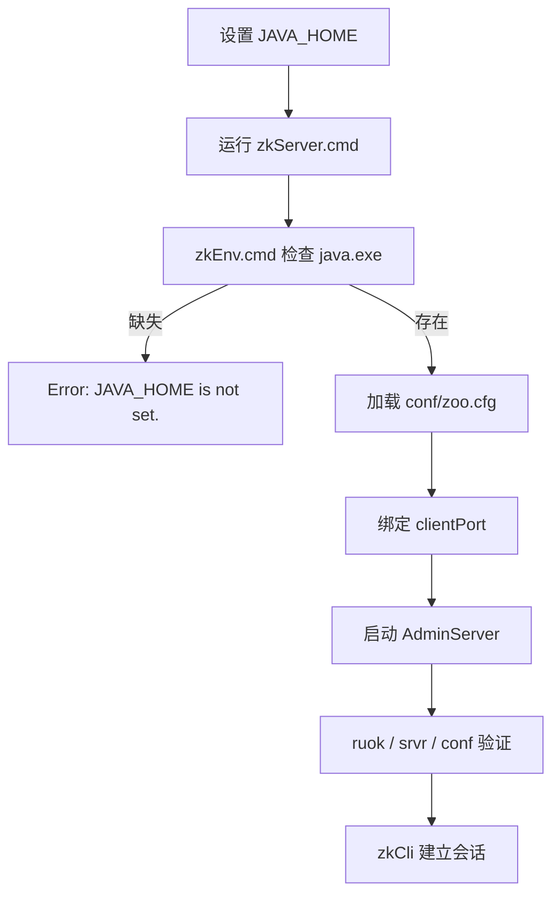

## 为什么单机安装也会踩坑？

ZooKeeper 的单机安装看起来很简单：解压、改一个配置文件、运行启动脚本。但第一次上手时，最常见的翻车点往往不是 ZooKeeper 本身，而是环境：

- 机器上装了 JDK，但 `JAVA_HOME` 没设置，启动脚本直接退出，只留下一句 `Error: JAVA_HOME is not set.`。
- `zoo.cfg` 里的 `dataDir` 指向一个不存在的目录，或者指向一个没有写权限的路径，服务启动到一半失败。
- 本机已经有一个 ZooKeeper 在 2181 端口跑着，新的实例启动时报端口占用。
- 把 `zoo_sample.cfg` 里的 `dataDir=/var/lib/zookeeper` 原样搬到 Windows，路径根本不存在。
- 看到启动日志里的 `Either no config or no quorum defined in config, running in standalone mode` 以为是报错，其实这是单机模式的正常提示。
- 想停止服务，却发现 Windows 的 `zkServer.cmd` 没有 `stop` 子命令；在任务管理器里强杀进程，又担心数据文件损坏。

这些问题有一个共同点：**没有先区分“环境准备、配置、启动、验证、停止”五个阶段**。本文按这五个阶段走一遍，每个阶段给出本机 3.8.7 的真实输出，并明确哪些输出是正常的、哪些需要处理。

| 阶段 | 最容易忽略的事 | 后果 |
|------|----------------|------|
| 环境准备 | `JAVA_HOME` 是否指向 JDK 而不是 JRE | 启动脚本找不到 `java.exe` |
| 配置 | `dataDir` 是否存在、是否可写 | 启动失败或数据写到意外位置 |
| 启动 | 端口是否被占用、是否是前台进程 | 启动看似成功，实际连不上 |
| 验证 | 只看进程在不在，不查 `ruok`/`srvr` | 进程活着但服务未就绪 |
| 停止 | 直接强杀进程 | 可能丢失最后一次快照，恢复变慢 |

> ### 💡 新人小结：装 ZooKeeper 像给公告板找一间房
>
> - JDK 是水电：没有它，公告板的照明和传送带都不工作。
> - `dataDir` 是仓库：公告的存档（快照）和变更记录（事务日志）都放在这里。
> - `zoo.cfg` 是门牌和窗口说明：告诉服务数据放哪、客户端从哪个端口进来。
> - `clientPort` 是窗口号：客户端按这个端口找到公告板。
>
> **安装不是“解压完事”，而是把水电、仓库、门牌、窗口四件事对齐。**

**学习路线图**

```
环境准备 → 解压与目录 → 最小配置 → 前台启动 → 验证 → 停止与清理
JDK        bin/conf/lib   zoo.cfg     zkServer.cmd  ruok/srvr  Ctrl+C / stop
```

---

## 环境准备：JDK、路径与版本

### JDK 要求

官方 Administrator's Guide 对 Java 的要求写的是 Java 1.8 或更高，并列出 JDK 8 LTS、JDK 11 LTS、JDK 12 的支持情况，同时明确 Java 9 和 10 不受支持。本文的测试环境使用的是 Alibaba Dragonwell 21.0.12（OpenJDK 21），发行包版本是 Apache ZooKeeper 3.8.7，实际可以正常启动。

这里要区分两件事：

- **“本机实测能跑”**不等于“官方承诺支持所有 JDK 21 组合”。生产环境应优先选择发行包文档明确支持、且与你的运维体系匹配的 JDK。
- 启动脚本只关心 `JAVA_HOME` 下有没有 `bin\java.exe`，不会替你检查版本是否受支持。版本不匹配时，可能在类加载或 TLS 初始化阶段才暴露。

```bat
REM 检查 JAVA_HOME 是否指向 JDK
echo %JAVA_HOME%
"%JAVA_HOME%\bin\java" -version
```

```text
openjdk version "21.0.12.0.12" 2026-07-21
OpenJDK Runtime Environment (Alibaba Dragonwell Standard Edition)-21.0.12.0.12+8-GA
OpenJDK 64-Bit Server VM Alibaba Dragonwell Standard Edition-21.0.12.0.12+8-GA (mixed mode, sharing)
```

### 发行包目录

解压后的目录结构如下（不同版本可能略有差异，但核心目录一致）：

| 目录/文件 | 作用 | 启动时是否必需 |
|-----------|------|----------------|
| `bin/` | 启动脚本与工具：`zkServer`、`zkCli`、`zkTxnLogToolkit` 等 | 必需 |
| `conf/` | 配置文件：`zoo_sample.cfg`、`logback.xml` | 必需，至少要有 `zoo.cfg` |
| `lib/` | ZooKeeper 与依赖的 JAR | 必需 |
| `docs/` | 官方文档与图片 | 否 |
| `LICENSE.txt` / `NOTICE.txt` | Apache 2.0 许可与声明 | 否，但分发时必须保留 |
| `dataDir`（配置指定） | 快照与事务日志的运行目录 | 必需，需可写 |

`bin/` 下同时提供 `.sh` 和 `.cmd` 两套脚本。Linux 用 `.sh`，Windows 用 `.cmd`；两套脚本的参数并不完全对称，后文的“停止”一节会专门说明这一点。

### 路径选择

`dataDir` 建议使用绝对路径，并且满足三个条件：

1. 目录存在，或至少父目录存在且可创建。
2. 运行 ZooKeeper 的用户有读写权限。
3. 路径尽量使用 ASCII 字符、避免空格。不是 ZooKeeper 的硬性限制，而是为了避免脚本、日志和命令行引号在 Windows 上互相打架。

本文的测试实例使用了一个临时目录，并把客户端端口改成 2182、AdminServer 端口改成 8081，目的是不碰本机已有的 2181 实例：

```text
C:/Users/webtu/AppData/Local/Temp/zk-zookeeper-docs/standalone/data
```

真实项目里可以把 `dataDir` 放到独立数据盘，例如 `D:/zookeeper/data`。官方特别提醒：事务日志对性能影响很大，生产环境应尽量把日志放到独立设备上，避免和快照、其他进程争抢 I/O。

---

## 最小配置：从 zoo_sample.cfg 开始

### 单机最小配置

官方 Getting Started 给出的最小配置只有三项：

```properties
tickTime=2000
dataDir=/var/lib/zookeeper
clientPort=2181
```

| 参数 | 含义 | 本文测试值 |
|------|------|------------|
| `tickTime` | ZooKeeper 的基本时间单位，单位毫秒；心跳和超时都以 tick 计算 | 2000 |
| `dataDir` | 快照与（默认情况下）事务日志的存放目录 | 临时 ASCII 目录 |
| `clientPort` | 客户端连接端口 | 2182（避开已有 2181） |

最小配置足以启动单机实例，但生产/实验环境通常还会显式设置下面几项：

```properties
tickTime=2000
initLimit=10
syncLimit=5
dataDir=C:/Users/webtu/AppData/Local/Temp/zk-zookeeper-docs/standalone/data
clientPort=2182
admin.serverPort=8081
maxClientCnxns=60
4lw.commands.whitelist=*
autopurge.snapRetainCount=3
autopurge.purgeInterval=0
```

| 参数 | 本文测试值 | 作用 | 注意事项 |
|------|------------|------|----------|
| `initLimit` | 10 | Follower 连接并同步到 Leader 的 tick 数 | 单机模式不起作用，集群模式才生效 |
| `syncLimit` | 5 | Follower 与 Leader 之间允许落后的 tick 数 | 单机模式不起作用 |
| `admin.serverPort` | 8081 | AdminServer 的 HTTP 端口 | 默认 8080；同机多实例要改 |
| `maxClientCnxns` | 60 | 单个 IP 对单个服务端的最大连接数 | 官方默认 60；0 表示不限制 |
| `4lw.commands.whitelist` | `*` | 允许的四字命令 | 实验环境可开，生产应只开需要的命令 |
| `autopurge.snapRetainCount` | 3 | 自动清理时保留的快照/日志份数 | 默认 3，最小值 3 |
| `autopurge.purgeInterval` | 0 | 自动清理间隔（小时） | 0 表示关闭自动清理 |

> ### 💡 新人小结：zoo.cfg 像门卫的值班表
>
> - `tickTime` 是值班表的时间刻度：所有超时都按它换算。
> - `dataDir` 是档案柜：快照和变更记录放这里，丢了就恢复不了。
> - `clientPort` 是接待窗口：客户端从这个端口进来。
> - `admin.serverPort` 是内部管理窗口：健康检查、指标查询走这里。
>
> **配置的核心不是“写满所有参数”，而是把档案柜和两个窗口的位置定清楚。**

### 配置文件的加载顺序

ZooKeeper 的启动脚本会把 `conf/` 目录加入 classpath，并把 `conf/zoo.cfg` 作为默认配置路径。你可以通过命令行参数指定另一个配置文件，但如果使用 `zkServer.cmd`，脚本会使用 `zkEnv.cmd` 计算出的 `ZOOCFG`（默认是 `conf\zoo.cfg`）。

这意味着：

- 改了 `conf/zoo.cfg` 后，直接重启脚本即可生效。
- 不要把配置写到 `conf/zoo_sample.cfg`，样例文件只是模板，脚本不会读取它。
- 同机多实例时，不要让所有实例共用同一个 `dataDir`；每个实例必须有自己的数据目录和 `myid`（集群模式），否则会互相覆盖。

---

## 启动：Windows 前台与 Linux 后台

先看启动流程的全貌，后面每一步都对应这张图里的一个节点：



### Windows：zkServer.cmd 是前台进程

Windows 下最直接的启动方式是：

```bat
set JAVA_HOME=D:\JDK\Alibaba_Dragonwell_Standard_21.0.12.0.12.8_x64_windows\dragonwell-21.0.12.0.12+8-GA
cd /d D:\ZK\apache-zookeeper-3.8.7-bin\apache-zookeeper-3.8.7-bin
bin\zkServer.cmd
```

`zkServer.cmd` 会调用 `zkEnv.cmd`，后者检查 `JAVA_HOME` 并拼接 classpath。启动时脚本会 `echo on`，把完整的 Java 命令行打印出来，这是正常行为，不是调试信息泄漏。

本机实测的关键输出如下（为隔离现有实例，使用了临时副本、2182 端口和 8081 管理端口）：

```text
Reading configuration from: C:\Users\webtu\AppData\Local\Temp\zk-zookeeper-docs\zkdist\bin\..\conf\zoo.cfg
clientPortAddress is 0.0.0.0:2182
secureClientPort is not set
WARN  [main:o.a.z.s.q.QuorumPeerMain@139] - Either no config or no quorum defined in config, running in standalone mode
Starting server
binding to port 0.0.0.0/0.0.0.0:2182
Started AdminServer on address 0.0.0.0, port 8081 and command URL /commands
```

| 日志行 | 含义 | 是否需要处理 |
|--------|------|--------------|
| `Reading configuration from` | 加载的配置文件路径 | 核对是不是你改的那份 |
| `clientPortAddress is 0.0.0.0:2182` | 客户端端口监听地址 | 确认端口没被占用 |
| `Either no config or no quorum defined ... standalone mode` | 没有 `server.x` 集群配置，按单机模式运行 | 单机正常，不是错误 |
| `Starting server` | 服务端主流程开始 | 继续看后面是否绑定端口成功 |
| `binding to port` | 客户端端口绑定成功 | 可以开始连接 |
| `Started AdminServer` | 管理端口启动成功 | 可用于 HTTP 健康检查 |

这里最容易误判的是那条 `WARN`。它来自 `QuorumPeerMain`：配置里没有 quorum（没有 `server.x` 行），所以按单机模式启动。只有当你期望启动的是集群节点时，这条 WARN 才意味着配置漏了。

### Linux：zkServer.sh 支持后台启动

Linux 下官方脚本提供更完整的子命令：

```bash
bin/zkServer.sh start              # 后台启动
bin/zkServer.sh start-foreground   # 前台启动，便于看日志
bin/zkServer.sh status             # 查看状态与角色
bin/zkServer.sh restart            # 重启
bin/zkServer.sh stop               # 停止
bin/zkServer.sh version            # 查看版本
```

`start` 会把进程放到后台，并把 PID 写下来；`start-foreground` 适合调试启动失败。`status` 会建立一个客户端连接并执行诊断命令，因此它不仅能看进程，还能确认服务是否能响应。

> ### 💡 新人小结：Windows 的启动脚本是“电灯开关”，Linux 的是“配电箱”
>
> - Windows 的 `zkServer.cmd` 没有 `start/stop` 子命令，它就是一个前台进程；关掉窗口或按 Ctrl+C 就是停止。
> - Linux 的 `zkServer.sh` 有 `start/stop/status`，像配电箱一样可以远程操作。
> - 不要把 Linux 的 `zkServer.sh stop` 习惯直接套到 Windows 的 `zkServer.cmd` 上。
>
> **先看脚本支持哪些参数，再决定怎么启停；不要凭平台习惯猜。**

---

## 验证：不要只看进程在不在

启动日志出现 `binding to port` 只说明端口绑定成功，不代表集群已经就绪，也不代表客户端一定能完成会话建立。建议按下面三层验证：

### 第一层：端口与四字命令

```text
$ echo ruok | nc 127.0.0.1 2182
imok
```

`ruok` 返回 `imok` 只说明服务进程活着、客户端端口可连接；官方明确说它不代表已经加入 quorum。单机模式没有 quorum，但集群模式要特别注意这一点。

```text
$ echo srvr | nc 127.0.0.1 2182
Zookeeper version: 3.8.7-9085db92dd679e1e90a63bfe6ae6345ab6cbc4ae, built on 2026-09-03 17:57 UTC
Latency min/avg/max: 0/1.1765/6
Received: 54
Sent: 54
Connections: 1
Outstanding: 0
Zxid: 0x34
Mode: standalone
Node count: 8
```

`Mode: standalone` 是单机模式的标志。集群模式下这里会显示 `leader` 或 `follower`。

### 第二层：配置是否符合预期

```text
$ echo conf | nc 127.0.0.1 2182
clientPort=2182
secureClientPort=-1
dataDir=C:\Users\webtu\AppData\Local\Temp\zk-zookeeper-docs\standalone\data\version-2
dataDirSize=67109337
dataLogDir=C:\Users\webtu\AppData\Local\Temp\zk-zookeeper-docs\standalone\data\version-2
dataLogSize=67109337
tickTime=2000
maxClientCnxns=60
minSessionTimeout=4000
maxSessionTimeout=40000
clientPortListenBacklog=-1
serverId=0
```

| 字段 | 说明 | 本文测试值 |
|------|------|------------|
| `clientPort` | 客户端端口 | 2182 |
| `dataDir` | 实际使用的快照目录（会自动拼上 `version-2`） | 临时目录下的 `version-2` |
| `dataLogDir` | 事务日志目录；未单独设置时与 `dataDir` 相同 | 同上 |
| `tickTime` | 基本时间单位 | 2000 |
| `maxClientCnxns` | 单 IP 连接上限 | 60 |
| `minSessionTimeout` | 最小会话超时，默认 `2 × tickTime` | 4000 |
| `maxSessionTimeout` | 最大会话超时，默认 `20 × tickTime` | 40000 |
| `serverId` | 单机模式下的服务 ID | 0 |

`dataDir` 显示的是 `...\data\version-2`，而不是配置里写的 `...\data`。这是正常的：ZooKeeper 会在数据目录下创建 `version-2` 子目录，快照和日志都放在里面。

### 第三层：数据文件是否落盘

```text
version-2/
  snapshot.0    457 bytes
  log.1         67108880 bytes
```

| 文件 | 含义 | 大小说明 |
|------|------|----------|
| `snapshot.0` | 快照文件，后缀是快照开始时的 zxid | 初始快照很小，几百字节 |
| `log.1` | 事务日志，后缀是第一条事务的 zxid | 预分配约 64 MB，实际事务可能很少 |

`log.1` 接近 64 MB 不代表写入量很大，而是 ZooKeeper 为了减少磁盘寻址预分配了空间。官方参数 `preAllocSize` 默认是 64M；可以用这个参数调整预分配块大小。

### 第四层：客户端能建立会话

```text
$ bin/zkCli.cmd -server 127.0.0.1:2182 ls /
WATCHER::

WatchedEvent state:SyncConnected type:None path:null
[app, jobs, zookeeper]
```

看到 `SyncConnected` 才说明客户端与服务端完成了会话建立；`ls /` 返回 `[app, jobs, zookeeper]` 说明数据树可读。`/zookeeper` 是系统保留子树，不是用户创建的。

---

## 停止：安全关闭与“看起来关了”

### Linux：zkServer.sh stop

```bash
bin/zkServer.sh stop
```

脚本会向记录的 PID 发送停止信号，等待进程退出。停止后建议再执行一次 `bin/zkServer.sh status`，确认客户端端口不再响应。

### Windows：没有 stop 子命令

`zkServer.cmd` 的脚本内容很直接：调用 `zkEnv.cmd`，然后执行 `QuorumPeerMain`，并把参数原样透传。它没有 `start/stop/status` 子命令。因此 Windows 下的停止方式取决于你怎么启动：

| 启动方式 | 停止方式 | 注意事项 |
|----------|----------|----------|
| 在当前命令行运行 `zkServer.cmd` | 按 `Ctrl+C` | 让进程走关闭流程，尽量等它打印退出信息 |
| 用 `start` 新开窗口 | 关闭该窗口或在窗口中 `Ctrl+C` | 不要直接关整个终端宿主 |
| 用服务包装器（WinSW/NSSM） | 用服务管理器停止 | 需要额外配置，本文未实测 |

不建议直接用任务管理器“结束进程”或 `taskkill /F`。ZooKeeper 的写请求在返回成功前已经把事务写入日志，强杀一般不会丢已提交的写，但可能让最后一次快照不完整，重启时需要回放更多日志，恢复时间变长。

停止后检查端口：

```text
$ echo ruok | nc 127.0.0.1 2182
（无响应或连接被拒绝）
```

没有 `imok` 才说明服务真的停了。如果仍能返回 `imok`，说明还有一个进程占着端口。

> ### 💡 新人小结：停止服务像关店，不是拉闸
>
> - 正常关店：先送走客人（处理完请求），再关灯（关闭会话），最后锁门（落盘退出）。
> - 拉闸：直接把电断掉，店里可能还有没结账的客人，第二天要重新盘点。
> - Windows 的 `Ctrl+C` 是“关店”，任务管理器强杀是“拉闸”。
>
> **能用正常关闭就别强杀；强杀后第一次启动要预留更长的恢复时间。**

---

## 常见故障排查清单

| 现象 | 先查什么 | 处理方向 |
|------|----------|----------|
| 启动脚本一闪而过 | `JAVA_HOME` 是否设置、是否指向 JDK | `zkEnv.cmd` 会打印 `Error: JAVA_HOME is not set.`；设置后重开终端 |
| `java.exe` 找不到 | `JAVA_HOME\bin\java.exe` 是否存在 | 修正 `JAVA_HOME`，不要指向 JRE 目录 |
| 端口被占用 | 本机是否已有 2181 实例 | 改 `clientPort`，或先停掉旧实例；同机多实例要同时改 `admin.serverPort` |
| `dataDir` 相关错误 | 目录是否存在、是否有写权限 | 创建目录并授权；不要多个实例共用同一个 `dataDir` |
| 启动日志只有 WARN，没有 binding | 配置是否被正确加载 | 核对 `Reading configuration from` 的路径 |
| `ruok` 不返回 `imok` | 进程是否真的在跑、端口是否绑定 | 看控制台日志，确认 `binding to port` 是否出现 |
| 客户端连不上 | 端口、防火墙、连接串 | 先用 `nc`/`telnet` 测端口，再查防火墙 |
| 启动后立刻退出 | Java 版本、配置、数据目录损坏 | 用 `start-foreground`（Linux）或前台 `zkServer.cmd` 看完整堆栈 |

### 安全边界

单机实例常用于开发，但不要把 2181 直接暴露到公网。至少做三件事：

1. 用防火墙限制来源 IP。
2. 生产环境不要使用 `4lw.commands.whitelist=*`；只放行需要的命令。
3. 为敏感 znode 设置 ACL，不要默认认为“内网就安全”。

ZooKeeper 的 ACL 是路径级的粗粒度模型，适合保护协调数据，不适合替代完整的业务权限系统。需要更细的权限时，应在应用层做鉴权，并把 ZooKeeper 放在受控网络内。

---

## 要点总结

1. **五个阶段分开看**：环境准备、配置、启动、验证、停止；每一阶段都有独立的失败点，不要用“进程起来了”代替全部验证。
2. **`JAVA_HOME` 是 Windows 启动脚本的硬前提**：`zkEnv.cmd` 找不到它会直接退出；`JAVA_HOME` 要指向 JDK，不是 JRE。
3. **最小配置只需要三项**：`tickTime`、`dataDir`、`clientPort`；集群参数和运维参数按需再加。
4. **`standalone mode` 的 WARN 是正常的**：没有 `server.x` 就按单机启动；只有在期望集群时才需要处理。
5. **验证要分层**：`ruok` 看进程，`srvr` 看模式，`conf` 看实际配置，`zkCli` 看会话和数据树。
6. **Windows 没有 `zkServer.cmd stop`**：前台 Ctrl+C 或关闭窗口；生产服务化需要额外包装，强杀不是首选。

---

> ### 💡 新人小结：单机安装学完了，记住这 4 点
>
> 1. **先修水电再开门**：`JAVA_HOME` 和可写的 `dataDir` 是启动的两块地基。
> 2. **只看 `binding to port` 不够**：`ruok`、`srvr`、`conf`、`zkCli` 四层都过一遍。
> 3. **`standalone mode` 的 WARN 不是故障**：它只是告诉你没有配置 quorum。
> 4. **停止要体面**：Windows 用 Ctrl+C，Linux 用 `zkServer.sh stop`；强杀会让下一次恢复更慢。
