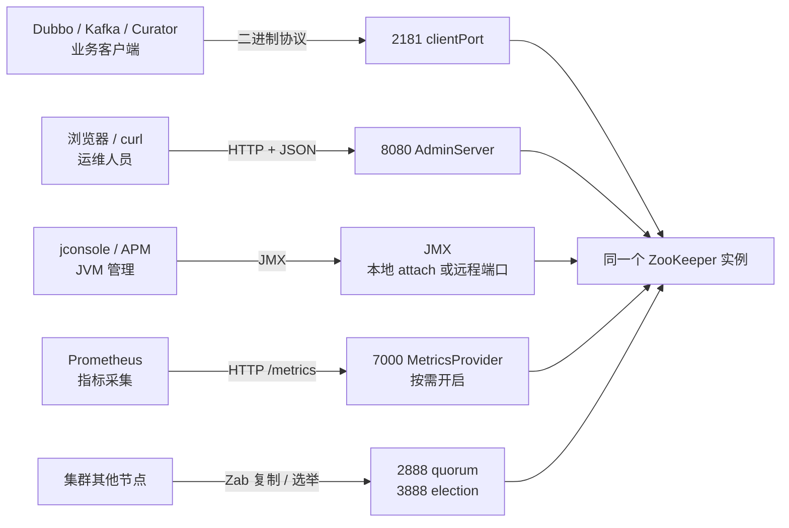

## 为什么启动一个 ZooKeeper 会看到两个端口？

很多人的第一次 ZooKeeper 排障，是从一条 `netstat` 开始的：

```text
C:\Users\webtu>netstat -ano | findstr 8080
  TCP    0.0.0.0:8080           0.0.0.0:0              LISTENING       27604
  TCP    192.168.x.x:53611      198.51.100.10:8080     ESTABLISHED     13120
  TCP    [::]:8080              [::]:0                 LISTENING       27604

C:\Users\webtu>netstat -ano | findstr 2181
  TCP    0.0.0.0:2181           0.0.0.0:0              LISTENING       27604
  TCP    [::]:2181              [::]:0                 LISTENING       27604
```

（原文中的本机与远端地址已脱敏；端口、状态和 PID 保留。）

于是问题来了：我只启动了一个 ZooKeeper，为什么它同时占了 2181 和 8080？8080 是不是被 Tomcat 或前端项目抢了？那行 `ESTABLISHED` 又是什么？

答案是：**2181 和 8080 都属于 ZooKeeper，而且很可能属于同一个 JVM 进程**。从 ZooKeeper 3.5.0 开始，实例默认会同时启动两套服务：

| 端口 | 配置项 | 用途 | 默认状态 |
|------|--------|------|----------|
| `2181` | `clientPort` | 客户端二进制协议：Dubbo、Kafka、Curator、`zkCli` 都连这里 | 样例配置常用 2181 |
| `8080` | `admin.serverPort` | AdminServer 的 HTTP 管理端口，浏览器和监控走这里 | 3.5.0 起默认开启 |

所以“一个进程、两个端口”不是重复启动，也不是端口冲突，而是**一条 ZooKeeper 进程同时提供了两条不同协议的入口**。先把这两条入口分开，后面的 `netstat`、防火墙、监控配置才不会互相打架。

> ### 💡 新人小结：一栋楼开了两扇门
>
> - 2181 是业务门：客户端进来看数据、注册服务、发 Watcher。
> - 8080 是管理门：运维和监控进来看状态、拿 JSON 报告。
> - 两扇门通向同一栋楼，所以 PID 相同；门不同，用途也不同。
>
> **看到两个端口先别急着杀进程，先问“这两个端口各是谁的门”。**

---

## 先把端口放回四条通路

ZooKeeper 相关端口不止 2181 和 8080。把它们按“谁在说话”分组，比死记端口号更有用：



| 端口/通道 | 何时存在 | 谁在用 | 关键提醒 |
|-----------|----------|--------|----------|
| `2181`（`clientPort`） | 单机和集群都有 | 业务客户端、`zkCli`、四字命令 | 业务注册发现的唯一入口，不能随便关 |
| `8080`（`admin.serverPort`） | 3.5.0 起默认开启 | 浏览器、curl、部分监控 | 纯 HTTP 管理面，可改端口、改绑定地址或关闭 |
| `2888`（quorum） | 仅集群 | Follower 与 Leader 的数据复制 | 由 `server.x=host:2888:3888` 指定，同机多实例必须错开 |
| `3888`（election） | 仅集群 | Leader 选举 | 与 quorum 端口成对出现，不是客户端端口 |
| `7000`（metrics） | 仅启用 MetricsProvider 时 | Prometheus 抓取 `/metrics` | 不是 ZooKeeper 默认监听；不配置就没有这个端口 |
| JMX（常见 1099，或本地 attach） | JVM 开启 JMX 时 | jconsole、APM、部分监控 | 本地管理默认可用；远程 JMX 需要额外配置，1099 不是 ZooKeeper 的固定默认值 |

这张表最重要的不是数字，而是**通路的独立性**：业务客户端只认 2181 的二进制协议；AdminServer 只是把部分管理信息换成 HTTP；Prometheus 是另一套指标导出；JMX 走 JVM 自己的管理通道。关掉其中一条，不会自动关掉另一条。

> ### 💡 新人小结：端口像不同部门的电话分机
>
> - 2181 是业务前台：客户办事必须打这个号。
> - 8080 是行政查询台：查状态方便，但业务不依赖它。
> - 2888/3888 是内部对讲机：只有集群成员之间用。
> - 7000 是报表打印机：装了才有，不装不影响业务。
>
> **先按“谁在用”分类，再决定“能不能关”。**

---

## netstat 里哪一行才是真占用？

`netstat -ano` 的输出有五列。很多人只看“出现 8080”就下结论，结果把一条正常的出站连接当成了本地端口冲突。

| 列 | 含义 | 判断要点 |
|----|------|----------|
| Proto | 协议，通常是 TCP | 先确认是不是 TCP |
| Local Address | 本地地址和本地端口 | **只有这一列的端口才是本机监听/使用的端口** |
| Foreign Address | 对端地址和对端端口 | 这里的 8080 是“对方”的端口，不是本机被占用 |
| State | 连接状态 | `LISTENING` 表示本机在监听；`ESTABLISHED` 表示已经建立的连接 |
| PID | 持有该连接的进程 ID | 用 `tasklist` 查进程名，不要只看 PID 猜 |

回到开头那段输出：

```text
TCP    0.0.0.0:8080           0.0.0.0:0              LISTENING       27604
TCP    192.168.x.x:53611      198.51.100.10:8080     ESTABLISHED     13120
```

- 第一行：本地地址是 `0.0.0.0:8080`，状态是 `LISTENING`，PID 27604。这是**本机 8080 的监听者**。
- 第二行：本地地址是 `192.168.x.x:53611`，远端地址才是 `198.51.100.10:8080`，状态是 `ESTABLISHED`，PID 13120。这是**另一个程序连出到远程 8080**，不是本机 8080 被占用。
- `findstr 8080` 会把本地列和远端列都匹配出来，所以“看到 8080”不等于“本机 8080 被占”。

正确的排查顺序是：

```text
# Windows：只看本机监听，再按 PID 查进程
netstat -ano | findstr LISTENING | findstr :8080
tasklist /fi "PID eq 27604"

# Linux/macOS：同样的思路
ss -lntp | grep ':8080'
ps -fp <PID>
```

在 Windows 上，`tasklist /fi "PID eq 27604"` 会显示进程名、内存占用和会话信息。如果进程名是 `java.exe`，再结合启动命令行、日志或 `jps -l` 判断它是不是 ZooKeeper；不要因为 PID 看起来眼熟就直接结束进程。

> ### 💡 新人小结：先看“本地地址”，再看“状态”
>
> - `Local Address` 里的端口，才是本机真正使用/监听的端口。
> - `Foreign Address` 里的端口，是对方服务的端口，不是本机占用。
> - 只有 `LISTENING` 行才代表“本机在这个端口上开门”。
>
> **`findstr` 是字符串匹配，不是端口语义匹配；匹配到不等于占用。**

---

## 为什么同一个 PID 会同时监听 2181 和 8080？

因为 ZooKeeper 的 JVM 在启动时做了两件事：

1. 启动客户端服务，绑定 `clientPort`；
2. 启动 AdminServer（Jetty），绑定 `admin.serverPort`。

本机复核实例的启动日志里能看到 AdminServer 的绑定过程：

```text
2026-10-25 21:22:06,520 [myid:] - INFO  [main:o.e.j.s.AbstractConnector@333] - Started ServerConnector@3bd82cf5{HTTP/1.1, (http/1.1)}{0.0.0.0:8085}
2026-10-25 21:22:06,520 [myid:] - INFO  [main:o.a.z.s.a.JettyAdminServer@196] - Started AdminServer on address 0.0.0.0, port 8085 and command URL /commands
```

同一时刻的 `netstat` 显示 2185 和 8085 是同一个 PID：

```text
TCP    0.0.0.0:2188           0.0.0.0:0              LISTENING       26940
TCP    127.0.0.1:8088         0.0.0.0:0              LISTENING       26940
```

（来自本机 2026-10-25 的复核实例；实例已停止，端口和 PID 保留原值，地址中 0.0.0.0 表示监听所有网卡，127.0.0.1 表示只监听回环。）

| 现象 | 解释 | 是否异常 |
|------|------|----------|
| 2181 和 8080 同一个 PID | 同一个 JVM 开了客户端和 AdminServer | 正常，设计如此 |
| 只有 2181，没有 8080 | AdminServer 被关闭，或启动失败 | 看是否配置了 `admin.enableServer=false`；看日志有没有 Jetty 报错 |
| 只有 8080，没有 2181 | 客户端端口绑定失败，但 AdminServer 先起来了 | 异常；查 2181 是否被占用、启动日志是否报 `binding to port` 失败 |
| 8080 是别的 PID | 另一个程序占了 8080 | 端口冲突；改 `admin.serverPort` 或关闭 AdminServer |

AdminServer 默认监听 `0.0.0.0`，意味着同一网络能访问到这台机器的设备都可能连上 8080。它默认没有内置的登录认证，所以生产环境要么限制来源，要么只绑定回环地址：

```properties
# 只允许本机访问管理端口
admin.serverAddress=127.0.0.1
```

本机实测配置 `admin.serverAddress=127.0.0.1` 后，`netstat` 只显示：

```text
TCP    127.0.0.1:8088         0.0.0.0:0              LISTENING       <PID>
```

这比“监听 0.0.0.0 再靠防火墙”少一层暴露面，但也意味着远程机器不能直接访问管理页面；如果监控在另一台机器上，需要结合防火墙和反向代理来设计。

> ### 💡 新人小结：一个 JVM，两套服务
>
> - `clientPort` 和 `admin.serverPort` 可以由同一个进程同时监听。
> - 看到同一个 PID 不要惊讶，先确认两个端口分别是什么服务。
> - AdminServer 默认监听所有网卡；不想暴露就改 `admin.serverAddress` 或关闭它。
>
> **端口相同不代表进程相同；进程相同也不代表两个端口用途相同。**

---

## 端口冲突怎么处理：先分辨，再改绑，最后才禁用

处理端口冲突，顺序很重要。直接 `taskkill` 或改端口，可能把业务入口一起弄没。

### 第一步：确认冲突的是哪条通路

| 冲突端口 | 先问的问题 | 处理方向 |
|----------|------------|----------|
| 2181 | 是 ZooKeeper 自己重复启动，还是别的程序占用？ | 查 PID/命令行；如果是另一个 ZooKeeper，先停重复实例 |
| 8080 | 是 AdminServer，还是 Tomcat/前端/其他 HTTP 服务？ | 查 PID；如果是 AdminServer，改端口或关闭 |
| 2888/3888 | 是否同机跑了多个 ZooKeeper 实例？ | 给每个实例分配不同的 quorum/election 端口 |
| 7000 | 是否启用了 Prometheus MetricsProvider？ | 改 `metricsProvider.httpPort`，或先不启用 |

### 第二步：能改绑就不要禁用

如果 8080 只是和别的服务冲突，但你还想保留 HTTP 管理入口，最直接的做法是换端口：

```properties
# zoo.cfg
admin.serverPort=9090
admin.serverAddress=127.0.0.1
```

改完重启 ZooKeeper，确认新端口在监听：

```text
netstat -ano | findstr LISTENING | findstr :9090
curl -s -o /dev/null -w "%{http_code}\n" http://127.0.0.1:9090/commands/stat
```

如果 8080 冲突且你根本不需要 HTTP 管理，可以关闭 AdminServer：

```properties
admin.enableServer=false
```

关闭后，`8080` 不再监听，但 2181 的客户端协议不受影响。注意：**关闭 AdminServer 不等于关闭四字命令**，两者是独立通路；四字命令仍可能在 2181 上可用，具体取决于 `4lw.commands.whitelist`。

### 第三步：2181 冲突要先评估客户端

`clientPort` 是业务入口。改 2181 不是“改一行配置”那么简单：

1. 所有 Dubbo/Kafka/Curator 客户端的连接串都要改；
2. 集群里每个节点的 `clientPort` 可以相同（不同主机），但同机多实例必须不同；
3. 改完后要用 `zkCli`、业务客户端和四字命令分别验证。

```properties
# 同机多实例时，每个实例一个客户端端口
clientPort=2182
```

如果只是本机学习，换到 2182 很方便；如果是线上注册中心，先确认客户端配置能否滚动更新，再决定是否改端口。

### 第四步：集群端口要成组规划

同机跑三个实例时，端口不是只错开 2181，而是客户端、管理、quorum、election 四组都要错开。本文实验用的组合：

| 实例 | `clientPort` | `admin.serverPort` | quorum | election |
|------|--------------|--------------------|--------|----------|
| zk1 | 2182 | 8081 | 2288 | 2388 |
| zk2 | 2183 | 8082 | 2289 | 2389 |
| zk3 | 2184 | 8083 | 2290 | 2390 |

对应的 `server.x`：

```properties
server.1=127.0.0.1:2288:2388
server.2=127.0.0.1:2289:2389
server.3=127.0.0.1:2290:2390
```

如果三台机器各跑一个实例，`2181/8080/2888/3888` 可以相同，因为 IP 不同；**同机多实例**才需要全部错开。不要把“同机实验端口”与“生产默认端口”混为一谈。

> ### 💡 新人小结：改端口像换门牌，不是换房子
>
> - 换 AdminServer 端口：只影响管理面，业务客户端不用动。
> - 换 clientPort：所有业务客户端都要跟着改，影响面最大。
> - 换 quorum/election：集群成员配置要同步改，否则节点加不进来。
>
> **先判断影响面，再决定改哪一层；不要为了躲一个 8080 把 2181 也改了。**

---

## 7000 与 JMX：别把可选端口当默认

### 7000 是 MetricsProvider 的端口，不是 ZooKeeper 默认端口

只有在 `zoo.cfg` 中启用 Prometheus MetricsProvider 后，ZooKeeper 才会额外监听 7000：

```properties
metricsProvider.className=org.apache.zookeeper.metrics.prometheus.PrometheusMetricsProvider
metricsProvider.httpHost=127.0.0.1
metricsProvider.httpPort=7000
metricsProvider.exportJvmInfo=true
```

本机复核实例把端口改成 7086，启动后：

```text
TCP    127.0.0.1:7086         0.0.0.0:0              LISTENING       <PID>
```

请求 `/metrics` 返回 `200 text/plain`，内容以 Prometheus 文本格式开头：

```text
# HELP znode_count znode_count
# TYPE znode_count gauge
znode_count 5.0
# HELP write_commit_proc_issued write_commit_proc_issued
```

| 配置 | 结果 |
|------|------|
| 不写 `metricsProvider.className` | 没有 7000 端口，也没有 `/metrics` |
| 写了 provider，未写 `httpPort` | 官方文档说明默认端口为 7000 |
| 写了 provider 和自定义端口 | 使用自定义端口；同机多实例要错开 |

### JMX 的 1099 不是“ZooKeeper 默认端口”

ZooKeeper 的 JMX 支持是 JVM 层的。官方 JMX 文档说明，随发行包提供的 `zkServer.sh` 默认只支持本地管理；要远程连接，需要额外配置 JMX 的 host/port。`1099` 是很多 Java 应用的常见约定，但不是 ZooKeeper 配置里自动写死的默认端口。

| 方式 | 是否需要额外端口 | 典型用途 |
|------|------------------|----------|
| 本地 `jconsole` attach | 不需要固定端口 | 本机排查 JVM、线程、内存 |
| 远程 JMX | 需要配置 host/port，常用 1099 | APM、集中监控 |
| Prometheus provider | 7000（可改） | 指标抓取与告警 |

因此，看到“监控连 1099”时，不要直接套到 ZooKeeper 的默认配置上；先看 JVM 启动参数和监控工具的连接配置。

> ### 💡 新人小结：7000 是“装了才有”，1099 是“配了才有”
>
> - 7000 不是 ZooKeeper 默认监听；不启用 Prometheus provider 就没有。
> - 1099 不是 ZooKeeper 固定默认端口；远程 JMX 才需要显式配置。
> - 看到端口先问“哪个组件、哪条配置开启的”，不要凭常见数字猜。
>
> **可选端口不是默认端口；默认端口也不是唯一端口。**

---

## 一张排查表：从现象到命令

| 现象 | 先查什么 | 命令/动作 |
|------|----------|-----------|
| 2181 没监听 | 进程是否启动、是否绑定失败 | 看启动日志的 `binding to port`；`netstat -ano \| findstr LISTENING \| findstr :2181` |
| 8080 被别的程序占用 | 占用者的 PID 和进程名 | `netstat -ano \| findstr LISTENING \| findstr :8080`；`tasklist /fi "PID eq <PID>"` |
| 8080 出现 `ESTABLISHED` | 本地端口和远端端口 | 看 `Local Address`；远端 8080 不是本机占用 |
| 同机三节点启动失败 | 客户端/管理/quorum/election 是否撞车 | 对照端口规划表逐项检查 |
| 7000 没监听 | 是否启用 MetricsProvider | 查 `metricsProvider.className` 和启动日志 |
| 管理页面打不开 | AdminServer 是否被关闭/改端口/只绑回环 | 查 `admin.enableServer`、`admin.serverPort`、`admin.serverAddress` |
| 业务正常但监控失联 | 监控走的是 2181、8080、7000 还是 JMX | 看监控工具的目标 URL/端口，分别处理 |

### 最小验证命令

```bash
# 客户端端口（Linux/macOS；Windows 可用 nc 或 PowerShell TcpClient）
echo ruok | nc 127.0.0.1 2181

# AdminServer（端口按实际配置替换）
curl -s -o /dev/null -w "%{http_code}\n" http://127.0.0.1:8080/commands/stat

# Prometheus（仅在启用 provider 时）
curl -s -o /dev/null -w "%{http_code}\n" http://127.0.0.1:7000/metrics
```

---

## 要点总结

1. **2181 和 8080 默认可以同时存在**：前者是客户端二进制协议，后者是 AdminServer 的 HTTP 管理端口；同一个 JVM 监听两个端口是设计行为。
2. **`netstat` 要看本地地址与状态**：`LISTENING` 行才是本机监听；`Foreign Address` 里的端口是远端端口，不是本机占用。
3. **8080 冲突优先改绑或关闭 AdminServer**：`admin.serverPort` 换端口，`admin.serverAddress` 限制来源，`admin.enableServer=false` 关闭；这些操作不影响 2181 上的业务协议。
4. **2181 是业务入口，改动影响最大**：改 `clientPort` 必须同步所有客户端连接串；同机多实例要同时错开客户端、管理、quorum、election 四组端口。
5. **2888/3888 只在集群出现**：由 `server.x=host:quorum:election` 指定，不要把它们当成客户端端口。
6. **7000 和 JMX 都是可选通道**：7000 仅在启用 Prometheus MetricsProvider 时存在；JMX 的 1099 是常见约定，不是 ZooKeeper 的固定默认值。
7. **看到端口先分通路，再决定动作**：业务、管理、集群、监控四条通路的关闭影响不同，不能用同一种“杀进程/改端口”处理。

---

> ### 💡 新人小结：端口排查学完了，记住这 4 点
>
> 1. **一个进程可以有两个门**：2181 业务、8080 管理，同 PID 不奇怪。
> 2. **`findstr 8080` 不等于占用 8080**：看本地地址、状态和 PID 三列。
> 3. **改管理端口影响小，改客户端端口影响大**：先评估客户端连接串。
> 4. **7000/1099 不是默认出现的**：先确认对应组件是否启用。
