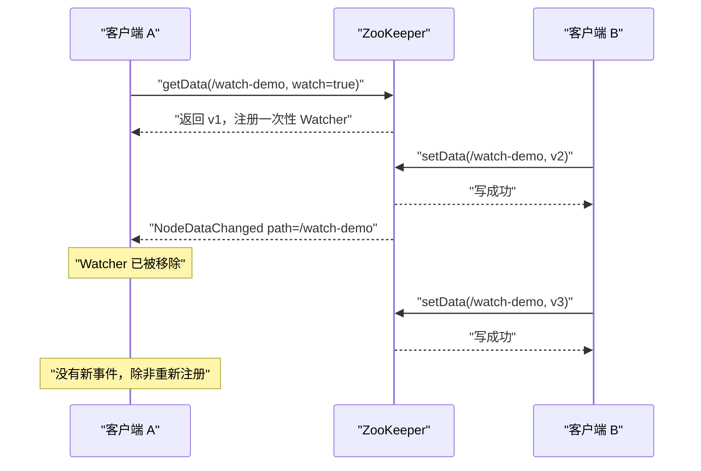

## 为什么先学 zkCli？

ZooKeeper 的客户端 API 很多，Java、C、Go、Python 都有封装。但对第一次接触 ZooKeeper 的人来说，最快建立直觉的方式不是写代码，而是打开 `zkCli`：它把 znode 树变成了一个可以 `ls`、`get`、`set`、`create`、`delete` 的交互式文件系统。

先把 zkCli 用熟，至少能带来三个好处：

1. **排障时不用现写程序**：怀疑某个配置节点不对，直接 `get` 一下；怀疑临时节点没释放，直接 `ls` 看。
2. **能亲眼看到版本号和会话边界**：`stat` 会告诉你 `dataVersion`、`ephemeralOwner`、`numChildren`，这些字段是理解 ZooKeeper 的关键。
3. **能验证 Watcher 的“一次性”**：看一次事件触发，比读十遍文档更容易记住。

当然，zkCli 也有自己的坑：一次性命令执行完，会话可能没有正常 `close`，临时节点要等超时；交互式终端在重定向输入时初始化很慢；不同平台的脚本参数不完全一样。本文用本机 3.8.7 的真实输出，把这些坑一并讲清楚。

| 只背命令时的误区 | 用 zkCli 验证后的认识 |
|------------------|------------------------|
| `create -e` 创建的节点会一直在 | 会话结束或超时后，临时节点会被删除 |
| `set` 成功就会立刻通知所有客户端 | 通知是异步的，且标准 Watcher 只触发一次 |
| `stat` 只是看大小 | 它记录了创建/修改的 zxid、三个版本号和所有者会话 |
| `ls` 只能看一层 | `ls -R` 可以递归；`ls -s` 还能带 stat |
| 顺序节点就是随机后缀 | 后缀是父节点维护的 10 位自增序号 |

> ### 💡 新人小结：zkCli 像一台“远程文件管理器”
>
> - 你连上一台服务器（会话），看到一棵共享目录树（znode 树）。
> - `ls` 看目录、`get` 看内容、`set` 改内容、`create` 新建、`delete` 删除。
> - 目录项上有一张登记卡（stat），写着版本号、创建时间、子节点数量和所有者会话。
> - `get -w` 相当于在目录项上贴一张“有变化叫我”的便签，便签只响一次。
>
> **zkCli 的价值不是“方便”，而是让你直接看到 ZooKeeper 数据模型的运行状态。**

**学习路线图**

```
连接 → 读与写 → stat → 临时节点 → 顺序节点 → 删除 → Watcher → 命令速查
会话    get/set   版本号   会话边界    排队       清理     一次性      备查
```

---

## 连接：先看到 SyncConnected

Windows 下连接本机实例：

```bat
bin\zkCli.cmd -server 127.0.0.1:2182
```

Linux 下：

```bash
bin/zkCli.sh -server 127.0.0.1:2181
```

连接成功后，CLI 会打印会话建立事件：

```text
Connecting to 127.0.0.1:2182

WATCHER::

WatchedEvent state:SyncConnected type:None path:null
[zk: 127.0.0.1:2182(CONNECTED) 0]
```

`WatchedEvent` 不是业务数据变化，而是客户端会话状态的变化：`SyncConnected` 表示客户端与服务端已经同步并建立会话。后面的 `[zk: ... (CONNECTED) 0]` 是命令提示符，数字是命令历史序号。

| 连接参数 | 作用 | 示例 |
|----------|------|------|
| `-server host:port` | 指定服务器地址 | `-server 127.0.0.1:2182` |
| `-timeout ms` | 请求的会话超时时间 | `-timeout 3000` |
| `-waitforconnection` | 等待连接成功后再执行命令 | 适合脚本化调用 |
| `-client-configuration` | 指定客户端配置文件 | 需要细调客户端参数时使用 |

连接串可以写多个地址，用逗号分隔，例如 `127.0.0.1:2182,127.0.0.1:2183,127.0.0.1:2184`。客户端会选一台连接；断线后自动尝试下一台。还可以在连接串末尾加 chroot 后缀（例如 `127.0.0.1:2182/app/a`），让客户端把所有路径都解释为相对于该根路径。

---

## 读与写：从一把“配置”开始

先创建父节点，再写入数据。下面每一步都是本机真实执行过的命令和输出（使用一次性命令模式，每条命令一个会话）：

```bash
zkCli.cmd -server 127.0.0.1:2182 create /app v1
# Created /app

zkCli.cmd -server 127.0.0.1:2182 get /app
# v1

zkCli.cmd -server 127.0.0.1:2182 set /app v2
# （set 成功时没有额外输出，这是正常现象）

zkCli.cmd -server 127.0.0.1:2182 get /app
# v2
```

| 命令 | 作用 | 成功时的输出 |
|------|------|--------------|
| `create /path data` | 创建持久节点 | `Created /path` |
| `get /path` | 读取 data 和 stat | data 内容 + stat 字段 |
| `set /path data` | 覆盖写入 data | 无额外输出 |
| `stat /path` | 只读 stat | stat 字段 |
| `ls /path` | 列出直接子节点 | `[child1, child2]` |
| `ls -R /path` | 递归列出子树 | 每行一个路径 |
| `delete /path` | 删除节点 | 无额外输出 |

`set` 成功时没有输出，是 zkCli 的默认行为，不代表失败。想确认结果，紧接着执行一次 `get` 或 `stat`。

### 读 data 与读 stat 是两件事

`get` 会同时返回 data 和 stat；`stat` 只返回 stat。下面的真实输出是对 `/app` 执行 `stat` 的结果：

```text
cZxid = 0x2
ctime = Sun Oct 25 20:49:30 CST 2026
mZxid = 0xf
mtime = Sun Oct 25 20:49:40 CST 2026
pZxid = 0x4
cversion = 1
dataVersion = 1
aclVersion = 0
ephemeralOwner = 0x0
dataLength = 2
numChildren = 1
```

| 字段 | 含义 | 这份输出里的值 |
|------|------|----------------|
| `cZxid` | 创建节点的事务 ID | 0x2 |
| `ctime` | 创建时间 | 20:49:30 |
| `mZxid` | 最后一次修改 data 的事务 ID | 0xf（对应 `set /app v2`） |
| `mtime` | 最后一次修改 data 的时间 | 20:49:40 |
| `pZxid` | 最后一次修改子节点列表的事务 ID | 0x4（对应创建临时子节点） |
| `cversion` | 子节点列表变更次数 | 1 |
| `dataVersion` | data 变更次数 | 1 |
| `aclVersion` | ACL 变更次数 | 0 |
| `ephemeralOwner` | 临时节点所有者会话；持久节点为 0 | 0，因此 `/app` 是持久节点 |
| `dataLength` | data 字节数 | 2（字符串 `v2`） |
| `numChildren` | 当前子节点数量 | 1（当时临时节点还在） |

`numChildren=1` 是因为此时 `/app/leader` 还没有过期。下一节会解释它为什么还在、什么时候消失。这也是 zkCli 排障时最容易被误导的地方：**你看到的状态是“此刻”的状态，不是“最终”的状态。**

---

## 临时节点：会话结束才消失

创建一个临时节点：

```bash
zkCli.cmd -server 127.0.0.1:2182 create -e /app/leader node-a
# Created /app/leader
```

紧接着 `ls /app`，还能看到它：

```text
[leader]
```

但要注意：这次 `create -e` 是通过一次性命令执行的，命令完成后客户端进程就退出了。**进程退出不等于会话已经正常关闭**。如果客户端没有调用 `close()`，服务端要等到会话超时（本例协商为 30000 ms）才清理临时节点。服务端日志里能看到：

```text
2026-10-25 20:50:03,094 [myid:] - INFO  [SessionTracker:o.a.z.s.ZooKeeperServer@643]
  - Expiring session 0x10001b840d10001, timeout of 30000ms exceeded
```

过期之后，`ls /app` 返回空列表：

```text
[]
```

如果我们用官方 Java 客户端显式调用 `close()`，临时节点的清理会更及时。同一台实例上的实测输出：

```text
CREATE_EPHEMERAL /ephemeral-demo session=0x10001b840d10013
EXISTS_BEFORE_CLOSE=true
EXISTS_AFTER_CLOSE=false
```

| 场景 | 临时节点何时删除 | 观察到的行为 |
|------|------------------|--------------|
| 客户端显式 `close()` | 关闭会话时 | `EXISTS_AFTER_CLOSE=false` |
| 客户端进程退出但未 close | 会话超时后 | 30 秒后 `ls /app` 变为空 |
| 网络断开但会话未超时 | 保留 | 重连后仍可访问 |
| 网络断开且超过会话超时 | 服务端过期会话时删除 | 重连后会话变为 Expired |

> ### 💡 新人小结：临时节点是“访客卡”，不是“长期门禁”
>
> - 你刷卡进入（建立会话），前台给你一张访客卡（临时节点）。
> - 你离开时把卡还给前台（`close()`），卡立即失效；直接走人（进程退出），前台要等超时后才注销。
> - 访客卡不能开长期办公室（临时节点不能有子节点）。
>
> **临时节点的生命周期由会话决定；想让节点立刻消失，就显式关闭会话，而不是只关进程。**

在交互式 zkCli 里，`close` 会关闭当前会话，`quit` 只是退出 CLI。如果临时节点很重要，建议先执行 `close`，再 `quit`。这一点和很多人的直觉相反：关闭窗口不一定等于关闭会话。

---

## 顺序节点：父节点发的“排队号”

先创建父节点，再连续创建两个顺序子节点：

```bash
zkCli.cmd -server 127.0.0.1:2182 create /jobs job-parent
# Created /jobs

zkCli.cmd -server 127.0.0.1:2182 create -s /jobs/job- payload
# Created /jobs/job-0000000000

zkCli.cmd -server 127.0.0.1:2182 create -s /jobs/job- payload
# Created /jobs/job-0000000001

zkCli.cmd -server 127.0.0.1:2182 ls /jobs
# [job-0000000000, job-0000000001]
```

| 规则 | 说明 | 本例中的表现 |
|------|------|--------------|
| 序号由父节点分配 | 同一父节点下的顺序节点共享一个计数器 | `/jobs` 下从 0 开始 |
| 序号格式为 10 位零填充 | `%010d`，便于字符串排序 | `0000000000` |
| 序号不是全局唯一 | 不同父节点可以出现相同序号 | `/jobs` 和 `/locks` 都可能有 0 |
| 顺序节点可以是持久或临时 | `-s` 与 `-e` 可以组合 | 选主/锁通常用 `-s -e` |
| 计数器是 32 位有符号整数 | 超过 2147483647 会溢出为负数 | 长期运行的任务编号要留意 |

顺序节点的典型用途是选主和公平锁：所有候选者创建临时顺序节点，序号最小者获得资格，其他人监听前一个节点。这样锁释放时只唤醒下一个等待者，不会产生惊群。

---

## 删除与版本号：不要盲目覆盖

删除一个节点：

```bash
zkCli.cmd -server 127.0.0.1:2182 delete /jobs/job-0000000001
# （成功时无输出）

zkCli.cmd -server 127.0.0.1:2182 ls /jobs
# [job-0000000000]
```

如果路径不存在，zkCli 会给出明确错误。例如我们曾在 `/app` 下尝试删除不存在的 `job-0000000001`：

```text
Node does not exist: /app/job-0000000001
```

ZooKeeper 的 `set` 和 `delete` 支持带版本号的条件操作：

| 命令 | 含义 | 版本不匹配时 |
|------|------|--------------|
| `set -v 2 /path data` | 只有当前 `dataVersion` 为 2 时才写入 | 操作失败，不会覆盖 |
| `delete -v 2 /path` | 只有当前 `dataVersion` 为 2 时才删除 | 操作失败，不会误删 |

版本号来自 `stat` 的 `dataVersion`。这是一种乐观锁：先读版本，再带着版本写；如果别人在你之前改了，你的写会失败，需要重新读取后再决定。比起“最后写入者赢”，它更适合配置、元数据这类不能盲目覆盖的数据。

> ### 💡 新人小结：版本号像快递柜的取件码
>
> - 你取件时输入取件码（版本号），只有码对得上，柜门才打开。
> - 别人先取走了，你的码就失效了；你需要重新查一次取件码（重新读 stat）。
> - 不带版本的 `set` 相当于“硬撬柜门”，能用，但会覆盖别人的修改。
>
> **需要防止覆盖时，用 `-v` 带上版本；不需要时，再考虑无条件写。**

---

## Watcher 初体验：一次通知，不是持续订阅

zkCli 的 `get -w`、`stat -w`、`ls -w` 可以在读的同时注册 Watcher。标准 Watcher 的语义是：

- 触发一次后自动移除；
- 事件异步送达；
- 事件只告诉类型和路径，不携带新的 data。

因为一次性命令模式在注册 Watcher 后会立刻退出，无法等待事件，我们用官方 Java 客户端做了同一语义的验证：客户端 A 注册 Watcher，客户端 B 修改数据，观察 A 是否收到事件、第二次修改是否还会触发。

```text
CLIENT_A_CONNECTED session=0x10001b840d10011
CREATE /watch-demo data=v1
WATCH_REGISTERED path=/watch-demo current=v1
CLIENT_B_CONNECTED session=0x10001b840d10012
SET /watch-demo data=v2 version=-1
WATCH_EVENT type=NodeDataChanged path=/watch-demo state=SyncConnected
WATCH_FIRED_WITHIN_5S=true
SET /watch-demo data=v3 again (no new watch)
WATCH_EVENTS_AFTER_SECOND_SET=0
```

这段输出的四个关键点：

1. **事件类型是 `NodeDataChanged`**：表示 data 变了，不是节点被创建或删除。
2. **事件带路径**：`path=/watch-demo`，多节点监听时可以区分来源。
3. **第二次修改没有事件**：`WATCH_EVENTS_AFTER_SECOND_SET=0`，证明 Watcher 是一次性的。
4. **通知不等于新值**：事件里没有 `v2`，A 收到通知后需要重新 `getData` 才能读到新值。



| CLI 命令 | 注册的 Watcher 类型 | 触发事件 |
|----------|---------------------|----------|
| `get -w /path` | 数据 Watcher | 节点创建、删除、data 变化 |
| `stat -w /path` | 数据 Watcher | 节点创建、删除、data 变化 |
| `ls -w /path` | 子节点 Watcher | 子节点列表变化 |

### 断线与重连：通知可能丢，状态要校准

Watcher 注册在客户端当前连接的服务器上。连接断开时，Watcher 不会送达；重连后客户端会重新注册已有 Watcher，但断开期间发生的变化可能已经错过。官方文档也提醒：如果监听的是一个尚未创建的节点，而它在断连期间被创建又删除，这个 Watcher 可能会漏掉。

因此正确的使用方式是：

1. 收到 Watcher 事件后，重新读取完整数据；
2. 在 `SyncConnected` 事件后，做一次全量校准，而不是只依赖断连期间的通知；
3. 对关键配置，定期做一次兜底轮询，Watcher 只作为低延迟触发器。

> ### 💡 新人小结：Watcher 是门铃，不是监控录像
>
> - 门铃响一次就复位；想听下一次，要再按（重新注册）。
> - 你不在家时门铃不会录像；回来要自己检查门口（重连后全量读）。
> - 门铃只告诉你“有人来过”，不告诉你“拿了什么”（事件不带新值）。
>
> **Watcher 负责提醒，数据要自己重新读；断线重连后，先校准再谈实时。**

---

## 常用命令速查

下表按“读、写、权限、诊断”分组，命令语法来自 3.8.7 发行包自带的 CLI 帮助：

| 分类 | 命令 | 作用 |
|------|------|------|
| 读 | `get [-s] [-w] path` | 读 data；`-s` 带 stat，`-w` 注册 Watcher |
| 读 | `stat [-w] path` | 读 stat；`-w` 注册 Watcher |
| 读 | `ls [-s] [-w] [-R] path` | 列子节点；`-R` 递归，`-s` 带 stat |
| 读 | `getAllChildrenNumber path` | 统计整棵子树的节点数 |
| 读 | `getEphemerals path` | 列出当前会话创建的临时节点 |
| 写 | `create [-s] [-e] [-c] [-t ttl] path [data] [acl]` | 创建节点 |
| 写 | `set [-s] [-v version] path data` | 写 data，可带版本条件 |
| 写 | `delete [-v version] path` | 删除节点，可带版本条件 |
| 写 | `deleteall path` | 递归删除整棵子树 |
| 权限 | `getAcl [-s] path` | 读 ACL |
| 权限 | `setAcl [-s] [-v version] [-R] path acl` | 设置 ACL |
| 权限 | `addauth scheme auth` | 为当前会话添加认证信息 |
| 诊断 | `history` | 查看最近执行过的命令 |
| 诊断 | `redo cmdno` | 重新执行历史命令 |
| 诊断 | `sync path` | 等待数据同步到当前服务器 |
| 会话 | `close` | 关闭当前会话 |
| 会话 | `quit` | 退出 CLI |
| 连接 | `connect host:port` | 切换到另一台服务器 |
| 版本 | `version` | 显示 CLI 版本 |

几个使用建议：

- 生产排障时优先用 `get -s` 而不是先 `get` 再 `stat`，少一次往返。
- 删除整棵子树用 `deleteall`，不要自己递归 `delete`，否则容易漏层。
- 改 ACL 前先用 `getAcl` 备份；ACL 是路径级的，改错可能把自己锁在外面。
- `sync` 只影响当前服务器视图的同步，不是全局事务；不要把它当成分布式锁。

---

## 常见错误与排查

| 错误/现象 | 常见原因 | 处理 |
|-----------|----------|------|
| `Node does not exist: /path` | 路径拼错、父节点不存在、节点已被删除 | 先 `ls` 父目录确认 |
| `Node exists: /path` | 重复创建持久节点 | 先 `get`/`stat`，或改用顺序节点 |
| `No children for ephemerals` | 试图在临时节点下创建子节点 | 用持久父目录 + 临时子节点 |
| `KeeperErrorCode = NoAuth` | ACL 不允许当前会话 | 用 `addauth` 认证，或检查 ACL |
| `ConnectionLoss` | 连接断开、会话过期、服务端无多数派 | 查服务端状态与网络；重连后重建会话 |
| `set` 没有输出 | 成功时本来就没有输出 | 用 `get`/`stat` 验证 |
| `ls` 看不到临时节点 | 会话已过期，节点已被删除 | 查会话超时和服务端过期日志 |
| 版本条件更新失败 | `dataVersion` 已被别人推进 | 重新 `stat` 读取新版本后再写 |

### 一个容易忽略的边界：一次性会话

本文大量使用“一条命令一个会话”的方式演示，是为了让输出可复现。真实使用时，zkCli 通常是交互式的：一次连接、多条命令、最后 `close`/`quit`。两种方式的差别主要在**会话生命周期**：

- 一次性命令：命令结束进程就退出，临时节点可能要等超时。
- 交互式会话：多条命令共享同一个会话，临时节点在会话期间持续存在；`close` 后立即清理。

如果你在脚本里用 `zkCli.cmd -server ... create -e ...` 创建临时节点，然后期望它一直存在，结果会和你想象的相反：命令一结束，客户端就退出了，节点迟早会被清理。临时节点适合表达“当前会话在线”，不适合当持久注册表。

---

## 要点总结

1. **`SyncConnected` 才代表会话建立成功**：看到这个事件，再去执行读写命令。
2. **`get` 读 data，`stat` 读登记卡**：三个 zxid、三个版本号、`ephemeralOwner`、`numChildren` 是排障的核心字段。
3. **临时节点跟会话走**：显式 `close()` 会立即清理；进程直接退出则要等会话超时。
4. **顺序节点的序号由父节点分配**：10 位零填充，父节点范围内唯一，适合选主、锁和队列。
5. **标准 Watcher 是一次性的**：事件异步、不带新值；收到后重新读，断线重连后做全量校准。
6. **版本条件写能防覆盖**：`set -v`/`delete -v` 用 `dataVersion` 做乐观锁，失败就重新读取。

---

> ### 💡 新人小结：zkCli 入门学完了，记住这 4 点
>
> 1. **先看会话，再看数据**：`SyncConnected` 没出现，后面的输出都不可信。
> 2. **临时节点不是永久的**：要么 `close()`，要么等超时；别把它当注册表。
> 3. **顺序节点是排队号**：父节点发号，10 位补零，越小越靠前。
> 4. **Watcher 只提醒一次**：收到事件先重新读，别把通知当成新值。
