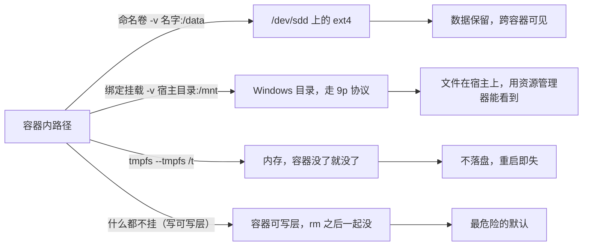

> **实战落点**：示例链第①段 · 依赖跑起来（本篇的实战切入就是第①段的完整复现，本机已跑通）
> **示例版本**：无前置示例文件依赖；本篇自己产出第①段所需的两条启动命令与验证命令，用官方 `redis:7-alpine`、`mysql:8.4` 直接可跑
> **前置依赖**：[/docs/01-基础认知/第一次动手/第一次运行容器与图形化工具/](/docs/01-基础认知/第一次动手/第一次运行容器与图形化工具/)、[/docs/02-核心操作/跑起来/镜像管理与容器生命周期/](/docs/02-核心操作/跑起来/镜像管理与容器生命周期/)、[/docs/00-导读/把环境搭好/环境准备/](/docs/00-导读/把环境搭好/环境准备/)
> **本篇产出物**：一条能跑的 `docker run`（带端口、带卷、带环境变量）+ 一次「删容器后数据仍在」的验证记录；一张把绑定挂载与命名卷的量差测出来的对照表
> **拓展接口**：本篇的「自定义网络才有服务名解析」在 4.9 完整实战里被直接复用（compose 建的就是用户自定义网络）；「绑定挂载慢一个量级」在 4.8 热重载与 7.8 性能排查里分别被复用；容器内 root 与宿主属主的映射原理本篇只给现象，穷尽处是 5.2；`--memory` 的真实下发本篇量到了，机制与 OOM 归 5.3；**回指 10-存储专题**：[/docs/10-存储专题/基础/存储是什么与为什么会出现/](/docs/10-存储专题/基础/存储是什么与为什么会出现/)（10.1）、[/docs/10-存储专题/落点与生命周期/存储形式在操作系统上的落点与验证/](/docs/10-存储专题/落点与生命周期/存储形式在操作系统上的落点与验证/)（10.3）。
> **难度·耗时**：★★☆ · 50 分钟（含动手）
> **自测三题**：
> 1. 为什么 `-p 6380:6379` 之后，宿主机上看到的进程不是 `redis-server`，而是容器后端？
> 2. 两个都在默认 bridge 上的容器为什么互相解析不到，而接进自定义网络就一条命令解决了？
> 3. 容器里 `date` 显示 03:34、宿主显示 11:34，这 8 小时差是容器的问题还是宿主的问题？依据是什么？

## 为什么要先把这三件事分清楚

一个人把服务跑起来，卡了半小时：

```text
「应用连不上我本地的 MySQL，容器明明在跑。」
「端口映射成什么的？」
「没写 -p，我在镜像里 EXPOSE 了 3306。」
「EXPOSE 不打开端口。而且你连的是 localhost:3306，宿主机上根本没有监听。」
「好，加了 -p 通了。另一个问题：我删了容器重建，数据没了。」
「那个卷是绑定挂载还是命名卷？……你把数据放容器可写层里了。」
「行。最后一个：日志时间比实际晚 8 小时，我以为数据库时钟坏了。」
「容器默认是 UTC。你的宿主是 +0800，差的是显示口径，不是时间。」
```

这三个坑的共同点是：**它们都不是"Docker 的 bug"，而是三个不同层面的"东西在哪"被搞混了**——端口在谁身上、数据落在哪个文件系统、时间按哪个时区显示。这三件事一旦分清，第二篇剩下的一半内容会顺很多。

> 💡 新人小结：`-p 6380:6379` 像公司前台转接。外面的人拨总机 `6380`，前台再转到你工位分机 `6379`；**你工位上的人不需要知道总机号**，也不因为总机换了号就得搬桌子。
> 对应到 Docker：`6380` 是宿主机（准确说是容器运行环境那一侧）监听的端口，`6379` 是容器内进程监听的端口，冒号左边是"外面拨的号"、右边是"里面接的号"。容器内进程永远只看到 `6379`，所以下面第一条读数里容器自己登记的端口就是 6379。

## 端口映射：谁在监听哪个号

五种写法都在本机跑过，读数是真实取到的。

| 写法 | 宿主侧实际监听（`netstat -ano` 原文） | 说明 |
|---|---|---|
| `-p 6380:6379` | `TCP 0.0.0.0:6380 ... LISTENING`、`TCP [::]:6380 ... LISTENING`、另有 `TCP 127.0.0.1:6380 ... LISTENING` | 四个地址族都在，等于"任何网卡都能进" |
| `-p 127.0.0.1:6381:6379` | 只有 `TCP 127.0.0.1:6381 ... LISTENING` | 绑定地址收窄到回环。`docker port` 显示 `6379/tcp -> 127.0.0.1:6381` |
| `-p 6379` | `6379/tcp -> 0.0.0.0:60993`、`6379/tcp -> [::]:60993` | 宿主端口随机分配，必须用 `docker port` 才查得到 |
| `-p 8080:80`（本表未跑） | — | 结构同上，只是把容器端口换成 80 |
| `--network host` | 容器内 `hostname` 返回 `docker-desktop` | 桌面版上「host」指那台 Linux 虚拟机的网络栈，**不是你的 Windows**。端口不映射，直接占 VM 的 |

容器那一侧看到什么，是这节最该记住的一条：

```text
$ docker exec m-p1 sh -c "head -2 /proc/net/tcp"
  sl  local_address rem_address   st ...
   0: 00000000:18EB 00000000:0000 0A ...   uid 999
```

`18EB` 是十六进制，换算过来正是 **6379**。也就是说容器里那份监听表上**完全没有 6380 这个数**——它根本不知道外面用了哪个号。这条读数是"端口映射不影响应用内部"的最硬证据。

顺手一条判据：映射成功后从宿主发一次真实协议请求，比看状态更可靠。

```text
$ （对 127.0.0.1:6380 发 RESP 命令 SET a1 v1 / GET a1）
+OK
$2
v1
```

宿主端口被占时的报错长这样，认得它能省十分钟：

```text
$ docker run -d --name m-p5 -p 6380:6379 redis:7-alpine
docker: Error response from daemon: failed to set up container networking: driver failed
programming external connectivity on endpoint m-p5 (...): Bind for 0.0.0.0:6380 failed:
port is already allocated
[返回码 125]
```

判据：**换宿主端口，不要去动容器端口**。上面这条错误里 `0.0.0.0:6380` 是宿主侧的冲突点，容器侧的 6379 从没参与竞争。

## 容器之间怎么找到彼此

这是本篇第二个"东西在哪"：**名字解析发生在哪个网络里**。三条命令的对照：

| 场景 | 命令 | 本机读数 |
|---|---|---|
| 目标容器在默认 bridge，发起容器也在默认 bridge | `getent hosts m-p1` | 无结果 |
| 发起容器在自定义网络，目标**没接进来** | `getent hosts m-p1` | 无结果 |
| 把目标接进来之后再问 | `docker network connect kb-probe-net m-p1` → `getent hosts m-p1` | `172.28.99.2  m-p1  m-p1` |
| 用名字真连一次 | `redis-cli -h m-p1 ping` | `PONG` |

一个实验结论：**容器名能不能被解析，取决于两个容器是不是在同一个用户自定义网络里**，跟"它们在不在同一台机器上"无关。默认 bridge 上没有这套名字解析。

配套读数，供排查时用：

```text
$ docker exec m-p1 cat /etc/resolv.conf
# Generated by Docker Engine.
nameserver 127.0.0.11
options ndots:0
# Based on host file: '/etc/resolv.conf' (internal resolver)
# ExtServers: [host(192.168.65.7)]

$ docker exec m-p1 ip -4 addr show eth0 | head -2
2: eth0@if5: <BROADCAST,MULTICAST,UP,LOWER_UP,M-DOWN> mtu 1500 ...
    inet 172.17.0.2/16 ...

$ docker exec m-p1 ip route | head -3
default via 172.17.0.1 dev eth0
172.17.0.0/16 dev eth0 scope link src 172.17.0.2
172.28.99.0/24 dev eth1 scope link src 172.28.99.2
```

> 💡 新人小结：默认 bridge 像一栋没有内部电话系统的公寓楼——你只知道门牌号（IP），互相叫名字没人应；用户自定义网络则是**给这组容器装了一台内部交换机**，登记了名字，报名字就能接通。
> 对应到 Docker：`nameserver 127.0.0.11` 是引擎内置的解析器，它只服务**用户自定义网络**的登记表；`172.17.0.2/16` 是默认 bridge 的地址，`eth1` 上的 `172.28.99.2/24` 才是接进自定义网络后拿到的、能被名字解析到的地址。所以一个容器可以同时在两个网络里，各自一个 IP。

四种内置网络模式怎么挑：

| 模式 | 什么时候用 | 代价 |
|---|---|---|
| `bridge`（默认） | 单机绝大多数场景 | 默认网络上没有名字解析，要用 `-p` 暴露、用 IP 互访 |
| 用户自定义 bridge | **只要有两个以上容器互访就用它** | 要多建一个网络；这是本篇建议的默认选择 |
| `host` | 追求最少一跳、且明确知道自己在 Linux 宿主上 | 桌面版上它指的是那台 VM，不是你的 Windows；端口直接占用、隔离性也掉了 |
| `none` | 完全不需要网络，或要自己插别的网络 | 连回环以外都没有，需要显式 `network connect` 补 |

判据：新建容器后**先问一次名字再连一次端口**，两步都过才算网络配好；只看 `docker ps` 有 `0.0.0.0:6380->6379/tcp` 不算，那只能证明映射建立了，证明不了解析和连通。

## 数据放在哪：三种挂载与它们的落点

先看图，再看本机实测的挂载表——**这张图就是"删容器会不会丢数据"的答案**。



本机同时挂三种，容器里的 `mount` 表把差异说得非常直白：

```text
$ docker run -d --name m-mix -v kb-probe-vol:/data -v <Windows目录>:/mnt --tmpfs /t redis:7-alpine
$ docker exec m-mix sh -c "mount | grep -E ' /data | /mnt | /t '"
/dev/sdd on /data type ext4 (rw,relatime)
C:\ on /mnt type 9p (rw,noatime,aname=drvfs;path=C:\;uid=0;gid=0;metadata;symlinkroot=/mnt/host/,cache=0x5,access=client,msize=65536,trans=fd,rfd=5,wfd=5)
tmpfs on /t type tmpfs (rw,nosuid,nodev,noexec,relatime)
```

三行读法：**`ext4` 说明命名卷的真身在 Linux 文件系统里（一个虚拟磁盘文件内部），`9p` 说明绑定挂载是跨协议访问 Windows 目录，`tmpfs` 那行带着 `noexec`——连在上面执行程序都不行。** 三种数据的"物理位置"根本不是一回事，所以备份、性能、权限行为全都不同。

> 💡 新人小结：命名卷像把东西存在**公司仓库**——你换了工位（重建容器）货还在，取货要用仓库单号（卷名）；绑定挂载像把**家里的柜子直接搬进办公室**——同一批东西，两边都能伸手拿，但你家和办公室之间那条走廊（这里就是 9p）比办公室内部走动感人得多。
> 对应到 Docker：卷名 `kb-probe-vol` 对应单号，落点 `/var/lib/docker/volumes/<名>/_data`；绑定挂载的宿主目录与容器内 `/mnt` 指向同一批文件，代价是跨文件系统协议；容器可写层则像"东西塞在你座位底下"，扔椅子（`docker rm`）就一起扔了。

### 量出来的差距，以及两次假读数

同一段工作（写 300 个小文件 + `dd` 写一个 64 MiB 文件 + `sync`）分别落在绑定挂载与命名卷上，各跑三轮：

| 轮次 | 绑定挂载（Windows 目录，9p） | 命名卷（ext4） |
|---|---|---|
| 1 | 1082 ms | 421 ms |
| 2 | 1068 ms | 429 ms |
| 3 | 1036 ms | 409 ms |
| 中位 | **1068 ms** | **421 ms** |

`docker run --rm alpine true` 的固定开销中位是 **398 ms**。扣掉它：绑定挂载约 **670 ms**，命名卷约 **23 ms**，**差约 29 倍**。宿主侧核对确实写出了 301 个文件、`big.bin` 为 `67108864` 字节（正好 64 MiB）。

两条关于测量本身的说明，比结论更容易复发：

1. **第一次尝试得到过"0 ms"这种不可能的数。** 原因是我在容器里用 `date +%s%N` 取纳秒，而这个镜像的 `date` 是精简实现，本机直接验它的行为：`date +%s%N` 返回 `1793072365`——**纳秒位被静默丢掉了**，于是 `(t2-t)/1000000` 恒为 0。改用宿主侧墙钟差值 + 减基线才拿到真数。
2. **基线里有一次 5613 ms 的离群值**（第一轮冷启动）。所以我取中位数而不是最小值或单次读数，并把三轮原始值一起留下。

还有两个"看着像通过其实没测到东西"的坑，都是本轮现场踩的：

| 现象 | 成因 | 怎么防 |
|---|---|---|
| 测"删容器后数据是否留在命名卷"，但结果毫无意义 | 我把挂载目标路径写错了，Docker **顺手建了一个匿名卷**接走真正的数据目录，容器照跑、查询照出 | 动手前先 `docker inspect --format '{{range .Mounts}}…'`，确认目标路径挂的是**你以为的那个卷** |
| `docker rm -f` 之后卷越积越多 | 镜像里有 `VOLUME /data` 声明，每次不带卷名起容器都会建一个匿名卷；`docker rm` 不清理它们，只有 `--rm` 会 | 本轮实测：一轮 `-d` 实验后遗留 **4 个匿名卷**，创建时间正好对上那四次运行，`docker system df` 却只报 0B（它们是空的）——所以"看大小"发现不了 |

> 💡 新人小结：`docker inspect` 的挂载列表像快递面单。**tmpfs 这一项在面单上是查不到的**——本机三个挂载（卷、绑定、tmpfs），`.Mounts` 只列了前两个。
> 对应到操作：想知道容器到底挂了几样东西，`docker inspect` 和容器内 `mount` 要**都看一次**；只看前者会漏掉 `--tmpfs`，也看不见那个不该出现的匿名卷。

### 三种挂载怎么选

| 需求 | 选 | 理由（含本机证据） |
|---|---|---|
| 数据库、缓存等要活过容器重建的数据 | 命名卷 | 落在 ext4 上，删容器不动卷；本轮 Redis 与 MySQL 两次验证都通过（见实战切入） |
| 要把宿主上的源码、配置文件给容器读 | 绑定挂载 | 必须双向可见时用。但**别把数据目录放这儿**：约 29 倍量差 |
| 临时缓存、编译中间产物、不能留痕的敏感数据 | tmpfs | 内存盘，容器没了就没；注意默认带 `noexec` |
| 什么也没挂 | —— | 这叫"写进可写层"，是最危险的默认。宁可显式挂一个卷 |

## 权限：容器里的 root 和宿主上是谁

容器默认是谁，本机读数：

```text
$ docker exec m-mix id
uid=0(root) gid=0(root) groups=0(root),1(bin),2(daemon),3(sys),4(adm),6(disk),10(wheel),...
$ docker exec m-mix grep -E '^(Uid|Gid)' /proc/self/status
Uid:	0	0	0	0
Gid:	0	0	0	0
```

`Uid:` 那一行四个数都是 0，说明**这台机器没有开用户命名空间重映射**——容器里的 root 就是引擎那侧真实 uid 0。（重映射开启后这四个数会指向一个高位段，那属于 5.8 的范围。）

改身份与写文件的组合结果，是这节最有用的表：

| 怎么起 | 容器内身份 | 写绑定挂载 | 写完后容器里 `stat -c '%u:%g'` |
|---|---|---|---|
| 默认 | `uid=0(root)` | 成功 | `0:0` |
| `--user 1000:1000` | `uid=1000 gid=1000(redis)` | **也成功** | `1000:1000` |
| `--user 1000:1000` 写命名卷里的非本人目录 | 见下方说明 | 未测 | 未测 |

第二行值得停一下：**Windows 上的绑定挂载是非 root 也能写**。原因就在上面那条 `mount` 里——9p 挂载带了 `uid=0;gid=0;metadata`，权限判定方式与原生 Linux 文件系统不同。这在开发期"帮了你"（不会因为属主卡住），但它会让人**养成在 Linux 生产上也这么写的习惯**，那里就没有这个宽容度了。所以本篇给的规矩是：**别把 Windows 上验证过的属主行为当成可移植的结论。**

命名卷里的属主也有一个真实读数，注意它和上面那条不是一回事：

```text
$ docker run --rm -v kb-own:/data redis:7-alpine sh -c 'echo probe > /data/m.txt; stat -c "%u:%g %A %n" /data /data/m.txt'
999:1000 drwxr-xr-x /data
0:0      -rw-------  /data/m.txt
```

`/data` 这个**目录本身**属于 `999:1000`，因为卷第一次被创建时按镜像里 `/data` 的属主初始化（镜像里有 `redis:x:999:1000::/home/redis:/sbin/nologin`）。而 root 写进去的文件就是 `0:0`。这条读数我用两个独立容器复现过两次。**换镜像时目录属主跟着镜像走**，这就是"应用换了非 root 用户之后突然写不进老卷"的常见成因。

> 💡 新人小结：属主像小区门禁卡的登记名字。卡（文件）本身没变，但你换了一个人刷卡（换 `--user` 或换镜像里的用户），物业按**登记名**决定让不让进；而卷目录的登记名在建卷那一刻就按"当初那把卡"写死了，后来换了人也不自动改。
> 对应到 Docker：卷的目录属主来自镜像首次初始化，不随你之后传的 `--user` 变；要么建卷/首次运行时就把属主设对，要么在编排里显式指定运行用户并保证目录属主匹配。

## 时区与中文：三处口径别搞混

| 位置 | 本机读数 | 结论 |
|---|---|---|
| 容器默认 | `Tue Oct 27 03:34:28 UTC 2026`，`TZ` 未设 | 容器是 UTC |
| 只设 `-e TZ=Asia/Shanghai` | `Tue Oct 27 11:34:28 CST 2026`，`date +%z` 给 `+0800` | 一个环境变量就改显示口径，**不改存储的时间点** |
| 挂载 `/etc/localtime:ro` 再 `date` | 仍然 `03:34:29 UTC` | 在桌面版上这招**没用**——你挂进来的是那台 Linux 虚拟机的时区文件，它本来就是 UTC |
| 宿主同一时刻 | `2026-10-27T11:34:29+0800` | 与容器那一行相差 8 小时的是显示，不是时刻 |
| 引擎日志 | `2026-10-27T03:34:23.808Z 1:C 27 Oct 2026 03:34:23.808 * Redis is starting` | **一行里两个时间戳都是 UTC**：前者是引擎加的时间戳，后者是应用自己打的 |

日志时间排查的判据：**先看有没有 `Z`**。带 `Z` 是 UTC，要换算才能和宿主时间对齐；不带 `Z` 的时间戳取决于应用内 `TZ`。设 `TZ` 只影响**应用自己打印的那一段**，引擎加的时间戳永远是 UTC。

中文的问题更朴素，也更常踩：同一个终端里可能混着三种编码。本轮在同一条命令链里就同时撞到过：

| 来源 | 输出编码 | 直接按 UTF-8 读会看到什么 |
|---|---|---|
| `where docker` 等 Windows 自带命令 | GBK 一类本地代码页 | 一句本来说明"没找到"的话，变成一串乱码字节 |
| `wsl.exe` | UTF-16LE | 连长度都不对，看起来像垃圾数据 |
| `docker` 与 `alpine` 里的命令 | UTF-8 | 正常 |

判据：**先确认解码方式，再判断"是不是坏了"**。乱码出现在读的那一端，不是容器里写坏了。

镜像本身可能根本没有 locale 数据，这点也量了：

```text
$ docker run --rm redis:7-alpine sh -c "locale | head -1; ls /usr/share/locale | head -1; printf '中文'"
sh: locale: not found
ls: /usr/share/locale: No such file or directory
中文
```

第三行才是重点：**没有 locale 工具、没有语言包，UTF-8 的中文照样正确输出。** 所以在精简镜像上，"中文乱码"极少是镜像缺语言包，绝大多数是宿主终端的解码或数据在写入前就被转错了编码。

## 实战切入：把示例链第①段真跑一遍

这一段就是第①段本体，全部命令本机跑通，读数照抄。要的东西：一个 MySQL、一个 Redis、两个命名卷，以及"删容器之后数据还在"。

```bash
# Redis：开 AOF，否则只有内存快照，删除容器后未必留得住
$ docker run -d --name kb-p1-redis -p 6380:6379 -v kb-p1-data:/data \
    redis:7-alpine redis-server --appendonly yes

# 宿主直接发协议写入（这一步同时验端口映射与网络）
$ （对 127.0.0.1:6380 发 SET kb:proof round-1-value） -> +OK

$ docker rm -f kb-p1-redis          # 只删容器，卷不动
$ docker run -d --name kb-p1-redis -p 6380:6379 -v kb-p1-data:/data \
    redis:7-alpine redis-server --appendonly yes
$ （再发 GET kb:proof） -> $13  round-1-value        # 活过一次删除
```

MySQL 侧同理，判据换成 `SELECT`：

```bash
$ docker run -d --name kb-p1-mysql -p 3307:3306 -v kb-p1-mysqldata:/var/lib/mysql \
    -e MYSQL_ROOT_PASSWORD=<自己的密码> -e MYSQL_DATABASE=kbdemo mysql:8.4
$ docker exec kb-p1-mysql mysqladmin ping -uroot -p<密码>     # 约 6~9 秒后就绪
$ docker exec kb-p1-mysql mysql -uroot -p<密码> kbdemo -e "
    CREATE TABLE t_probe(id INT PRIMARY KEY, note VARCHAR(32), written_at DATETIME);
    INSERT INTO t_probe VALUES (1,'before-delete',NOW()),(2,'second-row',NOW());"
```

删掉容器再重起之后：

```text
$ docker rm -f kb-p1-mysql
$ docker volume ls | grep kb-p1        →  kb-p1-mysqldata 仍在列表里
$ （重新 docker run 同一个卷，约 6 秒就绪）
$ mysql -e "SELECT COUNT(*) FROM t_probe;"        →  2
$ mysql -e "SELECT * FROM t_probe;"
1  before-delete  2026-10-27 03:22:48
2  second-row     2026-10-27 03:22:48
```

还有一条顺手验到的：**宿主连上 `127.0.0.1:3307` 时收到了 MySQL 的握手包，包里的版本串是 `8.4.13`**。这一步不只是"TCP 能连"，而是应用层协议真的走通了——很多人验证端口映射只看 `docker ps` 的端口列，那是最弱的一条证据。

两个必须写进流程的收尾动作：

1. **确认你测的是那个卷**。本轮出现过一次：挂载目标路径写错，Docker 建了个匿名卷接走真实数据目录，此时"数据还在"证明的不是命名卷。用 `docker inspect --format` 把挂载列出来看一眼，两秒钟。
2. **确认你的读法没错**。也出现过一次：手写协议报文时长度前缀和字段实际长度不一致，服务端把多余字节当成新命令，回了一个"空值"加一条怪错误——看起来完全像"键没留住"。用能自动算长度的客户端，或先用官方客户端验一次。

清理也是流程的一部分：本轮创建的容器、卷、镜像全部删除，`docker system df` 复核为 Images 0 / Containers 0 / Local Volumes 0 / Build Cache 0。参考容量：`redis:7-alpine` 57.8 MB、`mysql:8.4` 1.12 GB，两个卷初始化后一共 218.4 MB。

## 常见误读

| 你可能的理解 | 实际情况 |
|---|---|
| `EXPOSE 3306` 之后宿主就能连这个端口 | `EXPOSE` 只是元数据（见 3.3）。宿主侧没有监听，连不上是必然 |
| `-p 6380:6379` 之后容器里的应用"知道"自己是 6380 | 容器内监听表里只有 6379，映射完全发生在外面 |
| 容器连不上就重装 Docker | 名字解析问题、网络选错、宿主端口占用三类各有明确报错，先按报错定位 |
| 绑定挂载和命名卷只是写法不同 | 一个走 9p、一个走 ext4，本机量到约 29 倍的差；Windows 上把数据目录放绑定挂载会慢到影响开发 |
| 删容器才会丢数据，所以数据放哪儿无所谓 | 不放卷里就是放可写层，`docker rm` 一起丢；而且 `docker rm` 不会清掉匿名卷，会攒垃圾 |
| 容器里是 root，那宿主上创建的文件也归我 | 没开用户命名空间重映射时容器 root 对应引擎侧真实 uid 0；在 Windows 绑定挂载上这条表现又被 9p 的挂载参数改掉了，**不能当可移植结论** |
| 日志时间不对，是容器时间坏了 | 容器是 UTC、宿主是 +0800，差的是显示口径。设 `TZ` 只影响应用自己打的那一段 |
| 精简镜像里中文乱码，因为镜像缺中文包 | 没有 locale 工具也能正确输出中文。乱码通常是读的哪一端解码不对 |

## 本篇不覆盖什么

按基础层的规矩，故意不讲的东西要点名交给谁：

- 联合文件系统的写时复制机制，以及"为什么镜像层能共享" → **5.4**（本篇只给"可写层随容器消失"这个结论）。
- 用户命名空间重映射（容器 root 在宿主上变成高位 uid）的原理与限制 → **5.2**、**5.8**（本篇只给"这台机器没开重映射"的读数）。
- `--memory` / `--cpus` 怎么限制、超限为什么会被杀 → **5.3**（本篇只在容器里读到了 `memory.max` 这个数）。
- 跨主机网络（overlay、macvlan）与为什么单机 bridge 不够 → **5.5**、**5.6**。
- 镜像构建期怎么设文件属主（`COPY --chown`）与 `USER` 指令 → **3.2**、**3.3**（本篇只观察运行后的属主结果）。
- 环境变量注入与配置文件分离的完整口径 → **2.8 所在的另一篇**（[/docs/02-核心操作/跑起来/进容器调试与状态查看/](/docs/02-核心操作/跑起来/进容器调试与状态查看/)）。
- 数据卷的备份与恢复操作规程 → **6.6**；误删卷的现场救援 → **7.5**。
- 生产环境的资源限制、日志轮转与只读根文件系统怎么组合 → **6.3**、**6.4**。

## 要点总结

- 端口映射只发生在外面：容器内监听表上永远是自己的端口（本机读到十六进制 `18EB` = 6379）。`-p` 冒号**左边是宿主、右边是容器**，冲突永远报在左边那个号上。
- **只有用户自定义网络才有容器名解析**（默认 bridge 上 `getent` 无结果，`network connect` 之后立刻解析到 `172.28.99.2` 并拿到 `PONG`）。两个以上容器互访就建一个自定义网络。
- 三种挂载的落点各不相同：命名卷在 ext4 上、绑定挂载走 9p、tmpfs 在内存（还带 `noexec`）。Windows 上做绑定挂载的实测代价约 **29 倍**（净 670 ms 对 23 ms）。
- 数据要活过容器重建就放命名卷，并且**每次确认挂的是哪个卷**：路径写错时 Docker 会静默建匿名卷；`docker rm` 不清理匿名卷，只有 `--rm` 会。
- 属主三件事要分开：容器默认 root、`--user` 换身份、卷目录的初始属主跟着镜像。Windows 绑定挂载因为 9p 挂载参数而对非 root 写入异常宽容，**这不是可移植结论**。
- 容器默认 UTC，`TZ` 只改应用自己打印的时间；引擎加的时间戳永远是 UTC。挂载 `/etc/localtime` 在桌面版上不改变事实。
- 乱码先怀疑解码端：同一屏可能混着 GBK、UTF-16LE、UTF-8 三种编码，而精简镜像没有 locale 工具也能正确输出 UTF-8 中文。
- 本篇两次"看着通过其实没测到"的经历本身就是判据：**验留存前先确认卷，读空值前先确认读法。**

## 本篇未验证项

| 项 | 状态 | 原因 |
|---|---|---|
| `--user 1000:1000` 写命名卷里属主不匹配的目录 | 未测 | 需要一个属主为 root 的卷内子目录做对照，本轮没布置；这是"换用户后写不进老卷"的正面复现，应在 3.2/5.8 相关批次补齐 |
| `COPY --chown` 的构建期行为 | 未测 | 属镜像构建篇（3.2），本篇只测运行后的属主结果 |
| 用户命名空间重映射开启后的 uid 表现 | 未验证 | 本机未开启（`/proc/self/status` 的 `Uid` 四个数都是 0），无对照环境 |
| Linux 原生宿主上的绑定挂载性能 | 未验证 | 29 倍这个量差是 **Windows 目录经 9p** 的数，不能外推到 Linux 上的同机绑定挂载 |
| 计时实验的绝对值 | 参考值 | 差值法测得（含容器固定启动开销 398 ms 已扣除），机器负载会变；倍数关系三轮一致（1082/1068/1036 对 421/429/409），但别把 670 ms 当成契约数字 |
| `-p 8080:80` 这一档 | 未测 | 结构与 6380 那组相同，只换容器端口；为不凑数而没有实际跑，故不写成结论 |
| 卷备份与恢复操作规程 | 未验证 | 归 6.6。本篇只验"数据跨容器存活"，没做导出导入 |
| 示例链第①段作为**交付物**的 from-0 前置清单 | 未创建 | 命令与读数都真跑过，但示例目录还没落地，判据一仍需在干净机器上复现 |
