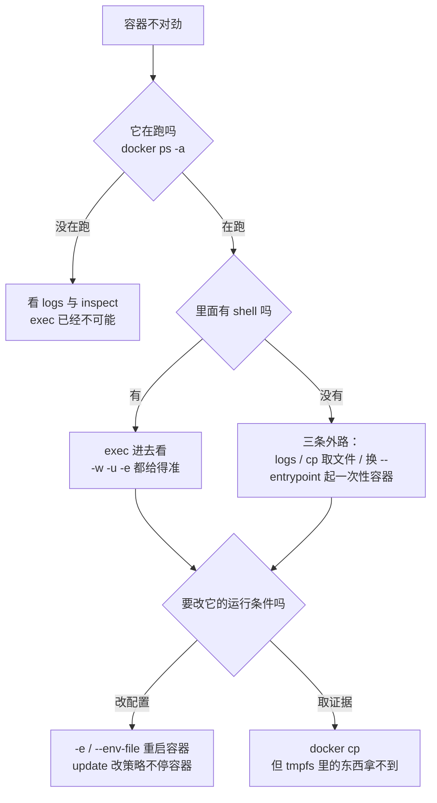

> **实战落点**：示例链第③段 · 服务自带源码能独立起步（本篇负责「镜像单独跑起来之后，怎么看清它、怎么把东西放进拿出」，是第③段与第②段之间的日常动作）
> **示例版本**：消费 `示例/贯穿示例/api-service/` 产出的 `kb-p2-api`，以及一个现造的 `FROM scratch` 无 shell 镜像（Dockerfile 在正文里，三行）
> **前置依赖**：[/docs/02-核心操作/跑起来/镜像管理与容器生命周期/](/docs/02-核心操作/跑起来/镜像管理与容器生命周期/)、[/docs/02-核心操作/接上去/端口映射数据管理与权限时区/](/docs/02-核心操作/接上去/端口映射数据管理与权限时区/)、[/docs/03-镜像构建/写出来/Dockerfile指令全解与构建上下文/](/docs/03-镜像构建/写出来/Dockerfile指令全解与构建上下文/)
> **本篇产出物**：一张「没有 shell 时还剩哪几条调试路」的实测表；一张 `docker cp` 四条边界（rootfs 可以、stopped 可以、tmpfs 不行、`-` 给的是 tar）；一份 `--env-file` 的解析规则实测（含一整行坏语法导致整文件被拒）；一条口令走 env 的外泄面清单（四条读数）
> **难度·耗时**：★★☆ · 50 分钟（含动手）
> **拓展接口**：本篇的「inspect 模板」在 7.2 症状索引里被逐条复用；`--env-file` 与 compose `.env` 的区别在 4.7 已量直，本篇只做容器侧；「secret 不该走 env」的边界在 6.3 落地为 `configs`/`secrets`；`logs -f` 的正确退出姿势在 7.9 值班 runbook 里用；**回指 10-存储专题**：[/docs/10-存储专题/配置与内容/配置应用内容覆盖与失效/](/docs/10-存储专题/配置与内容/配置应用内容覆盖与失效/)（10.5）。
> **自测三题**：
> 1. 同事的镜像是 distroless，`docker exec -it 容器 sh` 报 127。接下来你手里还剩哪三条路？
> 2. 你把日志重定向到容器里的 `/tmp/app.log`，`docker cp` 取不出来。最可能的原因是什么？
> 3. `-e K` 与 `--env-file` 同时给同一个键，哪个赢？`--env-file` 里有一行 `X = 1` 会怎样？

## 为什么要先分清「进得去、看得见、改得了」这三件事

一次线上排查的对话（本地栈也一样）：

```text
「服务 502，我进容器看看。」
「exec 进去了吗？」
「报错：executable file not found in $PATH —— 里面没 sh。」
「那是 distroless。别看交互了，先看 logs 和 inspect。」
「日志里全是空的。」
「你 exec 的是哪个容器？它已经退出两轮了，`ps` 不加 -a 看不见。」
「那我 docker cp 把里面的日志文件拷出来总行吧？」
「可以，但如果那文件写在 /tmp 而且是 tmpfs，cp 拿不到——本轮实测就是这样。」
```

这三件事各自的工具不重叠：**进得去**靠 `exec`/`attach`/`run --entrypoint`，**看得见**靠 `logs`/`inspect`/`stats`/`top`/`diff`/`events`，**改得了**靠 `cp`（放文件）、`-e`/`--env-file`（放配置）与 `update`（改策略）。搞混的结果就是「对着一个没有 shell 的镜像死磕 exec」或者「改了配置却以为生效了」。



> 💡 新人小结：**容器不是一个你能「远程登录」的小机器，它是一个进程**。有 shell 时你可以像 SSH 一样钻进去（`exec`）；没有 shell 时（distroless、scratch）那扇门根本不存在，能做的只剩**问它说过什么（logs）、摸它留下什么（cp）、看它现在什么样（inspect/stats/top/diff）**。类比之后接机制：`exec` 是在容器的 PID namespace 里再创建一个进程，所以它要求容器文件系统里真有那个可执行文件；而 `logs`/`inspect` 是 dockerd 从外部读元数据与日志文件，`cp` 走 daemon 的归档接口——这三条都不需要容器里有 shell。

## `exec` 与 `attach`：两条进容器的路

`exec` 家族的本机读数（容器是 `alpine:3.20` 里跑一个 `sleep` 循环）：

| 命令 | 读数 | 说明 |
|---|---|---|
| `docker exec kbC1 id` | `uid=0(root) … groups=…27(video)` | 默认以镜像的 `USER` 身份执行（这里是 root） |
| `docker exec -u nobody kbC1 id` | `uid=65534(nobody) gid=65534(nobody)` | `-u` 临时降权，验证权限问题最好用 |
| `docker exec -w /etc kbC1 pwd` | `/etc` | `-w` 指定工作目录，不改容器本身 |
| `docker exec -e FOO=bar kbC1 sh -c "echo $FOO"` | `bar` | 只给这一次执行加变量，不污染容器 |
| `docker exec kbC1 sh -c "exit 42"` | `rc=42` | **退出码透传**，脚本里能直接判 |
| `docker exec kbC1 no-such-tool` | `rc=127`，`OCI runtime exec failed: … exec: "no-such-tool": executable file not found` | 127 是 exec 层的「没这个命令」，与 `run` 的 127 同源 |
| `docker exec` 打到已退出容器 | `rc=1`，`container 2e0d… is not running` | 现场消失，只能回到 `logs` |

`attach` 只有一条读数（本轮没做交互式 attach，因为它是**人工动作**，脚本里会挂住）：

```console
$ docker create --name kbC1x alpine:3.20 true
$ docker attach kbC1x
[rc=1] cannot attach to a stopped container, start it first
```

两者的分工说清就够：`attach` 接的是容器 PID 1 的**标准流**，不新建进程，所以没有 shell 的镜像也能 attach 到它的 stdout；`exec` 是新建一个进程，要求镜像里有那个程序。日常排查用 `exec -it 容器 sh`，只有「主进程还活着但进不去」时才用 `attach`——注意 `attach` 会把你的终端接上去，脱离要用 `Ctrl-P` `Ctrl-Q`（这条组合键本轮未实测，属人工判据）。

## 没有 shell 的镜像怎么调

现造一个（三行，本机跑过）：

```dockerfile
FROM scratch
COPY api /app
ENTRYPOINT ["/app"]
```

```console
$ docker run -d --name kbNoshell kbnoshell
$ docker exec kbNoshell sh
[rc=127] OCI runtime exec failed: exec failed: unable to start container process:
          exec: "sh": executable file not found in $PATH
$ docker logs kbNoshell
api 监听 : 8080 | DB_HOST=  | REDIS_HOST=
$ docker cp kbNoshell:/app ./pulled-binary
   rc=0，取到 8,600,127 字节
$ docker diff kbNoshell
   (空)
```

四条外路，按「代价从低到高」排：

| 路子 | 命令 | 本轮读数 | 拿到的东西 |
|---|---|---|---|
| 1. 看它说过什么 | `docker logs --timestamps 容器` | 有输出（见上） | 应用自己的日志，唯一不需进容器的现场 |
| 2. 摸它留下什么 | `docker cp 容器:/path 宿主` | `rc=0`，`8,600,127` 字节 | 容器根文件系统里的任何文件（tmpfs 除外，见下一节） |
| 3. 问 daemon | `docker inspect --format …` | 见「看状态」一节 | 配置、挂载、网络、退出码、OOM 标志 |
| 4. 换一个入口再跑 | `docker run --rm --entrypoint /bin/sh 镜像 -c "命令"` | `echo PORT=$PORT` 读到 `8080` | 只对**镜像里有那个程序**的情况有用；scratch 连这条路也没有 |

第 4 条在 alpine 底镜像上很实用（本篇实测用它验了配置覆盖），在 scratch/distroless 上无效——此时唯一的动态手段是「**把可疑镜像的产物 `cp` 出来，在别的有 shell 的容器里再看一遍**」：`docker run --rm -v $(pwd):/w alpine:3.20 ls -l /w/pulled-binary`。团队规矩：**给 distroless 应用留一条「日志必须写到 stdout」的约定**，否则第 1 条路也是空的。

## `docker cp` 的四条边界

四条都在本机跑过，结果各不相同：

| 场景 | 命令 | 读数 |
|---|---|---|
| 从**运行中**容器取根文件系统上的文件 | `docker cp kbC1:/tmp/marker.txt ./from-ctr.txt` | `rc=0`，宿主读到 `out-of-container` |
| 从**已停止**容器取 | 先 `docker stop kbC1`，同一条命令 | `rc=0`，仍然拿得到 |
| 从 **tmpfs** 里取 | `docker cp kbC3ro2:/tmp/inside.txt …` | `rc=1`，`Could not find the file /tmp/inside.txt in container kbC3ro2` |
| 取到 `-`（标准输出） | `docker cp kbC1:/tmp/marker.txt -` | 拿到的是**一个 tar**（`2048` 字节，头部是补空的文件名），不是裸文件 |

第三行是本轮最值得记的一条：容器里 `ls /tmp; cat /tmp/inside.txt` 明明看得见（输出 `inside.txt | probe.txt | tmpfs-ok`），`docker cp` 却说「文件不存在」。原因是 `cp` 走的是 daemon 按**存储驱动**读根文件系统的接口，tmpfs（以及 bind mount、卷）是运行期挂上来的另一棵树，不在那条路径里。**替代做法**：`docker exec 容器 cat /tmp/inside.txt > 本地文件`（本轮实测 `rc=0`，内容 `tmpfs-ok`）；整目录就用 `docker exec 容器 tar -czf - -C /tmp . > dump.tgz`。

顺带两条同源的实测：

```console
$ docker stop kbC3ro2 && docker start kbC3ro2
$ docker exec kbC3ro2 ls /tmp
inside.txt              ← 只剩启动命令重写的那一个
```

上一轮由 `docker exec` 写进去的 `probe.txt` 消失了——**tmpfs 的内容活不过一次 `stop`/`start`**，看着像「文件还在」只是因为容器的启动命令又把它写了一遍。把日志写到 tmpfs 里 = 停一次就没（与第①段那条「命名卷活过容器」正好相反）。

只读容器的配套写法：

```console
$ docker run -d --name kbC3ro --read-only alpine:3.20 sh -c "while :; do sleep 1; done"
$ docker exec kbC3ro sh -c "echo x > /etc/nope"
   sh: can't create /etc/nope: Read-only file system
$ docker exec kbC3ro sh -c "echo x > /tmp/ok"
   sh: can't create /tmp/ok: Read-only file system      ← /tmp 也在根里，一样不可写
$ docker run -d --name kbC3ro2 --read-only --tmpfs /tmp alpine:3.20 …   ← 这才是标准解法
```

> 💡 新人小结：`docker cp` 像**仓库管理员按货架清单找东西**——货架（镜像层与可写层）上的他一眼就能看到，但临时工作台（tmpfs）不归他管，他只会说「没这个东西」。类比之后接机制：cp 的实现是 daemon 从存储驱动导出根文件系统路径，挂载点不是它的一部分；所以「东西确实在容器里但 cp 拿不到」不是 bug，是路径来源不同。工作台上取东西只能靠里面的人递（`exec cat`）。

## `logs`：顺序、时间戳与「能不能自己结束」

```console
$ docker run -d --name kbL alpine:3.20 sh -c "echo line1; sleep 0.2; echo line2; echo err >&2; sleep 0.2; echo line3"
$ docker logs kbL
line1
line2
line3
err                        ← stderr 被排到了后面，不是原始顺序
$ docker logs --tail 1 kbL
line3
$ docker logs --timestamps kbL
2026-10-27T10:33:28.513041366Z line1
2026-10-27T10:33:28.713954797Z line2
2026-10-27T10:33:28.914708411Z line3
2026-10-27T10:33:28.713923841Z err
$ docker logs -t --tail 2 kbL
2026-10-27T10:33:28.713954797Z line2
2026-10-27T10:33:28.914708411Z line3
$ docker logs -f --since 20s --until 1s kbL
[rc=0] line1 line2 line3 err          ← --until 会让 -f 自己结束，不会挂住
```

三条要点：

1. **别按 `logs` 的行序推断事件顺序**。`line2 → err → line3` 的真实发生顺序被两个流各自的缓冲打乱；要看时序一律加 `-t/--timestamps`，上面那组时间戳就是证据（`err` 的时刻在 `line2` 与 `line3` 之间）。
2. **`--tail` 与 `-t` 可以叠**，值班时最小可用组合是 `logs -t --tail 200`；`--since`/`--until` 接受 RFC3339 或相对时长（`42m`）。
3. **`--no-log-prefix` 不是 `docker logs` 的选项**（`rc=125 unknown flag`），它是 `docker compose logs` 的。命令族混用是排错现场里最常见的第二层困惑——compose 与 docker 的 `logs` 不是同一个实现。

## 看状态的五个工具，各自回答什么问题

| 你想知道 | 命令 | 本机读数 |
|---|---|---|
| 它现在占了多少资源 | `docker stats --no-stream --format "{{.Name}} cpu={{.CPUPerc}} mem={{.MemUsage}} pids={{.PIDs}}"` | `kbD2 cpu=0.05% mem=1.516MiB / 47.01GiB pids=2` |
| 里面跑了哪些进程 | `docker top 容器` | 表头 `UID PID PPID C STIME TTY TIME CMD`，PID `6292`、PPID `6268` |
| 它改了文件系统里什么 | `docker diff 容器` | `C /etc`、`D /etc/motd`、`C /tmp`、`A /tmp/m.txt`、`A /tmp/nd` |
| 刚才发生了什么事件 | `docker events --since 30s --until 1s --format "{{.Action}} {{.Actor.Attributes.name}}"` | `create kbSig3 \| start kbSig3 \| kill kbSig3 \| stop kbSig3 \| die kbSig3 \| destroy kbSig3 …` |
| 容器的可写层多大 | `docker ps -a --size --format "{{.Names}} {{.Size}}"` | `kbD2 20.5kB (virtual 8.51MB)`、`kbC1 24.6kB (virtual 8.52MB)` |

`docker top` 有个容易误读的点：**它给的 PID/PPID 是宿主命名空间的**（上面那行 PPID `6268` 是宿主侧的容器进程管理者），不是容器里的 `1`/`0`。要看容器视角的进程树得 `exec ps -ef`（而 distroless 里根本没有 `ps`）。

可以直接抄的 `inspect` 模板（本轮全部跑过）：

```console
$ docker inspect --format 'status={{.State.Status}} exit={{.State.ExitCode}} pid={{.State.Pid}} \
    error={{.State.Error}} oom={{.State.OOMKilled}} policy={{.HostConfig.RestartPolicy.Name}} mem={{.HostConfig.Memory}}' 容器
status=running exit=0 pid=6292 error= oom=false policy=no mem=0
$ docker inspect --format '{{json .Mounts}} | {{json .Config.Env}} | {{json .Config.Labels}}' 容器
[] | ["PATH=/usr/local/sbin:/usr/local/bin:/usr/sbin:/usr/bin:/sbin:/bin"] | {}
$ docker inspect --format '{{json .NetworkSettings.Ports}}' 容器       # 端口有没有真绑上
$ docker inspect --format '{{range .NetworkSettings.Networks}}{{.IPAddress}}{{end}}' 容器
$ docker ps -a --filter status=exited --filter ancestor=alpine:3.20 --format '{{.Names}} {{.Status}}'
kbA2o Exited (137) 6 minutes ago | kbA2k Exited (137) 6 minutes ago      # 多个 --filter 是「与」
```

`mem=0` 这一格值得停一下：**0 不等于「无限」是错觉吗？** 是——`HostConfig.Memory=0` 表示没设限，实际限额要从 `docker stats` 的分母（本机 `47.01GiB`）或容器里的 `/sys/fs/cgroup/memory.max` 读（第①段量过 `67108864` 那次就是这么验的）。

## 配置注入：`-e`、`--env-file`，与「什么不该走 env」

W6.1 第 15 项（环境变量注入与配置分离）。四种写法的行为差别是实测出来的：

| 写法 | 本机读数 |
|---|---|
| `-e KEY=value` | 容器内读到该值 |
| `-e KEY`（只给键名，宿主环境有值） | `printenv FROMHOST` → `host-value`（从宿主环境取值） |
| `-e KEY`（宿主该变量是空串） | 容器里 **变量存在**（值为空），`printenv` 不报错 |
| `-e` 覆盖镜像 `ENV` | 镜像默认 `PORT=8080` → 加 `-e PORT=9999` 读到 `9999` |
| `-e` 与 `--env-file` 给同一个键 | **`-e` 赢**，且两种先后顺序结果相同：`PORT=9999 DB=from-file` |
| `docker create -e PORT=7777 …` 后 inspect | `"Config.Env":["PORT=7777","PATH=…"]`（覆盖值排在最前） |

`--env-file` 的解析规则比想象的严：

```console
$ docker run --rm --env-file env1.txt alpine:3.20 sh -c '…'
[rc=125] docker: --env-file: invalid env file (env1.txt):
          variable '; 分号注释?' contains whitespaces
$ docker run --rm --env-file no-such.env alpine:3.20 true
[rc=125] docker: --env-file: open no-such.env: The system cannot find the file specified.
```

- `#` 开头的行是注释，空行被忽略；**`;` 不是注释**，一行 `; 分号注释?` 会让**整个文件**被拒（不是跳过那一行）。
- 值里可以有空格（`B=has space` 通过），但**键名两侧不能有空格**、不能有 `=` 之外的分隔写法。
- 文件不存在是 `125`，Windows 上报的是系统的「找不到文件」文案。
- **CRLF 行尾安全**：`K=1` 读到的长度是 `1`（`\r` 被吃掉），不需要专门转换行尾。

配置与镜像分离的原则，用一句话讲：**镜像里烤的是「不随环境变的东西」，随环境变的走 env**。判据是「换一个环境要不要重 build」——要，就说明它本该是 env。

口令是这条线之外的一类，因为 env 的可见面比想象的大。四条实测：

```console
$ docker run -d --name kbSec -e TOP_SECRET=s3cr3t-value alpine:3.20 sh -c "sleep 120"
$ docker inspect --format "{{json .Config.Env}}" kbSec
["TOP_SECRET=s3cr3t-value","PATH=…"]                 ← 任何能 inspect 的人/进程都读得到
$ docker exec kbSec sh -c 'cat /proc/1/environ | tr "\0" "\n" | grep SECRET'
TOP_SECRET=s3cr3t-value                                ← 容器里任何进程都能读 PID 1 的环境
$ docker ps --format "{{.Names}} {{.Status}}" kbSec
kbSec Up Less than a second                            ← ps 里看不到 env（好消息）
$ docker top kbSec
UID PID PPID … CMD root …                              ← top 只给命令行，不含 env
```

结论写成三条团队规矩：口令**不要**烘进镜像（`history` 与 `Config.Env` 两处都在，见 3.2）；**不要**把口令放进会提交进仓库的 `--env-file`（compose 的 `.env` 同理，示例目录的 `.gitignore` 里第一条就是 `.env`）；生产走 `configs`/`secrets` 或外部注入（6.3），临时调试用的口令一律放在只进容器一次、不落盘的位置。

还要分清两件事：**`docker run --env-file` 喂的是容器的环境变量，compose 的 `.env` 喂的是 compose 文件的插值**（`${VAR}` 在渲染阶段就被替换，压根不会自动进容器）。这条差异的量法与失败形状在 4.7：`.env` 缺失时 `${X:?文案}` 会硬失败并把文案打进报错。

> 💡 新人小结：**环境变量像贴在冰箱门上的便利贴**——家里每个人（容器里所有进程）路过都能看见，物业（能 `inspect` 的人）也能拍下来。所以不能把密码写在便利贴上，它天生不是私密介质。类比之后接机制：`/proc/1/environ` 对同容器进程可读、`.Config.Env` 是元数据的一部分，两道都不需要特权；真正的私密介质是「用到时才挂载进来、用完即走」的 `secrets`（03 篇里 `--mount=type=secret` 实测过：`history` 与运行期文件系统都查不到它）。

## 实战切入：给一个起不来的容器做五项体检

顺序固定，本机每步都有读数。以一个 `--read-only` 起、退出码不明、日志可疑的容器为例（把 `<C>` 换成你的容器名）：

| 步 | 命令 | 看什么 | 本轮实测到的样子 |
|---|---|---|---|
| 1 | `docker ps -a --filter name=<C> --format "{{.Names}} {{.Status}}"` | 在不在、什么状态 | `Created`、`Up 1 second (Paused)`、`Exited (137) 6 minutes ago` 三种本轮都出现过 |
| 2 | `docker inspect --format 'exit={{.State.ExitCode}} oom={{.State.OOMKilled}} err={{.State.Error}} pid={{.State.Pid}}' <C>` | 码归谁、是不是被杀 | `exit=137 oom=true`（OOM）与 `exit=137 oom=false`（kill）两种都造出来过 |
| 3 | `docker logs -t --tail 200 <C>` | 崩之前最后说了什么 | 加 `-t` 才能还原真实顺序（见上面 `err` 那一组） |
| 4 | `docker inspect --format '{{json .Mounts}} \| {{json .HostConfig.ReadonlyRootfs}} \| {{json .Config.Env}}' <C>` | 挂载、只读、注入了什么 | `[] \| true \| ["PATH=…"]`（本轮 `--read-only` 容器就是这个形状） |
| 5 | `docker diff <C>`；要取文件就 `docker cp` 或 `exec cat` | 它改过什么、能拿走什么 | scratch 容器 `diff` 为空；tmpfs 里的 `cp` 失败、`exec cat` 成功 |

第 5 步之后就能分流：有 shell → `exec` 进去复现；没 shell → 把产物 `cp` 出来放进另一个容器看。这条判据顺序在 7.9 的值班 runbook 里会被完整走一遍。

## 常见误读

| 误读 | 实际 |
|---|---|
| 「进不去容器就是 Docker 坏了」 | distroless/scratch 本来就没有 `sh`；`exec` 报 127 是「没这个可执行文件」，不是权限问题 |
| 「`attach` 和 `exec` 二选一随便用」 | `attach` 接主进程的流、不新建进程；`exec` 新建进程、要求镜像里有程序。`attach` 到未启动容器直接 `rc=1` |
| 「`docker cp` 什么都能取出来」 | tmpfs（以及运行期挂载的树）里的文件报「不存在」，改用 `exec cat` |
| 「`docker cp 容器:/f -` 给的是文件本体」 | 给的是 **tar**（本机 `2048` 字节，头部是补空格的文件名） |
| 「停过的容器 `cp` 不动」 | 能取，实测 `rc=0` |
| 「tmpfs 里的东西停一次还在」 | `stop`→`start` 后只剩启动命令重写的那个文件 |
| 「`logs` 的行序就是发生顺序」 | stdout/stderr 各有缓冲，本轮 `err` 排到最后但时刻在中间；要顺序就 `-t` |
| 「`--no-log-prefix` 是 docker 的参数」 | `rc=125 unknown flag`，那是 `docker compose logs` 的 |
| 「`--env-file` 里一行写错只会跳过那行」 | 整文件被拒（`invalid env file`，`rc=125`）；`;` 不是注释 |
| 「`-e K` 和 `-e K=` 一样」 | 前者从宿主取值（宿主为空串时变量仍存在），后者显式设空值 |
| 「env 里的密码别人看不到」 | `inspect .Config.Env` 与容器内 `/proc/1/environ` 两处都读得到，本轮实测 |
| 「`docker top` 的 PID 是容器里的」 | 是宿主命名空间的 PID/PPID |
| 「`HostConfig.Memory=0` 表示内存是 0」 | 0 是「未设限」；限额看 `stats` 分母或容器里的 `memory.max` |

## 本篇不覆盖什么

按 W6 的规矩，本篇**故意不讲**的东西逐条点名去处——写「不覆盖」不是免责声明，是防止你在这一篇里找不存在的答案：

- compose 侧的服务定义与多文件合并 → 见 **4.7**（`env` 文件在编排层的合并规则在那一篇量直，本篇只做容器侧）
- 镜像为什么会分层、层怎么被复用 → 见 **5.4**（`GraphDriver` 在本机给的是 null，那一篇有读数）
- 卷的物理落点与备份操作规程 → 见 **10.3** 与 **10.6**（`stat` 设备号与 `tar` 冷备在那两篇）
- 日志驱动、轮转参数与磁盘治理 → 见 **6.3**（`json-file` 不轮转的默认真相在那一篇）
- `configs` / `secrets` 的正经用法与最小权限基线 → 见 **6.2**（`secrets` 为什么不该走 env 的完整对照在那一篇）

## 要点总结

- 三种能力三套工具：**进得去**（`exec` 新建进程、`attach` 接主进程的流、`--entrypoint` 换入口）、**看得见**（`logs -t`、`inspect` 模板、`stats`、`top`、`diff`、`events`、`ps --size`）、**改得了**（`cp`、`-e`/`--env-file`、`docker update`）。
- 没有 shell 时按「logs → cp → inspect → 换 entrypoint」的顺序走，前三个都不需要容器里有解释器；本轮 scratch 镜像用 `cp` 取出了 8,600,127 字节的二进制。
- `docker cp` 的四条边界：根文件系统可以、停止的容器可以、**tmpfs 不行**、给 `-` 时输出 tar。tmpfs 用 `exec cat` 兜，且记住它活不过一次 `stop/start`。
- `logs` 的行序不可信，`-t` 才可信；`-f` 配 `--until` 会自己结束（本轮用它替代了人工脱离）。compose 与 docker 的 `logs` 参数集不同。
- `exec` 的退出码透传（实测 42），127 表示命令不存在，`inspect` 一次能给出 `exit/oom/error/pid` 四个归属判据。
- 配置注入的覆盖顺序：`-e` > `--env-file` > 镜像 `ENV`；`--env-file` 语法极严（一行坏 = 整文件坏，`rc=125`），CRLF 无害。
- env 不是私密介质：`.Config.Env` 与 `/proc/1/environ` 两处都能读到明文；口令走 `secrets`/外部注入，别进镜像、别进仓库里的 `.env`。
- 与 compose 的分工：`--env-file` 喂容器环境，`.env` 喂 compose 插值，两者不是一回事（4.7 有失败的形状）。

## 本篇未验证项

| 项 | 状态 | 原因 |
|---|---|---|
| 交互式 `exec -it` 与 `attach` 的真实手感（TTY 尺寸、`Ctrl-P Ctrl-Q` 脱离、`--sig-proxy`） | 未测 | 属人工动作，脚本里会挂住；本轮只取到 `attach` 对未启动容器的报错 |
| `docker cp` 不带 `--archive` 是否改文件权限 | 未判定 | 回注后容器里是 `-rwxr-xr-x`，但宿主侧那份文件的权限没同时记录，构不成对照；要保留属性请显式 `--archive` |
| `docker cp --archive` 的属性保留效果 | 未测 | 同上，需要一次「源权限已知」的对照实验 |
| `docker events` 的 `--filter`（按容器/镜像/事件类型） | 未测 | 只取到 `--help` 的过滤项说明与一次全量窗口读数 |
| `stats` 的实时刷新与 `--no-stream` 的误差 | 未测 | 只取单帧读数；CPU 百分比在单帧上本身不可解释 |
| distroless 官方镜像（`gcr.io/distroless/base`）上的同样三条路 | 未测 | 本机拉它要走 registry，撞上 03 篇那条 BuildKit 代理边界；本轮用 `FROM scratch` 代替，性质相同但没有 distroless 的 `/usr/lib` 结构差异 |
| 卷与 bind mount 里的文件 `cp` 是否也拿不到 | 未测 | 与 tmpfs 同一怀疑方向，需要专门造一个命名卷容器 |
