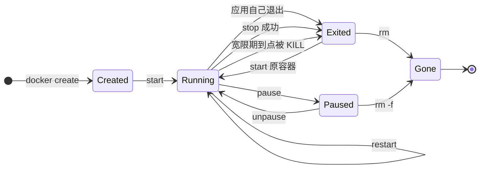

> **实战落点**：示例链第③段 · 服务自带源码能独立起步（本篇写完第③段的**章面**：源码目录 build 成镜像、镜像搬到另一台机器还能证明是同一个。链上的段产物——`Dockerfile.v1`、段 README、跳级自检——另列为待办，判据见清单 4.4）
> **示例版本**：消费 `示例/贯穿示例/api-service/` 的镜像产物 `kb-p2-api`；另外用四个一次性容器造出七种退出码现场（命令都在正文里，可直接复制）
> **前置依赖**：[/docs/01-基础认知/为什么是容器/核心概念与架构总览/](/docs/01-基础认知/为什么是容器/核心概念与架构总览/)、[/docs/01-基础认知/第一次动手/第一次运行容器与图形化工具/](/docs/01-基础认知/第一次动手/第一次运行容器与图形化工具/)、[/docs/03-镜像构建/写出来/Dockerfile指令全解与构建上下文/](/docs/03-镜像构建/写出来/Dockerfile指令全解与构建上下文/)
> **本篇产出物**：一张七种退出码的「怎么造出来 + 报错原文关键 + 归属哪一层」对照表；一张 restart 四种策略在同一只总是失败的容器上的实测差别；一组 `save/load` 与 `export/import` 的体积与后果读数（含 `import` 之后 `Cmd=null` 的现场）
> **难度·耗时**：★★☆ · 55 分钟（含动手）
> **拓展接口**：本篇的退出码是**引入**，穷尽处是 7.3；镜像分层的机制详解在 3.5 与 5.4，本篇只用它的现象；`--rm` 与匿名卷那条坑在 7.2 症状索引里单列；镜像搬到离线机器的做法在 6.5 的离线交付里被复用
> **自测三题**：
> 1. `docker stop` 之后退出码是 137 而不是 143，最可能是什么问题？怎么一眼确认？
> 2. `docker rm -f 容器` 之后，那个容器留下的匿名卷还在吗？哪两种写法能把它带走？
> 3. 同事发你一个 `docker export` 出来的 tar，你 `docker import` 之后 `docker run` 报 `no command specified`。这是坏文件吗？该怎么办？

## 为什么容器没了数据还在、镜像删了磁盘没小

一段真实对话：

```text
「磁盘满了，我把镜像都删了，怎么才回来 200 MB？」
「你删的是 tag。层还被别的镜像引用着。」
「行，那我把那个跑挂的容器删了，日志呢？」
「容器删了日志就没了。但数据如果在命名卷里，它还在。」
「所以到底哪些东西各自有各自的命？」
「四份：镜像、容器、卷、构建缓存。你能看见的是前两个。」
```

第二篇剩下的三章正好把这四份对象的「生、老、病、死」讲完：**2.1 管镜像**（怎么列、怎么删、怎么搬走），**2.2 管容器**（状态机与退出码），**2.7 管跨机器搬运**（`save/load` 与 `export/import` 不是一对近义词）。卷的生命周期在第①段（2.6）已经量过，本篇只在 `--rm` 那一节补它最容易踩的一格。

> 💡 新人小结：**镜像是安装包，容器是正在跑的那个程序，卷是你存在桌面上的文件**。关掉程序（容器）不会删你的文件（卷）；卸载安装包（镜像）也不会——但很多人以为会。类比之后接机制：镜像由一层层只读内容构成、被多个 tag 共享，`rmi` 删的是**名字**（`Untagged:`），最后一层真正释放要等所有引用消失；容器自己只有一层可写层，`rm` 把它丢掉，而命名卷/匿名卷是独立对象，只有 `-v`、`--rm` 或 `volume rm` 才动它们。

## 镜像：列、删、搬、看层

先把命令族钉住（每条都在本机跑过）：

| 命令 | 本机读数 | 容易误会的点 |
|---|---|---|
| `docker images` | 显示的是**本机存储的那份**，`SIZE` 是各层之和（共享层会被重复计），`CREATED` 是镜像内记录的构建时间 | `alpine:3.20` 显示 `25.8MB`，但它的 tar 只有 `7.9MB`——本机为两个架构各存了一份（为了交叉构建拉的 arm64） |
| `docker tag A B` | 之后 `docker images B` 读到同一个 ID（`d9e853e87e55`） | tag 是**别名**，不复制内容，也不额外占磁盘 |
| `docker rmi B` | 输出 `Untagged: B`，没有 `Deleted:`，A 仍然可用 | 删名字不等于删数据 |
| `docker rmi alpine:3.20` | `rc=1 conflict: unable to delete alpine:3.20 (must be forced) - container 2e0d2531919e is using its referenced image d9e853e87e55` | 有容器（含已退出的）引用它时删不掉，**先清容器再删镜像**，别急着加 `-f` |
| `docker image prune -f` | 本机读到 `Total reclaimed space: 0B` | 它只吃 dangling，不吃「旧的构建历史」 |
| `docker history 镜像` | 逐层显示 `SIZE` 与 `CreatedBy`，如 `4.1kB RUN /bin/sh -c echo v2 # buildkit`、`8.47MB ADD alpine-minirootfs-…` | `CreatedBy` 里能看到 `ARG`/`ENV` 的原值——口令泄漏点之一（见 3.2） |
| `docker image inspect` | `Architecture=amd64 os=linux layers=1 RepoDigests=[alpine@sha256:d9e853e87e55…]` | `RepoDigests` 是「这个 tag 曾经解析到的摘要」，用它做可复现部署的锚点 |

**dangling 的真相要看两次才算数。** 同一标签连续 build 三次（`FROM alpine:3.20` + 一条 `RUN echo vN`）之后：

```console
$ docker images -a --format "{{.ID}} {{.Repository}}:{{.Tag}}"
ab67b8e8b956 kbkink:latest          ← 只有最新这一个，前两个没在表里
$ docker images -f dangling=true
(空)
$ docker image prune -f
Total reclaimed space: 0B
```

也就是说 **BuildKit 的存储不会给你攒一堆 `<none>` 旧镜像**，`image prune` 因此回收不了什么；真正会长大的是**构建缓存**，本轮收尾读数是 `Build Cache 21 条 / 60.33MB`，回收要用 `docker builder prune`（不是 `image prune`）。另一次跑批里 `dangling` 列表里短暂出现过 `alpine` 自己的 ID，纯净复现做不出来（见本篇未验证项），不要拿它当规律讲。

## 容器状态机：create / start / stop / kill / pause / restart / rm / wait

`run = create + start`（W6.1 第 6 项），拆开来每一步的读数：

```console
$ docker create --name kbA1 alpine:3.20 sh -c "while :; do sleep 1; done"
6a99936c93c4…
   → Status=created   StartedAt=0001-01-01T00:00:00Z   ps 的 State 列 = Created
$ docker start kbA1
   → Status=running   StartedAt=2026-10-27T10:24:20.787875842Z
$ docker start kbA1          ← 再 start 一次
[rc=0] kbA1                  ← 幂等，不报错
$ docker stop -t 1 kbA1
   → Status=exited    ExitCode=137
$ docker rm kbA1
[rc=0] kbA1
$ docker rm kbA1             ← 再 rm 一次
[rc=1] Error response from daemon: No such container: kbA1
```



几个只在真机才看得见的细节：

| 动作 | 实测读数 | 说明 |
|---|---|---|
| `pause` | `.State.Paused=true`，`ps` 显示 `Up 1 second (Paused)`，`stats` 仍返回 `cpu=0.00% mem=1.957MiB` | 冻结的是进程调度，**不是停止**：容器仍在、内存仍占着，`docker rm` 直接删会失败，要先 `unpause` |
| `restart` | `StartedAt` 从 `10:24:26.6` 变成 `10:24:30.2` | 同一个容器对象被重启，`CREATED` 不变；要看有没有真的重启过，比较 `StartedAt` |
| `update --restart always` | 立刻读到 `HostConfig.RestartPolicy.Name=always` | 不用重建容器就能改策略，救火时有用 |
| `kill` | `ExitCode=137` | 默认 SIGKILL，进程没机会收尾 |
| `wait` | 一次性任务 `sleep 2; exit 7` → `docker wait` 输出 `7`，`rc=0` | 脚本里等一个容器并拿它的码 |
| `rm` 不加 `-f` | 已退出的容器：`rc=0` 正常删除 | `-f` 只在容器还在跑时才需要 |
| `exec` 打到已退出容器 | `rc=1 container 2e0d… is not running` | 现场没了，只剩 `logs`（见 2.4 那篇） |

## 七种退出码：现场、原文、归属

W6.1 第 7 项在这里**引入**，穷尽在 7.3。每一种都是本机造出来的：

| 码 | 怎么造 | 报错原文关键片段 | 这个码说明谁出了问题 |
|---|---|---|---|
| `0` | `docker run --rm alpine:3.20 true` | 无 | 应用自己走完 |
| `1` | `… sh -c "exit 1"` | 无 | 应用内部失败（多数语言的默认失败码） |
| `125` | `docker run --rm --bogus-flag alpine:3.20 true` | `unknown flag: --bogus-flag` | **docker 自己**：参数写错、镜像拉不到、创建失败 |
| `126` | `… alpine:3.20 /etc/hostname` | `exec: "/etc/hostna…" ` | 文件在但**不能执行**（权限、是目录） |
| `126` | `… /etc`（目录） | `exec: "/etc": is a directory` | 同上 |
| `126` | `… sh -c "printf … > /x && chmod 644 /x && /x"` | `sh: /x: Permission denied` | 同上，只不过由 shell 报出来 |
| `127` | `… definitely-not-a-cmd` | `exec: "definitely-…": executable file not found in $PATH` | **找不到命令**：路径错、依赖没装、被 `--entrypoint` 吞了参数 |
| `137` | `docker kill 容器`；或 `--memory=64m` 下 `tail /dev/zero` | `OOMKilled=true` | 被 SIGKILL；`128+9`。**OOM 也是这个码** |
| `143` | `--init` 起的容器 `docker stop` | `exit=143`，`stop` 用时 0.2 秒 | 被 SIGTERM 打死；`128+15` |

## 为什么 `stop` 常见的是 137 而不是 143

这是全篇最值得记的一格。同一个 `alpine:3.20 sleep 600`：

```console
# 主进程就是 PID 1
$ docker run -d --name kbI0 alpine:3.20 sleep 600
$ docker stop -t 3 kbI0        # 用满 3 秒（实测 3.2 秒返回）
   → ExitCode=137
$ docker kill --signal SIGTERM kbK1
   → 2 秒后 .State.Status=running，ExitCode=0，FinishedAt=0001-01-01T00:00:00Z   ← 完全没死

# 加上 --init：tini 当 PID 1，sleep 变成 PID 2
$ docker run -d --name kbI1 --init alpine:3.20 sleep 600
$ docker stop -t 3 kbI1        # 0.2 秒返回
   → ExitCode=143
$ docker kill --signal SIGTERM kbK2
   → .State.Status=exited，ExitCode=143
```

三条读数指向同一个机制：**PID 1 的信号默认处置和别的进程不一样**——内核不会因为「没装 handler」就按默认动作杀掉 PID 1，所以发给它的 `SIGTERM` 被无视，`stop` 只能等宽限期结束补一刀 `SIGKILL`，于是你看到 137。`--init` 塞一个 tini 进去当 PID 1，负责把信号转发给真正的子进程，于是同一个镜像、同一条 `stop`，退出码变成 143、耗时从 3.2 秒掉到 0.2 秒。

第三种情况也别忽略：**装了 handler 却不在 handler 里退出**（`trap 'echo got' TERM; while :; …`）→ 实测同样是 137，因为宽限期到点被 KILL。自己按惯例返回 `128+15` 的写法（`trap 'exit 143' TERM`）实测拿到 `143`。

> 💡 新人小结：容器里的 PID 1 像**唯一一个值班的人**。给他发消息（SIGTERM），系统不会替他「按默认流程下班」——他必须自己读到消息并且主动走人。没人值班转达时，你发的消息等于没发（实测：容器仍在 `running`）；等满宽限期就被强断（137）。`--init` 就是**派一个助理专门值班传话**，于是消息真的送达到应用（143），停机还快了一个数量级（3.2 秒 → 0.2 秒）。类比之后接机制：现象源于内核只对 PID 1 特殊处理默认信号处置；`--init` 是 Docker 内置的 tini，负责转发信号、回收僵尸进程。

**给团队的两条规矩**：Java/Go 这类需要优雅停机的服务，要么 `--init`（compose 里 `init: true`），要么自己处理 SIGTERM 并退出；`stop_grace_period` 要大于「收尾最长耗时」，否则你得到的是 137 和一半没写完的请求。

> **一条边界（段⑦ 复测补的，2026-10-28）**：上面那三条读数都是 `alpine:3.20 sleep 600` —— busybox 的 `sleep` 和 `ash` 一个信号 handler 都不装（`/proc/1/status` 里 `SigCgt:0000000000000000` / `0000000000010002`，TERM 位 `0x4000` 都不在），所以「一号进程无视 TERM」在这个镜像里成立。**换成链上那个 Go 二进制就不成立**：它没写 `signal.Notify`，可 Go 运行时给几乎所有信号都装了 handler（`SigCgt:fffffffd7fc1feff`），只发 TERM 也 **0.26 秒退出 143**，`docker stop` 墙钟 0.4 秒。判据要这么读：143 只说明「进程接住了 TERM 并结束」，**不说明它 drain 了在途请求**；`--init` 换来的不是「能收到信号」，是「脚本类镜像也能收到 + 僵尸有人收」。六格矩阵与位图读数在 `示例/贯穿示例/段7-生产形态与回滚/README.md`。

## restart 策略四种：同一只总是失败的容器

用一个必然 `exit 1` 的容器把四种策略的量差测出来（观察 6~8 秒）：

| 策略 | 实测状态 | `RestartCount` | `MaximumRetryCount` |
|---|---|---|---|
| `no`（默认） | `exited exit=1`，`ps` 显示 `Exited (1) 6 seconds ago` | 0 | 0 |
| `on-failure` | `restarting`，`ps` 显示 `Restarting (1) 2 seconds ago` | 6（6 秒内已重启 6 次） | 0（无限） |
| `on-failure:2` | 退到上限后停在 `exited exit=1` | 2 | 2 |
| `always` | `restarting`，8 秒时 `RestartCount=7`；`docker stop` 后 `exited`，计数停在 7 | 7 | 0 |
| `unless-stopped` | 与 `always` 同样 `restarting`；差别在下面这条 | 6 | 0 |

`always` 与 `unless-stopped` 的分界是「**人有没有明说要停**」：`docker stop` 之后再 `docker start`，两者都会起来；真正的差别在 **Docker 守护进程重启之后**——`always` 会把之前正在跑的容器再拉起来，`unless-stopped` 尊重你停掉的意图。后半句本轮没测（需要重启 Docker Desktop，会打断别的工作），标在未验证项里。

```console
$ docker stop kbP-always      → exited，RestartCount=7
$ docker start kbP-always     → 4 秒后 restarting，RestartCount=6（新一次计数的起点）
```

选法：一次性任务用 `no`（配合 `docker wait` 取码）；会瞬时失败、重试有意义的应用用 `on-failure:3` 这类**带上限**的；只有「必须由 Docker 兜住可用性」的常驻服务用 `unless-stopped`。`on-failure` 不带数字（无限重试）会把 CPU 烧在快速重启循环里，本机 6 秒 6 次就是它的样子。

## `--rm` 与匿名卷：删容器删不掉的那一格

`--volume /data` 不给名字时 Docker 建一个 64 位十六进制名的匿名卷。四步实测：

```console
$ docker run -d --name kbAnon --volume /data alpine:3.20 sleep 300
   .Mounts → [{"Type":"volume","Name":"95962d791889…","Destination":"/data",
               "Source":"/var/lib/docker/volumes/95962d791889…/_data"}]
$ docker rm -f kbAnon
   → 卷仍在 volume ls 里                  ← 默认不删，数据不会跟着容器走
$ docker run -d --name kbAnon2 --volume /data … ; docker rm -fv kbAnon2
   → 它自己的匿名卷被删掉（残留的只有上一个）
$ docker run --rm --volume /data alpine:3.20 echo one-shot
   → 跑完零增量卷                          ← --rm 连匿名卷一起带走
$ docker volume rm 95962d791889…           → 手工收最后一个
```

这条的实操含义有两层：`rm -f` 会留下卷（第①段那条「删容器后数据仍在」正是靠它），而 `--rm` 用于「一次性任务、不要留任何东西」——**别给有数据的容器 `--rm`**，也别指望 `rm -f` 帮你清干净（`docker volume ls` 才是核对手段）。

## 导入与导出：`save/load` 与 `export/import` 不是一对近义词

同一台机器上的 `alpine:3.20` 与一个在它上面跑了改动（`echo made-in-container > /marker.txt`）的容器：

| 命令 | 产物 | 本机读数 |
|---|---|---|
| `docker save -o img.tar alpine:3.20` | tar，含**层与元数据** | `7,910,912` 字节；`docker load -i img.tar` → `Loaded image: alpine:3.20`，ID 仍是 `d9e853e87e55`（**同名同 ID**） |
| `docker save --platform linux/amd64` | 同一镜像的单架构 tar | `3,722,752` 字节（比不带 `--platform` 小一半以上，因为本机存了两份架构） |
| `docker save -o two.tar alpine:3.20 busybox:1.37` | 多镜像一个 tar | `10,141,696` 字节 |
| `docker export -o ctr.tar 容器` | tar，只是**当时那个文件系统的快照** | `8,094,720` 字节 |
| `docker import ctr.tar kbfrom-ctr:1` | 新镜像 | `Cmd=null`、`Env=null`、`Entrypoint=null`、`WorkingDir=""`、`ExposedPorts=null`、`layers=1` |

`import` 出来的镜像立刻跑不起来：

```console
$ docker run --rm kbfrom-ctr:1
[rc=125] docker: Error response from daemon: no command specified
$ docker run --rm kbfrom-ctr:1 cat /marker.txt
made-in-container                ← 文件在，只是没人告诉你该跑什么
$ docker import --change 'CMD ["/bin/sh"]' ctr.tar kbfrom-ctr2:1
$ docker image inspect --format "{{json .Config.Cmd}}" kbfrom-ctr2:1
["/bin/sh"]
```

一句话概括差异：**`save/load` 搬的是「镜像」，`export/import` 搬的是「文件系统」**。前者保留层、`CMD`/`ENTRYPOINT`/`ENV`/`EXPOSE`/`VOLUME` 元数据与镜像 ID，加载后与原机器一致；后者把一切拍平成一层，元数据全丢，必须靠 `--change` 手工补回。

| 场景 | 该用 | 不该用 |
|---|---|---|
| 离线机器部署同一个服务 | `save` + `load` | `export`（丢了 CMD，起不来） |
| 把容器里当前状态当备份/取证 | `export`（或 `docker cp` 具体文件） | `save`（镜像里没有运行期改动） |
| 想把「装好依赖的状态」固化成镜像 | `docker commit`（本篇未实测） | `export/import` 的产物没有入口点 |
| 搬数据库数据本身 | 卷备份（2.6 那条 `tar` 到宿主的做法） | 两种都不该用 |
| 给多架构发布 | `buildx` 产出多平台镜像（3.9） | `save` 不带 `--platform` 会把你本机所有架构都塞进 tar |

> 💡 新人小结：`docker save` 像**把整套带说明书的家具原样打包运走**，到了地方照说明书就能装好（`CMD`、`ENV` 是说明书）；`docker export` 像**给房间拍了张照片再把看到的家具复刻一遍**——东西都在，但没人记得它们本来该按什么顺序摆、哪件是主件（本机读数：`Cmd=null`，运行时报 `no command specified`）。类比之后接机制：镜像之所以能自己起来，靠的是层之上那份**配置元数据**；`export` 走的是容器根文件系统快照，元数据不在文件系统里，所以注定丢。

## 实战切入：把镜像搬到一台没网络的机器，并证明它没变

判据不能是「跑起来了」，得是「是同一个东西」。本机四步：

| 步 | 命令 | 本机读数 | 判据 |
|---|---|---|---|
| 1 | `docker save -o img.tar alpine:3.20` | tar `7,910,912` 字节 | 产物存在且非空 |
| 2 | `docker rmi alpine:3.20` | 有容器在用时报 `conflict … must be forced`（本轮就撞上了） | **先清容器**，别急着 `-f` |
| 3 | `docker load -i img.tar` | `Loaded image: alpine:3.20` | 加载不报错 |
| 4 | `docker images alpine:3.20 --format "{{.ID}} {{.Size}}"` | `d9e853e87e55 25.8MB` | **ID 与步骤 1 之前一致**——这才是「同一个镜像」的证据 |

第 4 步是关键：`load` 前后镜像 ID 相同，说明层与配置逐字节搬过去了。若你搬的是 `export/import`，ID 必然变（层被拍平成一层），这一点正好可以当「我用错命令」的自检。

再用第③段的服务做一次真跑（本机已有 `kb-p2-api`）：

```console
$ docker run --rm --entrypoint /bin/sh -e PORT=9999 kb-p2-api -c 'echo 覆盖后PORT=$PORT'
覆盖后PORT=9999
```

## 常见误读

| 误读 | 实际 |
|---|---|
| 「`rmi` 删镜像就释放磁盘了」 | 先 `Untagged:`；层被别的 tag/容器引用时不释放，本机 `rmi alpine:3.20` 直接被 conflict 挡住 |
| 「`image prune` 能清掉构建历史」 | BuildKit 不在 `images` 里堆旧镜像，本轮 prune 报 `0B`；要清的是 `docker builder prune` |
| 「`docker rm -f` 会把卷一起删」 | 匿名卷留着；`-v` 或 `--rm` 才删。反过来给有数据的容器加 `--rm` 会丢现场 |
| 「`pause` 就是停住了」 | 进程被冻结但容器仍在跑（`Up … (Paused)`、内存仍占），`rm` 要先 `unpause` |
| 「`stop` 拿到 137 是应用崩了」 | 137 = 被 SIGKILL，通常是 PID 1 没处理 TERM、宽限期用满；`--init` 后同一容器同一命令得到 143、耗时 3.2 秒 → 0.2 秒 |
| 「126 和 127 差不多」 | 126 是「文件在但不能执行」，127 是「找不到这个命令」。本轮四个 126 现场与一个 127 现场的原文不同 |
| 「restart 策略能救应用 bug」 | `on-failure` 不带上限就是快速重启循环（本机 6 秒 6 次）；策略只保证进程在，不保证服务可用 |
| 「`export/import` 和 `save/load` 一样，只是对象不同」 | `import` 的产物元数据全空、`run` 报 `no command specified`、镜像 ID 变；必须 `--change` 补 |
| 「`load` 之后是不是新镜像看不出来」 | 看 ID：本轮 `d9e853e87e55` 前后一致 |
| 「`docker start` 一个已运行的容器会报错」 | `rc=0`，幂等 |

## 本篇不覆盖什么

按 W6 的规矩，本篇**故意不讲**的东西逐条点名去处——写「不覆盖」不是免责声明，是防止你在这一篇里找不存在的答案：

- 退出码的完整判别（尤其 137 的三条路）→ 见 **7.3**（`137` 的成因分流与第一条命令在那一篇）
- 层的文件系统实现与「删了镜像为什么磁盘没小」的机制 → 见 **5.4**（`GraphDriver` 与 copy-up 的读数在那一篇）
- 怎么构建、怎么推仓库、标签怎么定 → 见 **3.9** 与 **3.11**（`buildx` 与标签字符集的合法性在那两篇）
- 启停动作与存储的关系（`--rm` 与匿名卷谁留下东西）→ 见 **10.4**（`匿名卷` 堆积那一格在那一篇）
- 数据的备份与恢复演练 → 见 **10.6**（`备份` 能不能在新机器上原样变回来，那一篇用三级对账证明）

## 要点总结

- 四类对象各有各的命：镜像（tag 是别名，层被共享）、容器（自己一层可写层）、卷（独立，`rm -f` 不删）、构建缓存（`builder prune` 才收）。
- `create → start → stop/kill → rm` 的每一步都能从 `.State` 读到；二次 `start` 幂等、二次 `rm` 报错、`wait` 返回容器退出码、已退出容器可以不加分 `-f` 直接删。
- 七种退出码分层归属：`125` docker 自己、`126` 不可执行、`127` 找不到命令、`137` 被 KILL（含 OOM，`OOMKilled=true`）、`143` 被 TERM、`0/1` 应用自己。
- PID 1 不响应未注册的信号是「`stop` 得 137」的根因；`--init` 让同一镜像同一命令得到 143，停机从 3.2 秒变 0.2 秒。
- `restart` 四种策略在同一只失败容器上的实测：`no` 停住、`on-failure` 6 秒重启 6 次、`on-failure:2` 到 2 就停、`always` 与 `unless-stopped` 在 `stop`/`start` 之后都回来（守护进程重启后的差别本轮未测）。
- 匿名卷只在 `--rm` 或 `rm -v` 时消失；这是「删容器数据还在」与「一次性任务不留垃圾」两条需求的分界。
- `save/load` 搬镜像（保元数据与 ID，`alpine` 单架构 tar `3.72 MB`、默认 `7.91 MB`），`export/import` 搬文件系统（`Cmd=null`、`run` 报 `no command specified`、要 `--change` 补）。
- 判断「搬过去了没有变」的证据是镜像 ID，不是「能跑」。

## 本篇未验证项

| 项 | 状态 | 原因 |
|---|---|---|
| `always` 与 `unless-stopped` 在**守护进程重启后**的行为差别 | 未测 | 要重启 Docker Desktop，会打断本机正在进行的其它工作；结论只写到 `stop`/`start` 这一层 |
| `docker commit` 的产物形态与元数据保留 | 未测 | 清单 2.1 没要求，但要给「export/import 与它的关系」就得实测 |
| dangling 里短暂出现过 alpine 自己 ID 的那次读数 | 不可复现 | 后续纯净实验（同标签连续 build）里 `dangling` 恒为空、`image prune` 报 `0B`；那次现场归因不明，不写成结论 |
| `docker load` 对多架构 tar 的处理（一次 load 出两个平台） | 未测 | 需要 `buildx` 产多平台镜像，属 3.9 |
| `--oom-kill-disable`、`--oom-score-adjust` 的行为 | 未测 | 只测了默认路径下 OOM → 137 + `OOMKilled=true` |
| 僵尸进程回收（无 `--init` 时 `sh` 当 PID 1 的 reaping） | 未测 | 需要造一个频繁生子进程的容器，判据设计单独排一次 |
