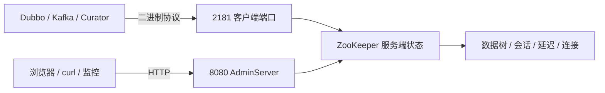

## 为什么 3.5 以后 ZooKeeper 多了一个 8080？

在 ZooKeeper 3.5 之前，运维想看服务状态，基本只有一条路：往客户端端口发四字命令。`ruok`、`srvr`、`stat`、`mntr` 这些命令很轻，但它们有三个天生的限制：

- 明文 TCP，没有认证；
- 只认识四个字母，表达能力有限；
- 返回纯文本，监控系统要自己解析。

3.5.0 起，ZooKeeper 内置了 AdminServer：一个嵌入式 Jetty HTTP 服务，默认监听 8080，把管理信息以 JSON 暴露出来。官方文档的描述很直接：它提供四字命令的 HTTP 接口，命令通过 `/commands/[命令名]` 访问，例如 `http://localhost:8080/commands/stat`，响应是 JSON；命令名不再限制为四个字母，还支持别名。

所以，8080 不是“另一个 ZooKeeper”，而是同一个实例的**HTTP 管理面**。它和 2181 的关系，可以画成两条并行的读取路径：



| 入口 | 协议 | 默认端口 | 主要读者 | 是否参与业务 |
|------|------|----------|----------|--------------|
| 客户端端口 | ZooKeeper 二进制协议 | `clientPort`（样例常用 2181） | 业务客户端、`zkCli` | 是，注册/发现/读写都走这里 |
| AdminServer | HTTP + JSON | 8080 | 运维、监控、排障脚本 | 否，只读管理信息（部分命令可重置统计） |

这张表是理解后面所有问题的钥匙：**AdminServer 是旁路，不是业务主路**。

> ### 💡 新人小结：AdminServer 像机房门口的查询屏
>
> - 业务客户端从 2181 的正门进出，搬数据、注册服务。
> - 运维从 8080 的查询屏看状态，不进入业务通道。
> - 查询屏关了，业务照常跑；但依赖查询屏的巡检脚本会失联。
>
> **先分清“业务门”和“查询屏”，再谈关闭影响。**

---

## AdminServer 到底暴露了什么？

官方文档把 AdminServer 定义为“四字命令的 HTTP 接口”，但它不是简单地把四字命令逐字翻译。它支持更长的命令名和别名，例如 `server_stats` 也可以写成 `srvr`，`monitor` 也可以写成 `mntr`。打开 `/commands` 会看到一个命令列表：

```text
$ curl -s http://127.0.0.1:8088/commands | head -n 8
<a href="/commands/configuration">configuration</a>
<br/>
<a href="/commands/connection_stat_reset">connection_stat_reset</a>
<br/>
<a href="/commands/connections">connections</a>
<br/>
<a href="/commands/dirs">dirs</a>
<br/>
```

下面这些端点最适合日常排障：

| 端点 | 等价四字命令 | 返回什么 | 使用场景 |
|------|--------------|----------|----------|
| `/commands/ruok` | `ruok` | `command` 与 `error` 字段；`error` 为 `null` 表示请求被处理 | 探活；不代表已加入 quorum |
| `/commands/srvr` | `srvr` | 版本、角色、延迟、连接数、zxid、节点数 | 第一眼判断 leader/follower/standalone |
| `/commands/stat` | `stat` | `srvr` 的信息加上连接列表 | 看“谁连着、有没有排队” |
| `/commands/mntr` | `mntr` | 监控指标 KV 的 JSON 版 | 采集延迟、连接、znode、watch 等 |
| `/commands/conf` | `conf` | 当前生效配置 | 核对 `clientPort`、`dataDir`、超时等 |
| `/commands/cons` | `cons` | 连接/会话详情 | 排查长连接、会话堆积 |
| `/commands/dump` | `dump` | 会话与临时节点 | 排查临时节点不消失 |
| `/commands/dirs` | `dirs` | 快照/日志目录大小 | 判断磁盘增长 |

本机复核实例的真实响应可以说明返回结构。`/commands/stat` 返回 `200 application/json`，开头是：

```json
{
  "version" : "3.8.7-9085db92dd679e1e90a63bfe6ae6345ab6cbc4ae",
  "read_only" : false,
  "server_stats" : {
    "packets_sent" : 0,
    "packets_received" : 0,
    "fsync_threshold_exceed_count" : 0,
    "uptime" : 11307
  }
}
```

`/commands/ruok` 返回的不是字符串 `imok`，而是一个 JSON 对象：

```json
{
  "command" : "ruok",
  "error" : null
}
```

`/commands/mntr` 则把指标摊成字段：

```json
{
  "version" : "3.8.7-9085db92dd679e1e90a63bfe6ae6345ab6cbc4ae",
  "server_state" : "standalone",
  "ephemerals_count" : 0,
  "num_alive_connections" : 0,
  "avg_latency" : 0.0,
  "outstanding_requests" : 0,
  "znode_count" : 5,
  "global_sessions" : 0
}
```

不同端点的 JSON 结构不一样，监控脚本不要假设“所有端点都有 `server_stats`”。最稳妥的方式是先请求一次，保存响应样本，再按实际字段解析。

> ### 💡 新人小结：AdminServer 像把体检报告做成了 JSON
>
> - `/commands/ruok` 是“在不在”，返回的是请求结果，不是业务数据。
> - `/commands/srvr` 是“什么角色、延迟多少”，适合第一眼判断。
> - `/commands/mntr` 是“全套指标”，字段多，适合监控采集。
> - `/commands` 是目录页，先看有哪些命令，再决定请求哪个。
>
> **JSON 字段不是四字命令文本的逐字翻版，先看样本再写解析。**

---

## 怎么配置：端口、绑定地址与关闭

AdminServer 的配置项都在 `zoo.cfg` 里，和客户端端口放在同一份文件：

| 配置项 | 默认值 | 作用 | 生产建议 |
|--------|--------|------|----------|
| `admin.enableServer` | `true` | 是否启用 AdminServer | 不需要 HTTP 管理时设为 `false` |
| `admin.serverPort` | `8080` | Jetty 监听端口 | 同机多实例必须错开 |
| `admin.serverAddress` | `0.0.0.0` | 监听地址 | 只给本机用就设 `127.0.0.1` |
| `admin.idleTimeout` | `30000` | 连接最大空闲时间（毫秒） | 一般不用改 |
| `admin.commandURL` | `/commands` | 命令路径前缀 | 一般不用改 |
| `admin.portUnification` | 关闭 | 同一端口同时接受 HTTP/HTTPS | 需要 TLS 时再评估 |
| `admin.forceHttps` | 关闭 | 强制 HTTPS | 需要 TLS 时再评估 |

一个最小配置示例：

```properties
# 管理端口换个不冲突的端口，并且只允许本机访问
admin.serverPort=9090
admin.serverAddress=127.0.0.1
```

如果完全不需要 HTTP 管理面：

```properties
admin.enableServer=false
```

改完配置需要重启实例才生效。`admin.enableServer` 既可以写在 `zoo.cfg` 里，也可以用等价的 Java 系统属性 `zookeeper.admin.enableServer=false`；本机复核用的是 `zoo.cfg` 写法，重启后 8080 不再监听，说明配置文件路径有效。

```text
# 启用 AdminServer 时（本机复核实例，2188/8088）
TCP    0.0.0.0:2188           0.0.0.0:0              LISTENING       26940
TCP    127.0.0.1:8088         0.0.0.0:0              LISTENING       26940

# 另一次收口复核：admin.enableServer=false、clientPort=2186
2186 正常监听；启动日志中没有 “Started AdminServer” 行
```

> ### 💡 新人小结：AdminServer 的开关是“旁路开关”
>
> - `admin.enableServer=false` 关的是 HTTP 管理面，不是整个 ZooKeeper。
> - `admin.serverAddress=127.0.0.1` 是“只让本机看”，不是“关闭”。
> - `admin.serverPort` 是“换个门牌”，适合与别的 HTTP 服务冲突时使用。
>
> **先决定“要不要这条旁路”，再决定“换端口还是改绑定”。**

---

## 禁用之后，Dubbo 为什么不受影响？

这是问答实录里最关键的一问：ZooKeeper 作为 Dubbo 注册中心，禁用 AdminServer 会不会影响服务注册与发现？

答案是：**不影响**。因为 Dubbo（以及 Curator、Kafka 等）走的是 2181 上的 ZooKeeper 二进制客户端协议，和 8080 的 HTTP 管理面是两条独立通路。

| 功能 | 走哪条路 | 禁用 AdminServer 后 |
|------|----------|---------------------|
| Dubbo 服务注册/发现 | 2181 客户端协议 | 正常 |
| 临时节点、Watcher、会话心跳 | 2181 客户端协议 | 正常 |
| 集群选举与数据同步 | 2888/3888 的 Zab 协议 | 正常 |
| `zkCli` 连接与操作 | 2181 客户端协议 | 正常 |
| `zkServer.sh status` | 2181 上的四字命令 `srvr` | 正常（前提是 `srvr` 在白名单内） |
| 浏览器访问 `http://host:8080/commands/stat` | AdminServer | 不可用 |
| 抓 `/commands/mntr` 的监控 | AdminServer | 需要改用四字命令、Prometheus 或 JMX |

注意最后两行：**禁用 AdminServer 影响的是“走 HTTP 管理面的人”，不是“走客户端协议的业务”**。这也是为什么很多生产环境会在注册中心场景关闭 AdminServer：它既减少了一个无认证的 HTTP 暴露面，也释放了 8080 端口。

但有一个容易忽略的边界：**AdminServer 关闭后，四字命令并不会自动关闭**。官方文档明确写着，AdminServer 禁用时，TCP 四字命令接口仍然可用。反过来说，如果你只收紧了四字命令白名单，AdminServer 的 `/commands/ruok`、`/commands/mntr` 仍可能照常返回。两者要分别配置、分别验证。

> ### 💡 新人小结：业务走正门，监控走后门
>
> - 关 AdminServer 就像关掉机房门口的查询屏：业务正门照常开。
> - `zkServer.sh status` 走的是 2181 的 `srvr`，不是 8080 的 HTTP。
> - 但监控如果抓的是 `/commands/mntr`，关掉 8080 后它一定会失联。
>
> **不要用“业务正常”证明“监控正常”，它们走的是不同通路。**

---

## 一个必须核准的 Windows 差异：`zkServer.cmd status`

问答实录里有一行容易误导的对比：

> `zkServer.sh status` / `zkServer.cmd status` 靠四字命令 `srvr` 判断运行状态。

这句话对 `zkServer.sh` 成立，对 3.8.7 发行包的 `zkServer.cmd` 不成立。查看发行包 `bin/zkServer.cmd` 可以看到，它只做了一件事：调用 `zkEnv.cmd`，然后前台启动 `QuorumPeerMain`；脚本里没有 `status`、`stop`、`restart` 这些子命令分支。

而 `bin/zkServer.sh` 的 `status` 分支确实会调用：

```bash
org.apache.zookeeper.client.FourLetterWordMain \
  $clientPortAddress $clientPort srvr $isSSL
```

然后从返回内容里筛选 `Mode`。所以：

| 平台/脚本 | 是否有 `status` 子命令 | 状态检查靠什么 |
|-----------|------------------------|----------------|
| Linux/macOS `zkServer.sh` | 有 | 2181 上的 `srvr` 四字命令 |
| Windows `zkServer.cmd` | 没有 | 需要自己发 `srvr`，或使用 AdminServer 的 `/commands/srvr` |

在 Windows 上，如果你执行 `zkServer.cmd status`，它并不会像 `zkServer.sh status` 那样查询状态；脚本仍会走启动逻辑。要检查运行状态，可以用：

```text
# 如果本机有 nc
echo srvr | nc 127.0.0.1 2181

# AdminServer 开启时
curl -s http://127.0.0.1:8080/commands/srvr
```

这条差异不影响“禁 AdminServer 不影响业务”的结论，但会影响你的排障命令：不要拿 Windows 上不存在的 `status` 子命令去验证服务状态。

> ### 版本核准：脚本能力要按发行包看
>
> 同一版本的 Unix 脚本和 Windows 脚本不保证功能对称。看到“`zkServer.sh` 可以这样，所以 `zkServer.cmd` 也可以”时，先去 `bin/` 目录读脚本，或者在临时实例上实际执行一次。本文的结论来自 3.8.7 发行包的脚本内容与真实运行，不按旧版本文档推定。

---

## 禁用、改端口还是只绑回环？

三种做法解决的是不同问题，不要混用：

| 你的问题 | 推荐动作 | 影响 |
|----------|----------|------|
| 8080 和 Tomcat/前端冲突，但仍想看管理页 | `admin.serverPort=9090` | 管理页换端口，业务不变 |
| 不想让局域网访问管理页 | `admin.serverAddress=127.0.0.1` | 只有本机能访问，远程监控需另想办法 |
| 完全不需要 HTTP 管理，想减少暴露面 | `admin.enableServer=false` | 8080 不再监听，HTTP 管理入口消失 |
| 监控依赖 `/commands/mntr` | 先改监控到 4lw 或 Prometheus，再关闭 | 否则监控失联 |
| 只是本机学习，端口冲突 | 换 `admin.serverPort` 最省事 | 仍保留管理页，便于观察 |

一个常见的生产组合是：

```properties
admin.enableServer=false
4lw.commands.whitelist=srvr,mntr,ruok
```

它的含义是：关掉无认证的 HTTP 管理面，但保留 2181 上少量诊断命令，供 `zkServer.sh status` 和监控采集使用。注意这里不是“把 4lw 全关”——3.8.7 的实现会始终保留 `srvr`，白名单置空的实际效果也仍是只留 `srvr`；这一点在四字命令专文里有实测说明。

> ### 💡 新人小结：三种做法，三种影响面
>
> - 换端口：管理页还在，只是门牌变了。
> - 绑回环：管理页还在，但只有本机能看。
> - 关闭：管理页没了，业务和 4lw 仍可能是开的。
>
> **先写清楚“我要保留什么”，再选动作；不要为了关一个端口把监控一起关掉。**

---

## 怎么验证 AdminServer 的状态？

### 验证 1：端口是否在监听

```text
# Windows
netstat -ano | findstr LISTENING | findstr :8080

# Linux/macOS
ss -lntp | grep ':8080'
```

看到 `LISTENING` 只说明端口开了，不代表端点可用；下一步要发一个真实请求。

### 验证 2：端点是否返回 JSON

```bash
curl -s -o /dev/null -w "%{http_code} %{content_type}\n" \
  http://127.0.0.1:8080/commands/stat
```

正常时应看到类似：

```text
200 application/json
```

如果返回 `000`，通常是连接被拒绝（服务没起、端口不对）或网络层不通；如果返回 `404`，检查 `admin.commandURL` 是否被改过；如果返回 `500`，看服务端日志里的异常。

### 验证 3：关闭后业务是否仍正常

关闭 AdminServer 后，至少验证三件事：

1. 2181 仍在监听；
2. `zkCli` 能连接并读取一个节点；
3. 业务客户端（Dubbo/Curator）能完成一次注册或读取。

不要只验证“8080 没了”就结束；关闭管理面时，真正要保护的是业务面。

### 验证 4：监控是否受影响

如果监控配置里出现 `/commands/`，关闭前先改到其他通道；如果监控走的是 2181 的 `mntr`，确认白名单包含 `mntr`；如果走 7000，确认 MetricsProvider 已启用。四条通道的取舍见[四条监控通道](/docs/03-cluster-operations/管理面与监控/monitoring-channels/)。

---

## 要点总结

1. **AdminServer 是 3.5.0 起内置的 HTTP 管理面**：默认监听 8080，命令路径 `/commands/[name]`，返回 JSON，和 2181 的客户端协议相互独立。
2. **它不参与业务**：Dubbo、Kafka、Curator 的注册、发现、会话、Watcher、选举都不经过 AdminServer；关闭它不会让业务失效。
3. **关闭影响的是运维和监控**：浏览器管理页、抓 `/commands/*` 的监控会失联；`zkServer.sh status` 走的是 2181 的 `srvr`，不依赖 AdminServer。
4. **AdminServer 与四字命令要分别配置**：关 AdminServer 不会自动关 4lw；收紧 4lw 也不会自动关 AdminServer。两者都验证，才算收口完成。
5. **配置有三个层次**：换端口（`admin.serverPort`）、限来源（`admin.serverAddress`）、关服务（`admin.enableServer`）；按“要不要保留管理页”选择，而不是一律关闭。
6. **Windows 脚本没有 `status` 子命令**：3.8.7 的 `zkServer.cmd` 只负责前台启动；状态检查要用 `srvr` 四字命令或 AdminServer 的 `/commands/srvr`。
7. **验证要落到端点**：端口监听只是第一层，`curl` 返回 `200 application/json` 才是第二层，业务与监控的回归是第三层。

---

> ### 💡 新人小结：AdminServer 学完了，记住这 4 点
>
> 1. **8080 是查询屏，不是业务门**：关它不影响 2181 上的注册与发现。
> 2. **关闭前先找监控**：配置里带 `/commands/` 的，关掉就会失联。
> 3. **4lw 和 AdminServer 是两条路**：一条关，另一条不一定关。
> 4. **Windows 没有 `zkServer.cmd status`**：用 `srvr` 或 `/commands/srvr` 验证。
