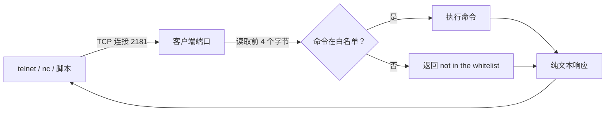

## 为什么 4 个字母就能管理 ZooKeeper？

ZooKeeper 有一个很“老派”的设计：你不用客户端库，也不用建立会话，只要往客户端端口发四个字母，就能拿到服务端的状态。比如：

```bash
echo ruok | nc 127.0.0.1 2181
echo srvr | nc 127.0.0.1 2181
echo mntr | nc 127.0.0.1 2181
```

第一条返回 `imok`，第二条返回版本、角色、延迟、连接数，第三条返回一整页监控指标。没有握手、没有认证、没有 JSON，甚至不需要知道 ZooKeeper 的二进制协议。

这套东西叫 **4lw**，即 Four Letter Words（四字命令）。它诞生于 ZooKeeper 还很年轻的年代，设计目标非常朴素：**服务器出问题时，运维手边只有 `telnet` 或 `nc`，也能在几秒钟内确认“还活着吗、是不是 Leader、延迟多少”**。

但也正因为太朴素，它后来变成了一个安全问题：任何人只要能连上客户端端口，就能执行这些命令。3.5.3 起，ZooKeeper 引入了 `4lw.commands.whitelist`，默认只放行 `srvr`，其余命令需要显式开启。理解 4lw，实际上是在理解三件事：**它怎么工作、白名单怎么生效、哪些命令不能随便开**。



| 对比项 | 4lw | AdminServer |
|--------|-----|-------------|
| 协议 | 客户端端口上的裸 TCP 文本 | HTTP + JSON |
| 默认入口 | `clientPort`（样例 2181） | 8080 |
| 命令名 | 固定四个字母 | 支持长名称和别名 |
| 认证 | 协议本身不做认证 | 默认没有内置登录认证 |
| 现状 | 官方建议逐步转向 AdminServer | 3.5.0 起内置，默认开启 |

> ### 💡 新人小结：4lw 像机房里的紧急按钮
>
> - 不需要钥匙（认证），按下去就有反应。
> - 按钮很少（命令固定），但每个都能快速回答一个关键问题。
> - 正因为谁都能按，后来才加了“只允许按哪几个”的白名单。
>
> **4lw 的价值是“零依赖诊断”，风险也是“零依赖就能用”。**

---

## 常用命令：先知道每个命令回答什么问题

官方 3.8.7 文档列出的四字命令如下。不要死记输出格式，先记“它能回答什么问题”：

| 命令 | 回答什么问题 | 返回形态 | 使用注意 |
|------|--------------|----------|----------|
| `ruok` | 进程还在吗？ | `imok` 或不返回 | 不代表已加入 quorum |
| `srvr` | 当前角色、延迟、连接数、zxid、节点数 | 多行文本 | 第一眼排障最常用 |
| `stat` | `srvr` 的信息 + 客户端连接列表 | 多行文本 | 连接多时输出较长 |
| `mntr` | 全套监控指标 | `key<TAB>value` | 字段随版本增加，脚本要容错 |
| `conf` | 当前生效配置 | 多行文本 | 用来核对实际值，不是你以为的值 |
| `cons` | 每个连接的会话、排队、收发计数 | 多行文本 | 连接多时可能较重 |
| `dump` | 会话与临时节点 | 多行文本 | 仅 Leader 输出完整信息 |
| `wchs` | Watcher 总量 | 多行文本 | 最轻量 |
| `wchc` | 按会话列 Watcher | 多行文本 | 官方提示可能很重，慎用 |
| `wchp` | 按路径列 Watcher | 多行文本 | 同上 |
| `dirs` | 快照/日志目录大小 | 多行文本 | 判断磁盘增长 |
| `isro` | 是否只读模式 | `ro` / `rw` | 只读模式相关 |
| `srst` | 重置服务端统计 | 无新字段 | 写操作，会影响统计口径 |
| `crst` | 重置连接统计 | 无新字段 | 写操作 |
| `stmk` | 设置 trace mask | 返回新 mask | 写操作，影响日志级别 |

本机真实输出示例：

```text
$ echo ruok | nc 127.0.0.1 2182
imok

$ echo srvr | nc 127.0.0.1 2182
Zookeeper version: 3.8.7-9085db92dd679e1e90a63bfe6ae6345ab6cbc4ae, built on 2026-09-03 17:57 UTC
Latency min/avg/max: 0/1.1765/6
Received: 54
Sent: 54
Connections: 1
Outstanding: 0
Zxid: 0x34
Mode: standalone
Node count: 8
```

`mntr` 的输出是逐行 KV：

```text
zk_version	3.8.7-9085db92dd679e1e90a63bfe6ae6345ab6cbc4ae, built on 2026-09-03 17:57 UTC
zk_server_state	standalone
zk_ephemerals_count	0
zk_num_alive_connections	1
zk_avg_latency	1.1765
zk_outstanding_requests	0
zk_znode_count	8
zk_global_sessions	0
zk_watch_count	0
zk_packets_sent	56
zk_packets_received	56
```

| 指标 | 含义 | 排障时怎么用 |
|------|------|--------------|
| `zk_server_state` | `standalone`/`leader`/`follower`/`looking` | 第一眼判断角色与是否在选举 |
| `zk_avg_latency` | 平均请求延迟 | 持续升高时查磁盘与请求队列 |
| `zk_outstanding_requests` | 尚未处理的请求数 | 持续大于 0 说明处理不过来 |
| `zk_num_alive_connections` | 当前客户端连接数 | 接近上限时查连接泄漏/重试 |
| `zk_znode_count` | znode 总数 | 与预期对比，发现异常增长 |
| `zk_watch_count` | Watcher 总数 | 暴涨时查客户端是否重复注册 |
| `zk_ephemerals_count` | 临时节点数 | 会话未清理时会持续存在 |
| `zk_packets_received/sent` | 收发包总数 | 突增可能是重试或异常流量 |

注意：`mntr` 的字段会随版本增加，官方明确说输出可能变化。监控脚本不要假设字段永远不变，也不要把某个字段缺失当成服务故障。

> ### 💡 新人小结：先记问题，再记命令
>
> - 想知道“活着吗”用 `ruok`，但它不回答“能不能服务”。
> - 想知道“什么角色、延迟多少”用 `srvr`。
> - 想知道“全部指标”用 `mntr`，但要容忍字段变化。
> - 想知道“谁连着、谁在监听”用 `stat`、`cons`、`wchs`。
>
> **命令是工具，不是仪式；先明确要回答的问题。**

---

## 白名单：从 3.5.3 开始，4lw 不是“默认全开”

官方文档写得很清楚：3.5.3 起，四字命令必须显式加入 `4lw.commands.whitelist`，默认只放行 `srvr`（`zkServer.sh` 会用到）；如果启用了只读模式，还会加入 `isro`。其他命令默认不可用，尝试使用会得到：

```text
ruok is not executed because it is not in the whitelist.
```

配置写法：

```properties
# 只放行排障需要的命令
4lw.commands.whitelist=srvr,ruok,mntr

# 放行全部（只适合受控实验环境）
4lw.commands.whitelist=*
```

| 配置 | 预期效果 | 适用场景 |
|------|----------|----------|
| 不写 | 默认只有 `srvr`（只读模式加 `isro`） | 最小暴露面 |
| `srvr` | 只允许 `srvr` | 只需要 `zkServer.sh status` |
| `srvr,ruok,mntr` | 允许这三条 | 需要探活和指标采集 |
| `*` | 允许全部已知命令 | 实验/受控排障，不建议长期 |

### 一个必须说清的 3.8.7 行为：`srvr` 会被强制保留

很多资料（包括一些旧问答）会说“把白名单置空，就一条四字命令都不放行”。在 ZooKeeper 3.8.7 上，这个说法不准确。

本机复核：配置

```properties
admin.enableServer=false
4lw.commands.whitelist=
```

启动后执行：

```text
$ echo ruok | 2186
ruok is not executed because it is not in the whitelist.

$ echo mntr | 2186
mntr is not executed because it is not in the whitelist.

$ echo srvr | 2186
Zookeeper version: 3.8.7-9085db92dd679e1e90a63bfe6ae6345ab6cbc4ae, built on 2026-09-03 17:57 UTC
Latency min/avg/max: 0/0.0/0
...
Mode: standalone
Node count: 5
```

也就是说，**白名单置空的实际效果是“只保留 `srvr`”，不是“全部关闭”**。3.8.7 的实现会在初始化白名单时无条件加入 `srvr`，所以 `srvr` 始终可用；这是为了让 `zkServer.sh status` 这类官方脚本继续工作。

再用 `4lw.commands.whitelist=ruok` 复核，可以看到配置确实生效：

```text
$ echo ruok | 2189
imok

$ echo srvr | 2189
Zookeeper version: 3.8.7-9085db92dd679e1e90a63bfe6ae6345ab6cbc4ae, built on 2026-09-03 17:57 UTC
...
Mode: standalone

$ echo mntr | 2189
mntr is not executed because it is not in the whitelist.
```

| 配置 | `ruok` | `srvr` | `mntr` |
|------|--------|--------|--------|
| 空白名单 | 拒绝 | 允许 | 拒绝 |
| `ruok` | 允许 | 允许 | 拒绝 |
| `srvr,ruok,mntr` | 允许 | 允许 | 允许 |
| `*` | 允许 | 允许 | 允许 |

**结论：** 如果你看到“置空白名单就能全关 4lw”的建议，不要直接照抄。3.8.7 至少会保留 `srvr`；要彻底消除 2181 上的管理面，只能靠网络层限制来源，而不能只靠白名单。对大多数生产环境，保留 `srvr` 反而是可取的，因为状态检查依赖它。

> ### 💡 新人小结：白名单是“减法”，但 srvr 是保底项
>
> - 白名单不是“全有或全无”，而是一张允许列表。
> - `srvr` 在 3.8.7 里是保底项，空列表也不会把它减掉。
> - 想减少暴露面，就把列表收紧到 `srvr` 或 `srvr,ruok,mntr`。
>
> **“置空”不等于“全关”；先实测，再写进生产配置。**

---

## 为什么 `srvr` 总被保留？因为它背了 `zkServer.sh status`

`zkServer.sh` 的 `status` 分支会调用 ZooKeeper 自带的 `FourLetterWordMain`，向客户端端口发 `srvr`，然后从返回文本里筛 `Mode`：

```bash
org.apache.zookeeper.client.FourLetterWordMain \
  $clientPortAddress $clientPort srvr $isSSL
```

所以白名单默认放行 `srvr`，是为了让 `zkServer.sh status` 开箱可用；3.8.7 的实现进一步把它做成“无论白名单怎么写都保留”。这就解释了为什么空白名单下 `srvr` 仍然可用。

但要注意平台差异：

| 脚本 | 是否有 `status` 子命令 | 状态检查方式 |
|------|------------------------|--------------|
| Linux/macOS `zkServer.sh` | 有 | 2181 上的 `srvr` |
| Windows `zkServer.cmd` | 没有 | 需要自己发 `srvr`，或用 AdminServer 的 `/commands/srvr` |

3.8.7 发行包的 `bin/zkServer.cmd` 只负责前台启动 `QuorumPeerMain`，脚本里没有 `status`、`stop`、`restart` 分支。所以在 Windows 上执行 `zkServer.cmd status` 并不会像 Unix 脚本那样查询状态；它仍会走启动逻辑。问答实录里把 `zkServer.cmd status` 与 `zkServer.sh status` 并列，这一条需要按平台更正。

> ### 版本核准：脚本能力不对等
>
> 同一版本的 Unix 和 Windows 脚本不保证功能一致。`zkServer.sh status` 依赖 `srvr` 是事实；`zkServer.cmd status` 在 3.8.7 中不存在，也是事实。排障时先读 `bin/` 脚本，不要按“另一个平台有”来推断。

---

## 安全边界：哪些命令不能随便开？

4lw 最大的风险不是“命令太多”，而是**它走的是客户端端口，协议本身不做认证**。任何能连上 2181 的人都可以尝试发送四字命令；白名单只能限制“哪些命令可用”，不能证明“你是谁”。

| 命令/配置 | 风险 | 建议 |
|-----------|------|------|
| `wchc` / `wchp` | Watcher 多时开销大，可能影响服务 | 只排障时临时开，别长期放行 |
| `cons` / `dump` | 泄露连接拓扑、会话、临时节点信息 | 限制来源；贴到工单前脱敏 |
| `envi` | 输出 classpath、环境变量等信息 | 不要对不可信网络开放 |
| `srst` / `crst` | 重置统计，影响监控口径 | 只给受控运维使用 |
| `stmk` | 修改 trace mask，可能放大日志 | 需要时临时使用，用完恢复 |
| `4lw.commands.whitelist=*` | 所有已知命令全部开放 | 只用于实验/受控排障 |
| 端口直接暴露到公网 | 任何扫描器都能尝试 | 用防火墙/安全组限制来源 |

另外，**3.8.7 的官方四字命令清单中没有 `kill`**。旧资料里常把 `kill` 列为“可以直接关停服务端”的四字命令；在 3.8.7 上不要依赖它。与其担心一个不存在的命令，不如把注意力放在 `wchc`/`wchp` 的开销、`cons`/`dump`/`envi` 的信息泄露，以及 `*` 的暴露面上。

> ### 💡 新人小结：白名单是门锁，不是身份证
>
> - 它决定“哪几个按钮能用”，不决定“谁可以按”。
> - 能连上 2181 的人，就可能尝试白名单里的命令。
> - 真正的边界是网络分段、防火墙和最小权限，不是一条配置。
>
> **先把 2181 关在受信网络里，再谈白名单开哪几条。**

---

## 生产配置：按“谁要用”来开

### 场景一：只做注册中心，不需要监控采集

```properties
admin.enableServer=false
4lw.commands.whitelist=srvr
```

- AdminServer 关闭，8080 不再监听；
- 4lw 只保留 `srvr`，`zkServer.sh status` 仍可用；
- 业务客户端走 2181 二进制协议，不受影响。

### 场景二：需要基础探活和指标采集

```properties
admin.enableServer=false
4lw.commands.whitelist=srvr,ruok,mntr
```

- `ruok` 给探活脚本；
- `mntr` 给监控采集；
- `srvr` 给状态检查；
- 不放开 `wchc`/`wchp`/`cons`/`dump` 等高开销或高信息量命令。

### 场景三：已经有 Prometheus，不想让监控走 4lw

```properties
admin.enableServer=false
4lw.commands.whitelist=srvr
metricsProvider.className=org.apache.zookeeper.metrics.prometheus.PrometheusMetricsProvider
metricsProvider.httpHost=127.0.0.1
metricsProvider.httpPort=7000
```

监控改抓 `/metrics`，4lw 只留 `srvr` 给状态检查。三条通路各司其职，互不替代。

> ### 💡 新人小结：配置不是越关越好，而是“各走各的门”
>
> - 业务走 2181，不需要 4lw 也能跑。
> - 状态检查需要 `srvr`，所以别把白名单设计成“绝对空”。
> - 监控需要指标，就明确选 `mntr`、AdminServer 或 Prometheus 中的一条。
>
> **先列“谁需要什么”，再写白名单；不要先写 `*` 再想怎么收。**

---

## 验证清单：别只看配置文件

### 1. 确认白名单实际生效

```bash
# 需要 nc；Windows 可用 Git Bash 的 /dev/tcp 或安装 nc
echo srvr | nc 127.0.0.1 2181
echo ruok | nc 127.0.0.1 2181
echo mntr | nc 127.0.0.1 2181
```

期望结果：

| 配置 | `srvr` | `ruok` | `mntr` |
|------|--------|--------|--------|
| `srvr` | 有输出 | not in the whitelist | not in the whitelist |
| `srvr,ruok,mntr` | 有输出 | `imok` | KV 输出 |
| 空白名单 | 有输出 | not in the whitelist | not in the whitelist |

### 2. 确认 `srvr` 的 `Mode`

```text
Mode: standalone
Mode: leader
Mode: follower
Mode: looking
```

`Mode` 是判断“能不能服务”的第一眼指标。`ruok` 返回 `imok` 但 `Mode` 是 `looking` 时，进程活着，但服务可能还没准备好。

### 3. 确认端口来源

```text
netstat -ano | findstr LISTENING | findstr :2181
```

如果 2181 的 PID 不是你以为的 ZooKeeper，先查进程，不要继续改配置。

### 4. 确认关闭 AdminServer 后 4lw 仍按预期工作

AdminServer 和 4lw 是两条通路。关闭 8080 后，2181 上的 `srvr` 仍应可用；如果不可用，查白名单、客户端端口和启动日志，而不是查 AdminServer。

---

## 排查表

| 现象 | 可能原因 | 下一步 |
|------|----------|--------|
| `ruok` 返回 `not in the whitelist` | 白名单没有 `ruok` | 加 `ruok` 并重启 |
| `srvr` 始终可用，即使白名单为空 | 3.8.7 强制保留 `srvr` | 正常；不要指望用空值关掉它 |
| 所有命令都返回拒绝 | 白名单拼写错误/为空 | 检查 `4lw.commands.whitelist`，用 `srvr,ruok,mntr` 复核 |
| `ruok` 返回 `imok` 但写入失败 | 没有 quorum 或处于 looking | 用 `srvr`/`stat` 看 `Mode` 和剩余节点 |
| `wchc` 执行后服务变慢 | Watcher 太多，命令开销大 | 改用 `wchs` 看总量，避免高峰期执行 |
| `zkServer.cmd status` 没反应/启动了新进程 | Windows 脚本没有 status 分支 | 用 `srvr` 或 AdminServer 查询 |
| 关闭 AdminServer 后监控失联 | 监控走的是 `/commands/*` | 改走 4lw `mntr` 或 Prometheus |
| 关闭 4lw 后业务也断了 | 误改了 `clientPort` 或停了进程 | 4lw 白名单不影响业务协议；查端口和进程 |

---

## 要点总结

1. **4lw 是客户端端口上的明文诊断协议**：发送四个字母就能拿到状态；不需要握手、客户端库或额外端口。
2. **常用命令各有边界**：`ruok` 只证明进程活着，`srvr` 看角色和延迟，`mntr` 看指标，`stat`/`cons` 看连接，`dump`/`wchs` 看会话与 Watcher。
3. **3.5.3 起有白名单**：默认只放行 `srvr`；`4lw.commands.whitelist` 决定其余命令是否可用，`*` 只适合受控环境。
4. **3.8.7 会强制保留 `srvr`**：空白名单的实际效果是“只剩 `srvr`”，不是“全部关闭”；本机实测 `ruok`/`mntr` 被拒而 `srvr` 仍返回。
5. **`srvr` 被保留是为了状态检查**：`zkServer.sh status` 通过 `FourLetterWordMain` 发 `srvr`；Windows 的 `zkServer.cmd` 没有 `status` 子命令，不能用同一套命令。
6. **安全边界在网络层**：4lw 不做认证，白名单只限制命令集合；限制 2181 来源、收紧白名单、关闭不必要的管理面，三者要一起做。
7. **3.8.7 官方清单没有 `kill`**：不要把旧资料里的“kill 关服务”当成当前版本的可用手段；重点关注高开销和信息泄露类命令。

---

> ### 💡 新人小结：4lw 学完了，记住这 4 点
>
> 1. **先问问题再选命令**：活着、角色、指标、连接，各有各的命令。
> 2. **白名单是允许列表**：不是全开也不是全关，默认只有 `srvr`。
> 3. **空白名单仍有 `srvr`**：3.8.7 强制保留，别把“置空”当“全关”。
> 4. **安全靠网络和最小权限**：4lw 不认证，别把 2181 暴露给不可信网络。
