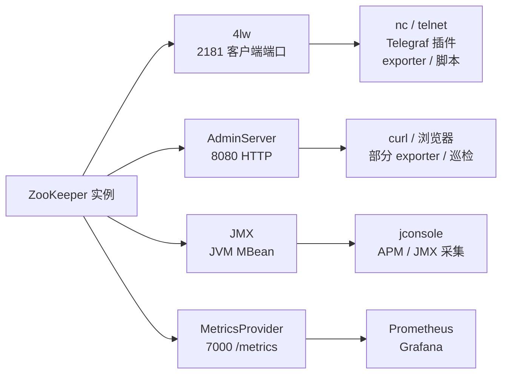
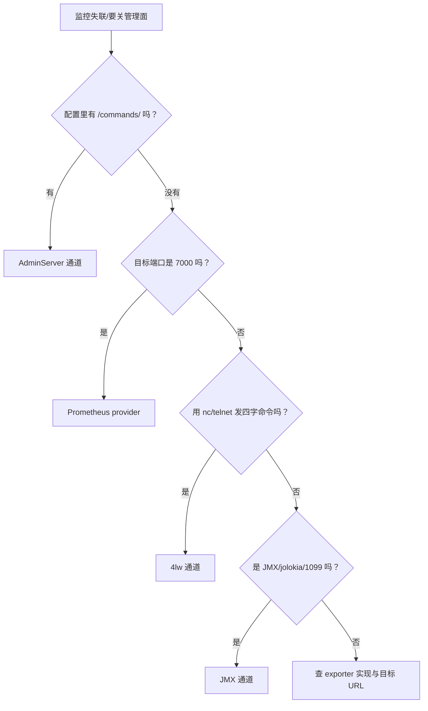

## 为什么监控工具连的端口不一样？

“我把 ZooKeeper 的 AdminServer 关了，为什么还有监控数据？”  
“我明明关了 4lw，为什么监控还在报错？”  
“第三方监控到底连的是 2181、8080、7000，还是 JMX？”

这些问题看起来矛盾，原因却很简单：**ZooKeeper 的监控数据不止一条出口**。不同的监控工具、不同的采集方式，可能分别走 4lw、AdminServer、JMX 或 Prometheus MetricsProvider。你关掉的是其中一条，其他通道当然还在工作；反过来，如果监控工具走的是你刚关掉的那条，它就会失联。

先把四条通道放在同一张图上：



| 通道 | 默认入口 | 数据形态 | 是否默认存在 | 关掉后谁受影响 |
|------|----------|----------|--------------|----------------|
| 4lw | 2181（客户端端口） | 纯文本 KV/多行文本 | 是，但受白名单限制 | 用 `nc`/`telnet` 采集的脚本、部分 exporter |
| AdminServer | 8080 | HTTP + JSON | 3.5.0 起默认开启 | 抓 `/commands/*` 的监控、浏览器管理页 |
| JMX | JVM 管理通道 | MBean 属性 | 取决于 JVM 启动参数与本地 attach | jconsole、APM、JMX 采集器 |
| Prometheus MetricsProvider | 7000（可改） | Prometheus 文本 | 否，需显式启用 | 抓 `/metrics` 的 Prometheus |

这张表最重要的结论是：**“关管理面”不是一个动作，而是四条通道各自的开关**。下面逐条拆开。

> ### 💡 新人小结：四条通道像四种查账方式
>
> - 4lw 是翻纸质流水：快、直接、没有权限校验。
> - AdminServer 是网页报表：结构清楚，但要多开一个 HTTP 端口。
> - JMX 是会计系统后台：信息深，但要懂 JVM。
> - Prometheus 是自动报表机：配置一次，长期采集。
>
> **先看监控工具连的是哪种“查账方式”，再决定关哪条。**

---

## 通道一：4lw（2181）

4lw 是最早、最“轻”的监控方式。它和业务客户端共用 2181，不需要额外端口，也不需要客户端库。采集方式通常是这样：

```bash
echo mntr | nc 127.0.0.1 2181
```

返回的是逐行 KV：

```text
zk_server_state	standalone
zk_avg_latency	1.1765
zk_outstanding_requests	0
zk_znode_count	8
zk_watch_count	0
zk_num_alive_connections	1
```

| 优点 | 限制 |
|------|------|
| 不需要额外端口，防火墙不用新开 | 纯文本，字段随版本变化 |
| `nc`/`telnet` 就能用，排障门槛低 | 协议不做认证，暴露面大 |
| 指标直接来自服务端 | 受 `4lw.commands.whitelist` 限制 |
| 历史久，很多脚本/插件按它实现 | 官方建议逐步转向 AdminServer |

常见的采集方式包括 Telegraf 的 ZooKeeper 插件、各类 exporter、Zabbix 社区模板，以及运维自己写的 `nc` 脚本。**不要按工具名判断它走哪条通道**：同一个工具可能支持 4lw、AdminServer 或 Prometheus 多种模式，最终以配置里的目标端口/URL 为准。

在 3.8.7 上，4lw 的白名单有一个容易踩的坑：`srvr` 会被强制保留，空白名单并不等于“全部关闭”。如果要给监控开放 `mntr`，需要显式写：

```properties
4lw.commands.whitelist=srvr,mntr,ruok
```

如果只写 `srvr`，监控请求 `mntr` 会得到：

```text
mntr is not executed because it is not in the whitelist.
```

> ### 💡 新人小结：4lw 是“共用业务门”的监控
>
> - 它不额外开端口，所以防火墙最省事。
> - 它也没有认证，所以端口暴露面最大。
> - 它受白名单限制，`mntr` 不是默认就有。
>
> **4lw 适合轻量探活和快速排障，不适合作为唯一的生产监控通道。**

---

## 通道二：AdminServer（8080）

AdminServer 是 3.5.0 起内置的 HTTP 管理面。它把管理信息以 JSON 暴露出来，默认监听 8080，命令路径是 `/commands/[name]`。监控可以直接请求：

```bash
curl -s http://127.0.0.1:8080/commands/mntr
```

本机复核实例的 `/commands/mntr` 返回 `200 application/json`，字段包括：

```json
{
  "version" : "3.8.7-9085db92dd679e1e90a63bfe6ae6345ab6cbc4ae",
  "server_state" : "standalone",
  "ephemerals_count" : 0,
  "num_alive_connections" : 0,
  "avg_latency" : 0.0,
  "outstanding_requests" : 0,
  "znode_count" : 5,
  "global_sessions" : 0
}
```

| 优点 | 限制 |
|------|------|
| JSON 结构适合程序解析 | 默认监听 `0.0.0.0`，暴露面较大 |
| 命令名有别名，表达力比四字命令强 | 默认没有内置登录认证 |
| 浏览器打开 `/commands` 就能看命令列表 | 关掉后所有 `/commands/*` 采集都会失联 |
| 和 4lw 共用服务端状态 | 不是所有第三方工具都支持这种模式 |

AdminServer 和 4lw 的关系，经常被误解为“开了 AdminServer 就不需要 4lw”或“关了 AdminServer 就等于关了 4lw”。本机复核表明两者独立：

- 4lw 白名单为空时，`ruok` 被拒，但 AdminServer 的 `/commands/ruok` 仍返回 `200 application/json`；
- `admin.enableServer=false` 时，8080 不再监听，但 2181 的 `srvr` 仍可用。

所以，**监控如果走 AdminServer，关闭前必须改配置；监控如果走 4lw，关闭 AdminServer 不会自动让它失联**。

> ### 💡 新人小结：AdminServer 是“另开一扇 HTTP 窗”
>
> - 它不替代 2181 的业务协议，也不替代 4lw。
> - 它的 JSON 好解析，但默认没有认证。
> - 关它只关 HTTP 管理面，不会自动关 4lw。
>
> **看到监控 URL 里有 `/commands/`，就知道它走的是 AdminServer。**

---

## 通道三：JMX（JVM 层）

JMX 不走 ZooKeeper 的客户端端口，也不走 AdminServer。它走 JVM 自己的管理接口，暴露的是 MBean。官方 JMX 文档说明，ZooKeeper 对 JMX 有完整支持；随发行包提供的 `zkServer.sh` 默认只支持本地管理，远程管理需要额外配置 JMX 的 host/port。

本地最典型的用法是 `jconsole`：

```text
jconsole
```

在本机进程列表里选择 ZooKeeper 的 JVM，然后在 “MBeans” 标签页查看。官方文档列出的关键 MBean 包括：

| MBean | 代表什么 | 用途 |
|-------|----------|------|
| `Quorum` | 整个 ensemble 的父节点 | 看集群成员与整体状态 |
| `LocalPeer` / `RemotePeer` | 本节点/远端节点 | 看 peer 状态、同步关系 |
| `LeaderElection` | 正在进行的选举 | 看选举开始时间等信息 |
| `Leader` / `Follower` | 当前节点的角色 | 看 Leader/Follower 专属属性 |
| `DataTree` | 内存中的 znode 数据库 | 看 znode、临时节点等统计 |
| `ServerCnxn` | 客户端连接 | 看会话、连接统计，甚至终止连接 |

独立模式的 MBean 名称会落在 `ZooKeeperServer`（`StandaloneServer_port<#>`）下；集群模式则通过 `Leader`/`Follower` 继承 `ZooKeeperServer` 的属性。看 JMX 时先确认自己连的是单机还是集群节点。

| 优点 | 限制 |
|------|------|
| 能看到 JVM 层的线程、内存、GC | 需要 JMX 配置/工具，门槛比 `nc` 高 |
| 能管理 MBean，不只是读指标 | 远程 JMX 涉及端口、认证、防火墙 |
| 不依赖 2181/8080 | 采集器需要支持 JMX 协议 |
| 适合深度排障 | 指标模型与 4lw/Prometheus 不同，不能直接套字段 |

关于端口：**1099 是很多 Java 应用远程 JMX 的常见约定，但不是 ZooKeeper 配置里固定写死的默认端口**。本地 `jconsole` 通过 attach 机制连接，不需要你先开放 1099；远程 JMX 才需要显式配置 host/port。看到监控配置写 `1099` 时，先确认它是不是 JMX，不要把它当成 ZooKeeper 的“默认管理端口”。

> ### 💡 新人小结：JMX 是“进 JVM 内部看”
>
> - 它看的不只是 ZooKeeper 指标，还有 JVM 的线程、内存、GC。
> - 本地 jconsole 是 attach，不是先开 1099 端口。
> - 远程 JMX 要额外配置，1099 只是常见约定。
>
> **JMX 适合深度排障，不适合拿来替代轻量探活。**

---

## 通道四：Prometheus MetricsProvider（7000）

从 3.6.0 起，ZooKeeper 支持可插拔的 MetricsProvider。启用 Prometheus provider 后，会额外启动一个 Jetty 服务，默认端口 7000，指标路径是 `/metrics`：

```properties
metricsProvider.className=org.apache.zookeeper.metrics.prometheus.PrometheusMetricsProvider
metricsProvider.httpHost=127.0.0.1
metricsProvider.httpPort=7000
metricsProvider.exportJvmInfo=true
```

本机复核实例把端口改成 7086，启动后：

```text
TCP    127.0.0.1:7086         0.0.0.0:0              LISTENING       28544
```

请求：

```bash
curl -s -o /dev/null -w "%{http_code} %{content_type}\n" \
  http://127.0.0.1:7086/metrics
```

返回：

```text
200 text/plain; version=0.0.4; charset=utf-8
```

响应开头是 Prometheus 文本格式：

```text
# HELP znode_count znode_count
# TYPE znode_count gauge
znode_count 5.0
# HELP write_commit_proc_issued write_commit_proc_issued
# TYPE write_commit_proc_issued summary
write_commit_proc_issued{quantile="0.5",} NaN
```

| 优点 | 限制 |
|------|------|
| 官方监控文档推荐的现代采集方式之一 | 需要显式启用，默认没有 7000 |
| Prometheus/Grafana 生态成熟 | 需要额外端口和防火墙规则 |
| 指标结构稳定，适合长期趋势 | 与 4lw/AdminServer 的字段名不同 |
| 不依赖 2181 的管理命令 | 仍需要保护 `/metrics` 的访问 |

Prometheus 的抓取配置通常是：

```yaml
scrape_configs:
  - job_name: zookeeper
    static_configs:
      - targets: ['10.0.0.11:7000', '10.0.0.12:7000', '10.0.0.13:7000']
```

注意 `metricsProvider.httpHost` 的默认值是 `0.0.0.0`。如果 Prometheus 在同一台机器上，绑 `127.0.0.1` 更安全；如果跨机器抓取，再按网络策略放开，并用防火墙限制来源。

> ### 💡 新人小结：Prometheus 是“专门拉指标”的通道
>
> - 它不依赖 4lw 白名单，也不依赖 AdminServer。
> - 它默认不存在，必须在 `zoo.cfg` 里显式启用。
> - 7000 是默认端口，但可以改；同机多实例要错开。
>
> **要长期监控，优先考虑 Prometheus；要快速排障，4lw 仍然方便。**

---

## 怎么判断自己的监控会不会失联？

最有用的方法不是记工具名，而是看监控配置里的**目标端口/URL**：

| 配置里出现 | 走哪条通道 | 关 AdminServer 后 | 收紧 4lw 后 | 需要做什么 |
|------------|------------|-------------------|-------------|------------|
| `2181` + `nc`/`telnet` + `mntr` | 4lw | 不受影响 | 可能失联 | 白名单保留 `mntr` |
| `8080` 或 URL 带 `/commands/` | AdminServer | 失联 | 不受影响 | 改走 4lw/Prometheus，或保留 AdminServer |
| `7000` 或 `/metrics` | Prometheus provider | 不受影响 | 不受影响 | 确认 provider 已启用、端口可达 |
| `1099`/JMX/jolokia | JMX | 不受影响 | 不受影响 | 确认 JMX 配置与采集器 |
| 只写“ZooKeeper exporter” | 不确定 | 需要看实现 | 需要看实现 | 查 exporter 文档/配置，别猜 |

一个实际的判断流程：



> ### 💡 新人小结：端口是通道的“指纹”
>
> - `/commands/` 指向 AdminServer。
> - `7000`/`/metrics` 指向 Prometheus provider。
> - `nc`/`telnet` + 四字命令指向 4lw。
> - `1099`/JMX/jolokia 指向 JVM 管理。
>
> **先看配置指纹，再决定关哪个开关；不要按工具名猜。**

---

## 四条通道怎么选？

| 维度 | 4lw | AdminServer | JMX | Prometheus |
|------|-----|-------------|-----|------------|
| 额外端口 | 不需要（共用 2181） | 8080 | 远程时通常需要 | 7000 |
| 数据丰富度 | 中（`mntr` 很全） | 中高（JSON） | 高（JVM + MBean） | 高（指标模型完整） |
| 认证 | 协议无认证 | 默认无认证 | 取决于 JMX 配置 | 取决于网络/代理 |
| 采集门槛 | 最低 | 低 | 中 | 中 |
| 长期趋势 | 一般 | 一般 | 一般 | 最好 |
| 典型用途 | 快速排障、探活 | 人工查看、轻量巡检 | JVM 深度排障 | 生产监控、告警 |

### 推荐组合

| 场景 | 建议组合 |
|------|----------|
| 本机学习/单机开发 | 4lw `srvr,ruok,mntr`；AdminServer 可开可关 |
| Dubbo 注册中心，轻量运维 | 4lw `srvr` + Prometheus 7000；AdminServer 关闭 |
| 已有 Prometheus/Grafana | Prometheus 7000 为主；4lw 只留 `srvr`；AdminServer 关闭 |
| 需要 JVM 深度排障 | 在上述基础上加本地 jconsole/JMX |
| 老旧监控只支持 4lw | 4lw `srvr,mntr,ruok`；限制 2181 来源；AdminServer 关闭 |
| 老旧监控只支持 AdminServer | 保留 AdminServer，但绑定内网/回环并加防火墙 |

没有一种组合适合所有环境。关键是：**每条通道都要有明确的“谁在用、怎么保护、关了谁受影响”**。

> ### 💡 新人小结：不要追求“全开”或“全关”
>
> - 全开：暴露面大，排障时也容易被无关数据淹没。
> - 全关：业务可能没事，但监控和状态检查会断。
> - 正确做法：业务一条、监控一条、排障一条，各走各的。
>
> **监控通道的选择，本质是“可用性、安全性、成本”的取舍。**

---

## 验证清单

### 1. 列出所有监听端口

```text
netstat -ano | findstr LISTENING | findstr ":2181 :8080 :7000"
```

或者在 Linux 上：

```bash
ss -lntp | grep -E ':(2181|8080|7000)\b'
```

### 2. 逐条验证通道

```bash
# 4lw（需要白名单允许 mntr）
echo mntr | nc 127.0.0.1 2181 | head

# AdminServer（若开启）
curl -s -o /dev/null -w "%{http_code}\n" http://127.0.0.1:8080/commands/mntr

# Prometheus（若启用）
curl -s -o /dev/null -w "%{http_code}\n" http://127.0.0.1:7000/metrics
```

### 3. 验证关闭后的影响

| 动作 | 应验证 |
|------|--------|
| 关闭 AdminServer | 8080 不再监听；2181 业务正常；4lw 按白名单工作 |
| 收紧 4lw | `mntr` 是否仍需；`srvr` 是否保留；监控是否改道 |
| 启用 Prometheus | 7000 是否监听；`/metrics` 是否 200；Prometheus 是否能抓取 |
| 配置 JMX | 本地 jconsole 是否能 attach；远程端口/认证是否可用 |

---

## 要点总结

1. **ZooKeeper 有四条常见监控通道**：4lw（2181）、AdminServer（8080）、JMX（JVM）、Prometheus MetricsProvider（7000）；它们相互独立，不是替代关系。
2. **4lw 最轻、最通用，但也最需要网络保护**：共用客户端端口、无认证、受白名单限制；`mntr` 不是默认开放。
3. **AdminServer 是 HTTP 管理面**：JSON 好解析，但默认监听所有网卡且无内置登录认证；关闭后所有 `/commands/*` 采集会失联。
4. **JMX 看的是 JVM 内部**：本地 jconsole 通过 attach，不需要先开 1099；远程 JMX 才需要显式配置 host/port，1099 不是 ZooKeeper 固定默认值。
5. **Prometheus 是长期监控的首选之一**：需要显式启用 MetricsProvider，默认端口 7000，路径 `/metrics`；它不依赖 4lw 或 AdminServer。
6. **判断监控走哪条通道，看目标端口/URL**：`/commands/` → AdminServer，`7000`/`/metrics` → Prometheus，`nc`+四字命令 → 4lw，`1099`/JMX → JVM。
7. **关管理面前先改监控**：把监控从即将关闭的通道迁走，再关；关完逐条验证业务、探活、指标和告警。

---

> ### 💡 新人小结：四条监控通道学完了，记住这 4 点
>
> 1. **监控不止 8080**：4lw、JMX、Prometheus 都可能在被使用。
> 2. **关 AdminServer 不会关 4lw**：两条路要分别验证。
> 3. **7000 不是默认端口**：启用 MetricsProvider 才有。
> 4. **先看配置指纹，再决定关哪个**：`/commands/`、`/metrics`、`nc`、JMX 各有各的入口。
