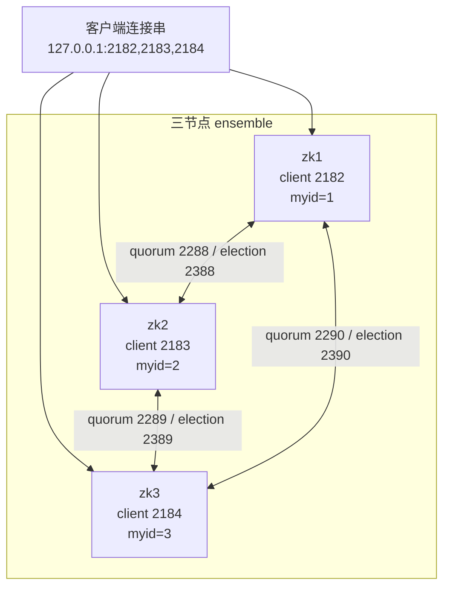
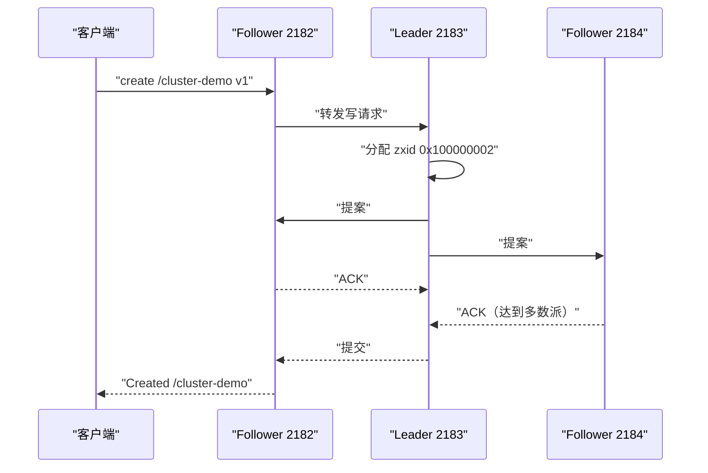
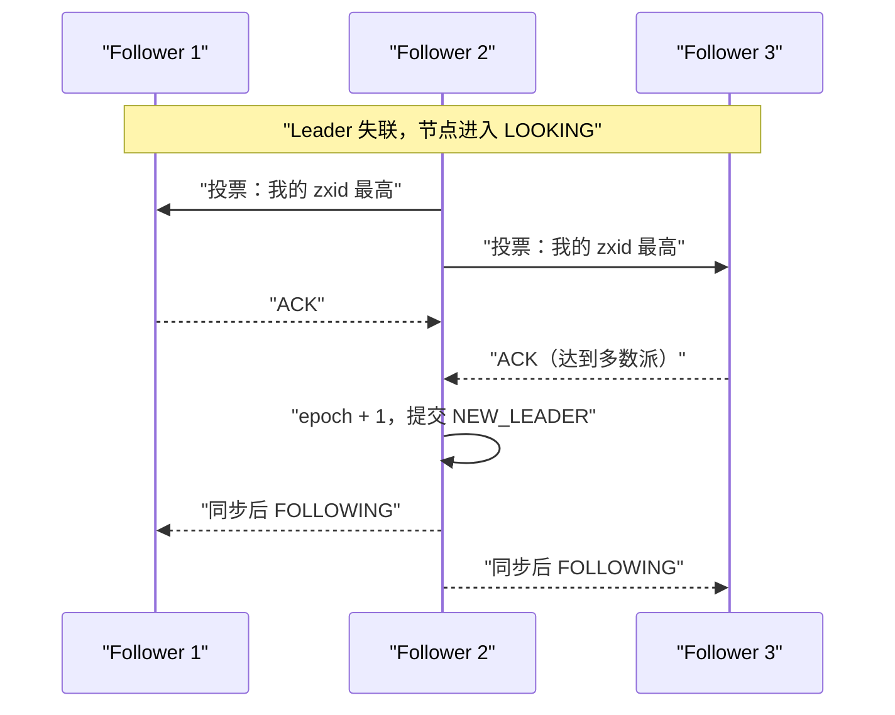

## 为什么单机不够？

单机 ZooKeeper 跑得很好，直到那台机器出问题：进程崩溃、磁盘写满、网卡故障，任何一个都会让所有依赖它的服务同时失去协调能力。更麻烦的是，单机没有“谁说了算”的机制：你无法判断是 ZooKeeper 挂了，还是网络断了，还是客户端自己的问题。

集群要解决的不是“把同一份数据多存几份”这么简单，而是三个问题：

1. **多数派还活着吗？** 少于多数派时，系统必须停止接受写，避免两个分区各自产生一个“主”。
2. **谁来处理写？** 所有写请求需要一个统一的排序点，否则不同节点会产生不同的更新顺序。
3. **主节点挂了怎么办？** 需要一套能在秒级选出新主、并让新主拿到最新已提交状态的协议。

ZooKeeper 用 ensemble（集群）+ quorum（多数派）+ ZAB（ZooKeeper Atomic Broadcast）解决这三个问题。三节点是最小推荐规模：能容忍一台机器故障，仍然保持多数派。本文用本机真实的三节点实验，把配置、启动、选主、读写、故障切换和“只剩一台会怎样”完整走一遍。

| 单机的问题 | 三节点集群的应对 | 代价 |
|------------|------------------|------|
| 一台机器挂了服务全停 | 多数派存活即可继续服务 | 需要 3 台机器/实例 |
| 无法判断“谁是最新状态” | Leader 统一排序，Follower 同步 | 写要经过 quorum 往返 |
| 两个进程都可能自称主 | 选举需要多数派投票，quorum 相交 | 少数派分区会停止服务 |
| 扩容只能换更强的机器 | 增加 Follower/Observer 扩展读 | 运维复杂度上升 |

> ### 💡 新人小结：三节点集群像三个人组成的决策小组
>
> - 任何决定至少要有两个人同意（多数派），一个人反对不影响结果。
> - 一个人请假，剩下两个人还能继续决策；两个人同时失联，小组就停摆。
> - 组长（Leader）负责给决定编号，组员（Follower）负责记录和投票。
> - 隔壁房间的观察员（Observer）可以旁听和传话，但没有投票权。
>
> **集群的关键不是“机器多”，而是“多数派还能不能见面”。**

**学习路线图**

```
quorum 数学 → 配置与 myid → 启动与角色 → 跨节点读写 → 杀主重选 → 失去多数派 → 选举内部 → 脑裂与 Observer
几个节点够    每台怎么配     谁是 Leader    写怎么走       故障演练     只剩一台        epoch/zxid   边界与扩展
```

---

## 先算清楚：几个节点才够？

ZooKeeper 要求所有 quorum 至少有一个共同成员。实现方式很简单：quorum 大小必须是 `floor(N/2) + 1`，也就是“严格多数”。

| 节点数 N | 多数派需要 | 可容忍故障数 | 说明 |
|----------|------------|--------------|------|
| 1 | 1 | 0 | 单机，没有高可用 |
| 2 | 2 | 0 | 任何一台故障都会失去多数派，比单机更脆弱 |
| 3 | 2 | 1 | 最小推荐规模 |
| 4 | 3 | 1 | 容错与 3 节点相同，但多一台成本 |
| 5 | 3 | 2 | 生产常用的高可用规模 |
| 6 | 4 | 2 | 容错与 5 节点相同，但多一台成本 |

官方文档给出的结论是：N 为奇数时最多容忍 `N/2` 台故障；N 为偶数时最多容忍 `N/2 - 1` 台。偶数节点不会提高容错，反而增加连接和数据传输成本，所以生产上通常选奇数。

还要注意，“可容忍故障”指的是**同时失联的机器数量**，不是“可以随便重启”。三节点集群在做一台机器的维护时，剩下两台只要再坏一台就失去多数派；如果维护窗口长、风险高，五节点更稳妥。

---

## 配置：server.x、myid 与三组端口

### 三节点的配置

本机实验在同一台机器上跑三个实例，因此每个实例需要独立的 `dataDir`、客户端端口、AdminServer 端口，以及不同的 quorum/election 端口。三个节点的 `zoo.cfg` 只有少量差异，下面是 zk1 的完整配置：

```properties
tickTime=2000
initLimit=10
syncLimit=5
dataDir=C:/Users/webtu/AppData/Local/Temp/zk-zookeeper-docs/ensemble/zk1/data
clientPort=2182
admin.serverPort=8081
4lw.commands.whitelist=*
server.1=127.0.0.1:2288:2388
server.2=127.0.0.1:2289:2389
server.3=127.0.0.1:2290:2390
```

三个节点的差异如下：

| 配置项 | zk1 | zk2 | zk3 | 说明 |
|--------|-----|-----|-----|------|
| `dataDir` | `.../zk1/data` | `.../zk2/data` | `.../zk3/data` | 每个实例独立，不能共用 |
| `clientPort` | 2182 | 2183 | 2184 | 客户端连接端口 |
| `admin.serverPort` | 8081 | 8082 | 8083 | AdminServer HTTP 端口 |
| `data/myid` 内容 | `1` | `2` | `3` | 必须与 `server.x` 的 x 对应 |
| `server.1` | `127.0.0.1:2288:2388` | 同左 | 同左 | 所有节点看到同一份成员列表 |
| `server.2` | `127.0.0.1:2289:2389` | 同左 | 同左 | 第一段端口用于 quorum 通信 |
| `server.3` | `127.0.0.1:2290:2390` | 同左 | 同左 | 第二段端口用于 Leader 选举 |

`server.x=host:port1:port2` 的两个端口含义不同：

- **第一个端口**：Follower 连接 Leader、同步数据、传输提案的 quorum 通信端口。
- **第二个端口**：Leader 选举专用端口。

两个端口不能省。很多教程用 `2888:3888`，本文为了避免和本机已有服务冲突，使用了 `2288:2388`、`2289:2389`、`2290:2390`。端口号本身没有语义，只要集群内一致、网络可达即可。

### myid：每个节点的身份证

`myid` 文件放在 `dataDir` 下，内容只有节点编号。它必须和 `server.x` 的 `x` 一致。本文用 Git Bash 写入：

```bash
printf '1' > /path/to/zk1/data/myid
printf '2' > /path/to/zk2/data/myid
printf '3' > /path/to/zk3/data/myid
```

Windows PowerShell 可以用：

```powershell
Set-Content -Path D:\zookeeper\zk1\data\myid -Value 1 -NoNewline -Encoding ascii
```

| 常见错误 | 后果 | 正确做法 |
|----------|------|----------|
| `myid` 写成 `myid=1` | 解析失败或 ID 不匹配 | 文件里只写数字 `1` |
| `myid` 放在 `conf/` 下 | 启动时找不到 | 放在 `dataDir` 下 |
| 三个节点共用同一个 `dataDir` | 数据和 `myid` 互相覆盖 | 每个节点独立目录 |
| `myid` 与 `server.x` 不一致 | 节点身份错乱，无法加入 quorum | 逐台核对编号 |
| 编号超出 1–255 | 不被接受 | 使用 1–255；启用 TTL 等扩展特性时需小于 255 |



### initLimit 与 syncLimit

| 参数 | 本文值 | 换算成时间 | 作用 |
|------|--------|------------|------|
| `tickTime` | 2000 ms | 2 秒 | 基本时间单位 |
| `initLimit` | 10 | 20 秒 | Follower 初始连接并同步到 Leader 的时间上限 |
| `syncLimit` | 5 | 10 秒 | Follower 与 Leader 允许落后的时间上限 |

如果数据量大、首次同步慢，`initLimit` 太小会导致 Follower 还没同步完就被判定失败；`syncLimit` 太小会让网络抖动更容易触发 Leader 踢掉 Follower。两者都以 tick 为单位，改 `tickTime` 会同时改变它们的实际时长。

> ### 💡 新人小结：myid 是座位号，server.x 是座位表
>
> - 每个节点坐下前，先看自己手里的座位号（`myid`）。
> - 座位表（`server.x`）告诉所有人：1 号坐哪、2 号坐哪、3 号坐哪。
> - 座位号和座位表对不上，这个人就找不到自己的位置，会议无法开始。
>
> **`myid` 和 `server.x` 必须一一对应；三个节点看到的是同一份座位表。**

---

## 启动：先 LOOKING，再 LEADING/FOLLOWING

三节点启动时，每个节点会先进入 `LOOKING` 状态，互相交换投票，选出 Leader 后分别进入 `LEADING` 或 `FOLLOWING`。本机实验的真实日志摘录如下：

```text
# zk1（follower）
FOLLOWING - LEADER ELECTION TOOK - 703 MS

# zk2（leader）
LEADING - LEADER ELECTION TOOK - 225 MS

# zk3（follower）
FOLLOWING - LEADER ELECTION TOOK - 23 MS
```

| 日志/状态 | 含义 | 是否需要处理 |
|-----------|------|--------------|
| `LOOKING` | 正在寻找 Leader，尚未参与服务 | 启动初期正常；长期 LOOKING 说明 quorum 不足 |
| `LEADING` | 当选 Leader，开始处理写提案 | 每个 ensemble 最多一个 |
| `FOLLOWING` | 跟随 Leader，参与投票并提供读 | 正常状态 |
| `LEADER ELECTION TOOK ... MS` | 本次选举耗时 | 秒级以内通常正常；持续过长查网络 |
| `Connection refused` | 启动早期有节点还没起来 | 短暂出现可忽略；持续出现查端口/防火墙 |

启动早期日志里出现 `java.net.ConnectException: Connection refused` 并不一定是故障：三个节点不是同时就绪，先起来的节点尝试连接还没启动的节点，自然会失败。只要最终形成 quorum，并且没有持续的连接错误，就可以继续。

启动完成后，用四字命令 `srvr` 看每个节点的角色。本机抓取的结果：

| 节点 | 客户端端口 | `Mode` | `Zxid` | `Node count` |
|------|------------|--------|--------|--------------|
| zk1 | 2182 | follower | 0x0 | 5 |
| zk2 | 2183 | leader | 0x100000000 | 5 |
| zk3 | 2184 | follower | 0x100000000 | 5 |

这里有一个容易误判的细节：zk1 的 `Zxid` 显示为 `0x0`，而 zk2/zk3 已经到 `0x100000000`。`Zxid` 是节点本地最后处理的 zxid，刚完成选主、还没有业务写入时，不同节点的本地视图可能短暂不同。判断角色看 `Mode`，不要拿单个节点的 `Zxid` 做全局比较；等有写入后，各节点会逐步推进到同一顺序。

`0x100000000` 的低 32 位是 0，高 32 位是 1：这是第 1 个 Leader epoch 的起点。它不是“数据量 4GB”，而是 zxid 的 epoch 进位。

---

## 读写：写走 Leader，读走本地

客户端可以连接任意一台服务器。我们在三节点上做了跨节点读写：

```text
===== create /cluster-demo v1 via 2182 (follower) =====
Created /cluster-demo

===== get /cluster-demo via 2183 (leader) =====
v1

===== get /cluster-demo via 2184 (follower) =====
v1

===== set /cluster-demo v2 via 2184 (follower) =====
（set 成功时没有额外输出）

===== get /cluster-demo via 2182 (follower) =====
v2
```

| 操作 | 连接的节点 | 角色 | 结果 | 说明了什么 |
|------|------------|------|------|------------|
| create | 2182 | follower | Created | 写可以发给 Follower，由它转发给 Leader |
| get | 2183 | leader | v1 | Leader 也能直接服务读 |
| get | 2184 | follower | v1 | Follower 用本地副本服务读 |
| set | 2184 | follower | 成功 | 写仍然要经过 Leader 和多数派 |
| get | 2182 | follower | v2 | 写提交后，其他 Follower 最终能读到 |

`stat` 里的 zxid 也印证了这是新 epoch 的写入：

```text
cZxid = 0x100000002
ctime = Sun Oct 25 20:52:08 CST 2026
mZxid = 0x100000006
mtime = Sun Oct 25 20:52:12 CST 2026
pZxid = 0x100000002
cversion = 0
dataVersion = 1
aclVersion = 0
ephemeralOwner = 0x0
dataLength = 2
numChildren = 0
```



这条路径解释了为什么“写比读慢”：读只用本地内存，写要经过 Leader 排序、Follower 落盘确认，再回到客户端。三节点下，一次写至少要 Leader + 一个 Follower 确认；五节点下至少 Leader + 两个 Follower。

---

## 杀掉 Leader：会发生什么？

我们直接终止了当时 Leader（zk2，PID 11148），等待 8 秒后再看状态：

```text
# 2182（原 follower）
Zxid: 0x100000008
Mode: follower

# 2184（原 follower，现在成为 leader）
Zxid: 0x200000000
Mode: leader

# 2183（原 leader）
DOWN
```

| 观察点 | 结果 | 解释 |
|--------|------|------|
| 新 Leader | zk3（2184） | 剩余两个节点重新选举，产生新 Leader |
| 新 epoch | `0x200000000` | epoch 从 1 变成 2，低 32 位从 0 开始 |
| 原 Leader | 2183 端口不可用 | 进程已被终止 |
| quorum | 2/3 仍满足多数派 | 集群可以继续服务 |
| 旧连接 | 连接到 2183 的客户端会重连 | 客户端库会自动切换服务器 |

随后通过新 Leader 写入，并从另一个 Follower 读取：

```text
# 通过 2184（新 Leader）创建
Created /after-failover

# 通过 2182（Follower）读取旧数据
v2
```

这说明集群没有因为原 Leader 消失而丢失已经提交的数据。新 Leader 会先与 Follower 同步，确保自己拥有最高的已提交 zxid，然后提交 `NEW_LEADER` 提案，正式接管。

### 选举的内部规则

ZooKeeper 使用 FastLeaderElection。选举不关心“谁的机器配置更好”，只看两个条件：

1. 候选者必须拥有所有 Follower 中最高的 zxid（也就是最新的已提交状态）。
2. 必须有 quorum 的服务器同意跟随它。

新 Leader 上任后，会把 epoch 加一，并从 `(epoch+1, 0)` 开始分配 zxid。我们的实验里，原 epoch 是 1，新 Leader 的 zxid 从 `0x200000000` 开始，正是这个规则。



官方 Internals 文档强调：Leader 激活阶段要保证“新 Leader 拥有最高的 zxid”，并且在 quorum 上提交 `NEW_LEADER` 提案；在这之前，新 Leader 不能处理客户端写。这样即使选举过程中出现网络抖动，也不会产生两个同时生效的 Leader。

> ### 💡 新人小结：换主像换班长，不是重新选一个“最活跃的人”
>
> - 新班长必须先拿到最新的班级日志（最高 zxid），否则会把旧状态当成新状态。
> - 必须有过半同学同意（quorum），不能自己宣布当选。
> - 新班长上任后重新编号（epoch + 1），旧班长签发的未完成事项作废。
>
> **选举看的是“谁的状态最新 + 谁拿到多数票”，不是“谁先喊”。**

---

## 只剩一台：多数派消失之后

三节点集群杀掉 Leader 后还剩两台，quorum 仍然是 2，所以服务继续。接下来我们再把其中一台 Follower（zk1，PID 24516）杀掉，只剩 zk3 一台。此时：

```text
$ echo srvr | nc 127.0.0.1 2184
This ZooKeeper instance is not currently serving requests
```

再尝试写入：

```text
Connecting to 127.0.0.1:2184
...
KeeperErrorCode = ConnectionLoss for /no-quorum
```

客户端在 15 秒内没有完成，测试脚本最终把它终止了。这不是“网络慢”，而是服务端已经没有多数派，无法提交新的写提案。

| 剩余节点 | 是否有 quorum | `srvr` 状态 | 写入结果 |
|----------|---------------|-------------|----------|
| 3/3 | 是 | leader + follower | 成功 |
| 2/3 | 是 | 新 leader + follower | 成功（本文实测） |
| 1/3 | 否 | not currently serving requests | `ConnectionLoss` |

这就是 ZooKeeper 的 CP 边界：**少数派不会继续接受写**。它宁可停止服务，也不让两个分区各自产生一个“主”，从而避免数据分叉。对业务的影响是：依赖 ZooKeeper 做选主/锁的系统，在失去多数派期间也必须停止相关写入，不能假设“还有一个节点就能用”。

---

## 脑裂边界：为什么三节点能避免“双主”？

“脑裂”指的是网络分区后，两个分区都认为自己有资格服务，各自产生一个 Leader。ZooKeeper 用 quorum 相交来避免这件事：

- 任意两个 quorum 至少有一个共同成员。
- 一个节点在同一时刻只能投票给一个 Leader。
- 新 Leader 必须拿到 quorum 的 `NEW_LEADER` 确认。

因此在三节点下：

| 分区形态 | 多数派在哪边 | 结果 |
|----------|--------------|------|
| 2 + 1 | 2 台那边 | 2 台继续服务，1 台停止 |
| 1 + 1 + 1 | 没有任何一边达到 2 | 全部停止写入 |
| 4 节点分成 2 + 2 | 没有任何一边达到 3 | 全部停止写入 |
| 5 节点分成 3 + 2 | 3 台那边 | 3 台继续服务，2 台停止 |

这也解释了为什么“加机器”不一定提高可用性：4 节点的多数派是 3，分成 2+2 时仍然不可用；6 节点的多数派是 4，分成 3+3 时也不可用。奇数节点在同样容错下成本更低。

### Observer：只旁听，不投票

Observer 是一种不参与投票的服务器：

| 特性 | Follower | Observer |
|------|----------|----------|
| 服务客户端读 | 是 | 是 |
| 参与 Leader 选举 | 是 | 否 |
| 参与写提案确认 | 是 | 否 |
| 是否计入 quorum | 是 | 否 |
| 典型用途 | 提供读 + 投票 | 扩展读能力，降低投票开销 |

增加 Observer 不会改变 quorum 的大小，也不会提高选举门槛。它适合读流量大、但不想增加投票成员的场景。本文的三节点实验没有部署 Observer；这部分行为来自官方 Observers Guide，未在本机实测。

> ### 💡 新人小结：Observer 像旁听席
>
> - 旁听席可以听会议内容、把消息传出去（服务读），但不参与举手投票。
> - 增加旁听席不会改变“过半数同意”的规则，所以不会让决策更容易达成。
> - 真正决定会议能否继续的，仍然是有投票权的成员数量。
>
> **Observer 扩展的是读能力，不是容错能力；quorum 只看投票成员。**

---

## 部署检查清单

| 检查项 | 正确做法 | 常见错误 |
|--------|----------|----------|
| 节点数 | 生产用 3 或 5 个投票成员 | 用 2 个节点以为更省钱，实际任何一台故障都停服 |
| `myid` | 每个节点唯一，放在 `dataDir` | 复制镜像时把同一个 `myid` 带到多台机器 |
| `server.x` | 所有节点配置一致，ID 与 `myid` 对应 | 某台机器漏了一行，或端口写错 |
| 端口 | 客户端、quorum、election 三组端口都放行 | 只开客户端端口，选举一直 LOOKING |
| 数据目录 | 每个节点独立、可写、容量足够 | 多节点共用 NFS 目录，锁和文件互相干扰 |
| 时间同步 | 所有节点使用 NTP | 时钟漂移导致超时判断异常 |
| `initLimit` | 按数据量和网络调整 | 数据量大仍用默认 10，首次同步超时 |
| 监控 | 查 `Mode`、`Zxid`、quorum 状态 | 只看进程存活，不看是否还在 quorum |

### 常见故障

| 现象 | 可能原因 | 排查方向 |
|------|----------|----------|
| 三个节点都停在 LOOKING | 只启动了一台，或 quorum/election 端口不通 | 检查对端端口、防火墙、`server.x` |
| 某节点反复重启 | `myid` 与 `server.x` 不匹配，或数据目录损坏 | 核对 myid、看启动日志第一条错误 |
| 启动时报端口占用 | 客户端/管理/quorum 端口冲突 | 改对应端口；同机多实例逐项错开 |
| 能读不能写 | 失去多数派，或 Leader 异常 | 查 `srvr` 的 Mode、剩余节点数 |
| 选主耗时很长 | 网络抖动、GC 停顿、`initLimit` 太小 | 查网络与 GC 日志，适当增大 `initLimit` |
| 数据目录被多个节点共用 | 复制部署时路径没改 | 每台机器使用独立路径和磁盘 |

---

## 要点总结

1. **quorum 是严格多数**：三节点要 2 台，五节点要 3 台；偶数节点不提高容错，奇数更划算。
2. **`myid` 与 `server.x` 必须一一对应**：`myid` 放在 `dataDir`，文件内容只写编号；三节点各用独立数据目录。
3. **`server.x` 的两个端口分工不同**：第一个用于 quorum 通信与同步，第二个用于 Leader 选举；同机多实例要全部错开。
4. **写走 Leader，读走本地**：Follower 可以接收写，但要转发给 Leader 并等待多数派确认。
5. **Leader 故障后，剩余多数派会重新选主**：新 Leader 的 epoch 加一，zxid 从新 epoch 的 0 开始；本文实测从 `0x100000000` 变为 `0x200000000`。
6. **失去多数派就停止服务**：只剩一台时 `srvr` 返回 not serving，写入报 `ConnectionLoss`；这是 CP 设计的预期行为，不是 bug。
7. **Observer 只扩展读，不参与投票**：它不改变 quorum 大小，也不提高容错。

---

> ### 💡 新人小结：三节点集群学完了，记住这 4 点
>
> 1. **先算多数派，再谈高可用**：3 节点容忍 1 台，5 节点容忍 2 台；2 节点没有容错。
> 2. **myid 是身份证，server.x 是名册**：两者对不上，节点就进不了会议。
> 3. **Leader 挂了不可怕，失去多数派才可怕**：2/3 能继续，1/3 只能停止写入。
> 4. **Observer 是旁听席**：能分担读，不能替代投票成员。
