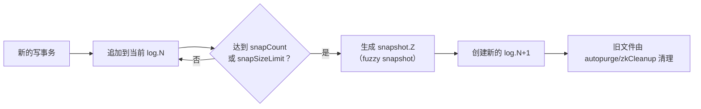
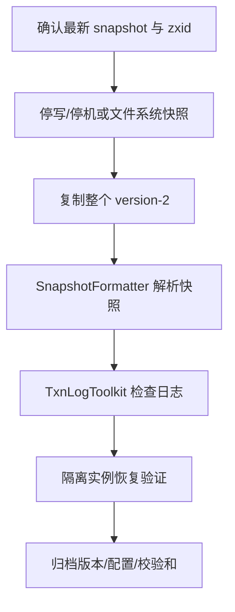
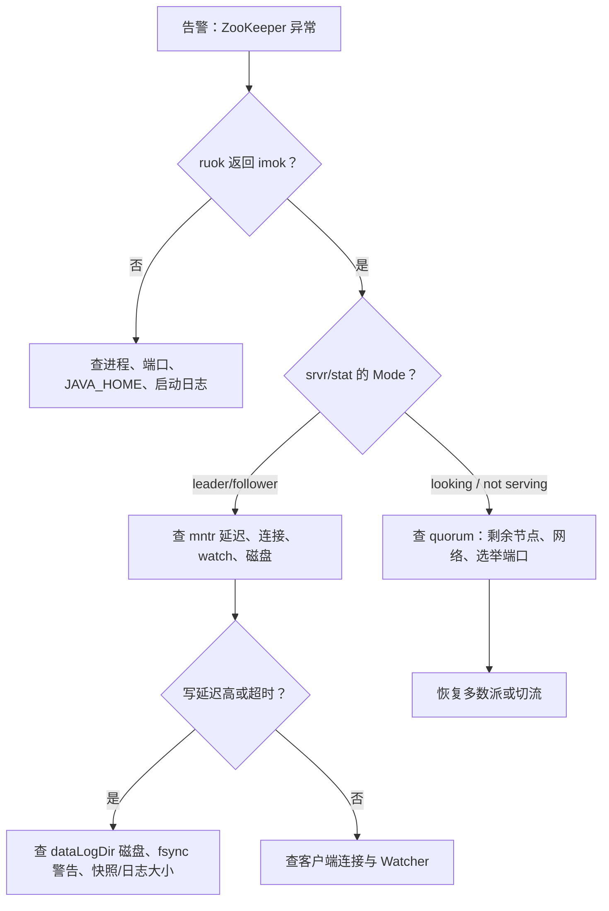

## 为什么“进程还活着”不等于“服务正常”？

ZooKeeper 最常见的一种误判是：运维看到进程在、端口在监听，就认为服务正常。但 ZooKeeper 至少有三种“看起来活着、实际不能用”的状态：

- **进程活着，但没有 quorum**：三节点只剩一台，客户端连接会被拒绝或写入超时。
- **进程活着，但处于 LOOKING**：正在选主，暂时不能提供一致服务。
- **进程活着，但磁盘写不进去**：事务日志无法落盘，写请求会阻塞或失败；读可能还能返回旧数据。

只看进程，等于只看汽车的发动机灯有没有亮。要判断“能不能开”，至少还要看仪表盘：`ruok`、`srvr`、`stat`、`mntr`、`conf` 这些四字命令就是 ZooKeeper 的仪表盘。再往下，`dataDir` 里的快照与事务日志决定了故障后能不能恢复。

本文分三层：

1. **健康层**：用四字命令看进程、角色、连接、延迟、Watcher。
2. **存储层**：看懂 `snapshot.N` 与 `log.N`，知道它们各自记录什么。
3. **恢复层**：用 `zkSnapShotToolkit`、`zkTxnLogToolkit` 做离线检查，理解 `autopurge`/`zkCleanup` 的清理边界。

| 只看进程 | 进一步看四字命令 | 再看数据文件 |
|----------|------------------|--------------|
| `java.exe` 在 | `Mode: leader/follower` | 最新 snapshot 的 zxid |
| 端口在监听 | `ruok: imok` | 后续 log 是否完整 |
| CPU/内存正常 | `mntr` 延迟、连接数、watch 数 | dataDirSize 是否异常增长 |
| 无法发现“没有多数派” | `srvr` 显示 not serving | 能否用日志回放到最新状态 |

> ### 💡 新人小结：四字命令是仪表盘，日志是行车记录仪
>
> - `ruok` 是发动机灯：亮着（返回 imok）只说明发动机在转，不代表车能上路。
> - `srvr`/`mntr` 是仪表盘：告诉你当前档位（Leader/Follower）、速度（延迟）、油量（连接/磁盘）。
> - `snapshot` + `log` 是行车记录仪：出事后靠它还原“当时到底发生了什么”。
>
> **先看仪表盘判断能不能服务，再看行车记录仪判断能不能恢复。**

**学习路线图**

```
四字命令 → 健康检查 → 连接与 Watcher → AdminServer → 数据目录 → 快照工具 → 事务日志工具 → 清理与备份
怎么用      ruok/srvr    cons/dump/wchs     HTTP 接口     snapshot/log   SnapshotFormatter  TxnLogToolkit   autopurge/zkCleanup
```

---

## 四字命令：先过白名单这一关

四字命令通过客户端端口发送，例如用 `nc`：

```bash
echo ruok | nc 127.0.0.1 2182
```

从 3.5.3 开始，四字命令必须显式加入白名单。官方默认只放行 `srvr`（`zkServer.sh` 会用到）；如果启用了只读模式，还会加入 `isro`。其他命令默认不可用，会返回“not in the whitelist”之类的提示。

3.8.7 的实现还有一个容易忽略的细节：`srvr` 会被强制保留。即使把 `4lw.commands.whitelist` 置空，`ruok`/`mntr` 会被拒绝，但 `srvr` 仍能返回。空值不等于“全部关闭”，完整的实测与安全边界见[四字命令 4lw](/docs/03-cluster-operations/管理面与监控/four-letter-words/)。

本文的测试配置为了采集完整输出，开启了全部命令：

```properties
4lw.commands.whitelist=*
```

生产环境不建议直接照抄 `*`。更稳妥的做法是只放行排障需要的命令：

```properties
4lw.commands.whitelist=stat,ruok,conf,isro,mntr
```

| 配置值 | 效果 | 适用场景 |
|--------|------|----------|
| 不配置 | 默认只放行 `srvr`（只读模式加 `isro`） | 最小暴露面 |
| `stat,ruok,conf,mntr` | 放行列出的命令，`srvr` 仍保留 | 生产常用 |
| `*` | 放行全部四字命令 | 实验/受控排障，不建议长期开启 |

官方还提示：四字命令未来会被 AdminServer 替代，新系统应优先考虑 AdminServer 的 HTTP 接口。四字命令的完整清单、白名单对照与 Windows 脚本差异见[四字命令 4lw](/docs/03-cluster-operations/管理面与监控/four-letter-words/)。

---

## 健康检查：ruok、srvr、stat、mntr、conf

### ruok：只回答“进程还在吗”

```text
$ echo ruok | nc 127.0.0.1 2182
imok
```

`imok` 的含义很窄：服务进程活着、客户端端口可连接。官方明确说它**不代表已经加入 quorum**。所以：

- `ruok` 不返回 `imok`：进程或端口有问题，先查启动日志。
- `ruok` 返回 `imok` 但写入失败：继续查 `srvr` 的 `Mode` 和剩余节点数，可能是没有多数派。

### srvr：看角色、zxid 和节点数

```text
$ echo srvr | nc 127.0.0.1 2182
Zookeeper version: 3.8.7-9085db92dd679e1e90a63bfe6ae6345ab6cbc4ae, built on 2026-09-03 17:57 UTC
Latency min/avg/max: 0/1.1765/6
Received: 54
Sent: 54
Connections: 1
Outstanding: 0
Zxid: 0x34
Mode: standalone
Node count: 8
```

| 字段 | 含义 | 排障时怎么用 |
|------|------|--------------|
| `Zookeeper version` | 服务端版本与构建时间 | 确认版本是否一致，避免混跑 |
| `Latency min/avg/max` | 请求延迟的最小/平均/最大值 | 平均值持续升高，查磁盘和请求队列 |
| `Received`/`Sent` | 收发的数据包数量 | 突增可能意味着客户端重试或异常流量 |
| `Connections` | 当前客户端连接数 | 接近上限时查 `maxClientCnxns` |
| `Outstanding` | 尚未处理的请求数 | 持续大于 0 说明处理不过来 |
| `Zxid` | 本地最后处理的 zxid | 判断节点是否落后；不要拿单节点当全局值 |
| `Mode` | `standalone`/`leader`/`follower`/`looking` | 集群排障第一眼就看它 |
| `Node count` | 当前 znode 总数（含系统节点） | 与预期对比，发现异常创建/删除 |

### stat：比 srvr 多一份客户端列表

```text
$ echo stat | nc 127.0.0.1 2182
Zookeeper version: 3.8.7-9085db92dd679e1e90a63bfe6ae6345ab6cbc4ae, built on 2026-09-03 17:57 UTC
Clients:
 /127.0.0.1:53342[0](queued=0,recved=1,sent=0)

Latency min/avg/max: 0/1.1765/6
Received: 55
Sent: 55
Connections: 1
Outstanding: 0
Zxid: 0x34
Mode: standalone
Node count: 8
```

`srvr` 和 `stat` 的差别主要在 `Clients` 列表：`stat` 会列出连接、会话、排队和收发计数，适合看“谁连着、有没有卡住”。`Clients` 里的 `[0]` 是会话 ID 的本地表示，`queued=0` 表示没有排队请求。两次抓取的 `Received`/`Sent` 分别是 54 和 55，是因为抓取时刻不同，命令本身也会计入收发；不要把两次快照的数字混在一起做同比。

| 场景 | 优先用 | 原因 |
|------|--------|------|
| 快速看角色与 zxid | `srvr` | 输出短，信息集中 |
| 看具体客户端连接 | `stat` | 多一份 `Clients` 列表 |
| 看指标与状态 | `mntr` | 键值对格式，便于脚本采集 |
| 看实际配置 | `conf` | 确认端口、dataDir、超时 |
| 看环境变量与 classpath | `envi` | 排查“加载了哪个 jar/配置” |

### mntr：给监控系统吃的键值对

```text
$ echo mntr | nc 127.0.0.1 2182
zk_version	3.8.7-9085db92dd679e1e90a63bfe6ae6345ab6cbc4ae, built on 2026-09-03 17:57 UTC
zk_server_state	standalone
zk_ephemerals_count	0
zk_num_alive_connections	1
zk_avg_latency	1.1765
zk_outstanding_requests	0
zk_znode_count	8
zk_packets_sent	56
zk_packets_received	56
zk_watch_count	0
zk_min_latency	0
zk_approximate_data_size	92
zk_uptime	82773
zk_max_latency	6
zk_open_file_descriptor_count	-1
zk_max_file_descriptor_count	-1
```

`mntr` 的输出是 `key \t value` 格式，适合直接喂给监控系统。官方提醒键会随版本增加，脚本要容忍新键；部分键只在 Leader 上出现，部分键只在 Unix 上可用。

| 指标 | 含义 | 观察建议 |
|------|------|----------|
| `zk_server_state` | 节点角色 | 集群里应只有一个 leader |
| `zk_num_alive_connections` | 当前活跃连接数 | 与客户端实例数对比 |
| `zk_avg_latency` | 平均请求延迟 | 持续上升查磁盘/队列 |
| `zk_max_latency` | 最大请求延迟 | 毛刺可能来自 GC、fsync、网络 |
| `zk_outstanding_requests` | 未完成请求数 | 持续非 0 说明处理能力不足 |
| `zk_znode_count` | znode 数量 | 异常增长可能是客户端泄漏 |
| `zk_watch_count` | Watcher 数量 | 异常增长要查客户端是否忘记移除 |
| `zk_ephemerals_count` | 临时节点数量 | 与在线实例数对比 |
| `zk_packets_sent/received` | 包计数 | 用于计算速率和重试 |
| `zk_approximate_data_size` | 数据树近似大小 | 估算内存占用 |
| `zk_uptime` | 运行时长（毫秒） | 频繁重启会归零 |
| `zk_open_file_descriptor_count` | 打开的文件描述符 | Unix 可用；Windows 显示 -1 |
| `zk_followers`/`zk_synced_followers`/`zk_pending_syncs` | Leader 侧的 Follower 统计 | 只在 Leader 上出现 |

本文的测试运行在 Windows 上，所以文件描述符指标显示 `-1`；这不代表异常，而是该平台不提供这个指标。

### conf：确认“实际生效”的配置

```text
$ echo conf | nc 127.0.0.1 2182
clientPort=2182
secureClientPort=-1
dataDir=C:\Users\webtu\AppData\Local\Temp\zk-zookeeper-docs\standalone\data\version-2
dataDirSize=67109337
dataLogDir=C:\Users\webtu\AppData\Local\Temp\zk-zookeeper-docs\standalone\data\version-2
dataLogSize=67109337
tickTime=2000
maxClientCnxns=60
minSessionTimeout=4000
maxSessionTimeout=40000
clientPortListenBacklog=-1
serverId=0
```

`conf` 的价值在于它显示的是**服务端实际使用**的值，不是配置文件里写了什么。比如 `dataDir` 已经自动拼上了 `version-2`；`minSessionTimeout`/`maxSessionTimeout` 是根据 `tickTime` 推导出来的；`serverId=0` 说明这是单机模式。

`dataDirSize=67109337` 正好等于 64 MB 事务日志（67,108,880 字节）加初始快照（457 字节）：

```text
67,108,880 + 457 = 67,109,337
```

这个等式说明 `dataDirSize` 统计的是目录里快照与日志的总字节数，不是“业务数据大小”。

### isro：只读模式

```text
$ echo isro | nc 127.0.0.1 2182
rw
```

`rw` 表示当前不是只读模式；`ro` 表示只读。只读模式通常用于分区/降级场景，需要显式开启 `readonlymode.enabled` 才会出现在白名单里。

---

## 连接、会话与 Watcher：cons、dump、wchs

### cons：谁连着，收发了多少

```text
$ echo cons | nc 127.0.0.1 2182
 /127.0.0.1:53342[0](queued=0,recved=1,sent=0)
```

`cons` 列出每个连接的会话、排队、收发计数和最后操作。客户端异常重试时，这里可能出现大量短连接或同一个 IP 的多个连接。

### dump：会话与临时节点的快照

```text
$ echo dump | nc 127.0.0.1 2182
SessionTracker dump:
Session Sets (3)/(0):
0 expire at Sun Oct 25 20:51:07 CST 2026:
0 expire at Sun Oct 25 20:51:09 CST 2026:
0 expire at Sun Oct 25 20:51:11 CST 2026:
ephemeral nodes dump:
Sessions with Ephemerals (0):
Connections dump:
Connections Sets (3)/(1):
0 expire at Sun Oct 25 20:50:57 CST 2026:
1 expire at Sun Oct 25 20:51:07 CST 2026:
	ip: /127.0.0.1:53348 sessionId: 0x0
0 expire at Sun Oct 25 20:51:17 CST 2026:
```

`dump` 适合排查“临时节点为什么不消失”：看会话集合里还有没有那个会话，看 `Sessions with Ephemerals` 里有没有对应的路径。本机抓取时 `Session Sets (3)/(0)` 表示 3 个全局会话、0 个本地会话；`Sessions with Ephemerals (0)` 表示当时没有临时节点。

### wchs / wchc / wchp：Watcher 的三个视角

```text
$ echo wchs | nc 127.0.0.1 2182
0 connections watching 0 paths
Total watches:0
```

| 命令 | 视角 | 输出 | 使用注意 |
|------|------|------|----------|
| `wchs` | 汇总 | 连接数、路径数、Watcher 总数 | 最轻量，先看总量 |
| `wchc` | 按会话 | 每个会话关联的路径 | 官方提示可能很重，慎用 |
| `wchp` | 按路径 | 每个路径关联的会话 | 适合定位“谁在监听这个节点” |

本机没有注册 Watcher，所以 `wchc`/`wchp` 都是空输出。如果线上 `zk_watch_count` 持续增长，先用 `wchs` 看规模，再决定是否用 `wchc`/`wchp` 定位；不要在高负载时频繁执行后两者。

---

## AdminServer：四字命令的 HTTP 版本

ZooKeeper 3.5.0 起内置了 AdminServer：一个 Jetty HTTP 服务，默认监听 8080，命令通过 `/commands/[命令名]` 访问，返回 JSON。例如：

```text
http://localhost:8080/commands/stat
```

它和 TCP 四字命令的区别：

| 维度 | TCP 四字命令 | AdminServer |
|------|--------------|-------------|
| 协议 | 客户端端口上的裸文本 | HTTP + JSON |
| 默认端口 | 与 `clientPort` 相同 | 8080（可配置） |
| 命令名 | 固定四个字母 | 可以有多别名，如 `srvr`/`server_stats` |
| 是否受四字命令白名单限制 | 是 | 使用 HTTP 接口，不要求命令名是四个字母；是否暴露给外部由网络策略决定 |
| 是否默认开启 | 是（但命令受白名单限制） | 是；可通过配置关闭 |

本文的实验配置把 AdminServer 放在 8081：

```properties
admin.serverPort=8081
```

启动日志里能看到：

```text
Started AdminServer on address 0.0.0.0, port 8081 and command URL /commands
```

AdminServer 的 JSON 更适合监控系统采集，但也要注意它默认监听所有网卡；生产环境应通过防火墙限制访问，或使用 `admin.enableServer=false`（`zoo.cfg`）关闭，等价的系统属性是 `zookeeper.admin.enableServer=false`。关闭后 TCP 四字命令仍可用，且四字命令白名单独立生效。AdminServer 的端点、配置与关闭影响见[AdminServer 管理接口](/docs/03-cluster-operations/管理面与监控/adminserver-http/)，监控选型见[四条监控通道](/docs/03-cluster-operations/管理面与监控/monitoring-channels/)。

> ### 💡 新人小结：四字命令像体检套餐，AdminServer 像电子报告
>
> - `ruok` 是量体温：只能回答“还在不在”。
> - `srvr`/`stat`/`mntr` 是验血/心电图：看角色、延迟、连接、Watcher。
> - `conf` 是核对病历：确认实际生效的配置，而不是你以为的配置。
> - AdminServer 是把这些结果打成 JSON 报告，方便监控系统自动采集。
>
> **体检要组合看：单看体温正常，不代表没有内伤。**

---

## 数据目录：snapshot 与 txnlog 各自记什么

ZooKeeper 的数据目录下会有一个 `version-2` 子目录（文件名中的 2 是格式版本）。本机实测：

```text
version-2/
  snapshot.0    457 bytes
  log.1         67108880 bytes
```

重启一次后，目录里多了一个快照：

```text
snapshot.0    457 bytes
snapshot.34   768 bytes
log.1         67108880 bytes
```

| 文件 | 后缀含义 | 内容 | 什么时候产生 |
|------|----------|------|--------------|
| `snapshot.N` | 快照开始时的最后已提交 zxid（十六进制） | 整个数据树的模糊快照 | 启动、达到 `snapCount`/`snapSizeLimitInKb`、关闭时 |
| `log.N` | 该日志第一条事务的 zxid（十六进制） | 从该 zxid 开始的事务流水 | 新事务日志创建时 |
| `myid` | 不适用 | 集群节点编号 | 集群模式手动创建 |

### 快照是“模糊”的

官方把快照称为 fuzzy snapshot：拍照的过程中，写请求还在继续，所以快照里可能包含一部分“拍照开始后”的更新，也可能不包含另一部分。它不是某个精确时刻的完整状态。

ZooKeeper 仍然能用它恢复，因为更新是幂等的：先加载快照，再从快照后缀对应的 zxid 开始回放事务日志，最终得到日志末尾的状态。官方文档特别强调：服务器需要最新的完整模糊快照、它之后的所有日志，以及快照前最后一个日志文件（因为快照开始时可能还有事务写进了旧日志）。

### 日志是预分配的

`log.1` 显示 67,108,880 字节，约 64 MB，并不代表写了 64 MB 的业务数据。ZooKeeper 为了减少磁盘寻址，会按 `preAllocSize`（默认 64M）预分配日志空间。实际事务可能只有几百字节，但文件大小看起来很大。

事务日志的滚动和快照频率由这些参数控制：

| 参数 | 默认值 | 作用 | 备注 |
|------|--------|------|------|
| `preAllocSize` | 64M | 日志预分配块大小 | 调整前先确认文件系统块大小 |
| `snapCount` | 100,000 | 多少条事务后触发快照 | 实际值在 `[snapCount/2+1, snapCount]` 随机，避免所有节点同时快照 |
| `snapSizeLimitInKb` | 4,194,304（4GB） | 日志总大小达到多少后触发快照 | 非正数关闭该限制 |
| `txnLogSizeLimitInKb` | 未启用 | 直接限制单个事务日志大小 | 设置过小会导致频繁滚动 |



注意：快照和日志滚动不是完全同步的。快照开始时可能还有事务写入旧日志，所以恢复时不能只保留“快照之后创建的日志”，还要保留快照前最后一个日志文件。这也是为什么手工清理数据目录很容易清出问题。

---

## SnapshotFormatter：离线看快照里有什么

发行包的 `zkSnapShotToolkit` 可以离线解析快照。它的用法来自官方 Tools 文档：

```text
USAGE: SnapshotFormatter [-d|-json] snapshot_file
 -d dump the data for each znode
 -json dump znode info in json format
```

本机对 `snapshot.34` 执行默认模式，输出如下（节选）：

```text
ZNode Details (count=8):
----
/
  cZxid = 0x00000000000000
  ctime = Thu Jan 01 08:00:00 CST 1970
  mZxid = 0x00000000000000
  mtime = Thu Jan 01 08:00:00 CST 1970
  pZxid = 0x00000000000031
  cversion = 4
  dataVersion = 0
  aclVersion = 0
  ephemeralOwner = 0x00000000000000
  dataLength = 0
----
/app
  cZxid = 0x00000000000002
  ctime = Sun Oct 25 20:49:30 CST 2026
  mZxid = 0x0000000000000f
  mtime = Sun Oct 25 20:49:40 CST 2026
  pZxid = 0x00000000000019
  cversion = 1
  dataVersion = 1
  aclVersion = 0
  ephemeralOwner = 0x00000000000000
  dataLength = 2
```

这份输出告诉我们：

- 快照里有 8 个 znode，包括 `/`、`/app`、`/zookeeper` 及其系统子节点。
- `/app` 的 `dataVersion=1`，说明它被改过一次；`mZxid=0xf` 对应 `set /app v2`。
- `pZxid=0x19` 对应最后一次修改子节点列表的事务；在我们的日志里，`0x19` 正是过期会话删除 `/app/leader` 的那次 `closeSession`。
- `ephemeralOwner=0` 说明 `/app` 是持久节点；临时节点会显示非 0 的会话 ID。

默认模式输出节点详情，`-d` 会额外输出每个节点的数据，`-json` 输出 JSON。生产上排查“某个配置到底写没写进去”时，用 `-d` 比直接读二进制快照可靠。

> ### 💡 新人小结：快照是“定期合影”，日志是“流水账”
>
> - 合影（snapshot）记录某一刻的大致样子，但拍照时有人还在走动（fuzzy）。
> - 流水账（txnlog）记录每一次改动，按 zxid 排序，一条不漏。
> - 恢复时先看合影，再把合影之后的流水账补上；只留合影会丢更新，只留流水账会回放很久。
>
> **快照负责“快速接近”，日志负责“精确补齐”，两者缺一不可。**

---

## TxnLogToolkit：离线读事务日志

`zkTxnLogToolkit` 的 3.8.7 帮助信息如下（本机执行 `-h` 的真实输出）：

```text
usage: TxnLogToolkit [-dhrvc] <txn_log_file_name> (-z <zxid>)
 -c,--chop         Chop mode. Chop txn file to a zxid.
 -d,--dump         Dump mode. Dump all entries of the log file with printing the content of a nodepath (default)
 -h,--help         Print help message
 -r,--recover      Recovery mode. Re-calculate CRC for broken entries.
 -v,--verbose      Be verbose in recovery mode: print all entries, not just fixed ones.
 -y,--yes          Non-interactive mode: repair all CRC errors without asking
 -z,--zxid <arg>   Used with chop. Zxid to which to chop.
```

本机对 `log.1` 执行 `-d`，输出节选：

```text
ZooKeeper Transactional Log File with dbid 0 txnlog format version 2
2026/10/25 CST 20:49:30 session 0x10001b840d10000 cxid 0x0 zxid 0x1 createSession 30000
2026/10/25 CST 20:49:30 session 0x10001b840d10000 cxid 0x1 zxid 0x2 create /app,v1,[31,s{'world,'anyone}],false,1
2026/10/25 CST 20:49:31 session 0x10001b840d10001 cxid 0x0 zxid 0x3 createSession 30000
2026/10/25 CST 20:49:31 session 0x10001b840d10001 cxid 0x1 zxid 0x4 create /app/leader,node-a,[31,s{'world,'anyone}],true,1
2026/10/25 CST 20:49:34 session 0x10001b840d10003 cxid 0x1 zxid 0x7 create /jobs,job-parent,[31,s{'world,'anyone}],false,2
2026/10/25 CST 20:49:35 session 0x10001b840d10004 cxid 0x1 zxid 0x9 create /jobs/job-0000000000,payload,[31,s{'world,'anyone}],false,1
2026/10/25 CST 20:49:40 session 0x10001b840d10008 cxid 0x1 zxid 0xf setData /app,v2,1
2026/10/25 CST 20:49:45 session 0x10001b840d1000c cxid 0x1 zxid 0x14 delete '/jobs/job-0000000001
2026/10/25 CST 20:50:03 session 0x10001b840d10001 cxid 0x0 zxid 0x19 closeSession v{'/app/leader}
```

| 字段 | 含义 | 示例 |
|------|------|------|
| 时间 | 事务记录时间 | 2026/10/25 CST 20:49:30 |
| `session` | 发起事务的会话 ID | 0x10001b840d10001 |
| `cxid` | 客户端请求序号 | 0x1 |
| `zxid` | 全局事务 ID | 0x4 |
| 操作 | `createSession`、`create`、`setData`、`delete`、`closeSession` | create |
| 路径与数据 | 操作对象及内容 | `/app/leader,node-a,...` |
| 布尔字段 | `create` 记录的临时节点标志 | `true` 表示临时节点 |
| `closeSession v{...}` | 关闭会话时一并删除的临时节点 | `v{'/app/leader}` |

这份日志把前面的实验串起来了：`zxid=0x4` 创建了临时节点 `/app/leader`，`zxid=0x19` 的 `closeSession` 又把它删除。你不必记住 ACL 的编码细节，只要会看时间、会话、zxid、操作、路径和临时标志，就能还原大部分事故现场。

### 恢复模式与截断模式

- `-r/--recover`：遇到 CRC 错误时，把日志复制到一个 `.fixed` 文件，并重新计算 CRC；原文件不被修改。
- `-c/--chop` + `-z <zxid>`：把日志截断到指定 zxid，用于构造“只恢复到某个点”的测试数据。
- `-y/--yes`：非交互修复，适合脚本化处理。

这些是离线工具，不要对正在运行的实例的数据目录直接执行修复。先停写/停机，复制一份到临时目录，再在副本上操作。

---

## 清理：autopurge 与 zkCleanup

ZooKeeper 默认不会自动删除旧快照和日志。官方明确说：默认配置下，旧的 snapshot/log 由运维负责清理。长期运行的实例，`version-2` 会持续增长，最终撑满磁盘。

### 自动清理

```properties
autopurge.snapRetainCount=3
autopurge.purgeInterval=1
```

| 参数 | 默认值 | 作用 | 注意 |
|------|--------|------|------|
| `autopurge.snapRetainCount` | 3（官方最小值 3） | 保留最近多少份快照及对应日志 | 低于最小值不应配置 |
| `autopurge.purgeInterval` | 0 | 清理任务间隔（小时） | 0 表示关闭；正整数才启用 |

本文的实验配置是 `purgeInterval=0`，所以启动日志显示：

```text
autopurge.snapRetainCount set to 3
autopurge.purgeInterval set to 0
Purge task is not scheduled.
```

### 手工清理

Linux 下可以用 `zkCleanup.sh`。脚本会从 `zoo.cfg` 读取 `dataDir`/`dataLogDir`，然后调用 `PurgeTxnLog`。官方 Tools 文档给出的用法是：

```bash
# 保留最近 5 份快照与日志
bin/zkCleanup.sh -n 5
```

`-n` 的值应大于等于 3。清理前先确认：

1. 最新的快照和它之后的日志都在保留范围内。
2. 不要只保留“最新快照”，还要保留快照前最后一个日志文件。
3. 清理时最好停写或停机，避免边写边删。

Windows 发行包的 `bin` 目录没有 `zkCleanup.cmd`（本机 3.8.7 的 bin 列表里只有 `.sh` 版本）。可以用 Git Bash 运行 `zkCleanup.sh`，或者直接调用 `PurgeTxnLog` 类：

```bash
java -cp "conf;lib/*" org.apache.zookeeper.server.PurgeTxnLog \
  "C:/path/to/data" -n 5
```

这条等价调用来自脚本内容，本文未在本机执行清理；执行前先备份并在测试目录验证参数。

---

## 备份与恢复：先保证“可解释”，再谈“可恢复”

### 备份什么

ZooKeeper 的持久状态就在 `dataDir`（如果单独配置了 `dataLogDir`，还包括日志目录）：

- 最新的 `snapshot.N`
- 快照之后的所有 `log.N`
- 快照前最后一个 `log.N`（因为快照是模糊的）

只备份最新快照不够；只备份日志也不够。两者要作为一组来备份。

### 推荐的备份流程

| 步骤 | 操作 | 目的 |
|------|------|------|
| 1 | 确认当前 zxid 与最新快照 | 记录恢复起点 |
| 2 | 停写或停机，或对数据目录做文件系统快照 | 避免复制到写了一半的日志 |
| 3 | 复制整个 `version-2` 目录 | 保留快照 + 全部日志 |
| 4 | 用 `zkSnapShotToolkit` 解析快照 | 确认快照可读、节点数符合预期 |
| 5 | 用 `zkTxnLogToolkit -d` 检查日志 | 确认日志可解析、末尾 zxid 合理 |
| 6 | 在隔离环境启动一个测试实例 | 验证恢复后的数据树 |
| 7 | 记录版本、配置、校验和 | 下次恢复时知道该用哪套文件 |



### 恢复时的顺序

1. 停止目标实例，清空或备份目标 `dataDir`。
2. 把备份的 `version-2` 放回 `dataDir`，确保文件权限正确。
3. 确认 `myid`（集群模式）与 `server.x` 匹配。
4. 启动实例，观察它是否从快照 + 日志恢复到预期 zxid。
5. 用 `srvr`/`mntr`/`zkSnapShotToolkit` 验证节点数与关键路径。
6. 如果是集群，先恢复一个节点并验证，再逐个恢复其他节点，避免同时回放造成压力。

本文验证了“快照解析”和“日志解析”，但没有在生产规模上做完整恢复演练。真实环境应定期做恢复演练：备份文件能解析不等于能启动，能启动不等于业务数据完整。

> ### 💡 新人小结：备份像“合影 + 流水账”的复印件
>
> - 只复印合影（最新快照），会丢掉拍照之后的改动。
> - 只复印流水账（日志），恢复时要从头翻很久，而且可能缺起始状态。
> - 正确的复印件是：一张最近的合影 + 合影前后的流水账，并且能读懂它们。
>
> **备份的验收标准不是“文件复制成功”，而是“在隔离环境能恢复到预期状态”。**

---

## 监控与排障：一张决策图



| 症状 | 优先命令 | 进一步动作 |
|------|----------|------------|
| 进程在但写失败 | `srvr`/`stat` | 看 `Mode` 是否 looking/not serving；数剩余节点 |
| 读延迟升高 | `mntr` | 看 `zk_avg_latency`、`zk_outstanding_requests` |
| 连接数异常 | `stat`/`cons` | 看是否有大量短连接或重试 |
| 临时节点不消失 | `dump` | 看会话集合与 `Sessions with Ephemerals` |
| Watcher 数量暴涨 | `wchs` | 再决定是否用 `wchc`/`wchp` 定位 |
| 磁盘增长快 | `conf`、`dirs` | 看 `dataDirSize`/`dataLogSize`，检查 autopurge |
| 快照/日志异常 | `zkSnapShotToolkit`/`zkTxnLogToolkit` | 在副本上解析，不要直接动线上文件 |

### 安全提醒

- 四字命令走客户端端口，任何能连上端口的人都能尝试；白名单是第一道门。
- `wchc`/`wchp` 可能很重，不要在高峰期反复执行。
- `envi` 会输出 classpath 等环境信息，贴到工单前先脱敏。
- AdminServer 默认监听所有网卡；生产环境用防火墙限制，或关闭它。
- 备份文件包含完整数据树，按敏感数据管理，不要随便放到公共目录。

---

## 要点总结

1. **`ruok` 只证明进程活着**：它不代表加入 quorum；判断服务能力要看 `srvr`/`stat` 的 `Mode` 和 quorum 状态。
2. **四字命令有白名单**：3.5.3 起默认只放行 `srvr`；生产只开需要的命令，实验环境才考虑 `*`。
3. **`mntr` 是监控入口**：`zk_server_state`、延迟、连接、znode 数、watch 数、临时节点数是核心指标；部分指标只在 Leader 或 Unix 上出现。
4. **数据目录由 snapshot + txnlog 组成**：快照是模糊的，日志记录每次事务；恢复需要最新完整快照、其后的全部日志，以及快照前最后一个日志。
5. **日志文件大小不等于业务数据量**：`log.1` 约 64 MB 是 `preAllocSize` 预分配；`dataDirSize` 是快照与日志的总和。
6. **清理要保守**：默认不自动清理；`autopurge` 或 `zkCleanup` 的保留数不要低于 3，且要保留快照前最后一个日志。
7. **备份的验收是恢复演练**：能解析快照/日志只是第一步，能在隔离环境恢复到预期状态才算备份可用。

---

> ### 💡 新人小结：监控与备份学完了，记住这 4 点
>
> 1. **先看 Mode，再看指标**：`ruok` 说“活着”，`Mode` 才说“能不能服务”。
> 2. **快照 + 日志是一组**：只留其中一个，恢复都会出问题。
> 3. **清理别贪多**：保留最近几份，且保留快照前最后一个日志；不确定就多留。
> 4. **备份要演练**：解析成功不等于恢复成功，隔离环境跑一遍才算数。
