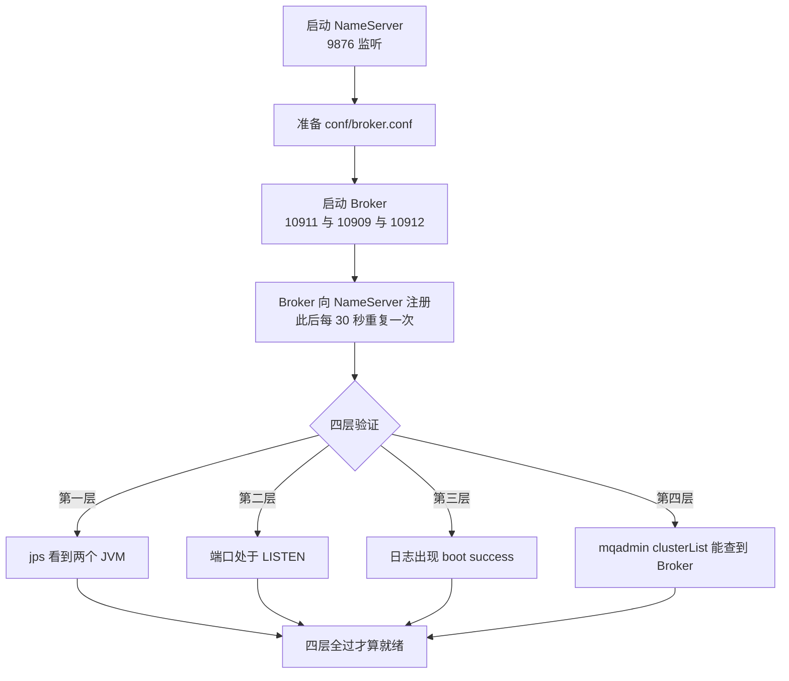
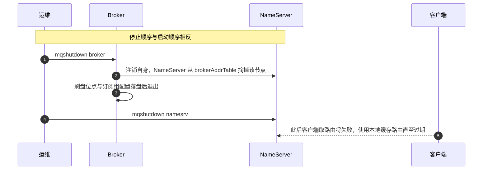

## 为什么要把手册写到「每一步都能自查」的程度？（痛点引入）

单机启动是 RocketMQ 所有部署形态里最简单的一种，也是最容易「看似成功、实则没就绪」的一种。四个真实场景：

- Broker 进程在、端口在、日志里有 `boot success`，但 `clusterList` 查不到它——因为它启动时 NameServer 还没就绪，注册失败了，客户端视角里这个集群是空的；
- Windows 下用 `start mqnamesrv.cmd` 起了服务，去吃了一顿饭回来，消息全发不出去——那个 cmd 窗口被关掉了，进程随窗口一起结束；
- 端口表照抄了旧资料，防火墙只放行 `10911`，结果客户端连不上——4.9.8 的 Broker 实际同时监听三个端口；
- 想用发行包里的 Web 控制台，敲 `mqadmin startConsoleWeb` 报「命令不存在」——4.x 后期版本已经不带这个命令，控制台是独立的 Dashboard 应用。

这四件事的共性是：**进程活着不等于服务就绪，命令存在不等于该版本支持**。所以本手册每一步都配一个可执行的判据，并在与本机 4.9.8 实测不一致的地方直接更正、注明依据。

> ### 💡 新人小结：把启动过程理解成「先装电话总机，再接分机」
>
> - NameServer 是总机：它不存消息，只回答「哪个主题在哪些机器、哪些端口」；
> - Broker 是分机：它一起来就要向总机登记自己，登记上了才有人找得到它；
> - 客户端（生产/消费者）先拨总机问地址，再直接找分机收发；
> - 所以顺序只有一个正确答案：**总机先通，分机再注册，客户端最后上线**；停止时反过来，先摘分机，再关总机。
>
> 本手册的「四层验证」就是在确认这三件事分别成立。

**本手册覆盖的完整链路**

```text
环境准备 → 端口基线 → 启动 NameServer → 准备并启动 Broker
→ 四层状态验证 → 用自带 tools 收发一条消息 → 可选 Dashboard
→ 优雅停止 → 巡检命令速查 → 注意事项与实测更正
```

---

## 前置准备

| 项目 | 要求 | 本机实测 |
|------|------|----------|
| JDK | 64 位 JDK 1.8 以上，`JAVA_HOME` 配置正确 | Alibaba Dragonwell 8.29.28（`1.8.0_492`），全路径调用，未加入 PATH |
| 发行包 | RocketMQ 4.9.8 解压到任意目录，下文用 `%ROCKETMQ_HOME%`（Windows）/ `$ROCKETMQ_HOME`（Linux）代指 | `rocketmq-all-4.9.8-bin-release`，解压后嵌套一层同名目录 |
| 内存 | Broker 默认 JVM 参数面向大内存机器，小规格节点要改 `bin/runbroker.sh` | 本机 Broker 以默认参数启动成功（物理内存充足） |
| 防火墙 | 需放行 NameServer 与 Broker 的全部监听端口，否则注册与收发都会失败 | 单机本机无防火墙介入，端口全部可见 |

关于 `ROCKETMQ_HOME` 的取值优先级，官方 NameServer 参数表写的是「默认从环境变量 `ROCKETMQ_HOME` 或系统属性 `rocketmq.home.dir` 读取」（出处：`docs/06-parameterConfiguration/02server.md` 的 NameServer 段）。这一点在 Windows 的批处理与 Git Bash 里最容易踩坑：`bin/mqadmin.cmd` 一类的包装脚本会把 `user.dir` 当基准，路径不对时报的是「找不到 conf」而不是「ROCKETMQ_HOME 没设」。本机的做法是显式传系统属性，实测可用：

```bash
# 本机验证过的调用形态（等价于 mqadmin.cmd，但参数解析更可控）
"$JAVA_HOME/bin/java" -Drocketmq.home.dir="$RMQ_HOME" -cp "conf;lib/*" \
  org.apache.rocketmq.tools.command.MQAdminStartup <子命令> <参数...>
```

## 端口基线：三个端口都要放行

原手册给的端口表把 `11011` 写成「Slave 同步/拉取端口」。这条在 4.9.8 上**不成立**，本机实测的直接反证是没有 11011 在监听，而 HA 端口是 10912。

```text
$ netstat -ano | grep LISTEN | grep -E "9876|10909|10911|10912|11011"
  TCP    0.0.0.0:9876     LISTENING   28160
  TCP    0.0.0.0:10909    LISTENING   29044
  TCP    0.0.0.0:10911    LISTENING   29044
  TCP    0.0.0.0:10912    LISTENING   29044
```

| 端口 | 归属进程 | 用途 | 依据 |
|------|----------|------|------|
| 9876 | NameServer（pid 28160） | 路由注册与发现；`listenPort` 实测值即 9876 | `mqadmin getNamesrvConfig` 回显 + `docs/06-parameterConfiguration/02server.md` |
| 10911 | Broker（pid 29044） | 消息收发主端口，官方定义「接受客户端连接的监听端口」 | `listenPort=10911` 实测 + `docs/05-bestPractice/01bestpractice.md` |
| 10909 | 同一个 Broker 进程 | VIP 通道端口。本机 `listenPort=10911` 时它确实监听在 10911 − 2 = 10909；客户端 `vipChannelEnabled` 默认为 true（出处：`docs/06-parameterConfiguration/01local.md`） | 端口实测 + 参数表。**偏移关系仅在本机这一组数值上验证过，上游文档未给出该公式** |
| 10912 | 同一个 Broker 进程 | HA 端口 `haListenPort`，供 Slave 拉取主节点 CommitLog 做主从复制；**单机无 Slave 时同样监听** | `getBrokerConfig` 实测 `haListenPort = 10912` |
| 11011 | — | 本机未监听。主从架构里 Slave 用的是**它自己的 `listenPort`（默认同为 10911）**，复制连接走的是**主节点的 `haListenPort`（本机 10912，即 listenPort + 1）** | 端口实测 + `brokerIP2` 定义（「BrokerHAIP 地址，供 slave 同步消息的地址」，出处：`docs/06-parameterConfiguration/02server.md`） |

> ### 💡 新人小结：一句话记三个端口
>
> 一个 Broker 进程开三条门：**10911 做买卖**（客户端收发）、**10909 走 VIP 快速通道**（同一份业务的另一条入口）、**10912 只管仓库之间搬货**（主从复制，客户端永远用不到）。放行策略就是：客户端网络要能到前两个，主从之间的网络要能到第三个。

---

## 第一步：启动 NameServer（必须最先启动）

Broker 一起来就主动向 NameServer 注册，所以 NameServer 必须先就绪。原手册这句话在 4.9.8 上完全成立，本机也有行为证据：NameServer 侧的注册记录是每 30 秒一条，Broker 一旦掉线，NameServer 立即把它从路由表里摘掉（`unregisterBroker, remove name from brokerAddrTable OK`，本机 `~/logs/rocketmqlogs/namesrv.log` 实测）。

### Linux

```bash
cd $ROCKETMQ_HOME

# 后台启动，丢弃标准输出
nohup sh bin/mqnamesrv >/dev/null 2>&1 &

# 或者把日志显式重定向，便于排查启动期问题（推荐）
nohup sh bin/mqnamesrv > namesrv_startup.log 2>&1 &
```

两种写法的差别只在启动期的标准输出去向；**运行日志始终落在 `${user.home}/logs/rocketmqlogs/namesrv.log`**，不受重定向影响（这一条见后文「日志路径统一」）。

如果准备了配置文件（`conf/namesrv.properties` 需要自己建，发行包里没有，本机 `ls conf/` 实测确认），用 `-c` 指定：

```bash
nohup sh bin/mqnamesrv -c conf/namesrv.properties > namesrv_startup.log 2>&1 &
```

`-c` 与 `-p` 两个选项在 4.9.8 的 `NamesrvStartup` 里确实存在——本机没有另起一个 NameServer 进程去验证（会和已在跑的那台抢 9876 端口），而是用 `javap` 静态读出该类的命令行选项定义，字段名分别是 `configFile`（描述 "Name server config properties file"）与 `printConfigItem`，日志串里还能读到 `load config properties file OK`。判据形态如下：

```text
$ javap -c -p -cp lib/rocketmq-namesrv-4.9.8.jar org.apache.rocketmq.namesrv.NamesrvStartup | grep -a "String"
String Name server config properties file
String printConfigItem
String load config properties file OK
```

### Windows

在 **cmd** 里进入 `bin` 目录后：

```cmd
cd /d %ROCKETMQ_HOME%\bin
start mqnamesrv.cmd
```

`start` 会新开一个命令行窗口跑 NameServer。**这个窗口不能关**，关掉进程就退出——这是 Windows 侧最常见的「服务莫名消失」原因。若带配置文件：

```cmd
start mqnamesrv.cmd -c ../conf/namesrv.properties
```

注意相对路径是相对 `bin` 目录写的（`../conf/...`），因为批处理会先切到 `bin`。

---

## 第二步：准备并启动 Broker

### 2.1 最小可用配置 `conf/broker.conf`

发行包自带的 `conf/broker.conf` 就是单机可用的最小配置（本机实测其内容为：`brokerClusterName=DefaultCluster`、`brokerName=broker-a`、`brokerId=0`、`deleteWhen=04`、`fileReservedTime=48`、`brokerRole=ASYNC_MASTER`、`flushDiskType=ASYNC_FLUSH`）。原手册在此基础上补了两条关键项，这份配置是合理的单机起点：

```properties
brokerClusterName=DefaultCluster
brokerName=broker-a
brokerId=0
namesrvAddr=127.0.0.1:9876
listenPort=10911
brokerRole=ASYNC_MASTER
flushDiskType=ASYNC_FLUSH
storePathRootDir=/data/rocketmq/store/broker-a
autoCreateTopicEnable=true
autoCreateSubscriptionGroup=true
```

Windows 下把存储路径改成 Windows 风格并**注意转义**，例如 `storePathRootDir=D:\\rocketmq\\store\\broker-a`。这里有个 4.9.8 的实际行为值得先知道：路径里的 `\n`、`\t` 这类序列在配置打印时会变成控制字符，本机 NameServer 的配置回显里，`C:\Users\webtu\namesrv\namesrv.properties` 就被显示成了跨行的残字：

```text
configStorePath                                   =  C:Userswebtu
amesrv
amesrv.properties
kvConfigPath                                      =  C:Userswebtu
amesrvkvConfig.json
```

这不是数据错了（`kvConfigPath` 的实际默认位置确实是 `${user.home}/namesrv/kvConfig.json`，本机实测确认），而是**回显把反斜杠当转义吃掉了**。判断依据：`configStorePath` 与 `kvConfigPath` 两项在 NameServer 参数表的 `configBlackList` 里（实测回显 `configBlackList = configBlackList;configStorePath;kvConfigPath`），配置文件类路径本就不建议随意改，保持默认最省事。

### 2.2 启动命令

Linux：

```bash
cd $ROCKETMQ_HOME
nohup sh bin/mqbroker -c conf/broker.conf -n 127.0.0.1:9876 > broker_startup.log 2>&1 &
```

- `-c`：指定 Broker 配置文件；
- `-n`：显式指定 NameServer 地址。即使配置文件里已写 `namesrvAddr` 也建议保留，形成双重保障——**优先级问题最容易坑人的地方是：你以为生效的那份没生效**。本机实测的取值链是配置文件里的 `namesrvAddr=localhost:9876` 生效并出现在 `getBrokerConfig` 回显里，说明这条路径可用。

Windows：

```cmd
cd /d %ROCKETMQ_HOME%\bin
start mqbroker.cmd -c ../conf/broker.conf -n 127.0.0.1:9876
```

同样会弹出一个新窗口，**窗口不能关**。



---

## 第三步：四层状态验证

只看进程存在远远不够。四层是漏斗关系，逐层收紧。

| 层次 | 命令 | 通过标志 | 能证明什么 / 不能证明什么 |
|------|------|----------|---------------------------|
| 一、JVM 进程 | `jps -l \| grep -E "NamesrvStartup\|BrokerStartup"` | 看到两行 | 只证明进程活着，不证明注册成功 |
| 二、监听端口 | `ss -tlnp \| grep 9876`（或 `netstat -tlnp`） | 9876、10911 处于 LISTEN | 只证明网络入口在，不证明路由表有内容 |
| 三、启动日志 | `tail -n 50 ~/logs/rocketmqlogs/namesrv.log`、`.../broker.log` | `The Name Server boot success`、`The broker[broker-a, ...] boot success` | 证明自身启动完成，不证明对方可见 |
| 四、`mqadmin` 集群检测 | `sh bin/mqadmin clusterList -n 127.0.0.1:9876` | 输出里出现该 Broker 的行 | **服务对客户端可用的最终判据** |

本机 4.9.8 的实测回显（Windows 侧 `jps` 输出与 `netstat` 归属）：

```text
$ jps -l
28160 org.apache.rocketmq.namesrv.NamesrvStartup
29044 org.apache.rocketmq.broker.BrokerStartup

$ bash bin/mqadmin.sh clusterList -n 127.0.0.1:9876
DefaultCluster    X    0    192.168.3.103:10911    V4_9_8    0.00(0,0ms)    0.00(0,0ms)    0    497849.73    0.3100
```

第四层这条输出里有两个初学者容易看漏的信息：

1. **地址列是 `192.168.3.103:10911`，不是 `127.0.0.1:10911`。** Broker 上报的是它自己选定的对外 IP（由 `brokerIP1` 决定），客户端后续就连这个地址。同一台机器上没问题，跨机器或容器网络里就会出现「NameServer 连得上、消息发不出去」。多网卡环境必须显式配 `brokerIP1`。
2. **BrokerName 显示为 `X`。** 本机 Broker 未指定 `brokerName` 生效值时的实际结果。名字本身不影响单机收发，但主从配对靠的就是这个 `brokerName`，所以生产环境必须写清楚（见《生产环境高可用部署方案》）。

`topicList` 是第四层的补充判据，用来确认 NameServer 的路由数据不只是「有一台 Broker」：

```text
$ bash bin/mqadmin.sh topicList -c DefaultCluster -n 127.0.0.1:9876
DefaultCluster        SCHEDULE_TOPIC_XXXX
DefaultCluster        DefaultCluster_REPLY_TOPIC
DefaultCluster        X
DefaultCluster        TP_STOCK_DEDUCTED      order-stock-confirmed-group
DefaultCluster        TP_STOCK_REPLENISH     stock-replenish-group
DefaultCluster        OFFSET_MOVED_EVENT
DefaultCluster        TP_DELIVERY_SHIPPED    order-delivery-shipped-group
DefaultCluster        TP_ORDER_SEQ           order-seq-group
```

能看到 `SCHEDULE_TOPIC_XXXX`、`OFFSET_MOVED_EVENT` 这类系统主题，以及「主题 + 订阅组」两列并排的记录，说明 NameServer 的 `topicQueueTable`、`brokerAddrTable`、`clusterAddrTable`、`filterServerTable` 都在正常维护——这正是官方对 NameServer 两大职责（Broker 管理、路由信息管理）的落地形态（出处：`docs/00-introduction/02whatis.md`）。

### 可选：用 `NAMESRV_ADDR` 少打几个字

`mqadmin`、`mqbroker`、tools 脚本都会读这个环境变量（官方对 `namesrvAddr` 的取值说明即「从 `-D` 系统参数 `rocketmq.namesrv.addr` 或环境变量 `NAMESRV_ADDR`」，出处：`docs/06-parameterConfiguration/01local.md`）。

Linux：

```bash
# 当前会话生效
export NAMESRV_ADDR=127.0.0.1:9876

# 永久生效
echo 'export NAMESRV_ADDR=127.0.0.1:9876' >> ~/.bashrc
source ~/.bashrc
```

Windows：

```cmd
set NAMESRV_ADDR=127.0.0.1:9876
```

要永久生效在「系统属性 → 环境变量」里加。设好后 `mqadmin clusterList` 可省略 `-n`。

---

## 第四步：功能验证，用自带 tools 收发一次

Linux：

```bash
cd $ROCKETMQ_HOME

# 终端 A：先起消费者
export NAMESRV_ADDR=127.0.0.1:9876
sh bin/tools.sh org.apache.rocketmq.example.quickstart.Consumer

# 终端 B：再起生产者
export NAMESRV_ADDR=127.0.0.1:9876
sh bin/tools.sh org.apache.rocketmq.example.quickstart.Producer
```

Windows：

```cmd
cd /d %ROCKETMQ_HOME%\bin

:: 窗口 A：消费者
set NAMESRV_ADDR=127.0.0.1:9876
tools.cmd org.apache.rocketmq.example.quickstart.Consumer

:: 窗口 B：生产者
set NAMESRV_ADDR=127.0.0.1:9876
tools.cmd org.apache.rocketmq.example.quickstart.Producer
```

原手册写「生产者会发送 1000 条消息后退出」。**本机没有重跑这一条去数总条数**（避免与已在跑的消费者抢订阅），因此对该数值只按原手册口径转述，不当作已验证事实；能验证的是这条链路依赖自动建主题：默认 `autoCreateTopicEnable=true` 才可以让示例主题凭空出现，若按生产纪律把它关掉，就得先手动 `updateTopic` 再跑示例。这一点在《NameServer 与 Broker 配置》两篇里都有对应说明。

一个必须知道的判据：`tools` 示例走的是**普通同步发送**，它成功不代表延时、事务、顺序三类语义在你的服务端上可用。4.9.8 上「任意时间戳定时」实际不生效，这类差异只能在专门的消息类型篇里验。

---

## 第五步（可选）：Web 可视化控制台

原手册给了两种方式，其中方式 A 在 4.9.8 上不成立，需要更正：

| 方式 | 原手册说法 | 4.9.8 实测结论 | 依据 |
|------|------------|----------------|------|
| A：`mqadmin startConsoleWeb` | 「部分 4.x 发行包提供」，默认监听 8080 | **该命令在 4.9.8 不存在**。发行包 `lib/` 全量扫描没有任何 `StartConsoleWeb` 类；`rocketmq-tools-4.9.8.jar` 里的命令类共 59 个，清单里没有这一项 | `jar tf lib/*.jar` 逐一搜索（静态检查，未启动额外进程） |
| B：独立 `rocketmq-dashboard` jar | `java -jar rocketmq-dashboard-*.jar --rocketmq.config.namesrvAddr=127.0.0.1:9876` | **这是 4.9.8 唯一可行路径**。Dashboard 是独立项目、独立发布，发行包内不含其产物 | 发行包 `bin/`、`lib/` 实测无 dashboard 相关文件 |

方式 B 的启动形态按原手册保留：

```bash
java -jar rocketmq-dashboard-*.jar \
  --rocketmq.config.namesrvAddr=127.0.0.1:9876
```

启动后访问 `http://localhost:8080`；8080 被占用时用 `--server.port=8082` 之类的参数改端口。控制台能做的事情与命令行等价，官方对两者的分工说明见 `docs/04-deployment/03Dashboard.md`（Dashboard 与 mqadmin 的能力对照，站内《Dashboard消息轨迹与Metrics监控》有展开）。

---

## 第六步：停止流程（顺序：先 Broker，后 NameServer）

停止顺序与启动顺序相反，目的是避免 Broker 在 NameServer 消失后反复重试注册、刷出大量错误日志。

Linux：

```bash
cd $ROCKETMQ_HOME

sh bin/mqshutdown broker
sh bin/mqshutdown namesrv
```

Windows：

```cmd
cd /d %ROCKETMQ_HOME%\bin

mqshutdown.cmd broker
mqshutdown.cmd namesrv
```

`mqshutdown` 会向对应进程发优雅关闭信号。若因环境问题无法正常关闭：

- Windows 可在任务管理器里结束对应 Java 进程；
- Linux 可回退到 `pkill -f mqbroker` / `pkill -f mqnamesrv`。

**这条兜底要按自己的进程来，不要按名字批量杀。** 同一台机器上常有别人的 JVM（IDE、别的服务、另一套 RocketMQ）。稳妥做法是先 `jps -l` 拿到 pid 再精确终止：

```bash
pid=$(jps -l | awk '$2 ~ /BrokerStartup/ {print $1; exit}')
echo "将要停止的 pid=$pid"    # 先看一眼，确认是自己的进程
```

优雅关闭与强杀在数据层面的区别：Broker 在关闭时会把消费进度、刷盘位点等状态落到 `store/checkpoint` 与 `store/config` 下（本机实测这两个目录存在），强杀会跳过这部分收尾工作，靠下次启动的恢复流程兜住。



---

## 巡检命令速查

原手册的速查表命令名在 4.9.8 上逐个核对过——`rocketmq-tools-4.9.8.jar` 里的子命令类共 59 个，下表每一项都能对上类名。Linux 前缀 `sh bin/mqadmin`，Windows 前缀 `mqadmin.cmd`；设了 `NAMESRV_ADDR` 后 `-n` 可省略。

| 目的 | 命令 | 对应实现类（本机静态核对） |
|------|------|----------------------------|
| 集群概况 | `mqadmin clusterList -n 127.0.0.1:9876` | `ClusterListSubCommand` |
| Broker 运行状态 | `mqadmin brokerStatus -n 127.0.0.1:9876 -b 127.0.0.1:10911` | `BrokerStatusSubCommand` |
| 读 Broker 全部配置 | `mqadmin getBrokerConfig -n 127.0.0.1:9876 -b 127.0.0.1:10911` | `GetBrokerConfigCommand` |
| 读 NameServer 配置 | `mqadmin getNamesrvConfig -n 127.0.0.1:9876` | `GetNamesrvConfigCommand` |
| Topic 列表 | `mqadmin topicList -n 127.0.0.1:9876 -c DefaultCluster` | `TopicListSubCommand` |
| Topic 路由 | `mqadmin topicRoute -n 127.0.0.1:9876 -t <TopicName>` | `TopicRouteSubCommand` |
| Topic 各队列 offset 与时间戳 | `mqadmin topicStatus -n 127.0.0.1:9876 -t <TopicName>` | `TopicStatusSubCommand` |
| 创建 / 更新 Topic | `mqadmin updateTopic -n 127.0.0.1:9876 -c DefaultCluster -t <TopicName>` | `UpdateTopicSubCommand` |
| 删除 Topic | `mqadmin deleteTopic -n 127.0.0.1:9876 -c DefaultCluster -t <TopicName>` | `DeleteTopicSubCommand` |
| 全部主题统计 | `mqadmin statsAll -n 127.0.0.1:9876` | `StatsAllSubCommand` |
| 消费进度（全部） | `mqadmin consumerProgress -n 127.0.0.1:9876` | `ConsumerProgressSubCommand` |
| 指定消费组进度 | `mqadmin consumerProgress -n 127.0.0.1:9876 -g <GroupName>` | 同上，带 `-g` |

两个补充用法，是排查单机时最常立刻需要的：

```bash
# 只读某一组参数的当前生效值（比翻配置文件可靠，因为读的是运行中的进程）
sh bin/mqadmin getBrokerConfig -n 127.0.0.1:9876 -b 127.0.0.1:10911 | grep -E "brokerRole|flushDiskType|listenPort|haListenPort"

# 确认某主题到底落在哪些队列上、读写队列数各是多少
sh bin/mqadmin topicRoute -n 127.0.0.1:9876 -t <TopicName>
```

`getBrokerConfig` 的输出是「键 + `=` + 值」的定宽表，本机实测有 178 个键值对；用它来判断「配置文件里写的值到底生效了没有」，比看配置文件准得多——因为同机器多实例、启动顺序、参数覆盖都会让文件与运行时不一致。

---

## 关键注意事项

1. **NameServer 必须先启动。** Broker 在没有 NameServer 的情况下也能「存活」，但无法完成注册：`clusterList` 里看不到它，对客户端等于不存在。判据永远是第四层。
2. **`clusterList` 查到才算就绪。** 进程存在、端口监听、日志 `boot success` 都只是必要条件。本手册把四层画成漏斗，就是这个意思。
3. **Windows 窗口不能关。** `start mqnamesrv.cmd` / `start mqbroker.cmd` 弹出的窗口一旦关闭，对应服务立即终止。要在 Windows 上长期跑，得把启动做成服务或计划任务，不能靠人记着别关窗口。
4. **日志路径统一在 `${user.home}/logs/rocketmqlogs/`。** Linux 是 `~/logs/rocketmqlogs/`，Windows 是 `C:\Users\<用户名>\logs\rocketmqlogs\`，与安装目录无关。排查启动问题优先看 `namesrv.log` 与 `broker.log` 的 `boot success` 与异常堆栈。本机该目录下当前有 17 个文件：

   ```text
   broker.log  broker_default.log  commercial.log  filter.log  lock.log
   namesrv.log  namesrv_default.log  protection.log  remoting.log  rocketmq_client.log
   stats.log  store.log  storeerror.log  tools.log  tools_default.log
   transaction.log  watermark.log
   ```

   想知道刷盘（`store.log`）、事务回查（`transaction.log`）、订阅锁（`lock.log`）、线程水位（`watermark.log`）、网络层（`remoting.log`）、消费统计（`stats.log`）时，各自的落点不同，别只在 `broker.log` 里翻。
5. **`11011` 不是 4.9.8 的 Slave 端口。** 主从之间复制走主节点的 `haListenPort`（本机 10912），Slave 对客户端仍用它自己的 `listenPort`（默认同为 10911，同机部署多实例时才需要改）。
6. **控制台只有独立 Dashboard 这一条路。** `mqadmin startConsoleWeb` 在 4.9.8 已不存在，别按旧资料配防火墙放行 8080 后再纳闷为什么连不上。

> ### 💡 新人小结：一次成型的最小自查清单
>
> 把下面五行贴到工单里，单机就算交付完成：
>
> ```bash
> jps -l | grep -E "NamesrvStartup|BrokerStartup"          # 两个进程
> ss -tlnp | grep -E "9876|10911|10909|10912"              # 四个端口
> grep "boot success" ~/logs/rocketmqlogs/namesrv.log ~/logs/rocketmqlogs/broker.log
> sh bin/mqadmin clusterList -n 127.0.0.1:9876             # 能查到 Broker，注意地址列
> sh bin/mqadmin topicList -n 127.0.0.1:9876 | head        # 系统主题在列
> ```
>
> 五步全过，再谈收发；不过就先别看应用日志。

---

## 要点总结

1. **顺序只有一个**：NameServer → Broker → 客户端；停止反过来。Broker 的注册是周期性重复的（本机实测 30 秒节拍），掉线即被摘除，因此「先起谁」决定了第一分钟是否可见。
2. **四层验证是漏斗不是清单**：进程、端口、日志三层只能证明节点自身活着，`clusterList` 才证明集群对客户端可用；`topicList` / `topicRoute` 证明路由内容正确。
3. **端口基线在 4.9.8 上是四个数**：9876（NameServer）、10911（Broker 主端口）、10909（VIP 通道，实测存在）、10912（HA，单机也在监听）。旧资料里的 11011 应删除。
4. **Broker 上报的地址不等于你填的地址**：`clusterList` 与路由里显示的是 `brokerIP1` 选出的地址（本机 `192.168.3.103:10911`），多网卡与容器环境必须显式配置，否则就是「连得上 NameServer、发不出消息」。
5. **Windows 的两条硬约束**：`start` 出的窗口不能关；路径反斜杠要在配置文件里转义，且配置回显会把 `\n` 吃掉（实测），排查路径问题时优先用 `getBrokerConfig` / `getNamesrvConfig` 看运行时值。
6. **控制台与示例程序的边界要说清**：4.9.8 没有 `mqadmin startConsoleWeb`，Web 界面只能起独立 Dashboard；示例生产者跑通只证明普通同步链路可用，不证明延时/事务/顺序语义在你的服务端上成立。
7. **停止要优雅、兜底要精确**：`mqshutdown` 优先；必须强杀时按 `jps` 拿到的 pid 精确处理，不按进程名批量杀。

**下一步读什么**：`conf/broker.conf` 每个键的含义与默认值见《Broker 配置文件逐项详解》；NameServer 侧的参数见《NameServer 配置文件逐项详解》；从单机扩到主从集群见《生产环境高可用部署方案》；组件之间为什么这样连接见《RocketMQ 4.9.8 组件架构与部署形态详解》。

---

## 本文事实的出处与验证方式

| 类别 | 来源 |
|------|------|
| 用户提供操作手册 | `RocketMQ 4.9.8 本地测试环境单机启动手册.md`（本文完整承载其全部步骤、命令与注意事项，冲突处以实测更正） |
| 官方文档（`apache/rocketmq-site` 分支 `new-official-website`） | `docs/00-introduction/02whatis.md`、`docs/01-quickstart/01quickstart.md`、`docs/04-deployment/01deploy.md`、`docs/04-deployment/03Dashboard.md`、`docs/05-bestPractice/01bestpractice.md`、`docs/06-parameterConfiguration/01local.md`、`docs/06-parameterConfiguration/02server.md` |
| 本机 4.9.8 运行时实测 | `jps -l`、`netstat -ano`、`~/logs/rocketmqlogs/` 目录与日志、`mqadmin clusterList/topicList/getBrokerConfig/getNamesrvConfig` 回显、`javap` 静态读 `NamesrvStartup` 选项、`jar tf` 清点 `rocketmq-tools-4.9.8.jar` 的 59 个命令类 |
| 发行包实物 | `conf/broker.conf`、`bin/mqnamesrv`、`bin/runserver.sh`、`bin/mqshutdown`、`bin/tools.sh` |
