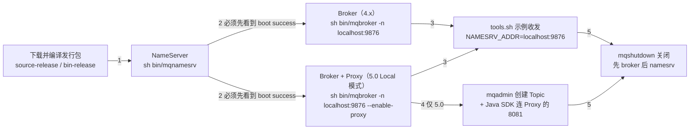
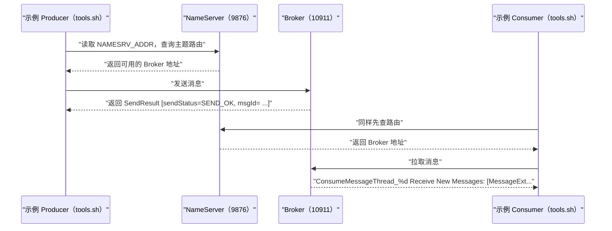

## 为什么需要本地二进制部署？（痛点引入）

几乎所有第一次接触 RocketMQ 的人，都会先在环境上耗掉半天，而且卡点高度雷同：

- 照着博客里抄来的命令启动 Broker，结果日志里等不到那句 `boot success`，因为 NameServer 其实还没起来；上游文档明确写了顺序要求「NameServer 成功启动后，我们启动 Broker」。
- 5.0 环境下客户端连不上，原因是把接入点填成了 NameServer 的 `localhost:9876`，而 5.0 的新客户端要连的是 Proxy 的地址和端口（示例值 `localhost:8081`）。
- 用源码包折腾了半天 `mvn`，却始终不知道自己该进哪个目录，因为发行包解压出来的路径和编译产物的路径不是同一个。
- 发完消息只看到一行 `SendResult [sendStatus=SEND_OK, msgId= ...`，但不确定这算不算真的成功，也不知道下一步该验证什么。
- 实验做完直接 `kill -9`，下次重启时又要重新猜一边启动顺序。

| 维度 | 没有一条可复现的本地启动路径 | 有了本文这条最短路径 |
|------|------------------------------|----------------------|
| 启动顺序 | 猜：先 Broker 还是先 NameServer | 固定三段：NameServer → Broker（5.0 带 Proxy）→ 收发验证 |
| 成败判据 | 「没报错应该就是起来了」 | 每步都有明确的日志文件与 `boot success` 字符串可对号入座 |
| 版本混淆 | 把 4.x 的命令直接套到 5.0，Proxy 迟迟不起 | 逐步骤标注 4.x / 5.0 差异，附对照表 |
| 接入点填错 | 客户端一律填 `9876` | 明确「工具测试用 `NAMESRV_ADDR`，5.0 SDK 用 Proxy endpoint」 |
| 收尾 | 强杀进程，留下脏状态 | 用 `sh bin/mqshutdown broker` / `sh bin/mqshutdown namesrv` 正常关闭 |

> ### 💡 新人小结：本地二进制部署到底在装什么？
>
> 把整套东西想象成「在自家厨房开一间小型咖啡馆」：
> - 发行包 = 一整台拆箱即用的咖啡机（二进制包）或一箱零件加说明书（源码包，需要自己 `mvn` 组装）。
> - NameServer = 门口的接线台，只负责告诉客人「现在哪台机器在营业」，它自己不做咖啡。
> - Broker = 真正做咖啡、存杯子的机器，消息就落在这里。
> - Proxy（只有 5.0）= 柜台窗口：新客户端只走窗口，不再直接找机器。
> - `tools.sh` 与 Java SDK = 第一杯试机咖啡：先按说明书接一杯（工具测试），再用自己家的杯子接（SDK 测试）。
>
> **快速开始的目标只有一个：在本地把「接线台 → 机器 → 窗口 → 第一杯咖啡」这条链路一次跑通，并且知道每一步用什么字符串判断成功。**

**学习路线图**（本文按六段推进，逐段读完即可从零跑到第一条消息）

```
发行包 → NameServer → Broker（4.x）/ Broker+Proxy（5.0）→ tools.sh 收发 → Java SDK 收发 → 关闭清理
下载编译   boot success   同进程 Local 模式              SEND_OK        8081 接入点      mqshutdown
```

**本文范围**：只负责「本地从零到第一条消息收发成功」这一条链路——下载、编译、启动顺序、验证字符串、收发命令、关闭动作。集群拓扑与多副本容灾（异步复制、DLedger、Controller）在 `06-operations/集群与容灾/部署模式与高可用容灾.md` 展开；参数默认值与取值范围在 `07-configuration/参数与日志配置/客户端与服务端参数配置.md` 与 `01-overview/版本演进与限制/使用限制与参数约束.md` 展开，本文不重复这些表格。

---

## 先把术语对齐（否则后面每一步都会听不懂）

下表覆盖本文出现的全部专名与缩写；「全称」列与上游用词保持一致。

| 术语 | 全称 | 含义（用自己的话） | 在本文中的角色 |
|------|------|--------------------|----------------|
| NameServer | Name Server（`mqnamesrv`） | 一个轻量的路由注册中心：Broker 到它这里登记自己，客户端到它这里查「该连哪个 Broker」；本身不存消息 | 第一个要启动的进程，端口示例 `localhost:9876` |
| Broker | Broker（`mqbroker`） | 消息的存储与投递服务端，主题的队列真正落在这里 | 第二个要启动的进程，日志里以 `brokerName,ip:port` 形式自报家门 |
| Proxy | Proxy（代理组件，5.0 引入） | 面向新客户端的接入层，把客户端的 gRPC 请求转成对 Broker 的访问；5.0 快速开始用 Local 模式与 Broker 同进程启动 | 5.0 起才有；SDK 接入点填的就是它的地址和端口 |
| Local 模式 | Broker 与 Proxy 同进程部署 | 上游原话：「这里我们使用 Local 模式部署，即 Broker 和 Proxy 同进程部署」，由 `--enable-proxy` 触发 | 本文 5.0 的启动方式 |
| JDK | Java Development Kit | Java 运行与编译环境，上游要求 64 位 JDK 1.8+ | 系统要求里唯一的运行时前提 |
| 二进制包 | bin-release 包 | 上游原话：「已经编译完成后可以直接运行的」发行包 | 只想跑起来就选它 |
| 源码包 | source-release 包 | 上游原话：「需要编译后运行的」发行包，用 `mvn -Prelease-all` 构建出可执行分布 | 本文的演示路径（上游即以源码包演示） |
| `tools.sh` | 示例程序启动脚本 | 位于 `bin/` 下，用来运行打包好的示例类，例如 `org.apache.rocketmq.example.quickstart.Producer` | 第一次收发验证用 |
| `mqadmin` | 管理命令行工具 | 对主题、订阅组等资源做增删改查；本文只用它创建主题 | 5.0 SDK 收发的前置步骤 |
| `NAMESRV_ADDR` | NameServer 地址环境变量 | 告诉客户端「去哪里问路」；上游用 `export NAMESRV_ADDR=localhost:9876` 设置 | tools.sh 验证阶段的入口 |
| endpoint | 客户端接入点 | 5.0 新 SDK 里通过 `ClientConfiguration.newBuilder().setEndpoints(endpoint)` 设置，注释写明「需要设置成 Proxy 的地址和端口列表，一般是 xxx:8080;xxx:8081」 | SDK 验证阶段与 `NAMESRV_ADDR` 相对的那个概念 |
| `DefaultCluster` | 集群名参数值 | `mqadmin updatetopic` 的 `-c` 参数取值，上游示例直接用这个字符串 | 创建主题时指定归属集群 |
| SendReceipt / SendResult | 发送回执 / 发送结果 | 新 SDK 返回 `SendReceipt`（可取 `getMessageId()`）；4.x 工具示例输出的是 `SendResult [sendStatus=SEND_OK, ...]` | 判断「发成功了」的凭据 |
| ConsumeResult | 消费结果 | PushConsumer 监听器返回的处理结果，示例返回 `ConsumeResult.SUCCESS` | 判断「消费成功了」的凭据 |
| MessageView | 消息视图 | 消费监听器接收到的只读消息对象，示例里用 `messageView.getMessageId()` 打日志 | SDK 消费示例的入参类型 |
| SimpleConsumer / PushConsumer | 两种消费者类型 | 上游原文：「Apache RocketMQ 支持 SimpleConsumer 和 PushConsumer 两种消费者类型，您可以选择以下任意一种方式订阅消息」；本文代码给 PushConsumer | SDK 消费阶段的选型入口 |
| `mqshutdown` | 关闭脚本 | `bin/mqshutdown broker` / `bin/mqshutdown namesrv`，向对应进程发送关闭请求 | 清理动作 |
| SLF4J | Simple Logging Facade for Java | 示例代码里的 `Logger`/`LoggerFactory`，用来打印发送与消费结果 | SDK 示例的输出方式 |

---

## 启动链路总览：谁必须先起来

下图是本文要跑通的依赖关系，箭头表示「前置完成才能进入下一步」，不是消息流动方向。



读图要点三条：

1. **NameServer 是硬前置**。4.x 与 5.0 文档都写着「NameServer 成功启动后，我们启动 Broker」，并且 5.0 明确是「启动 Broker 和 Proxy」——Broker 起来时会向 NameServer 注册，反了顺序就注册不上。
2. **Proxy 只在 5.0 这条支线上**。4.x 图上根本没有这个节点，客户端直连 NameServer + Broker；5.0 才多出「SDK 走 Proxy 接入点」这条路。
3. **SDK 收发前面还多一步「建 Topic」**。5.0 文档在 SDK 章节的第 3 步给出 `sh bin/mqadmin updatetopic -n localhost:9876 -t TestTopic -c DefaultCluster`，而 tools.sh 用的示例主题不需要你手动建。

> ### 💡 新人小结：为什么要按这个顺序起？
>
> 想象咖啡馆开业：
> - 先把「门口的接线台」摆好（NameServer），客人才能问到哪里有咖啡。
> - 再开机做咖啡（Broker）；机器一开机就要主动去接线台登记「我在 10911 营业」，接线台还没摆好，登记就落空。
> - 5.0 多了一个「柜台窗口」（Proxy）：客人从此只在窗口点单，不冲进操作间。窗口背后仍然是同一台机器，所以本机演示把它们放在同一个进程里。
>
> **启动顺序不是玄学，而是「谁向谁登记」决定的：被登记的一方必须先活着。**

---

## 第一步：下载并编译 Apache RocketMQ

上游对系统要求只有两条（4.x 与 5.0 完全一致）：

1. 64 位操作系统，推荐 Linux/Unix/macOS；
2. 64 位 JDK 1.8+。

> [!NOTE] 上游本节只演示 Linux 环境
> 两版快速开始都写着「这里以在 Linux 环境为例，介绍 RocketMQ 安装过程」，均未给出 Windows 下的本地二进制启动方式；本文照抄这一口径，不给 Windows 版命令。Windows 的差异（`%cd%` 与 `$pwd`、换行续行符）集中在容器部署那篇：`03-quickstart/容器与云原生部署/Docker与Compose部署.md`。

上游对安装包的定位区分得很清楚：**二进制包是已经编译完成后可以直接运行的，源码包是需要编译后运行的**。

| 对比项 | 源码包（source-release） | 二进制包（bin-release） |
|--------|--------------------------|--------------------------|
| 4.9.4 下载地址 | `https://archive.apache.org/dist/rocketmq/4.9.4/rocketmq-all-4.9.4-source-release.zip` | `https://archive.apache.org/dist/rocketmq/4.9.4/rocketmq-all-4.9.4-bin-release.zip` |
| 5.3.2 下载地址 | `https://dist.apache.org/repos/dist/release/rocketmq/5.3.2/rocketmq-all-5.3.2-source-release.zip` | `https://dist.apache.org/repos/dist/release/rocketmq/5.3.2/rocketmq-all-5.3.2-bin-release.zip` |
| 是否需要 Maven 构建 | 需要，`mvn -Prelease-all -DskipTests -Dspotbugs.skip=true clean install -U` | 不需要，解压即可运行 |
| 上游演示用的是 | 是（两版都以源码包为例走完整流程） | 未演示 |
| 最终要进入的运行目录 | `distribution/target/rocketmq-4.9.4/rocketmq-4.9.4`（4.x）／`distribution/target/rocketmq-5.3.2/rocketmq-5.3.2`（5.0） | 解压目录本身（上游未给出具体路径写法） |
| 适用场景 | 想顺带验证「自己能不能从源码构建出发行版」 | 只想最快跑起来收发第一条消息 |

4.x 的构建与进入运行目录（照抄上游，两步）：

```shell
# ========== ✅ 推荐：按上游给的这条命令构建，跳过测试与静态检查，最快拿到可运行分布 ==========
$ mvn -Prelease-all -DskipTests -Dspotbugs.skip=true clean install -U
$ cd distribution/target/rocketmq-4.9.4/rocketmq-4.9.4
# 输出: 上游未给出构建日志样例；进入该目录后即可看到 bin/、conf/ 等运行所需内容
```

5.0 的构建多了「解压」和「进入解压目录」两步，其余一致：

```shell
# ========== ✅ 推荐：5.3.2 源码包完整四步 ==========
$ unzip rocketmq-all-5.3.2-source-release.zip
$ cd rocketmq-all-5.3.2-source-release/
$ mvn -Prelease-all -DskipTests -Dspotbugs.skip=true clean install -U
$ cd distribution/target/rocketmq-5.3.2/rocketmq-5.3.2

# ========== 不推荐写法（仅展示） ==========
# ❌ 构建完停在 rocketmq-all-5.3.2-source-release/ 根目录就去执行 sh bin/mqnamesrv：
#    上游的后续命令都以 distribution/target/rocketmq-5.3.2/rocketmq-5.3.2 为当前目录
```

参数解释：

| 片段 | 作用 | 注意 |
|------|------|------|
| `-Prelease-all` | 激活上游的发行版构建 profile，产出 `distribution/target/` 下的可运行分布 | 少了它就不会产出这个目录 |
| `-DskipTests` | 跳过单元测试 | 上游示例带此参数 |
| `-Dspotbugs.skip=true` | 跳过 SpotBugs 静态检查 | 上游示例带此参数 |
| `clean install -U` | 清理后重新构建并强制更新依赖 | `-U` 是上游原文 |
| `distribution/target/rocketmq-<版本>/rocketmq-<版本>` | 真正的运行目录，`bin/mqnamesrv`、`bin/mqbroker`、`bin/tools.sh` 都在这里的 `bin/` 下 | 4.9.4 与 5.3.2 只是版本号不同，路径结构一致 |

---

## 第二步：启动 NameServer

```shell
# ========== ✅ 推荐：先起 NameServer，并等到 boot success 再进入下一步 ==========
### 启动namesrv
$ nohup sh bin/mqnamesrv &

### 验证namesrv是否启动成功
$ tail -f ~/logs/rocketmqlogs/namesrv.log
The Name Server boot success...

# ========== 不推荐写法（仅展示） ==========
# ❌ 不起 NameServer、或没看到上面这行就直接执行下一条 sh bin/mqbroker -n localhost:9876 &：
#    上游的顺序要求是「NameServer 成功启动后，我们启动 Broker」，问路的地方不存在，Broker 起不来也无处可查
```

判据（4.x 与 5.0 完全一致）：在 `namesrv.log` 中看到 **`The Name Server boot success..`**，表示 NameServer 已成功启动。

参数解释：

| 片段 | 作用 | 备注 |
|------|------|------|
| `nohup ... &` | 让进程忽略挂断信号并放到后台运行，终端可以继续使用 | 上游原文写法 |
| `sh bin/mqnamesrv` | 启动 NameServer 的脚本 | 上游统一用 `sh`，未给 `bash` 写法 |
| `~/logs/rocketmqlogs/namesrv.log` | NameServer 日志路径 | 两版都是这个小写文件名 |
| `tail -f` | 实时跟踪日志，用来等那句 `boot success` | 看到后可 `Ctrl+C` 退出跟踪，不影响 NameServer 进程 |

> [!TIP] 验证不是可选步骤
> 上游在 NameServer 与 Broker 两步之后各给了一段「我们可以在 …log 中看到 …，表示 … 已成功启动」。这句话的实际作用是**闸门**：没看到对应字符串，就不要往下起 Broker。本文后续的排查清单也完全围绕这几条字符串组织。

---

## 第三步：启动 Broker（4.x）与 Broker+Proxy（5.0）

4.x：只有一个进程要起。

```shell
### 先启动broker
$ nohup sh bin/mqbroker -n localhost:9876 &

### 验证broker是否启动成功, 比如, broker的ip是192.168.1.2 然后名字是broker-a
$ tail -f ~/logs/rocketmqlogs/Broker.log
The broker[broker-a,192.169.1.2:10911] boot success...
```

5.0：Broker 起来时把 Proxy 一起带起来（Local 模式，同进程）。

```shell
# ========== ✅ 推荐（5.0）：一条命令把 Broker 与 Proxy 一起带起来，验证看 proxy.log ==========
### 先启动broker
$ nohup sh bin/mqbroker -n localhost:9876 --enable-proxy &

### 验证broker是否启动成功, 比如, broker的ip是192.168.1.2 然后名字是broker-a
$ tail -f ~/logs/rocketmqlogs/proxy.log
The broker[broker-a,192.169.1.2:10911] boot success...

# ========== 不推荐写法（仅展示） ==========
# ❌ 在 5.0 里仍执行 4.x 的 sh bin/mqbroker -n localhost:9876 &：
#    少了 --enable-proxy，Proxy 不会被起来，第五步 SDK 示例连 localhost:8081 时无人应答
# ❌ 在 4.x 里执行带 --enable-proxy 的命令：4.x 文档没有这个参数，也没有 Proxy 组件
```

> [!NOTE] 版本适用：5.0 起 Broker 需与 Proxy 一同启动，4.x 无 Proxy 组件
> 5.0 上游原文：「NameServer 成功启动后，我们启动 Broker 和 Proxy。这里我们使用 Local 模式部署，即 Broker 和 Proxy 同进程部署。5.x 版本也支持 Broker 和 Proxy 分离部署以实现更灵活的集群能力。」
> 分离部署与集群拓扑（多副本、异步复制、DLedger、Controller 容灾）不在本文展开，见 `06-operations/集群与容灾/部署模式与高可用容灾.md`。
> 4.x 命令里没有也不能有 `--enable-proxy`：4.x 发行包中不存在 Proxy 组件。

判据对比：4.x 看 `Broker.log`（上游把这个文件名写成大写 B，照抄），5.0 看 `proxy.log`；两版要看到的成功字符串形式相同：**The broker[brokerName,ip:port] boot success..**。

| 对比维度 | 4.x（4.9.4） | 5.0（5.3.2） |
|----------|--------------|--------------|
| 需要启动的服务端进程 | NameServer、Broker | NameServer、Broker+Proxy（同进程 Local 模式） |
| Broker 启动命令 | `sh bin/mqbroker -n localhost:9876` | `sh bin/mqbroker -n localhost:9876 --enable-proxy` |
| 成功判据所在日志 | `~/logs/rocketmqlogs/Broker.log` | `~/logs/rocketmqlogs/proxy.log` |
| 成功字符串 | `The broker[broker-a,192.169.1.2:10911] boot success...` | 同左（形式一致：`The broker[brokerName,ip:port] boot success..`） |
| 日志里自报的 Broker 端口 | `10911` | `10911` |
| 客户端要不要连 Proxy | 不存在 Proxy，客户端连 NameServer + Broker | 新 SDK 连 Proxy 的地址和端口，示例 `localhost:8081` |
| 上游给出的接入点注释 | `NAMESRV_ADDR=localhost:9876` | 「需要设置成 Proxy 的地址和端口列表，一般是 xxx:8080;xxx:8081」 |
| 分离部署 | 不适用 | 支持，但本文用 Local 模式；细节见 06-operations |
| 关闭时的输出差异 | `Send shutdown request to mqbroker(36695) OK` | `Send shutdown request to mqbroker with proxy enable OK(36695)` |

> ### 💡 新人小结：Proxy 到底是不是「又多一台机器要养」？
>
> 用「柜台窗口」来理解：
> - 4.x：客人（客户端）直接进操作间找咖啡机，问完接线台就直奔机器。
> - 5.0：操作间外面加了一个窗口。窗口不煮咖啡，它只做「接客、翻译、转单」。
> - Local 模式 = 窗口和操作间在同一间屋子里（同进程），你仍然只启动一个 `mqbroker` 命令，只是加了 `--enable-proxy`。
> - 分离模式 = 把窗口搬到另一个房间甚至另一栋楼，好处是上下游可以各自扩缩容；上游只说了这一句定位，细节归 06-operations。
>
> **5.0 快速开始让你只多打一个 `--enable-proxy` 参数，而不是多装一个组件；但多出一个必须知道的接入点端口。**

---

## 第四步：第一次收发（tools.sh 示例程序，两版通用）

上游这一步的原话是「在进行消息收发之前，我们需要告诉客户端 NameServer 的地址」，并选择用环境变量 `NAMESRV_ADDR` 来告诉它。

```shell
# ========== ✅ 推荐：先 export 再跑示例，两个示例按顺序跑 ==========
$ export NAMESRV_ADDR=localhost:9876
$ sh bin/tools.sh org.apache.rocketmq.example.quickstart.Producer
 SendResult [sendStatus=SEND_OK, msgId= ...

$ sh bin/tools.sh org.apache.rocketmq.example.quickstart.Consumer
 ConsumeMessageThread_%d Receive New Messages: [MessageExt...

# ========== 不推荐写法（仅展示） ==========
# ❌ 不 export NAMESRV_ADDR 就执行 tools.sh：上游这一步的前提就是「我们需要告诉客户端 NameServer 的地址」
# ❌ 只跑 Consumer 不跑 Producer：示例程序不会凭空造消息，上游给出的顺序就是先 Producer 后 Consumer
```

逐行解释：

| 命令／输出片段 | 含义 | 判断标准 |
|----------------|------|----------|
| `export NAMESRV_ADDR=localhost:9876` | 把 NameServer 地址交给示例程序；上游说「RocketMQ 有多种方式在客户端中设置 NameServer 地址，这里我们利用环境变量」 | 变量值与你启动 Broker 时 `-n` 传的地址一致 |
| `sh bin/tools.sh <示例类全名>` | 运行发行包内置的示例类，Producer 与 Consumer 各一个 | 类名照抄：`org.apache.rocketmq.example.quickstart.Producer`／`.Consumer` |
| `SendResult [sendStatus=SEND_OK, msgId= ...` | 发送结果：`sendStatus` 为 `SEND_OK` 才算这次发送成功 | 上游给出的样例输出本身以省略号结尾，本文照抄不补 |
| `ConsumeMessageThread_%d Receive New Messages: [MessageExt...` | 消费线程收到了消息 | 同上：这是上游样例输出的原文形态 |

> [!NOTE] 想看完整一条消息长什么样，去 Kubernetes 那篇
> 上游本地部署篇给的是截断形态的样例输出；同一组 `tools.sh` 命令在 K8s 场景下上游给出了完整输出（含 `offsetMsgId`、`messageQueue=MessageQueue [topic=TopicTest, brokerName=rocketmq-demo-broker-0, queueId=2]`、`queueOffset=124` 等字段），见 `03-quickstart/容器与云原生部署/Kubernetes与Helm部署.md`。

5.0 的这一步与 4.x 逐字相同（上游把它命名为「工具测试消息收发」），区别只在于**它不再是终点**：5.0 紧接着还有一节「SDK 测试消息收发」。

下图是这一步里各组件实际发生的交互，覆盖「发送」与「接收」两段验证。



图后解读：示例程序从不「记住」Broker，它每次都是先问 NameServer。这就是为什么 `NAMESRV_ADDR` 填错时表现是「连不上／拿不到路由」，而不是「连接被 Broker 拒绝」——问路的地方错了，压根没走到机器。

---

## 第五步（5.0 专有）：用 Java SDK 完成第一条消息

5.0 上游原话：「工具测试完成后，我们可以尝试使用 SDK 收发消息。这里以 Java SDK 为例介绍一下消息收发过程，可以从 rocketmq-clients 中参阅更多细节。」这一节是 5.0 快速开始与 4.x 快速开始最大的内容差异。

**1）创建 Java 工程并引入依赖。** 在 `pom.xml` 里加入下面这段，并把 `rocketmq-client-java-version` 替换成最新版（上游给的查询地址是 Maven Central 检索 `g:org.apache.rocketmq AND a:rocketmq-client-java`）：

```xml
<dependency>
    <groupId>org.apache.rocketmq</groupId>
    <artifactId>rocketmq-client-java</artifactId>
    <version>${rocketmq-client-java-version}</version>
</dependency>
```

| 坐标 | 含义 | 与 4.x 的差别 |
|------|------|---------------|
| `rocketmq-client-java` | 5.0 新客户端（gRPC 客户端）的 Java 构件 | 4.x 用的是 `rocketmq-client`（示例版本 `4.9.6`），两者不是同一套 SDK |
| `${rocketmq-client-java-version}` | 上游用占位符，要求替换成最新版本 | 上游刻意不给固定版本号，本文不代为猜测 |

**2）先建 Topic，再发第一句话。**

```shell
# ========== ✅ 推荐：先建 Topic，再跑下面的 SDK 示例 ==========
$ sh bin/mqadmin updatetopic -n localhost:9876 -t TestTopic -c DefaultCluster
# 输出: 上游未给出该命令的成功输出样例；它的作用是创建下面代码里要用的目标主题

# ========== 不推荐写法（仅展示） ==========
# ❌ 主题名与代码里的 topic 不一致（例如这里建了 OtherTopic，代码里仍写 TestTopic）：
#    上游注释两次写明「消息发送的目标Topic名称，需要提前创建」，名字必须一字不差
```

参数解释：`-n localhost:9876` 指定 NameServer 地址；`-t TestTopic` 是要创建的主题名，必须与代码里的 `topic` 变量一致；`-c DefaultCluster` 是指定集群名，上游示例用 `DefaultCluster`。

> [!TIP] 别忘了消费者分组也要提前创建
> 5.0 消费示例代码里的注释写明「为消费者指定所属的消费者分组，Group 需要提前创建」，但**本地部署这一篇上游没有给出创建 Group 的命令**。同一系列 Kubernetes 篇给出的命令是 `sh mqadmin updateSubGroup -c DefaultCluster -g TestGroup`，可按同样格式替换成你代码里的 `YourConsumerGroup`。

**3）发送端（照抄上游 `ProducerExample`）**：

```java
import org.apache.rocketmq.client.apis.ClientConfiguration;
import org.apache.rocketmq.client.apis.ClientConfigurationBuilder;
import org.apache.rocketmq.client.apis.ClientException;
import org.apache.rocketmq.client.apis.ClientServiceProvider;
import org.apache.rocketmq.client.apis.message.Message;
import org.apache.rocketmq.client.apis.producer.Producer;
import org.apache.rocketmq.client.apis.producer.SendReceipt;
import org.slf4j.Logger;
import org.slf4j.LoggerFactory;

public class ProducerExample {
    private static final Logger logger = LoggerFactory.getLogger(ProducerExample.class);

    public static void main(String[] args) throws ClientException {
        // 接入点地址，需要设置成Proxy的地址和端口列表，一般是xxx:8080;xxx:8081。
        String endpoint = "localhost:8081"; // 本机 Local 模式下 Proxy 与 Broker 同进程，端口取 8081
        // 消息发送的目标Topic名称，需要提前创建。
        String topic = "TestTopic"; // 与上一步 mqadmin updatetopic -t 的主题名必须一致
        ClientServiceProvider provider = ClientServiceProvider.loadService();
        ClientConfigurationBuilder builder = ClientConfiguration.newBuilder().setEndpoints(endpoint);
        ClientConfiguration configuration = builder.build();
        // 初始化Producer时需要设置通信配置以及预绑定的Topic。
        Producer producer = provider.newProducerBuilder()
            .setTopics(topic)
            .setClientConfiguration(configuration)
            .build();
        // 普通消息发送。
        Message message = provider.newMessageBuilder()
            .setTopic(topic)
            // 设置消息索引键，可根据关键字精确查找某条消息。
            .setKeys("messageKey")
            // 设置消息Tag，用于消费端根据指定Tag过滤消息。
            .setTag("messageTag")
            // 消息体。
            .setBody("messageBody".getBytes())
            .build();
        try {
            // 发送消息，需要关注发送结果，并捕获失败等异常。
            SendReceipt sendReceipt = producer.send(message);
            logger.info("Send message successfully, messageId={}", sendReceipt.getMessageId());
            // 输出: Send message successfully, messageId=<消息 ID>
        } catch (ClientException e) {
            logger.error("Failed to send message", e);
            // 输出（失败时）: Failed to send message + 异常堆栈
        }
        // producer.close();
    }
}
```

**4）消费端（照抄上游 `PushConsumerExample`）**：

```java
import java.io.IOException;
import java.util.Collections;
import org.apache.rocketmq.client.apis.ClientConfiguration;
import org.apache.rocketmq.client.apis.ClientException;
import org.apache.rocketmq.client.apis.ClientServiceProvider;
import org.apache.rocketmq.client.apis.consumer.ConsumeResult;
import org.apache.rocketmq.client.apis.consumer.FilterExpression;
import org.apache.rocketmq.client.apis.consumer.FilterExpressionType;
import org.apache.rocketmq.client.apis.consumer.PushConsumer;
import org.slf4j.Logger;
import org.slf4j.LoggerFactory;

public class PushConsumerExample {
    private static final Logger logger = LoggerFactory.getLogger(PushConsumerExample.class);

    private PushConsumerExample() {
    }

    public static void main(String[] args) throws ClientException, IOException, InterruptedException {
        final ClientServiceProvider provider = ClientServiceProvider.loadService();
        // 接入点地址，需要设置成Proxy的地址和端口列表，一般是xxx:8081;xxx:8081。
        String endpoints = "localhost:8081"; // 照抄上游此处写法；同页发送端注释写作 xxx:8080;xxx:8081
        ClientConfiguration clientConfiguration = ClientConfiguration.newBuilder()
            .setEndpoints(endpoints)
            .build();
        // 订阅消息的过滤规则，表示订阅所有Tag的消息。
        String tag = "*";
        FilterExpression filterExpression = new FilterExpression(tag, FilterExpressionType.TAG);
        // 为消费者指定所属的消费者分组，Group需要提前创建。
        String consumerGroup = "YourConsumerGroup";
        // 指定需要订阅哪个目标Topic，Topic需要提前创建。
        String topic = "TestTopic";
        // 初始化PushConsumer，需要绑定消费者分组ConsumerGroup、通信参数以及订阅关系。
        PushConsumer pushConsumer = provider.newPushConsumerBuilder()
            .setClientConfiguration(clientConfiguration)
            // 设置消费者分组。
            .setConsumerGroup(consumerGroup)
            // 设置预绑定的订阅关系。
            .setSubscriptionExpressions(Collections.singletonMap(topic, filterExpression))
            // 设置消费监听器。
            .setMessageListener(messageView -> {
                // 处理消息并返回消费结果。
                logger.info("Consume message successfully, messageId={}", messageView.getMessageId());
                return ConsumeResult.SUCCESS; // 返回 SUCCESS 表示这条消息处理完成
            })
            .build();
        Thread.sleep(Long.MAX_VALUE); // 让主线程长时间挂住，保持消费者存活
        // 如果不需要再使用 PushConsumer，可关闭该实例。
        // pushConsumer.close();
    }
}
```

参数解释（只讲本文示例用到的）：

| 参数／方法 | 含义 | 本文示例取值 |
|-----------|------|--------------|
| `setEndpoints(endpoint)` | 客户端接入点，上游注释要求填 Proxy 的地址和端口列表 | `localhost:8081` |
| `setTopics(topic)` | 初始化 Producer 时预绑定的主题 | `TestTopic`，且需提前用 mqadmin 创建 |
| `setKeys("messageKey")` | 消息索引键，上游注释：「可根据关键字精确查找某条消息」 | 占位串，实际应换成业务可检索的键 |
| `setTag("messageTag")` | 消息标签，供消费端按 Tag 过滤 | 上游注释原话 |
| `setBody(...)` | 消息负载，字节数组 | `"messageBody".getBytes()` |
| `SendReceipt.getMessageId()` | 发送回执里的消息 ID | 打进日志 |
| `FilterExpression(tag, FilterExpressionType.TAG)` | 订阅过滤规则 | `tag = "*"`，即订阅所有 Tag |
| `setConsumerGroup(...)` | 消费者分组，需提前创建 | `YourConsumerGroup` |
| `setSubscriptionExpressions(Map)` | 预绑定订阅关系：主题到过滤规则的映射 | `Collections.singletonMap(topic, filterExpression)` |
| `setMessageListener(...)` | 消费监听器，返回 `ConsumeResult` | 返回 `ConsumeResult.SUCCESS` |
| `producer.close()` / `pushConsumer.close()` | 释放客户端实例 | 上游以注释形式给出，因为示例要一直运行 |

> [!NOTE] 上游注释里的一处不一致（照抄，不做修改）
> 同一篇 5.0 快速开始中，发送端代码注释写「一般是 xxx:8080;xxx:8081」，消费端代码注释写「一般是 xxx:8081;xxx:8081」；本文两处都按上游原文照抄，并在表中统一说明实际取值是 `localhost:8081`。至于 8080 与 8081 各自对应哪种协议端口，上游快速开始未给出说明。

---

## 旧写法与新写法：同一个「发第一条消息」目标的两条路

5.0 的 SDK 章节是对「用 tools.sh + NameServer 地址」这条老路的演进，两者目标一致（本地发出并收到第一条消息），因此按规范必须同场景对照。

```shell
# ========== ✅ 旧写法（4.x 与 5.0 工具测试都走这条路）：靠环境变量问路 ==========
$ export NAMESRV_ADDR=localhost:9876
$ sh bin/tools.sh org.apache.rocketmq.example.quickstart.Producer
# 输出: SendResult [sendStatus=SEND_OK, msgId= ...
# 特点：不需要创建 Topic（示例主题内置），不需要 Java 工程，但只能跑示例代码

# ========== ✅ 新写法（5.0 SDK）：代码里显式设置 Proxy 接入点 ==========
$ sh bin/mqadmin updatetopic -n localhost:9876 -t TestTopic -c DefaultCluster
# 然后运行前面的 ProducerExample：endpoint = "localhost:8081"
# 输出: Send message successfully, messageId=<消息 ID>
# 特点：多一步建 Topic，换来可在自己业务代码里控制 Keys/Tag/Body 与异常处理

# ========== 不推荐写法（仅展示） ==========
# ❌ 在 5.0 SDK 里把 setEndpoints 填成 localhost:9876：那是 NameServer 的端口，
#    上游注释要求的是「Proxy 的地址和端口列表」
# ❌ 在 4.x 环境里硬套新写法：4.x 快速开始既没有 --enable-proxy，也没有 SDK 这一节
```

| 对比维度 | 旧写法（tools.sh + `NAMESRV_ADDR`） | 新写法（5.0 SDK + Proxy endpoint） |
|----------|-------------------------------------|------------------------------------|
| 前置动作 | 只要 `export NAMESRV_ADDR` | 还要先 `mqadmin updatetopic` 创建 `TestTopic` |
| 连接对象 | NameServer（9876）＋ Broker | Proxy（示例 8081） |
| 是否需要工程与依赖 | 不需要，发行包自带示例类 | 需要 Java 工程 + `rocketmq-client-java` 依赖 |
| 主题是否必须提前存在 | 上游未要求创建 | 上游注释两次强调「需要提前创建」 |
| 结果形态 | `SendResult [sendStatus=SEND_OK, ...]` | `SendReceipt.getMessageId()` |
| 可定制程度 | 低（示例类写死） | 高（Keys／Tag／Body／监听器都能改） |
| 失败可见性 | 看标准输出 | `catch (ClientException e)` 后打日志 |
| 4.x 是否可用 | 可用（上游原文即 4.x 流程） | 4.x 发行包无 Proxy，`--enable-proxy` 与 8081 均不适用 |
| 迁移成本与风险 | 脚本类冒烟测试可原样保留 | 接入点从 9876 换成 Proxy 端口是最常见的踩坑点：填成 NameServer 地址会连不上 |
| 旧写法仍适用场景 | 只想快速验证服务端是否活着、CI 里做部署后冒烟 | 业务代码、需要按 Tag 过滤与自定义消息体 |

---

## 第六步：关闭服务器与清理

上游给的关闭顺序是**先关 Broker，再关 NameServer**（与启动顺序相反）：

```shell
# ========== ✅ 推荐（4.x）：先 broker 后 namesrv，与启动顺序相反 ==========
$ sh bin/mqshutdown broker
The mqbroker(36695) is running...
Send shutdown request to mqbroker(36695) OK

$ sh bin/mqshutdown namesrv
The mqnamesrv(36664) is running...
Send shutdown request to mqnamesrv(36664) OK

# ========== 不推荐写法（仅展示） ==========
# ❌ 先关 namesrv 再关 broker：上游给的顺序就是 broker 在前、namesrv 在后
# ❌ 按示例里的进程号 36695／36664 去 kill：那是上游日志样例里的数字，你机器上一定不同
```

5.0 的差异只在 Broker 那一行的文案（因为带了 Proxy）：

```shell
$ sh bin/mqshutdown broker
The mqbroker(36695) is running...
Send shutdown request to mqbroker with proxy enable OK(36695)

$ sh bin/mqshutdown namesrv
The mqnamesrv(36664) is running...
Send shutdown request to mqnamesrv(36664) OK
```

| 关闭对象 | 命令 | 成功判据（上游原话） |
|----------|------|----------------------|
| Broker（4.x） | `sh bin/mqshutdown broker` | `The mqbroker(36695) is running...` 后接 `Send shutdown request to mqbroker(36695) OK` |
| Broker+Proxy（5.0） | `sh bin/mqshutdown broker` | 第二行是 `Send shutdown request to mqbroker with proxy enable OK(36695)`，多了 `with proxy enable` |
| NameServer | `sh bin/mqshutdown namesrv` | `Send shutdown request to mqnamesrv(36664) OK` |

> [!WARNING] 别用强杀代替脚本
> 上游提供 `mqshutdown` 的目的就是走正常关闭流程；示例进程号（`36695`、`36664`）只是上游日志样例里的数字，你机器上一定不同，不要按示例数字去 `kill`。

---

## 排查清单：只看上游给过的判据

下表把本文出现过的「成功字符串」和「它属于哪一步」列全。**上游快速开始没有给出任何错误码或异常样例输出**，因此本表只列正向判据，不编造失败文案。

| 症状 | 先看哪个判据 | 判据出自哪一步 | 判据缺失时本文给出的检查点 |
|------|--------------|----------------|------------------------------|
| 完全不知道服务起没起 | `The Name Server boot success...` | 第二步 `~/logs/rocketmqlogs/namesrv.log` | NameServer 必须第一个启动；`sh bin/mqnamesrv` 是否在当前运行目录下执行 |
| Broker 起了但注册不上 | `The broker[broker-a,192.169.1.2:10911] boot success...` | 第三步，4.x 看 `Broker.log`、5.0 看 `proxy.log` | `-n localhost:9876` 是否指向已启动的 NameServer；顺序是否反了 |
| 示例生产者发不出去 | `SendResult [sendStatus=SEND_OK, msgId= ...` | 第四步 | `NAMESRV_ADDR` 是否已 `export`，且与 `-n` 传的地址一致 |
| 示例消费者收不到 | `ConsumeMessageThread_%d Receive New Messages: [MessageExt...` | 第四步 | 先确认发送那步已经出现 `SEND_OK` |
| SDK 客户端连不上（5.0） | `Send message successfully, messageId=...` | 第五步 | 接入点必须填 Proxy 地址和端口（示例 `localhost:8081`），不是 `9876`；Broker 是否用 `--enable-proxy` 启动 |
| SDK 报主题不存在／发送失败（5.0） | `logger.error("Failed to send message", e)` 分支 | 第五步 | 是否执行过 `sh bin/mqadmin updatetopic -n localhost:9876 -t TestTopic -c DefaultCluster` |
| 消费端拿不到消息（5.0） | `Consume message successfully, messageId=...` | 第五步 | `YourConsumerGroup` 是否已创建（创建 Group 的命令见本文中的 TIP 说明）；`pushConsumer.close()` 是否被过早调用 |
| 关闭脚本没反应 | `Send shutdown request to ... OK` | 第六步 | 参数拼写：`broker` / `namesrv`（不是 `mqbroker`／`mqnamesrv`） |

---

## 要点总结

1. **本地部署只有三段式，顺序不能乱**：发行包（源码包要 `mvn -Prelease-all -DskipTests -Dspotbugs.skip=true clean install -U` 并进入 `distribution/target/rocketmq-<版本>/rocketmq-<版本>`）→ NameServer → Broker；每步都以上游给出的 `boot success` 字符串为闸门。
2. **5.0 与 4.x 的核心差异只有一处命令**：`sh bin/mqbroker -n localhost:9876 --enable-proxy`，Local 模式下 Proxy 与 Broker 同进程；验证日志从 `Broker.log` 换成 `proxy.log`，停机文案多出 `with proxy enable`。
3. **两条验证路各有分工**：`tools.sh` + `NAMESRV_ADDR=localhost:9876` 是版本通用的冒烟路径；5.0 的 Java SDK 路径走 `rocketmq-client-java` + Proxy 接入点（示例 `localhost:8081`），并且必须先用 `mqadmin updatetopic` 创建主题。
4. **接入点填错是 5.0 第一大坑**：新 SDK 连的是 Proxy，不是 NameServer；`9876` 只用于路由问路与 `mqadmin` 的 `-n` 参数。
5. **收尾用脚本、按反序关**：`sh bin/mqshutdown broker` → `sh bin/mqshutdown namesrv`，看到 `Send shutdown request to ... OK` 才算干净退出。

---

> ### 💡 新人小结：本地二进制部署学完了，记住这 5 点
>
> 1. **先摆接线台，再开机器**：NameServer 的 `boot success` 没出现，就不要去起 Broker。
> 2. **5.0 只多一个参数，但多一个必知的端口**：`--enable-proxy` 把窗口和操作间放在同一间屋子里；客户端从此连 8081 而不是 9876。
> 3. **工具测试和 SDK 测试是两件事**：前者证明「服务端活着」，后者证明「你的代码能连上」；两者判据分别是 `SEND_OK` 与 `Send message successfully, messageId=`。
> 4. **主题和分组要先存在**：SDK 路径里上游两次写明「需要提前创建」，Topic 用 `mqadmin updatetopic`，Group 用 `mqadmin updateSubGroup`（后者命令出自同一系列的 K8s 篇）。
> 5. **关闭也要照抄脚本，而不是 `kill -9`**：`mqshutdown` 输出的 `Send shutdown request to ... OK` 就是这次的收尾判据。
