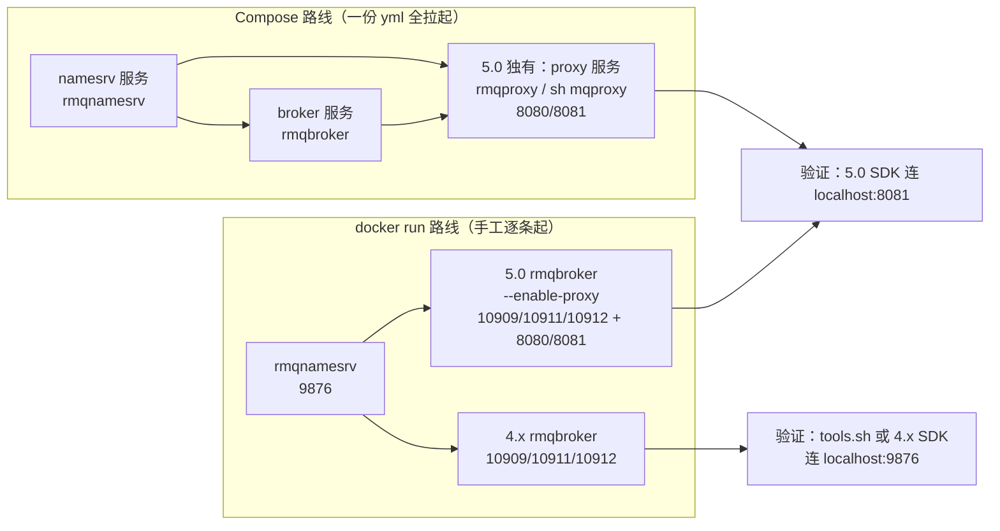
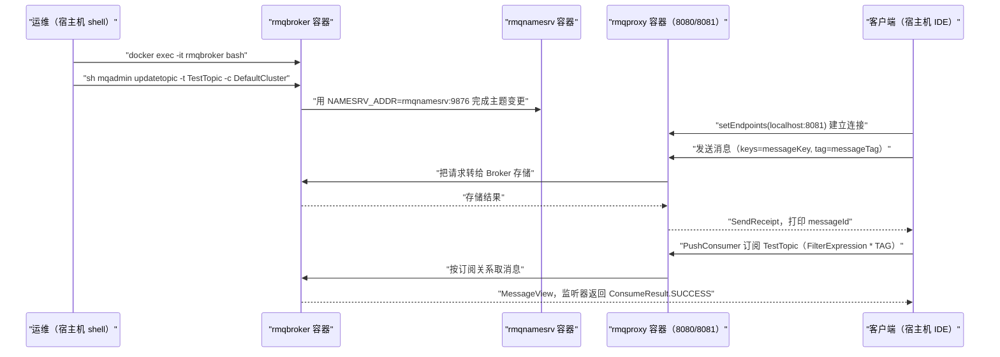

## 为什么需要 Docker 与 Compose 部署？（痛点引入）

本地二进制部署跑通之后，第二个现实问题马上会来：**这套东西我不想装在自己机器上编译，也不想让同事照着我的屏幕一步步敲。**

上游文档给出的两条容器化路径正好对应这两种需求：`docker run` 手动起容器（自己掌控每一步、能看清每一步的验证点），以及 Docker Compose 一次拉起整套集群（把步骤固化成一个文件）。两条路各自都有 4.x 和 5.0 两套写法，差异点集中在三处：**镜像 tag、Broker 要不要带 Proxy、要不要单独起一个 Proxy 容器**。

新手在这几条路上最常踩的坑：

- 只 `docker pull` 了一个镜像就以为完事了，忘了 RocketMQ 是多服务进程：上游原话是「RocketMQ 中有多个服务，需要创建多个容器，创建 docker 网络便于容器间相互通信」。
- 容器名和网络名随手起，结果 Broker 的 `-e NAMESRV_ADDR=rmqnamesrv:9876` 指到了一个不存在的容器名。
- 忘了写 `broker.conf` 里的 `brokerIP1`。上游这一步的注释只有一句「配置 Broker 的 IP 地址」，但对外的可连地址就是它。
- 在 Windows 上把 Linux 的反斜杠续行原样粘进 PowerShell，或者没把 `%cd%` 换成 `$pwd`，导致挂载路径挂成一个空文件。
- 5.0 用 Compose 时把接入点填成 Broker 的 `10911`，而示例代码要连的是 Proxy 的 `8081`。

| 维度 | 手工 `docker run` 一条一条起 | 用 Compose 一个文件拉起 |
|------|------------------------------|--------------------------|
| 步骤可见性 | 每一步一条命令、一个验证点，最适合学习 | 一次 `up`，服务顺序由 `depends_on` 声明 |
| 复制给同事 | 要贴一屏命令，还容易漏参数 | 直接给 `docker-compose.yml` + `broker.conf` |
| 清理 | `docker stop rmqnamesrv`、`docker stop rmqbroker` 逐个来 | `docker-compose down` 一次收摊 |
| 5.0 的 Proxy 形态 | 与 Broker 同容器（`sh mqbroker --enable-proxy`） | 独立 Proxy 容器（`sh mqproxy`），上游模板就是这么给的 |
| 出错定位 | 哪条命令失败一眼可见 | 需要 `docker logs <容器名>` 再看具体服务 |

> ### 💡 新人小结：容器化部署 RocketMQ 像在干什么？
>
> 把它想象成「开一家连锁快餐店，但所有设备都是标准集装箱」：
> - 镜像 `apache/rocketmq:4.9.6`／`apache/rocketmq:5.3.2` = 同一款设备的两个出厂型号，里面已经装好 JDK 和全部脚本，你不用自己装修。
> - `docker network create rocketmq` = 给这几个集装箱之间拉一条内部通道；没这条通道，容器之间只能用 IP 硬连。
> - 容器名 `rmqnamesrv`／`rmqbroker`／`rmqproxy` = 集装箱的门牌号，通道里靠门牌号找人（所以 `NAMESRV_ADDR=rmqnamesrv:9876` 用的是容器名而不是 `localhost`）。
> - `-p 9876:9876` = 把集装箱上的小窗开到店外，让街上的人（宿主机／你的 IDE）也能点单。
> - `docker-compose.yml` = 一张开店总清单：摆几个箱子、谁等谁（`depends_on`）、窗口开在哪、挂了哪块板子（`volumes`）。
>
> **容器化的价值不是「省命令」，而是把「顺序、地址、端口、挂载」这四件事写成一份可复制的声明。**

**学习路线图**（本文按五条主线推进）

```
镜像与网络 → 4.x docker run → 5.0 docker run（Broker+Proxy 同容器）→ 4.x Compose → 5.0 Compose（独立 Proxy 容器）→ 验证与清理
pull/network   run + broker.conf   --enable-proxy + 8080/8081   一份 yml   namesrv/broker/proxy 三服务   logs/exec/down
```

**本文范围**：只负责容器形态下「从零到第一条消息收发成功」——镜像 tag、启动顺序、端口、验证命令、清理动作。集群拓扑选型（多副本、异步复制、DLedger、Controller 容灾）见 `06-operations/集群与容灾/部署模式与高可用容灾.md`；参数默认值与限制见 `07-configuration/参数与日志配置/客户端与服务端参数配置.md` 与 `01-overview/版本演进与限制/使用限制与参数约束.md`；本地二进制方式（下载发行包、`mvn` 构建、`mqshutdown`）见 `03-quickstart/单机部署/本地二进制部署与消息收发.md`。

---

## 先把术语对齐（术语表）

| 术语 | 全称 | 含义（用自己的话） | 在本文中的角色 |
|------|------|--------------------|----------------|
| Docker 镜像 | image | 打包好的只读模板，里面有运行 RocketMQ 需要的一切；用「镜像名:tag」指定版本 | 本文用到 `apache/rocketmq:4.9.6` 与 `apache/rocketmq:5.3.2` |
| tag | 镜像标签 | 同一镜像的不同版本标识，可在 Docker Hub 的 tags 页查看 | 版本差异的第一处落点：4.9.6 vs 5.3.2 |
| 容器 | container | 镜像跑起来的实例，用 `--name` 起名字 | `rmqnamesrv`、`rmqbroker`、`rmqproxy` |
| `docker network create rocketmq` | 容器共享网络 | 上游原话：「RocketMQ 中有多个服务，需要创建多个容器，创建 docker 网络便于容器间相互通信」 | 让容器之间用容器名互访 |
| `--net` / `--network` | 指定容器加入哪个网络 | 两种写法作用相同；上游 4.x 全用 `--net`，5.0 的 Linux 示例用 `--network`（Windows 示例仍用 `--net`） | 本文照抄上游差异 |
| `-p` | publish 端口映射 | 宿主机端口:容器端口，把服务暴露到宿主机 | `9876`、`10909/10911/10912`、`8080/8081` |
| `-v` | volume 挂载 | 把宿主机文件挂进容器指定路径 | 把本地 `broker.conf` 挂到镜像的 `conf/broker.conf` |
| `-e` | environment 环境变量 | 向容器内传配置 | `-e "NAMESRV_ADDR=rmqnamesrv:9876"` |
| `-d` | detached 后台运行 | 命令立刻返回，容器在后台跑 | 两个组件的启动都带它 |
| `docker logs -f` / `docker logs` | 查看容器日志 | `-f` 是持续跟踪 | NameServer 与 Broker 的成功判据都从这里读 |
| `docker exec -it <容器> bash` | 进入运行中的容器 | 交互式进入，里面就有 `tools.sh`、`mqadmin` | 收发验证与建 Topic 的入口 |
| `sh mqnamesrv` / `sh mqbroker` / `sh mqproxy` | 容器内的启动命令 | 覆盖镜像默认入口，直接指定要跑哪个服务 | 三个服务分别对应这三条 |
| `--enable-proxy` | Broker 启动参数（5.0） | 让 Broker 进程内一起把 Proxy 带起来（Local 模式，同进程） | 5.0 `docker run` 路线用它 |
| `brokerIP1` | Broker 配置项 | 上游对它的说明就一句「配置 Broker 的 IP 地址」；Broker 对外可连的地址就是这个值 | `broker.conf` 里唯一被上游要求写的一行 |
| `-c` | Broker 的配置文件参数 | `sh mqbroker -c /home/rocketmq/.../conf/broker.conf`，指定要加载的配置文件 | 4.x 与 5.0 的 `docker run` 路线都带 |
| Docker Compose | 多容器编排工具 | 用一个 `docker-compose.yml` 描述多个服务并一次拉起 | 本文第二条主线 |
| `services` | Compose 服务块 | 每个服务对应一个容器 | `namesrv`、`broker`、`proxy` |
| `depends_on` | 服务依赖声明 | 声明启动依赖顺序 | 4.x：`broker` 依赖 `namesrv`；5.0：`proxy` 依赖 `broker` 和 `namesrv` |
| `restart: on-failure` | 容器重启策略 | 失败时重启；上游只写在 5.0 的 `proxy` 服务上 | 5.0 Compose 模板里 Proxy 独有的配置 |
| `driver: bridge` | 网络驱动 | Compose 自定义网络用桥接驱动 | 两版模板底部都是 `rocketmq: driver: bridge` |
| `-p rocketmq_project` | Compose 项目名参数 | 上游 Windows 标签页给出的写法，为项目指定名称 | Windows 下启动多了一个参数 |
| Proxy | 代理组件（5.0 引入） | 新客户端的接入层；5.0 有两种起法：跟 Broker 同进程，或独立容器跑 `sh mqproxy` | 本文最重要的版本差异 |
| NameServer | 路由注册中心 | Broker 向它注册、客户端向它问路 | 第一个启动的服务，端口 `9876` |
| Broker | 存储与投递服务端 | 消息真正存放的进程，端口示例 `10911` | 第二个启动的服务 |
| `NAMESRV_ADDR` | NameServer 地址环境变量 | 容器里所有 RocketMQ 服务与工具用它找 NameServer | 本文取值是 `rmqnamesrv:9876`（容器名，不是 localhost） |
| `mqadmin` | 管理命令行工具 | 本文用 `updatetopic` 创建主题 | 5.0 的 SDK 验证前置步骤 |
| `rocketmq-client` / `rocketmq-client-java` | 两套 Java 客户端 | 前者是 4.x 客户端（示例版本 `4.9.6`），后者是 5.0 新客户端（版本用占位符） | 决定你填 NameServer 地址还是 Proxy 接入点 |
| `setNamesrvAddr` / `setEndpoints` | 两个客户端的地址设置方法 | 前者设 NameServer 地址，后者设 Proxy 的地址和端口列表 | 旧写法与新写法的分界 |
| `SendResult` / `SendReceipt` | 发送结果 / 发送回执 | 4.x 示例打印 `SendResult`；5.0 示例取 `SendReceipt.getMessageId()` | 两条路的成功判据 |
| grpc 端口 | 上游在 K8s 篇使用的端口说法 | 原文要求「在部署时将 grpc 端口暴露出来，可根据 grpc 端口做成 NodePort 或者 LoadBalance 方便本地测试的服务」 | 说明 5.0 部署还要关注接入层端口；上游未写明 grpc 端口与 8080/8081 的对应关系，本文不推断 |
| Docker Hub | 镜像仓库 | 上游给的 tags 页是 `https://hub.docker.com/r/apache/rocketmq/tags` | 查可用 tag 的地方 |

---

## 容器路线总览：两条路、四个版本

下图是本文四条主线的服务依赖关系。左边是 `docker run` 路线（5.0 用同进程模式），右边是 Compose 路线（5.0 用独立 Proxy 容器）。



读图三条要点：

1. **NameServer 永远是第一个**，两版四路的 `NAMESRV_ADDR` 都指向 `rmqnamesrv:9876`，用的是容器名而不是 `localhost`——因为 Broker 和 NameServer 在两个容器里。
2. **5.0 有两种 Proxy 形态，不是二选一的对错关系**，而是上游两条路线各给一种：`docker run` 用 `sh mqbroker --enable-proxy`（同容器），Compose 用独立的 `sh mqproxy` 容器。
3. **客户端连哪儿由版本决定**：4.x 走 `9876` 问路再连 Broker；5.0 的 SDK 只连 Proxy（示例 `localhost:8081`）。

> ### 💡 新人小结：为什么 `docker run` 里 5.0 不带 Proxy 容器，Compose 里却带？
>
> 类比「同一台咖啡机，两种开店方式」：
> - `docker run` 是**自己在家演示**：机器和窗口拼在一个箱子里最省事，这就是上游说的 Local 模式（Broker 和 Proxy 同进程）。
> - Compose 是**按标准店面装修**：窗口单独一个箱子（`rmqproxy`），因为它要独立开 8080/8081 两个门、还要单独配 `restart: on-failure`。
> - 上游在 Compose 模板里把 Broker 的命令写成 `sh mqbroker`（**不加** `--enable-proxy`），因为窗口已经由另一个服务负责了。
>
> **判断自己该走哪条：想看清每一步就 `docker run`；想固化成文件、并且贴近真实部署形态，就用 Compose 的三服务模板。**

---

## 系统要求

上游四篇文档的系统要求完全一致：

1. 64 位操作系统；
2. 64 位 JDK 1.8+。

> [!NOTE] 这里的 JDK 要求指的是什么
> 上游原文照抄了这一条，但容器镜像里已经自带运行时；这一项是上游给的前提说明，本文不做超出原文的解释。

---

## 路线一：`docker run` 部署 4.x

### 1）拉取镜像

上游以 Docker Hub 上 RocketMQ 4.9.6 版本的镜像为例。

```shell
docker pull apache/rocketmq:4.9.6
```

### 2）创建容器共享网络

```shell
docker network create rocketmq
```

上游对这一步的理由写得很直白：RocketMQ 中有多个服务，需要创建多个容器，创建 docker 网络便于容器间相互通信。

### 3）启动 NameServer

```shell
# ========== ✅ 推荐：后台起 + 命名 + 映射端口 + 加入共享网络，四样缺一不可 ==========
# 启动NameServer
docker run -d --name rmqnamesrv -p 9876:9876 --net rocketmq apache/rocketmq:4.9.6 sh mqnamesrv

# 验证NameServer是否启动成功
docker logs -f rmqnamesrv
# 输出（判据）: The Name Server boot success..

# ========== 不推荐写法（仅展示） ==========
# ❌ 漏掉 --net rocketmq：后面的 Broker 传 -e NAMESRV_ADDR=rmqnamesrv:9876 时解析不到容器名
# ❌ 漏掉 --name rmqnamesrv：容器名变成随机名，配置里的 rmqnamesrv 就成了空头地址
```

参数解释：`-d` 后台运行；`--name rmqnamesrv` 给容器起名，后面的 `NAMESRV_ADDR=rmqnamesrv:9876` 就靠这个名字解析；`-p 9876:9876` 把路由端口映射到宿主机；`--net rocketmq` 加入第 2 步创建的网络；结尾的 `sh mqnamesrv` 覆盖镜像默认命令，明确只跑 NameServer。上游的判据原话是：我们可以看到 **'The Name Server boot success..'，** 表示 NameServer 已成功启动。

### 4）启动 Broker（含 `broker.conf`）

Linux 写法（上游原文）：

```shell
# 配置 Broker 的 IP 地址
echo "brokerIP1=127.0.0.1" >broker.conf

# 启动 Broker
docker run -d \
--name rmqbroker \
--net rocketmq \
-p 10912:10912 -p 10911:10911 -p 10909:10909 \
-e "NAMESRV_ADDR=rmqnamesrv:9876" \
-v ./broker.conf:/home/rocketmq/rocketmq-4.9.6/conf/broker.conf \
apache/rocketmq:4.9.6 sh mqbroker \
-c /home/rocketmq/rocketmq-4.9.6/conf/broker.conf

# 验证 Broker 是否启动成功
docker logs rmqbroker
# 输出（判据）: The broker boot success..
```

Windows 写法（上游原文，注意续行符与挂载路径写法都变了）：

```shell
# 配置 Broker 的 IP 地址
echo "brokerIP1=127.0.0.1" >broker.conf

# 启动 Broker
docker run -d ^
--name rmqbroker ^
--net rocketmq ^
-p 10912:10912 -p 10911:10911 -p 10909:10909 ^
-e "NAMESRV_ADDR=rmqnamesrv:9876" ^
# 在PowerShell中请将 %cd% 替换为 $pwd
-v %cd%\broker.conf:/home/rocketmq/rocketmq-4.9.6/conf/broker.conf ^
apache/rocketmq:4.9.6 sh mqbroker ^
-c /home/rocketmq/rocketmq-4.9.6/conf/broker.conf

# 验证 Broker 是否启动成功
docker logs rmqbroker
```

| 参数 | 作用 | 本文取值 |
|------|------|----------|
| `-p 10911:10911` | Broker 对外提供服务的端口（与 NameServer 日志里自报的 `ip:10911` 同一端口） | 三个端口一起映射 |
| `-p 10909:10909`、`-p 10912:10912` | 上游一并映射的另外两个 Broker 端口 | 照抄，用途在 06-operations 展开 |
| `-e "NAMESRV_ADDR=rmqnamesrv:9876"` | 告诉 Broker 去哪里注册；走容器名 | 网络没建对时这里第一个报错 |
| `-v ./broker.conf:/home/rocketmq/rocketmq-4.9.6/conf/broker.conf` | 把宿主机刚写好的配置挂进镜像内的配置目录 | 目录名带版本号，换版本要同步改 |
| `-c .../conf/broker.conf` | 让 Broker 加载这份配置 | 与 `-v` 的容器侧路径必须一致 |

> [!WARNING] 容器内配置路径是带版本号的
> 4.x 是 `/home/rocketmq/rocketmq-4.9.6/conf/broker.conf`，5.x 是 `/home/rocketmq/rocketmq-5.3.2/conf/broker.conf`。换了镜像 tag 却没改这两处路径，结果是 Broker 挂不到配置。

### 5）工具测试消息收发

```shell
# 进入broker容器
$ docker exec -it rmqbroker bash

$ sh tools.sh org.apache.rocketmq.example.quickstart.Producer
 SendResult [sendStatus=SEND_OK, msgId= ...

$ sh tools.sh org.apache.rocketmq.example.quickstart.Consumer
 ConsumeMessageThread_%d Receive New Messages: [MessageExt...
```

与本地二进制路线的差别只有一句话：命令前面不用再写 `bin/`（容器里的 PATH 已经能直接找到 `tools.sh`），而且不需要再 `export NAMESRV_ADDR`——这个变量在启动 Broker 容器时就已经注入。上游给的样例输出本身以省略号结尾，本文照抄。

### 6）SDK 测试消息收发（4.x 客户端）

上游在 `pom.xml` 里加的依赖与版本：

```xml
<dependency>
    <groupId>org.apache.rocketmq</groupId>
    <artifactId>rocketmq-client</artifactId>
    <version>4.9.6</version>
</dependency>
```

发送端（照抄上游 `ProducerExample`；上游说明「Apache RocketMQ 可用于以三种方式发送消息：同步、异步和单向传输，这里以同步模式为示例」）：

```java
import org.apache.rocketmq.client.producer.DefaultMQProducer;
import org.apache.rocketmq.client.producer.SendResult;
import org.apache.rocketmq.common.message.Message;

public class ProducerExample {
    public static void main(String[] args) throws Exception {
        // 创建生产者实例，并设置生产者组名
        DefaultMQProducer producer = new DefaultMQProducer("please_rename_unique_group_name");
        // 设置 Name Server 地址，此处为示例，实际使用时请替换为真实的 Name Server 地址
        producer.setNamesrvAddr("localhost:9876");
        producer.start();

        try {
            // 创建消息实例，指定 topic、Tag和消息体
            Message msg = new Message("TestTopic", "TagA", ("Hello RocketMQ").getBytes());
            // 发送消息并获取发送结果
            SendResult sendResult = producer.send(msg);
            System.out.println("Message sent: " + new String(msg.getBody()));
            System.out.println("Send result: " + sendResult);
            // 输出: Message sent: Hello RocketMQ
            //       Send result: SendResult [sendStatus=SEND_OK, ...]
        } catch (Exception e) {
            e.printStackTrace();
            System.out.println("Message sending failed.");
            // 输出（失败时）: Message sending failed.
        } finally {
            // 关闭生产者
            producer.shutdown();
        }
    }
}
```

消费端（照抄上游 `ConsumerExample`；上游说明「Apache RocketMQ 有两种消费模式：Push 和 Pull，这里以 Push 消费为示例」）：

```java
import org.apache.rocketmq.client.consumer.DefaultMQPushConsumer;
import org.apache.rocketmq.client.consumer.listener.ConsumeConcurrentlyContext;
import org.apache.rocketmq.client.consumer.listener.ConsumeConcurrentlyStatus;
import org.apache.rocketmq.client.consumer.listener.MessageListenerConcurrently;
import org.apache.rocketmq.common.message.MessageExt;

import java.util.List;

public class ConsumerExample {
    public static void main(String[] args) throws Exception {
        // 创建消费者实例，并设置消费者组名
        DefaultMQPushConsumer consumer = new DefaultMQPushConsumer("please_rename_unique_group_name");
        // 设置 Name Server 地址，此处为示例，实际使用时请替换为真实的 Name Server 地址
        consumer.setNamesrvAddr("localhost:9876");
        // 订阅指定的主题和标签（* 表示所有标签）
        consumer.subscribe("TestTopic", "*");

        // 注册消息监听器
        consumer.registerMessageListener(new MessageListenerConcurrently() {
            @Override
            public ConsumeConcurrentlyStatus consumeMessage(List<MessageExt> msgs, ConsumeConcurrentlyContext context) {
                for (MessageExt msg : msgs) {
                    System.out.println("Received message: " + new String(msg.getBody()));
                    // 输出: Received message: Hello RocketMQ
                }
                return ConsumeConcurrentlyStatus.CONSUME_SUCCESS;
            }
        });

        // 启动消费者
        consumer.start();
        System.out.println("Consumer started.");
        // 输出: Consumer started.
    }
}
```

参数解释：`setNamesrvAddr("localhost:9876")` 用的是**宿主机映射出来的端口**（IDE 在宿主机跑，容器端口已通过 `-p 9876:9876` 映射出来）；组名 `please_rename_unique_group_name` 是上游示例占位串，实际必须替换；`subscribe("TestTopic", "*")` 的 `*` 按上游注释表示所有标签。

### 7）停止容器

```shell
# ========== ✅ 推荐：两个容器都要停，名字来自 --name ==========
# 停止 NameServer 容器
docker stop rmqnamesrv

# 停止 Broker 容器
docker stop rmqbroker

# ========== 不推荐写法（仅展示） ==========
# ❌ 只 docker stop rmqbroker 就收工：上游这一节给的是两条停止命令，rmqnamesrv 仍在后台跑
```

---

## 路线二：`docker run` 部署 5.0（Broker + Proxy 同容器）

### 1）拉取镜像并创建网络

```shell
docker pull apache/rocketmq:5.3.2
docker network create rocketmq
```

### 2）启动 NameServer

```shell
# 启动 NameServer
docker run -d --name rmqnamesrv -p 9876:9876 --network rocketmq apache/rocketmq:5.3.2 sh mqnamesrv

# 验证 NameServer 是否启动成功
docker logs -f rmqnamesrv
# 输出（判据）: The Name Server boot success..
```

对照 4.x，这一条命令只有两处不同：`--net` 写成 `--network`、tag 写成 `5.3.2`。

### 3）启动 Broker + Proxy

Linux 写法（上游原文）：

```shell
# ========== ✅ 推荐（5.0）：一条 run 命令把 Broker 与 Proxy 一起起，端口一次映射完 ==========
# 配置 Broker 的IP地址
echo "brokerIP1=127.0.0.1" > broker.conf

# 启动 Broker 和 Proxy
docker run -d \
--name rmqbroker \
--network rocketmq \
-p 10912:10912 -p 10911:10911 -p 10909:10909 \
-p 8080:8080 -p 8081:8081 \
-e "NAMESRV_ADDR=rmqnamesrv:9876" \
-v ./broker.conf:/home/rocketmq/rocketmq-5.3.2/conf/broker.conf \
apache/rocketmq:5.3.2 sh mqbroker --enable-proxy \
-c /home/rocketmq/rocketmq-5.3.2/conf/broker.conf

# 验证 Broker 是否启动成功
docker exec -it rmqbroker bash -c "tail -n 10 /home/rocketmq/logs/rocketmqlogs/proxy.log"
# 输出（判据）: The broker boot success..

# ========== 不推荐写法（仅展示） ==========
# ❌ 只映射 10909/10911/10912、漏掉 -p 8080:8080 -p 8081:8081：
#    上游 5.0 的示例命令里这两条映射就是和 --enable-proxy 一起出现的，漏掉后宿主机 IDE 里的
#    客户端就连不到 localhost:8081
# ❌ 把挂载路径写成 /home/rocketmq/rocketmq-4.9.6/conf/broker.conf 却用 5.3.2 镜像：
#    上游两版的路径都带版本号，换 tag 必须同步换这两处路径
```

Windows 写法（上游原文；注意上游这段里 `^` 与 `\` 混用，本文照抄不改）：

```shell
# 配置 Broker 的 IP 地址
echo "brokerIP1=127.0.0.1" > broker.conf

# 启动 Broker 和 Proxy
docker run -d ^
--name rmqbroker ^
--net rocketmq ^
-p 10912:10912 -p 10911:10911 -p 10909:10909 ^
-p 8080:8080 -p 8081:8081 \
-e "NAMESRV_ADDR=rmqnamesrv:9876" ^
# 在PowerShell中请将 %cd% 替换为 $pwd
-v %cd%\broker.conf:/home/rocketmq/rocketmq-5.3.2/conf/broker.conf ^
apache/rocketmq:5.3.2 sh mqbroker --enable-proxy \
-c /home/rocketmq/rocketmq-5.3.2/conf/broker.conf

# 验证 Broker 是否启动成功
docker exec -it rmqbroker bash -c "tail -n 10 /home/rocketmq/logs/rocketmqlogs/proxy.log"
```

> [!NOTE] 版本适用：5.0 起 Broker 需与 Proxy 一同启动，4.x 无 Proxy 组件
> 4.x 的 `docker run` 命令是 `sh mqbroker -c ...`，5.0 是 `sh mqbroker --enable-proxy -c ...`；多出的两个端口 `8080`、`8081` 也是 5.0 才需要映射。
> 4.x 用 `docker logs rmqbroker` 就能验证，5.0 上游改成了进容器 `tail` 一份新日志：`/home/rocketmq/logs/rocketmqlogs/proxy.log`。
> 想验证 NameServer／Broker 之外的那一层（客户端侧）是否通，判据就是后面 SDK 输出的 `Send message successfully, messageId=`。

### 4）SDK 测试消息收发（5.0 新客户端）

依赖换成新客户端，版本用占位符（上游要求替换成 Maven Central 上的最新版本）：

```xml
<dependency>
    <groupId>org.apache.rocketmq</groupId>
    <artifactId>rocketmq-client-java</artifactId>
    <version>${rocketmq-client-java-version}</version>
</dependency>
```

创建 Topic（上游这一步要先 `docker exec` 进 Broker 容器，并且**不带 `-n` 参数**，因为容器里已经有 `NAMESRV_ADDR` 环境变量）：

```shell
$ docker exec -it rmqbroker bash
$ sh mqadmin updatetopic -t TestTopic -c DefaultCluster
# 输出: 上游未给出该命令的成功输出样例
```

发送端与消费端与本地部署篇第五步用的是同一份上游代码（`rocketmq-client-java` 的 `ClientServiceProvider` / `newProducerBuilder` / `newPushConsumerBuilder`），接入点写法由上游注释统一规定：「接入点地址，需要设置成 Proxy 的地址和端口列表，一般是 xxx:8080;xxx:8081」，本文示例取值 `localhost:8081`；消费端 `PushConsumerExample` 用 `FilterExpression("*", FilterExpressionType.TAG)` 订阅全部标签、消费者分组 `YourConsumerGroup` 需提前创建、监听器返回 `ConsumeResult.SUCCESS`。完整代码与逐参数解释见 `03-quickstart/单机部署/本地二进制部署与消息收发.md` 的第五步，本文不重复贴一遍同一份代码。

新客户端的关键取值对照（本文用到的部分）：

| 代码里的取值 | 对应本文的容器 | 为什么这么填 |
|--------------|----------------|--------------|
| `endpoint = "localhost:8081"` | 宿主机 → `-p 8081:8081` → `rmqbroker` 容器内的 Proxy | IDE 在宿主机运行，必须走映射出来的 Proxy 端口，而不是 Broker 的 10911 |
| `topic = "TestTopic"` | 与 `mqadmin updatetopic -t TestTopic` 一致 | 上游注释两次强调「需要提前创建」 |
| `consumerGroup = "YourConsumerGroup"` | 需提前创建 | 上游注释原话；创建 Group 的命令形态见 K8s 篇的 `updateSubGroup` |
| `producer.close()` / `pushConsumer.close()` | 上游注释掉 | 示例要保持进程存活持续收发 |

### 5）停止容器

```shell
# 停止 NameServer 容器
docker stop rmqnamesrv

# 停止 Broker 容器
docker stop rmqbroker
```

这一节 4.x 与 5.0 上游写法逐字相同：因为 5.0 的 `docker run` 路线里 Proxy 和 Broker 在同一个容器中，停止时也只关这两个容器。

### `docker run` 路线的 4.x / 5.0 差异对照表

| 对比维度 | 4.x（`apache/rocketmq:4.9.6`） | 5.0（`apache/rocketmq:5.3.2`） |
|----------|--------------------------------|--------------------------------|
| 需要的容器数量 | 2（rmqnamesrv、rmqbroker） | 2（rmqnamesrv、rmqbroker，Proxy 与 Broker 同容器同进程） |
| Broker 启动命令 | `sh mqbroker -c .../conf/broker.conf` | `sh mqbroker --enable-proxy -c .../conf/broker.conf` |
| 映射端口 | 9876；10909／10911／10912 | 9876；10909／10911／10912；**外加 8080／8081** |
| 网络参数写法 | `--net rocketmq` | Linux 用 `--network rocketmq`，Windows 示例仍写 `--net rocketmq` |
| Broker 验证方式 | `docker logs rmqbroker` | `docker exec -it rmqbroker bash -c "tail -n 10 /home/rocketmq/logs/rocketmqlogs/proxy.log"` |
| 配置挂载路径 | `/home/rocketmq/rocketmq-4.9.6/conf/broker.conf` | `/home/rocketmq/rocketmq-5.3.2/conf/broker.conf` |
| 工具测试（tools.sh） | 上游有独立一节 | 上游没有这一节，直接进 SDK 测试 |
| Java 依赖坐标 | `rocketmq-client:4.9.6` | `rocketmq-client-java:${rocketmq-client-java-version}` |
| 客户端地址设置方法 | `setNamesrvAddr("localhost:9876")` | `setEndpoints("localhost:8081")` |
| 是否需要先建 Topic | 上游未要求（示例主题走内置 tools） | 需要，`sh mqadmin updatetopic -t TestTopic -c DefaultCluster` |
| 停止命令 | `docker stop rmqnamesrv` / `docker stop rmqbroker` | 同左，逐字相同 |

---

## brokerIP1：容器部署里最容易忽略的一行

上游在 4.x、5.0 的 `docker run` 路线和 4.x 的 Compose 路线里，都要求先执行这一行再启动 Broker：

```shell
# 配置 Broker 的 IP 地址
echo "brokerIP1=127.0.0.1" > broker.conf
```

它解决的是「Broker 向 NameServer 登记时，报出去的那个地址客户端能不能连上」这个问题：客户端问完路之后，会去连 Broker 报出去的地址和端口；如果报的是容器内部地址，宿主机上的客户端就永远连不上。上游对这一项只写了一句「配置 Broker 的 IP 地址」，因此本文只保留 `127.0.0.1` 这个示例取值。

> ### 💡 新人小结：brokerIP1 像什么？
>
> 像你在外卖平台上留的「取餐地址」：
> - 平台（NameServer）只负责把你的地址转告给骑手（客户端），它自己不去看你店在哪。
> - 你填了仓库内部的门牌号（容器内网地址），骑手照着地址走过来只会撞墙。
> - 上游示例填 `127.0.0.1`，对应的场景是「骑手就站在这台机器上点单」——宿主机与容器同机验证。
> - 一旦客户端不在这台宿主机上，这一行就必须换成客户端真正可达的地址；上游没有在这一节展开这个场景。
>
> **`brokerIP1` 不是「Broker 自己监听的网卡地址」，而是「Broker 告诉全世界怎么找到我」的那张名片。**

参数解释与注意事项：

| 项 | 本文取值／写法 | 说明 |
|----|----------------|------|
| 生成方式 | `echo "brokerIP1=127.0.0.1" > broker.conf` | 上游就是用一个只有一行的配置文件；4.x 原文写作 `>broker.conf`（无空格），5.0 写作 `> broker.conf` |
| 挂载方式 | `-v ./broker.conf:/home/rocketmq/<版本>/conf/broker.conf` | Windows 下是 `-v %cd%\broker.conf:...`，PowerShell 需把 `%cd%` 换成 `$pwd` |
| 生效方式 | 启动命令带 `-c /home/rocketmq/<版本>/conf/broker.conf` | 只挂载不 `-c`，配置不会被加载 |
| 5.0 Compose 路线 | 上游模板里没有这一步 | 该模板的 Broker 命令是 `sh mqbroker`，不挂 `broker.conf`、也不带 `-c` |
| 默认值与更多取值 | 本文不给 | 见 `07-configuration/参数与日志配置/客户端与服务端参数配置.md` |

---

## 路线三：Docker Compose 部署 4.x

### 1）配置 broker.conf

```shell
# 配置 broker 的IP地址
echo "brokerIP1=127.0.0.1" > broker.conf
```

### 2）编写 docker-compose.yml

上游原话：「为了快速启动并运行 RocketMQ 集群，您可以使用以下模板通过修改或添加环境部分中的配置来创建 docker-compose.yml 文件。」下面是上游模板原文（镜像 `4.9.6`）：

```text
version: '3.8'

services:
  namesrv:
    image: apache/rocketmq:4.9.6
    container_name: rmqnamesrv
    ports:
      - 9876:9876
    networks:
      - rocketmq
    command: sh mqnamesrv

  broker:
    image: apache/rocketmq:4.9.6
    container_name: rmqbroker
    ports:
      - 10909:10909
      - 10911:10911
      - 10912:10912
    environment:
      - NAMESRV_ADDR=rmqnamesrv:9876
    volumes:
      - ./broker.conf:/home/rocketmq/rocketmq-4.9.6/conf/broker.conf
    depends_on:
      - namesrv
    networks:
      - rocketmq
    command: sh mqbroker -c /home/rocketmq/rocketmq-4.9.6/conf/broker.conf

networks:
  rocketmq:
    driver: bridge
```

字段解释：

| 字段 | 作用 | 本文 4.x 取值 |
|------|------|---------------|
| `version: '3.8'` | Compose 文件格式版本 | 两版模板都是 `3.8` |
| `container_name` | 固定容器名，让 `NAMESRV_ADDR=rmqnamesrv:9876` 能被解析 | `rmqnamesrv`、`rmqbroker` |
| `ports` | 端口映射，等价于 `docker run -p` | namesrv 一个，broker 三个 |
| `environment` | 等价于 `docker run -e` | 只注入 `NAMESRV_ADDR` |
| `volumes` | 把本地 `broker.conf` 挂进容器 | 路径里带 `rocketmq-4.9.6` |
| `depends_on` | 声明 broker 依赖 namesrv | 4.x 只有一层依赖 |
| `command` | 覆盖镜像默认命令 | `sh mqnamesrv` / `sh mqbroker -c ...` |
| `networks` + `driver: bridge` | 自定义桥接网络，替代手工 `docker network create rocketmq` | 网络名与 `docker run` 路线一致，都叫 `rocketmq` |

### 3）启动 RocketMQ 集群

上游按操作系统给两条命令（Linux 标签页／Windows 标签页）：

```shell
# ========== ✅ 推荐：在 docker-compose.yml 所在目录执行 ==========
# Linux
docker-compose up -d

# Windows（上游额外给了一个项目名参数）
docker-compose -p rocketmq_project up -d

# ========== 不推荐写法（仅展示） ==========
# ❌ 改了 yml 却忘了重跑 up：模板里的端口、依赖与 command 都是 up 时才生效的
```

### 4）工具测试消息收发

```shell
# 进入broker容器
$ docker exec -it rmqbroker bash

$ sh tools.sh org.apache.rocketmq.example.quickstart.Producer
 SendResult [sendStatus=SEND_OK, msgId= ...

$ sh tools.sh org.apache.rocketmq.example.quickstart.Consumer
 ConsumeMessageThread_%d Receive New Messages: [MessageExt...
```

### 5）SDK 测试消息收发

与「路线一」第 6 节完全一致：依赖 `rocketmq-client:4.9.6`、`DefaultMQProducer`／`DefaultMQPushConsumer` 都用 `setNamesrvAddr("localhost:9876")`、主题 `TestTopic`、标签 `TagA` 与 `*`。同一份上游代码不在这里重复贴，见路线一第 6 节。

### 6）停止所有服务

```shell
docker-compose down
```

---

## 路线四：Docker Compose 部署 5.0（独立 Proxy 容器）

### 1）编写 docker-compose.yml（这一版不需要 broker.conf）

上游 5.0 的 Compose 文档**没有**「配置 broker.conf」这一步，直接给模板；服务从两个变成三个：

```text
version: '3.8'
services:
  namesrv:
    image: apache/rocketmq:5.3.2
    container_name: rmqnamesrv
    ports:
      - 9876:9876
    networks:
      - rocketmq
    command: sh mqnamesrv
  broker:
    image: apache/rocketmq:5.3.2
    container_name: rmqbroker
    ports:
      - 10909:10909
      - 10911:10911
      - 10912:10912
    environment:
      - NAMESRV_ADDR=rmqnamesrv:9876
    depends_on:
      - namesrv
    networks:
      - rocketmq
    command: sh mqbroker
  proxy:
    image: apache/rocketmq:5.3.2
    container_name: rmqproxy
    networks:
      - rocketmq
    depends_on:
      - broker
      - namesrv
    ports:
      - 8080:8080
      - 8081:8081
    restart: on-failure
    environment:
      - NAMESRV_ADDR=rmqnamesrv:9876
    command: sh mqproxy
networks:
  rocketmq:
    driver: bridge
```

与 4.x 模板的逐字段差异：

| 字段／项 | 4.x 模板 | 5.0 模板 |
|----------|----------|----------|
| 服务数量 | `namesrv`、`broker` | `namesrv`、`broker`、`proxy` |
| 镜像 tag | `apache/rocketmq:4.9.6` | `apache/rocketmq:5.3.2` |
| Broker 的 `command` | `sh mqbroker -c /home/rocketmq/rocketmq-4.9.6/conf/broker.conf` | `sh mqbroker`（不带 `--enable-proxy`，也不带 `-c`） |
| Broker 的 `volumes` | 挂载 `broker.conf` | 无挂载 |
| Proxy 服务 | 不存在 | `container_name: rmqproxy`，`command: sh mqproxy` |
| Proxy 端口 | 不存在 | `8080:8080`、`8081:8081` |
| Proxy 的重启策略 | 不存在 | `restart: on-failure`（整个模板里只有 proxy 服务有这一项） |
| 依赖关系 | `broker` → `namesrv` | `broker` → `namesrv`；`proxy` → `broker` 和 `namesrv` |
| 前置的 broker.conf 步骤 | 有（`echo "brokerIP1=127.0.0.1" > broker.conf`） | 无 |
| 是否需要工具测试章节 | 有 | 无（上游这一版直接从 SDK 测试开始） |

> [!NOTE] 上游这一篇的一句残留文案
> 5.0 Compose 文档第 3 节开头写「工具测试完成后，我们可以尝试使用 SDK 收发消息」，但该篇正文并没有工具测试章节（`docker exec` 进去只执行了 `mqadmin updatetopic`）。本文按上游实际给出的步骤走，不代为补一段 `tools.sh` 流程。

### 2）启动集群

```shell
# Linux
docker-compose up -d

# Windows
docker-compose -p rocketmq_project up -d
```

### 3）SDK 测试消息收发

先进 Broker 容器创建主题：

```shell
$ docker exec -it rmqbroker bash
$ sh mqadmin updatetopic -t TestTopic -c DefaultCluster
# 输出: 上游未给出该命令的成功输出样例
```

然后用 `rocketmq-client-java` 连 Proxy 的 `8081` 端口发送与消费。上游给的 Producer 与 PushConsumer 代码同「路线一／本地部署篇」一致，此处只强调 Compose 场景下的取值差异：

```yaml
# ========== ✅ 推荐（Compose 路线，照抄上游示例取值）：客户端填 Proxy 的地址和端口 ==========
# 在宿主机 IDE 里运行上游示例：String endpoint = "localhost:8081";
# 它靠的是 proxy 服务里的两条映射：- 8080:8080 / - 8081:8081（容器名是 rmqproxy）
# 上游原文对这一项的要求：「接入点地址，需要设置成 Proxy 的地址和端口列表，一般是 xxx:8080;xxx:8081」

# ========== 不推荐写法（仅展示） ==========
# ❌ 把接入点填成 broker 服务映射出来的 10911：那是 Broker 的端口，
#    上游 5.0 示例的接入点注释只认 Proxy 的地址和端口，不认 Broker 端口
# ❌ 在 broker 服务的 command 里加 --enable-proxy，同时又保留独立的 proxy 服务：
#    5.0 上游只给了两种起法（同容器 或 独立容器），没有给「两个都开」的写法
```

下图是 Compose 路线下第一条消息的完整链路，覆盖「建 Topic」到「消费成功」。



图后解读：客户端全程只和 `rmqproxy` 说话；`mqadmin` 建主题仍然是在 Broker 容器里干的活，靠的是容器环境变量里的 `NAMESRV_ADDR`。这也解释了为什么 5.0 Compose 的 Proxy 服务要同时 `depends_on` Broker 和 NameServer——它两头都要连。

### 4）停止所有服务

```shell
docker-compose down
```

---

## 旧写法与新写法：同一个「第一次收发」的两种容器形态

场景固定为「本地起一套单节点，宿主机 IDE 里发出第一条消息」。

```shell
# ========== 旧写法（4.x 容器路线）：两个容器，客户端直连 NameServer 问路 ==========
docker pull apache/rocketmq:4.9.6
docker network create rocketmq
docker run -d --name rmqnamesrv -p 9876:9876 --net rocketmq apache/rocketmq:4.9.6 sh mqnamesrv
echo "brokerIP1=127.0.0.1" >broker.conf
# 再 docker run 一个 rmqbroker（3 个 Broker 端口 + -c broker.conf），然后：
#   producer.setNamesrvAddr("localhost:9876");
# 输出（判据）: SendResult [sendStatus=SEND_OK, msgId= ...

# ========== 新写法（5.0 容器路线）：Proxy 承担接入，客户端只认 8081 ==========
docker pull apache/rocketmq:5.3.2
docker network create rocketmq
docker run -d --name rmqnamesrv -p 9876:9876 --network rocketmq apache/rocketmq:5.3.2 sh mqnamesrv
echo "brokerIP1=127.0.0.1" > broker.conf
# 再 docker run 一个 rmqbroker：--enable-proxy + 5 个端口（含 8080/8081）
# docker exec -it rmqbroker bash 后 sh mqadmin updatetopic -t TestTopic -c DefaultCluster
#   ClientConfiguration.newBuilder().setEndpoints("localhost:8081")
# 输出（判据）: Send message successfully, messageId=<消息 ID>
```

| 对比维度 | 旧写法（4.x 容器） | 新写法（5.0 容器） |
|----------|--------------------|--------------------|
| 命令复杂度 | 2 条 `docker run` + 1 份 `broker.conf` | 同样 2 条 `docker run`，但 Broker 命令多 `--enable-proxy`、多映射 2 个端口 |
| 客户端代码量 | `DefaultMQProducer` + `setNamesrvAddr`，靠 `finally` 里 `shutdown()` | `ClientServiceProvider` + builder 链，`setTopics` 预绑定主题 |
| 是否需要提前建资源 | 上游未要求建 Topic | 必须先 `mqadmin updatetopic`；Group 也要求提前创建 |
| 端口暴露面 | 9876 + 3 个 Broker 端口 | 再加 8080、8081 两个 Proxy 端口（同篇 K8s 文档另外要求部署时把 grpc 端口暴露出来） |
| 验证入口 | `docker logs rmqbroker` | 进容器 `tail proxy.log` |
| 安全与运维面 | 客户端直接触达 Broker | 接入层收口到 Proxy，便于后续独立扩缩 |
| 迁移成本与兼容性风险 | 老业务代码可原样跑 | 最大风险是接入点填错（填 9876／10911 而不是 Proxy 端口）与漏建 Topic |
| 旧写法仍适用场景 | 只有 4.x 镜像／无法暴露额外端口／沿用 4.x 客户端 SDK 的团队 | 新项目、需要走新客户端与 PushConsumer／SimpleConsumer 语义 |

---

## 排查清单：只看上游给过的判据

上游四篇文档没有给出任何错误码或异常样例输出，本表只列正向判据与本文能确认的检查点。

| 症状 | 判据 | 检查点（只依据上游给出的信息） |
|------|------|--------------------------------|
| NameServer 起没起 | `The Name Server boot success..` | `docker logs -f rmqnamesrv`；容器是否 `--net/--network rocketmq` 加进了同一网络 |
| Broker 起没起（4.x） | `The broker boot success..` | `docker logs rmqbroker`；`-c` 的容器内路径与 `-v` 目标路径是否一致 |
| Broker 起没起（5.0 同容器） | `The broker boot success..` | `docker exec -it rmqbroker bash -c "tail -n 10 /home/rocketmq/logs/rocketmqlogs/proxy.log"` |
| Broker 起不来、像是没注册上 | — | `NAMESRV_ADDR` 是否为 `rmqnamesrv:9876`，容器名是否与 NameServer 的 `--name` 完全一致 |
| 宿主机客户端连不上 Broker | — | `broker.conf` 里 `brokerIP1=127.0.0.1` 是否存在；`-c` 是否带上；端口是否已 `-p` 映射 |
| Windows 上 Broker 容器挂了个空配置 | — | `%cd%` 是否换成 `$pwd`；`^` 续行符是否被粘成了 `\` |
| 工具测试没输出 | `SendResult [sendStatus=SEND_OK, msgId= ...` | 是否已 `docker exec -it rmqbroker bash` 进入容器；容器内命令是 `sh tools.sh ...`（不带 `bin/`） |
| 5.0 SDK 连不上 | `Send message successfully, messageId=` | 接入点是否填 `localhost:8081`（Compose 路线由 `proxy` 服务的 8081 映射；`docker run` 路线由 Broker 容器的 8081 映射） |
| 5.0 SDK 报主题问题 | — | 是否在 Broker 容器里执行过 `sh mqadmin updatetopic -t TestTopic -c DefaultCluster` |
| Compose 起了一半 | — | `depends_on` 只保证启动声明顺序，Broker 是否真的可用仍要看判据字符串；Proxy 服务失败时按 `restart: on-failure` 会自行重启 |
| 收摊没干净 | — | 手工路线 `docker stop rmqnamesrv`／`docker stop rmqbroker`；Compose 路线 `docker-compose down` |

---

## 要点总结

1. **两条容器路线的定位不同**：`docker run` 是「一步一验证」的学习／冒烟路线（pull → network create → namesrv → broker → 验证 → 收发 → stop）；Compose 是把同样内容固化成 `docker-compose.yml`，用 `up -d` 起、`down` 收。
2. **5.0 的 Proxy 有两种起法，上游各给一种**：`docker run` 路线用 `sh mqbroker --enable-proxy` 与 Broker 同容器同进程，并额外映射 `8080`／`8081`；Compose 路线用独立的 `rmqproxy` 容器跑 `sh mqproxy`，且只有它带 `restart: on-failure`。
3. **4.x 与 5.0 的可核对差异**：镜像 tag（4.9.6 vs 5.3.2）、容器内配置路径（`rocketmq-4.9.6/conf` vs `rocketmq-5.3.2/conf`）、Broker 验证方式（`docker logs` vs 进容器 `tail proxy.log`）、Java 依赖（`rocketmq-client` vs `rocketmq-client-java`）、客户端地址方法（`setNamesrvAddr` vs `setEndpoints`）、是否需要先建 Topic（5.0 才需要）。
4. **`brokerIP1` 是容器化最独有的一类坑**：它决定 Broker 报给客户端的地址能不能被连上；上游只给了「配置 Broker 的 IP 地址」这一句说明和 `127.0.0.1` 这个示例值，其余取值与默认值见 `07-configuration`。
5. **Windows 差异要照抄不要合并**：续行符 `^`、挂载路径 `%cd%`（PowerShell 用 `$pwd`）、Compose 启动多一个 `-p rocketmq_project`，这三项在上游文档中是明确分标签给出的。

---

> ### 💡 新人小结：容器化部署学完了，记住这 5 点
>
> 1. **先修通道再摆箱子**：`docker network create rocketmq` 不是可选项，它是 `NAMESRV_ADDR=rmqnamesrv:9876` 里那个容器名能被解析的前提。
> 2. **容器里用容器名，宿主机上用 localhost**：Broker 找 NameServer 走 `rmqnamesrv:9876`；你 IDE 里的客户端找服务走 `localhost:9876`／`localhost:8081`，两者靠 `-p` 与网络各自成立。
> 3. **5.0 就多一个窗口，但端口也多两个**：`--enable-proxy`（同容器）或 `rmqproxy` + `sh mqproxy`（独立容器），无论哪种，客户端接入点都填 Proxy 的 `8081`。
> 4. **broker.conf 只有被挂载并被 `-c` 指定才生效**：只 `echo` 出文件、或只 `-v` 不带 `-c`，都等于没配。
> 5. **收尾要成对**：`docker stop` 收手工路线的两个容器；`docker-compose down` 收整套，Compose 起过 proxy 的也要一并 down。
