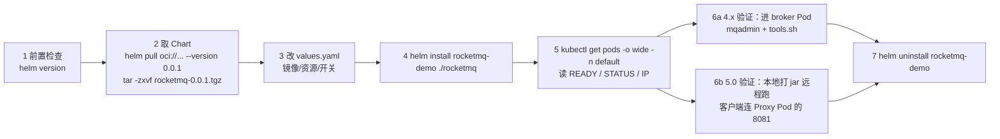
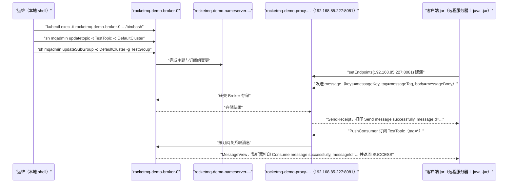

## 为什么需要 Kubernetes 与 Helm 部署？（痛点引入）

容器化跑通之后，下一个真实问题立刻会出现：**这套容器谁来管？**

用 `docker run` 或 Compose 在单机上演示没问题，但只要落到「一个能连的 K8s 集群」上，你要面对的就是 Pod 编排、副本数、资源请求与上限、镜像版本、以及「怎么把它干净地删掉」。上游给出的答案是一个官方 RocketMQ Helm Chart：用一条 `helm install` 把 NameServer、Broker、（5.0 的）Proxy 一起装出来，用一条 `helm uninstall` 一起收回。

新手在这条路上最常卡住的点，几乎都能在文档里找到对应线索：

- 不知道 Chart 从哪来：上游不是从代码仓库 `git clone`，而是 `helm pull oci://registry-1.docker.io/apache/rocketmq --version 0.0.1` 再 `tar -zxvf` 解压。
- 拿到 Chart 就直接 `helm install`，结果在 4.x 场景里把不该起的服务起了——上游对 4.x 的要求明确写了「同时禁用 proxy、controller 功能」，还要「修改镜像 tag 为 4.9.6」。
- 只看 `helm install` 没报错就以为部署完成，实际上 `kubectl get pods` 里 READY 还是 `0/1`（上游 4.x 示例输出的两行 Pod 就都是 `0/1`）。
- 验证收发时把接入点填成 `localhost:8081`：在 K8s 里客户端不在同一个网络命名空间，上游给的是 Proxy Pod 的地址（示例 `192.168.85.227:8081`），并明确解释「由于本地网络和 k8s 网络不属于同一内网，需要将项目本地打包后放在远程运行」。
- 5.0 只建了 Topic 就开始消费，忘了上游在 K8s 这一篇里额外给了一条建订阅组的命令：`sh mqadmin updateSubGroup -c DefaultCluster -g TestGroup`。

| 维度 | 只有 `docker run`／Compose | 用 Helm 部署到 K8s |
|------|-----------------------------|---------------------|
| 服务编排 | 自己一条条命令或一份 yml | Chart 模板 + values 参数，一次 `helm install` |
| 资源规格 | 上游容器路线未涉及 | `values.yaml` 里的 `resources.limits/requests`（上游示例 cpu 2、memory 10Gi） |
| 版本控制 | 改镜像 tag | 改 `values.yaml` 里的镜像版本（4.x 路线要求改成 `4.9.6`） |
| 就绪判据 | `docker logs` 里看 `boot success` | `kubectl get pods -o wide -n default` 看 READY／STATUS／RESTARTS |
| 验证收发 | 宿主机客户端连 `localhost:<映射端口>` | 进 Pod 用 `tools.sh`（4.x）或把客户端打到 Proxy Pod 地址（5.0） |
| 清理 | `docker stop` / `docker-compose down` | `helm uninstall rocketmq-demo` |

> ### 💡 新人小结：Helm 和 Chart 到底在帮你做什么？
>
> 把它想象成「在商场里开一家连锁店，商场提供统一物业」：
> - Kubernetes 集群 = 商场物业：谁住哪间、断电了搬到哪间、给你多大电量，都由物业管。
> - Helm = 装修队的标准流程工具：一条命令完成申请、按图纸施工、验收。
> - Chart = 那套图纸（RocketMQ 官方图纸版本 `0.0.1`），你 `helm pull` 回来还得 `tar -zxvf` 拆开才能看。
> - `values.yaml` = 图纸上的「可填选项」：镜像版本、副本数、资源大小（上游示例把 Broker 的 limits/requests 都写成 cpu 2、memory 10Gi）。
> - `helm install rocketmq-demo ./rocketmq` = 按这份图纸在这个 release 名下开店；`helm uninstall rocketmq-demo` = 整店退租，物业把资源收回。
>
> **Helm 的价值不是少打几条命令，而是把「装什么版本、给多少资源、起几个副本、怎么删干净」变成一份可复现的参数文件。**

**学习路线图**（本文按六段推进）

```
前置检查 → 取 Chart → 调 values → helm install → 看 Pod 就绪 → 验证收发 → helm uninstall
helm版本   oci pull+tar  镜像/资源/开关  release 命名   kubectl get pods   4.x tools / 5.0 SDK   释放资源
```

**本文范围**：只负责 K8s 形态下「从零到第一条消息收发成功」——Helm 与 Chart 获取、`values.yaml` 里上游明确要求改的项、安装与就绪判读、两种验证路线、资源释放。集群拓扑与高可用容灾（多副本、异步复制、DLedger、Controller）见 `06-operations/集群与容灾/部署模式与高可用容灾.md`；参数默认值与取值范围见 `07-configuration/参数与日志配置/客户端与服务端参数配置.md` 与 `01-overview/版本演进与限制/使用限制与参数约束.md`；单机容器路线（镜像 tag、端口映射、`brokerIP1`、Compose 三服务模板）见 `03-quickstart/容器与云原生部署/Docker与Compose部署.md`。

---

## 先把术语对齐（术语表）

| 术语 | 全称 | 含义（用自己的话） | 在本文中的角色 |
|------|------|--------------------|----------------|
| Kubernetes | 容器编排系统（文中简称 K8s） | 管理一批机器上容器运行位置与生命周期的平台；上游要求「一个运行中的 Kubernetes 集群」 | 本文的部署目标环境 |
| Pod | 集群里可调度的最小运行单元 | 上游示例里 NameServer、Broker、Proxy 各自表现为一个 Pod | 你看状态、进容器执行命令的对象 |
| Helm | K8s 的包管理器 | 把一组资源清单模板化、命名成一个 release 来安装与卸载 | 本文的安装与清理工具 |
| Chart | Helm 的软件包（模板 + 默认参数） | 上游用 `helm pull` 拉取并 `tar` 解压出来的那套模板目录 `./rocketmq` | 本文部署 RocketMQ 用的图纸 |
| Release | 一次 Chart 安装实例的名字 | 上游示例名 `rocketmq-demo`，Pod 名都带这个前缀 | `helm install`／`helm uninstall` 的操作对象 |
| `values.yaml` | Chart 的参数文件 | 用户可改的配置项集合：镜像版本、资源大小、副本数、开关 | 上游要求动手改的就是它 |
| OCI | Open Container Initiative（此处指 OCI 制品仓库地址） | Chart 也能像镜像一样从 OCI 仓库拉取，上游地址写作 `oci://registry-1.docker.io/apache/rocketmq` | Chart 的获取来源 |
| `helm pull ... --version 0.0.1` | 下载指定版本的 Chart 包 | 上游给的 Chart 版本就是 `0.0.1`，包名 `rocketmq-0.0.1.tgz` | 第二步的第一条命令 |
| `tar -zxvf` | 解压 gzip 压缩包 | 把 `.tgz` 解开成可安装的 Chart 目录 | 第二步的第二条命令 |
| `helm install rocketmq-demo ./rocketmq` | 用本地 Chart 目录安装一个 release | 名字 `rocketmq-demo`、路径 `./rocketmq` 都是上游原文 | 第四步的部署命令 |
| `helm uninstall` | 卸载 release | 上游原话「释放所有 RocketMQ 资源」 | 收尾动作 |
| `kubectl` | K8s 命令行工具 | 看 Pod（`get pods -o wide -n default`）、进 Pod（`exec -ti ... -- /bin/bash`） | 就绪判读与验证入口 |
| `-n default` / `-n` | namespace 参数 | `get pods` 里指「看哪个命名空间」，上游用 `default` | 照抄上游命令 |
| READY | Pod 内容器的就绪计数 | 形如 `0/1` 或 `1/1`：就绪容器数/总容器数 | 判读部署是否可用的第一列 |
| STATUS | Pod 运行阶段 | 上游示例值均为 `Running` | 与 READY 合起来看 |
| RESTARTS | 容器重启计数 | 上游 5.0 示例里 proxy 的值是 `3 (6h2m ago)` | 本文只如实呈现，上游未解释原因 |
| `-o wide` | 加宽输出，带上 Pod IP 与所在节点 | 5.0 路线要从这里读 Proxy 的 IP 来填接入点 | 关键：接入点地址来自这里 |
| NameServer | 路由注册与问路组件 | Pod 名形如 `rocketmq-demo-nameserver-<随机后缀>` | 上游示例里的第一个组件 |
| Broker | 消息存储与投递服务端 | Pod 名 `rocketmq-demo-broker-0`（带序号） | 建 Topic／Group、跑 tools 验证都在这里 |
| Proxy | 新客户端接入层（5.0） | Pod 名 `rocketmq-demo-proxy-<随机后缀>`；上游要求客户端填它的地址和端口 | 5.0 验证链路的入口 |
| `proxy`／`controller` 功能 | Chart 里的两组可选组件 | 上游对 4.x 的明确要求是「同时禁用 proxy、controller 功能」；Controller 相关细节归 06-operations | 4.x 与 5.0 的 Chart 用法差异点 |
| `resources.limits` / `resources.requests` | 容器资源上限与请求量 | 上游示例：`cpu: 2`、`memory: 10Gi`（limits 与 requests 同值） | `values.yaml` 里唯一被上游贴出来的片段 |
| `mqadmin` | RocketMQ 管理命令行工具 | 上游用它建 Topic（`updatetopic`）与建订阅组（`updateSubGroup`） | 验证前置步骤 |
| `DefaultCluster` | 集群名参数值 | `mqadmin` 的 `-c` 参数取值，上游示例统一用这个字符串 | 建 Topic/Group 必带 |
| `tools.sh` | 发行包内置示例程序脚本 | 上游 4.x K8s 篇用它跑 Producer/Consumer 并给出完整输出 | 4.x 验证路线 |
| `rocketmq-client-java` | 5.0 新客户端 Java 构件 | 上游 K8s 篇给的版本是 `5.0.7` | 5.0 验证路线的依赖 |
| endpoint | 客户端接入点 | 上游示例值 `192.168.85.227:8081`，即 Proxy Pod 的 IP 加 8081 | 5.0 验证的关键填值 |
| gRPC 端口 | 新客户端使用的协议端口 | 上游 5.0 篇原文：部署时需要「将 grpc 端口暴露出来」，本地测试可用 NodePort 或 LoadBalance | 解释为什么要关注 Proxy 的端口 |
| NodePort / LoadBalance | K8s 对外暴露服务的两种方式 | 上游在本篇提到的两个概念名称，未展开细节 | 见本文最后的范围说明 |
| `java -jar` | 用 Java 直接运行打好的 jar 包 | 上游要求项目本地打包后放在远程运行，取 `target` 目录下的 jar 包拷到目标服务器上执行 `java -jar jar包名称` | 5.0 验证路线的执行方式 |
| Maven `target/` | 构建产物目录 | 上游指出从这里取 jar 包 | 5.0 验证的中间步骤 |
| JDK | Java Development Kit | 上游系统要求 64 位 `JDK 1.8+` | 前提之一 |

---

## 部署链路总览

下图是本文的完整链路，箭头表示先后依赖；虚线分支是 4.x 与 5.0 在「验证收发」这一步分岔。



读图三条要点：

1. **第 5 步是承上启下的闸门**：4.x 路线要在 Pod 里跑 `tools.sh`（必须先能进 Pod），5.0 路线要从这里读 Proxy Pod 的 IP 来填客户端接入点。
2. **两条验证路对「客户端在哪」的假设完全不同**：4.x 是在 Pod 内部执行；5.0 是本地打 jar 后放到远程执行，因为上游判定本地网络与 K8s 网络不属同一内网。
3. **收尾只有一条命令**：无论哪条验证路，释放动作都是 `helm uninstall rocketmq-demo`。

> ### 💡 新人小结：为什么第 5 步要看三列而不是只看 STATUS？
>
> 想象你在验房：
> - `STATUS=Running` 只说明「灯是亮的」；
> - `READY=1/1` 才说明「房间真的可以住人」（就绪检查过了）；
> - `RESTARTS=3 (6h2m ago)` 说明「这盏灯在六小时前灭过三次」，哪怕现在是亮的也值得看一眼；
> - `-o wide` 带出的 `IP` 和 `NODE` 才是「门牌号在哪条街」——5.0 的客户端接入点用的就是这个 IP。
>
> **上游给的成功判据不是「命令没报错」，而是「Pod 列表里这几列长得符合预期」。**

---

## 第一步：前置检查与安装 Helm

上游系统要求三条（4.x 与 5.0 两篇完全一致）：

- 一个运行中的 `Kubernetes` 集群；
- 已安装的 `Helm 3.7.0+`；
- 64 位 `JDK 1.8+`。

先确认本机已有 Helm：

```bash
$ helm version
# 输出: 上游未给出该命令的输出样例；本步的作用是确认已安装的 Helm 在 3.7.0 以上
```

如果未安装（上游给的官方脚本安装方式）：

```bash
$ curl https://raw.githubusercontent.com/helm/helm/main/scripts/get-helm-3 | bash
```

| 项 | 上游要求／写法 | 注意 |
|----|----------------|------|
| Helm 版本 | `3.7.0+` | 两篇都写这一条 |
| 安装命令 | 上游用 `curl` 取官方安装脚本 `get-helm-3` 后交给 `bash` 执行（完整写法见上方代码块） | 管道执行远程脚本，请自行确认脚本来源 |
| JDK | 64 位 `JDK 1.8+` | 客户端侧打包 jar 需要 Java 环境 |

---

## 第二步：下载 RocketMQ Helm Chart

4.x 与 5.0 两篇在这一步**逐字相同**（Chart 版本都是 `0.0.1`）：

```bash
$ helm pull oci://registry-1.docker.io/apache/rocketmq --version 0.0.1 
$ tar -zxvf rocketmq-0.0.1.tgz

# 输出: 上游未给出下载与解压的日志样例；完成后当前目录出现名为 rocketmq 的 Chart 目录，
#       下一步 helm install 用的就是它（./rocketmq）
```

> [!TIP] Chart 版本与 RocketMQ 版本不是一回事
> 上游这条命令里的 `--version 0.0.1` 是 **Helm Chart 的版本**；你最终跑起来的是哪个 RocketMQ，由 `values.yaml` 里的镜像版本决定（4.x 路线上游明确要求「修改镜像 tag 为 4.9.6」）。两个版本号来自两套体系，别把它们对齐理解。

参数解释：

| 片段 | 含义 | 本文取值 |
|------|------|----------|
| `oci://registry-1.docker.io/apache/rocketmq` | Chart 的 OCI 仓库地址 | 上游原文 |
| `--version 0.0.1` | 指定要下载的 Chart 版本 | `0.0.1` |
| `rocketmq-0.0.1.tgz` | 下载得到的包文件名 | 与上一条的 `--version` 对应 |
| `tar -zxvf` | 解压（gzip + 详细输出 + 归档文件） | 解出的目录名即后面要用的 `./rocketmq` |

---

## 第三步：修改 values.yaml（两版要求不同）

4.x 的要求（上游原文括注）：「根据实际需求修改相关配置信息，如镜像版本，资源大小、副本数等，同时禁用 proxy、controller 功能」，并且「将 broker 中的 resources 的 limits、requests 等参数修改调整成适宜大小，修改镜像 tag 为 4.9.6」。上游贴出的片段：

```yaml
$ vim values.yaml
##values.yaml, 根据实际需求修改相关配置信息，如镜像版本，资源大小、副本数等，同时禁用proxy、controller功能##
  resources:
    limits:
      cpu: 2
      memory: 10Gi
    requests:
      cpu: 2
      memory: 10Gi
##values.yaml##
```

5.0 的要求（上游原文括注）：「例如根据机器可用内存大小将 broker 中 resources 中 requests 和 limits 的 memory 进行调整」，贴出的片段与 4.x 同值：

```yaml
$ vim values.yaml
##values.yaml, 例如根据机器可用内存大小将broker中resources中requests和limits的memory进行调整##
  resources:
    limits:
      cpu: 2
      memory: 10Gi
    requests:
      cpu: 2
      memory: 10Gi
##values.yaml##
```

| 对比维度 | 4.x 路线的 values 要求 | 5.0 路线的 values 要求 |
|----------|------------------------|------------------------|
| 上游明确点名的项 | 镜像版本、资源大小、副本数 | 资源中的 memory（按机器可用内存调整） |
| 是否需要关掉组件 | **需要**：上游要求「禁用 proxy、controller 功能」 | 未提禁用；5.0 部署起来的 Pod 里就有 proxy |
| 镜像 tag 示例 | 上游直接写「修改镜像 tag 为 4.9.6」 | 上游未指定 tag 取值 |
| `resources` 示例值 | `limits.cpu: 2`、`limits.memory: 10Gi`、`requests.cpu: 2`、`requests.memory: 10Gi` | 同左（四行完全相同） |
| 修改方式 | `vim values.yaml` | 同左 |

参数解释：

| 字段 | 含义 | 本文取值依据 |
|------|------|--------------|
| `resources.limits.cpu` | 容器可用的 CPU 上限 | 上游示例 `2` |
| `resources.limits.memory` | 容器内存上限 | 上游示例 `10Gi`；5.0 篇特别提示按机器可用内存调整 |
| `resources.requests.cpu` | 调度时向集群申请的 CPU | 上游示例 `2`，与 limits 同值 |
| `resources.requests.memory` | 调度时申请的内存 | 上游示例 `10Gi`，与 limits 同值 |

```bash
# ========== ✅ 推荐：改 values 之后再安装，两版各自的上游要求都满足 ==========
$ vim values.yaml                 # 4.x：改镜像版本/资源/副本数，并禁用 proxy、controller 功能（tag 示例 4.9.6）
$ helm install rocketmq-demo ./rocketmq

# ========== 不推荐写法（仅展示） ==========
# ❌ 解压完 Chart 就直接 helm install：4.x 路线上游明确要求先禁用 proxy、controller，并把镜像 tag 改成 4.9.6
# ❌ 照抄示例的 memory: 10Gi 不做调整：5.0 路线上游专门提示要根据机器可用内存调整 broker 的 memory
```

> [!WARNING] 这段片段是不完整的 values 结构
> 上游贴出的只是 `resources` 这一小段（缩进表明它在 Chart 的某个服务节点下）。本文不补写其它字段，也不猜测完整层级：改动前先在你的 `values.yaml` 里定位到 broker 对应的 `resources` 段，再按上表示例值调整。

> ### 💡 新人小结：limits 和 requests 有什么区别？
>
> 像公司给员工的报销额度：
> - `requests` = 「入职时承诺给你的额度」，集群按这个数决定把你安排到哪台机器（有足够余量才排得下）。
> - `limits` = 「最多只能用到这么多」，超了就碰壁；上游示例把两者写成同一个值（cpu 2、memory 10Gi），相当于「承诺即上限」。
> - RocketMQ 的 Broker 是重内存组件，所以上游在 5.0 篇专门提示：memory 要按机器可用内存调整。
>
> **对快速开始来说，你要记住的只有一件事：这两个值都必须在你的机器上真的能分出来，否则 Pod 会卡在待调度状态。**

---

## 第四步：安装并判读 Pod 状态

安装命令（4.x 与 5.0 完全一致）：

```bash
$ helm install rocketmq-demo ./rocketmq
```

看状态：

```bash
$ kubectl get pods -o wide -n default
```

4.x 上游给出的输出（照抄，含注释行）：

```
#查看pod状态
#若参数正常，则表明部署成功
NAMESPACE     NAME                                        READY   STATUS    RESTARTS   AGE   IP                NODE         NOMINATED NODE   READINESS GATES
default       rocketmq-demo-broker-0                      0/1     Running   0          19s   192.168.58.228    k8s-node02   <none>           <none>
default       rocketmq-demo-nameserver-6678bb86f6-62s5d   0/1     Running   0          19s   192.168.85.229    k8s-node01   <none>           <none>
```

5.0 上游给出的输出（照抄；注意这一版的表头没有 `NAMESPACE` 列）：

```
NAME                                        READY   STATUS    RESTARTS       AGE    IP               NODE         NOMINATED NODE   READINESS GATES
rocketmq-demo-broker-0                      1/1     Running   0              6h3m   192.168.58.225   k8s-node02   <none>           <none>
rocketmq-demo-nameserver-757877747b-k669k   1/1     Running   0              6h3m   192.168.58.226   k8s-node02   <none>           <none>
rocketmq-demo-proxy-6c569bd457-wcg6g        1/1     Running   3 (6h2m ago)   6h3m   192.168.85.227   k8s-node01   <none>           <none>
```

两版输出的逐项对照：

| 观察项 | 4.x 示例 | 5.0 示例 | 怎么读 |
|--------|----------|----------|--------|
| Pod 数量 | 2 个：broker、nameserver | 3 个：broker、nameserver、**proxy** | 5.0 多出的 proxy Pod 就是新客户端的接入点 |
| Pod 命名 | `rocketmq-demo-broker-0`、`rocketmq-demo-nameserver-6678bb86f6-62s5d` | `rocketmq-demo-broker-0`、`...nameserver-757877747b-k669k`、`...proxy-6c569bd457-wcg6g` | 都带 `rocketmq-demo` 前缀，即 release 名；broker 的名字带序号 `-0` |
| READY | 两行都是 `0/1` | 三行都是 `1/1` | 就绪容器数/总数 |
| STATUS | `Running` | `Running` | 与 READY 分开看 |
| RESTARTS | `0` | broker／nameserver 为 `0`，proxy 为 `3 (6h2m ago)` | 上游未解释这 3 次重启的原因，本文不做推断 |
| AGE | `19s`（刚装完） | `6h3m`（示例是运行了一段时间后截的） | 只是示例时间点不同 |
| IP | broker `192.168.58.228`、nameserver `192.168.85.229` | broker `192.168.58.225`、nameserver `192.168.58.226`、proxy `192.168.85.227` | 5.0 路线要用 proxy 的 IP 填接入点 |
| NODE | `k8s-node02`／`k8s-node01` | 前两行 `k8s-node02`，proxy 在 `k8s-node01` | 说明三个 Pod 不保证在同一节点上 |

> [!NOTE] 版本适用：5.0 部署后多出一个 Proxy Pod，4.x 要求禁用 proxy 与 controller
> 4.x 篇在 `values.yaml` 一步就要求「禁用 proxy、controller 功能」，Pod 列表里也确实只有 broker 与 nameserver；5.0 篇的 Pod 列表里有 `rocketmq-demo-proxy-6c569bd457-wcg6g`。
> 因此：5.0 的客户端接入点是 **Proxy Pod 的地址 + 8081**（上游示例 `192.168.85.227:8081`）；4.x 没有 Proxy，验证路线直接进 Broker Pod 跑 `tools.sh`。
> 关于 4.x 示例输出里 READY 为 `0/1` 而 5.0 为 `1/1`，上游两篇都只写了同一句判据「若参数正常，则表明部署成功」，没有解释这个差异；本文如实呈现，不推断原因。

---

## 第五步（路线 A）：4.x 用 tools 工具验证消息收发

上游原话：「使用 tools 工具测试验证消息发送和接收。」

### 1）进入 Broker Pod

```bash
#登录pod内（需要管理工具），也可以在宿主机执行
$ kubectl exec -ti rocketmq-demo-broker-0  -- /bin/bash
```

`-ti` 是交互式终端（上游写法如此，两个字母合在一个参数里）；`-- /bin/bash` 指定进去后跑的 shell。上游还补了一句「也可以在宿主机执行」，前提是宿主机上有对应的管理工具。

### 2）创建 Topic

```bash
#通过mqadmin创建 Topic
$ sh mqadmin updatetopic -t TopicTest -c DefaultCluster
# 输出: 上游未给出该命令的成功输出样例
```

参数解释：`-t TopicTest` 是要创建的主题名（注意 4.x 这篇用的是 `TopicTest`，5.0 两篇用的是 `TestTopic`）；`-c DefaultCluster` 是集群名。

### 3）发送消息（Pod 内操作，上游给出的完整输出照抄）

```bash
$ sh tools.sh org.apache.rocketmq.example.quickstart.Producer
SendResult [sendStatus=SEND_OK, msgId=7F00000100E60F6F4D334B52982103E7, offsetMsgId=C0A83AE400002A9F000000000002ECD2, messageQueue=MessageQueue [topic=TopicTest, brokerName=rocketmq-demo-broker-0, queueId=2], queueOffset=124]
```

### 4）接收消息（Pod 内操作，上游给出的完整输出照抄）

```bash
$ sh tools.sh org.apache.rocketmq.example.quickstart.Consumer
ConsumeMessageThread_please_rename_unique_group_name_4_16 Receive New Messages: [MessageExt [brokerName=rocketmq-demo-broker-0, queueId=2, storeSize=192, queueOffset=124, sysFlag=0, bornTimestamp=1723734104097, bornHost=/192.168.58.228:40492, storeTimestamp=1723734104097, storeHost=/192.168.58.228:10911, msgId=C0A83AE400002A9F000000000002ECD2, commitLogOffset=191698, bodyCRC=638172955, reconsumeTimes=0, preparedTransactionOffset=0, toString()=Message{topic='TopicTest', flag=0, properties={MIN_OFFSET=0, MAX_OFFSET=125, CONSUME_START_TIME=1723734158990, UNIQ_KEY=7F00000100E60F6F4D334B52982103E7, CLUSTER=DefaultCluster, TAGS=TagA}, body=[72, 101, 108, 108, 111, 32, 82, 111, 99, 107, 101, 116, 77, 81, 32, 57, 57, 57], transactionId='null'}]]
```

这两段是上游唯一给出**完整未截断输出**的收发样例（本地部署与 Docker 篇的同类输出都以省略号结尾）。从这两段能直接读出的事实：

| 输出字段 | 值 | 能确认的事实 |
|----------|-----|--------------|
| `sendStatus` | `SEND_OK` | 发送侧的成功判据 |
| `messageQueue=... topic=TopicTest` | 与第 2 步创建的 Topic 同名 | 上一步 `mqadmin updatetopic` 建的就是这条消息进的队列 |
| `brokerName` | `rocketmq-demo-broker-0` | 与 `kubectl get pods` 里的 broker Pod 名一致 |
| `queueId=2` | 队列编号 | 收发两侧一致，说明消费的就是发送落进去的那个队列 |
| `queueOffset=124` | 队列内位点 | 发送与接收两段输出里是同一个值 |
| `storeHost=/192.168.58.228:10911` | 存储地址 | IP 与 4.x Pod 列表里 broker 的 IP 一致，端口是 Broker 的 10911 |
| `properties={... TAGS=TagA ...}` | 消息标签 | 与示例消息的 Tag 一致；`CLUSTER=DefaultCluster` 对应 `-c` 参数 |
| `reconsumeTimes=0` | 重新消费次数 | 示例里这条消息没有被重复消费 |
| `body=[72, 101, ...]` | 字节数组形式的消息负载 | 本文按 ASCII 解码得到 18 个字符的 `Hello RocketMQ 999`；这是本文对示例输出做的解码，不作为上游断言 |
| `MIN_OFFSET=0`、`MAX_OFFSET=125` | 队列头尾位点边界 | 与 `queueOffset=124` 同轴，可看出这条消息在队列中的位置 |

> [!TIP] 想快速判断「收发链路是不是通的」
> 只看三处就够：发送侧 `sendStatus=SEND_OK`；接收侧出现 `Receive New Messages`；两侧的 `topic`／`brokerName`／`queueId`／`queueOffset` 能对上。四个字段一一对应，说明这条消息确实是从这台 Broker 的这一个队列里被消费出来的。

> ### 💡 新人小结：为什么这条验证要在 Pod 里面跑？
>
> 类比「先在工厂内部试机，再从门店下单」：
> - `kubectl exec` 进 Broker Pod 里跑 `tools.sh`，等于**在工厂内部拿货**——不依赖外部网络入口，最不容易被网络问题干扰。
> - 这一步成功，只证明「服务端本身可用、Topic 建对了」。
> - 它**不**证明「外部客户端能不能连上」——所以 5.0 路线干脆跳过 Pod 内 tools，直接让外部客户端走 Proxy，专门验证这条对外链路。
>
> **两条验证路线不是在比优劣，而是在验证不同的边界：一个验内部可用性，一个验对外可达性。**

---

## 第六步（路线 B）：5.0 用 Java SDK 验证消息收发

上游这一步的前提说明要照抄：**「使用 JAVA SDK 测试消息收发（由于本地网络和 k8s 网络不属于同一内网，需要将项目本地打包后放在远程运行，打包后将 target 目录下的 jar 包拷贝至至目标服务器上执行 `java -jar jar包名称`）」**。

同篇还补充了端口层面的原因：**「由于使用 k8s 部署，故需要在部署时将 grpc 端口暴露出来，可根据 grpc 端口做成 NodePort 或者 LoadBalance 方便本地测试的服务，部署完成后根据前面 java 收发消息测试完成数据交互。」**（其中「java 收发消息测试」指 `03-quickstart/单机部署/本地二进制部署与消息收发.md` 第五步的 SDK 示例）

### 1）建工程与加依赖

```xml
 <dependency>
        <groupId>org.apache.rocketmq</groupId>
        <artifactId>rocketmq-client-java</artifactId>
        <version>5.0.7</version>
  </dependency>
```

与本地部署篇用 `${rocketmq-client-java-version}` 占位不同，K8s 这一篇上游直接写了 `5.0.7`——本文如实区分，两处不混用。

### 2）用 mqadmin 创建 Topic 与消费者分组

```bash
# ========== ✅ 推荐：Topic 与订阅组都建，名字与代码里的变量一字不差 ==========
# 登录 pod 内
$ kubectl exec -ti rocketmq-demo-broker-0  -- /bin/bash

# 通过 mqadmin 创建 Topic
$ sh mqadmin updatetopic  -t TestTopic -c DefaultCluster

# 通过 mqadmin 创建订阅组
$ sh mqadmin updateSubGroup -c DefaultCluster -g TestGroup
# 输出: 上游未给出这两条命令的成功输出样例

# ========== 不推荐写法（仅展示） ==========
# ❌ 只建 Topic 不建订阅组就跑消费示例：上游这一步的标题就是「使用 mqadmin 工具创建 Topic 和消费者」，
#    且消费端注释写明「Group 需要提前创建」
# ❌ 代码里写 YourConsumerGroup、命令里建 TestGroup：两边名字必须一致，示例统一用 TestGroup
```

| 命令 | 参数 | 含义 | 与 4.x 路线的差异 |
|------|------|------|-------------------|
| `mqadmin updatetopic` | `-t TestTopic`、`-c DefaultCluster` | 创建主题，必须与代码里的 `topic` 一致 | 4.x 用 `TopicTest`，5.0 用 `TestTopic` |
| `mqadmin updateSubGroup` | `-c DefaultCluster`、`-g TestGroup` | 创建订阅组（消费者分组），必须与代码里的 `consumerGroup` 一致 | **5.0 路线独有的一步**；上游原话是「使用 mqadmin 工具创建 Topic 和消费者」 |

### 3）发送端（照抄上游 `ProducerDemo.java`）

```java
package com.rocketmq.producer;

import org.apache.rocketmq.client.apis.ClientConfiguration;
import org.apache.rocketmq.client.apis.ClientConfigurationBuilder;
import org.apache.rocketmq.client.apis.ClientException;
import org.apache.rocketmq.client.apis.ClientServiceProvider;
import org.apache.rocketmq.client.apis.message.Message;
import org.apache.rocketmq.client.apis.producer.Producer;
import org.apache.rocketmq.client.apis.producer.SendReceipt;


public class ProducerDemo {
    public static void main(String[] args) throws ClientException {
        // 接入点地址，需要设置成Proxy的地址和端口列表，以下为k8s环境下rocketmq的proxy地址。
        String endpoint = "192.168.85.227:8081"; // 与 kubectl get pods 里 rocketmq-demo-proxy Pod 的 IP 一致
        // 消息发送的目标Topic名称，需要提前创建。
        String topic = "TestTopic"; // 与上一步 mqadmin updatetopic -t 一致
        ClientServiceProvider provider = ClientServiceProvider.loadService();
        ClientConfigurationBuilder builder = ClientConfiguration.newBuilder().setEndpoints(endpoint);
        ClientConfiguration configuration = builder.build();
        // 初始化Producer时需要设置通信配置以及预绑定的Topic。
        Producer producer = provider.newProducerBuilder()
                .setTopics(topic)
                .setClientConfiguration(configuration)
                .build();
        // 普通消息发送。
        Message message = provider.newMessageBuilder()
                .setTopic(topic)
                // 设置消息索引键，可根据关键字精确查找某条消息。
                .setKeys("messageKey")
                // 设置消息Tag，用于消费端根据指定Tag过滤消息。
                .setTag("messageTag")
                // 消息体。
                .setBody("messageBody".getBytes())
                .build();
        try {
            // 发送消息，需要关注发送结果，并捕获失败等异常。
            SendReceipt sendReceipt = producer.send(message);
            System.out.println("Send message successfully, messageId="+sendReceipt.getMessageId());
            // 输出: Send message successfully, messageId=<消息 ID>
        } catch (ClientException e) {
            // 上游示例此处为空实现，仅保留捕获结构
        }
        // producer.close();
    }
}
```

### 4）消费端（照抄上游 `Consumer.java`；上游写明「Apache RocketMQ 支持 SimpleConsumer 和 PushConsumer 两种消费者类型，这里使用 PushConsumers 类型」，其中类名拼写为上游原文）

```java

package com.rocketmq.consumer;

import java.io.IOException;
import java.util.Collections;
import org.apache.rocketmq.client.apis.ClientConfiguration;
import org.apache.rocketmq.client.apis.ClientException;
import org.apache.rocketmq.client.apis.ClientServiceProvider;
import org.apache.rocketmq.client.apis.consumer.ConsumeResult;
import org.apache.rocketmq.client.apis.consumer.FilterExpression;
import org.apache.rocketmq.client.apis.consumer.FilterExpressionType;
import org.apache.rocketmq.client.apis.consumer.PushConsumer;

import java.util.List;

public class Consumer {
    public static void main(String[] args) throws ClientException, IOException, InterruptedException {
        final ClientServiceProvider provider = ClientServiceProvider.loadService();
        // 接入点地址，需要设置成Proxy的地址和端口列表，以下为k8s环境下rocketmq的proxy地址。
        String endpoints = "192.168.85.227:8081"; // 发送端与消费端填的是同一个 Proxy 地址
        ClientConfiguration clientConfiguration = ClientConfiguration.newBuilder()
                .setEndpoints(endpoints)
                .build();
        // 订阅消息的过滤规则，表示订阅所有Tag的消息。
        String tag = "*";
        FilterExpression filterExpression = new FilterExpression(tag, FilterExpressionType.TAG);
        // 为消费者指定所属的消费者分组，Group需要提前创建。
        String consumerGroup = "TestGroup"; // 与 mqadmin updateSubGroup -g 的取值一致
        // 指定需要订阅哪个目标Topic，Topic需要提前创建。
        String topic = "TestTopic";
        // 初始化PushConsumer，需要绑定消费者分组ConsumerGroup、通信参数以及订阅关系。
        PushConsumer pushConsumer = provider.newPushConsumerBuilder()
                .setClientConfiguration(clientConfiguration)
                // 设置消费者分组。
                .setConsumerGroup(consumerGroup)
                // 设置预绑定的订阅关系。
                .setSubscriptionExpressions(Collections.singletonMap(topic, filterExpression))
                // 设置消费监听器。
                .setMessageListener(messageView -> {
                    // 处理消息并返回消费结果。
                    System.out.println("Consume message successfully, messageId="+ messageView.getMessageId());
                    // 输出: Consume message successfully, messageId=<消息 ID>
                    return ConsumeResult.SUCCESS;
                })
                .build();
        Thread.sleep(Long.MAX_VALUE);
        // 如果不需要再使用 PushConsumer，可关闭该实例。
        // pushConsumer.close();
    }
}
```

参数解释（只列 K8s 场景下与本文取值相关的）：

| 代码项 | 本文取值 | 依据 |
|--------|----------|------|
| `endpoint` / `endpoints` | `192.168.85.227:8081` | 上游注释「以下为 k8s 环境下 rocketmq 的 proxy 地址」；该 IP 与 5.0 Pod 列表里 proxy 行一致 |
| `topic` | `TestTopic` | 与 `mqadmin updatetopic -t TestTopic` 一致 |
| `consumerGroup` | `TestGroup` | 与 `mqadmin updateSubGroup -g TestGroup` 一致 |
| `FilterExpression(tag, FilterExpressionType.TAG)` 且 `tag = "*"` | 订阅所有 Tag | 上游注释原话 |
| `System.out.println(...)` | 这一篇上游用标准输出打印，不像本地篇用 SLF4J 的 `logger.info` | 照抄上游差异 |
| `package com.rocketmq.producer` / `com.rocketmq.consumer` | 上游给的两个类分别所在包名 | 照抄，打包时保持目录一致 |

下图是 5.0 路线在 K8s 上的完整收发验证链路（发送端与消费端各自打到同一个 Proxy 地址）。



图后解读：客户端从头到尾只认识一个地址（Proxy 的 `IP:8081`），Broker 与 NameServer 的位置由集群内部决定；这正是 5.0 与 4.x 验证路线最根本的区别——4.x 那条路你是在 Broker Pod 里操作，5.0 这条路你是在集群外面打一个 jar 进来。

---

## 旧写法与新写法：同一个「K8s 上验证收发」的两套做法

| 对比维度 | 旧写法（4.x K8s 路线） | 新写法（5.0 K8s 路线） |
|----------|------------------------|------------------------|
| Chart 与 values | `helm pull ... --version 0.0.1`；values 里要改镜像版本、资源、副本数，并**禁用 proxy、controller** | 同一 Chart 版本；values 里上游只举例调整 broker 的 memory |
| 部署后 Pod 形态 | broker + nameserver 两个 Pod | broker + nameserver + **proxy** 三个 Pod |
| 验证执行位置 | Pod 内（`kubectl exec` 进 broker 后跑 `tools.sh`），上游注明「也可以在宿主机执行（需要管理工具）」 | 集群外：本地打包后把 `target` 目录下的 jar 拷到远程执行 `java -jar jar包名称` |
| 需要创建的资源 | Topic（`updatetopic -t TopicTest -c DefaultCluster`） | Topic（`TestTopic`）**加**订阅组（`updateSubGroup -g TestGroup`） |
| 依赖与版本 | 无需 Java 工程（示例内置） | `rocketmq-client-java` 且上游写定 `5.0.7` |
| 客户端地址 | 不适用（示例在 Pod 内） | Proxy 地址和端口：`192.168.85.227:8081` |
| 需要额外暴露的端口 | 上游未提 | 上游要求在部署时把 grpc 端口暴露出来，可用 NodePort 或 LoadBalance |
| 成功判据 | `SendResult [sendStatus=SEND_OK, ...]` 与 `Receive New Messages`（完整字段见上文） | `Send message successfully, messageId=...` 与 `Consume message successfully, messageId=...` |
| 网络前提 | 在 Pod 内部，不受本地网络与集群网络差异影响 | 上游判定「本地网络和 k8s 网络不属于同一内网」，因此要求把 jar 放到远程跑 |
| 旧写法仍适用场景 | 只想在集群内快速确认 Broker 活着、或沿用 4.x Chart 关掉了 Proxy 的部署 | 新项目、需要验证外部客户端经 Proxy 接入的完整链路 |

> [!WARNING] 两处「照抄上游」带来的可读性风险
> 上游代码里有一处示例值需要你换成自己的：消费者分组名 `TestGroup`、Proxy 地址 `192.168.85.227:8081`。集群重建后 Pod IP 一定变（上游自己给的两版示例里 Proxy/broker 的 IP 就完全不同），不要把示例 IP 写进配置库。
> 另外 4.x 与 5.0 两篇创建的 Topic 名不同（`TopicTest` 与 `TestTopic`），跨版本复用同一份客户端代码时这里是第一个要对齐的地方。

---

## 第七步：释放 RocketMQ 资源

两篇文档的收尾命令逐字相同（上游注释也一致）：

```bash
# ========== ✅ 推荐：用安装时的那个 release 名来卸载 ==========
#释放所有 RocketMQ 资源
$ helm uninstall rocketmq-demo

# ========== 不推荐写法（仅展示） ==========
# ❌ 用 helm uninstall 时写成 Chart 目录名 rocketmq：release 名是安装时指定的 rocketmq-demo
# ❌ 把示例里的 Proxy 地址 192.168.85.227:8081 写死进配置库：集群重建后 Pod IP 一定变，
#    要现读 kubectl get pods -o wide -n default 里 proxy 那一行的 IP
```

| 动作 | 命令 | 说明 |
|------|------|------|
| 卸载 release | `helm uninstall rocketmq-demo` | `rocketmq-demo` 就是你 `helm install` 时用的那个 release 名，改过名字要同步 |
| 卸载前建议 | `kubectl get pods -o wide -n default` 确认只剩自己的资源 | 上游未给出卸载后的输出样例，本文不代为描述 |

---

## 判读与排查清单（只依据上游给过的判据）

上游两篇 K8s 文档没有给出任何错误码或异常输出。下表把「本文能确认的判据」列全，避免你靠猜。

| 现象 | 先确认 | 依据 |
|------|--------|------|
| `helm install` 跑完不知道成没成 | `kubectl get pods -o wide -n default`；上游判据原话「若参数正常，则表明部署成功」 | 第四步输出与两版示例逐项对照（READY／STATUS／Pod 数量） |
| 只看到 2 个 Pod，找不到 proxy | 你走的是 4.x 还是 5.0 路线：4.x 要求禁用 proxy／controller，Pod 里就没有 proxy | 第三步 4.x 的 values 要求 |
| Pod 一直是 `0/1` | 上游 4.x 示例本身就是 `0/1`，且未解释；本文不推断原因 | 第四步 4.x 输出 |
| proxy Pod 有重启计数 | 上游 5.0 示例里 `RESTARTS` 为 `3 (6h2m ago)`，上游未说明原因 | 第四步 5.0 输出 |
| 客户端连不上（5.0） | 接入点必须是 Proxy 的地址 + 8081；且本地与集群不同内网时要按上游做法把 jar 放到远程跑 | 上游 5.0 第五步前提说明 |
| 发送失败／主题相关报错（5.0） | 是否执行过 `sh mqadmin updatetopic -t TestTopic -c DefaultCluster` | 上游代码注释「需要提前创建」 |
| 消费不到（5.0） | 是否执行过 `sh mqadmin updateSubGroup -c DefaultCluster -g TestGroup`，且代码里 `consumerGroup` 与 `-g` 一致 | 上游 5.0 第 3）步两条命令 |
| 想核对消息到底落在哪 | 对比收发两段输出里的 `topic`／`brokerName`／`queueId`／`queueOffset` | 第五步字段表 |
| 端口不通（5.0） | 上游要求在部署时把 grpc 端口暴露出来，可用 NodePort 或 LoadBalance | 第六步开头引文 |
| Chart 找不到 / 层级不认识的字段不敢改 | 你的 Chart 是 `helm pull ... --version 0.0.1` 解压出来的那份 `./rocketmq` | 第二步；其余参数含义见 `07-configuration` |

---

## 要点总结

1. **入口只有一个 Chart**：`helm pull oci://registry-1.docker.io/apache/rocketmq --version 0.0.1` 加 `tar -zxvf rocketmq-0.0.1.tgz`，两版上游给的命令逐字相同；Chart 版本 `0.0.1` 不等于 RocketMQ 版本。
2. **`values.yaml` 的要求在两版之间不一样**：4.x 明确要改镜像版本、资源大小、副本数，并且**禁用 proxy、controller**（镜像 tag 示例 `4.9.6`）；5.0 只举例让你按机器可用内存调 broker 的 memory。两版示例的 `resources` 取值都是 cpu 2、memory 10Gi。
3. **部署成功的判据是 Pod 列表，不是 install 返回**：`kubectl get pods -o wide -n default`；4.x 示例是 broker + nameserver 两个 Pod（READY `0/1`），5.0 示例是三个 Pod 且 READY 全 `1/1`，proxy 的 `RESTARTS` 为 `3 (6h2m ago)`。
4. **验证路线按版本分岔**：4.x 走 Pod 内 `mqadmin updatetopic`（`TopicTest`）+ `tools.sh`，上游给了完整收发输出；5.0 走集群外的 Java SDK（`rocketmq-client-java` 5.0.7），要先建 Topic（`TestTopic`）**和**订阅组（`updateSubGroup -g TestGroup`），再把本地打包出的 `target` 目录下 jar 拷到远程用 `java -jar` 跑，接入点填 Proxy 的 `192.168.85.227:8081`。
5. **收尾是一条命令**：`helm uninstall rocketmq-demo`；集群重建后 Proxy 的 Pod IP 必变，接入点不要固化示例值。

---

> ### 💡 新人小结：Kubernetes 与 Helm 部署学完了，记住这 5 点
>
> 1. **图纸和成品是两回事**：Chart 版本 `0.0.1` 是图纸版本，镜像 tag（4.x 要改成 `4.9.6`）才是你真正跑起来的 RocketMQ 版本。
> 2. **5.0 在 K8s 上多一个 Proxy Pod**，客户端从此只认「Proxy 地址:8081」；这一串数字要从 `kubectl get pods -o wide` 现读，不能抄示例。
> 3. **验证方式换了边界**：4.x 在 Pod 内部拿货（`tools.sh`），5.0 在集群外打 jar 进来（因为本地网络与 K8s 网络不同内网）——一个验内部可用，一个验对外可达。
> 4. **5.0 要建两个资源**：Topic 用 `updatetopic`、订阅组用 `updateSubGroup`，代码里的 `TestTopic`／`TestGroup` 必须与命令参数一字不差。
> 5. **退租要干净**：`helm uninstall rocketmq-demo` 是上游给出的唯一释放动作；集群拓扑、持久化与高可用容灾不在这里解决，去 `06-operations/集群与容灾/部署模式与高可用容灾.md`。
