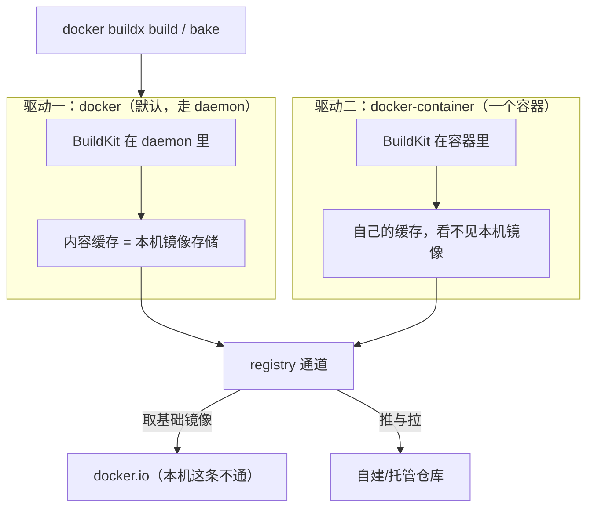

> **实战落点**：示例链第⑤段 · 定标签规范、推镜像仓库、再从仓库拉起来跑。段⑤ 的三条判据（tag/push/pull 三段可复现、删掉本地镜像后 `pull && up` 能起、从镜像反查回 commit）全部在本机跑通，读数与命令在 `示例/贯穿示例/段5-推上仓库/README.md`。
> **示例版本**：链上新增 `示例/贯穿示例/compose.registry.yaml`（只给 api/web 补 `image:`，不动 `compose.yaml`）与 `段5-推上仓库/README.md`；链目录成为本机 git 仓库（annotated tag `v0.5.0`，无远端）。镜像仓库用本机 `registry:2` 容器，**没有推任何远端**。
> **前置依赖**：[/docs/03-镜像构建/养小养快/分层缓存多阶段构建与镜像瘦身/](/docs/03-镜像构建/养小养快/分层缓存多阶段构建与镜像瘦身/)、[/docs/03-镜像构建/写出来/Dockerfile指令全解与构建上下文/](/docs/03-镜像构建/写出来/Dockerfile指令全解与构建上下文/)、[/docs/04-单机编排/定义/Compose语法基线与文件全字段参考/](/docs/04-单机编排/定义/Compose语法基线与文件全字段参考/)、[/docs/07-运维手册/按故障域排错/磁盘占满与镜像拉取失败/](/docs/07-运维手册/按故障域排错/磁盘占满与镜像拉取失败/)
> **本篇产出物**：一张 buildx 两种驱动的能力对照表（含本机那条「取基础镜像不走代理」的边界在哪一侧显形）；一张标签字符集的合法性实测表；一张「报错关键字 → 成因 → 修法」表（与 7.2 症状索引对接）；`3.9~3.12` 每一条结论的可复现命令
> **难度·耗时**：★★★ · 65 分钟（含动手）
> **拓展接口**：3.6 的 cache mount 持久性在本篇被 `--no-cache` 与 `builder prune` 两把钥匙继续限定；6.1 的 CI 用本篇的 bake 与 `${GIT_SHA}` 注入形态；7.3「磁盘占满与镜像拉取失败」共用本篇的 registry 通道判断；6.5 的回滚用本篇 `imagetools create` 那条「只挪标签」的路
> **自测三题**：
> 1. 同一句 `FROM alpine:3.20`，本机 `docker images` 里明明有，为什么换一种 builder 就报连不上 `auth.docker.io`？
> 2. `0.5.0+g4276bfa` 这种 semver 写法为什么不能当镜像标签？它会让整条命令成功还是失败？
> 3. 你要证明「线上跑的就是仓库里那份，不是本机现造的」。除了 `pull` 成功，还必须补哪个旗标，为什么？

## 为什么要先分清「构建这件事由谁在执行」

三个现场，都属于「命令没错，世界不同」：

```text
「我 `docker buildx create --driver docker-container` 之后，同一个 Dockerfile 突然 build 不过了，
 报连不上 auth.docker.io。我本机明明有 alpine。」
「那个 builder 是一个容器，它有自己的一套内容缓存。`FROM` 在你眼前是本机那份，
 在它眼里是 registry 里的一份——取不到就死在这。」
「好，那我推到自己的仓库，它总认了吧？我写 localhost:5000 它报 i/o timeout。」
「容器里的 localhost 是它自己。要么走 host.docker.internal（那还得处理它只讲 HTTPS），
 要么建 builder 时给它 --driver-opt network=host。」
「我把 --set VER=9 传给 bake 想改版本号，它报 invalid override key VER。」
「bake 的 --set 只改 target 的属性，变量得走环境变量。
 而且变量给成空串时 --print 一切正常，真正 build 才告诉你标签非法。」
```

这三段话的共同点是：**「docker build」这四个字下面至少藏着三套执行体**——daemon 内的经典构建器、`docker` 驱动的 BuildKit、`docker-container` 驱动的 BuildKit，它们各自的缓存、网络与对 registry 的信任模型都不同。3.9 就是把这三套的差别量清楚；3.10 处理「镜像交给谁」；3.11 处理「怎么让一个标签能反查到一次提交」；3.12 把构建期最常撞的错误原文收成一表。



> 💡 新人小结：**换 builder 不是换参数，是换机器**。`docker buildx use` 之后，`FROM` 能不能命中、`COPY --from=<镜像>` 要不要联网、`--cache-from` 存不存在，全都在变。判断自己踩的是哪一套，最直接的读数是 `docker buildx ls` 里当前 builder 的 DRIVER 列，以及构建第一行的 `building with "xxx" instance using yyy driver`。

## buildx 的两个驱动：同一句 FROM 看到的不是同一个世界

本机基线（`docker buildx version` = `github.com/docker/buildx v0.37.0 ac30b249…`）：

| builder | 驱动 | 状态 | 自报平台 | BuildKit |
|---|---|---|---|---|
| `default` | `docker` | running | `linux/amd64 (+3), linux/arm64, linux/arm (+2), linux/ppc64le, (2 more)` | v0.33.0 |
| `desktop-linux`（带 `*`，当前） | `docker` | running | `linux/amd64 (+3)` | v0.33.0 |

新建一个容器驱动的 builder：`docker buildx create --name kbdc --driver docker-container --use` → `rc=0`，`inspect --bootstrap` 回 `Driver: docker-container`，并顺带把 `moby/buildkit:buildx-stable-1` 拉了下来。之后同一份 `FROM alpine:3.20` 的命运：

| 试的东西 | 结果 | 原文（截断处标出） |
|---|---|---|
| `FROM alpine:3.20`（本机已有该镜像） | `rc=1`，`22.4` 秒 | `failed to authorize: failed to fetch anonymous token: Get "https://auth.docker.io/token?scope=repository%3Alibrary%2Falpine%3Apull…": dial tcp 118.107.180.216:443: connectex: A connection attempt…` |
| `FROM scratch` + `--output type=oci,dest=out.tar` | `rc=0`，tar `7,168` 字节 | ——（说明 builder 本身是好的，坏的只是取镜像这条路） |
| `FROM localhost:5000/kbdemo/alpine:3.20`（仓库在跑、本机也能推） | `rc=1` | `failed to do request: Head "http://localhost:5000/v2/kbdemo/alpine/manifests/3.20": dial tcp [::1]:5000: i/o timeout` |
| 同上改 `host.docker.internal:5000` | `rc=1` | `Head "https://host.docker.internal:5000/v2/…": http: server gave HTTP response to HTTPS client` |
| 重建 builder 加 `--driver-opt network=host`，再 `FROM localhost:5000/…` | **`rc=0`** | `#1 DONE 6.3s` |

四条读数连起来是一条完整的因果链：容器驱动的 BuildKit **看不见本机的镜像存储**（第一行）→ 它只能通过网络取镜像，而它的网络是它自己的命名空间，所以 `localhost` 指向它自己（第三行）→ 换成宿主别名能连上了，但它默认只肯用 HTTPS（第四行）→ 给它宿主网络，`localhost:5000` 就成立了（第五行）。

而「构建期容器内出网」和「BuildKit 取基础镜像」是**两条不同的通道**，这一点很容易被混为一谈：同一台机器上，`RUN apk add --no-cache curl && curl --version | head -1` 不带任何代理旗标 `rc=0`（那步打印 `Installing curl (8.14.1-r2)` 与 `curl 8.14.1 (x86_64-alpine-linux-musl) libcurl/8.14.1 OpenSSL/3.3.7 zlib/1.3.2 br…`），可 `FROM` 一行却撞死在 `auth.docker.io` 上。所以批 11 里我把「Maven/Gradle 没跑」归因给代理，是**错的归因**（那篇文章已就地更正）：本机没跑它们，是因为没有 `mvn`/`gradle` 工具链与本地依赖缓存，不是因为下不动。

> 💡 新人小结：撞网络错误时先问一句「**这句话是在取镜像，还是在容器里跑命令**」。取镜像走 daemon 或 BuildKit 的解析通道（本机对 docker.io 不通），容器里跑命令走的是 NAT 出网（本机通）。修法完全不同：前者「先 `docker pull` 再 build」，后者才轮得到代理旗标。

## 多平台在这台机器上到底行不行

经典说法是「`docker` 驱动不能出多平台，必须换 `docker-container`」。**本机不是这样**，因为这台用的是 containerd 镜像存储，`docker` 驱动就能把多架构写进本地镜像：

| 试的东西 | 结果 | 读数 |
|---|---|---|
| `--platform linux/amd64,linux/arm64`（docker 驱动，仅 build） | `rc=0` | 输出里有 `exporting manifest sha256:38d75ceb…`（清单条目，不是单层镜像） |
| 同上再加 `--load` | `rc=0` | 未见「不能多架构 --load」的报错 |
| 双架构 + `--push` 到本机 registry | `rc=0` | 仓库 `/v2/_catalog` 出现该仓库 |
| 只 `--platform linux/arm64` | `rc=0`，`0.4` 秒 | 容器内 `uname -m` = `aarch64` |
| 把 arm64 镜像在 amd64 宿主直接 `docker run` | `rc=0` | `aarch64`，但附警告原文：`WARNING: The requested image's platform (linux/arm64) does not match the detected host platform (linux/amd64/v3) and no specific platform was requested` |
| 推送本机那份「双架构 alpine」 | `rc=0` 但附带一条 Info | `Not all multiplatform-content is present and only the available single-platform image was pushed`，并打印被推的那一个 `sha256:d9e853e8… -> sha256:c64c687c…` |

两条实操结论：**能出多平台不等于推上去的就是多平台**（最后一条是本机最典型的假绿——`rc=0`，但推出去只有单架构）；`WARNING` 那条是**警告不是错误**，容器照样起（`aarch64`），所以别把「有 WARNING」当成失败，也别把「起得来」当成「平台对了」。

## BuildKit 与旧构建器：同一份 Dockerfile 的两种行为

清单 3.9 点名要这条对照。旧构建器（`DOCKER_BUILDKIT=0`）在本机**还能用**，但差异不是「快一点慢一点」：

| 维度 | 旧构建器 | BuildKit（本机默认） | 本机读数 |
|---|---|---|---|
| 上下文上传 | 整包上传，不看谁引用 | 按需取内容 | 同一个 30 MB 未被引用的文件：旧构建器传 `31.46 MB`，BuildKit 的 `transferring context` 停在 `2B`（3.4 量的）；链上 v1 改一行源码后是 `27B`（3.5 量的） |
| `--squash` | 需要实验特性 | **旗标已移除** | 旧：`"--squash" is only supported on a Docker daemon with experimental features enabled`（`rc=1`）；BuildKit：`WARNING: experimental flag squash is removed with BuildKit…`，`rc=0` 但层数与体积与不加它完全一样（`4` 层 / `33,107,550` 字节） |
| `RUN --mount=type=cache` / `=secret` | 不支持 | 支持 | secret 的 `src=` 形态与「不进 `history`」在 3.4 量过；cache 挂载的持久性六个样本在 3.6 |
| 输出形态 | 逐层 `Step 3/7` | 步骤号 + 可折叠 | `--progress` 三模式对比见下一节 |
| 多平台 | 无 | 有 | `--platform` 与 `exporting manifest` 的读数在前面「多平台」一节 |

结论值得写进团队规范：**别指望 `--squash` 帮你省体积**，两条路都不给；能省的是「同一条 `RUN` 里生成再删」（3.5）与多阶段（3.7）。

## 缓存的三条导出路，只有一条在本机通

3.6 量的是 cache mount 的持久性；这一节量的是**把构建缓存搬出这台机器**。

| 写法 | 本机结果 | 关键原文 / 读数 |
|---|---|---|
| `--cache-to type=local,dest=<目录>` | **`rc=100`** | `error writing layer blob: rpc error: code = Internal desc = header key "buildkit-attachable-store-id" contains value with non-printable ASCII characters`，且目录是空的 |
| `--cache-to type=inline` | `rc=0` | 镜像层数不变（`3`）——inline 缓存写在镜像元数据里，不是多加一层 |
| `--cache-to type=registry,ref=localhost:5000/kbdemo/cx:cache` | `rc=0` | `exporting cache to registry`；`imagetools inspect` 看到该标签的 `MediaType: application/vnd.oci.image.manifest.v1+json`、`Digest: sha256:07accc59…` |
| `--cache-from type=gha`（本机没有 GitHub 环境变量） | **`rc=0`，静默无效果** | 没有报错、也没有导入行 |

两件事必须记住。第一，`type=local` 在本机这条路径是**坏的**（`rc=100` 那串 header 报错），所以「把缓存目录拷进 CI 缓存」这种玩法要先在自己的机器上跑一次，不能照抄文档；能用的是 `type=inline` 与 `type=registry`。第二，**`--cache-from` 拿到一个不可用的后端不会报错**——`type=gha` 在无 CI 变量的本机照样 `rc=0`。这正是 3.5 那条纪律的镜像版：`rc=0` 只证明命令跑完，不证明缓存生效，判据要落回「步骤有没有 `CACHED`」「`buildx du` 的数有没有变」。

顺带两个口径：`docker builder prune` 与 `docker buildx prune` 的 `--help` **首行都是 `Usage: docker buildx prune`**，它们是同一个入口的别名，不是两套缓存；`docker buildx ls --format '{{.Driver}}'` 在这台机器上报 `template parsing error: … can't evaluate field Driver in type *commands.lsContext`（要用默认表格输出）。

> 💡 新人小结：验证「缓存到底有没有被复用」的手段只有三个，且要一起看：构建输出里的 `CACHED` 行、`docker buildx du` 的 `Shared/Private/Reclaimable`、以及**产物内容**（改一行代码后镜像里的二进制哈希该变）。只看退出码，`--cache-from` 静默失效和 `--load` 只推单架构这两种坑都抓不到。

## bake：一次建多个镜像，把它写成一个文件

`docker buildx bake` 用一个 HCL 文件描述多个 target。本机踩到的第一件事是**语法**：HCL 的块内属性用换行分隔，不是逗号。

```console
># docker buildx bake --print          # 我的第一版把三行属性写成一行、用逗号分隔
docker-bake.hcl:2
   1 |     group "default" { targets = ["api", "web"] }
   2 | >>> target "api" { context = "../b5", dockerfile = "Dockerfile", tags = ["kbake/api:1"] }
   3 |     target "web" { context = "../b5", dockerfile = "Dockerfile", tags = ["kbake/web:1"] }
```

改成每行一个属性之后：

| 试的东西 | 结果 | 读数 |
|---|---|---|
| `bake --print` | `rc=0` | stdout 是 JSON：`group.default.targets=["api","web"]`，`target.api={"context":"api","dockerfile":"Dockerfile","tags":["localhost:5000/kbdemo/bake-api:1"]}` |
| `bake`（默认组，实建） | `rc=0`，`0.5` 秒 | `#10 naming to localhost:5000/kbdemo/bake-api:1 done`、`#11 naming to …bake-web:1 done` |
| `bake api`（只建一个 target） | `rc=0` | 只出现 api 那步 |
| `--set api.tags=…:2` | 生效 | `api.tags=["…:2"]`，`web.tags` **不受影响** |
| `--set *.platform=linux/amd64,linux/arm64` | **没进结果** | `--print` 里 `api.platform` 是 `None` |
| `--set VER=9`（想改变量） | `rc=1` | `ERROR: invalid override key VER, expected target.name` |
| 环境变量 `VER=7` | 生效 | `api.tags=["localhost:5000/kbdemo/bake-api:7"]`（变量默认值是 `"1"`） |
| 环境变量 `VER=`（空串） | `--print` 不报错，**build 才报错** | `ERROR: invalid tag "localhost:5000/kbdemo/bake-api:": invalid reference format` |

`--set` 只改 `target.<名>.<属性>`；变量靠环境传。空变量那条特别值得贴在 CI 门口：`--print` 会平静地渲染出以冒号结尾的非法标签，错误只在真 build 时爆出来——CI 里如果只跑 `bake --print` 做校验，这一步是假绿。

`--cache-to`、`tags`、`context` 这些字段在 HCL 与 `--set` 里的行为都属于「同一份配置多目标」的表达，CI 里建议把 bake 文件当**唯一真相**，命令行只做 `--set` 覆盖，这样 `--print` 的 JSON 可以直接进 diff 审。

## 私有仓库：本机能量到的，与只能写写法的

链上段⑤ 用的仓库就是本机一个容器：

```console
># docker run -d --name kbdemo-registry -p 127.0.0.1:5000:5000 -v kbdemo-registry:/var/lib/registry registry:2
># docker push localhost:5000/kbdemo/api:0.5.0
… 3.20: digest: sha256:c64c687cbea9300178b30c95835354e34c4e4febc4badfe27102879de0483b5e size: 1023
```

**明文 HTTP 不需要改引擎配置**（`rc=0`）——这与「必须先加 `insecure-registries`」的常见说法在这台机器上不成立。但别把它当通用结论：换成 `127.0.0.1:5000`、或从另一台机器访问、或走 `docker-container` 驱动的 builder（上一节那条 `HTTPS client` 报错），都是另一条路径，本机未逐一验证。

仓库本身就是个 HTTP API，排错时很好用：

```console
># curl http://localhost:5000/v2/_catalog
{"repositories":["kbdemo/alpine","kbdemo/api","kbdemo/cx","kbdemo/only-one-segment/nope","kbdemo/web"]}
># curl http://localhost:5000/v2/kbdemo/api/tags/list
{"name":"kbdemo/api","tags":["0.5.0-g4276bfa","0.5.0","stable","promoted"]}
># curl http://localhost:5000/v2/kbdemo/nosuch/tags/list
{"errors":[{"code":"NAME_UNKNOWN","message":"repository name not known to registry","detail":{"name":"kbdemo/nosuch"}}]}
```

三条认证/授权的反直觉读数，全部本机实测：

| 动作 | 结果 | 为什么值得记 |
|---|---|---|
| `docker login localhost:5000 -u anyone -p whatever`（仓库根本没配认证） | `rc=0`，`Login Succeeded` | **登录成功不代表有权限校验**，只代表客户端把凭据存下了。别用 `login` 通不通来判断仓库安全 |
| 未登录 `docker push kb12-nosuchorg-kb/kb12-img:test`（docker.io） | `rc=1`，`9.9` 秒 | 原文 `push access denied, repository does not exist or may require authorization: server message: insufficient_scope: authorization failed`——「不存在」与「没权限」是同一句话 |
| `docker push` 一个不属于你的 `library/` 名字 | 同上形态 | CI 里 `denied` 的第一因是**命名空间不属于这个凭据**，不是网络 |

各家仓库的取舍（**只有最后一列是本机实测**，其余是权限模型的写法对照，不编造配额与价格数字）：

| 仓库形态 | 认证模型 | 谁来管凭据 | 本机状态 |
|---|---|---|---|
| 自建 `registry:2` | 默认无认证（上面第一条就是它的样子） | 你自己：要 TLS + htpasswd/前端代理 | **已实测**（段⑤ 就用它） |
| Docker Hub | 用户名 + PAT，命名空间即账号 | 开发者与 CI 各一份 | 未登录推送的**失败原文**已实测；正常推送未做 |
| GHCR（`ghcr.io`） | 随仓库作用域的 token，组织镜像需组织授权 | CI 用 `GITHUB_TOKEN` 免密最常见 | 未实测（要往外部发东西，本轮不做） |
| 云厂商（如阿里云 ACR） | 独立访问凭据 + 命名空间/子账号 | 平台侧轮转 | 未实测 |
| 自建 Harbor | 项目/角色（`systeminfo` 自报 `auth_mode:"db_auth"`），Trivy 扫描与复制**要 `prepare` 时开、本机没装** | 运维团队 | **已实测**：本机装了 v2.14.6（`harbor_version: v2.14.6-f435c950`），九个容器全 healthy，推拉链跑通；全过程与「Windows 上证书到底放哪」的失败原文在 `示例/Harbor私有仓库/07-本机安装与判据实录.md`（同级另有 01~06 六篇专题，导航在 `README.md`） |

清单定的口径也记在这儿备查：**团队在本地阶段以 GHCR 或 ACR 为默认路径，Harbor 自建标「按需」**。本篇没有实测 GHCR/ACR（要凭据、且是往外发东西），所以上表那两行只写权限模型；本机能量到的是：自建 `registry:2` 推拉、pull-through 只读缓存、未登录推 docker.io 的 `denied` 原文，以及**整套 Harbor**（见下一小节）。

### Harbor 在本机装起来了，顺手把三条老说法量了一遍

完整过程在 `示例/Harbor私有仓库/07-本机安装与判据实录.md`，同目录还扩了六篇专题（01 为什么用 / 02 组件与架构 / 03 历史与版本 / 04 快速入门 / 05 存储目录 / 06 配置 HTTPS，导航在 `README.md`；示例目录不进站点产物，所以按全库惯例写路径而不是链接），里面还有 `harborctl.py` 的五条安装命令与全部原文。这里只摘与本篇判断直接相关的三条：

| 老说法 | 本机实测 |
|---|---|
| 「私有仓库必须往 `certs.d` 放 CA，否则用不了」 | 分两层：**daemon 侧对回环入口根本不验**（Docker Desktop 出厂 `InsecureRegistryCIDRs=["::1/128","127.0.0.0/8"]`），所以 `localhost:8443` 直接 push/pull 通；真客户端才需要 CA（容器里 `curl --cacert` 得 200 健康 JSON，不带则 `http=000`）。而 Windows 上那条标准路径压根建不出来：目录名带冒号被拒（`[WinError 267] 目录名称无效`） |
| 「装 Harbor 就是多个 registry」 | 一次 `up` 拉 10 个 `goharbor` 镜像 ≈ **3.46 GB**（`registry:2` 是 37.4 MB），VM 里 `/data` 起手 `database/` 就 49 MB。清单把 Harbor 标「按需」就是这笔账 |
| 「Harbor 的 `hostname` 随便写」 | `hostname: 127.0.0.1` 被官方 `prepare` 直接拒绝（`ERROR:root:127.0.0.1 can not be the hostname`，rc=255）；`host.docker.internal` 只有 VM 解析得了，Windows 侧 `docker login` 因此 `context deadline exceeded` |

**代理缓存（pull-through cache）也量了**，而且它揭示了一件反直觉的事：**registry 容器自己能出网**，哪怕 BuildKit 取镜像那条通道是死的。

```console
># docker run -d --name kbdemo-proxy -p 5004:5000 -e REGISTRY_PROXY_REMOTEURL=https://registry-1.docker.io registry:2
   日志： Registry configured as a proxy cache to https://registry-1.docker.io
># docker pull 127.0.0.1:5004/library/busybox:1.37
   rc=0  Status: Downloaded newer image for 127.0.0.1:5004/library/busybox:1.37      # 第一次替远端取并留下副本
># docker pull 127.0.0.1:5004/library/busybox:1.37
   rc=0  Status: Image is up to date for 127.0.0.1:5004/library/busybox:1.37         # 第二次命中缓存
># docker push 127.0.0.1:5004/kbdemo/probe:1
   rc=1  unknown: unexpected status from HEAD request to http://127.0.0.1:5004/v2/kbdemo/probe/blobs/sha256:bf8527eb…: 500 Internal Server Error
```

三条读数的用处：一是**离线/受限网络团队真的可以靠它把外网镜像“引进来”**（这台机器 `docker pull` 走 daemon 代理是通的，而 BuildKit 直接连 registry 是不通的，缓存仓库用自己的出网通道补上了这一格）；二是**只读缓存不接受 push**，而它给的是 `500`，不是干净的 `405 Method Not Allowed`——CI 里推到错误地址时的现象就是这个 500；三是**旗标写法**：`-e REGISTRY_PROXY_REMOTEURL=…` 一次成功，而我先前用 `-v <配置文件>:/etc/docker/registry/config.yml:ro` 那两次，容器只打出 4 行日志、日志里连 `proxy cache` 那行都没有——**挂载没生效时 registry 会安静地按默认配置起一个「看起来正常」的容器**，判据要回到「日志里有没有那行配置确认」。

顺带一条端口绑定的坑（同一轮撞的）：`-p 127.0.0.1:5001:5000` 起好之后引用 `localhost:5001` 报的是 `dial tcp [::1]:5001: i/o timeout`——`localhost` 被解析到 IPv6 回环，而发布只绑了 IPv4。要么写 `127.0.0.1:5001`，要么 `-p 5001:5000`（双栈都绑）。

链上的接法是 `compose.registry.yaml` 给 api/web 补 `image:`（`build:` 保留），于是同一份工程既能「本机现造」也能「从仓库拉」：

```console
># docker compose -f compose.yaml -f compose.registry.yaml --profile app config --format json
   api.build = {"context":"…\\api-service","dockerfile":"Dockerfile.v2"}   api.image = "localhost:5000/kbdemo/api:0.5.0"
># docker compose -f compose.yaml -f compose.registry.yaml --profile app pull
   rc=0，6.3 秒，Image localhost:5000/kbdemo/api:0.5.0 Pulled
># docker compose -f compose.yaml -f compose.registry.yaml --profile app up -d --wait --no-build
   rc=0，16.6 秒，五个服务 Healthy
```

**`--no-build` 是判据的一部分**。第一轮我没加它，`up` 在 `build:` 还在的情况下现场把镜像造了出来：`pull` 其实失败（两个服务都 `not found`），`up` 却全绿，五个 Healthy 一个不少——如果那时就收工，段⑤ 的「从仓库拉起来」这条判据会被一次彻底的假绿盖过去。两个 `-f` 也必须同时给：非标准文件名不会被自动加载，而一旦点名，`compose.override.yaml` 的自动合并就失效（4.4 判据二当初就是被这条实测改写的）。

> 💡 新人小结：验证「跑的是仓库那份」有两条硬证据，缺一不可：`up` 加 `--no-build`（不能现造）、容器里回读 `Config.Image` 与 `org.opencontainers.image.revision` label（是不是我要的那次提交）。只把 `up` 跑绿，等于什么都没验。

## 镜像标签与版本策略：字符集、语义，以及为什么生产禁用 `latest`

标签不是自由文本。本机逐条 `docker tag` 的合法性结果：

| 形态 | 接受？ | 备注 |
|---|---|---|
| `0.5.0`、`0.5.0-rc1`、`0.5.0.GA`、`0.5.0-g4276bfa`、`0.5.0_g4276bfa` | 是 | 字母数字开头，允许 `.` `_` `-`，最长 128 字符（`0`×128 通过，129 字符拒绝） |
| `0.5.0+g4276bfa` | **否** | `is not a valid repository/tag: invalid reference format`——**semver 的 `+build` 元数据形态不能直接当镜像标签** |
| `0.5.0~rc1`、`0.5.0 build1`、`0.5.0/build1`、`0.5.0:build1` | 否 | `~`、空格、`/`、`:` 都不行 |
| 仓库名含大写（`Kbdemo/Upper`） | 否 | `repository name must be lowercase` |
| 标签含大写（`…:0.5.0-GA`） | 是 | 大小写限制只管仓库名，不管标签 |

`+` 那条有个连带后果，而且是本机最容易踩的：**一条命令里任一个 `-t` 非法，整次 build 直接失败**，不会「跳过坏标签、留下好标签」。我的第一轮段⑤ 就死在这里——`-t …:0.5.0+g4276bfa` 让 api 与 web 两次构建都 `rc=1`，`0.3` 秒结束，一层都没建，后面的 `pull`、反查全部空转。所以团队规范要**先跑一次 `docker tag` 校验**，再进构建。

链上采用的团队标签规范（全文写在 `段5-推上仓库/README.md`）：

- 每次发布打**两个**标签：`0.5.0`（给人读）与 `0.5.0-g<git 短 sha>`（给机器反查）。
- 三个 OCI label 随镜像走：`org.opencontainers.image.revision`（完整 40 位）、`.version`、`.source`。CI 里 revision 用 compose 变量注入即可：

```console
># docker compose config          # labels 里写 org.opencontainers.image.revision: ${GIT_SHA:?没导出就报错}
   rc=1  required variable GIT_SHA is missing a value: 没导出就报错
# 导出 GIT_SHA 后同一行渲染成：
   org.opencontainers.image.revision: 4276bfa7cc5aa53d37b29f3d09be903602bd8a94
```

标签与镜像的关系，本机四条：

| 现象 | 读数 | 结论 |
|---|---|---|
| 一次 build 打三个标签 | `kbdemo/api:0.5 / :0.5.0 / :latest` 三行同 ID（`35a945bf6d`） | 标签只是别名，不复制任何字节 |
| `docker rmi kbdemo/api:0.5.0` | 另两个标签仍能 `run`，`RepoTags` 剩 `["kbdemo/api:0.5","kbdemo/api:latest"]` | 删标签不是删镜像；`RepoTags` 才是它还挂着谁 |
| 把 `latest` 重新指向新内容 | `:0.5` 里文件仍是 `first`，`:latest` 里是 `moved`，两者 ID 不同 | 用 `latest` 的编排文件在两次 `up` 之间可能换了实现，而且不报错 |
| 本地构建、尚未推送的镜像 | `RepoDigests` **已经有值**（`kbdemo/api@sha256:55c82d…`） | 这台是 containerd 存储；「本地没有 digest」这句老话在这不成立 |

为什么生产禁用 `latest`：上表第三行就是它的事故形态——「同一个标签，两次构建指向不同实现」正是发布系统最不能容忍的状态。而「该不该同时打 `latest`」的本机答案是——**可以打，但不能作为唯一引用**：`latest` 是给人类「看一眼哪个新」用的，编排文件与回滚目标必须写不可变的东西（版本号 + sha，或者直接 `repo@sha256:…`）。用 digest 起一次：`docker pull localhost:5000/kbdemo/api@sha256:<digest>`，`rc=0`，且 `RepoDigests` 里就是那个值。

回滚的仓库侧做法（不重新构建、不改代码）：

```console
># docker buildx imagetools create -t localhost:5000/kbdemo/api:stable localhost:5000/kbdemo/api@sha256:c44541e5…
   rc=0
># curl http://localhost:5000/v2/kbdemo/api/tags/list
   {"name":"kbdemo/api","tags":["0.5.0-g4276bfa","0.5.0","stable","promoted"]}
   # :stable 与 :0.5.0 的 manifest digest 相同（imagetools inspect 回同一个 sha256:c44541e5…）
```

**promote/rollback = 移动一个标签指向的 manifest**，registry 里没有第二份数据。段⑦（生产 compose 与回滚演练）就建在这条上。

> 💡 新人小结：标签体系要同时解决三件事，缺一件就会在某天凌晨找不到人：**可读**（`0.5.0`）、**可反查**（`-g<sha>` 或 `revision` label）、**可固定**（digest 或不可变标签）。`latest` 三件都不解决——它只保证「你拉到的不一定是你以为的那个」。

## 从镜像反查 commit：段⑤ 那条判据的完整形状

```console
CD /D <链根>\示例\贯穿示例
git init -b main
git add -A
git -c user.name=kb-chain-demo -c user.email=kb-chain-demo@example.invalid commit -m "贯穿示例：段①~段⑤ 现状"
git -c user.name=kb-chain-demo -c user.email=kb-chain-demo@example.invalid tag -a v0.5.0 -m "段⑤"
git rev-parse --short HEAD                       REM 4276bfa
docker buildx build -f api-service\Dockerfile.v2 -t localhost:5000/kbdemo/api:0.5.0 ^
  -t localhost:5000/kbdemo/api:0.5.0-g4276bfa --label org.opencontainers.image.revision=<40位sha> --push .\api-service
```

本机跑出来的判据：

| 判据 | 命令 | 读数 |
|---|---|---|
| 提交里不能带秘密与产物 | `git status --porcelain --ignored` | 被忽略侧正是 `.env` 与 `api-service/api`；`git add -A` 的待提交列表里 `.env` 出现 = `False` |
| 反查：镜像 → commit | `docker image inspect --format '{{ index .Config.Labels "org.opencontainers.image.revision" }}'` → `git tag --points-at <值>` | label = `4276bfa7cc5aa53d37b29f3d09be903602bd8a94`，与 HEAD 一致 `True`；`--points-at` 回 `v0.5.0` |
| 反查：标签后缀 → 短 sha | `git rev-parse --verify --quiet 4276bfa` | `4276bfa7c`（`-g<短 sha>` 也能还原） |
| annotated tag 与 commit 不是一个东西 | `git rev-parse v0.5.0` / `v0.5.0^{commit}` | `1b06b93ede76` / `4276bfa7cc5a` |
| 反查的另一条写法 | `git describe --tags --exact-match <revision>` | `v0.5.0` |

第一行那条判据是顺带捡到的：仓库里放 `.env` 就是泄密，而链上的 `.gitignore` 恰好把它排在忽略侧——**这条不能靠运气，要在 CI 里断言**（6.1 的密钥基线里有一行）。

这条链上还有一次自我修正，值得单独记：第一次提交 `4276bfa` 里**还没有段⑤ 那份 README**（它是在推拉判据跑完之后才补写的），也就是说 `v0.5.0` 当时指向一个不含交付物的提交，而镜像里的 `revision` 也照着它写。补的做法是「再提交一次 → `git tag -f -a v0.5.0` 重指 → 按新 sha 重建重推 → 再跑一遍反查」，最终提交 `d475d4a9f7c3…`、tag 对象 `8c8e687545…`，`git tag --points-at` 与 `git describe --tags --exact-match` 都回 `v0.5.0`。教训写成一句：**打 tag 前先 `git status --porcelain` 为空；改完交付物必须重指 tag 并重建成像**，否则「从镜像反查提交」查到的是一个找不到源码的提交——这类不一致不会被任何 CI 步骤报错，只会凌晨把人叫醒。

## 构建期排错手册

**先学会读输出**。BuildKit 的行首是步骤号，`#6 CACHED` 表示没执行，`#6 0.206 <程序的输出>` 才是执行过的那步的 stdout。三种进度模式在同一条失败命令上的差异（`RUN false` 收尾、故意 `--no-cache`）：

| `--progress` | rc | 总行数 | 以 `#` 开头的步骤行 | 说明 |
|---|---|---|---|---|
| `auto`（默认） | 1 | `39` | `21` | 非交互（输出被管道/重定向接走）时它退化成 `plain`，两者读数完全一样 |
| `plain` | 1 | `39` | `21` | 排错要的就是这一份：每一步一行，含 stderr |
| `quiet` | 1 | `8` | **`0`** | 只剩最后那行 ERROR，步骤号、`CACHED`、哪一步失败的线索全没了 |

「BuildKit 把输出折叠了」这件事的真相通常是：你在 CI 里看到的是 `quiet`/交互式进度，而本地是 `plain`。**CI 里排错第一动作就是加 `--progress=plain`**，同时留 `--no-cache` 之外的最小复现集。

下表全部是本机原文（`成因`一列写我验证过的机制，没验证的标在末节）：

| 报错关键字 | 本机现场 | 成因 | 修法 |
|---|---|---|---|
| `failed to calculate checksum of ref …: "/nope.txt": not found` | `COPY nope.txt /` | 引用了上下文里没有的路径（路径相对**上下文根**，不是仓库根） | 核对 `docker build` 最后那个参数；`COPY ../x` 会被规范化到上下文根（3.4） |
| `failed to solve: dockerfile parse error on line 1: unknown instruction: FRM (did you mean FROM?)` | 指令拼错 | 解析期即失败，`0.3` 秒 | 照抄括号里的建议；CI 里可用 `docker buildx build --no-cache` 前的 lint 步骤提前抓 |
| `unknown instruction: FOOBAR` | 未知指令 | BuildKit **不宽容**未知指令（`rc=1`，不是警告） | 删掉或换成合法指令 |
| `no build stage in current context` | Dockerfile 里没有 `FROM` | 至少要有 `FROM scratch` | 补 `FROM`；纯产物镜像可 `FROM scratch` |
| `process "/bin/sh -c echo \"unclosed" did not complete successfully: exit code: 2` + `/bin/sh: syntax error: unterminated quoted string` | `RUN` 里引号未闭合 | 这是 **shell 层**的错，不是 Dockerfile 解析错 | 先本地 `sh -c '…'` 验一遍 |
| 阶段名写错：`COPY --from=nope /x /y` | 本机报的是 `failed to fetch anonymous token … auth.docker.io … connectex`，`rc=1`，`22.2` 秒 | **反直觉第一名**：没有同名阶段时，`--from` 的值被当作**镜像引用**去 registry 解析；本机对 docker.io 不通，于是真实原因（阶段名打错）被网络错误盖住 | 看到取镜像失败先查 `--from` 是不是打错的阶段名；本地仓库可达时报的就是 `localhost:5000/kbdemo/nope:1: not found`（同一原因的干净形态） |
| `docker buildx build … : invalid tag "…:0.5.0+g4276bfa": invalid reference format` | 标签里用了 `+` | `+` 不在标签字符集内，且**一个非法 `-t` 让整次构建失败** | 先 `docker tag` 校验；`+` 换 `-g` |
| `repository name must be lowercase` | 仓库名写了大写 | 仓库名只能小写（标签可以大写） | 命名规范里把大小写写死 |
| `http: server gave HTTP response to HTTPS client` | `docker-container` 驱动的 builder 取本机明文仓库 | builder 只肯用 HTTPS | `--driver-opt network=host` + `localhost`，或给仓库上 TLS |
| `dial tcp [::1]:5000: i/o timeout` | builder 容器内写 `localhost:5000` | 那个 `localhost` 是容器的 loopback | 同上 |
| `error writing layer blob: … header key "buildkit-attachable-store-id" contains value with non-printable ASCII characters`（`rc=100`） | `--cache-to type=local,dest=…` | 本机这条导出路径坏（builder/存储组合的具体成因未查） | 改用 `type=inline` 或 `type=registry`（本机两者 `rc=0`） |
| `Not all multiplatform-content is present and only the available single-platform image was pushed` | 推双架构镜像到仓库 | 本地那份并不含两个架构 | 别信「`rc=0` 就是多平台」；用 `imagetools inspect` 数 `Manifests` |
| `WARNING: The requested image's platform (linux/arm64) does not match the detected host platform (linux/amd64/v3) and no specific platform was requested` | 直接 `docker run` 一个 arm64 镜像 | 只是警告，容器仍起（`uname -m` = `aarch64`） | 需要固定平台时在 compose 里写 `platform:` |
| `Invalid: lock file's chalk@5.3.0 does not satisfy chalk@4.1.2`（`npm ci`，`rc=1`） | `package.json` 与锁不一致 | `npm ci` 的设计就是「不一致就停」 | 用 `npm install` 重生成锁并一起提交；CI 保持 `npm ci` |
| `failed to find target default` | `bake -f var.hcl`（该文件只有 `target`，没有 `group "default"`） | bake 默认执行名为 `default` 的组 | 显式 `bake api`，或在文件里补 `group "default"` |
| `invalid override key VER, expected target.name` | `bake --set VER=9` | `--set` 只能覆盖 target 属性 | 变量走环境变量（`VER=7` 实测生效） |
| `push access denied, repository does not exist or may require authorization: server message: insufficient_scope: authorization failed` | 未登录推 docker.io | 命名空间不属于这个凭据（或不存在） | 先 `docker login` 并核对命名空间；CI 用仓库作用域 token |
| Harbor/带项目的仓库上 push 得到 `401 Unauthorized`（HEAD `/v2/<项目>/<名>/blobs/…`） | 项目/仓库还不存在 | Harbor 把「仓库不存在」与「无权限」压成同一个 401（不是 404） | 先建项目（`POST /api/v2.0/projects`）再推；`docker login` 只对**已存在的仓库名**有用 |
| Harbor API `GET /api/v2.0/repositories/kbdemo%2F<名>/artifacts` 得到 `NOT_FOUND，path /api/v2.0/repositories/kbdemo/<名>/artifacts was not found` | 路径形式不对（且 `%2F` 被解码回去） | v2.14 是嵌套式路由 | 用 `/api/v2.0/projects/<项目>/repositories/<仓库名不含项目前缀>/artifacts` |
| `required variable GIT_SHA is missing a value: <你写的提示>` | compose 里 `${GIT_SHA:?…}` 未导出 | 必填变量校验（4.7 那条机制在 labels 上也生效） | CI 注入；本地写 `.env` |
| `template parsing error: … can't evaluate field Driver in type *commands.lsContext` | `buildx ls --format` | 该子命令的模板字段与文档不一致 | 用默认表格，或先 `--format {{.}}` 摸结构 |
| 构建慢且 `transferring context` 数字很大 | 上下文过大（`node_modules`、`dist`、构建产物都在里面） | `COPY .` 会把整包扫进缓存键；旧构建器更狠，整包上传 | `.dockerignore` 从上下文根排掉（3.4 模板），并把 `COPY` 收窄到具体文件 |
| 改了依赖却命中旧层（缓存投毒） | 预编译产物型 Dockerfile（`COPY api`）或 `--cache-from` 指向失效后端 | 本机两种现场：v1 改 `main.go` 后 `0.4` 秒全命中、镜像里二进制哈希不动；`--cache-from type=gha` 在无 CI 变量的本机 `rc=0` 且什么都没导入 | 判据加两列：**产物哈希** + **`CACHED` 行数**；`--no-cache` 只在「怀疑缓存说了谎」时用，日常用 `--no-cache-filter <阶段>`（本机 `6.8` 秒对全量 `7.1` 秒） |
| `mvn`/`npm` 在容器里下不动依赖 | 常见说法 | **本机不成立**：不带任何代理旗标，`RUN apk add --no-cache curl` 在 6.0 秒内装成并打印 `curl 8.14.1 …`。真正不通的是 BuildKit 取基础镜像那条通道（`auth.docker.io` connectex） | 先分清是哪条通道：容器内命令失败才谈代理；`FROM` 失败就先 `docker pull`。npm 侧另有一条真会失败的：锁与 `package.json` 不一致时 `npm ci` 直接 `rc=1` |

三条「rc 会骗你」的总结，够贴在工位上：`--cache-from` 指向不可用后端 → `rc=0` 且静默无效；`up` 不带 `--no-build` → 全绿但镜像是现造的；`bake --print` 在变量为空时 → 渲染出非法标签也不报错。**这三条的判据都要往上加一层：看 `CACHED` 行、看 `Config.Image`、看真 build 的 rc。**

本表与 [/docs/07-运维手册/检索与规矩/命令速查症状索引与团队规范/](/docs/07-运维手册/检索与规矩/命令速查症状索引与团队规范/) 的症状索引对接：**构建期**（`docker build` 到 `naming to … done` 之前）的所有条目归本表；容器起不来、探针失败、网络不通这类**运行期**条目归 7.2，那边写完后会把「报错原文」逐条指回这里。

## 常见误读

| 误读 | 实际 |
|---|---|
| 「换 builder 只是换个参数」 | 换的是执行体：`FROM` 能不能命中本机镜像、走哪条网络、认哪个仓库都变（`FROM alpine:3.20` 从 `rc=0` 变 `rc=1` 那条） |
| 「出多平台必须用 docker-container 驱动」 | 本机 `docker` 驱动就能出多架构清单；真正的问题是推上去的到底有几个架构 |
| 「`rc=0` 说明缓存生效了」 | `--cache-from type=gha` 在无 CI 变量的本机 `rc=0` 且什么都没导入 |
| 「`--cache-to type=local` 是最省事的导出方式」 | 本机 `rc=100`，目录为空；`inline`/`registry` 才通 |
| 「bake 的属性用逗号分隔」 | HCL 块内换行分隔；写成一行逗号只得到解析错误 |
| 「`--set` 什么都能改」 | 只能改 `target.<名>.<属性>`；变量走环境，且空变量在 `--print` 里不报错 |
| 「semver 的 `+build` 可以当镜像标签」 | `+` 非法；且一个坏 `-t` 让整次 build 失败 |
| 「标签删了镜像就没了」 | `rmi` 掉 `:0.5.0`，另两个标签照样 `run`；`RepoDigests`/`RepoTags` 才是它的真相 |
| 「本地镜像没有 digest」 | containerd 存储下本地构建也有 `RepoDigests`（`kbdemo/api@sha256:55c82d…`） |
| 「`docker login` 成功说明仓库有认证」 | 无认证的 `registry:2` 也回 `Login Succeeded` |
| 「`up` 全绿就说明镜像来自仓库」 | 必须 `--no-build`；否则它是现造的（段⑤ 第一轮就是这么假绿的） |
| 「BuildKit 折叠输出，得换 tty」 | 非交互下 `auto` 已等价于 `plain`（`39` 行 / `21` 步骤行）；吞掉信息的是 `quiet` |
| 「`--from` 打错会报阶段不存在」 | 会把它当镜像名去解析，本机表现为 `auth.docker.io` 网络错误 |
| 「空 `RUN` 会被拒绝」 | `rc=0`，还留下一层 `4.1kB\|RUN /bin/sh -c` |

## 本篇不覆盖什么

按 W6 的规矩，本篇**故意不讲**的东西逐条点名去处——写「不覆盖」不是免责声明，是防止你在这一篇里找不存在的答案：

- 层缓存的取舍与多阶段怎么省体积 → 见 **3.5** 与 **3.7**（`COPY --from` 那两节是构建侧的账）
- 私有仓库服务端的装法与配置（Harbor 那套）→ 见 **7.6** 与 **8.1**（`manifest unknown` 的判读在那一篇，仓库软件的可得性在 8.1 那张表）
- 镜像层的文件系统实现 → 见 **5.4**（`GraphDriver` 的实地观察在那一篇）
- 生产镜像的签名、供应链与扫描闸门 → 见 **6.2**（`trivy` 的三种骗法在那一篇）
- 构建缓存把磁盘占满之后怎么清 → 见 **7.5**（`builder prune` 与五大来源的定位命令在那一篇）

## 要点总结

- 本机基线：buildx `v0.37.0`、两个 `docker` 驱动的 builder、BuildKit `v0.33.0`、containerd 镜像存储。**`docker-container` 驱动是另一个世界**：看不见本机镜像（`FROM alpine:3.20` 变成 `rc=1` 的 registry 错误）、`localhost` 指向自己、只信 HTTPS；`--driver-opt network=host` 是让本机仓库可用的一条实测修法。
- **两条网络通道要分开判**：容器内 `RUN` 出网在本机通（`apk add curl` 不带代理 `rc=0`），BuildKit 取基础镜像在本机不通（`auth.docker.io` connectex）。批 11 里我把 Maven/Gradle 没跑归因给代理，是错的归因，已更正。
- 多平台在 `docker` 驱动下能产出清单（`exporting manifest sha256:38d75ceb…`），但推送时会出现「只推了单架构」的 Info；`WARNING: platform … does not match` 是警告不是失败。**判据用 `imagetools inspect` 数 `Manifests`**，不用 `rc`。
- 缓存导出三条路本机只有一条通顺：`type=local` `rc=100`（原文已收）、`type=inline` `rc=0` 且层数不变、`type=registry` `rc=0` 并能在仓库里看到缓存 manifest；`--cache-from` 对不可用后端**静默无效**。`builder prune` 与 `buildx prune` 是同一个入口。
- bake 的三条实测：HCL 属性换行分隔（逗号只得到解析错误）、`--set` 只覆盖 target 属性（变量走环境，`VER=7` → `:7`）、空变量在 `--print` 里不报错而 build 报 `invalid tag …: invalid reference format`。
- 私有仓库：本机 `registry:2` 明文 HTTP **不需要改引擎配置**即可推；registry 的 `_catalog`/`tags/list`/`NAME_UNKNOWN` 是排错首选；`login` 到无认证仓库照样 `Login Succeeded`；未登录推 docker.io 的 `denied` 原文兼具「不存在」与「没权限」两种含义。
- 标签规范：字符集实测（`+` `~` 空格 `/` `:` 非法，`.` `_` `-` 合法，128 字符上限，仓库名禁大写而标签允许）；每次发两个标签（`0.5.0` 与 `0.5.0-g<sha>`）+ 三个 OCI label；`latest` 只能作为人类视图，不能是唯一引用；回滚用 `imagetools create` 移动标签指向旧 manifest，本机 `:stable` 与 `:0.5.0` 同一个 digest。
- 反查链跑通：镜像 label `revision=4276bfa7…` → `git tag --points-at` → `v0.5.0`；annotated tag 对象（`1b06b93e…`）与 commit（`4276bfa7…`）不是一回事；`.gitignore` 恰好把 `.env` 与交叉编译产物挡在提交外，这条要在 CI 断言而不是靠运气。
- 段⑤ 的判据形态：`pull` 之后必须 `up --no-build` 才算证明；两个 `-f` 同时点名会关掉自动 override（4.4 那条实测），所以 `compose.registry.yaml` 只补 `image:` 不搬别的。
- 排错手册收在 18 行「关键字 → 成因 → 修法」，其中三条反直觉最值钱：`--from` 打错阶段名会伪装成网络错误、空 `RUN` 照样建层、`quiet` 进度模式把步骤行全吞。

## 本篇未验证项

| 项 | 状态 | 原因 |
|---|---|---|
| 推送到 GHCR / 阿里云 ACR / Harbor 的正常链路 | 未做 | 需要账号与凭据，且是「往外发东西」的动作。表里这几行只写权限模型，不写配额与价格 |
| registry 的 TLS 与认证（htpasswd / 前置代理） | 未做 | 本机只验了明文仓库的行为与 API；`HTTPS client` 那条报错只出现在 builder 侧 |
| `--cache-to type=local` 在别的存储/版本组合下是否可用 | 未查 | 本机 `rc=100` 的 header 错误具体成因没追；只给「换 inline/registry」这条能跑的出路 |
| `--sbom=true` 的产物与格式 | 未取到 | 它要在构建期拉 `docker/buildkit-syft-scanner` 镜像，本机 registry 通道不通（原文已收） |
| `bake --set *.platform=…` 为何没进 `--print` | 未解释 | 观察到 `api.platform` 为 `None`，没继续查是字段名还是驱动限制 |
| `127.0.0.1:5000` 与跨机器访问明文仓库是否需要 `insecure-registries` | 未测 | 本机只证了 `localhost:5000` 这一条路 `rc=0` |
| Harbor 的扫描/签名、GHCR 的组织镜像权限 | 未测 | 无环境；3.10 的对比表按「写法对照」处理 |
| 多架构推送在远端仓库上的 `Manifests` 数量 | 未测 | 本机 registry 上只看了单架构那份的 Info；没有双架构都齐的对照组 |
