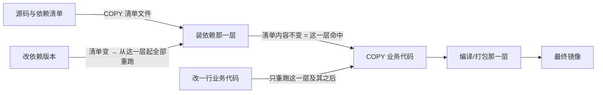

> **实战落点**：示例链第④段 · 改一行代码不该重下依赖、不该把构建工具带上生产。篇尾那张前后对照表是清单给段④定的判据（三个数字齐全才算闭合），也是全库第一张实测表，后面所有优化类章节的表格口径以它为准。
> **示例版本**：消费 `示例/贯穿示例/api-service/` 的 `Dockerfile.v1` 与 `Dockerfile.v2`（两版并存），产物落位与逐条读数在 `示例/贯穿示例/段4-把镜像养小/README.md`
> **前置依赖**：[/docs/03-镜像构建/写出来/Dockerfile指令全解与构建上下文/](/docs/03-镜像构建/写出来/Dockerfile指令全解与构建上下文/)、[/docs/05-原理深入/隔离与资源/联合文件系统与镜像分层/](/docs/05-原理深入/隔离与资源/联合文件系统与镜像分层/)、[/docs/02-核心操作/跑起来/镜像管理与容器生命周期/](/docs/02-核心操作/跑起来/镜像管理与容器生命周期/)
> **本篇产出物**：`api-service/Dockerfile.v2`（多阶段 + 依赖分层，`Dockerfile.v1` 保留）；一张四栈依赖层对照表；一张 cache mount 与层缓存的取舍判据表；**站④前后对照表**（体积 / 只改一行的 rebuild 耗时 / 命中层数）；一组体积口径的换算警告
> **难度·耗时**：★★★ · 60 分钟（含动手）
> **拓展接口**：3.9 把本篇的 `--mount=type=cache` 扩到 builder 实例与 `buildx bake`；3.10 谈层复用与 registry 端去重（本篇只量本地）；5.4 给本篇每条现象的机制解释；6.1 把这张对照表接进 CI 的构建缓存；7.3 的磁盘账用本篇的 `buildx du` 口径
> **自测三题**：
> 1. 上下文里一个文件的修改时间变了、内容没变，`COPY` 它的那一层会重跑吗？依据是哪条实测？
> 2. 改一行 `main.go`，v1 的构建只要 `0.4` 秒、v2 要 `6.9` 秒——谁「更快」？为什么这个问题本身问错了？
> 3. 同一份 Go 产物，`FROM scratch` 与 `FROM alpine:3.20` 的最终镜像差多少？哪一条链上约束逼着你别选小的那个？

## 为什么要先弄明白「哪一层在为什么而重跑」

三个现场，都属于「构建成功，但账算错了」：

```text
「我加了 .dockerignore，为什么第二次构建还是全 CACHED？它不是变了上下文吗？」
「`COPY` 只认它引用到的那几个文件的内容。你没动 app.txt，它就不重跑——
 .dockerignore 加的那条规则没改变任何一个被引用的字节。」
「好。那我把缓存文件清掉再 build，为什么还是慢？我明明 --no-cache 了。」
「`--no-cache` 关掉的是层缓存，不是你自己挂进去的 cache mount；
 反过来，它会把你那个 cache mount 换成一个空的。这两个开关不是一把。」
「那我更狠一点：改了 `pom.xml` 里一个依赖版本，构建只跑了 0.4 秒，说明缓存生效了吧？」
「恰恰相反。0.4 秒说明它什么都没做——你镜像里那份 jar 还是旧的。
 快不等于对，这一篇大半内容就是在教怎么把这两件事分开看。」
```

这三段话的共同点是：**「构建快」和「构建对」是两个正交的度量**，而把它们绑在一起的正是同一套层缓存机制。所以 3.5 先量清楚缓存键到底看什么；3.6 用这个规则去设计分层（四栈怎么各写各的）；3.7 把构建环境整个挡在镜像外；3.8 收尾到体积与选型，并给出段④那张对照表。

分层为什么能这么算账，机制在 [5.4 联合文件系统与 OverlayFS](/docs/05-原理深入/隔离与资源/联合文件系统与镜像分层/)：层就是联合挂载里的一个只读目录，命中就是复用同一个目录，删文件不省空间是因为上面盖了一条标记。本篇只给构建侧的读数，不重复那套解释。



> 💡 新人小结：把 Dockerfile 想成一条**单向流水线**：任何一步的输入变了，它和它之后的每一步都要重做，之前的可以留着。所以分层设计的全部技巧就是一句话——**把变得慢的东西放在前面，变得快的东西放在后面**。你以为「优化构建速度」是在改命令，其实是在改指令的顺序。

## 层与体积：先建后删不等于没建

清单 3.5 要求的第一个现象是「镜像为何越构建越大」。本机用同一份底、同一批字节做了两个镜像，差别只在**分几条 `RUN`**：

```dockerfile
# A：建它、再删它，写成两条指令
FROM alpine:3.20
RUN dd if=/dev/zero of=/big.bin bs=1M count=20
RUN rm /big.bin

# B：建它、删它，写在同一条指令里
FROM alpine:3.20
RUN dd if=/dev/zero of=/big.bin bs=1M count=20 && rm /big.bin
```

| 版本 | 指令层数 | 镜像体积 | `history` 里那两条的样子 |
|---|---|---|---|
| A（两条 `RUN`） | 3 | `33,103,030` 字节 | `21MB RUN … dd if=/dev/zero of=/big.bin …` 与 `4.1kB RUN /bin/sh -c rm /big.bin` |
| B（一条 `RUN`） | 2 | `12,106,519` 字节 | `4.1kB RUN /bin/sh -c dd if=/dev/zero of=/big.bin …` 一行 |

差值 `20,996,511` 字节，正好是那 20 MB。两条读数值得各记一件事：

- A 里那条 `rm` 自己的层只有 `4.1kB`（它只往可写层放了一条标记，见 5.4），但它**下面**那层的 21 MB 一个字节都没少。删文件的指令不删数据。
- B 里同一条指令既建又删，落到层里的净变化是「什么都没有」，于是那一层只有 `4.1kB`（元数据与空目录树）。所以「`4.1kB` 的一层」不是没执行，是执行完没留下内容。

这也是为什么 B 仍然比 A 少一层：A 的第三层是 `8.47MB ADD alpine-minirootfs…` 之外的独立一层，B 直接接在底镜像上。

把这条推广到依赖安装上就是「合并 `RUN` 与清理缓存」这对搭档：`apk add --no-cache`、`pip install --no-cache-dir`、`npm install --no-audit --no-fund` 都是在**同一条 `RUN` 里把下载缓存一起清掉**的写法，与「先装后单独 `RUN rm -rf /var/cache`」的区别就是上面那 `20,996,511` 字节。

> 💡 新人小结：判断「这一层值多少」要看**这层结束时文件系统里多了什么**，不是看指令里写了什么。清缓存、删临时文件必须和生成它的动作**在同一条 `RUN` 里**闭合，跨条就白删。

## 缓存键到底看什么：内容、时间戳、还是无关文件

这一组实验把「改了会不会重跑」量成可复现的四条。样本：`FROM alpine:3.20` + `COPY app.txt /` + `RUN echo tail`，`#5`=底镜像解析、`#6`=`COPY`、`#7`=`RUN`。

| 这次改动 | 结果（`CACHED` 的步骤号） | 结论 |
|---|---|---|
| 首次构建 | `#4` | 基线 |
| 只把 `app.txt` 的修改时间推到未来一小时，内容一字不动 | `#6`、`#7` 全命中，用时 `0.4` 秒 | **缓存键是内容哈希，不是 mtime**。`touch` 一个文件不会让构建重跑 |
| 把 `app.txt` 内容从 `v1` 改成 `v2`（1 字节差） | 只剩 `#5` 命中，`COPY` 与后面的 `RUN` 全重跑，用时 `0.8` 秒 | 1 字节就够。别指望「改动很小」能糊过去 |
| 上下文里新增一个**谁都没 `COPY`** 的 `ignoreme.bin` | `#6`、`#7` 仍全命中 | 无关文件不破坏缓存键；但它会破坏「镜像里不该有它」的期望（`.dockerignore`，见 3.4） |
| 再加一份 `.dockerignore` 把那个文件排除掉 | `#6`、`#7` 仍全命中 | 排除规则改变也不影响未被引用的那步 |
| 把 `COPY app.txt` 换成 `COPY . /ctx/`，再构建两次 | 第一次不命中（`#4`），第二次 `#6`、`#7` 全命中 | `COPY .` 的键是**整个（过滤后的）上下文内容**，所以任何被它扫到的文件变了就重跑 |

最后一条是依赖层设计的起点：`COPY .` 与 `COPY <清单文件>` 的差别不是「风格」，是**缓存键的覆盖面**。前者把源码、文档、临时产物全算进键里；后者只算那一个文件。

> 💡 新人小结：想知道某一步会不会重跑，就问「**这一步看得见的输入里，有没有哪个字节变了**」。这条判断在 `RUN` 文本、`COPY` 源内容、`ENV`/`ARG` 值上完全一致；修改时间、文件顺序、有没有多几个没人看的文件，都不算数。

## 指令顺序即优化策略：三条排序纪律的实测版

把上一节的规则用到链上 `api-service` 的两版 Dockerfile，得到本篇的三条纪律，每条都有读数。

**一、清单文件单独 `COPY`，业务代码放最后。** v2 的构建阶段就是这个形状：

```dockerfile
FROM golang:1.27-alpine AS build
WORKDIR /src
COPY go.mod ./
RUN go mod download
COPY main.go ./
RUN CGO_ENABLED=0 GOOS=linux go build -trimpath -o /out/api .
```

在 `main.go` 末尾追加一行注释再构建：`COPY go.mod`、`WORKDIR`、`go mod download` 三步全 `CACHED`，只有 `COPY main.go` 与其后的 `go build` 重跑（本机 `6.9` 秒，命中 4 步）。同一条改动放在 v1 上（`COPY api`，二进制是本机预先交叉编译好的）：整条构建 `0.4` 秒、全部命中——**这不是快，是没干活**。实测证据是镜像里那份二进制的 `sha256` 在改动前后完全不动，而 v2 改动后从 `0ea64c16…` 变成 `6ee99b8c…`。

**二、`FROM` 的标签是地基。** 本篇所有实验都从 `alpine:3.20` 起；把它换成 `alpine:3.21` 时，`#5` 之外没有任何一步能命中（3.4 的缓存矩阵里同一列的另一条读数）。同理，`docker build --pull` 会把这一步变成新的解析结果，等于自拆地基——本机测过一次：代理环境下 `--pull` 直接失败（`auth.docker.io` 连不通，BuildKit 取镜像不走 daemon 的代理，见 3.4 那条本机边界）。

**三、别为了「层少」把什么都塞进一条 `RUN`。** 合并只对**中间产物**有意义（上一节 B 比 A 省 `20,996,511` 字节）；把「装依赖」和「拷代码」并进一条 `RUN`，等于放弃第一条纪律——改一行代码就重下依赖。取舍口径：同一条 `RUN` 里的东西**变化频率应当同档**，且中间垃圾必须在这条里清干净。

顺带把 `--link` 说清楚，因为它常被写成「让 COPY 层与前面解耦、改前置也能命中」的免费优化。本机按最有利于它的形状测了：`RUN echo pre-v1` → `COPY base.txt` → `RUN echo tail`，然后把前置那条 `RUN` 改成 `pre-v2`（`base.txt` 一字节不动），并且每个变体在开跑前 `docker builder prune -f`，避免两个变体互相借用对方刚建出来的层。

| 变体 | 改前置 `RUN` 后各步骤状态 | 层数 | 层摘要序列（前 12 位） |
|---|---|---|---|
| 不加 `--link` | `#4` 底镜像 `CACHED`；`RUN`、`COPY`、尾部 `RUN` 三步全重跑 | 4 | `08bc4e534116 5f70bf18a086 62639f680021 5f70bf18a086` |
| 加 `--link` | `#5` 底镜像 `CACHED`；`RUN`、`COPY --link`、尾部 `RUN` 三步同样全重跑 | 4 | `08bc4e534116 5f70bf18a086 a7048a520b6c 5f70bf18a086` |

**本机没能测出 `--link` 的任何命中收益**：两种写法的重跑步骤集合与层数完全一致，唯一区别是 `COPY` 那层的摘要不同（`62639f68…` 对 `a7048a52…`）。所以我不会把它当优化推荐——它在这台 BuildKit（buildx `0.37.0`）上没有可观测效果，而宣传里的收益要落到「多个镜像共享同一份 COPY 层」这种注册表/跨镜像复用的场景才显形，本机没造出那个场景（列入未验证项）。

> 💡 新人小结：优化构建速度只需要动两样东西——**指令顺序**（变化频率分档）和**每步能看到的输入范围**（`COPY` 到具体文件而不是 `.`）。其它「技巧」在照抄之前先自己跑一次 A/B，因为很多（如本篇的 `--link`）在你这台机器上是空收益。

## 依赖层设计：四栈对照表

清单 3.6 要求 Maven / npm / Gradle / pip 四栈的写法对照。**npm 与 pip 是本机实测**，Maven 与 Gradle 是写法（本机没有可用的依赖缓存，构建期要走公司网/代理下载全部依赖，条件不具备）——两类在表里分开标注，别混着当结论用。

| 栈 | 先拷哪个文件 | 装依赖那一步的写法 | 变化频率与判据 | 本机状态 |
|---|---|---|---|---|
| **npm** | `package-lock.json`（没有锁文件就只拷 `package.json`） | `RUN npm ci --omit=dev --no-audit --no-fund` | 锁文件不变即命中；改源码不重跑安装 | 已实测（见下） |
| **pip** | `requirements.txt`（或 `pyproject.toml` + lock） | `RUN pip install --no-cache-dir -r requirements.txt` | 同上；版本号一动就整层重跑 | 已实测（见下） |
| **Maven** | `pom.xml`（多模块再加各子模块 `pom.xml`） | `RUN mvn -B dependency:go-offline` 或 `mvn -B package -DskipTests` 后 `mvn -B -o package` | 依赖坐标不变即命中 | **未实测**（本机没有 `mvn` 工具链与依赖缓存；网络不是障碍，见下面那条更正） |
| **Gradle** | `build.gradle` + `settings.gradle` + `gradle/wrapper/*` | `RUN ./gradlew --no-daemon dependencies` 或直接配合 cache mount | wrapper 与构建脚本不变即命中 | **未实测**（同上，也没有本地 Gradle 缓存） |

npm 这条量了**两种形态**。先说结论上的更正：`node:22-alpine` 当时看着像卡死（拉了 8 分钟没结束、`docker system df` 的 SIZE 三分钟不动），我就换成了 `alpine` + `apk add --no-cache nodejs npm` 的替身；**后来复查发现它其实拉完了**（`docker image inspect` 给 `239,050,910` 字节，`node -v` 出 `v22.23.4`）——掐掉客户端的 `docker pull` 不等于取消 daemon 侧的下载。所以下面两组都在本机跑过：A 组是替身形态，B 组是官方镜像形态。

```dockerfile
FROM alpine:3.20
RUN apk add --no-cache nodejs npm          # 运行时+包管理器：一层，最不常变
WORKDIR /app
COPY package.json ./                        # 清单单独一层
RUN npm install --omit=dev --no-audit --no-fund
COPY app.js ./                              # 业务代码放最后
CMD ["node","app.js"]
```

| 读数 | 值 |
|---|---|
| 首建 | `13.5` 秒（`apk` 装 npm 那步 `7.802` 秒；`npm install` 那步 `1.256` 秒，输出 `added 1 package in 974ms`） |
| 只改 `app.js` 后重建 | `0.7` 秒，`apk`、`WORKDIR`、`COPY package.json`、`npm install` 四步全 `CACHED` |
| 运行 | `node app v2 CHANGED` |
| 镜像体积 | `106,895,538` 字节 |

B 组（官方镜像 + 真锁文件 + `npm ci`）：锁文件由宿主的 `npm install --package-lock-only` 生成（`974` 字节，`ms@2.1.3` + `chalk@5.3.0`），Dockerfile 形状与 A 组同构，只是运行时换成 `node:22-alpine`、安装换成 `npm ci --omit=dev`：

| 读数 | 值 |
|---|---|
| 首建（先 `docker builder prune -f` 清空） | `2.7` 秒，那一步输出 `added 2 packages, and audited 3 packages in 1s` |
| 同内容再建 | `0.4` 秒，四步全 `CACHED` |
| 只改 `app.js` | `0.5` 秒，`COPY package.json package-lock.json` 与 `npm ci` 命中 |
| 镜像体积 | `242,555,026` 字节 |

**A 组比 B 组小 `135,659,488` 字节，差别全在运行时底座**（apk 装进来的 node 比官方镜像精简），而缓存行为两者一致——这正好说明「依赖层怎么分」与「底座选谁」是两个独立的决定，别把它们混在一条改动里。`npm ci` 与 `npm install` 的差别也量了：锁文件与 `package.json` 不一致时 `npm ci` **直接失败**（`rc=1`，原文 `Invalid: lock file's chalk@5.3.0 does not satisfy chalk@4.1.2`），而 `npm install` 会悄悄改锁文件——CI 里要的是前者。

pip 的两种写法都要量，因为「把 `RUN pip install httpx` 直接写死」和「先拷 `requirements.txt` 再 `pip install -r`」在缓存行为上不是一个东西：

| 形状 | 首建 | 只改 `app.py` | 只改 `requirements.txt` 的版本号 | 体积 |
|---|---|---|---|---|
| `RUN pip install --no-cache-dir httpx`（写死在指令里） | `11.5` 秒 | `0.6` 秒（那一步命中） | 不适用（改了就是改指令，等同全重跑） | `93,166,126` 字节 |
| `COPY requirements.txt` + `RUN pip install --no-cache-dir -r requirements.txt` | `17.5` 秒 | `0.6` 秒，装依赖那层 `CACHED`，run 出 `v2 CHANGED 0.27.0` | `10.9` 秒（`COPY requirements.txt` 起全部重跑，重新下载） | `93,322,509` 字节 |

两条结论直接从数字来：第一种写法「改代码」很快（`0.6` 秒），但**任何依赖调整都等于改指令**，缓存全废；第二种多花 `6` 秒首建，换来「代码动、依赖不动」时的命中，以及依赖清单在镜像里**可读**（排错时能 `docker run --rm <镜像> cat /app/requirements.txt`）。生产形态一律用第二种。

> 💡 新人小结：依赖层的通用形状就三行：**拷清单 → 装依赖 → 拷代码**。四栈只是文件名和命令不同。判断自己写对没有，看一个现象：改一行代码之后，构建日志里装依赖那一行是 `CACHED` 还是重跑。

## cache mount 与层缓存的取舍

层缓存（默认）与 `--mount=type=cache` 解决的是同一个问题的两端：前者**复用结果**（那一层已经建好，直接拿来当新层的底），后者**复用中间品**（一个不进镜像的目录，专给编译器/包管理器当自己的缓存）。

本机把两者的边界各量了一组。先看 cache mount 到底什么时候有内容——同一份 Dockerfile（`id=depsm`，挂载点 `/deps`，第一次建标记文件、以后读到就打 HIT）跑六个样本：

| 样本 | 步骤真实输出 | 该步是否重跑 |
|---|---|---|
| R1 首次 | `MARKER-MISS` | 重跑 |
| R2 同文再构建 | 无输出（步骤 `CACHED`，根本没执行） | 没跑 |
| R3 加 `--no-cache` | `MARKER-MISS` | 重跑，且**挂载是空的** |
| R4 改这一步自己的文本（同 `id`） | `MARKER-HIT` | 重跑，但**挂载里还是 R1 那份内容** |
| R5 `docker builder prune -f` 之后（同 `id`） | `MARKER-MISS` | 重跑，挂载被回收 |
| R6 prune 后再构建一次 | `MARKER-HIT` | 重跑，内容回来了 |

R3 与 R4 并排看是这一节的关键：`--no-cache` 之后这一步看到的是空目录，而**同一次不带 `--no-cache`、只改指令文本**的构建仍能看到 R1 写下的东西。也就是说「`--no-cache` 清掉的是这一步能复用的一切（包括它自己的 cache mount）」，而「文本改动不清 mount」。至于 `--no-cache` 是把原目录清空还是换了一个新实例，本机这六个样本分不出来（未验证项）。

再量收益，两个形状完全相反的活儿：

| 场景 | 不加挂载 | 加挂载 | 差 |
|---|---|---|---|
| 链上 Go 服务：改一行 `main.go` 后重建（`--mount=type=cache,target=/root/.cache/go-build`） | `6.9` 秒、`6.9` 秒（两次各测） | `1.4` 秒、`1.5` 秒、`1.4` 秒（三次） | **省约 `5.5` 秒/次，约 79%** |
| pip 装依赖：`httpx` 版本号从 `0.27.0` 改到 `0.27.2`（`--mount=type=cache,target=/root/.cache/pip`，两次都带 `--no-cache` 排除层缓存） | `14.2` 秒 → `10.3` 秒 | `14.3` 秒 → `10.5` 秒 | **没有差别** |
| `docker buildx du` 里挂载占多少 | `Shared: 131.7MB  Private: 16.38kB  Reclaimable: 131.8MB` | 同一次实验的两个读数 | 挂载内容算在 builder 缓存里，不进镜像 |

两条放在一起就是取舍判据：**重跑那一步的成本如果是本地计算（编译、打包、测试），cache mount 收效显著；如果成本主要是网络往返（拉元数据、解析依赖图），挂载救不了你**——pip 那两组第二次构建都在逐包打印 `Downloading … .whl.metadata`，`0.2` 秒的差就是噪声。另一个必要自查：挂载内容不该出现在镜像里，本机 `docker history` 的最终阶段只有 `8.62MB COPY /out/api /usr/local/bin/api`、`ENV`、`EXPOSE`、`ENTRYPOINT` 四行，没有 `type=cache` 的残迹，加上带挂载与不带的体积差 `25,627,941` 对 `25,627,937`（4 字节），可以确认它没烘进层。

CI 里还有一条常被误用的开关：`--no-cache-filter <阶段名>` 只让某个阶段失效。本机对链上 v2 用它重跑 `build` 阶段：`6.8` 秒，`WORKDIR` 命中、`COPY go.mod`/`go mod download`/`COPY main.go`/`go build` 全重跑，而**最终阶段那条 `COPY --from=build` 仍然命中**（源码没变 → 产物字节相同 → 层内容相同）。整条 `--no-cache` 是 `7.1` 秒——在这份小工程上两者几乎没差，阶段一多（真 Java 工程）才是它的主场。

> 💡 新人小结：**层缓存省「已经做过的事」，cache mount 省「做这件事时攒下的中间品」**。前者会把内容带进镜像，后者永远不带。选哪个不看流行，看那一步重跑时钱花在 CPU 上还是网络 RTT 上；两条都能用，但 `--no-cache` 一开，两条一起失效。

## 多阶段：把构建环境挡在镜像外

3.7 的核心事实本机用「只建到某一层」来量：同一条多阶段指令，加 `--target build` 只建构建阶段，和不加（建到运行阶段）拿到的体积是两个数量级。

| 链上/实验对象 | 构建阶段单独成镜像 | 最终镜像 | 差 |
|---|---|---|---|
| `api-service` 的 Go 多阶段（`golang:1.27-alpine` → `scratch`） | `508,480,388` 字节 | `13,513,788` 字节（未加探针注释那一轮的配对；加了注释那一轮是 `13,513,768`） | 约 `37.6` 倍 |
| 前端形态的最小替身（`alpine` builder 生成一个 `index.html` → `nginx:1.27-alpine`） | `12,114,936` 字节 | `73,599,305` 字节 | 运行阶段反而更大 |

第二行当时是个替身实验（builder 里只 `printf` 一个静态页），所以看不出多阶段的价值。批 12 把它补成了真实形态：同一个前端工程（`node:22-alpine` + `npm ci` + 产出 `dist/`），三种写法的体积是——

| 形态 | 体积 |
|---|---|
| 单阶段（node 全留在镜像里） | `242,575,229` 字节 |
| 多阶段的构建阶段单独成镜像（`--target build`） | `242,579,251` 字节 |
| 多阶段的最终镜像（`nginx:1.27-alpine` + `COPY --from=build /app/dist/`） | `73,599,283` 字节 |

多阶段比单阶段省 `168,975,946` 字节（约 70%）。这里 `nginx` 的运行阶段反而比 alpine 底大，但它带的是一台能对外服务的 web server，而不是 node 运行时加依赖树——这才是「多阶段减什么」的正确读法：减的是构建工具链与依赖树进不进最终镜像，不是运行阶段那点底子。

链上 web 因此**没有**换成多阶段版：`示例/贯穿示例/web/` 目前只有一份静态 `index.html`，没有真实构建步骤，硬套多阶段只是把上面的替身形状写进链里，读者拿不到可迁移的东西。这条决定连同它的判据放在段④ README 的「刻意不做的事」。

阶段数与可读性的取舍，本机读数：链上 v2 一共 13 个步骤（`#1`~`#13`，其中 2 个 `FROM`、3 个 `COPY`、2 个 `RUN`、其余是 `load metadata`/`load .dockerignore`/`unpacking` 这类内部步骤）。经验口径是**两个阶段（build + 运行）解决八成需求**；再加阶段一般只为两件事：一份产物喂多个运行阶段，或把「跑测试」和「出包」分开以便 `--target` 单独调用。为「分类注释」拆阶段是净亏——每个 `FROM` 都要解析一次元数据（本机每个 `load metadata` 步骤 `0.1` 秒量级，不大，但日志行数直接翻倍）。

> 💡 新人小结：多阶段的正确心智是「**搬运，不共享**」。运行阶段是新镜像，只通过 `COPY --from=` 拿它需要的字节；构建阶段里装的一切（工具链、缓存、临时文件）不会漏过去，前提是你没写 `COPY . ` 这种把整个工作目录拖走的东西。写完自检一句：`docker run --rm <最终镜像> sh -c 'ls /'` 里该只有运行需要的东西。

## `COPY --from` 的三种来源

`--from` 后面跟的东西有三种身份，行为差别不小：

| 写法 | 来源 | 本机证据 | 坑 |
|---|---|---|---|
| `COPY --from=build /out/api /usr/local/bin/api` | 同一次构建里的**另一个阶段**（名字或序号） | 链上 v2 就是这么写的，产物 8.6 MB 单层 | 阶段名拼错时报 `Dockerfile parse error`（构建期就失败，不是运行期） |
| `COPY --from=nginx:1.27-alpine /usr/share/nginx/html/index.html /from-image.html` | 一个**镜像名**（不需要多阶段！） | 建出的镜像 `3` 层、`12,115,564` 字节，`head -1` 取到 `<!DOCTYPE html>`；**nginx 的层没有跟着进来** | 它仍要求那个镜像可解析（本地或 registry）。离线机器上会卡在这一步（与 3.4 那条本机代理边界同一类） |
| `COPY --from=<容器 id>`（旧构建器） | 一个**已存在的容器** | 未测（本机走 BuildKit） | 传统构建器语法，BuildKit 下按镜像/阶段处理；别在新工程里依赖它 |

第三条被 3.4 那篇留在未验证项里，本轮只补上前两种（第三种要 `DOCKER_BUILDKIT=0`，与本篇其余测量不同轴，不混着报）。

顺带把 3.4 那条「只有上下文根的 `.dockerignore` 生效」接到这里：链上 `api-service/.dockerignore` 排掉了 `*.md`，所以段④的 v1/v2 构建都不会把 `README.md` 送进层——这条不属于优化，属于「别把不该给的东西交付出去」。

> 💡 新人小结：看到 `--from` 先问「这个名字在本文件里存在吗」。有同名 `AS` 阶段 → 阶段；没有 → 它就是一个普通镜像引用（会去拉）。想确认自己有没有把构建环境漏进最终镜像，最省事的办法是上面那条：对最终镜像 `ls /`，看有没有 `/usr/local/go`、`/root/.npm` 这类不该在的东西。

## 站④前后对照表：全库第一张实测表

先定义口径，后续所有优化类章节沿用这四条：

- **体积** = `docker image inspect --format "{{.Size}}"` 的字节数（不是 `docker images` 那个显示值，见下一节）。
- **改一行的 rebuild 耗时** = 从发出 `docker build` 到进程返回的墙钟秒；改动统一是「在 `main.go` 末尾追加一行 `// probe-*` 注释，其余字节不动」；构建命令统一 `docker build -f <该版 Dockerfile> -t <标签> api-service`。
- **命中层数** = 构建输出里以 `CACHED` 结尾的步骤行数（**含**底镜像解析那一步，所以「1」意味着除底之外什么都没复用）。
- **前置状态**：本机 `golang:1.27-alpine`、`alpine:3.20` 已在本地镜像与构建缓存里，因此「首建」不是空缓存冷启动。空缓存下的首建时间 = 上面的首建 + 拉基础镜像，本轮没测（未验证项）。

| 版本 | 首建 | 改一行后 rebuild | 命中步骤 | 哪几步命中 | 体积 | 传给构建器的上下文 | 改一行后产物哈希 |
|---|---|---|---|---|---|---|---|
| v1 单阶段（`COPY api` 现成二进制） | `1.4` 秒 | `0.4` 秒 | 1 | 底镜像解析 | `25,625,260` | `8.60MB` → `27B` | **不变**（`599c7699…`） |
| v2 多阶段 + 依赖分层 | `7.0` 秒 | `6.9` 秒 | 4 | `FROM alpine`、`COPY go.mod`、`WORKDIR`、`go mod download` | `25,627,942` | `2.00kB` → `1.97kB` | 变（`0ea64c16…` → `6ee99b8c…`） |
| v2 + Go 构建 cache mount | `7.1` 秒 | `1.4` 秒（三次 `1.4/1.5/1.4`） | 4 | 同上 | `25,627,937` | 同上 | 变（同一机制） |

这张表里三条反直觉的读数，正好是段④要交付的三个结论：

1. **v1 那一列的「0.4 秒」是假新鲜**。改了源码、构建成功、体积不变、时间极短，但镜像里那份 `api` 是旧的。只有把「产物哈希」当第 8 列列出来，这条才看得见——这也是本篇给后续所有对照表定的规矩：**耗时必须与命中层数、产物变化同时给**，缺一律视为可疑。
2. **v1 的上下文传输从 `8.60MB` 掉到 `27B`**，是 BuildKit 惰性上下文的现场：首建要拷走那份 8.6 MB 的二进制，第二次「没有任何被引用的文件变」，于是只传一个 `27B` 的清单。对照 v2 全程 `2.00kB`/`1.97kB`——它的上下文里 `COPY` 只看得到 `go.mod` 与 `main.go`，那份 8.6 MB 的 `api` 虽然还在目录里，却根本没进过任何层。
3. **多阶段不减运行阶段体积**（`25,625,260` 与 `25,627,942` 差 `2,682` 字节，两者同一个 alpine 底 + 同一个二进制），它减的是那 500 MB 的构建环境。

`scratch` 那一档也一并给出，因为它常被当成 v2 的自然下一步（同一份源码、只换运行阶段）：

| 收尾写法 | 体积 | 层数 | 镜像内二进制 |
|---|---|---|---|
| `FROM scratch` | `13,513,768` | 1 | `8.61MB`（`history` 里唯一一行内容）；`sha256sum`/`/bin/ls` 都不存在 |
| `FROM alpine:3.20` | `25,627,634` | 2 | `8,601,467` 字节 |
| `FROM alpine:3.20` + `go build -ldflags="-s -w"` | `20,476,487` | 2 | `5,836,960` 字节 |

`scratch` 比 alpine 省 `12,113,866` 字节（这一批三个数同轮配对，源码里都还带着 `// probe-*` 那一行；下一节另有一轮不带注释的配对，差 `20` 字节左右——这正是「同一份 Dockerfile 两次测量的字节数不该被当成同一个常量」的现场），看着很该换——但链上不能换，理由可执行：api 服务的 `healthcheck` 是 `test: ["CMD","wget",…]`，`scratch` 里连 `/bin/sh` 都没有，实测 `docker run --entrypoint /bin/sh` 得到 rc=127 与原文 `exec: "/bin/sh": stat /bin/sh: no such file or directory`。换 `scratch` 是**编排层的连带改动**（健康检查、调试手段、`--env-file` 读取方式都要跟着换），归段⑦与 4.6，不该在这段做。

> 💡 新人小结：读任何「优化前后」的表，先检查三件事：**有没有产物变化那一列**（防假新鲜）、**首建的前置缓存状态说没说**（防把命中当收益）、**体积是同一口径吗**（防跨口径相减）。这三条不齐，表里的数字再漂亮也不要用。

## 体积的三个口径：别拿它们互相加减

本篇所有体积都是 `inspect .Size`，但同一台机器上还有两个会同时出现的数，混用就会出错：

| 口径 | 本机读数举例 | 特点 |
|---|---|---|
| `docker image inspect --format {{.Size}}` | `alpine:3.20` = `12,102,484` | 与 `docker images` 的显示值**不一致** |
| `docker images` 的 `SIZE` 列 | `alpine:3.20` = `25.8MB`；实验镜像 `kbm` = `33.1MB` | 而同一 `kbm` 的 `inspect .Size` = `33,107,550`，**一致** |
| `docker system df` 的 `Images SIZE` | `1.924GB`（`RECLAIMABLE 1.825GB (94%)`） | 按层去重后的占用，不能逐镜像相加 |

也就是说：本机对**本地构建出来的**镜像两个口径一致（`33,107,550` ↔ `33.1MB`），对**拉下来的** `alpine` 不一致（`12,102,484` ↔ `25.8MB`）。差异的确切成因本轮没查（未验证项，方向是拉取镜像的元数据里记录的是压缩层与解包后各一份）。工程上只有一条硬规矩：**同一张表里只用一种口径，并在表外写清是哪一种**；`system df` 的数只用来回答「这台机器一共占了多少」，永远不参与逐镜像相减。

顺带一条 `history` 的量级尺子，用来自查「这层正常不正常」：同一条 `RUN echo only-this` 只加 `3,982` 字节（`12,102,484` → `12,106,466`），而 `dd 20MB` 那层是 `21MB`。看到某一层报出百 MB 级、而它写的是拷贝配置，就该怀疑它把不该要的东西拖进来了。

## 基础镜像选型：把「坑」写成可查的读数

| 底座 | 底座自身体积 | 装同一个 Go 产物后的最终镜像 | 层数 | libc | 有没有 shell |
|---|---|---|---|---|---|
| `scratch` | 没有这一层（`FROM` 的退化情形，0 层） | `13,513,788` | 1 | 无 | **无**：`--entrypoint /bin/sh` 得 rc=`127` |
| `alpine:3.20` | `12,102,484` | `25,627,635` | 2 | `musl libc (x86_64)`，`/lib/ld-musl-x86_64.so.1` | 有 |
| `debian:bookworm-slim` | `113,552,705` | `127,077,855` | 2 | `Debian GLIBC 2.36-9+deb12u14` | 有 |
| `ubuntu:24.04` | `117,404,008` | `130,928,728` | 2 | `Ubuntu GLIBC 2.39-0ubuntu8.9` | 有 |

四个底座装的是**同一个二进制**（`CGO_ENABLED=0` 静态链接），四个都探活成功：`{"status":"UP","db":"DOWN","cache":"DOWN"}` + `http=200`。所以选型不是「谁能跑」的问题，是这三笔账：

- **静态二进制 + `scratch`**：`13,513,788` 字节，比 alpine 档省 `12,113,847` 字节，代价是没有 shell（`rc=127`，原文在段④ README）。
- **alpine → slim/ubuntu 这一跳是 `101,450,220` 字节**（`25,627,635` 对 `127,077,855`），近四倍。要 glibc（例如某些带原生扩展的 Python/Node 包、`libstdc++` 依赖）就得付这笔钱；能静态编译就别付。
- **`debian-slim` 与 `ubuntu` 之间只差 `3,850,873` 字节**，选型理由基本落在 glibc 版本（`2.36` 对 `2.39`）与你们基线认可哪个发行版，不在体积。

其余三行是现成服务镜像与未测档，标清状态：

| 底座 | 本机状态 | 读数 / 坑 |
|---|---|---|
| `python:3.12-alpine` | 已用（pip 那两组实验的底） | 底座 `74.7MB`（`docker images` 口径）；装完 httpx 的最终镜像 `93,166,126` / `93,322,509` 两档 |
| `node:22-alpine` | `239,050,910` 字节 | 批 11 曾判它「拉不下来」，其实是**掐掉 CLI 后 daemon 侧仍把下载走完了**（复查 `node -v` = `v22.23.4`）。用它装的产物是 `242,555,026` 字节 |
| `mysql:8.4`（现成镜像，不自建） | 已用 | `1.12GB`。顺带纠正一条常见说法：它的底座**不是 Debian**——`ldd --version` 给 `GNU libc 2.34`，`/etc/os-release` 给 `Oracle Linux Server 9.8`，且镜像里没有 `nslookup` |
| `gcr.io/distroless/*` | **未测** | 本机没拉过。它想解决的「无 shell 怎么调」这一档，本轮只给到 `scratch` 的失败现场；调试路径（临时 sidekeeper 容器）留在 6.3 |

alpine 那行的 musl 值得多说一句，因为它常被写成「alpine 的 DNS 有 bug」。本机量到的事实是：Docker 给容器写的 `/etc/resolv.conf` 是 `nameserver 127.0.0.11` + `options ndots:0`，alpine(musl) 解析服务名 `kb-glibc` 得 `172.18.0.3`，glibc 侧解析 `kb-musl` 得 `172.18.0.2`，两边都 `rc=0`。**所以「换掉 alpine 就能修好 DNS」这条判断在这台机器上没有依据**；真要踩 musl 的坑，常见形态是并行查 A/AAAA 带来的行为差异与某些依赖 `getaddrinfo` 细节的库，这类问题要在具体应用栈上复现，不能用「alpine 有 DNS 问题」一句话替掉。

## 实战切入：给链上 api-service 换装，并回答三个问题

段④的落地动作与判据，全部可复现：

```console
CD /D <链根>\示例\贯穿示例
docker pull golang:1.27-alpine
docker build -f api-service\Dockerfile.v1 -t seg4-v1 .\api-service
docker build -f api-service\Dockerfile.v2 -t seg4-v2 .\api-service
docker image inspect --format "{{.Size}}" seg4-v1 seg4-v2
验证.cmd --seg4
```

**问题一：换了 v2，段②那条「一条命令起全栈」还成立吗？** 成立。`compose.yaml` 的 api 从 `build: ./api-service` 换成显式 `dockerfile: Dockerfile.v2`（`docker compose config --format json` 读到 `"dockerfile": "Dockerfile.v2"` 才算进模型），`docker compose --profile app up -d --wait` 实测 `16.9` 秒五个服务全 `Healthy`；`curl :8080/api/health` 得 `{"status":"UP","db":"UP","cache":"UP"}`、`http=200`、`0.003298` 秒；`down` 后再 `up` 是 `12.4` 秒（走缓存），`kbdemo.t_note` 里 `1  seg1-sentinel` 还在。

**问题二：v2 里的二进制真的是这次构建编出来的吗？** 两条证据：改 `main.go` 前后镜像内 `sha256` 变了；`docker exec` 进容器 `ls -l /usr/local/bin/api` 看到 `8600127` 字节、时间戳是这次构建的时间。**只凭构建成功不能证明这件事**——那正是 v1 的失效模式。

**问题三：想再瘦一半，该动哪里？** 顺序是：`-ldflags="-s -w"`（本机 `25,627,634` → `20,476,487`，二进制 `8,601,467` → `5,836,960`）；再考虑运行阶段换 `scratch`（`-12,113,846` 字节，但健康检查与调试手段要一起改）。**不要**先动依赖层形状——它已经在 v2 里是对的。

## 常见误读

| 误读 | 实际 |
|---|---|
| 「构建时间变短就是优化生效」 | v1 改源码后 `0.4` 秒全命中，镜像里二进制一个字节没变。判据要加产物哈希 |
| 「`.dockerignore` 改了会让所有缓存失效」 | 本机：新增排除规则后 `COPY`/`RUN` 两步仍全 `CACHED` |
| 「`touch` 一下文件会重跑」 | 只改 mtime 不改内容，`COPY` 那步照样命中 |
| 「多阶段能让运行镜像变小很多」 | v1/v2 体积差 `2,682` 字节（同一个底、同一个二进制）。它减的是那 `508,480,388` 字节的构建环境 |
| 「`--link` 是免费的缓存优化」 | 本机三个改动样本里命中集合与层数都不变；只有那层摘要不同 |
| 「`--no-cache` 会连 cache mount 一起保留」 | R3 样本里挂的是空的；改文本的 R4 才拿回原内容 |
| 「cache mount 总能让 rebuild 变快」 | Go 编译 `6.9`→`1.4` 秒有效；pip 拉依赖 `10.3` 对 `10.5` 秒，没有差别 |
| 「删掉镜像里的临时文件就不占体积」 | 分两条 `RUN` 是 `33,103,030`，同一条里建删是 `12,106,519` |
| 「`COPY .` 和 `COPY 单个文件` 只是写法偏好」 | 前者缓存键覆盖整个上下文，任何被扫到的文件变了就重跑 |
| 「换掉 alpine 能修 DNS」 | 本机 musl 与 glibc 两侧互相解析服务名都正常，`ndots:0` 由 Docker 写入 |
| 「`--squash` 能把层压成一层」 | 旧构建器要实验特性（本机 `--squash` 报 `only supported on a Docker daemon with experimental features enabled`）；BuildKit 直接警告 `experimental flag squash is removed with BuildKit`，加与不加层数都是 `4`、体积都是 `33,107,550` |
| 「`inspect .Size` 与 `docker images` 的数可以互相加减」 | `alpine` 一个报 `12,102,484` 一个报 `25.8MB`；同口径内才可比 |

## 本篇不覆盖什么

按 W6 的规矩，本篇**故意不讲**的东西逐条点名去处——写「不覆盖」不是免责声明，是防止你在这一篇里找不存在的答案：

- 每条指令的逐条语义与上下文规则 → 见 **3.1** 与 **3.2**（`.dockerignore` 的三条规矩在那一篇）
- 层的读写机制与目录不透明 → 见 **5.4**（`GraphDriver` 那一节的读数在那一篇）
- 推私有仓库、标签策略与多平台 → 见 **3.9** 与 **3.10**（`buildx` 驱动差异与仓库端去重在那两篇）
- CI 里缓存能不能命中、镜像扫描怎么接 → 见 **6.1**（`cache` 那一节把本篇的结论改写成流水线判据）
- 镜像在 VM 里到底落在哪个目录 → 见 **10.3**（`df -T` 与容量口径在那一篇）

## 要点总结

- 缓存键看**内容**：改 mtime 不重跑，改 1 字节就从这步起全重跑，未被引用的新文件与 `.dockerignore` 规则变化都不影响 `COPY` 那步。`COPY .` 的键覆盖整个过滤后上下文，这是依赖层必须单独 `COPY` 清单文件的直接原因。
- 层与体积是一对可量的账：分两条 `RUN` 建 20 MB 再删 = `33,103,030` 字节，同一条里建删 = `12,106,519` 字节；差值就是那条 `rm` 没能回收的字节。删文件的指令不删数据。
- 依赖层的通用形状是「拷清单 → 装依赖 → 拷代码」。npm 实测首建 `13.5` 秒 / 改代码重建 `0.7` 秒（四步命中）；pip 用 `requirements.txt` 形态时首建 `17.5` 秒、改代码 `0.6` 秒、改版本号 `10.9` 秒。Maven/Gradle 两行是写法，本机未实测。
- cache mount 与层缓存不同轴：`--no-cache` 会让这一步看到空挂载，只改指令文本则不会（`MARKER-MISS` 与 `MARKER-HIT` 两个样本）；`docker builder prune` 之后连文本没改也 `MISS`。收益看成本形状：Go 编译省 `5.5` 秒/次（约 79%），pip 拉依赖省不出来。
- 多阶段解决的是「构建环境进不进镜像」：`--target build` 单独建出 `508,480,388` 字节，最终 `13,513,788` 字节（同一轮配对）；`COPY --from=<镜像>` 不写多阶段也能取上下文外的文件，且不会把那个镜像的层带进来（本机 `3` 层 / `12,115,564` 字节）。
- 段④前后对照表给出全库第一张实测表，并定下口径：体积用 `inspect .Size`、改动统一为「加一行注释」、命中数含底镜像解析那步、首建注明缓存前置状态；**耗时必须与命中层数和产物变化同时给**，否则「0.4 秒」这种读数会掩盖镜像过期。
- 瘦身有量过的梯度：`-ldflags="-s -w"` 省 `5,151,147` 字节；换 `scratch` 省 `12,113,866` 字节但会打断链上 `wget` 健康检查（rc=127，原文已引）。`--squash` 在本机两条路都不通/无效，不是可用手段。
- 底座事实要自己查：`mysql:8.4` 是 Oracle Linux 9.8 + glibc 2.34 而非 Debian；alpine 的 musl DNS 问题本机未复现；`node:22-alpine` 那次「拉不下来」是误判——被掐断的只是客户端，daemon 侧把下载走完了。

## 本篇未验证项

| 项 | 状态 | 原因 |
|---|---|---|
| Maven / Gradle 依赖层的实测读数 | 未跑 | 障碍不是网络：批 12 实测「不带任何代理旗标」的构建期出网是通的（`apk add --no-cache curl` 在 6.0 秒内装成并打印 `curl 8.14.1 …`）。没跑它俩的原因是**本机没有 mvn/gradle 工具链与本地依赖缓存**，且 `maven:*` 底座更大、单轮成本高。表里这两行只作写法对照 |
| `--link` 的跨镜像层复用收益 | 未证实 | 本机三个改动样本（改 COPY 源、改前置 `RUN`、改后置 `RUN`）命中集合与层数都没变；宣传的收益要落在注册表端或多镜像共享中间层，本地测不到 |
| `--no-cache` 对 cache mount 是「清空原目录」还是「换新实例」 | 未分辨 | 六个样本能证明「行为不同」，但不能区分这两种实现；要分辨得在构建前后直接读挂载目录内容，而该目录位置在 containerd 存储下不好定位（见 5.4） |
| 空构建缓存下的 v1/v2 首建 | 未测 | 对照表注明了前置状态：基础镜像与层缓存已在本地。空缓存首建 = 首建 + 拉镜像，本轮没跑这一档 |
| `distroless` 底座与无 shell 调试路径 | 未测 | 本机没拉过该镜像；换 `scratch` 的可执行证据（rc=127 原文）已给，distroless 那条挪到 6.3 |
| `inspect .Size` 与 `docker images SIZE` 对拉取镜像不一致的确切成因 | 未查 | 只观察到「本地构建的镜像两者一致、拉下来的 alpine 不一致」这组事实，不猜压缩/解包两套记录 |
| Copy-up 对大文件的首次写代价 | 未测 | 本篇只量 5 字节小文件；机制上应与大小成正比，读数在 5.4 未验证项里同条挂着 |
| `-ldflags="-s -w"` 与 `scratch` 两项收益的相加性 | 未测 | 两组分别量过（`20,476,487` 与 `13,513,788`），没建「既 upx/strip 又 scratch」的组合镜像 |
