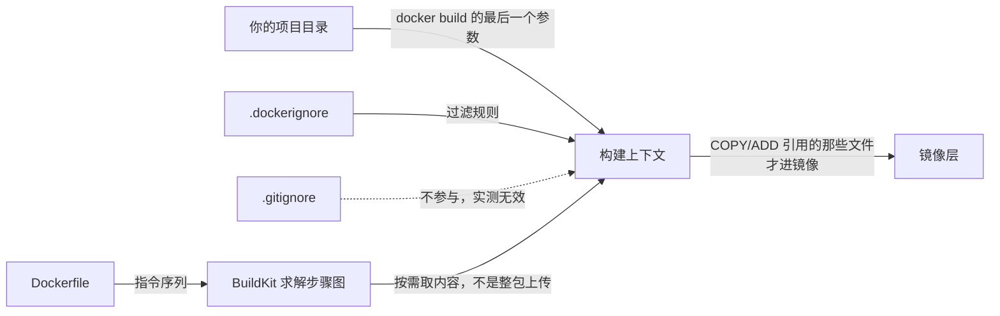

> **实战落点**：示例链第③段 · 服务自带源码能独立起步（本篇先把「一个源码目录 + 一份 Dockerfile 就能 build」这条路量直，段③的依赖层设计在 3.5~3.8 闭合）
> **示例版本**：消费 `示例/贯穿示例/api-service/`（`main.go` + `go.mod` + `Dockerfile.v1`），段③另有 `段3-服务自带源码/README.md` 列全前置；本篇不新产站点文件，但每一条指令读数都来自可直接复制的最小样本
> **前置依赖**：[/docs/02-核心操作/跑起来/镜像管理与容器生命周期/](/docs/02-核心操作/跑起来/镜像管理与容器生命周期/)、[/docs/01-基础认知/第一次动手/第一次运行容器与图形化工具/](/docs/01-基础认知/第一次动手/第一次运行容器与图形化工具/)、[/docs/00-导读/把环境搭好/环境准备/](/docs/00-导读/把环境搭好/环境准备/)、[/docs/04-单机编排/定义/Compose语法基线与文件全字段参考/](/docs/04-单机编排/定义/Compose语法基线与文件全字段参考/)
> **本篇产出物**：一张 CMD/ENTRYPOINT 六种组合的实测真值表；一张「改哪一行、哪些步骤重跑」的缓存矩阵；一份能直接抄的 `.dockerignore` 模板（含 `.gitignore` 不管用的泄密现场）；一条本机专属的构建期网络绕法（先 pull 再 build）
> **难度·耗时**：★★☆ · 55 分钟（含动手）
> **拓展接口**：本篇的「一条 RUN 一层」在 3.5 被压测成依赖层设计；「`--mount=type=secret`」在 3.9 扩成 cache 挂载、在 6.3 与镜像外注入合流；「HEALTHCHECK 只给现象」在 4.6 穷尽；「构建期拉不到基础镜像」这条在 3.12 排错手册与 7.2 症状索引里各占一行
> **自测三题**：
> 1. 上下文里放一个 30 MB 的没人 `COPY` 的文件，构建会变慢吗？BuildKit 与旧构建器的答案为什么相反？
> 2. `ENTRYPOINT /p -x` 配 `CMD ["c1","c2"]`，容器里 `/p` 收到了几个参数？依据是什么？
> 3. 口令用 `--build-arg` 传和用 `--secret` 挂，构建完之后各自能从哪儿翻出来？

## 为什么要先弄明白「构建上下文」，再背指令

三个现场，都属于「指令没写错，但结果不对」：

```text
「我明明写了 COPY app.jar，为什么说 not found？」
「你的 build 命令是在仓库根跑的，jar 在 target/ 下，路径是相对上下文的。」
「好，通了。可是这镜像怎么 800 MB？我只 COPY 了一个 jar。」
「你写了 COPY . ，把 node_modules 一起放进去了。」
「那我把密钥文件删掉再 build 一次，总干净了吧？」
「先别急。你上一次烘进镜像的那层还在缓存里，改 .gitignore 也不影响构建——
 上下文里有什么，取决于 .dockerignore，不是 .gitignore。」
```

这三段话的共同点是：**Dockerfile 描述的是「怎么装」，构建上下文决定「有什么可装」**，两者是两套规则。而新人通常先背指令、后遇到上下文问题，于是把「COPY 找不到文件」「镜像虚胖」「密钥进了镜像」都当成指令写错。

所以本篇的顺序是：先看清上下文这条管道（3.4），再逐条拆指令（3.2、3.3），最后把「改一行会不会重跑」的缓存规则量成一张表（3.1 引入、3.5 穷尽）。



> 💡 新人小结：**构建上下文像搬家时的「装车范围」**。Dockerfile 是「到了新家在哪个房间摆什么东西」的清单；清单写得再对，车上没装那件东西就只能报错。而 `.dockerignore` 是**装车前**的过滤规则——它跟 `.gitignore`（「哪些文件不提交」）是两件事，本机实测：`.gitignore` 里写了 `secret.txt`，`COPY .` 之后照样能在镜像里 `cat` 出它的内容。类比之后接机制：BuildKit 拿到的是过滤后的上下文，`.gitignore` 从来不在它的解析范围内；缓存则按「这条指令看到的输入有没有变」来判定，不是按目录有没有新文件。

## 第一个能跑的 Dockerfile：逐行拆

贯穿示例里 `api-service` 的第一份镜像描述（`Dockerfile.v1`）只有五行，正好够把每条指令讲完：

```dockerfile
FROM alpine:3.20
COPY api /usr/local/bin/api
EXPOSE 8080
ENV PORT=8080
ENTRYPOINT ["/usr/local/bin/api"]
```

| 行 | 它在决定什么 | 本机证据 |
|---|---|---|
| `FROM alpine:3.20` | 取哪一层当底。用 alpine 而不是 `scratch` 的唯一理由：健康检查要在镜像里有可执行的东西 | `scratch` 里没有 `wget`，`test: ["CMD","wget",…]` 永远失败（第①段实测） |
| `COPY api /usr/local/bin/api` | 从上下文取**一个文件**。不是 `COPY .` | 上下文里另放 30 MB 未被引用的文件，BuildKit 那步的 `transferring context` 仍是 `2B`，构建 0.4 秒 |
| `EXPOSE 8080` | 只是元数据声明 | `docker run` 不加 `-p` 时，宿主 8080 的 LISTEN 数 = 0，`docker port` 输出为空 |
| `ENV PORT=8080` | 进镜像的运行时变量，应用读它来决定监听哪个端口 | 镜像 `Env` 读到 `["PATH=…","PORT=8080"]` |
| `ENTRYPOINT ["/usr/local/bin/api"]` | 固定主程序；`docker run` 后面的参数**追加**给它 | 组合表见下面「CMD 与 ENTRYPOINT」一节 |

单独把这个镜像跑起来（没有任何依赖服务）的真实样子：

```console
$ docker build -f api-service/Dockerfile.v1 -t kb-p2-api api-service        # rc=0
$ docker inspect --format "{{json .Config.Healthcheck}} | {{json .Config.Entrypoint}} | {{json .Config.Cmd}} | {{json .Config.ExposedPorts}}" kb-p2-api
null | ["/usr/local/bin/api"] | null | {"8080/tcp":{}}
$ docker run -d --name kbapi-solo kb-p2-api
$ docker exec kbapi-solo wget -q -O - http://127.0.0.1:8080/api/health
{"status":"UP","db":"DOWN","cache":"DOWN"}
```

三条读数各自说明一件事：`Healthcheck` 是 `null`——compose 里那段健康检查**不属于镜像**，是编排注入的；`Cmd` 是 `null`——`docker run` 带参数就是直接给 `ENTRYPOINT` 追加；`db:"DOWN"`——这个服务能独立起来，但依赖不在它自己身上。

最小可跑的三种语言写法，同一份「起一个 HTTP 端口」的需求：

```dockerfile
FROM alpine:3.20
COPY api /usr/local/bin/api
ENTRYPOINT ["/usr/local/bin/api"]
```

```dockerfile
FROM python:3.12-alpine
WORKDIR /srv
COPY app.py /srv/
CMD ["python","app.py"]
```

```dockerfile
# 这两份本轮没跑（见未验证项）：JDK 版要用 Maven 产物，Node 版要装依赖
FROM node:22-alpine
WORKDIR /app
COPY package*.json ./
RUN npm ci --omit=dev
COPY . .
EXPOSE 3000
CMD ["node","server.js"]
```

Python 那份是真的跑起来了：

```console
$ docker pull python:3.12-alpine && docker build -t kbbase-py .   # rc=0，0.7 秒
$ docker run --rm kbbase-py
hello from python image 3.12.16
```

## 构建上下文：谁被传上去、传了多少、什么时候传

先给结论，再给读数。**「上下文大小 = 构建成本」这句话在 BuildKit 上只对了一半**：未被指令引用的文件不进镜像也不占传输；一旦被 `COPY .` 引用，它就真的进了镜像。

本机用同一个目录（一份两行 Dockerfile + 一个 30 MB 的 `junk.bin`）跑了四种组合：

| 写法 | 上下文那行读数 | 用时 | 镜像体积 |
|---|---|---|---|
| BuildKit，`RUN true`（没人 COPY junk.bin） | `#3 transferring context: 2B done` | 0.4 秒 | 与底镜像同（12.2 MB） |
| BuildKit，`COPY . /inbox/`，没有 `.dockerignore` | 同样打印 `2B` | 3.1 秒 | **43.6 MB**，容器里 `du -sh /inbox/junk.bin` = `30.0M` |
| BuildKit，`COPY . /inbox/` + `.dockerignore` 写 `junk.bin` | `transferring context: 49B` | 0.5 秒 | **12.1 MB** |
| 旧构建器（`DOCKER_BUILDKIT=0`），同目录 | `Sending build context to Docker daemon  31.46MB` | 2.8 秒 | 能跑通（旧构建器在 Engine 29.8 上仍可用） |
| 旧构建器 + `.dockerignore` | `Sending build context to Docker daemon  3.072kB` | — | — |

两条要点：

1. **别拿 `transferring context: N B` 当上下文大小的判据。** BuildKit 是先传清单、按需取内容，那一行的 `2B` 与镜像里真的多了 30 MB 是同时成立的（第 2 行）。要判断上下文是否被塞进镜像，看**镜像体积**与**容器里的 `du -sh`**；要判断构建慢在哪，看用时。这条属于「判据换口径」：原来的读数在新实现下不再表达它原本的意思。
2. **旧构建器会把整个上下文上传一遍**，所以「目录里有个大文件就慢」在旧实现下是真的；换到 BuildKit 之后这句话只对「被引用的文件」成立。团队里如果有人用 `DOCKER_BUILDKIT=0` 兜旧问题，就要按旧规则给他解释。

同一目录里再验一次「谁真的进了镜像」：

```console
# 根目录 .dockerignore 内容：big.bin 与 sub
$ docker run --rm kbbase-dk sh -c "ls -1 /inbox"
Dockerfile  app.txt
```

## `.dockerignore`：模板、三条规矩，以及 `.gitignore` 不管用的现场

先把最刺眼的那条实测摆出来。目录里有 `secret.txt`（内容 `do-not-ship`）、`build.log`、`app.txt`，`.gitignore` 写着 `secret.txt` 和 `*.log`，Dockerfile 是 `COPY . /inbox/`：

```console
$ docker run --rm kbbase-gi sh -c "ls -1 /inbox; cat /inbox/secret.txt"
Dockerfile | app.txt | build.log | secret.txt | do-not-ship
```

**密钥照样在镜像里**——`.gitignore` 只约束提交，不约束构建上下文。把同样的规则写进 `.dockerignore` 之后：

```console
$ docker run --rm kbbase-dk sh -c "ls -1 /inbox"
Dockerfile | app.txt
```

团队模板（可直接抄进仓库根）：

```text
# 版本库元数据
.git
.gitignore
# 构建产物与依赖目录（这些是镜像虚胖的主要来源）
target/
node_modules/
**/*.log
# 本地才有的东西，一个都不许进镜像
.env
.env.*
*.pem
*.key
# 例外：某个文件确实要进镜像时写在规则之后
!.env.example
```

三条规矩，每条都有本机证据支撑：

| 规矩 | 为什么 | 证据 |
|---|---|---|
| 只写 `.dockerignore`，别指望 `.gitignore` | 构建器不读 `.gitignore` | 上面那两条 `ls -1 /inbox` 对照 |
| `.dockerignore` 只认**上下文根**那一份 | 子目录里的同名文件不参与过滤 | 根规则是 `*.bin` + `!keep.bin`，子目录再放一份写 `app.txt` 的 `.dockerignore` → `/inbox` 里仍有 `app.txt`，且两次构建的上下文字节数相同 |
| 例外行 `!xxx` 必须排在被排除的模式之后 | 规则按顺序匹配 | 同一目录里 `keep.bin` 因 `!keep.bin` 出现，`big.bin` 因 `*.bin` 消失 |

另外两条顺手能验的：`.dockerignore` 自己**不会**被 `COPY .` 带进镜像（上面列表里没有它）；上下文里**新增一个没人引用的文件不会让缓存失效**——缓存矩阵那一节给了这条读数。

> [!warning]
> 「先 build 出来再看里面有什么」是错的顺序。密钥一旦进了某一层，删掉那行再 build 也可能命中旧层，而镜像已经被推到仓库就是既成事实。规矩应该是：`.dockerignore` 先写好，再第一次 build；构建完用 `docker run --rm  sh -c "ls -R /"` 复核一次——这条复核命令在 3.12 排错手册里是固定动作。

## `COPY ../x` 为什么不报「越界」，而是静悄悄拿了另一个文件

旧教程常说「`COPY ../foo` 会报错，因为不能越出上下文」。本机的答案更麻烦：**它可能不报错**。

```console
# 上下文里没有同名文件，只有父目录有 only-outside.txt
$ docker build -t kbbase-esc1 .          # rc=1
  #6 ERROR: failed to calculate checksum of ref 644s…: "/only-outside.txt": not found

# 上下文里也放一个同名 only-outside.txt（内容不同）
$ docker build -t kbbase-esc2 .          # rc=0
$ docker run --rm kbbase-esc2 cat /tmp/only-outside.txt
'from inside the context'
```

两条合起来才是完整结论：BuildKit 把 `../` **规范化到上下文根**（注意报错里的路径已经没有 `..` 了，变成 `/only-outside.txt`），于是：

- 上下文里有同名文件 → 拿到它，构建成功，但拿到的**不是**你写在路径里的那个父目录文件；
- 上下文里没有 → 报 `not found`。

这比「直接报错」危险，因为它静默替换了输入。判据：任何 `COPY` 源路径里出现 `..`，就当它是 bug 处理——把文件挪进上下文，或用 `-f` 指定 Dockerfile 并把上下文设为真正的公共根。

`COPY` 的兄弟场景两条：

```console
$ docker build -t kcesc2 .      # COPY missing.txt
  ERROR: failed to build: failed to solve: failed to compute cache key:
    failed to calculate checksum of ref …: "/missing.txt": not found
```

`COPY --chmod=755 --chown=1000:1000 plain.txt /opt/p.txt` 生效，容器里读到 `-rwxr-xr-x 1 1000 1000 6 …`——注意属主显示为**数字**，因为镜像里没有 `1000` 这个用户名（与第②篇 UID/GID 那条同源）。

## ADD 与 COPY：只剩一条正当理由

两者都是把上下文里的文件放进镜像，差别只有一处是实质性的：

```console
# ADD pkg.tar.gz /opt/added/
$ docker run --rm kbadd sh -c "ls /opt/added; cat /opt/added/inside.txt"
inside.txt | made-by-tar

# COPY pkg.tar.gz /opt/copied/
$ docker run --rm kbcopy sh -c "ls /opt/copied; od -c -N 8 /opt/copied/pkg.tar.gz"
pkg.tar.gz | 0000000 037 213  \b  \0 …
```

| 能力 | `ADD` | `COPY` | 本机证据 |
|---|---|---|---|
| 从上下文复制文件 | 是 | 是 | 上面两条 |
| **自动解压**上下文里的 tar/tar.gz | 是 | 否（原样放一个压缩包） | `od` 读出 gzip 魔数 `037 213` 说明它仍是压缩包 |
| 从 URL 取远程文件 | 是（构建期抓） | 否 | `ADD http://127.0.0.1:9/none.tgz` 报 `failed to load cache key: Get "…": dial tcp 127.0.0.1:9: connect: connection refused` |
| `--chmod` / `--chown` | 是 | 是 | 上一节 |

结论写成团队规矩就一句：**默认用 `COPY`，只有在「上下文里已有一个 tar 且你希望它被自动解包」时才用 `ADD`**。URL 形式不要用在生产镜像里——它把构建结果绑到一个外部地址上，同一份 Dockerfile 明天可能拿到不同的字节（`failed to load cache key` 那句也说明它是构建期网络动作，结果进缓存键）。需要远程内容时，用 `RUN curl` + 校验和，或干脆把下载挪到构建之外。

> 💡 新人小结：`ADD` 的自动解压像**快递帮你把箱子拆了摆进房间**，`COPY` 是**整箱原样搬进来**。听起来前者省事，但「谁来拆箱子」这件事一旦交给工具，你就不能从镜像里看到那个箱子原本长什么样（本机 `od` 一眼就分得开：一边是解出来的 `inside.txt`，一边还是 `037 213` 开头的压缩包）。类比之后接机制：解压与否影响的是**层内容与缓存键**，而 URL 抓取多出来的网络动作还额外把不可复现性写进了缓存键——这是同一件事的两个代价。

## FROM：标签、摘要、`--platform`，以及本机那条代理边界

`FROM` 的三种来源写法各有明确后果：

| 写法 | 每次构建拿到什么 | 适合 |
|---|---|---|
| `FROM alpine:3.20` | 跟着 `3.20` 这个标签走，标签被上游移动后你就换内容了 | 开发期 |
| `FROM alpine:3.20@sha256:d9e853e8…` | 固定摘要，逐字节可复现 | 生产；BuildKit 的步骤行本来就会打印解析到的摘要，抄下来即可 |
| `FROM scratch` | 没有底，什么都没有 | 静态二进制；代价是连 `sh`、`wget` 都没有，健康检查与调试都要换思路（第①段实测过这条路） |

`--platform` 在本机（`24 cpu`、`linux/amd64`）的真实情况值得单独记，因为它牵扯到 Docker Desktop 的一个代理边界：

```console
# 直接交叉构建：失败
$ docker build --platform linux/arm64 -t kbplat .
[rc=1，21.4 秒]
  #2 ERROR: failed to copy: httpReadSeeker: failed open: failed to authorize:
  failed to fetch anonymous token: Get "https://auth.docker.io/token?scope=…":
  dial tcp 69.63.176.59:443: connectex: A connection attempt failed …

# 先把那个平台的底镜像拉下来（走的是 dockerd 的通道，代理有效）
$ docker pull --platform linux/arm64 alpine:3.20      # rc=0
$ docker build --platform linux/arm64 -t kbplat .     # rc=0，0.8 秒
  #5 0.231 aarch64          ← RUN uname -m 的输出，qemu 模拟在跑
```

同一个镜像标签，两条通道的结果不同：

```console
$ docker pull alpine:nonexistent-tag-xyz
  Error response from daemon: failed to resolve reference "docker.io/library/alpine:nonexistent-tag-xyz":
  docker.io/library/alpine:nonexistent-tag-xyz: not found      ← 走到了 registry，说明代理是通的

$ docker build -t kbbase-reg .        # FROM 同一标签
[rc=1，21.4 秒] failed to authorize: failed to fetch anonymous token: Get "https://auth.docker.io/token…"  ← 没走代理，超时
```

结论（本机专属，2026-10-27）：**Docker Desktop 配的代理只管 dockerd 侧的拉取，BuildKit 自己去 registry 取镜像时不经过它。** 实操上两条：把要用的底镜像先 `docker pull` 下来再 build（跨平台时带上 `--platform`）；或在构建前把代理交给 BuildKit 的配置（这条属于 3.9 与 6.6 的范围，本篇没验）。附带一条：`docker build --pull` 在本机反而 `rc=1`（21.3 秒）——它强制回到 registry，正好撞上那条不通的路。

> 💡 新人小结：这就像**公司前台（dockerd）配了专线，你自己（BuildKit）用手机流量出门**——同一份名单，前台查得到、你查不到。类比之后接机制：报错里 `failed to authorize` + `auth.docker.io` 的 443 超时，说的是「没拿到匿名 token」这一步断在网络层，而不是「这个标签不存在」；标签真不存在时报的是 `not found`。分清这两种文本，就不会把代理问题当镜像问题去查。

## RUN：一条一行一层，shell 形式与 exec 形式

层数是**每条指令一层**，不是每次执行一层：

```dockerfile
RUN echo one
RUN echo two
RUN echo three
```

```console
$ docker history --format "{{.CreatedBy}}" kblayers3      # 5 行（三条 RUN + 底镜像两步）
  RUN /bin/sh -c echo three # buildkit | RUN /bin/sh -c echo two # buildkit | RUN /bin/sh -c echo one # buildkit | CMD ["/bin/sh"] | ADD alpine-minirootfs-3.20.10-x86_64.tar.gz …

$ docker history --format "{{.CreatedBy}}" kblayers1      # 合并成一条 && → 3 行
  RUN /bin/sh -c echo one && echo two && echo … | CMD ["/bin/sh"] | ADD alpine-minirootfs-3.20.10-x86_64.tar.gz …
```

两条读数的用处不同：**层数不等于体积收益**，合并 `&&` 真正的价值是「中间产物不留痕」（装完包顺手 `rm` 掉缓存，同一层里做才有效）；而把不常变的步骤**拆成独立一条**，缓存收益才拿得到——这正是下面那张矩阵的结论。

RUN 的两种写法：`RUN make hello`（shell 形式，实际执行 `/bin/sh -c "make hello"`）与 `RUN ["/bin/echo","hi"]`（exec 形式，不经 shell）。历史里能看到包裹痕迹（`RUN /bin/sh -c …`）。需要环境变量展开、管道、重定向就用 shell 形式；只是启动一个固定程序就用 exec 形式——这条规矩在 `CMD`/`ENTRYPOINT` 上更关键（下一节）。

`RUN --network=none` 能把某一步彻底断网（本机 rc=0），用来强制暴露「这步偷偷联网了」的问题——它是「依赖必须来自上下文或底镜像」这条纪律的检查器。

## 缓存矩阵：改哪一行、哪些步骤重跑

这是 3.1 要求的「指令与缓存命中的关系」，本机逐步骤打印出来的结果（`#6`=`RUN echo heavy-step`，`#7`=`COPY app.txt /`，`#8`=最后一条 `RUN`）：

| 这次改动 | 命中的步骤 | 重跑的步骤 | 结论 |
|---|---|---|---|
| 什么都没改，再 build 一次 | `#6 #7 #8` 全 CACHED | 无 | 幂等 |
| 只改 `COPY` 的源文件**内容**（文件名不变） | `#6` | `#7`、`#8` | 失效点在 `COPY`，**它之前的层不受影响** |
| 只改最后一条 `RUN` 的文本 | `#6`、`#7` | `#8` | 只有最后一层重跑 |
| 改中间那条 `RUN` 的文本 | `#4`（底镜像解析） | `#6`、`#7`、`#8` | **一条指令变，它和它之后全部重跑** |
| 加 `--no-cache` | `#4` | `#6`、`#7`、`#8` | `--no-cache` 不是「什么都不命中」：底镜像解析那步仍然报 CACHED |
| 上下文里新增一个**没人 `COPY`** 的文件 | `#6 #7 #8` 全 CACHED | 无 | 无关文件不破坏缓存（但会破坏「镜像里不该有它」的期望，见 `.dockerignore`） |

于是三条排序纪律（穷尽版在 3.5，这里只给因果）：**变化最频繁的指令放最后**（所以 `COPY . .` 通常在依赖安装之后）；**依赖清单单独一次 `COPY`**（改业务代码时不重跑安装）；**`FROM` 的标签是缓存的地基**，动它就等于动全部。

## ENV 与 ARG：谁留在镜像里、谁在 history 里裸奔

同一份 Dockerfile 里写一个 `ARG` 和一个 `ENV`，看它们在哪儿能被翻出来：

```dockerfile
ARG OUTSIDE=pre
FROM alpine:3.20
ARG INSIDE=secret-inside
ENV SEE_ME=secret-env
RUN echo built-with=${INSIDE}
```

```console
$ docker history --no-trunc kbargs
  …  RUN |1 INSIDE=secret-inside /bin/sh -c echo built-with=${INS…
  <missing>  ENV SEE_ME=secret-env
  <missing>  ARG INSIDE=secret-inside

$ docker run --rm kbargs sh -c "echo INSIDE=[$INSIDE] OUTSIDE=[$OUTSIDE] SEE_ME=[$SEE_ME]"
INSIDE=[] OUTSIDE=[] SEE_ME=[secret-env]
```

四条语义一次量齐：

- **`ARG` 只活在构建期**：运行时读到空；`FROM` 之前声明的 `ARG`（`OUTSIDE`）连构建期都不给普通 `RUN` 用。
- **`ENV` 同时活在构建期和运行时**：写进镜像配置，容器里读得到。
- **两者都会出现在 `docker history` 里**。显式 `--build-arg TOKEN=super-token-9` 之后，历史里能看到 `RUN |1 TOKEN=super-token-9 …` 与 `ARG TOKEN=super-token-9` 两处——**口令会随镜像分发出去**（任何能 pull 的人）。
- 想不留痕，正路是 BuildKit 的 secret 挂载：

```dockerfile
FROM alpine:3.20
RUN --mount=type=secret,id=token wc -c </run/secrets/token
```

```console
$ docker build --secret id=token,src=secretpayload -t kbsecret2 .      # rc=0
$ docker history --no-trunc kbsecret2 | grep -c token-value-77          # 0 命中
$ docker run --rm kbsecret2 sh -c "cat /run/secrets/token"
cat: can't open '/run/secrets/token': No such file or directory
```

挂载只在**那一条指令执行期间**存在，`history` 里没有明文，运行期文件也不在——三条都对上才是安全的。另外一条本机读数：`--secret id=token,inline=值` 这个写法**不被支持**（`ERROR: unexpected key 'inline'`），要用 `src=` 或 `env=`。cache 挂载（`--mount=type=cache`）与更完整的用法在 3.9。

## CMD 与 ENTRYPOINT：六种组合的真值表

这是本篇最该背下来的一张表，全部是本机读数。做法：镜像里放一个探针脚本 `/p`，它打印自己收到的 `argv` 与 `/proc/1/cmdline`。

| Dockerfile 写法 | 直接 `docker run 镜像` | `docker run 镜像 r1 r2` | 镜像元数据 `Entrypoint` ‖ `Cmd` |
|---|---|---|---|
| A `ENTRYPOINT ["/p","-x"]` + `CMD ["c1","c2"]` | `args=[-x c1 c2]` | `args=[-x r1 r2]` | `["/p","-x"]` ‖ `["c1","c2"]` |
| B `ENTRYPOINT ["/p","-x"]` + `CMD echo shell-cmd` | `args=[-x /bin/sh -c echo shell-cmd]` | `args=[-x r1 r2]` | `["/p","-x"]` ‖ `["/bin/sh","-c","echo shell-cmd"]` |
| C `ENTRYPOINT /p -x`（shell）+ `CMD ["c1","c2"]` | `args=[-x]` | `args=[-x]` ← **传参被吞** | `["/bin/sh","-c","/p -x"]` ‖ `["c1","c2"]` |
| D 只有 `CMD ["/p","only-cmd"]` | `args=[only-cmd]` | 报错（见下） | `null` ‖ `["/p","only-cmd"]` |
| E 只有 `ENTRYPOINT ["/p","-x","only-entry"]` | `args=[-x only-entry]` | `args=[-x only-entry r1 r2]` ← **追加** | `["/p","-x","only-entry"]` ‖ `null` |
| F 两个都写 shell 形式 | `args=[-x]` | `args=[-x]` ← **传参被吞** | `["/bin/sh","-c","/p -x"]` ‖ `["/bin/sh","-c","echo hi"]` |

归纳成三条覆盖规则，与表完全对应：

1. `docker run` 后面的参数**替换 `CMD`**，不动 `ENTRYPOINT`（A、B、D）。
2. 没有 `CMD` 时，参数就**追加到 `ENTRYPOINT`**（E）。
3. `ENTRYPOINT` 写成 shell 形式，整条命令被包进 `/bin/sh -c "…"`，此时 `CMD` 与 run 参数**都接不上**（C、F）。这就是「传进去的参数被吞」的机制。

D 组合的报错很具体，因为参数替换掉了整个 `CMD`（连 `/p` 都没了）：

```console
$ docker run --rm kbce3 r1 r2
  docker: Error response from daemon: failed to create task for container: … runc create failed:
  unable to start container process: error during container init:
  exec: "r1": executable file not found in $PATH
```

顺带把两个相邻的失败读数放在一起（这三个码要在 7.3 才穷尽，这里只登记现象）：

| 写法 | `docker run` 结果 | 报错里的关键字 |
|---|---|---|
| `CMD ["/nope"]`（可执行文件不存在） | `rc=127` | `exec: "/nope": stat /nope: no such file or directory` |
| `CMD ["r1","r2"]`（D 组合被参数替换） | `rc=127` | `executable file not found in $PATH` |
| 应用自己退出（`STRICT=1` 那条） | `Exited (1)` | 日志：`依赖未就绪，按 STRICT=1 退出： dial tcp [::1]:3306: connect: connection refused` |

`--entrypoint` 可以整体覆盖，用来进容器排查：

```console
$ docker run --rm --entrypoint /bin/sh kb-p2-api -c "uname -m; ls -l /usr/local/bin/api"
x86_64 | -rwxr-xr-x 1 root root 8600127 Oct 27 04:31 /usr/local/bin/api
```

> 💡 新人小结：**`ENTRYPOINT` 是固定开场白，`CMD` 是可以换的后半句**。`docker run 镜像 r1 r2` 的意思是「后半句我现场说」，所以它换掉 `CMD` 而不是换掉开场白。而 shell 形式的 `ENTRYPOINT` 相当于**把开场白交给主持人自由发挥**——你递上去的纸条（`CMD` 和参数）根本没进场的机会。类比之后接机制：包装成 `/bin/sh -c "…"` 之后，argv 里只有一个字符串，Docker 没有地方再往后面拼参数，这就是 C/F 两行 `args=[-x]` 的全部原因。

## EXPOSE、USER、SHELL、STOPSIGNAL、LABEL，以及 HEALTHCHECK 的预告

**`EXPOSE` 不会打开任何端口**，这是最容易误解的一条：

```console
$ docker run -d --name kbexp-c kbexp        # Dockerfile 里有 EXPOSE 8080 9999/udp
$ docker port kbexp-c                        # 空输出
$ docker inspect --format "{{json .Config.ExposedPorts}} | {{json .NetworkSettings.Ports}}" kbexp-c
{"8080/tcp":{},"9999/udp":{}} | {"8080/tcp":null,"9999/udp":null}
```

宿主侧数 8080 端口的 LISTEN，读数 `0`。`EXPOSE` 只写进镜像元数据（`ExposedPorts`，`{}` 表示没有任何宿主绑定）。它的真实用途有两个：给人看的文档，以及 `-P`（大写）的输入——实测 `docker run -d -P` 之后：

```console
$ docker port kbexp-p
8080/tcp -> 0.0.0.0:32769
9999/udp -> 0.0.0.0:32769
```

两个协议被分到**同一个宿主端口号** 32769（UDP/TCP 不冲突），端口号由 daemon 挑。生产里没人用 `-P`，但它是理解「`EXPOSE` 只是名单」的最好实验。

**`USER`** 三种写法的实测：

| 写法 | 容器里 `id` |
|---|---|
| 不写 | `uid=0(root)`（alpine 的默认） |
| `USER appuser`（先 `adduser -D -u 1234 appuser`） | `uid=1234(appuser) gid=1234(appuser)` |
| `USER 1000:1000` | `uid=1000 gid=1000 groups=1000` |

数字写法不要求镜像里有对应用户名，但写出来的文件属主在宿主上就只看得见数字——这条与第②篇的 UID/GID 现象同源，原理在 5.2。

**`SHELL`** 换掉 shell 形式的解释器，实测生效：`SHELL ["/bin/busybox","echo","SHELLFORM-WAS-USED"]` 之后，构建日志里出现了 `SHELLFORM-WAS-USED`（rc=0），说明那条 `RUN` 是用它执行的。

**`STOPSIGNAL`** 决定 `docker stop` 发哪个信号，用会打印信号名的脚本量：

| Dockerfile | `docker stop` 后的容器日志 |
|---|---|
| 不写 `STOPSIGNAL` | `started \| GOT_SIGTERM` |
| `STOPSIGNAL SIGUSR1` | `started \| GOT_SIGUSR1`，且 `inspect .Config.StopSignal` = `SIGUSR1` |

Java 应用要用 `SIGTERM` 走优雅停机（`SIGKILL` 不会被任何进程接收到），所以这里给什么信号，决定 6.4 的回滚能不能做到不丢请求。

**`LABEL`** 多条会合并，后写的覆盖同名键：

```console
$ docker image inspect --format "{{json .Config.Labels}}" kblabel
{"org.opencontainers.image.title":"kb-demo","team":"platform","version":"1.2.3"}
```

**`HEALTHCHECK`** 本篇只登记它在 Dockerfile 里的现象与优先级事实：compose 里写 `healthcheck` 会覆盖镜像自带的 `HEALTHCHECK`，`disable: true` 会把 `Test` 变成 `["NONE"]`。探测命令怎么写、`start_period` 怎么定，穷尽处在 [/docs/04-单机编排/启停/常用命令启动顺序与健康检查/](/docs/04-单机编排/启停/常用命令启动顺序与健康检查/)。

## 实战切入：把 api-service 从源码 build 出来并验六条

这一段就是示例链第③段的第一步：**不依赖 compose、不依赖仓库，一个源码目录 + 一份 Dockerfile 能独立起镜像**。目录内容（就是 `示例/贯穿示例/api/`）：`main.go`、`go.mod`、`Dockerfile`。

| 步 | 命令 | 本机读数 | 判什么 |
|---|---|---|---|
| 1 | `GOOS=linux GOARCH=amd64 CGO_ENABLED=0 go build -trimpath -o api .` | 产物 8,600,127 字节，`file` 判 `ELF 64-bit … statically linked` | 交叉编译产物与宿主无关，Windows 上也能造 Linux 二进制 |
| 2 | `docker build -f api-service/Dockerfile.v1 -t kb-p2-api api-service` | `rc=0`，`#7 naming to docker.io/library/kb-p2-api:latest done` | Dockerfile 路径与上下文路径可以分离指定 |
| 3 | 原样再 build 一次 | `rc=0`；`docker compose build api` 口径下 0.5 秒、`--no-cache` 1.0 秒 | 内容与指令都没变时不重跑；`--no-cache` 会把 `COPY`/`RUN` 全部重跑（底镜像解析仍算命中） |
| 3b | 改 `main.go` 一行注释后 build | 本轮没对 api 单独跑这步；机制读数是上面矩阵的「改 `COPY` 源内容」那一行（`COPY` 与其后全部重跑），同一件事在 4.8 里被 `watch` 触发过，代价 4.1 秒 | 输入变了就不是缓存问题 |
| 4 | `docker run -d --name kbapi-solo kb-p2-api` | `rc=0`，状态 `running`，`ExitCode` 0 | 无依赖也能起（`STRICT` 未设） |
| 5 | `docker exec kbapi-solo wget -q -O - http://127.0.0.1:8080/api/health` | `{"status":"UP","db":"DOWN","cache":"DOWN"}` | 服务活着，但依赖不在它自己身上 |
| 6 | `docker run --rm --entrypoint /bin/sh kb-p2-api -c "uname -m; ls -l /usr/local/bin/api"` | `x86_64`、`-rwxr-xr-x 1 root root 8600127 …` | 进容器排查靠 `--entrypoint` 覆盖 |
| 7 | `docker run -d -e STRICT=1 kb-p2-api` | `Exited (1)`，日志 `dial tcp [::1]:3306: connect: connection refused` | 快速失败是应用侧行为，不是 Docker 的 |

第 4、5 步合起来解释了一件事：**镜像是「能不能起」的单位，不是「能不能服务」的单位**；后者属于编排（4.5）与运行基线（6.2）。

## 常见误读

| 误读 | 实际 |
|---|---|
| 「`.gitignore` 里写了就不进镜像」 | 构建器不读它。本机实测密钥文件在镜像里，`cat` 得内容 |
| 「上下文里的大文件一定让构建变慢」 | BuildKit 按需取内容：没被 `COPY` 引用时构建 0.4 秒；`COPY .` 之后镜像从 12.1 MB 变 43.6 MB、用时 3.1 秒 |
| 「`transferring context: 2B` 说明上下文很小」 | 那行是清单传输量，不是上下文总字节。判据要换到镜像体积与容器内 `du` |
| 「`COPY ../x` 会报越界错误」 | `..` 被规范化到上下文根；上下文里有同名文件时**静默拿到它** |
| 「`ADD` 和 `COPY` 随便用哪个」 | 只差自动解压与 URL 抓取。生产里 URL 形式会把不可复现性写进缓存键 |
| 「多条 `RUN` 合并总是更好」 | 合并只保证中间产物不留痕；把变化频繁的步骤拆到最后才拿到缓存收益 |
| 「`--build-arg` 传口令很安全，反正 ARG 不进运行时」 | 运行时读不到，但 `docker history` 里两处都有明文。要不留痕用 `--mount=type=secret`（`inline=` 本机不支持，用 `src=`） |
| 「`ENTRYPOINT` 写成 shell 形式和 exec 形式一样」 | shell 形式包成 `/bin/sh -c "…"`，`CMD` 与 `docker run` 参数都被吞（实测 C、F 两行） |
| 「`EXPOSE` 了就不用 `-p`」 | 只写元数据。不加 `-p` 时宿主 LISTEN 数是 0 |
| 「`--no-cache` 让所有步骤都不命中」 | 底镜像解析那步（`#4`）仍然报 `CACHED` |
| 「构建期拉不到镜像就是 Docker 坏了」 | 本机是代理边界：`docker pull` 通、BuildKit 自己取不通。先 pull 再 build |

## 本篇不覆盖什么

按 W6 的规矩，本篇**故意不讲**的东西逐条点名去处——写「不覆盖」不是免责声明，是防止你在这一篇里找不存在的答案：

- 层缓存的经济学与瘦身账 → 见 **3.5** 与 **3.7**（`COPY --from` 与 cache mount 的取舍在那两节）
- 推仓库、标签策略与构建排错语料 → 见 **3.10** 与 **3.12**（`imagetools` 与报错关键字对照表在那一篇）
- 层的文件系统实现（联合挂载、白名单条）→ 见 **5.4**（`GraphDriver` 实地观察在那一篇）
- compose 里的 `build` 段与多服务编排 → 见 **4.1**（`build` 字段在编排层的完整形态在那一篇）
- 构建产物在 CI 里怎么被复用 → 见 **6.1**（`cache` 命中这件事在流水线那一篇重写）

## 要点总结

- 先分清两条管道：**上下文决定有什么可装，Dockerfile 决定怎么装**。`COPY` 报 not found、镜像虚胖、密钥进镜像，都是这两条搞混的结果。
- BuildKit 按需取上下文：未被引用的 30 MB 文件让构建停在 0.4 秒；`COPY .` 之后它真的进镜像（43.6 MB / 3.1 秒），`.dockerignore` 一行就把它挡在外面（12.1 MB / 0.5 秒）。旧构建器（`DOCKER_BUILDKIT=0`）仍可用，但会整包上传（31.46 MB）。
- `.dockerignore` 只认上下文根那一份，例外用 `!` 排在模式之后；`.gitignore` 与它无关，`.dockerignore` 自身不进镜像，新增无人引用的文件不破坏缓存。
- `COPY ../x` 不报越界而是把路径规范化到上下文根，上下文里有同名文件时静默替换——把它当 bug 处理。
- `ADD` 相对 `COPY` 只有两条能力差：自动解包上下文里的 tar、构建期抓 URL。生产默认 `COPY`。
- 缓存失效是「从改动点往后全部重跑」：改中间 `RUN` → 三层重跑；改 `COPY` 源内容 → 从 `COPY` 起；只改尾部 → 只重跑尾部。所以依赖层在前、业务代码 `COPY` 在后。
- `ARG` 只在构建期且会进 `history`；`ENV` 进镜像也进 `history`；不留痕只有 BuildKit 的 secret 挂载，`history` 与运行期两处都查不到才算通过。
- `CMD`/`ENTRYPOINT` 的覆盖规则只有三条：run 参数换 `CMD`；无 `CMD` 时追加到 `ENTRYPOINT`；shell 形式的 `ENTRYPOINT` 让两者都接不上。
- `EXPOSE` 是元数据（`-P` 才会用它开宿主端口），`USER` 建议数字写法、默认是 root，`STOPSIGNAL` 决定 `docker stop` 发什么信号，`HEALTHCHECK` 与 compose 的优先级在 4.6 讲透。
- 本机（Docker Desktop + Clash 代理）有一条专属边界：BuildKit 取基础镜像不经过 daemon 的代理，先 `docker pull`（跨平台带 `--platform`）再 build 就通，`--pull` 反而失败。

## 本篇未验证项

| 项 | 状态 | 原因 |
|---|---|---|
| Spring Boot（JDK）版与 Node 版 Dockerfile 的真实构建 | 未跑 | 本机没有 Maven 依赖缓存，`npm ci` 需要构建期网络；两份只作为写法对照放在正文，标注清楚 |
| `python:3.12-alpine` 最终镜像体积 | 未取到 | 收尾的 `docker images` 传了多个参数被拒（`requires at most 1 argument`，我自己的命令口径错）；只读到基础镜像 74.7 MB |
| `--mount=type=cache` 的收益 | 未测 | 属于 3.9，本篇只跑通 `type=secret` |
| 给 BuildKit 配代理的正确做法 | 未测 | 需要改 builder 配置或 `docker buildx create`，改动面比本篇大，挪到 6.6 |
| `FROM --platform` 与 `docker buildx bake` 的多平台一次产出 | 未测 | 本机只验了单平台交叉（先 pull 再 build，`uname -m` = `aarch64`） |
| 层体积与镜像体积的精确关系 | 未测 | 本篇只用了镜像总大小做对照，逐层字节在 3.8 量 |
| `COPY --from=<镜像>`（不用多阶段也拉上下文外文件） | 未测 | 与 3.7 多阶段一起量 |
