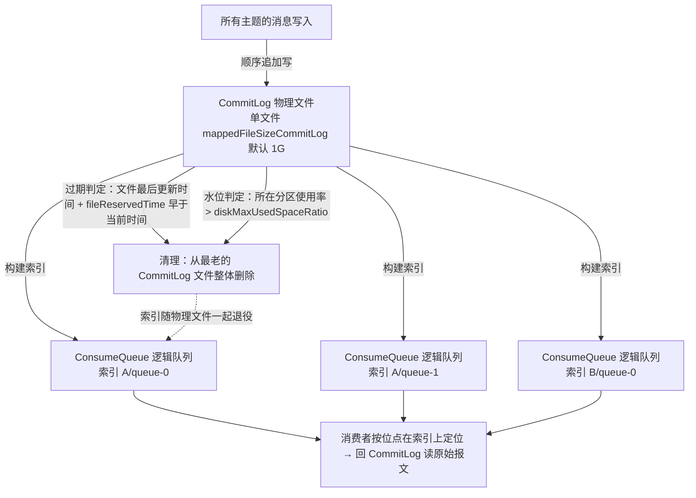
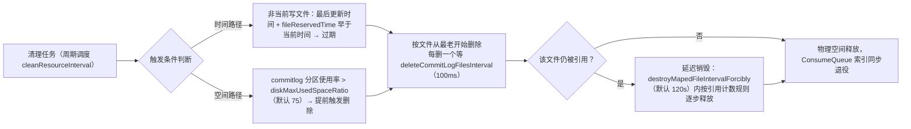

## 为什么需要「发送重试与流控」？为什么消息会「提前消失」？（痛点引入）

这一篇管的是消息链路两端的**容量与故障行为**：发送端在节点抖动时会不会成功、要阻塞多久；服务端在压力过大时怎么自保；已经存进服务端的消息能活多久、什么时候会被清掉。三个高频事故各对应一个机制：

1. **事故一：一台 Broker 重启，整个应用的发送调用集体变慢。** 客户端 SDK 内置重试逻辑，触发重试时业务线程可能一路阻塞到「某次重试成功或最终重试失败」。你没写重试代码，但重试真实存在——不了解它的触发条件与耗时预算，就无法解释「发送 RT 从 5ms 涨到 30s」。
2. **事故二：业务上新要回溯消费，队列存储压力瞬间飙升，随后收到成片的 `TOO_MANY_REQUESTS`。** 服务端容量或水位过高时会用**快速失败返回流控错误**来保护底层资源——这不是消息丢了，是服务端在「限流拒客」，客户端将按指数退避重试。
3. **事故三：承诺保存 3 天的消息，第 2 天就查不到了。** 消息保存时长并不能完整控制实际保存时间：本地磁盘空间不足时，为保证服务稳定性消息仍然会被**强制清理**，导致实际保存时长小于设置的保存时长。

| 维度 | 不懂发送重试 | 不懂流控 | 不懂存储清理 |
|------|--------------|----------|--------------|
| 排障 | 把 SDK 重试造成的耗时误判为「服务端变慢」 | 把 530 限流当成 Broker 故障重启了事 | 把强制清理当成「消息丢失」事故 |
| 容量 | 重试次数随手调大，阻塞业务线程 | 不知道回溯/堆积会触发存储压力流控 | 无法给出消息存储时间 SLA |
| 代码 | 最终重试失败后不做兜底，数据静默丢 | 不做退避重试，重试风暴加剧限流 | 消费时长设计超出保留窗口，回溯扑空 |
| 成本 | —— | 突发流控无应急预案 | 存储预算拍脑袋，提前无预留 |

> ### 💡 新人小结：这三个机制像什么？
>
> 把 RocketMQ 服务端想成一家热门餐厅：
> - **发送重试** = 你打电话订座没接通，重拨。重拨几次、隔多久重拨是套餐里定好的（SDK 内置策略）；占线时每次重拨都占着你的时间（同步调用阻塞）。
> - **流控** = 餐厅坐满了就在门口挂「今日限流，改天再来」（快速失败返回 530）。懂事的重拨策略是**越被拒等越久**（指数退避），不然电话能把餐厅总机打瘫痪。
> - **存储清理** = 餐厅冷库按「存放天数」轮换新菜，过期就清；但**冷库塞不下时，没过期的也得先挪出去**——天数承诺让位于物理空间。
>
> **一句话总结：重试管「再试几次」，流控管「什么时候别再试」，清理管「消息到底能活多久」。**

**学习路线图**

```
痛点引入 → 发送重试 → 退避策略 → 4.x/5.0 对照 → 流控机制 → 存储机制 → 清理规则 → 排查清单
三个问题   触发条件   五个参数    同场景写法     530 行为   时长粒度    双触发路径  现象倒推
```

分工红线：消费重试与死信队列不在本篇（见〈消费重试与死信队列〉）；事务消息只做透明重试的协议背景见〈事务消息〉；参数默认值总表在〈使用限制与参数约束〉，本篇只列与发送可靠性和存储直接相关的数值。

---

## 术语表

| 术语 | 全称 | 通俗含义（用自己的话） | 在本文中的角色 |
|------|------|------------------------|----------------|
| SDK | Software Development Kit（客户端开发包） | 业务进程里引入的 RocketMQ 客户端库，重试逻辑内置其中、对应用不可见 | 发送重试的执行主体 |
| 透明重试 | transparent retries | 只在调用尚未真正「出门」前重做的轻量重试；gRPC 重试提案定义的类别 | 事务消息唯一支持的重试 |
| 指数退避 | Exponential Backoff | 每失败一次，下次等待时间乘一个倍率，越挫等越久 | 流控错误的重试节奏 |
| INITIAL_BACKOFF | 初始退避间隔 | 第一次失败后重试前要等多久，默认 1 秒 | 退避算法五参数之一 |
| MULTIPLIER | 指数退避因子 | 退避倍率，默认 1.6 | 退避算法五参数之一 |
| JITTER | 随机抖动因子 | 在等待时间上叠加的随机扰动，默认 0.2，防所有客户端同一刻重试 | 退避算法五参数之一 |
| MAX_BACKOFF | 等待间隔上限 | 单次最长等待封顶，默认 120 秒 | 退避算法五参数之一 |
| MIN_CONNECT_TIMEOUT | 最短重试间隔 | 重试间隔下限，默认 20 秒 | 退避算法五参数之一 |
| TOO_MANY_REQUESTS / reply-code 530 | 流控错误码 | 服务端「客满了」的回执编号 | 触发指数退避重试的信号 |
| 水位 | —— | 资源使用率的运维黑话：磁盘、内存、队列积压到了几成 | 流控的判定语言 |
| CommitLog | 提交日志 | Broker 上存放消息**物理数据**的统一追加式日志文件，所有主题的消息混写其中 | 存储与清理的实体 |
| ConsumeQueue | 消费队列 | 按主题/队列组织的**逻辑索引**文件，记录消息在 CommitLog 中的位置 | 消费者按图索骥的目录 |
| storePathRootDir | 存储根目录配置 | 消息存储文件根目录，由该配置参数决定 | 目录结构入口 |
| storePathCommitLog / storePathConsumerQueue | 存储路径配置 | commit log 与 consume queue 各自的存放路径 | 5.0 最佳实践参数表 |
| mappedFileSizeCommitLog | CommitLog 单文件大小 | commit log 的映射文件大小，默认 1024\*1024\*1024（1G） | 清理的删除单位是文件 |
| fileReservedTime | 文件保留时间 | 消息保留时长，默认 72（小时，5.0 最佳实践表口径） | 过期清理的时间判据 |
| deleteWhen | 定时删除时刻 | 磁盘空间充足情况下，默认每天什么时候执行删除过期文件，默认 04（凌晨 4 点） | 定时清理触发 |
| diskMaxUsedSpaceRatio | 磁盘最大使用比例 | commitlog 目录所在分区使用率超过该值（默认 75）即触发过期文件删除 | 空间不足清理触发 |
| deleteCommitLogFilesInterval / deleteConsumeQueueFilesInterval | 删除间隔 | 删一个文件后等待的毫秒数（默认各 100），平滑删除动作 | 清理节流 |
| destroyMapedFileIntervalForcibly | 强制销毁等待 | MappedFile 被引用时的最长强删等待，默认 120000 毫秒 | 引用保护机制 |
| MMAP | Memory Mapped File | 把文件映射进内存地址空间的读写方式，Broker 用它加载 CommitLog 和 ConsumeQueue | 解释 vm.max_map_count/文件描述符调优的由来 |
| SLA | Service Level Agreement | 服务承诺；这里是「消息保证存多久」的承诺 | 存储机制存在的业务意义 |
| 消费位点 | ConsumerOffset | 某消费组在某队列消费到的坐标 | 「初始消费位点=队列最大消费位点」是流控触发一的原理支点 |

---

## 消息发送重试：SDK 里那套「看不见的重拨」

### 它替你回答的三个问题

5.0《消息发送重试和流控机制》开篇列了发送重试机制要解答的问题，本篇按这三问展开：

```
部分节点异常是否影响消息发送？→ 触发条件（连接失败/超时/错误码都会触发）
请求重试是否会阻塞业务调用？  → 同步阻塞、异步不阻塞；被阻塞的是最大重试次数×单次耗时
请求重试会带来什么不足？      → 链路耗时不可控、消息可能重复，最终仍可能失败
```

### 基本概念与适用范围

客户端连接服务端发起发送请求时，可能因网络故障、服务异常等原因调用失败。为保证消息可靠性，RocketMQ **在客户端 SDK 中内置请求重试逻辑**，尝试通过重试发送达到最终调用成功的效果。**同步发送和异步发送模式均支持消息发送重试。**

### 触发条件（上游清单完整照录）

| 大类 | 上游列出的具体情形 | 典型现场 |
|------|--------------------|----------|
| 请求调用失败或请求超时 | 网络异常造成连接失败或请求超时 | 机房链路抖动、DNS 异常 |
| | 服务端节点处于重启或下线等状态造成连接失败 | 滚动升级 Broker |
| | 服务端运行慢造成请求超时 | GC 停顿、刷盘排队 |
| 服务端返回失败错误码 | 系统逻辑错误：因运行逻辑不正确造成的错误 | 类型校验拒绝、主题权限问题 |
| | 系统流控错误：因容量超限造成的流控错误 | 触发下面「消息流控机制」一节 |

> [!NOTE] 版本适用：事务消息的例外
> 对于事务消息，只会进行**透明重试（transparent retries）**，网络超时或异常等场景**不会进行重试**（5.0 原文，附 gRPC 客户端重试提案链接）。原因回看〈事务消息〉：半消息超时重发会产生多个悬挂的半事务，回查判据被搅浑。

### 重试流程与两种发送方式的行为差

生产者在初始化时设置消息发送最大重试次数；出现上述触发条件时，客户端按设置的重试次数一直重试，**直到消息发送成功或达到最大重试次数重试结束，并在最后一次重试失败后返回调用错误响应**。

```
同步发送: 调用线程一直阻塞 → 某次重试成功(返回结果) 或 最终重试失败(抛出错误码和异常)
异步发送: 调用线程不阻塞   → 结果通过异常事件或成功事件返回
```

### 重试间隔：立即重试是常态，流控重试要退避

上游给出的间隔规则分两档：

1. **除服务端返回系统流控错误的场景外，其他触发条件重试后均立即进行重试，无等待间隔。**
2. **服务端返回流控错误触发重试时，按指数退避策略延迟重试**，由五个参数控制：

| 参数 | 含义（上游原文） | 默认值 |
|------|------------------|--------|
| INITIAL_BACKOFF | 第一次失败重试前后需等待多久 | 1 秒 |
| MULTIPLIER | 指数退避因子，即退避倍率 | 1.6 |
| JITTER | 随机抖动因子 | 0.2 |
| MAX_BACKOFF | 等待间隔时间上限 | 120 秒 |
| MIN_CONNECT_TIMEOUT | 最短重试间隔 | 20 秒 |

上游给出的建议算法（照录，并注明出处为 gRPC connection-backoff 策略文档）：

```text
ConnectWithBackoff()
  current_backoff = INITIAL_BACKOFF
  current_deadline = now() + INITIAL_BACKOFF
  while (TryConnect(Max(current_deadline, now() + MIN_CONNECT_TIMEOUT)) != SUCCESS)
    SleepUntil(current_deadline)
    current_backoff = Min(current_backoff * MULTIPLIER, MAX_BACKOFF)
    current_deadline = now() + current_backoff + UniformRandom(-JITTER * current_backoff, JITTER * current_backoff)
```

伪代码逐步解释：首轮从 1 秒起步（INITIAL_BACKOFF）；每次失败后把间隔乘 1.6（MULTIPLIER）但不封顶在 120 秒以内（MAX_BACKOFF）；每次的实际等待时长再叠加 ±20% 的随机抖动（JITTER），避免成千上万个客户端在同一毫秒集体重试造成二次雪崩；单次尝试的连接截止时间不低于 20 秒（MIN_CONNECT_TIMEOUT）。这条算法链的终点，就是流控错误下「越拒越等」的节奏。

### 功能约束：三个必须写进设计文档的代价

| 约束 | 上游口径 | 业务侧动作 |
|------|----------|------------|
| 链路耗时阻塞评估 | 重试流程中生产者仅能控制最大重试次数；系统异常触发 SDK 内置重试时，服务端需要等待最终重试结果，可能导致消息发送请求链路被阻塞。对实时调用类场景，需合理评估每次调用请求的超时时间以及最大重试次数，避免影响全链路耗时 | 用「超时 × 最大重试次数」算最坏阻塞，给调用链留出预算 |
| 最终异常兜底 | 客户端内置重试机制**并不能保证消息发送一定成功**；最终重试仍然失败时，业务方调用需要捕获异常、做好冗余保护处理，避免消息发送结果不一致 | 失败落库/告警/补偿任务，三选一必须有 |
| 消息重复问题 | 远程调用不确定：因请求超时触发重试时，客户端无法感知服务端处理结果，重试**可能产生消息重复**，业务逻辑需要自行处理消息重复问题 | 消费端按消息 Key 做幂等 |

> ### 💡 新人小结：为什么「超时重试」会造成重复？
>
> 你给朋友转账，页面卡在「处理中」。你不知道钱到没到账：
> - 直接再转一次 → 可能两笔都到账（消息重复）；
> - 不重转 → 可能一笔都没到（消息丢失）。
> SDK 的超时重试替你选了「再转一次」，把「可能重」的风险接了过来——所以才要求**收钱的那一方（消费端）对账（幂等）**。
> 而「立即连接失败」的重试没有这个问题：电话根本没接通，重拨不会造成双份账单。这就是「连接失败立即重试、超时重试须谨慎、流控重试要退避」三种节奏背后的同一条逻辑。
>
> **一句话总结：重试策略的松紧，取决于「上一次尝试可能已经成功了多少」。**

---

## 新旧对照：4.x 手动重试参数 vs 5.0 SDK 内置策略

**4.x 旧写法最小案例**（场景：一次同步发送，节点重启期间允许重试）：

```java
DefaultMQProducer producer = new DefaultMQProducer("RetryDemoGroup");
producer.setNamesrvAddr("localhost:9876");
producer.setSendMsgTimeout(3000);          // 默认发送超时 3000 毫秒（4.x 客户端参数表）
producer.setRetryTimesWhenSendFailed(2);   // 同步发送失败时 SDK 内部重试 2 次（4.x 默认值）
producer.setRetryTimesWhenSendAsyncFailed(2); // 异步发送失败重试次数（4.x 默认值）
// retryAnotherBrokerWhenNotStoreOK 默认 false：结果非 SEND_OK 不默认当作失败重发
producer.start();
Message msg = new Message("RetryTopic", "TagA", "OrderKey001", "hello".getBytes()); // topic, tag, key, body 四参构造
// ========== 不推荐写法（仅展示） ==========
// ❌ 捕获异常后直接忽略：重试最终失败后仍要业务侧兜底，见上方「最终异常兜底」约束
// try { producer.send(msg); } catch (Exception ignore) {}

// ========== ✅ 推荐写法 ==========
SendResult result = producer.send(msg); // 同步发送：调用线程阻塞，失败时 SDK 内部已按上面参数重试
// 输出（成功场景）: SendResult 回显，sendStatus=SEND_OK
// 输出（失败场景，4.x/5.0 FAQ 原文格式）: Send [xxx] times, still failed, cost [xxx]ms, Topic: xxx, BrokersSent ...
```

**5.0 新写法下的同一关注点**：5.0 发送重试文档不再暴露「按同步/异步分别设重试次数」的客户端参数，改为两条纪律——「生产者在**初始化时**设置消息发送最大重试次数」（限制表默认值：3 次），以及流控场景的指数退避五参数。同步/异步的语义与三种发送方式代码见[领域模型全景与通信方式](/docs/02-core-concepts/领域模型/领域模型全景与通信方式/)，此处不重复。

| 对比维度 | 4.x 手动重试参数 | 5.0 内置重试 + 指数退避（当前方案） |
|----------|------------------|--------------------------------------|
| 写法差异 | 显式 set 三件套：sendMsgTimeout / retryTimesWhenSendFailed / retryTimesWhenSendAsyncFailed | 初始化设置最大重试次数即可，退避节奏由 SDK 内置策略接管 |
| 默认值口径 | 同步/异步内部重试默认各 2 次；FAQ：同步（SYNC）方式**共发送 3 次**，异步（ASYNC）和单向（ONEWAY）发送 1 次 | 消息发送重试次数默认 3 次（限制表）；同步/异步均支持重试，单向未列入支持范围 |
| 重试间隔 | 上游 4.x 文档未给出等待间隔（表现为连续快速重试换 Broker） | 非流控立即重试；流控错误按 INITIAL_BACKOFF 1s / 倍率 1.6 / 抖动 0.2 / 上限 120s / 最短 20s 退避 |
| 行为差异 | 重试次数与超时都摊在业务配置里，最坏耗时 = 超时 × 次数 | 策略收进 SDK，业务只需要评估「阻塞预算」；流控下自动降噪 |
| 迁移成本与兼容性风险 | —— | 迁移删掉重试参数不等于没有重试；FAQ 的异常文案 `Send [xxx] times, still failed...` 两代一致，排障时按「超时是否过小、Broker 是否正常、连接是否正常」三点核对（4.x/5.0 FAQ 原文解决方案） |
| 旧方案仍适用的场景 | 存量 4.x 集群需精确控制同步/异步各自的重试次数 | 新建集群用默认 3 次起步，先压测再谈调整 |

---

## 消息流控机制：服务端什么时候「拒客」，拒了之后会怎样

### 三个问题

流控机制要解答的同样是三问：系统在什么情况下会触发流控？触发流控时客户端行为是什么？应该如何避免触发流控，以及如何应对突发流控？

### 定义与触发条件

消息流控指的是**系统容量或水位过高，服务端通过快速失败返回流控错误，来避免底层资源承受过高压力**。上游给出的触发条件共两条：

| 触发条件 | 上游原文要点 | 为什么是这条链路 |
|----------|--------------|------------------|
| 存储压力大 | 消费者分组的初始消费位点为当前队列的最大消费位点；若某些场景（例如业务上新）需要回溯到指定时刻前开始消费，队列的存储压力会瞬间飙升，触发消息流控 | 回溯意味着大量历史消息重新进入读路径；原理机制参见〈负载均衡与消费进度管理〉 |
| 服务端请求任务排队溢出 | 消费者消费能力不足导致队列中大量堆积消息，堆积超过一定数量后触发消息流控，减少下游消费系统压力 | 保护对象是下游与 Broker 自身队列 |

### 流控时客户端收到什么

当系统触发消息发送流控时，客户端会收到系统限流错误和异常，错误码信息固定为两行：

```text
reply-code: 530
reply-text: TOO_MANY_REQUESTS
```

参数解释：`reply-code`/`reply-text` 是客户端收到的响应字段（上游以「错误码信息如下」给出以上两行原文取值）。**客户端收到系统流控错误码后，会根据指数退避策略进行消息发送重试**——即上一节的五个参数在这里接管节奏。

### 处理建议（上游两条）

1. **如何避免触发消息流控**：触发限流的根本原因是系统容量或水位过高，可利用可观测性功能监控系统水位、容量等，保证底层资源充足，避免触发流控机制。
2. **突发消息流控处理**：如果因突发原因触发流控、且客户端内置的重试流程执行失败，建议业务方**将请求调用临时替换到其他系统进行应急处理**——即预留一条旁路降级通道，而不是指望重试硬闯。

### ✅ / ❌ 对照

| 场景 | 做法 | 判定 |
|------|------|------|
| 收到 530 | 依赖 SDK 指数退避自动重试，同时告警水位 | ✅ 与上游机制同向 |
| 收到 530 | 业务层再包一层固定 100ms 死循环重试 | ❌ 与指数退避对打，容量问题被重试风暴放大（上游把重试调大/滥用的风险口径见〈使用限制与参数约束〉） |
| 大促前 | 压测存储水位、准备旁路降级 | ✅ 「临时替换到其他系统进行应急处理」 |
| 业务上新回溯消费 | 不评估存储压力直接重置位点到很久以前 | ❌ 上游点名的流控触发场景 |

---

## 消息存储机制：以「时长」为纲，以「存储节点」为粒度

### 背景问题

按 5.0《队列》定义，消息按到达服务端的先后顺序存储到队列中，**理论上每个队列都支持无限存储**；但实际部署中服务端节点物理存储空间有限，消息无法永久存储。于是存储机制回答三个问题：存储以什么维度为判定条件？以什么粒度管理？超过限制后如何处理？

理解它的运维价值（上游两条）：

- **提供消息存储时间 SLA，为业务提供安全冗余空间**：存储时长承诺本质上代表业务可自由获取消息的时间范围，对消费时间长、消息堆积、故障恢复等场景非常关键。
- **评估和控制存储成本**：消息一般存储于磁盘介质上，可通过存储机制评估存储空间、提前预留资源。

### 三条核心规则

| 规则 | 上游口径 | 推论 |
|------|----------|------|
| 存储依据 = 存储时长 | 每个节点对外承诺消息的存储时长；时长范围内**无论是否被消费都会保留**，超过时长限制的消息会被清理掉 | 「消费完就删」是想象，按生产时间计时才是事实 |
| 管理粒度 = 存储节点 | 按存储节点管理存储时长，**不是按主题或队列粒度** | 同一 Broker 上所有主题共享同一份时长预算 |
| 与消费状态无关 | 按消息的生产时间计算；若不按消费状态统一控制，大量未消费堆积很容易导致存储空间不足，进而影响新消息的读写速度 | 堆积不会「续命」；有效期内可随时消费，也可用重置位点重复消费 |


### 为什么不按主题/队列单独管理（上游两条原因）

1. **存储结构决定的优势与代价**：RocketMQ 基于「统一的物理日志队列 + 轻量化逻辑队列」的**二级组织方式**管理物理数据——顺序读写、高吞吐、高性能是收益，代价是不支持按主题和队列单独管理。
2. **容量风险并没有真的隔离**：即使按主题独立生成存储文件，存储层本质仍是共享存储介质；单独按主题控制时长看似灵活，整个集群仍然存在容量风险，可能导致存储时长 SLA 被打破。**从安全生产角度，最合理的方式是将不同存储时长的消息通过不同集群分离治理。**

### 存储文件结构：CommitLog 与 ConsumeQueue 的关系

消息默认存储在本地磁盘文件中，**存储文件的根目录由配置参数 `storePathRootDir` 决定**；其中 `commitlog` 文件夹存储消息**物理文件**，`consumeCQueue` 文件夹存储**逻辑队列索引**（上游原文对目录职责的描述；其他文件的详细作用上游未逐一说明）。

下图把「二级组织」+「清理删除」两件事画在一起：



图后解读三条要点：

1. **一份报文，多份目录**：消息实体只写一份进 CommitLog（所有主题混写，换来顺序写性能）；每个主题的每个队列只在 ConsumeQueue 里存一条「去 CommitLog 哪里取」的索引。清理时**以文件为单位**整体删除最老的 CommitLog——所以「删单条过期消息」不存在，删除的最小动作是删一个文件。
2. **消费者读消息 = 索引定位 + 回表读原文**：ConsumeQueue 承载位点语义，物理数据寿命由 CommitLog 决定。
3. **清理有两条触发路径**（见下一节规则表）。

存储相关参数速查（数值均照自上游，注意标注出处文档）：

| 参数 | 上游给出的值 | 出处 |
|------|--------------|------|
| storePathCommitLog | `$HOME/store/commitlog/`（存储 commit log 的路径） | 5.0《最佳实践》Broker 存储参数表 |
| storePathConsumerQueue | `$HOME/store/consumequeue/`（存储 consume queue 的路径） | 同上 |
| mappedFileSizeCommitLog | `1024 * 1024 * 1024`（1G，commit log 的映射文件大小） | 同上 |
| fileReservedTime | 72（以小时计算的文件保留时间） | 5.0《最佳实践》参数表；4.x Broker 参数表说明栏同口径写「默认 72 小时」（该表默认值栏印的是 120，两处不一致，已列入需复核点） |
| deleteWhen | `04`：磁盘文件空间充足情况下，默认每天凌晨 4 点执行删除过期文件 | 4.x《Broker 端配置》参数表 |
| diskMaxUsedSpaceRatio | `75`：commitlog 目录所在分区使用比例大于该值则触发过期文件删除 | 同上 |
| deleteCommitLogFilesInterval | `100`：删除一个 commitlog 文件后的等待毫秒数 | 同上 |
| deleteConsumeQueueFilesInterval | `100`：删除 consumequeue 文件的时间间隔 | 同上 |
| destroyMapedFileIntervalForcibly | `120000`（默认 120s）：过期文件首次销毁时若仍被其他线程引用，则标记不可用并延迟销毁，下次清理任务到达时按规则递减引用直到释放物理资源 | 同上（说明栏全文照录） |
| vm.max_map_count / 文件描述符 | RocketMQ 使用 MMAP 加载 CommitLog 和 ConsumeQueue，建议设置较大的 vm.max_map_count；建议文件描述符设为 655350 | 4.x/5.0《JVM OS 配置》 |

---

## 消息过期清理规则：时间到点删、空间不够也删

下图是清理任务的双触发路径与删除动作的节流细节：



解读（三句话把规则讲完）：

1. **日常路径按时间**：fileReservedTime（5.0 最佳实践表默认 72 小时）到期的文件，在 deleteWhen 指定的时刻（默认凌晨 04 点、磁盘空间充足的前提下）执行删除。
2. **应急路径按空间**：commitlog 所在分区使用率超过 diskMaxUsedSpaceRatio（默认 75）就提前触发过期文件删除——**磁盘紧张时，未到期消息也可能被清掉**，这正是 5.0《消息存储和清理机制》「消息过期清理机制」一节唯一的正文：消息保存时长并不能完整控制实际保存时间，本地磁盘空间不足时，为保证服务稳定性消息仍然会被强制清理，导致实际保存时长小于设置的保存时长。
3. **删除动作是节流且保守的**：逐文件删除、文件之间间隔 100 毫秒；被引用的文件不硬删，等 destroyMapedFileIntervalForcibly（默认 120000 毫秒）的引用释放规则走完。

### 使用建议：把存储时长当 SLA 来谈

上游《使用建议》只有一条，但值得原样强调：**建议在存储成本可控的前提下，尽可能延长消息存储时长**——延长存储时长，可以为紧急故障恢复、应急问题排查和消息回溯带来更多的可操作空间。反过来，运维上要接受两个事实：存储承诺以「节点」为单位（想给不同业务不同保留期，按上游建议用不同集群分离治理）；承诺时长可能被磁盘水位击穿（监控 disk 使用率就是保住 SLA）。

> ### 💡 新人小结：CommitLog / ConsumeQueue 像「总台账」和「索引卡片柜」
>
> - CommitLog 是图书馆唯一的总台账：所有新书（消息）不管哪个科室的，都按到货时间记在同一本流水账上，一本记满（1G）换下一本；
> - ConsumeQueue 是每个科室的索引卡片柜：卡片只写「该书在总台账第几页」；
> - 过期清理 = 台账按册销毁（最老的一整册扔掉），卡片跟着作废——所以删除从不「抽掉其中一页」；
> - 仓库要爆（磁盘 75% 水位）时，管理员没等到销毁日就把老台账提前清走——**台账在架子上的时间，永远 ≤ 官方承诺的保留期**。
>
> **一句话总结：消息按「台账寿命」活着，不按「有没有被读过」活着。**

---

## 排查清单：从现象倒推机制

| 现象 | 先查什么 | 依据出处 |
|------|----------|----------|
| 发送日志出现 `Send [xxx] times, still failed, cost [xxx]ms` | 超时参数是否过小；Broker 是否正常；Producer 与 Broker 连接是否正常 | 4.x/5.0 FAQ SEND_MSG_FAILED 条目（解决方案三条原文） |
| 发送 RT 周期性变长 | 是否触发 SDK 内置重试（节点重启/下线、服务端运行慢）；评估超时 × 最大重试次数的阻塞预算 | 发送重试触发条件 + 功能约束 |
| 收到 reply-code 530 / TOO_MANY_REQUESTS | 回溯消费或大量堆积导致的存储压力/排队溢出；核对水位 | 流控触发条件两条原文 |
| 530 之后客户端长时间不发 | 指数退避生效中：核对五参数节奏（1s 起步、×1.6、±0.2 抖动、封顶 120s、最短 20s） | 重试间隔一节 |
| 事务消息在网络抖动后没有重试 | 正常：事务消息仅透明重试，网络超时/异常不重试 | 发送重试 note 原文 |
| 消息未到保留期就查不到 | 磁盘使用率是否越过 diskMaxUsedSpaceRatio 触发强制清理；检查 deleteWhen 时段附近告警 | 过期清理机制一节 |
| 死信/回溯后发现「消息没消费就没了」 | 存储与消费状态无关，按生产时间计时是设计而非缺陷 | 存储三条核心规则 |
| 消费失败后出现重复消息 | 超时重试的固有代价，检查消费端幂等（按消息 Key 对账） | 功能约束「消息重复问题」 |
| Broker 启动报 mmap 相关失败 | vm.max_map_count 与文件描述符（建议 655350）是否过小 | JVM OS 配置文档 |

---

## 要点总结

1. **重试内置在 SDK，不是可选项**：同步/异步发送均支持重试，触发条件是「连接失败/超时 + 服务端逻辑错误/流控错误」两大类；非流控场景立即重试无间隔，流控场景走指数退避（1s / 1.6 / 0.2 / 120s / 20s 五参数）；单向发送不在 5.0 支持重试的模式之列。
2. **重试的三个代价必须兜底**：同步链路可能被阻塞到「最终重试失败」；内置重试**不保证一定成功**，最后一次失败要抛错误码给业务兜底；超时重试可能产生**消息重复**，幂等由业务自理。
3. **事务消息不享受网络重试**：只做透明重试；4.x 与 5.0 的异常排障文案一致（`Send [xxx] times, still failed...`），排查按「超时、Broker 状态、连接」三问走。
4. **流控是服务端自保不是故障**：容量或水位过高时快速失败返回 530 TOO_MANY_REQUESTS；触发源就两条——回溯类存储压力与消费堆积类任务排队溢出；对策是水位监控 + 突发时旁路降级，客户端退避重试别叠业务重试。
5. **存储清理认两本账**：日常账按 fileReservedTime（默认 72 小时口径）+ deleteWhen（凌晨 4 点）到期删文件；应急账按 diskMaxUsedSpaceRatio（75%）提前删——**消息实际保存时长 ≤ 承诺时长**；管理粒度是存储节点，不同保留需求的业务按上游建议分集群治理。

---

> ### 💡 新人小结：发送可靠性与存储学完了，记住这 5 点
>
> 1. **算出你的最坏阻塞量级**：上游的评估口径是「合理评估每次调用请求的超时时间以及最大重试次数」——以默认值为例，请求超时 3000 毫秒、发送重试 3 次，同步发送的最坏耗时要按这个量级预留链路预算。
> 2. **把 530 当交通指挥棒**：它出现说明问题在容量不在代码；先看水位监控，再看退避日志，最后才怀疑集群。
> 3. **幂等不是玄学，是重试的对价**：SDK 替你重试，就等于替你选了「宁可重复不可丢失」；消费端对账代码是这笔交易的尾款。
> 4. **消息寿命 = min(保留时长, 磁盘余量)**：给业务承诺「可回溯 N 天」之前，先看 diskMaxUsedSpaceRatio 的告警历史。
> 5. **不同保留期分集群，不同 SLA 分预算**：存储时长是节点级承诺，把它下放到主题级是伪需求——上游把答案写得很明白。
