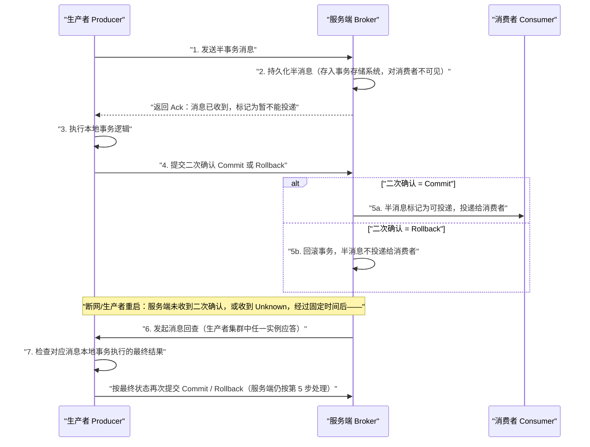
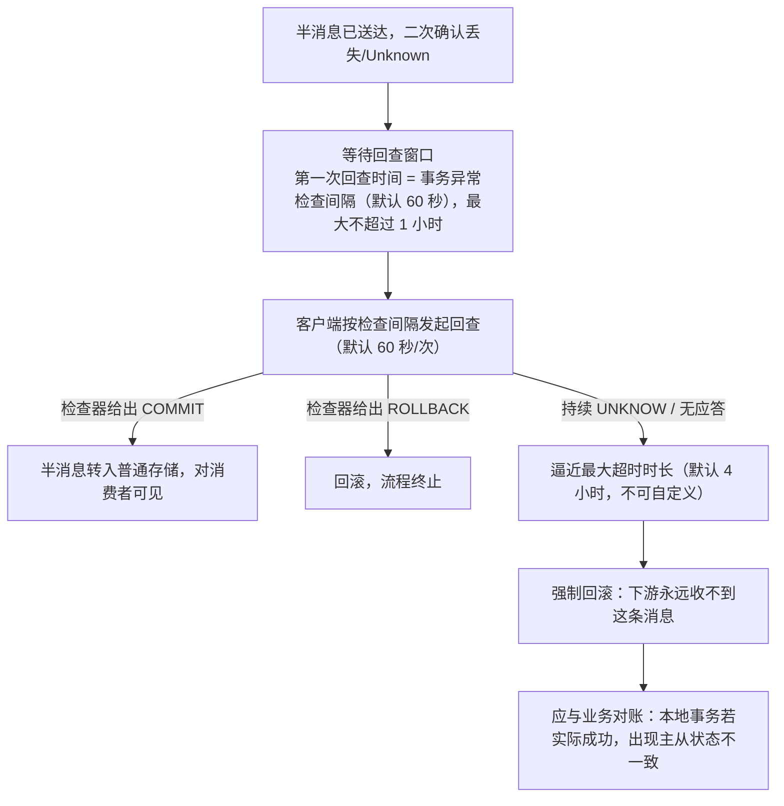

## 为什么需要事务消息？（痛点引入）

先看一个真实形状的分布式事故。电商交易里用户支付订单这一核心操作，同时牵动多个下游子系统：

- 主分支订单系统状态更新：由未支付变更为支付成功。
- 物流系统状态新增：新增待发货物流记录，创建订单物流记录。
- 积分系统状态变更：变更用户积分，更新用户积分表。
- 购物车系统状态变更：清空购物车，更新用户购物车记录。

四条分支要「要么都成、要么都败」。最直觉的两个方案都有硬伤：

**方案 A：传统 XA 事务。** 把四个调用分支封装成包含四个独立事务分支的大事务。能满足结果正确性，但最大的缺点是**多分支环境下资源锁定范围大、并发度低，随着下游分支的增加，系统性能会越来越差**。

**方案 B：普通消息 + 订单表事务。** 订单变更做本地事务，其余分支改为消息下游，用异步化缩短链路、提高并发。但消息下游分支和订单主分支很容易不一致——上游原文列的三种情况，每一种都是对账事故：

| 情况 | 后果 |
|------|------|
| 消息发送成功，订单没有执行成功 | 需要回滚整个事务，但下游可能已经开工 |
| 订单执行成功，消息没有发送成功 | 需要额外补偿才能发现不一致 |
| 消息发送超时未知 | **此时无法判断需要回滚订单还是提交订单变更** |

普通消息和订单事务无法保证一致的原因，本质上是**普通消息无法像单机数据库事务一样，具备提交、回滚和统一协调的能力**。事务消息就是把「提交/回滚/协调」这三样单机事务的能力搬进消息链路：在普通消息基础上支持二阶段提交，并把二阶段提交和本地事务绑定，实现全局提交结果的一致性。

| 维度 | 没有事务消息 | 有事务消息 |
|------|--------------|------------|
| 本地事务失败但消息已出 | 手动写补偿任务、对账脚本 | 半消息未提交，下游根本看不见 |
| 事务成功但消息没发出去 | 靠监控发现 + 人工补发 | 二次确认丢失由服务端回查自动补决策 |
| 发送超时结果未知 | 业务自己猜该提交还是回滚 | 返回 Unknown 挂起，等回查裁决 |
| 协调者 | 每个业务自建 | Broker + TransactionChecker/TransactionListener 协议内置 |

> ### 💡 新人小结：事务消息是「先寄存、后签字」的快递
>
> 把半事务消息想象成快递站的寄存流程：
> - 你先把包裹交到驿站寄存（**发送半消息**），驿站收下了、给你回执，但**不派送给收件人**（对消费者不可见）；
> - 你回家确认订单真的下成了（**执行本地事务**），再回驿站签字：「发」（Commit）或「撤」（Rollback）；
> - 你要是忘了签、或者签字路上手机没电了（断网/应用重启），**驿站不会替你猜**——它会按固定时间主动打电话问你，或问你同一家公司的其他分店（同生产者组实例），这就是**回查**；
> - 一直问不到结果，超过期限包裹按「撤」处理（强制回滚）。
>
> **一句话总结：事务消息 = 把「投递」这个动作挂在一个可以由双方反复确认的二阶段协议上。**

**学习路线图**

```
痛点引入 → 协议全景 → 生命周期 → 使用限制 → 4.x 写法 → 5.0 写法 → 新旧对照 → 回查与悬挂排查 → 要点
时序图     状态机     四条红线   Listener   Checker+Transaction  逐维度表   参数与排查清单
```

---

## 术语表

| 术语 | 全称 | 通俗含义（用自己的话） | 在本文中的角色 |
|------|------|----------------|----------------|
| 半事务消息 | Half Message / prepare message | 已到服务端并持久化、但没拿到二次确认、「暂不能投递」的消息 | 二阶段协议的第一阶段载体 |
| 二次确认 | Commit / Rollback | 本地事务跑完后生产者给服务端的最终答复 | 决定半消息投递还是丢弃 |
| 回查 | Transaction Check | 服务端迟迟拿不到二次确认时，反向询问生产者本地事务结果 | 悬挂事务的自动恢复机制 |
| TransactionListener | 事务监听器（4.x 接口） | 一个接口两个方法：`executeLocalTransaction` 执行本地事务、`checkLocalTransaction` 应答回查 | 4.x 客户端的事务契约 |
| TransactionMQProducer | 事务生产者（4.x 类） | 替代 DefaultMQProducer 的事务消息发送入口 | 4.x 示例的主体 |
| LocalTransactionState | 本地事务状态（4.x 枚举） | executeLocalTransaction/checkLocalTransaction 的返回值：COMMIT_MESSAGE / ROLLBACK_MESSAGE / UNKNOW | 4.x 返回码语义 |
| TransactionChecker | 事务检查器（5.0） | 生产者绑定的回查回调：通过业务侧数据状态判断事务消息最终状态 | 5.0 客户端的事务契约 |
| Transaction | 事务对象（5.0） | `producer.beginTransaction()` 返回的句柄，send 要带上它，之后 commit()/rollback() | 5.0 显式二阶段 API |
| TransactionResolution | 事务状态（5.0 枚举） | 检查器/二次确认的结果标识：提交、回滚、未决 | 5.0 返回码语义 |
| 预绑定主题列表 | 生产者属性（5.0） | 生产者初始化时声明会发送哪些主题；事务消息场景**必须设置** | 故障重启后旧事务能被恢复的前提 |
| 透明重试 | transparent retries | 事务消息只做的重试类别：网络超时/异常不重试 | 发送重试与事务的交叉规则 |
| XA | XA 协议（分布式事务标准） | 多分支强一致的数据库事务协议，锁范围大、并发低 | 被对照的性能方案 |
| 最终一致性 | Eventual Consistency | 允许中间状态不一致，但保证收敛到一致 | 事务消息承诺的一致性级别 |
| RMQ_SYS_TRANS_HALF_TOPIC | 系统保留主题 | 半事务消息相关的系统主题名（保留字符，业务命名不得占用） | 排查半消息滞留时的检索线索 |
| UNKNOW | （上游 4.x 枚举原文拼写） | 4.x 的「未决」状态值，注意不是 UNKNOWN | 照抄上游类名/枚举名 |
| mqadmin queryMsgByKey / queryMsgById | 管理工具查询命令 | 按消息 Key / 消息 ID 查询消息 | 悬挂事务排查的工具入口 |

---

## 协议全景：七步交互链

5.0《事务消息》的功能原理给出七步流程，4.x 的八条步骤与之逐句同构（4.x 多出的第 6 条是对回查次数与时效的提醒）。下图是完整时序：



图后解读四个关键裁决点：

1. **「持久化成功」不等于「可消费」。** 服务端把半消息持久化成功后返回 Ack，此时消息被标记为「暂不能投递」——半事务消息**只有 Commit 才会真正向下游投递**（4.x 原文）。
2. **回查的触发条件是两类**（5.0 步骤 5 原文）：服务端**未收到**发送者提交的二次确认结果；或收到的二次确认结果为 **Unknown 未知状态**。典型诱因是断网或生产者应用重启。经过固定时间后，服务端对消息生产者——**生产者集群中任一生产者实例**——发起回查。
3. **4.x 对回查次数有明确告诫**：「服务端仅仅会按照参数尝试指定次数，超过次数后事务会强制回滚，因此未决事务的回查时效性非常关键，需要按照业务的实际风险来设置」。上游本篇未给出该次数的具体数值，数值纪律见〈使用限制与参数约束〉。
4. **回查不是新协议，是旧协议的续集**：生产者收到回查后检查本地事务最终结果，再次提交二次确认，服务端仍按 Commit/Rollback 的原规则处理（步骤 7 与步骤 4 语义相同）。

## 事务消息生命周期：普通消息没有的两个中间态


5.0 文档的生命周期在普通消息五段之上多切出「事务专属区」：

| 阶段 | 发生了什么 | 对消费者可见吗 |
|------|------------|----------------|
| 初始化 | 半事务消息被生产者构建并完成初始化，待发送到服务端 | 否 |
| 事务待提交 | 发送到服务端后**并不会被直接持久化到普通存储**，而是单独存储到事务存储系统中，等待第二阶段本地事务结果 | 否 |
| 消息回滚 | 第二阶段结果明确为回滚：服务端将半事务消息回滚，**该事务消息流程终止** | 永远不会 |
| 提交待消费 | 第二阶段结果明确为提交：半消息重新存储到普通存储系统 | 是，等待被获取消费 |
| 消费中 / 消费提交 / 消息删除 | 与普通消息一致（超时触发消费重试；提交仅逻辑标记；到期滚动清理） | —— |

「事务待提交」的存在解释了一个常见疑惑：**半消息在提交前查不到、消费不到，是协议设计而不是丢消息**。另外「消息回滚」是一条终止态——回滚后的半消息不会再投递，也不存在「复活」。

---

## 使用限制：四条红线（全部照自 5.0 原文）

| 限制 | 原文口径 | 违反后的表现 |
|------|----------|--------------|
| 消息类型一致性 | 事务消息仅支持在 MessageType 为 Transaction 的主题内使用；NORMAL 类型 Topic 不支持 TRANSACTION 类型消息，生产消息会报错 | 发送直接报错被拒 |
| 消费事务性 | 事务消息保证本地主分支事务和下游**消息发送**事务的一致性，**不保证消息消费结果和上游事务的一致性** | 下游处理失败不会让上游事务回滚；需下游自行做好消费重试，短暂失败靠重试收敛 |
| 中间状态可见性 | 事务消息为**最终一致性**：在消息提交到下游消费端处理完成之前，下游分支和上游事务之间的状态会不一致 | 只适合接受异步执行的事务场景；要求「下游立刻同步可见」的业务不适用 |
| 事务超时机制 | 半事务消息被发送服务端后，若指定时间内服务端无法确认提交或回滚，消息**默认会被回滚** | 超时时长默认 4 小时、不支持自定义修改（见参数表） |

与〈使用限制与参数约束〉同源的三个事务参数（5.0 参数表原文数值）：

| 参数 | 默认值 | 取值范围 | 说明（原文要点） |
|------|--------|----------|------------------|
| 事务异常检查间隔 | 60 秒 | 不建议设置过短 | 半事务消息因系统重启或异常未提交时，生产者客户端按该间隔进行事务状态回查；过短则频繁回查影响系统性能 |
| 半事务消息第一次回查时间 | 取值等于事务异常检查间隔 | 最大不超过 1 小时 | —— |
| 半事务消息最大超时时长 | 4 小时 | 不支持自定义修改 | 超过该时长仍没有返回结果，半事务消息被强制回滚；建议通过监控该指标避免异常事务 |

另有一条按类型的报文红线：事务消息（与定时/延时消息同档）单条大小上限 64 KB，出自 5.0《消息（Message）》按类型的默认上限（与〈使用限制与参数约束〉「按类型收紧」口径一致）。

> ### 💡 新人小结：为什么「不保证消费结果」不是缺陷？
>
> 还是快递寄存的类比：驿站能保证「你签了发，包裹一定在」（消息一定投出去），但**包裹签收后里面东西坏没坏，驿站不管**——那是收件人（下游）自己的质检流程（消费重试）。
> - 承诺的边界：主分支事务 ↔ 消息发送，这两件事最终一致；
> - 不承诺的边界：消息投递 ↔ 下游消费成功，中间状态允许暂时不一致，靠最终一致性收敛。
>
> **一句话总结：事务消息交付的是「说到做到」，不是「别人也做到」；后半句要靠消费重试和下游对账。**

---

## 4.x 写法：TransactionMQProducer + TransactionListener

4.x 的事务契约是**一个接口两个方法**：

```java
public interface TransactionListener {
    // 半事务消息发送成功后被调用，用于执行本地事务
    LocalTransactionState executeLocalTransaction(final Message msg, final Object arg);
    // 对 prepare(半) 消息没有收到应答时，Broker 发回查消息检查事务状态，此方法被调用以获取本地事务状态
    LocalTransactionState checkLocalTransaction(final MessageExt msg);
}
```

完整可运行示例（照搬上游 TransactionProducer，补齐注释与输出说明）：

```java
public class TransactionProducer {
    public static void main(String[] args) throws MQClientException, InterruptedException {
        TransactionListener transactionListener = new TransactionListenerImpl();
        // 事务消息的发送不再使用 DefaultMQProducer，而是使用 TransactionMQProducer
        TransactionMQProducer producer = new TransactionMQProducer("please_rename_unique_group_name");
        // 设置事务回查的线程池；如果不设置，也会默认生成一个
        ExecutorService executorService = new ThreadPoolExecutor(2, 5, 100, TimeUnit.SECONDS,
            new ArrayBlockingQueue<Runnable>(2000), new ThreadFactory() {
                @Override
                public Thread newThread(Runnable r) {
                    Thread thread = new Thread(r);
                    thread.setName("client-transaction-msg-check-thread");
                    return thread;
                }
            });
        producer.setExecutorService(executorService);
        producer.setTransactionListener(transactionListener);
        producer.start();

        String[] tags = new String[] {"TagA", "TagB", "TagC", "TagD", "TagE"};
        for (int i = 0; i < 10; i++) {
            try {
                Message msg =
                    new Message("TopicTest", tags[i % tags.length], "KEY" + i,
                        ("Hello RocketMQ " + i).getBytes(RemotingHelper.DEFAULT_CHARSET));
                // 入口方法不再是 send()，而是 sendMessageInTransaction(msg, arg)
                // 半消息发送成功后，arg（此处为 null）会原样传给 executeLocalTransaction
                SendResult sendResult = producer.sendMessageInTransaction(msg, null);
                System.out.printf("%s%n", sendResult);
                // 输出: SendResult 回显；此时本地事务已执行，状态由 executeLocalTransaction 返回值决定
                Thread.sleep(10);
            } catch (MQClientException | UnsupportedEncodingException e) {
                e.printStackTrace();
            }
        }
        // 演示程序保活：等待 Broker 可能对 UNKNOW 事务发起的回查
        for (int i = 0; i < 100000; i++) {
            Thread.sleep(1000);
        }
        producer.shutdown();
    }

    static class TransactionListenerImpl implements TransactionListener {
        private AtomicInteger transactionIndex = new AtomicInteger(0);
        private ConcurrentHashMap<String, Integer> localTrans = new ConcurrentHashMap<>();

        @Override
        public LocalTransactionState executeLocalTransaction(Message msg, Object arg) {
            // 演示逻辑：按计数取模模拟三种本地事务结果，以 transactionId 记账
            int value = transactionIndex.getAndIncrement();
            int status = value % 3;
            localTrans.put(msg.getTransactionId(), status);
            return LocalTransactionState.UNKNOW; // 演示用：统一返回未决，把裁决交给回查
        }

        @Override
        public LocalTransactionState checkLocalTransaction(MessageExt msg) {
            // 回查时按 transactionId 找到本地记账，返回真实状态
            Integer status = localTrans.get(msg.getTransactionId());
            if (null != status) {
                switch (status) {
                    case 0:
                        return LocalTransactionState.UNKNOW;          // 仍未决，等待下一轮回查
                    case 1:
                        return LocalTransactionState.COMMIT_MESSAGE;  // 本地事务成功，提交
                    case 2:
                        return LocalTransactionState.ROLLBACK_MESSAGE;// 本地事务失败，回滚
                    default:
                        return LocalTransactionState.COMMIT_MESSAGE;
                }
            }
            return LocalTransactionState.COMMIT_MESSAGE;
        }
    }
}

// ========== 不推荐写法（仅展示） ==========
// ❌ executeLocalTransaction 里无论如何都返回 UNKNOW 且 checkLocalTransaction 无法给出答案：
//    事务将一路回查到超时被强制回滚（见「悬挂事务排查」）
```

参数解释与返回码语义（4.x 原文）：

| 返回值 | 语义 | 服务端行为 |
|--------|------|------------|
| `LocalTransactionState.COMMIT_MESSAGE` | 提交事务 | 允许消费者消费该消息 |
| `LocalTransactionState.ROLLBACK_MESSAGE` | 回滚事务 | 消息将被丢弃，不允许消费 |
| `LocalTransactionState.UNKNOW`（上游枚举原文拼写） | 暂时无法判断状态 | 等待固定时间后 Broker 根据回查规则向生产者发起消息回查 |

回查规则（4.x 原文）：本地事务执行完成后，若 Broker 收到的本地事务返回状态为 UNKNOW，**或生产者应用退出导致本地事务未提交任何状态**，Broker 会向消息生产者发起事务回查；第一次回查后仍未获取到事务状态，则之后**每隔一段时间**会再次回查。

> [!WARNING] 生产者组名不能随意设置（4.x 原文 caution）
> 事务消息有回查机制。回查时 Broker 端如果发现原始生产者已经崩溃，**则会联系同一生产者组的其他生产者实例**回查本地事务执行情况，以 Commit 或 Rollback 半事务消息。因此事务生产者必须使用规划过的 ProducerGroupName：同组实例的 `checkLocalTransaction` 逻辑必须一致、且都能依据消息内容独立裁决——否则回查落到「不懂这笔账」的实例上，悬挂概率陡增。

---

## 5.0 写法：TransactionChecker + 显式 Transaction 句柄

5.0 的契约变化：本地事务**不再嵌在回调里由客户端自动触发**，而是业务代码显式开启事务、发送半消息、执行本地事务、决定 commit/rollback；`TransactionChecker` 只承担回查应答这一个职责。上游原文对改造点的概括：发送事务消息前需要开启事务并关联本地事务执行；**为保证事务一致性，在构建生产者时，必须设置事务检查器和预绑定事务消息发送的主题列表**，客户端内置的事务检查器会对绑定的事务主题做异常状态恢复。

```shell
# ========== 5.0：先创建事务主题（NORMAL 主题发 TRANSACTION 消息会直接报错） ==========
./bin/mqadmin updatetopic -n localhost:9876 -t TestTopic -c DefaultCluster -a +message.type=TRANSACTION
# 参数：-c 集群名称；-t Topic 名称；-n NameServer 地址；
#       -a 额外属性，本例给主题添加 message.type 为 TRANSACTION 的属性用来支持事务消息
```

发送端完整示例（照搬上游演示代码，保留类名与方法名，补齐注释与输出）：

```java
// 演示 demo：模拟订单表查询服务，用来确认订单事务是否提交成功。
private static boolean checkOrderById(String orderId) {
    return true;
}
// 演示 demo：模拟本地事务的执行结果。
private static boolean doLocalTransaction() {
    return true;
}

public static void main(String[] args) throws ClientException {
    ClientServiceProvider provider = new ClientServiceProvider();
    MessageBuilder messageBuilder = new MessageBuilderImpl();
    // 构造事务生产者：事务消息需要生产者构建一个事务检查器，用于检查确认异常半事务的中间状态。
    Producer producer = provider.newProducerBuilder()
            .setTransactionChecker(messageView -> {
                // 事务检查器一般是根据业务的 ID 去检查本地事务是否正确提交还是回滚。
                // 此处以订单 ID 属性为例：订单表找到了这个订单，说明本地事务插入订单的操作已正确提交；
                // 订单表没有订单，说明本地事务已经回滚。
                final String orderId = messageView.getProperties().get("OrderId");
                if (Strings.isNullOrEmpty(orderId)) {
                    return TransactionResolution.ROLLBACK; // 错误的消息，直接返回 Rollback
                }
                return checkOrderById(orderId) ? TransactionResolution.COMMIT : TransactionResolution.ROLLBACK;
            })
            .build();

    // 开启事务分支。
    final Transaction transaction;
    try {
        transaction = producer.beginTransaction();
    } catch (ClientException e) {
        e.printStackTrace();
        return; // 事务分支开启失败，直接退出
    }

    Message message = messageBuilder.setTopic("topic")
            .setKeys("messageKey")     // 消息索引键，可根据关键字精确查找某条消息
            .setTag("messageTag")      // 消息 Tag，消费端可按 Tag 过滤（过滤本身见〈消息过滤Tag与SQL92〉）
            // 一般事务消息都会设置一个本地事务关联的唯一 ID，用来做本地事务回查的校验。
            .addProperty("OrderId", "xxx")
            .setBody("messageBody".getBytes())
            .build();

    // 发送半事务消息
    final SendReceipt sendReceipt;
    try {
        sendReceipt = producer.send(message, transaction);
    } catch (ClientException e) {
        return; // 半事务消息发送失败，事务可以直接退出并回滚
    }
    // 输出: sendReceipt.getMessageId() 可取回半消息的 ID，此后本地事务成败都与该 ID 关联

    // 执行本地事务，并确定本地事务结果：
    // 1. 本地事务提交成功 -> 提交消息事务；2. 提交失败 -> 回滚消息事务；
    // 3. 未知异常 -> 不处理，等待事务消息回查。
    boolean localTransactionOk = doLocalTransaction();
    if (localTransactionOk) {
        try {
            transaction.commit();   // 二次确认 Commit：半消息转为可投递
        } catch (ClientException e) {
            // 业务可按自身对实时性的要求选择是否重试；放弃重试时，可以依赖事务消息回查机制进行事务状态的提交。
            e.printStackTrace();
        }
    } else {
        try {
            transaction.rollback(); // 二次确认 Rollback：半消息被回滚，永不投递
        } catch (ClientException e) {
            // 建议记录异常信息；回滚异常时可以无需重试，依赖事务消息回查机制进行事务状态的提交。
            e.printStackTrace();
        }
    }
}
```

参数解释与返回码语义（5.0 口径）：

| 元素 | 语义 | 备注 |
|------|------|------|
| `setTransactionChecker(...)` | 绑定回查应答逻辑 | 上游领域模型要求事务场景**必须设置**，并与预绑定主题列表配合做异常状态恢复 |
| `beginTransaction()` | 显式开启事务分支 | 失败直接退出，此时没有任何消息在服务端 |
| `send(message, transaction)` | 发送半事务消息 | 与 4.x `sendMessageInTransaction` 的本质区别：不再自动执行本地事务 |
| `transaction.commit() / rollback()` | 二次确认 | 异常时可按实时性要求选择重试；放弃重试就依赖回查兜底 |
| 本地事务未知异常 | **不处理**（既不 commit 也不 rollback） | 等回查；这是 5.0 版「UNKNOW 语义」的表达方式——没有返回 Unknown，而是不调用 commit |
| `TransactionResolution.COMMIT / ROLLBACK` | 检查器的裁决输出 | 检查器应通过业务侧数据状态判断事务消息状态（如按订单 ID 查订单表） |

> ### 💡 新人小结：4.x 与 5.0 的事务契约，像「全托管」与「半托管」
>
> - 4.x 像把车交给代驾：你注册两个回调（execute/check），半消息一发出去，SDK 自动喊你执行本地事务、根据你返回的枚举决定提交还是回滚；
> - 5.0 像自己开车、只在出事时接交警电话：`beginTransaction → send → 本地事务 → commit/rollback` 每一步都在你手里，客户端只留一个 `TransactionChecker` 专门应答回查；
> - 两代的「不知道怎么办」也同构：4.x 返回 UNKNOW，5.0 干脆不调 commit——都把裁决权交给回查时间线。
>
> **一句话总结：5.0 把事务流程从「回调驱动」改成「代码驱动」，回查职责被单独收敛进 TransactionChecker。**

---

## 新旧写法对照：同一场景「订单落库 + 通知下游」

> [!NOTE] 版本适用：两代事务 API 完全不通用
> 4.x 侧的事务入口是 `TransactionMQProducer.sendMessageInTransaction(msg, arg)` + `TransactionListener` 双回调，返回 `LocalTransactionState`（含上游原文拼写 `UNKNOW`）；5.0 侧是 `producer.beginTransaction()` → `send(message, transaction)` → `transaction.commit()/rollback()` 显式三段，回查应答收敛到 `TransactionChecker`，返回 `TransactionResolution`。此外 5.0 强制主题类型校验（必须 `+message.type=TRANSACTION`）并要求构建生产者时**必须**设置事务检查器与预绑定事务主题列表，4.x 无此两项要求。迁移不存在「只改依赖不改代码」的路径。

**4.x 旧写法最小案例**（核心骨架，完整类见上一节）：

```java
TransactionMQProducer producer = new TransactionMQProducer("OrderTransactionGroup");
producer.setTransactionListener(new TransactionListener() {
    public LocalTransactionState executeLocalTransaction(Message msg, Object arg) {
        boolean ok = insertOrder(msg.getKeys());                 // 本地事务嵌在回调里自动执行
        return ok ? LocalTransactionState.COMMIT_MESSAGE
                  : LocalTransactionState.ROLLBACK_MESSAGE;      // 无法判断时返回 UNKNOW 等回查
    }
    public LocalTransactionState checkLocalTransaction(MessageExt msg) {
        return orderExists(msg.getKeys()) ? LocalTransactionState.COMMIT_MESSAGE
                                          : LocalTransactionState.ROLLBACK_MESSAGE;
    }
});
producer.sendMessageInTransaction(msg, null);
// 输出: SendResult；半消息送达后 SDK 自动回调 executeLocalTransaction 完成第二阶段
```

**5.0 新写法最小案例**（同一场景）：

```java
Producer producer = provider.newProducerBuilder()
        .setTransactionChecker(mv -> orderExists(mv.getKeys())
                ? TransactionResolution.COMMIT : TransactionResolution.ROLLBACK)
        .build();                                   // 检查器在建 producer 时绑定
Transaction tx = producer.beginTransaction();       // 阶段边界显式化
try {
    producer.send(message, tx);                     // 半消息
} catch (ClientException e) { return; }             // 半消息都没发出去，直接退出
if (insertOrder(message.getKeys())) { tx.commit(); } else { tx.rollback(); }
// 输出: 半消息在 commit 后才对消费者可见
```

逐维度对比分析：

| 对比维度 | 4.x TransactionListener | 5.0 TransactionChecker + Transaction（当前方案） |
|----------|------------------------|---------------------------------------------------|
| 写法差异（代码量、复杂度） | 实现两方法接口 + `sendMessageInTransaction` 一行触发全流程 | 三步显式 API（begin/send/commit），但事务边界、异常路径全部自己编排 |
| 本地事务的触发者 | SDK 自动回调 executeLocalTransaction | 业务代码在 send 之后自行执行 |
| 未决状态的表达方式 | 返回值 `LocalTransactionState.UNKNOW` | 不调用 commit/rollback，等回查裁决 |
| 回查应答的输入 | `MessageExt`，演示代码用 `msg.getTransactionId()` 查内存记账 | `MessageView` 只读视图，上游示例按 `getProperties().get("OrderId")` 查业务表 |
| 恢复机制的挂载点 | 生产者组：原始实例崩溃时 Broker 联系**同组其他实例**回查 | 生产者属性：**必须设置**事务检查器 + 预绑定事务主题列表，客户端内置检查器对绑定主题做异常状态恢复 |
| 主题要求 | 无类型属性校验，任意主题可发事务消息 | 必须 `+message.type=TRANSACTION`，NORMAL 主题发送报错 |
| 发送重试行为 | 上游本篇未单列 | 事务消息只做透明重试（transparent retries），网络超时或异常等场景不会重试（5.0《消息发送重试和流控机制》原文，详见〈发送重试、流控与消息存储清理〉） |
| 迁移成本与兼容性风险 | —— | 需要：拆接口（Listener 一分为二：本地事务回归业务代码、回查留给 Checker）、补建 TRANSACTION 主题、把事务判据从 transactionId 内存映射改为可持久化业务键（如订单 ID 属性）、预绑定主题列表。**风险点**：4.x 演示代码把事务状态记在 ConcurrentHashMap 里，进程重启即失忆；5.0 示例特意改用「查订单表」——回查可能落在重启后的进程甚至其他实例上，判据必须进程外可查 |
| 旧方案仍适用的场景 | 存量 4.x 集群；希望 SDK 托管事务编排、业务只写回调 | 新建 5.0 集群一律用显式 Transaction API |

---

## 悬挂事务：回查时效性与排查清单

「悬挂事务」= 半消息长期停在事务待提交状态：既没 Commit 也没 Rollback。它的终点只有一个——超过半事务消息最大超时时长（默认 4 小时、不支持自定义修改）仍无结果，**被强制回滚**。上游在 4.x 提醒「未决事务的回查时效性非常关键」，5.0 建议「通过监控该指标避免异常事务」。

下图是悬挂事务沿参数时间线的演化（数值全部取自 5.0 参数表）：



解读：被强制回滚不等于「一切正常」。**如果本地事务其实成功了而消息被超时回滚，上游状态与下游分支就永久不一致**——这正是「回查时效性关键」和「监控该指标」两句话指向的事故。悬挂事务排查按下面清单走：

| 排查步骤 | 动作 | 依据/工具 |
|----------|------|-----------|
| 1. 确认是否进入回查 | 看生产者日志中的回查调用（4.x 回查线程名 `client-transaction-msg-check-thread` 即为演示所设） | 4.x 示例代码 |
| 2. 检查回查是否过频 | 核对事务异常检查间隔是否被改得过短（默认 60 秒）；过短则「频繁的回查调用会影响系统性能」 | 5.0 参数表 |
| 3. 检查 Checker/Listener 判据 | 判据必须是进程外可查的业务状态（订单表、流水表）；内存 Map、本地缓存在重启/跨实例回查时必然失效 | 5.0 示例注释「一般是根据业务的 ID 去检查本地事务是否正确提交还是回滚」 |
| 4. 检查进行中事务的应答 | 事务仍在执行时**不要返回 Rollback 或 Commit，继续保持 Unknown**；原因为「事务执行较慢，消息回查太快」，解法：把第一次回查时间设置较大（最大不超过 1 小时，代价是依赖回查的事务提交延迟变大），或让程序能正确识别进行中的事务 | 5.0《使用建议》原文 |
| 5. 按 Key/ID 定位消息 | 事务消息发送示例均建议设置消息索引键；排查时用主题 + 消息 ID 准确查询（`mqadmin` 提供 `queryMsgById`、`queryMsgByKey`「根据消息 Key 查询消息」等命令） | 4.x FAQ；5.0《RocketMQ Admin 工具》 |
| 6. 检查半消息残留 | 半事务相关系统主题为保留主题 RMQ_SYS_TRANS_HALF_TOPIC（保留字符清单收录）；若业务命名撞上这些保留名，系统解析会出现异常 | 5.0 参数表保留字符 |
| 7. 检查生产者组/预绑定 | 4.x：回查会落到同生产者组其他实例，组名与实例逻辑必须统一；5.0：预绑定主题列表未包含事务主题，重启后异常恢复覆盖不到 | 4.x caution；5.0 领域模型「事务消息（必须设置）」 |
| 8. 复核超时窗口 | 半消息从送达至强制回滚的预算即 4 小时；业务若允许更长的本地事务，属于设计错误，应拆小事务 | 5.0 参数表 + 使用限制「事务超时机制」 |

使用建议的另一条红线：**避免大量未决事务导致超时**——RocketMQ 支持在事务提交阶段异常时发起回查保证一致性，但生产者应尽量避免本地事务返回未知结果；大量事务检查会导致系统性能受损，容易引发事务处理延迟。

---

## 常见误区自检（✅ 与 ❌ 对照）

| 场景 | ❌ 错误做法 | ✅ 正确做法 | 依据 |
|------|------------|-------------|------|
| 下游积分服务处理失败 | 认为上游订单事务会自动回滚 | 下游做好消费重试、保证消息被正确处理；不一致走对账 | 消费事务性限制 |
| 要求「支付成功瞬间下游状态同步可见」 | 用事务消息做同步 RPC 用 | 换方案；事务消息仅适合接受异步执行的事务场景 | 中间状态可见性限制 |
| 本地事务耗时 5 小时 | 照常用半消息 | 事务必须收敛进 4 小时超时预算，或拆事务 | 事务超时机制 |
| 回查判据 | 用进程内存 Map 记录事务状态 | 用业务表状态（订单 ID 查单）作为判据 | 5.0 示例注释 |
| 4.x 生产者组 | 每个实例起不同的组名 | 统一规划 ProducerGroupName，同组回查逻辑一致 | 4.x caution 原文 |
| 5.0 生产者构建 | 不设 Checker / 不预绑定主题 | 构建时**必须**设置事务检查器和预绑定事务主题列表 | 5.0 使用示例原文 |
| 大量场景拿不准就返回 Unknown | 靠回查当常规路径 | 本地事务尽量给出明确结果；回查是异常兜底不是主链路 | 使用建议「避免大量未决事务」 |

---

## 要点总结

1. **事务消息解决的是「本地事务 ↔ 消息发送」的一致性**：普通消息没有提交/回滚/协调能力，XA 性能随分支数恶化；事务消息用「半消息 + 二次确认 + 回查」的二阶段协议把两者绑定，承诺最终一致（中间状态可见、消费结果不负责）。
2. **七步链路必须能默画**：发半消息 → 服务端持久化并 Ack（暂不能投递）→ 执行本地事务 → Commit（可投递）/Rollback（丢弃）；二次确认丢失或 Unknown → 固定时间后服务端向**生产者集群任一实例**回查 → 检查本地事务最终结果 → 按原规则再次提交。
3. **回查有硬性时间线**：第一次回查在事务异常检查间隔后（默认 60 秒，最大不超过 1 小时），持续未决到半事务最大超时时长（默认 4 小时、不可自定义）即被**强制回滚**；4.x 额外警告超过指定尝试次数强制回滚——回查时效性是业务风险项。
4. **两代 API 的契约差异**：4.x 是 TransactionMQProducer + TransactionListener 双回调（UNKNOW 返回码、同生产者组代为回查、组名不可乱设）；5.0 是显式 beginTransaction/send/commit + TransactionChecker 单一职责，且必须绑定检查器与预绑定事务主题、主题必须是 TRANSACTION 类型。
5. **判据要「活得比进程久」**：回查可能落在重启后的原实例或同组其他实例上，事务状态必须能从业务数据（如订单表）反查；悬挂事务排查走「回查日志 → 间隔参数 → 判据 → 进行中应答 → Key 查询 → 半消息主题 → 组/预绑定 → 超时预算」八步清单。

---

> ### 💡 新人小结：事务消息学完了，记住这 5 点
>
> 1. **画一遍时序图再写代码**：半消息、Ack、本地事务、二次确认、回查，五要素缺一个就不是完整事务。
> 2. **Unknown 是「挂电话」不是「按了免提」**：返回 UNKNOW（4.x）或不 commit（5.0）只是把裁决推迟到回查窗口，4 小时一到服务端替你「回滚」。
> 3. **Checker 就是你的对账接口**：按业务 ID 查真实状态写进去，重启、跨实例、并发场景它都靠得住——这是 5.0 示例用订单表而不是内存 Map 的原因。
> 4. **上线前先回答三个问题**：主题类型是 TRANSACTION 吗？检查器和预绑定主题设了吗？回查落到别的实例还能认出这笔事务吗？
> 5. **别把回查当传送带**：偶尔悬挂是兜底，大量悬挂是事故；监控「未决事务」指标比事后翻日志便宜。
