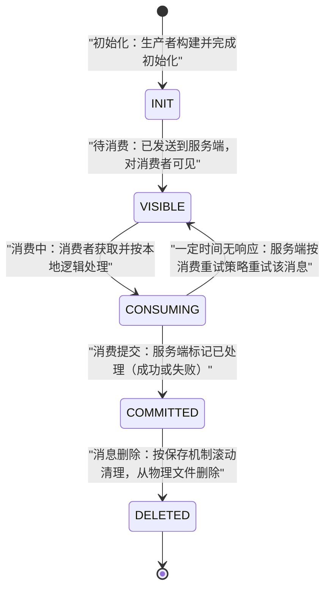
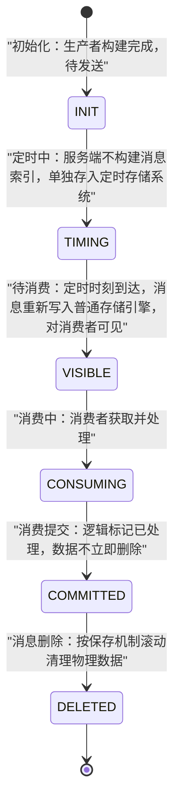

## 为什么需要「普通消息与定时/延时消息」？（痛点引入）

消息队列最原始的承诺只有一句话：**把消息从 A 搬到 B，别丢**。但真实业务很快会提出两个追加要求，这两个要求分别催生本文的两类主角：

1. 「我不在乎消息什么时候被处理，但吞吐要大」——于是有了**普通消息**（无特殊语义、相互独立），以及在它之上做加法、用打包换网络次数的**批量消息**。
2. 「这条订单消息必须 30 分钟后才投给下游，早一秒都不行」——于是有了**定时/延时消息**。而这个需求在 4.x 与 5.0 里的实现语义完全不同：4.x 只有 18 个固定档位（想延时 15 秒？档位表里没有，最近的是 10 秒或 30 秒），5.0 改成了任意时刻的**毫秒级时间戳**。升级时不改这段代码，行为就悄悄变了。

| 维度 | 没有普通/批量消息 | 没有定时/延时消息 |
|------|-------------------|-------------------|
| 上游改造 | 下游不可用时只能自己落盘缓存、写重试表 | 每个延时需求都自建「计划任务表 + 扫描线程」 |
| 下游改造 | 新接一个消费方要改上游代码 | 分布式部署后每台机器都要扫库，重复触发难去重 |
| 网络开销 | 一条一个请求，日志类小消息的调用次数随条数线性涨 | —— |
| 精度 | —— | 数据库扫描的轮询间隔决定精度，越准越贵 |
| 有 RocketMQ 之后 | 发送即可，通道可靠；批量打包减少 API 与网络调用次数 | 发一条「到点才可见」的消息，触发能力由服务端提供 |

> ### 💡 新人小结：这四类东西到底是谁？
>
> 把 RocketMQ 想成一家快递公司：
> - 普通消息 = **普通包裹**：密封、独立、先到先送，包裹之间没有任何关系；
> - 批量消息 = **整箱发货**：一箱里装很多小件，只跑一趟快递车，省的是「趟数」（API 和网络调用次数）；
> - 定时消息 = **指定送达日期的鲜花**：下单时就写好「6 月 9 日 19:20 送」，快递站压箱存着，到点才出库；
> - 延时消息 = 「**放 1 小时后送**」：本质仍是鲜花单，只是你要先把「1 小时后」换算成具体日期再写单。
>
> **一句话总结：普通消息管「搬得稳」，批量消息管「搬得省」，定时/延时消息管「到点才搬」。**

**学习路线图**

```
痛点引入 → 普通消息 → 批量消息 → 定时/延时(4.x) → 定时/延时(5.0) → 新旧对照 → 术语速查
是什么     场景/原理   分片约束    固定档位         任意时间戳      同场景代码    数值出处
```

本文覆盖普通消息、批量消息、定时/延时消息三种类型；**同步/异步/单向三种发送方式的代码三件套不在本文重复**，见[领域模型全景与通信方式](/docs/02-core-concepts/领域模型/领域模型全景与通信方式/)，本文只讲每种消息自己的机制、限制、示例与坑。消费重试的细节在〈消费重试与死信队列〉，消息过滤（Tag/SQL92）在〈消息过滤Tag与SQL92〉，本文各只带过一句。

---

## 术语表（先对齐名词，再读正文）

| 术语 | 全称 | 通俗含义（用自己的话） | 在本文中的角色 |
|------|------|------------------------|----------------|
| MessageType | 消息类型 | 主题与消息的「性格标签」：Normal/FIFO/Delay/Transaction 四选一，5.0 起强制校验两者必须一致 | 本文三类主角各自的入场券 |
| Topic | 主题 | 一类消息的集合容器，发送前必须存在（或允许自动创建） | 创建示例的操作对象 |
| mqadmin | RocketMQ Admin 命令行工具 | 运维用的「物业办公室窗口」，建主题、查配置都靠它 | 本文创建主题的命令 |
| autoCreateTopicEnable | 自动创建主题开关 | Broker 收到没见过名字的主题消息就顺手建主题 | 生产环境建议关闭的隐患项 |
| Tag | 消息标签 | 主题之下的二级分类标记，消费端可按标签过滤 | 发送示例里的消息属性（过滤本身不在本文展开） |
| MessageKey | 消息索引键 | 给消息挂的业务检索钥匙（订单号、用户 ID），可按它精确查消息 | 普通消息使用建议 |
| Delay Level | 投递等级 / 延时级别 | 4.x 延时消息的档位号（1~18），1 档=1 秒、3 档=10 秒……18 档=2 小时 | 4.x 延时语义的核心 |
| DeliveryTimestamp | 定时时间 | 5.0 定时消息的目标投递时刻，毫秒级 Unix 时间戳 | 5.0 定时语义的核心 |
| 定时存储系统 | —— | 5.0 服务端单独存放未到点定时消息的子系统，到点后写回普通存储引擎 | 解释「定时中」状态的机制 |
| SCHEDULE_TOPIC_XXXX | 系统保留主题名 | 4.x 内部暂存延时消息的系统主题（保留字符，业务不得占用） | 4.x 延时机制的落点（本文仅在保留字符清单语境提及） |
| waitStoreMsgOK | 等待存储确认标记 | 批量消息内所有消息必须取值相同的三个属性之一 | 批量消息分片约束 |
| 1 MiB | 批量消息大小上限 | 一批消息打包后的总量红线，超过要自行分割 | 批量消息的硬约束数值 |
| SendResult / SendReceipt | 发送结果 | 4.x 与 5.0 客户端发送成功后拿到的回执对象，5.0 可取 messageId | 示例代码的输出载体 |
| SimpleConsumer | 简单消费者 | 5.0 由业务主动 receive/ack 的消费者类型 | 示例中的消费侧配角 |
| Unix 时间戳 | —— | 从 1970-01-01 00:00:00 UTC 起算的毫秒数，定时消息的书写格式 | 5.0 定时时间的表示法 |

---

## 普通消息：最基础的那个「包裹」

### 应用场景

普通消息一般应用于微服务解耦、事件驱动、数据集成等场景，这些场景大多数要求数据传输通道具有可靠传输的能力，且对消息的处理时机、处理顺序没有特别要求。上游给了两个典型场景：

**典型场景一：微服务异步解耦。** 以在线的电商交易场景为例，上游订单系统将用户下单支付这一业务事件封装成独立的普通消息发送至服务端，下游按需订阅并按本地消费逻辑处理下游任务。每个消息之间都是相互独立的，且不需要产生关联。


**典型场景二：数据集成传输。** 以离线的日志收集场景为例，埋点组件收集前端应用的操作日志并转发到 RocketMQ；每条消息就是一段日志数据，RocketMQ 不做任何处理，只需把日志可靠投递到下游的存储系统和分析系统。


4.x 文档还补了一个选型注脚：日志处理场景可以接受较大的发送延迟，但对吞吐量要求很高（「希望每秒能处理百万条日志」），此时可在普通消息之上使用批量消息——这就引出本文第二节。

### 功能原理：普通消息生命周期


下图是上游生命周期文字的等价状态机，五个状态与源码文档逐条对应：



图后解读三条关键事实（均出自 5.0《普通消息》原文）：

1. **消费提交 ≠ 物理删除**。消息处理完成后只是被逻辑标记已消费，数据在保存时间到期或存储空间不足被删除前仍可回溯重新消费。
2. **消费中超时会触发重试**——「如果一定时间后没有收到消费者的响应，Apache RocketMQ 会对消息进行重试处理」，重试规则归〈消费重试与死信队列〉讲。
3. **删除按保存机制滚动清理最早的消息数据**，机制本身见[发送重试、流控与消息存储清理](/docs/04-message-features/发送可靠性与存储/发送重试流控与消息存储清理/)。

### 使用限制

普通消息仅支持使用 MessageType 为 Normal 的主题，即普通消息只能发送至类型为普通消息的主题中，**发送的消息的类型必须和主题的类型一致**。这是 5.0 强制校验的一部分：主题类型不匹配时消息发送会被拒绝。

### 使用示例：创建主题与发送消息

4.x 与 5.0 建主题命令的差异恰好是「消息类型强制校验」的直观体现——5.0 必须用 `-a` 参数声明类型属性：

```shell
# ========== 5.0 推荐写法：创建 Normal 类型主题（必须带消息类型属性） ==========
sh mqadmin updateTopic -n <nameserver_address> -t <topic_name> -c <cluster_name> -a +message.type=NORMAL
# 输出: 与 4.x 同类命令一致，返回 create topic ... success 与 TopicConfig 回显
```

```shell
# ========== 4.x 旧写法：不带类型属性，建出来的主题不区分消息类型 ==========
sh bin/mqadmin updateTopic -c DefaultCluster -t TopicTest -n 127.0.0.1:9876
# 输出（照抄上游示例）:
# create topic to 127.0.0.1:10911 success.
# TopicConfig [topicName=TopicTest, readQueueNums=8, writeQueueNums=8, perm=RW-, topicFilterType=SINGLE_TAG, topicSysFlag=0, order=false, attributes=null]
```

参数解释：`-c` 集群名称、`-t` 主题名、`-n` NameServer 地址、`-a` 额外属性（5.0 用 `+message.type=NORMAL` 声明主题只收普通消息）。4.x 回显里的 `readQueueNums=8, writeQueueNums=8` 表示该 Broker 上创建了 8 个读队列、8 个写队列，`order=false` 表示非顺序主题。

**关于自动创建主题**（4.x《普通消息发送》原文，属于生产环境纪律）：

> [!WARNING] 部署安装包默认开启了 autoCreateTopicEnable，会自动为发送的消息创建 Topic，但该特性仅推荐在初期测试时使用。生产环境强烈建议管理所有主题的生命周期、关闭自动创建参数，以避免生产集群出现大量无效主题，无法管理和回收，造成集群注册压力增大，影响生产集群的稳定性。

5.0 客户端发送普通消息的最小示例（照搬上游，补齐注释与输出说明）：

```java
// ========== ✅ 推荐写法：5.0 发送普通消息，关注结果并捕获异常 ==========
MessageBuilder messageBuilder = new MessageBuilderImpl();
Message message = messageBuilder.setTopic("topic")
    // 设置消息索引键，可根据关键字精确查找某条消息。
    .setKeys("messageKey")
    // 设置消息Tag，用于消费端根据指定Tag过滤消息（过滤规则本身见〈消息过滤Tag与SQL92〉）。
    .setTag("messageTag")
    // 消息体。
    .setBody("messageBody".getBytes())
    .build();
try {
    // 发送消息，需要关注发送结果，并捕获失败等异常。
    SendReceipt sendReceipt = producer.send(message);
    System.out.println(sendReceipt.getMessageId());
    // 输出: 消息 ID 字符串（发送成功的回执凭据，可用于消息轨迹查询）
} catch (ClientException e) {
    e.printStackTrace();
    // ❌ 不推荐：catch 后什么都不做且业务照常「认为发送成功」——同步发送必须做失败兜底
}
```

参数解释：`setKeys` 对应使用建议「设置全局唯一业务索引键，方便问题追踪」——消息查询与轨迹查询可按 Key 高效精确地定位消息，建议用订单 ID、用户 ID 这类业务唯一信息；`setTag` 是细粒度分类属性；`setBody` 是负载字节。与之对照，4.x 侧的同步/异步/单向三种写法（`DefaultMQProducer` + `Message(topic, tag, body)`）已完整收录在[领域模型全景与通信方式](/docs/02-core-concepts/领域模型/领域模型全景与通信方式/)，此处不再重复。

5.0 的上游示例同时给出了两种消费方式（此处仅作消息类型语境的配套展示，消费机制细节归〈消费者类型与推拉模型〉）：

```java
// 消费示例一：使用 PushConsumer 消费普通消息，只需要在消费监听器中处理即可。
MessageListener messageListener = new MessageListener() {
    @Override
    public ConsumeResult consume(MessageView messageView) {
        System.out.println(messageView);
        // 输出: 只读消息视图的字符串形式；按消费结果返回状态
        return ConsumeResult.SUCCESS;
    }
};

// 消费示例二：使用 SimpleConsumer 消费普通消息，主动获取消息、处理并提交消费结果。
List<MessageView> messageViewList = null;
try {
    messageViewList = simpleConsumer.receive(10, Duration.ofSeconds(30));
    // 参数一 10：本次最多取 10 条；参数二 30 秒：消费不可见时间（详见〈使用限制与参数约束〉）
    messageViewList.forEach(messageView -> {
        System.out.println(messageView);
        // 消费处理完成后，需要主动调用 ACK 提交消费结果。
        try {
            simpleConsumer.ack(messageView);
        } catch (ClientException e) {
            e.printStackTrace();
        }
    });
} catch (ClientException e) {
    // 如果遇到系统流控等原因造成拉取失败，需要重新发起获取消息请求。
    e.printStackTrace();
}
```

### ✅ / ❌ 使用建议对照

| 场景 | 写法 | 判定 |
|------|------|------|
| 关键业务链路发消息 | 同步发送 + 捕获异常 + 失败兜底 | ✅ 上游口径：可靠同步传输适用于重要通知消息 |
| 忽略 `send` 抛出的异常 | `try { producer.send(msg); } catch (Exception ignore) {}` | ❌ 「如果忽略异常则可能会导致消息未成功发送的情况」（4.x 原文） |
| 定位问题靠猜 | 不设置消息 Key | ❌ 事后无法按业务键精确查消息 |
| 定位问题有钩子 | 设置全局唯一业务索引键（订单 ID、用户 ID） | ✅ 5.0《普通消息》使用建议原文 |
| 生产集群放任主题乱建 | 开着 autoCreateTopicEnable 上线 | ❌ 大量无效主题、注册压力增大、影响稳定性 |

---

## 批量消息：用「整箱发货」换网络调用次数

### 痛点与设计

在对吞吐率有一定要求的情况下，RocketMQ 可以将一些消息聚成一批以后进行发送，**可以增加吞吐率，并减少 API 和网络调用次数**。日志收集这类「条数多、单条小」的场景收益最直接：4.x 概念文档的原话是可以接受较大发送延迟、但要求每秒处理百万条日志。


### 分片约束（上游数值照抄，一个都不能改）

批量消息发送的三条硬约束写在上游代码注释里，逐条展开：

| 约束 | 上游原文 | 违反后果 |
|------|----------|----------|
| 大小限制 | 「If you just send messages of no more than 1MiB at a time, it is easy to use batch」；正文注：**批量消息的大小不能超过 1MiB（否则需要自行分割）** | 超过 1MiB 必须由业务自行切分批次 |
| 同批主题 | 「Messages of the same batch should have: same topic」；正文注：**同一批 batch 中 topic 必须相同** | 混主题发送不合法 |
| 同批存储确认 | 「same waitStoreMsgOK」 | 批内该标记取值不一致不合法 |
| 不支持定时 | 「no schedule support」，即**批量消息不支持定时/延时投递** | 批内不能混入带延时的消息 |

### 使用示例

```java
// ========== ✅ 推荐写法：4.x 批量发送（照搬上游示例） ==========
public class SimpleBatchProducer {
    public static void main(String[] args) throws Exception {
        DefaultMQProducer producer = new DefaultMQProducer("BatchProducerGroupName");
        producer.start();

        // 单批不超过 1MiB 时可直接用 batch；
        // 同一批消息必须：same topic（同主题）、same waitStoreMsgOK（同存储确认标记）、no schedule support（不支持定时）
        String topic = "BatchTest";
        List<Message> messages = new ArrayList<>();
        messages.add(new Message(topic, "Tag", "OrderID001", "Hello world 0".getBytes()));
        messages.add(new Message(topic, "Tag", "OrderID002", "Hello world 1".getBytes()));
        messages.add(new Message(topic, "Tag", "OrderID003", "Hello world 2".getBytes()));

        producer.send(messages); // 调用与单条发送的唯一区别：传入 Collection<Message> msgs
        // 输出: 无显式打印；如需逐批结果可在外层包 try/catch 后检查 SendResult
    }
}

// ========== 不推荐写法（仅展示） ==========
// ❌ 单批塞到 1MiB 以上指望服务端帮你切：上游明确「否则需要自行分割」
// ❌ 把 TopicA 和 TopicB 的消息混进一个 batch：违反 same topic 约束
// ❌ 批内某条消息 setDelayTimeLevel 想「顺带」延时：违反 no schedule support
```

参数解释：`producer.send(messages)` 传入 `List<Message>`（接口形态是 `Collection<Message> msgs`）；每条 `Message` 的四参构造依次是 topic、tag、key、body，这里的 OrderID001~003 即消息索引键。批量只是「多条独立普通消息搭同一趟车」，消息之间依然互不关联，不因此获得顺序语义。

> ### 💡 新人小结：批量消息是「整箱发货」，不是「合并成一个包裹」
>
> - 箱子里每件还是独立包裹（每条消息仍是独立的普通消息）；
> - 省的是趟数：一箱一趟车，API 和网络调用次数从 N 降到 1；
> - 箱子有承重上限（1MiB），超重要自己分箱，快递站不会替你拆；
> - 指定日期的鲜花（定时消息）不能进箱——same waitStoreMsgOK、no schedule support 就是「装箱检查清单」。
>
> **一句话总结：批量消息优化的是「发送成本」，不改变消息「相互独立」的本质。**

---

## 定时/延时消息（4.x）：18 个固定档位

### 痛点与设计

延时消息发送是指消息发送到 RocketMQ 后，**并不期望立马投递这条消息，而是延迟一定时间后才投递到 Consumer 进行消费**。在分布式定时调度触发、任务超时处理等场景，需要实现精准、可靠的延时事件触发；使用延时消息可以简化定时调度任务的开发逻辑，实现高性能、可扩展、高可靠的定时触发能力。


4.x 的实现思路是「档位表」：不做任意时长，只开放 18 级预定义的延迟投递档位。

### 使用限制：18 级延迟投递表（上游完整 18 行照抄）

Apache RocketMQ 4.x 一共支持 18 个等级的延迟投递：

| 投递等级（delay level） | 延迟时间 | 投递等级（delay level） | 延迟时间 |
|-------------------|------|-------------------|-------|
| 1                 | 1s   | 10                | 6min  |
| 2                 | 5s   | 11                | 7min  |
| 3                 | 10s  | 12                | 8min  |
| 4                 | 30s  | 13                | 9min  |
| 5                 | 1min | 14                | 10min |
| 6                 | 2min | 15                | 20min |
| 7                 | 3min | 16                | 30min |
| 8                 | 4min | 17                | 1h    |
| 9                 | 5min | 18                | 2h    |

这张表就是 4.x 延时能力的全貌：**最长 2 小时、最短 1 秒、档位之间是跳变**。需要「延时 15 秒」？没有这一档；需要「今天 19:20 整投递」？档位只能表达「从现在起几秒/几分钟/几小时」。

### 使用示例

```java
// ========== ✅ 推荐写法：4.x 延时消息（照搬上游 ScheduledMessageProducer） ==========
public class ScheduledMessageProducer {
    public static void main(String[] args) throws Exception {
        // 实例化一个生产者来发送延时消息
        DefaultMQProducer producer = new DefaultMQProducer("ExampleProducerGroup");
        // 启动生产者
        producer.start();
        int totalMessagesToSend = 100;
        for (int i = 0; i < totalMessagesToSend; i++) {
            Message message = new Message("TestTopic", ("Hello scheduled message " + i).getBytes());
            // 设置投递等级为 3：该消息将在发送 10 秒后才被投递给消费者
            message.setDelayTimeLevel(3); // 档位 3 = 10s，取自上面的 18 级延迟表
            // 发送消息
            producer.send(message);
        }
        // 使用完毕后关闭生产者
        producer.shutdown();
    }
}

// ========== 不推荐写法（仅展示） ==========
// ❌ setDelayTimeLevel 传档位表之外的数字（如 0 或 19）：落在 18 档之外，语义不成立
// ❌ 100 条消息全用同一档位同一瞬间发出：见下方「上游提醒」
```

参数解释：核心只有 `setDelayTimeLevel(3)` 一行——「这里最重要的是 message 中设置延迟等级，例子中设置的等级是 3，也就是发送者发送后，10s 后消费者才能收到消息」。除档位号外没有任何时长参数，这是 4.x 与 5.0 定时消息在使用面上的本质差别。

> [!WARNING] 上游提醒（4.x《延迟消息发送》原文）：延时消息的实现逻辑需要先经过定时存储等待触发，延时时间到达后才会被投递给消费者。因此，如果将大量延时消息的定时时间设置为同一时刻，则到达该时刻后会有大量消息同时需要被处理，会造成系统压力过大，导致消息分发延迟，影响定时精度。

---

## 定时/延时消息（5.0）：任意精度的绝对时间戳

### 语义升级：从「档位」到「时刻」

5.0 文档开篇就统一了口径：**定时消息和延时消息本质相同，都是服务端根据消息设置的定时时间在某一固定时刻将消息投递给消费者消费**，因此统一用定时消息描述。也就是说 5.0 里不存在「延时时长」这种入参——延时也要先换算成一个目标时间戳再传。

**定时时间设置原则**（逐条照自 5.0《定时/延时消息》）：

| 原则 | 上游原文要点 | 设置错了会怎样 |
|------|--------------|----------------|
| 传时间戳而非时长 | 定时时间是一个预期触发的系统时间戳，延时时间也需要转换成当前系统时间后的某一个时间戳，而不是一段延时时长 | 传「10000」当成「延时 10 秒」，实际会被解释为 1970 年的时间戳，落入下一条 |
| 毫秒级 Unix 时间戳 | 定时时间的格式为毫秒级的 Unix 时间戳，需将时刻转换成时间戳形式 | 传秒级时间戳时，其数值落在过去时刻，按上一条原则会「定时不生效、立即投递」 |
| 必须落在定时时长范围内 | 定时时间必须设置在定时时长范围内，超过范围则定时不生效，服务端会立即投递消息 | 超范围 = 定时失效、立即投递 |
| 定时时长上限 | 定时时长最大值默认为 24 小时，不支持自定义修改（特性文档口径，见下方版本提示） | —— |
| 必须是未来时刻 | 定时时间必须设置为当前时间之后，若设置到当前时间之前，则定时不生效，服务端会立即投递消息 | 过去时刻 = 立即投递 |

上游给出的换算示例（照抄数值）：

- 定时消息：当前系统时间为 2022-06-09 17:30:00，希望 19:20:00 投递，则定时时间 2022-06-09 19:20:00，时间戳 **1654773600000**。
- 延时消息：当前系统时间为 2022-06-09 17:30:00，希望延时 1 小时后投递，则投递时刻为 2022-06-09 18:30:00，时间戳 **1654770600000**。

### 功能原理：定时中是一个独立存储状态




图后解读两个新手最容易踩空的机制点：

1. **「定时中」的消息对消费者不可见**，也不参与普通消息索引——它在定时存储系统里压着，到点才写回普通存储引擎。所以「消息发出去了但消费者查不到」在到点之前是正常现象。
2. **定时状态可持久化**：系统因故障重启后，仍支持按照原来设置的定时时间触发消息投递；但若存储系统异常重启，可能导致定时消息投递出现一定延迟（上游原文口径）。

### 使用限制

| 限制项 | 数值/规则 | 出处口径 |
|--------|-----------|----------|
| 主题类型 | 定时消息仅支持 MessageType 为 Delay 的主题，消息类型必须和主题类型一致 | 5.0《定时/延时消息》 |
| 定时精度 | 定时时长参数精确到毫秒级，但默认精度为 1000ms，即定时消息为秒级精度 | 5.0《定时/延时消息》 |
| 定时时长上限（特性文档口径） | 默认为 24 小时，不支持自定义修改 | 5.0《定时/延时消息》 |
| 定时时长上限（领域模型文档口径） | 最大可设置定时时长为 40 天 | 5.0《消息（Message）》「定时时间（可选）」约束 |
| 消息大小上限 | 定时/延时消息（与事务消息同档）为 64 KB | 5.0《消息（Message）》按类型的默认上限 |

> [!NOTE] 版本适用与两处上游口径不一致（需复核）
> 关于定时时长上限：5.0 特性文档《定时/延时消息》写「定时时长最大值默认为 24 小时，不支持自定义修改」并指向参数限制页；而 5.0 领域模型文档《消息（Message）》的「定时时间」属性约束写「最大可设置定时时长为 40 天」。**两份上游文档数值不一致**，本文如实并列两个出处，不做取舍推定。本站〈使用限制与参数约束〉一文的限制大表按领域模型口径收录了「40 天」，并指出 5.0 参数限制表本身没有定时时长这一行。落地部署前请以你所用 Broker 版本的实际配置为准验证。

### 使用示例：创建 Delay 主题 + 发送定时消息

```shell
# ========== ✅ 5.0：先创建 DELAY 类型主题，否则定时消息无法发送 ==========
/bin/mqadmin updateTopic -c DefaultCluster -t DelayTopic -n 127.0.0.1:9876 -a +message.type=DELAY
# 参数：-c 集群名称；-t Topic 名称；-n NameServer 地址；
#       -a 额外属性，本例给主题添加了 message.type 为 DELAY 的属性用来支持延迟消息
```

```java
// ========== ✅ 推荐写法：5.0 定时/延时消息发送（照搬上游示例，补齐注释与输出） ==========
MessageBuilder messageBuilder = new MessageBuilderImpl();
// 以下示例表示：延迟时间为 10 分钟之后的 Unix 时间戳。
Long deliverTimeStamp = System.currentTimeMillis() + 10L * 60 * 1000;
Message message = messageBuilder.setTopic("topic")
        // 设置消息索引键，可根据关键字精确查找某条消息。
        .setKeys("messageKey")
        // 设置消息Tag，用于消费端根据指定Tag过滤消息。
        .setTag("messageTag")
        // 关键差异行：传「目标投递时刻」的时间戳，而不是延时档位号。
        .setDeliveryTimestamp(deliverTimeStamp)
        // 消息体
        .setBody("messageBody".getBytes())
        .build();
try {
    // 发送消息，需要关注发送结果，并捕获失败等异常。
    SendReceipt sendReceipt = producer.send(message);
    System.out.println(sendReceipt.getMessageId());
    // 输出: 消息 ID；此刻消息处于「定时中」，10 分钟后才对消费者可见
} catch (ClientException e) {
    e.printStackTrace();
}

// ========== 不推荐写法（仅展示） ==========
// ❌ setDeliveryTimestamp(System.currentTimeMillis() - 60_000)：过去的时刻，定时不生效，服务端立即投递
// ❌ 目标时刻超出定时时长范围：定时不生效，服务端立即投递（与上一条同样的静默降级行为）
```

消费侧与 PushConsumer/SimpleConsumer 两种示例形态与普通消息完全一致，唯一差别是监听器里可读 `messageView.getDeliveryTimestamp()` 回显目标投递时刻（上游定时消息消费示例即打印该值）。

> ### 💡 新人小结：4.x 档位与 5.0 时间戳，像「微波炉」和「闹钟」
>
> - 4.x 的 18 个 delay level 像微波炉的预设按钮：「解冻 10 秒」「加热 2 分钟」，按钮之间怎么跳由厂商定好，你只能按现有的 18 个键；
> - 5.0 的 DeliveryTimestamp 像手机闹钟：直接设定「19:20 响」，想几点就几点，但有两个坑完全同构——**设了已经过去的时刻，闹钟不会倒着响**（服务端立即投递）；**设得过远超出支持范围，闹钟直接不生效**（同样是立即投递）；
> - 「延时 1 小时」在 5.0 里要先心算成时刻（17:30 的延时 1 小时 = 18:30:00 = 时间戳 1654770600000），这正是上游换算示例要手把手教的原因。
>
> **一句话总结：4.x 传「档位号」、5.0 传「时刻戳」；两者对『非法时刻』的兜底行为都是立即投递，不报错。**

---

## 新旧写法对照：同一个需求「10 秒后投递」

**4.x 旧写法最小案例**（延时档位路线，场景：发一条 10 秒后才可见的消息）：

```java
Message message = new Message("TestTopic", ("Hello scheduled message " + i).getBytes());
message.setDelayTimeLevel(3);  // 档位 3，固定映射 10s（18 级表）
producer.send(message);
// 输出: SendResult 正常返回；消息在 10 秒后投递给消费者
```

**5.0 新写法最小案例**（同一场景）：

```java
Long deliverTimeStamp = System.currentTimeMillis() + 10L * 1000; // 10 秒后的时刻
Message message = messageBuilder.setTopic("TestTopic")
        .setBody(("Hello scheduled message " + i).getBytes())
        .setDeliveryTimestamp(deliverTimeStamp)   // 传时间戳，无档位概念
        .build();
producer.send(message);
// 输出: SendReceipt；主题必须是 MessageType=DELAY，否则发送被类型校验拒绝
```

**逐维度对比分析表**（规范原则五：改进前后必须可比）：

| 对比维度 | 4.x 延时级别 | 5.0 定时时间戳（当前方案） |
|----------|--------------|----------------------------|
| 写法差异（代码量、复杂度） | 一行 `setDelayTimeLevel(3)`，不接触时间概念 | 需自行取当前时间并换算时间戳；多一步类型转换 |
| 可选延迟值 | 仅 18 个固定档位（1s~2h，见上表），档位间跳变 | 当前时间之后、定时时长范围内的任意毫秒时刻；默认精度 1000ms（秒级） |
| 「任意时刻投递」能力 | 不支持（无法表达「今天 19:20:00」） | 原生支持（这就是绝对定时语义） |
| 主题要求 | 无类型属性要求，任意主题可发延时消息 | 必须 MessageType=DELAY；类型不符发送被拒 |
| 非法输入的行为 | 档位表之外无合法值可传 | 过去时刻/超范围：定时不生效，**立即投递**（静默降级，不报错） |
| 消息在到点前的可见性 | 经定时存储等待触发（上游只描述机制，未展开） | 明确：不构建消息索引、单独存定时存储系统，到点写回普通存储引擎 |
| 迁移成本与兼容性风险 | —— | 4.x 业务升 5.0：需把 `setDelayTimeLevel(level)` 批量替换为「按档位表换算成时间戳」，同时给主题补 `message.type=DELAY` 属性；最隐蔽的风险是过去/超范围时刻被**立即投递**，迁移期时间换算写错不会报错、只会提前触发 |
| 旧方案仍适用的场景 | 延迟档位恰好在 18 级表内、且不升 5.0 的存量集群；档位写法天然规避「过去时刻」类错误 | —— |

> [!NOTE] 版本适用：定时精度与批量消息的组合约束
> 5.0 侧：定时/延时消息单条大小上限 64 KB（领域模型按类型的默认上限），且批量消息（4.x 概念）明确 no schedule support——**批量与定时两个特性不能叠加使用**。
> 4.x 侧：上游未给出批量消息在 5.0 客户端的对应接口，本文不做推定。

---

## 排查清单：这三类消息最常见的「诡异现象」

| 现象 | 大概率原因 | 核对依据（本文出处） |
|------|------------|----------------------|
| 定时消息发出去立刻被消费了 | 目标是过去时刻，或超出定时时长范围，服务端按规则立即投递 | 定时时间设置原则第 3、5 条 |
| 发 DELAY/FIFO/TRANSACTION 消息被拒 | 主题 MessageType 属性与消息类型不一致（5.0 强制校验） | 各类型「使用限制」小节 + 创建主题命令 |
| 想延时 15 秒在 4.x 里做不到 | 只有 18 个固定档位，无此档 | 18 级延迟表 |
| 定时消息到点后分发慢了 | 大量消息共用同一时刻，触发时刻集中造成系统压力 | 上游使用建议「避免大量相同定时时刻的消息」 |
| 「定时中」的消息查不到 | 未构建普通消息索引，属正常中间状态 | 定时消息生命周期「定时中」 |
| 批量发送失败/被拆 | 单批超 1MiB，或批内混主题/混 waitStoreMsgOK/混定时消息 | 批量消息四条约束表 |
| 生产集群主题数量暴涨 | autoCreateTopicEnable 未关，测试残留继续向生产发消息 | 自动创建主题警告块 |

---

## 要点总结

1. **普通消息是基座，不是低端**：它承诺的只是「可靠搬运 + 类型一致（MessageType=Normal）」，消息之间相互独立；配套纪律是设置全局唯一业务 Key、生产环境关闭 autoCreateTopicEnable、同步发送必须捕获异常兜底。
2. **批量消息只优化成本、不改变语义**：三条硬约束照抄上游——单批 ≤1MiB（超了自行分割）、same topic、same waitStoreMsgOK、no schedule support；它的收益也写在原话里：增加吞吐率，减少 API 和网络调用次数。
3. **4.x 与 5.0 的延时语义是两套世界观**：4.x 是 18 级固定档位（1s~2h），5.0 是「当前时间之后、时长范围内的任意毫秒时间戳」，默认精度 1000ms；迁移要做的不只是换 API，还包括给主题补 `message.type=DELAY`。
4. **非法定时一律「立即投递」**：过去时刻、超出范围都是静默降级而非报错，这是定时消息最隐蔽的坑；同理，到点前的消息对消费者不可见（定时存储系统），查不到 ≠ 丢了。
5. **定时时长上限存在两处上游口径（24 小时 vs 40 天）**：本文并列引用、不做推定，落地前按实际部署版本验证——这也是「数值必须同源」纪律的示范：拿不准时，写出处比下结论诚实。

---

> ### 💡 新人小结：普通/批量/定时消息学完了，记住这 5 点
>
> 1. **先给主题定性再发消息**：5.0 的主题都带 MessageType，普通消息进 Normal 主题、定时消息进 DELAY 主题，类型不匹配直接被拒。
> 2. **一箱车拉一箱货**：批量消息省趟数不省规矩——1MiB、同主题、同 waitStoreMsgOK、不带定时。
> 3. **4.x 按微波炉按钮，5.0 定闹钟**：档位制没有 15 秒，时间戳制什么时刻都行但必须是「未来的、范围内的」时间戳。
> 4. **闹钟设在过去的时间不会响，只会立刻响**：立即投递是定时失效的唯一表现形态，排查定时消息先核对时间戳换算。
> 5. **默认精度是秒级（1000ms）**：毫秒入参不等于毫秒必达，对精度敏感的场景要按秒级容差设计。
