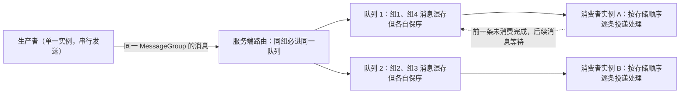

## 为什么需要顺序消息？（痛点引入）

普通消息的世界观是「每条消息互相独立」。但有一类业务，消息之间的**先后**本身就是数据：

- 同一个订单先「创建」、再「付款」、最后「发货」。下游如果先处理了「发货」再处理「创建」，轻则报错，重则状态错乱。
- 数据库增量同步：上游源端库执行增、删、改，把二进制操作日志经 RocketMQ 传给下游搜索系统，下游必须**按顺序还原**，否则数据和上游操作结果对不上。
- 证券、股票撮合：对出价相同的交易单，坚持先出价先交易，处理订单的系统必须严格按出价顺序。

普通消息为什么做不到？因为普通消息会被轮询打散到主题的多个队列里，**队列之间的消费是并行的**，两条消息进了不同队列，就进入了两条互不知晓的处理流水线。4.x 文档的表述很直白：「如果是普通消息，订单 A 的消息可能会被轮询发送到不同的队列中，不同队列的消息将无法保持顺序」。

| 维度 | 用普通消息硬撑顺序场景 | 用顺序消息 |
|------|------------------------|------------|
| 发送侧 | 上游自己排队列、猜哪条消息落在哪个队列 | 声明分组键（ShardingKey/MessageGroup），同组消息进同一队列 |
| 消费侧 | 多线程乱序回调，靠业务层排序缓冲、时间戳比对 | 按队列存储顺序逐条投递，前一条不完成不放行后一条 |
| 故障时 | 「先可用还是先顺序」被迫在代码里手写策略 | 服务端参数把「保顺序」显式配置出来（order=true） |
| 典型事故 | 下游状态与上游操作结果不一致，需人工对账修复 | 顺序保证收敛在「同组消息」这个粒度内 |


> ### 💡 新人小结：顺序消息到底在排什么「序」？
>
> 把队列想象成银行窗口：
> - 普通消息 = 大厅叫号随机分流到多个窗口，每个窗口内部有序，**跨窗口没有先后可言**；
> - 顺序消息 = 「办同一笔业务的一家人必须排同一个窗口」——这就是分区键（ShardingKey/MessageGroup）的作用；
> - 「一家人到了窗口还得一个一个办完」= 消费侧按存储顺序逐条处理，前一件没办完，窗口不放下一件；
> - 「不同家庭之间不用互相等」= 不同分组之间不涉及顺序性，可以并行。
>
> **一句话总结：RocketMQ 的顺序是「同一个组内先进先出（FIFO）」，不是「全主题大一统排队」。**

**学习路线图**

```
痛点引入 → 顺序的两半 → 全局/分区之辨 → 4.x 分区键写法 → 5.0 MessageGroup → 新旧对照 → 消费侧顺序锁 → 排查清单
生产顺序   生产+消费    单队列推论       Selector        属性+主题类型    逐维度表    重试与阻塞     常见乱序
```

---

## 术语表

| 术语 | 全称 | 通俗含义（用自己的话） | 在本文中的角色 |
|------|------|------------------------|----------------|
| FIFO | First In, First Out，先进先出 | 先发布的先消费，后发布的后消费 | 顺序消息的验收标准 |
| ShardingKey | 分区键（4.x 叫法） | 「这一家人」的户主名，相同键的消息路由到同一队列 | 4.x 发送侧的分组判据 |
| MessageGroup | 消息分组（5.0 叫法） | 标记一组特定消息先后顺序的属性，同组遵循 FIFO | 5.0 发送侧的顺序判定载体 |
| MessageQueueSelector | 消息队列选择器（4.x 接口） | 客户端自己决定「这条消息去哪个窗口」的回调 | 4.x 实现分区顺序的 API |
| MessageQueue | 消息队列 | 存储与顺序的最小单元，队列内部天然有序 | 顺序性的边界：出了队列就不保证 |
| order=true | 主题顺序标记 | 建主题时声明「严格顺序优先于可用」的开关 | 4.x 一致性取舍的落点 |
| MessageType=FIFO | 顺序主题类型（5.0） | 主题只收顺序消息的类型标签 | 5.0 入场券 |
| -o / --order | mqadmin 顺序参数 | updateTopic/updateSubGroup 上标记顺序的选项 | 5.0 建顺序主题与顺序消费组 |
| orderMessageEnable | Broker 顺序开关 | 服务端维持顺序主题路由不变的参数 | 4.x 保严格顺序的两个必检参数之一 |
| returnOrderTopicConfigToBroker | Broker 配置回传开关 | 顺序主题配置不因队列变化而改投的参数 | 4.x 必检参数之二 |
| PushConsumer | 5.0 推式消费者 | SDK 长轮询拉取后逐条回调监听器 | 5.0 顺序投递的消费者形态 |
| SimpleConsumer | 5.0 简单消费者 | 业务主动 receive/ack，可能一次取多条 | 顺序性需业务自证的例外场景 |
| MessageListenerOrderly | 顺序监听器（4.x 消费侧概念） | 消费失败在客户端本地重试、阻塞后续消息的监听模式 | 与并发监听的差异对照（细节归消费篇） |
| suspendCurrentQueueTimeMillis | 队列挂起间隔（4.x 参数） | 顺序消费失败后本地重试的等待间隔，默认 1000 | 消费侧顺序锁的节流参数 |
| ConsumeResult | 消费结果 | 监听器返回的成功/失败标识 | 触发顺序重试的输入 |
| mqadmin | 管理命令行工具 | 建主题/建消费组的窗口 | 创建示例载体 |

---

## 顺序性的两半：生产顺序性与消费顺序性

顺序消息是一种对消息发送和消费顺序有严格要求的消息：对一个指定的 Topic，消息严格按照 FIFO 原则进行发布和消费。RocketMQ 的消息顺序性分为**生产顺序性**与**消费顺序性**两部分，**只有同时满足两者才能达到 FIFO 效果**——这是 4.x 与 5.0 文档逐字一致的核心结论。

下图是「一条顺序消息从发送侧的分组键，到服务端队列，再到消费侧放行规则」的完整链路（两种版本的判据名称不同，图中以 5.0 的 MessageGroup 标注，4.x 的 ShardingKey 语义等价）：



图后解读三件事：

1. **顺序的判定单位是「消息组」，不是「主题」。** 5.0 原文：顺序消息的顺序关系通过消息组（MessageGroup）判定和识别，相同消息组的多条消息遵循先进先出，**不同消息组、无消息组的消息之间不涉及顺序性**。
2. **队列里允许混组。** 服务端顺序存储逻辑（5.0 原文两条）：相同消息组的消息按照先后顺序被存储在同一个队列；不同消息组的消息可以混合在同一个队列中，且不保证连续。下图上游示意：组 1 与组 4 混存于队列 1，两组各自内部保序，组间不涉及顺序。


3. **跨队列永远不保证顺序**，这正是下一节「全局顺序 vs 分区顺序」的分界线。

### 生产顺序性：两个必须满足的条件

如需保证消息生产的顺序性，则必须满足（4.x/5.0 原文一致）：

| 条件 | 原文要点 | 反面场景 |
|------|----------|----------|
| 单一生产者 | 消息生产的顺序性仅支持单一生产者；不同生产者分布在不同的系统，即使设置相同的分区键/消息组，不同生产者之间产生的消息也无法判定其先后顺序 | 两台机器各发订单 A 的「付款」「发货」，谁先谁后服务端无从裁决 |
| 串行发送 | 生产者客户端支持多线程安全访问，但如果使用多线程并行发送，不同线程间产生的消息无法判定先后顺序 | 线程 1、2 并发 send 同一订单的两条消息，到达顺序即乱序 |


### 消费顺序性：投递顺序 + 有限重试

5.0 文档给出的两个必须条件：

**投递顺序。** SDK 与服务端通信协议保障消息按服务端存储顺序投递，但业务方必须严格按照「接收——处理——应答」的语义处理消息，避免因异步处理导致乱序。一个重要的分叉：

> [!NOTE] 版本适用：消费者类型决定你要不要自己排队
> 消费者类型为 PushConsumer 时，RocketMQ 保证消息按照存储顺序**一条一条**投递给消费者；若消费者类型为 SimpleConsumer，则消费者有可能**一次拉取多条消息**，此时消息消费的顺序性需要由业务方自行保证。（5.0《顺序消息》原文，消费者类型细节见〈消费者类型与推拉模型〉）

**有限重试。** 顺序消息投递仅在重试次数限定范围内：一条消息如果一直重试失败，超过最大重试次数后将不再重试，**跳过这条消息消费，不会一直阻塞后续消息处理**。对于需要严格保证消费顺序的场景，务必设置合理的重试次数，避免参数不合理导致消息乱序。5.0 限制表中对应的数值：PushConsumer 顺序性投递的重试间隔默认 3000 毫秒（非顺序投递为重试阶梯，见〈消费重试与死信队列〉）；消息消费重试次数默认 16 次（与〈使用限制与参数约束〉同表同值）。

生命周期与普通消息同构（初始化 → 待消费 → 消费中 → 消费提交 → 消息删除），仅两处顺序特有注脚：消息消费失败或消费超时触发的重试消息属于新消息、原消息生命周期已结束；**顺序消息消费失败进行重试时，为保障顺序性，后续消息不可被消费，必须等待前面的消息消费完成后才能被处理**。

### 生产/消费四种组合（上游表格完整照录）

一般业务场景下，同一个生产者可能对接多个下游消费者，不一定所有消费者都需要顺序。发送顺序性和消费顺序性可以差异化组合：

| 生产顺序 | 消费顺序 | 顺序性效果 |
|----------|----------|------------|
| 设置消息组，保证消息顺序发送。 | 顺序消费 | 按照消息组粒度，严格保证消息顺序。同一消息组内的消息的消费顺序和发送顺序完全一致。 |
| 设置消息组，保证消息顺序发送。 | 并发消费 | 并发消费，尽可能按时间顺序处理。 |
| 未设置消息组，消息乱序发送。 | 顺序消费 | 按队列存储粒度，严格顺序。基于 RocketMQ 本身队列的属性，消费顺序和队列存储的顺序一致，但不保证和发送顺序一致。 |
| 未设置消息组，消息乱序发送。 | 并发消费 | 并发消费，尽可能按照时间顺序处理。 |

第二行常被误用为事故源：发的是顺序消息、消费端却是并发组，效果退化为「尽量按时间」——**发送侧的投入不会自动变成消费侧的保证**。

> ### 💡 新人小结：组合表怎么用？
>
> 把它当「点餐核对单」：
> - 你点的菜（消息组）和厨房出菜顺序（存储顺序）是两回事，服务员顺手多拿几盘（并发消费）桌上就可能先喝汤后吃面；
> - 只有「点了套餐 + 服务员一盘一盘上」（第一行）才严格保证你桌上的顺序；
> - 第三行提醒你：就算服务员规矩，你前厨出菜本身就乱（没设消息组），上的还是「后厨摆盘顺序」而非「下单顺序」。
>
> **一句话总结：顺序性是两端协议，缺一段都不算数。**

---

## 全局顺序 vs 分区顺序：先把术语掰开

上游文档的用语需要精确对待：4.x 原文只说「在 Apache RocketMQ 中**支持分区顺序消息**」，并按 ShardingKey 分区路由；5.0 则把顺序判定单位表述为 MessageGroup。两版文档都没有以「全局顺序」为标题给出独立功能条目，因此本文按机制表述，不做命名推定：

| 目标 | 机制上怎么达成 | 代价 | 依据 |
|------|----------------|------|------|
| 分区顺序（推荐） | 同一分组键/消息组进同一队列、组内 FIFO；不同分组并行 | 分组间无顺序；吞吐随队列数水平扩展 | 4.x/5.0《顺序消息》核心机制原文 |
| 全主题大一统 FIFO | 机制推论：顺序保证的边界是队列（组合表第三行「按队列存储粒度严格顺序」），因此需主题只有 1 个队列且单消费者串行消费 | 吞吐被压到单队列单线程，等于放弃 RocketMQ 的水平扩展 | 由「消费顺序和队列存储的顺序一致」推论，上游未直接给出「全局顺序」配置案例 |
| 「同一订单/同一用户」有序、彼此无关 | 最细粒度分区键：订单 ID、用户 ID | —— | 两版《使用建议》原文 |

两版文档的使用建议在此完全一致：**生产环境中建议选择最细粒度的分区键进行拆分**（4.x 原文），例如将订单 ID、用户 ID 作为分区键关键字，可实现同一终端用户的消息按顺序处理、不同用户的消息无需保证顺序（5.0 原文同义，并强调消息组要「尽可能打散，避免集中导致热点」）。

---

## 4.x 实现路径：MessageQueueSelector 客户端选队列

4.x 的顺序发送由**客户端自己决定消息进哪个队列**：调用带选择器的 send 重载，把分区分类标准作为 `arg` 传入。

```java
// ========== 4.x 旧写法：MessageQueueSelector 按 orderId 选队列（照搬上游 Producer 示例） ==========
DefaultMQProducer producer = new DefaultMQProducer("please_rename_unique_group_name");
producer.start();

String[] tags = new String[] {"TagA", "TagB", "TagC", "TagD", "TagE"};
for (int i = 0; i < 100; i++) {
    int orderId = i % 10; // 分区分类标准：10 个订单，同一订单的消息必须同队列
    Message msg =
        new Message("TopicTest", tags[i % tags.length], "KEY" + i,
            ("Hello RocketMQ " + i).getBytes(RemotingHelper.DEFAULT_CHARSET));
    // 关键差异：不是 send(msg)，而是 send(msg, selector, arg)
    SendResult sendResult = producer.send(msg, new MessageQueueSelector() {
        @Override
        public MessageQueue select(List<MessageQueue> mqs, Message msg, Object arg) {
            Integer id = (Integer) arg;      // arg 就是外面传入的 orderId
            int index = id % mqs.size();     // 取模：同一 orderId 永远命中同一队列
            return mqs.get(index);
        }
    }, orderId);
    System.out.printf("%s%n", sendResult);
    // 输出: SendResult 回显，queueId 字段对同一 orderId 恒定
}
producer.shutdown();

// ========== 不推荐写法（仅展示） ==========
// ❌ 选择器里 return mqs.get(new Random().nextInt(mqs.size()))：随机选队列，等于自己制造乱序
// ❌ arg 传整个 Message 却只用时间戳哈希：时间戳每秒都变，同订单被拆到不同队列
```

参数解释：接口定义为 `MessageQueueSelector { MessageQueue select(final List<MessageQueue> mqs, final Message msg, final Object arg); }`——`mqs` 是可以发送的队列列表，`msg` 是消息，`arg` 是 `send` 接口传入的 Java Object 分类标准，返回该消息需要发送到的队列。上游例子里以 `orderId % mqs.size()` 把相同 orderId 的消息发送到同一个队列。**队列数变化时取模结果会变**，这一点由下一节的一致性取舍来兜底。

### 顺序消息的一致性：Broker 掉线时保顺序还是保可用？

4.x 文档用一对问答把这层取舍讲透了：

> 如果一个 Broker 掉线，那么此时队列总数是否会发生变化？如果发生变化，那么同一个 ShardingKey 的消息就会发送到不同的队列上，造成乱序；如果不发生变化，那消息将会发送到掉线 Broker 的队列上，必然是失败的。

因此 4.x 提供两种模式，若要**保证严格顺序而不是可用性**，创建 Topic 时要指定 `-o` 参数（--order）为 true：

```shell
# ========== ✅ 4.x：创建严格顺序主题（牺牲可用性换顺序稳定） ==========
sh bin/mqadmin updateTopic -c DefaultCluster -t TopicTest -o true -n 127.0.0.1:9876
# 输出（照抄上游示例）:
# create topic to 127.0.0.1:10911 success.
# TopicConfig [topicName=TopicTest, readQueueNums=8, writeQueueNums=8, perm=RW-, topicFilterType=SINGLE_TAG, topicSysFlag=0, order=true, attributes=null]
# 回显末段 order=true 即顺序主题标记（对照上一节的 order=false）
```

并且要保证 NameServer 中的配置 **orderMessageEnable** 和 **returnOrderTopicConfigToBroker** 必须是 true。**上述任意一个条件不满足，则是保证可用性而不是严格顺序**——即队列总数可能变化，路由结果随之漂移。

### 消费侧（4.x）：顺序消费为什么不会把队列卡死

4.x 消费文档给出的机制（细节归〈消费重试与死信队列〉，此处只讲与顺序相关的一段）：顺序消费和并发消费的重试机制并不相同——**顺序消费失败后会先在客户端本地重试**，直到最大重试次数，这样可以避免消费失败的消息被跳过后打乱顺序；而**并发消费失败后会把消息投回服务端重试队列，期间照常消费队列后面的消息**。顺序消费本地重试的间隔可通过自定义参数 `suspendCurrentQueueTimeMillis` 设置（默认 1000 毫秒）；最大重试次数通过 `MaxReconsumeTimes` 配置，该参数取值无最大限制，若未设置，默认最大重试次数为 Integer.MAX。

| 对比项 | 顺序消费（4.x） | 并发消费（4.x） |
|--------|-----------------|-----------------|
| 失败后消息去哪 | 客户端本地重试 | 投回服务端重试队列，服务端再投回来 |
| 重试期间后续消息 | 不消费（阻塞等前一条完成） | 正常消费 |
| 重试间隔 | 可通过 suspendCurrentQueueTimeMillis 自定义（默认 1000ms） | 阶梯变化，取值范围 1 秒~2 小时，不支持自定义配置 |
| 最大重试次数 | MaxReconsumeTimes 无最大限制；未设置时默认 Integer.MAX | 默认 16 次，无最大限制，建议使用默认值 |

这张表解释了「顺序锁与重试」的关系：顺序消费的重试是把窗口**堵在本地**（宁可慢不可乱），并发消费的重试是**绕开窗口**（宁可乱不可堵）。5.0 文档对应的表述是「有限重试」：超过最大重试次数后跳过该条、不再无限阻塞。

---

## 5.0 实现路径：MessageGroup 属性声明 + 服务端路由

5.0 把「分组」从客户端选队列逻辑升级为**消息的一等属性**：发送顺序消息时必须为每条消息设置归属的消息组，路由由服务端保证同组同队列，客户端不再自己数队列。

### 使用限制

顺序消息仅支持使用 MessageType 为 FIFO 的主题，即顺序消息只能发送至类型为顺序消息的主题中，发送的消息的类型必须和主题的类型一致。消息组本身的约束（与〈使用限制与参数约束〉同表）：MessageGroup 支持所有可见字符，长度建议 **1~64 字节**；一般设置为需要保证顺序的一组消息标识，例如订单 ID、用户 ID。

### 创建主题与消费组

```shell
# ========== ✅ 5.0：创建 FIFO 主题（-o 标顺序 + -a 标类型，两个都要） ==========
./bin/mqadmin updateTopic -c DefaultCluster -t FIFOTopic -o true -n 127.0.0.1:9876 -a +message.type=FIFO
# 参数：-c 集群名称；-t Topic 名称；-n Nameserver 地址；-o 创建顺序消息主题
# 输出: create topic ... success 回显（同 4.x 命令形态，多出 -a 类型属性）

# ========== ✅ 5.0：创建 FIFO 订阅消费组（消费组也要声明顺序） ==========
./bin/mqadmin updateSubGroup -c DefaultCluster -g FIFOGroup -n 127.0.0.1:9876 -o true
# 参数：-c 集群名称；-g ConsumerGroup 名称；-n Nameserver 地址；-o 创建顺序订阅消费组
```

参数解释：通用形式（上游「使用示例」的模板命令）为 `sh mqadmin updateTopic -n <nameserver_address> -t <topic_name> -c <cluster_name> -a +message.type=FIFO` 与 `sh mqadmin updateSubGroup -c <cluster_name> -g <consumer_group_name> -n <nameserver_address> -o true`。**消费组忘加 `-o true` 的后果**对应 5.0 发送示例代码里的注释：「消费顺序消息时，需要确保当前消费者分组是顺序投递模式，否则仍然按并发乱序投递」——主题对了、组没对，照样乱。

### 发送与消费

```java
// ========== ✅ 推荐写法：5.0 顺序消息发送（照搬上游示例，补齐注释与输出） ==========
MessageBuilder messageBuilder = new MessageBuilderImpl();
Message message = messageBuilder.setTopic("topic")
        // 设置消息索引键，可根据关键字精确查找某条消息。
        .setKeys("messageKey")
        // 设置消息Tag，用于消费端根据指定Tag过滤消息。
        .setTag("messageTag")
        // 设置顺序消息的排序分组，该分组尽量保持离散，避免热点排序分组。
        .setMessageGroup("fifoGroup001")   // 核心差异行：分组是消息属性，不是选队列回调
        // 消息体。
        .setBody("messageBody".getBytes())
        .build();
try {
    // 发送消息，需要关注发送结果，并捕获失败等异常
    SendReceipt sendReceipt = producer.send(message);
    System.out.println(sendReceipt.getMessageId());
    // 输出: 消息 ID；同组后续消息与本报文在服务端被保序存储于同一队列
} catch (ClientException e) {
    e.printStackTrace();
}

// ========== 消费示例一：PushConsumer（消息按存储顺序一条一条投递） ==========
MessageListener messageListener = new MessageListener() {
    @Override
    public ConsumeResult consume(MessageView messageView) {
        System.out.println(messageView);
        // 输出: 只读消息视图；返回 SUCCESS 后服务端放行队列里的下一条
        return ConsumeResult.SUCCESS;
    }
};

// ========== 消费示例二：SimpleConsumer（自己 receive/ack，注意顺序闸门） ==========
// 需要注意的是，同一个 MessageGroup 的消息，如果前序消息没有消费完成，再次调用 Receive 是获取不到后续消息的。
List<MessageView> messageViewList = simpleConsumer.receive(10, Duration.ofSeconds(30));
messageViewList.forEach(messageView -> {
    System.out.println(messageView);
    try {
        simpleConsumer.ack(messageView); // 处理完成主动 ACK 提交消费结果
    } catch (ClientException e) {
        e.printStackTrace();
    }
});

// ========== 不推荐写法（仅展示） ==========
// ❌ setMessageGroup("DEFAULT_GROUP")：全站消息挤一个组 = 全部塞进同一队列，存储热点 + 顺序粒度形同全局顺序
// ❌ 用分钟级时间戳做消息组：同订单跨分钟被拆组，组内顺序链断裂
```

参数解释：`setMessageGroup` 的取值即顺序判定标识，上游建议「消息组尽可能打散，避免集中导致热点」，因为相同消息组的消息存储在同一个队列，不同业务都集中在少量或一个消息组时，存储压力会集中到服务端的少量队列，容易导致性能热点且不利于扩展；一般建议用订单 ID、用户 ID 这类同终端用户有序、跨用户无关的粒度。SimpleConsumer 一段还包含顺序消费的一个显式闸门：**同组前序消息未消费完成时，再次 receive 是拿不到后续消息的**（上游代码注释原文）。

---

## 新旧写法对照与选型

**同一场景**：订单 O-1001 的「创建 → 付款 → 发货」三条消息必须按序到达同一处理链。

4.x 旧写法（核心两行）：

```java
Message msg = new Message("TopicTest", "TagA", "O-1001-created", body);
producer.send(msg, (mqs, m, arg) -> mqs.get(Math.abs(((String) arg).hashCode()) % mqs.size()), "O-1001");
// 分组判据在调用点通过 arg 传入，由客户端选择器计算落位
```

5.0 新写法（核心两行）：

```java
Message message = messageBuilder.setTopic("FIFOTopic").setMessageGroup("O-1001").setBody(body).build();
producer.send(message); // 分组判据成为消息属性，服务端保证同组同队列
```

逐维度对比：

| 对比维度 | 4.x MessageQueueSelector | 5.0 MessageGroup（当前方案） |
|----------|--------------------------|------------------------------|
| 写法差异（代码量、复杂度） | send 三参重载 + 匿名选择器 + arg 传分类标准，路由算法自己写 | 一行 setMessageGroup，路由交给服务端 |
| 顺序判据归属 | 客户端：选择器返回值决定队列，写错即乱序 | 消息属性：客户端只声明「属于哪个组」 |
| 分区键粒度 | arg 任意 Object，常见 orderId 取模 | 字符串组标识，1~64 字节 |
| 队列数变化时 | 取模类选择器会漂移（同一 key 换队列），需配合 order=true 等参数兜底 | 由服务端路由保证同组同队列，顺序主题需 `-o true` + `+message.type=FIFO` |
| 消费组要求 | 消费端用顺序监听器（见 4.x 消费文档） | 消费组必须 `-o true` 顺序投递模式，否则按并发乱序投递 |
| 迁移成本与兼容性风险 | —— | 选择器逻辑整体删除；风险集中在「消费组没设顺序」与「消息组写成热点常量」两处 |
| 旧方案仍适用的场景 | 存量 4.x 集群；需要非常规路由规则（选择器是任意函数，能做自定义映射） | 新建 5.0 集群一律用 MessageGroup |

选型一句话：**要顺序就 5.0 属性化（判据跟着消息走、服务端兜底）；只有存量 4.x 或确需自定义映射函数时才保留选择器。**


（上三图对应 5.0《顺序消息》应用场景：撮合交易，以及数据库增量同步中普通消息与顺序消息两种结果的对比——普通消息方案可能导致状态混乱、与预期操作结果不符，顺序消息方案可使下游状态和上游操作结果一致。）

---

## 顺序性被破坏的真实场景清单

| 场景 | 发生了什么 | 破坏的是哪一半 |
|------|------------|----------------|
| 两个 Pod 都发订单 O-1 的消息 | 多生产者并行发送，同组消息到达服务端的先后不可判定 | 生产顺序性（「单一生产者」条件） |
| 单生产者内起线程池并发 send | 不同线程产生的消息无法判定先后 | 生产顺序性（「串行发送」条件） |
| 消费监听器里把消息丢进线程池立刻返回 SUCCESS | 应答先于处理完成，「接收—处理—应答」语义被破坏 | 消费顺序性（投递顺序条件） |
| 批量消费：发送 1→2→3→4，消费 1→23（批量处理失败）→23（重试）→4 | 消息 3 的失败导致消息 2 被重复处理，最终乱序（5.0 使用建议原文示例） | 消费顺序性 |
| 顺序消费某条一直失败 | 后续消息被阻塞；超过最大重试次数后该条被跳过，顺序链在此处出现「洞」 | 消费顺序性（有限重试的代价） |
| SimpleConsumer 一次拉多条再乱序 ack | 拉取本身成批，顺序需业务自行保证 | 消费顺序性 |
| Broker 掉线、队列总数变化且未配 order 参数 | 同 ShardingKey 的消息被发往不同队列 | 生产顺序性（一致性取舍，4.x） |
| 消费组未按顺序模式创建（5.0 未加 `-o true`） | 主题侧对了，投递侧仍并发乱序 | 消费顺序性 |

> [!NOTE] 版本适用：本文两种实现路径的适用版本
> MessageQueueSelector（send 三参重载）是 4.x 客户端路径；MessageGroup 属性 + FIFO 主题（`+message.type=FIFO`）+ 顺序消费组（`updateSubGroup -o true`）是 5.0 路径。5.0 文档对顺序语义的全部约束（含 SimpleConsumer 行为、有限重试跳过）均以 MessageGroup 为判据描述。本文消费重试的阶梯数值与死信规则不在篇内展开，见〈消费重试与死信队列〉。

---

## 要点总结

1. **顺序 = 生产顺序性 ∧ 消费顺序性**：生产侧要求「单一生产者 + 串行发送」，消费侧要求「按存储顺序投递 + 接收—处理—应答不异步」，缺一半就没有 FIFO（四种组合表是唯一裁判）。
2. **顺序的边界是分组，分组的载体换代了**：4.x 用 ShardingKey/MessageQueueSelector 让客户端自己选队列，5.0 用 MessageGroup 把分组变成消息属性、服务端负责同组同队列；迁移时删选择器、补 setMessageGroup，并给消费组加 `-o true`。
3. **分区顺序是产品能力，全局顺序是性能自残**：上游只提供分区顺序；全主题 FIFO 只能按机制推论压到单队列，吞吐与可用性都会塌方——用订单 ID/用户 ID 做最细粒度分组才是文档的处方。
4. **严格顺序与可用性必须显式站队**：4.x 是 `-o true` + orderMessageEnable + returnOrderTopicConfigToBroker 三个条件，不满足就退化为保可用；5.0 是 FIFO 主题 + 顺序消费组两个命令。Broker 掉线时「顺序消息发不出去」不是 bug，是你选的那个边。
5. **重试是顺序链上最脆弱的一环**：顺序消费靠「本地重试、堵窗口」保序（4.x suspendCurrentQueueTimeMillis 默认 1000ms），5.0 明确有限重试——超过最大重试次数就跳过该条；重试次数设不合理，乱序和「顺序洞」二选一找上门。

---

> ### 💡 新人小结：顺序消息学完了，记住这 5 点
>
> 1. **先问「谁和谁需要互相比顺序」**：答案是「同一订单/同一用户内部」，那就一个业务实体一个 MessageGroup，别拉全主题陪跑。
> 2. **消息组打散是性能红线**：所有流量挤一个组 = 所有数据挤一个队列，热点、阻塞、无法扩容三连。
> 3. **发送端声明了顺序不算完，去查消费组是不是顺序模式**：5.0 的 `-o true` 打在 updateSubGroup 上，漏了它一切白搭。
> 4. **消费监听器里「立即返回 + 后台慢慢处理」是伪装成顺序消费的并发消费**：接收—处理—应答必须串行完成再返回 ConsumeResult。
> 5. **给重试设一个「你会心疼的次数」**：顺序消费的重试要么堵住窗口、要么跳过留下顺序洞，两个后果都要在参数设计时提前认账。
