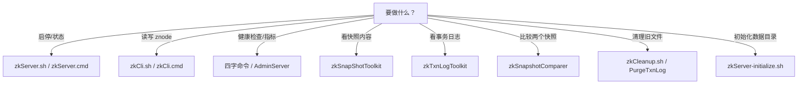

## 为什么需要一张工具地图？

ZooKeeper 发行包的 `bin/` 目录里有十几个脚本，名字都很像：`zkServer`、`zkCli`、`zkCleanup`、`zkSnapShotToolkit`、`zkTxnLogToolkit`、`zkSnapshotComparer`。第一次上手时很容易出现两种极端：

- **只用 zkCli**：所有事情都试图用命令行读写 znode 解决，遇到快照损坏、日志 CRC 错误、磁盘被旧文件撑满时无从下手。
- **乱用工具**：在 Windows 上找 `zkCleanup.cmd`，找不到就以为没有清理工具；或者对正在运行的实例数据目录直接跑修复工具，把小问题变成大问题。

工具本身不难，难的是**在正确的时机用正确的工具**。本文按“启停、读写、健康检查、离线分析、清理、初始化”六类，把 3.8.7 发行包里的脚本和命令整理成一张地图，并给出本机真实输出。读完后你至少应该知道：

- 启停服务用哪个脚本，Windows 和 Linux 的差异在哪。
- 读写 znode 用 zkCli，哪些命令能带版本号和 Watcher。
- 健康检查用四字命令或 AdminServer，先看什么、后看什么。
- 快照和事务日志用什么工具离线解析，参数怎么给。
- 清理旧文件用 `zkCleanup` 还是 `PurgeTxnLog`，Windows 上怎么跑。
- 新数据目录和 `myid` 怎么初始化。

| 只记一个工具时的困境 | 有工具地图后的选择 |
|----------------------|--------------------|
| 想看服务状态，只能 `ps` 看进程 | `ruok`/`srvr`/`mntr` 按层检查 |
| 想清理磁盘，不知道从哪下手 | `autopurge` 或 `zkCleanup`/`PurgeTxnLog` |
| 快照打不开，只能猜 | `zkSnapShotToolkit` 离线解析 |
| 日志有 CRC 错误，不敢动 | `zkTxnLogToolkit -d` 先看，再在副本上 `-r` |
| Windows 找不到 `zkCleanup.cmd` | 用 Git Bash 跑 `.sh`，或直接调用 `PurgeTxnLog` |

> ### 💡 新人小结：bin 目录像一个工具箱
>
> - `zkServer` 是车钥匙：负责启动、停止、看状态。
> - `zkCli` 是遥控器：负责读写 znode、注册 Watcher、看 stat。
> - 四字命令是仪表盘：负责健康检查与指标。
> - `zkSnapShotToolkit`/`zkTxnLogToolkit` 是法医工具：负责离线分析快照和日志。
> - `zkCleanup` 是保洁工具：负责清理旧文件。
>
> **工具不难，难的是先判断“我现在要做什么”，再去拿对应的那一件。**

**学习路线图**

```
工具地图 → 启停 → 读写 → 健康检查 → 快照工具 → 日志工具 → 比较工具 → 清理 → 初始化 → 平台差异
谁负责啥   zkServer  zkCli    四字命令   Snapshot   TxnLog    Comparer   zkCleanup  initialize  .sh/.cmd
```

---

## 工具地图：bin 目录里有什么

3.8.7 发行包的 `bin/` 同时提供 `.sh` 与 `.cmd` 两套脚本，但不是每个工具都有 `.cmd`。本机实测的清单如下：

| 工具 | 主要用途 | Windows `.cmd` | Linux `.sh` |
|------|----------|----------------|-------------|
| `zkServer` | 启动/停止/状态/版本 | 有，但只有前台启动 | 有，支持 start/stop/status 等 |
| `zkCli` | 交互式命令行，读写 znode | 有 | 有 |
| `zkEnv` | 被其他脚本调用，设置环境与 classpath | 有 | 有 |
| `zkCleanup` | 清理旧快照与事务日志 | **没有** | 有 |
| `zkSnapShotToolkit` | 离线解析快照 | 有 | 有 |
| `zkTxnLogToolkit` | 离线解析/修复事务日志 | 有 | 有 |
| `zkSnapshotComparer` | 比较两个快照的差异 | 有 | 有 |
| `zkServer-initialize` | 初始化数据目录、写 myid、建 initialize 标记 | **没有** | 有 |

“没有 `.cmd`”不是说 Windows 不能做这件事，而是官方没有提供对应的批处理封装；可以用 Git Bash 运行 `.sh`，或直接调用 Java 主类。



---

## 启停脚本 zkServer：Linux 有子命令，Windows 只有前台

### Linux：zkServer.sh

官方 Tools 文档给出的用法：

```text
Usage: ./zkServer.sh {start|start-foreground|stop|version|restart|status|upgrade|print-cmd}
```

| 子命令 | 作用 | 使用场景 |
|--------|------|----------|
| `start` | 后台启动 | 生产/测试常驻 |
| `start-foreground` | 前台启动 | 调启动失败、看完整日志 |
| `stop` | 停止 | 正常关闭 |
| `restart` | 重启 | 改配置后 |
| `status` | 查看状态与角色 | 启停后确认 |
| `version` | 显示版本 | 核对发行包 |
| `print-cmd` | 打印启动命令 | 排查 classpath/JVM 参数 |
| `upgrade` | 已废弃 | 旧版本升级遗留 |

```bash
bin/zkServer.sh start
bin/zkServer.sh status
bin/zkServer.sh stop
```

`status` 会建立客户端连接并执行诊断命令，不只是看进程；所以它能告诉你 `Mode: standalone/leader/follower`。

### Windows：zkServer.cmd

Windows 的 `zkServer.cmd` 没有 `start/stop/status` 子命令，它只做一件事：调用 `QuorumPeerMain`，把参数原样透传。启动后是前台进程，停止靠 `Ctrl+C` 或关闭窗口。

```bat
set JAVA_HOME=D:\JDK\Alibaba_Dragonwell_Standard_21.0.12.0.12.8_x64_windows\dragonwell-21.0.12.0.12+8-GA
bin\zkServer.cmd
```

本机启动时的关键输出：

```text
Reading configuration from: ...\conf\zoo.cfg
clientPortAddress is 0.0.0.0:2182
WARN  [main:o.a.z.s.q.QuorumPeerMain@139] - Either no config or no quorum defined in config, running in standalone mode
binding to port 0.0.0.0/0.0.0.0:2182
Started AdminServer on address 0.0.0.0, port 8081 and command URL /commands
```

| 现象 | 含义 | 处理 |
|------|------|------|
| 脚本一闪而过 | `JAVA_HOME` 未设置或指向 JRE | 设置 `JAVA_HOME` 到 JDK |
| `running in standalone mode` WARN | 没有 `server.x`，按单机启动 | 单机正常；集群模式要查成员配置 |
| 端口占用 | 已有实例或别的进程占用端口 | 改端口或停旧实例 |
| 没有 `start/stop` 参数 | Windows 脚本本来就不支持 | 用 Ctrl+C/关闭窗口；生产用服务包装器 |

> ### 💡 新人小结：zkServer 是车钥匙，但 Windows 的钥匙只有“点火”
>
> - Linux 的 `zkServer.sh` 像完整车控：点火、熄火、看仪表、重启都有。
> - Windows 的 `zkServer.cmd` 只有点火：启动后一直占着前台，熄火要按 Ctrl+C 或关窗。
> - 别拿 Linux 的 `zkServer.sh stop` 习惯去命令 Windows 的 `.cmd`，它不认识。
>
> **先看平台支持哪些子命令，再决定启停方式。**

---

## 命令行 zkCli：读写 znode 的主入口

zkCli 的完整命令列表来自 3.8.7 自带帮助，按用途分组如下：

| 分类 | 命令 | 作用 |
|------|------|------|
| 连接/会话 | `connect host:port`、`close`、`quit` | 切换服务器、关闭会话、退出 CLI |
| 读 | `get [-s] [-w] path`、`stat [-w] path` | 读 data/stat，可注册 Watcher |
| 读 | `ls [-s] [-w] [-R] path` | 列子节点，可递归、可带 stat |
| 读 | `getAllChildrenNumber path`、`getEphemerals path` | 统计子树节点数、列出本会话临时节点 |
| 写 | `create [-s] [-e] [-c] [-t ttl] path [data] [acl]` | 创建各类节点 |
| 写 | `set [-s] [-v version] path data` | 写 data，可带版本条件 |
| 写 | `delete [-v version] path`、`deleteall path` | 删除节点/整棵子树 |
| 权限 | `getAcl`、`setAcl`、`addauth` | 读/写 ACL、添加认证 |
| 诊断 | `history`、`redo cmdno`、`sync path`、`version` | 历史、重放、同步、版本 |
| 配额/重组 | `listquota`、`setquota`、`delquota`、`reconfig` | 配额与动态成员；按需使用 |

一次真实的读写：

```bash
bin/zkCli.cmd -server 127.0.0.1:2182 create /app v1
# Created /app

bin/zkCli.cmd -server 127.0.0.1:2182 get /app
# v1

bin/zkCli.cmd -server 127.0.0.1:2182 stat /app
# cZxid = 0x2
# ctime = Sun Oct 25 20:49:30 CST 2026
# ...
```

| 使用场景 | 推荐命令 | 注意 |
|----------|----------|------|
| 看配置当前值 | `get -s /path` | 一次拿到 data + stat |
| 监听配置变化 | `get -w /path` | 标准 Watcher 只触发一次 |
| 看目录结构 | `ls -R /path` | 大子树输出可能很长 |
| 防覆盖更新 | `set -v <version> /path data` | 版本不匹配会失败 |
| 清理整棵子树 | `deleteall /path` | 确认路径再执行 |
| 看临时节点 | `getEphemerals /path` | 只列当前会话创建的 |
| 关闭会话 | `close` 再 `quit` | 只 `quit` 可能让临时节点等超时 |

更完整的 zkCli 操作与 Watcher 实验见 [zkCli 常用操作与 Watcher 初体验](/docs/02-getting-started/单机安装与首次操作/zkcli-first-steps/)。

---

## 健康检查：四字命令速查

四字命令通过客户端端口发送。最常用的几条：

```bash
echo ruok | nc 127.0.0.1 2181
echo srvr | nc 127.0.0.1 2181
echo mntr | nc 127.0.0.1 2181
```

| 命令 | 作用 | 输出/注意 |
|------|------|-----------|
| `ruok` | 测试进程是否存活 | 返回 `imok`；不代表已加入 quorum |
| `srvr` | 服务器详情 | 版本、延迟、zxid、Mode、节点数 |
| `stat` | 服务器 + 客户端列表 | 比 `srvr` 多 `Clients` |
| `mntr` | 监控指标键值对 | 适合监控采集；部分键只在 Leader/Unix 出现 |
| `conf` | 实际生效配置 | 端口、dataDir、超时、连接上限 |
| `envi` | 环境变量与 classpath | 贴工单前脱敏 |
| `cons` | 连接/会话详情 | 定位客户端连接问题 |
| `dump` | 会话与临时节点 | 查临时节点为什么不消失 |
| `wchs` | Watcher 汇总 | 轻量，先看总量 |
| `wchc`/`wchp` | 按会话/按路径列 Watcher | 可能很重，慎用 |
| `isro` | 是否只读 | `rw`/`ro` |
| `dirs` | 快照/日志目录大小 | 返回 `datadir_size`/`logdir_size` |
| `srst`/`crst` | 重置统计 | 排障时清零计数 |
| `hash` | 数据树摘要历史 | 3.6.0 起；审计一致性时用 |
| `gtmk`/`stmk` | 读写 trace mask | 需要 logback 开 TRACE |

四字命令从 3.5.3 起需要白名单。默认只放行 `srvr`（只读模式加 `isro`），所以“命令没反应”时先查 `4lw.commands.whitelist`。3.8.7 还会强制保留 `srvr`，空白名单并不等于全关。健康检查的完整解读见[四字命令 4lw](/docs/03-cluster-operations/管理面与监控/four-letter-words/)，快照与备份见[四字命令、快照与事务日志](/docs/03-cluster-operations/集群与一致性/monitoring-and-backup/)。

### 管理接口 AdminServer

AdminServer 是四字命令的 HTTP 版本，默认端口 8080，命令路径 `/commands/[name]`，返回 JSON：

```text
http://localhost:8080/commands/stat
http://localhost:8080/commands/mntr
```

它的命令名不限于四个字母，例如 `srvr` 也可以叫 `server_stats`。本文实验把 AdminServer 放在 8081，启动日志显示：

```text
Started AdminServer on address 0.0.0.0, port 8081 and command URL /commands
```

生产环境要限制 AdminServer 的访问来源；不需要时可通过 `admin.enableServer=false`（`zoo.cfg`）关闭，等价的系统属性是 `zookeeper.admin.enableServer=false`。关闭后 TCP 四字命令仍可用，两条通路独立生效。AdminServer 的端点与关闭影响见[AdminServer 管理接口](/docs/03-cluster-operations/管理面与监控/adminserver-http/)。

---

## 快照工具 SnapshotFormatter

`zkSnapShotToolkit` 的官方用法：

```text
USAGE: SnapshotFormatter [-d|-json] snapshot_file
 -d dump the data for each znode
 -json dump znode info in json format
```

本机对一个 768 字节的快照执行默认模式：

```bash
bin/zkSnapShotToolkit.cmd snapshot.34
```

```text
ZNode Details (count=8):
----
/
  cZxid = 0x00000000000000
  ctime = Thu Jan 01 08:00:00 CST 1970
  mZxid = 0x00000000000000
  mtime = Thu Jan 01 08:00:00 CST 1970
  pZxid = 0x00000000000031
  cversion = 4
  dataVersion = 0
  aclVersion = 0
  ephemeralOwner = 0x00000000000000
  dataLength = 0
----
/app
  cZxid = 0x00000000000002
  ...
```

| 用法 | 输出 | 适用场景 |
|------|------|----------|
| 默认 | 每个 znode 的 stat 详情 | 看结构、版本、临时节点所有者 |
| `-d` | 额外输出 data | 确认某个配置值是否写入 |
| `-json` | JSON | 交给脚本做二次分析 |

注意：快照是模糊快照，后缀是快照开始时的 zxid；它不代表某个精确时刻的完整状态。要还原到最新状态，还需要快照之后的日志。

---

## 事务日志工具 TxnLogToolkit

`zkTxnLogToolkit` 的 3.8.7 帮助信息：

```text
usage: TxnLogToolkit [-dhrvc] <txn_log_file_name> (-z <zxid>)
 -c,--chop         Chop mode. Chop txn file to a zxid.
 -d,--dump         Dump mode. Dump all entries of the log file with printing the content of a nodepath (default)
 -h,--help         Print help message
 -r,--recover      Recovery mode. Re-calculate CRC for broken entries.
 -v,--verbose      Be verbose in recovery mode: print all entries, not just fixed ones.
 -y,--yes          Non-interactive mode: repair all CRC errors without asking
 -z,--zxid <arg>   Used with chop. Zxid to which to chop.
```

最安全的默认行为是 dump：

```bash
bin/zkTxnLogToolkit.cmd -d log.1
```

```text
ZooKeeper Transactional Log File with dbid 0 txnlog format version 2
2026/10/25 CST 20:49:30 session 0x10001b840d10000 cxid 0x0 zxid 0x1 createSession 30000
2026/10/25 CST 20:49:30 session 0x10001b840d10000 cxid 0x1 zxid 0x2 create /app,v1,[31,s{'world,'anyone}],false,1
2026/10/25 CST 20:49:31 session 0x10001b840d10001 cxid 0x0 zxid 0x3 createSession 30000
2026/10/25 CST 20:49:31 session 0x10001b840d10001 cxid 0x1 zxid 0x4 create /app/leader,node-a,[31,s{'world,'anyone}],true,1
2026/10/25 CST 20:50:03 session 0x10001b840d10001 cxid 0x0 zxid 0x19 closeSession v{'/app/leader}
```

| 模式 | 参数 | 行为 | 风险 |
|------|------|------|------|
| dump | `-d`（默认） | 打印所有事务，不改文件 | 只读，安全 |
| recover | `-r` | 修复 CRC，写入 `.fixed` 文件 | 原文件不动，但要在副本上操作 |
| recover + yes | `-r -y` | 非交互修复全部 CRC | 适合脚本，先备份 |
| chop | `-c -z <zxid>` | 截断到指定 zxid | 会改变输出文件，务必在副本上做 |
| verbose | `-v` | recover 时打印所有记录 | 输出量大 |

不要在正在运行的实例数据目录上直接修复。先停写/停机，复制一份到临时目录，在副本上 dump，确认问题后再决定是否 recover。

---

## 比较工具 SnapshotComparer

`zkSnapshotComparer` 用来比较两个快照的差异，适合离线一致性检查、容量趋势分析。官方用法：

```text
usage: java -cp <classPath> org.apache.zookeeper.server.SnapshotComparer
 -b,--bytes <BYTETHRESHOLD> (Required) The node data delta size threshold, in bytes, for printing the node.
 -d,--debug Use debug output.
 -i,--interactive Enter interactive mode.
 -l,--left <LEFT> (Required) The left snapshot file.
 -n,--nodes <NODETHREHOLD> (Required) The descendant node delta size threshold, in nodes, for printing the node.
 -r,--right <RIGHT> (Required) The right snapshot file.
```

示例（来自官方文档）：

```bash
bin/zkSnapshotComparer.sh -l /backup/snapshot.44 -r /backup/snapshot.45 -b 2 -n 1
```

它只比较持久节点，忽略会话和临时节点；`-b` 是按字节过滤，`-n` 是按子节点数量过滤。本文没有在本机运行这个工具，参数与行为来自官方 Tools 文档。

---

## 清理工具 zkCleanup

`zkCleanup.sh` 的职责是保留最近 N 份快照与对应日志，删除更旧的。脚本会从 `zoo.cfg` 读取数据目录，然后调用 `PurgeTxnLog`。

```bash
# 保留最近 5 份
bin/zkCleanup.sh -n 5
```

| 参数/行为 | 说明 |
|-----------|------|
| `-n count` | 保留的快照/日志份数，官方建议不小于 3 |
| 数据目录 | 从 `zoo.cfg` 的 `dataDir`/`dataLogDir` 读取 |
| Windows | `bin` 没有 `zkCleanup.cmd`；用 Git Bash 跑 `.sh` 或直接调 Java 类 |
| 运行时机 | 停写/停机，或至少避开快照写入窗口 |
| 清理前 | 备份，确认保留范围覆盖最新快照及其前后日志 |

Windows 上的等价调用：

```bash
java -cp "conf;lib/*" org.apache.zookeeper.server.PurgeTxnLog \
  "C:/path/to/data" -n 5
```

这条调用来自脚本内容，本文未在本机执行清理。如果你不想手工清理，优先用 `autopurge.snapRetainCount` + `autopurge.purgeInterval`，并监控 `dataDirSize`。

---

## 初始化工具 zkServer-initialize

`zkServer-initialize.sh` 用于初始化数据目录、写 `myid`、创建 `initialize` 标记。3.8.7 的脚本帮助：

```text
usage: $0 <parameters>
  Optional parameters:
     -h                                                    Display this message
     --help                                                Display this message
     --configfile=...                                      ZooKeeper config file
     --myid=#                                              Set the myid to be used, if any (1-255)
     --force                                               Force creation of the data/txnlog dirs
```

示例（来自脚本用法，本文未在本机执行）：

```bash
bin/zkServer-initialize.sh --configfile=/data/zookeeper/conf/zoo.cfg --myid=1
```

注意 `--force` 会重新初始化数据/日志目录，属于破坏性操作；执行前必须确认目录里没有需要保留的数据。Windows 没有对应的 `.cmd`，可以在 Git Bash 中运行，或手工创建目录和 `myid`。

---

## 任务到工具：一张选择表

| 任务 | 首选工具 | 备选/补充 |
|------|----------|-----------|
| 启动/停止单机 | `zkServer.sh` / `zkServer.cmd` | 服务包装器（WinSW/NSSM） |
| 查看角色与 zxid | `srvr` | AdminServer `/commands/srvr` |
| 查看连接与 Watcher | `stat`、`cons`、`wchs` | `wchc`/`wchp`（慎用） |
| 读写 znode | `zkCli` | Java/C 客户端 |
| 查看实际配置 | `conf` | 配置文件 + 变更记录 |
| 解析快照 | `zkSnapShotToolkit` | `SnapshotComparer` 做差异 |
| 解析/修复日志 | `zkTxnLogToolkit` | 副本 + `-r` |
| 清理旧文件 | `autopurge` | `zkCleanup.sh`/`PurgeTxnLog` |
| 初始化数据目录 | `zkServer-initialize.sh` | 手工创建目录 + `myid` |
| 动态改成员 | `zkCli reconfig`（需 `reconfigEnabled=true`） | 官方 Reconfig 文档 |

---

## 平台差异与常见错误

| 平台差异/错误 | 现象 | 处理 |
|---------------|------|------|
| Windows 找 `zkCleanup.cmd` | 文件不存在 | 用 Git Bash 跑 `.sh`，或调用 `PurgeTxnLog` |
| Windows 执行 `zkServer.cmd stop` | 脚本把 `stop` 当参数透传，可能启动失败 | Windows 没有 stop 子命令，用 Ctrl+C/关窗 |
| Windows 找 `zkServer-initialize.cmd` | 文件不存在 | Git Bash 跑 `.sh`，或手工初始化 |
| 对运行中数据目录跑修复 | 文件被占用/写到一半 | 停写/停机，复制副本再操作 |
| `zkTxnLogToolkit -r` 交互等待 | 脚本停在 `Would you like to fix it` | 用 `-y` 非交互，或手工输入 |
| `zkCleanup -n 2` | 保留份数过少，可能删掉恢复所需日志 | 至少 3，并保留快照前最后一个日志 |
| 快照后缀看不懂 | 后缀是十六进制 zxid | `snapshot.34` 对应 zxid `0x34` |
| `zkCli` 创建临时节点后消失 | 会话结束/超时 | 查 `getEphemerals`、`dump` 和服务端过期日志 |
| 四字命令无响应 | 不在白名单 | 查 `4lw.commands.whitelist` |
| `JAVA_HOME` 未设置 | 脚本直接退出 | 设置到 JDK，不要指向 JRE |

> ### 💡 新人小结：离线工具像法医工具箱
>
> - `SnapshotFormatter` 是看遗体（快照）的：告诉你里面有哪些节点、版本如何。
> - `TxnLogToolkit` 是看监控（日志）的：按时间顺序还原发生了什么。
> - `SnapshotComparer` 是对比两份档案的：找出新增、修改、删除。
> - 法医工具都在副本上做，不要对“活人”（运行中的实例）直接动刀。
>
> **线上只做只读检查，修复和截断都在副本上完成。**

---

## 要点总结

1. **先选类别再选工具**：启停用 `zkServer`，读写用 `zkCli`，健康检查用四字命令/AdminServer，离线分析用 Snapshot/TxnLog 工具，清理用 autopurge/`zkCleanup`。
2. **Windows 与 Linux 的脚本不对称**：Windows 的 `zkServer.cmd` 只有前台启动；`zkCleanup` 和 `zkServer-initialize` 没有 `.cmd`。
3. **四字命令受白名单限制**：默认只放行 `srvr`（只读模式加 `isro`）；`ruok` 只证明进程活着，不证明 quorum。
4. **快照工具先 dump 再修复**：`zkSnapShotToolkit` 默认只读；`zkTxnLogToolkit -r` 会写 `.fixed` 文件，必须在副本上操作。
5. **清理保留数不要低于 3**：还要保留快照前最后一个日志；Windows 用 `.sh` 或 `PurgeTxnLog`。
6. **初始化是破坏性操作**：`zkServer-initialize.sh --force` 会重建数据目录，执行前必须确认没有要保留的数据。

---

> ### 💡 新人小结：工具速查学完了，记住这 4 点
>
> 1. **先判断任务，再拿工具**：启停、读写、体检、法医、保洁，各用各的。
> 2. **Windows 少几个 `.cmd` 不等于不能做**：Git Bash 或 Java 主类都能补上。
> 3. **线上只读，副本修复**：快照和日志工具都不该直接对运行中目录动刀。
> 4. **清理和初始化都要留后路**：先备份、先确认保留范围，再执行。
