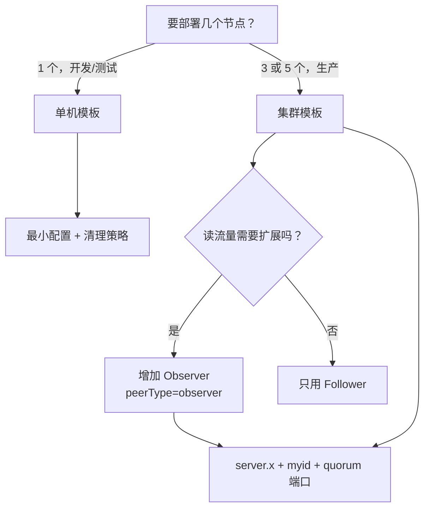

## 为什么 zoo.cfg 值得单独读一遍？

ZooKeeper 的配置文件很短，短到很多人以为“照抄示例就行”。但真正出问题时，往往就是这几行里的一两个值：

- `dataDir` 指向一个临时目录，机器重启后被清理，整个集群的数据没了。
- `initLimit` 还是模板里的 10，数据量大时 Follower 首次同步超时，节点一直起不来。
- `autopurge.purgeInterval` 没开，`version-2` 目录半年后撑满磁盘。
- `4lw.commands.whitelist=*` 被带到了生产，任何人连上客户端端口就能执行管理命令。
- 三节点集群里 `myid` 和 `server.x` 对不上，节点反复重启。
- 把 `leaderServes=no` 理解成“Leader 不参与写”，结果发现读少了一台，写并没有变快。

`zoo.cfg` 不是“启动参数清单”，而是**这个 ZooKeeper 实例的行为契约**：它决定数据放哪、谁能连、集群成员是谁、超时怎么算、旧文件怎么清理。本文按“单机、集群、运维”三组，把 3.8.7 中最常改的参数整理成一张可查的表，并给出两份可以直接改路径使用的模板。

本文覆盖范围：

| 覆盖 | 不覆盖 |
|------|--------|
| 单机最小配置、数据目录、端口、会话超时 | TLS/SSL、SASL/Kerberos 的完整证书配置 |
| 三节点集群的 `server.x`、`myid`、quorum 端口 | 动态 reconfig 的全部命令与权限模型 |
| 事务日志、快照、autopurge、四字命令白名单 | 配额、审计日志、Prometheus 的完整接入 |
| 连接数、请求限流、Leader 行为开关 | 源码级参数与实验特性 |

这些专项配置在官方 Administrator's Guide 中都有独立章节，本文只在相关位置给出入口和影响，不把整份手册压缩成一张表。

> ### 💡 新人小结：zoo.cfg 像一栋楼的控制面板
>
> - `dataDir` 是仓库地址：档案放哪，丢了去哪找。
> - `clientPort` 是接待窗口：客户端从哪个门进来。
> - `tickTime` 是心跳节拍：所有超时都按它换算。
> - `server.x` 是住户名册：这栋楼里有哪些成员、门牌号是多少。
> - `autopurge` 是保洁规则：旧档案保留几份、多久清一次。
>
> **配置不是“填满就好”，而是把仓库、窗口、节拍、名册、保洁五件事定清楚。**

**学习路线图**

```
最小配置 → 时间与会话 → 存储与清理 → 连接与限流 → 集群成员 → 监控白名单 → 行为开关 → 模板与核对
三行启动   tickTime       dataDir       maxClientCnxns  server.x     4lw           leaderServes  conf 验证
```

---

## 先选形态：单机、集群还是 Observer？



单机和集群的配置不是“多几行”的关系：单机没有 `server.x`，启动时会打印 `running in standalone mode`；集群必须有完整的成员列表和 `myid`，否则节点无法加入 quorum。先确定形态，再填参数，能避免大量无效配置。

---

## 最小配置：三行就能启动

官方 Getting Started 给出的最小单机配置只有三项：

```properties
tickTime=2000
dataDir=/var/lib/zookeeper
clientPort=2181
```

| 参数 | 是否必需 | 本文测试值 | 说明 |
|------|----------|------------|------|
| `tickTime` | 是 | 2000 | 基本时间单位，毫秒；心跳和超时按 tick 计算 |
| `dataDir` | 是 | 临时 ASCII 目录 | 快照与默认事务日志目录；必须存在且可写 |
| `clientPort` | 是 | 2182 | 客户端连接端口；模板常用 2181 |

这三项足以启动单机。但生产环境还需要考虑：数据目录是否在独立磁盘、会话超时是否合适、旧文件怎么清理、四字命令开哪些、AdminServer 是否暴露。下面按组展开。

---

## 时间与会话：tickTime、initLimit、syncLimit

| 参数 | 本文值/示例 | 单位 | 作用 | 调整建议 |
|------|-------------|------|------|----------|
| `tickTime` | 2000 | 毫秒 | 基本心跳单位；会话超时、选举超时都按它换算 | 保持 2000 是常见起点；改大要同步评估所有超时 |
| `initLimit` | 10 | tick | Follower 初始连接并同步到 Leader 的上限 | 数据量大/跨机房时增大，例如 20–60 |
| `syncLimit` | 5 | tick | Follower 与 Leader 允许落后的上限 | 网络抖动多时适当增大；过大导致慢节点拖尾 |
| `minSessionTimeout` | 未显式设置（默认 `2 × tickTime`） | 毫秒 | 服务端允许的最小会话超时 | 一般不用改；客户端请求更小会被抬到该值 |
| `maxSessionTimeout` | 未显式设置（默认 `20 × tickTime`） | 毫秒 | 服务端允许的最大会话超时 | 需要长会话时增大，同时评估临时节点滞留 |
| `clientPortListenBacklog` | 未显式设置（-1） | 连接数 | 客户端端口等待 accept 的队列长度 | 高并发短连接时关注；Linux 未设置时常用 50 |

本机 `tickTime=2000` 时，启动日志和 `conf` 输出都显示：

```text
minSessionTimeout set to 4000 ms
maxSessionTimeout set to 40000 ms
```

换算关系很简单：`2 × 2000 = 4000`，`20 × 2000 = 40000`。客户端请求 30000 ms 时，服务端会接受并协商为 30000 ms；请求小于 4000 或大于 40000 时，会被抬到边界值。

### initLimit 与 syncLimit 不是“越大越好”

- `initLimit` 太小：大数据量首次同步还没完成，Follower 就被判定失败，集群反复选主。
- `initLimit` 太大：真正失联的节点会占用更久才被剔除，故障恢复变慢。
- `syncLimit` 太小：网络抖动或 Full GC 一下，Follower 就被踢出 quorum。
- `syncLimit` 太大：落后的 Follower 可能长时间提供过期读，读一致性变差。

两个值都以 tick 为单位。把 `tickTime` 从 2000 改成 4000，`initLimit=10` 的实际时限就从 20 秒变成 40 秒，所有相关超时都会跟着变。

> ### 💡 新人小结：tickTime 是心跳节拍器
>
> - 乐队按节拍器演奏，所有乐器的“快慢”都以它为准（超时按 tick 换算）。
> - 节拍器调快，同样的 10 拍就更短；调慢，10 拍就更长（initLimit/syncLimit 的绝对时间变化）。
> - 节拍器不是越快越好：太快会让网络抖动被误判为故障，太慢会让真正故障恢复得很迟。
>
> **改 tickTime 不是改一个数字，而是改整套超时的标尺。**

---

## 存储：dataDir、dataLogDir 与快照/日志

| 参数 | 默认/示例 | 作用 | 关键提醒 |
|------|-----------|------|----------|
| `dataDir` | 必填，示例 `/var/lib/zookeeper` | 快照目录；未设 `dataLogDir` 时也放事务日志 | 必须可写；不要多个实例共用 |
| `dataLogDir` | 未设置（跟随 `dataDir`） | 单独存放事务日志 | 生产建议独立磁盘，避免和快照/其他进程争 I/O |
| `preAllocSize` | 64M | 事务日志预分配块大小（KB） | 文件看起来很大不等于写入量很大 |
| `snapCount` | 100,000 | 多少条事务后触发快照 | 实际阈值在 `[snapCount/2+1, snapCount]` 随机 |
| `snapSizeLimitInKb` | 4,194,304（4GB） | 日志总大小达到多少后触发快照 | 非正数关闭该限制 |
| `txnLogSizeLimitInKb` | 未启用 | 直接限制单个事务日志大小 | 设得过小会频繁滚动，建议为 `preAllocSize` 的整数倍 |
| `commitLogCount` | 500 | 内存中保留的最近已提交请求数 | 默认 500 是推荐下限，帮助 Follower 快速同步 |

`dataDir` 是最不能出错的参数。它需要满足：

1. 目录存在，或父目录可创建；
2. ZooKeeper 运行用户可读写；
3. 每个实例独立，不能和别的实例共用；
4. 容量足够容纳“快照 + 日志 + 预留空间”。

`dataLogDir` 的价值在于把事务日志放到独立设备。官方特别强调：事务日志是写请求返回前必须落盘的部分，放在繁忙设备上会显著影响延迟。若只有一块盘，至少把 `dataDir` 和系统临时目录分开，避免被其他进程的临时文件挤满。

### 文件大小为什么看起来不对

本机第一次启动后：

```text
snapshot.0    457 bytes
log.1         67108880 bytes
```

`log.1` 约 64 MB，是 `preAllocSize` 预分配的结果；实际事务可能只有几百字节。`snapshot.0` 是初始快照，几百字节也正常。不要用文件大小判断业务数据量，应该看 `mntr` 的 `zk_approximate_data_size`、`zk_znode_count`，或 `conf` 的 `dataDirSize`/`dataLogSize`。

---

## 清理：autopurge 与手工 PurgeTxnLog

| 参数 | 默认值 | 单位 | 作用 | 建议 |
|------|--------|------|------|------|
| `autopurge.snapRetainCount` | 3（官方最小值 3） | 份 | 保留最近多少份快照及对应日志 | 不要低于 3 |
| `autopurge.purgeInterval` | 0 | 小时 | 清理任务间隔；0 表示关闭 | 生产建议设为 1 或更大，并观察磁盘 |

默认配置下，ZooKeeper 不会自动删除旧快照和日志；这是官方明确的行为。长期运行的实例必须自己管理磁盘，否则 `version-2` 会持续增长。

### 保留多少份才安全

至少保留：

- 最新一份完整快照；
- 快照之后的所有事务日志；
- 快照前最后一个事务日志（因为快照是模糊的，开始拍照时可能还有事务写进旧日志）。

因此 `snapRetainCount=3` 是一个保守起点，不是“浪费”。如果写入频率很高、快照很大，可以适当增大，但要结合磁盘容量和恢复时间评估。

### 手工清理

Linux 下：

```bash
bin/zkCleanup.sh -n 5
```

脚本会从 `zoo.cfg` 读取数据目录，然后调用 `PurgeTxnLog` 保留最近 5 份。Windows 发行包的 `bin` 没有 `zkCleanup.cmd`（本机 3.8.7 实测），可以用 Git Bash 运行 `.sh`，或直接调用 `PurgeTxnLog` 类。清理前先备份，并在测试目录验证参数。

---

## 连接与限流：maxClientCnxns 到底限制谁

| 参数 | 默认值 | 作用 | 容易误解的点 |
|------|--------|------|--------------|
| `clientPort` | 示例 2181 | 客户端监听端口 | 端口改了，客户端连接串也要改 |
| `clientPortAddress` | 未设置（监听所有地址） | 绑定到指定网卡/IP | 多网卡机器上可限制入口 |
| `maxClientCnxns` | 60 | 单个 IP 对单个服务端的最大连接数 | 是“每 IP、每服务端”，不是全局总数 |
| `maxCnxns` | 0（不限制） | 单个客户端端口的总连接数上限 | 0 表示完全去掉限制，谨慎使用 |
| `globalOutstandingLimit` | 1000 | 所有客户端未完成请求的总上限 | 超过后服务端会节流客户端 |
| `requestThrottleLimit` | 0（关闭） | 请求限流阈值 | 高负载时再考虑开启 |
| `requestThrottleStallTime` | 100 ms | 请求等待通知的最长时间 | 与限流配套 |
| `requestThrottleDropStale` | true | 丢弃已关闭连接/过期请求 | 默认开启，减少无效处理 |

`maxClientCnxns` 是最容易被误解的一个。它限制的是**同一个客户端 IP 对同一个 ZooKeeper 服务端**的连接数，不是整个集群的总连接数，也不是“一个客户端进程只能有 60 个连接”。如果大量客户端在同一个 NAT 后面，它们可能共享一个出口 IP，从而撞上这个限制；这时需要评估是否调大，或让客户端分散出口。

`maxCnxns=0` 表示不限制总连接数，适合受控环境；公网或不可信网络不应这样配置。

---

## 集群成员：server.x、myid 与端口

| 参数 | 是否必需 | 示例 | 作用 |
|------|----------|------|------|
| `server.x` | 集群必需 | `server.1=10.0.0.1:2888:3888` | 成员列表；x 与 myid 对应 |
| `myid` 文件 | 集群必需 | `1` | 放在 `dataDir`，内容是节点编号 |
| quorum 端口 | 集群必需 | 2888 | Follower 连接 Leader、同步与提案 |
| election 端口 | 集群必需 | 3888 | Leader 选举专用 |
| `standaloneEnabled` | 可选 | true | 默认 true；false 允许单节点以复制模式运行/缩容到 1 |
| `leaderServes` | 可选 | yes | Leader 是否接受客户端连接；no 表示专注协调 |
| `electionAlg` | 可选 | 3 | 3 是 TCP FastLeaderElection；1/2 已废弃 |
| `reconfigEnabled` | 可选 | false | 是否允许动态 reconfig；默认 false |
| `localSessionsEnabled` | 可选 | false | 是否启用本地会话；默认 false |
| `group.x`/`weight.x` | 可选 | 见官方 | 分层 quorum 与投票权重；默认权重 1 |

一个三节点集群的 `zoo.cfg`（每个节点的 `dataDir`、`clientPort`、`admin.serverPort` 和 `myid` 不同）：

```properties
tickTime=2000
initLimit=10
syncLimit=5
dataDir=/data/zookeeper
clientPort=2181
admin.serverPort=8080
maxClientCnxns=60
autopurge.snapRetainCount=3
autopurge.purgeInterval=1
4lw.commands.whitelist=stat,ruok,conf,isro,mntr
server.1=10.0.0.1:2888:3888
server.2=10.0.0.2:2888:3888
server.3=10.0.0.3:2888:3888
```

| 节点 | `dataDir` | `clientPort` | `admin.serverPort` | `myid` |
|------|-----------|--------------|--------------------|--------|
| zk1 | `/data/zookeeper` | 2181 | 8080 | 1 |
| zk2 | `/data/zookeeper` | 2181 | 8080 | 2 |
| zk3 | `/data/zookeeper` | 2181 | 8080 | 3 |

上面的表格是“每台机器独立部署”的形态：不同主机可以用相同的 `clientPort` 和 `admin.serverPort`，因为 IP 不同。若像本文实验那样在同一台机器跑三个实例，则必须把客户端端口、管理端口、quorum 端口、election 端口全部错开。

### myid 的硬约束

- 文件放在 `dataDir` 下，不是 `conf/`。
- 内容只写数字，例如 `1`；不要写 `myid=1`。
- 编号必须与某个 `server.x` 的 x 一致。
- 编号范围 1–255；启用 TTL 等扩展特性时要求小于 255。
- 每个节点唯一；复制虚拟机镜像时最容易把同一个 `myid` 带到多台机器。

### Observer 的配置入口

Observer 需要两处标记：

```properties
# 在 Observer 自己的 zoo.cfg 中
peerType=observer

# 在所有节点的 server.x 列表中，给 Observer 的条目加 :observer
server.4=10.0.0.4:2888:3888:observer
```

Observer 不参与投票，但可以服务读；增加 Observer 不会改变 quorum 大小。本文的三节点实验没有部署 Observer，这一节来自官方 Observers Guide。

> ### 💡 新人小结：server.x 是名册，myid 是座位号
>
> - 名册告诉所有人“这个集群有哪几个座位、每个座位在哪个地址”。
> - 座位号告诉每个节点“你是第几号”，必须和名册对得上。
> - 同一台机器上放多个实例，就像同一间教室摆多张桌子：座位号要区分，进出通道（端口）也要区分。
>
> **集群配置的第一步不是填参数，而是确认“名册和座位号一一对应”。**

---

## 监控与四字命令：admin.serverPort 与白名单

| 参数 | 默认/示例 | 作用 | 建议 |
|------|-----------|------|------|
| `admin.serverPort` | 8080 | AdminServer HTTP 端口 | 同机多实例要错开；不需要就关闭 |
| AdminServer 开关 | `admin.enableServer`（等价系统属性 `zookeeper.admin.enableServer=false`） | 关闭内置 Jetty 管理服务 | 关闭后 TCP 四字命令仍可用；两条通路独立生效 |
| `4lw.commands.whitelist` | 默认只含 `srvr`（只读模式加 `isro`） | 允许的四字命令 | 3.8.7 会强制保留 `srvr`；生产只开需要的命令 |
| `readonlymode.enabled` | 系统属性，默认 false | 启用只读模式 | 启用后 `isro` 才进入默认白名单 |
| `metricsProvider.className` | `DefaultMetricsProvider` | 指标提供者 | 需要 Prometheus 时替换为对应实现 |
| `metricsProvider.httpPort` | 未启用 | Prometheus 导出端口 | 与 `className` 配套 |

本机启动日志显示：

```text
metricsProvider.className is org.apache.zookeeper.metrics.impl.DefaultMetricsProvider
Started AdminServer on address 0.0.0.0, port 8081 and command URL /commands
```

测试环境把 AdminServer 放在 8081，并开启全部四字命令：

```properties
admin.serverPort=8081
4lw.commands.whitelist=*
```

生产环境不建议照抄这两行。AdminServer 默认监听所有网卡，四字命令里的 `cons`、`wchc`、`wchp` 可能很重；至少用防火墙限制来源，并按需缩小白名单。AdminServer 的端点与关闭影响见[AdminServer 管理接口](/docs/03-cluster-operations/管理面与监控/adminserver-http/)，四字命令白名单的实测见[四字命令 4lw](/docs/03-cluster-operations/管理面与监控/four-letter-words/)，收口模板见[管理面收口配置](/docs/04-reference/配置与工具/management-plane-hardening/)。

---

## 行为开关：leaderServes、standaloneEnabled、reconfigEnabled

| 参数 | 默认值 | 作用 | 什么时候改 |
|------|--------|------|------------|
| `leaderServes` | yes | Leader 是否接受客户端连接 | 写吞吐优先、读可由 Follower 承担时可设 no |
| `standaloneEnabled` | true | 是否允许单节点以复制模式运行、缩容到 1 | 需要单节点 quorum 或特殊运维场景时设 false |
| `reconfigEnabled` | false | 是否允许动态修改集群成员 | 需要在线扩缩容时设 true，并严格控制权限 |
| `localSessionsEnabled` | false | 是否启用本地会话 | 大规模短连接场景，需理解其限制 |
| `localSessionsUpgradingEnabled` | false | 本地会话是否可升级为全局会话 | 与本地会话配套；创建临时节点会触发升级 |
| `syncEnabled` | true | Observer 是否也写事务日志和快照 | 想缩短 Observer 重启恢复时间时保持 true |
| `tcpKeepAlive` | false | quorum 连接是否启用 TCP keepalive | 跨 NAT/防火墙、长连接易被断开时考虑 |
| `clientTcpKeepAlive` | false | 客户端连接是否启用 TCP keepalive | 客户端异常断链留下僵尸连接时考虑 |

`leaderServes=no` 的常见误解是“Leader 不参与写”。实际上 Leader 仍然负责写排序和提案，只是不接受客户端连接；读请求会落到 Follower。它适合写吞吐优先、Follower 足够多的场景，不适合客户端数量少、读也需要 Leader 分担的部署。

`reconfigEnabled` 默认关闭，意味着即使是超级用户也不能动态改成员；需要先在所有节点上把它设为一致的值，再通过受控的 reconfig 流程操作。不要在集群运行中只改一台机器的这个值。

---

## 配置生效与核对：以 `conf` 为准

改完 `zoo.cfg` 后，必须重启实例（动态 reconfig 除外）。重启后不要只看文件，执行：

```bash
echo conf | nc 127.0.0.1 2181
```

本机实测输出（端口 2182、单机配置）：

```text
clientPort=2182
dataDir=C:\Users\webtu\AppData\Local\Temp\zk-zookeeper-docs\standalone\data\version-2
dataDirSize=67109337
dataLogDir=C:\Users\webtu\AppData\Local\Temp\zk-zookeeper-docs\standalone\data\version-2
dataLogSize=67109337
tickTime=2000
maxClientCnxns=60
minSessionTimeout=4000
maxSessionTimeout=40000
clientPortListenBacklog=-1
serverId=0
```

| 核对项 | 期望 | 不一致时查什么 |
|--------|------|----------------|
| `clientPort` | 你配置的端口 | 是否改错了文件、是否被别的实例占用 |
| `dataDir` | 配置的目录 + `/version-2` | 是否指向了旧路径、是否没有权限 |
| `tickTime` | 你配置的值 | 是否加载了另一份配置 |
| `min/maxSessionTimeout` | `2×`/`20×tickTime` | 是否显式覆盖过 |
| `maxClientCnxns` | 你配置的值 | 是否仍是默认 60 |
| `serverId` | 单机为 0；集群为 myid | 集群模式是否没读到 `myid` |

`conf` 输出的是服务端实际生效的值，比配置文件更可信。把这份输出和变更单一起存档，下次排障时能快速确认“当时到底跑的是什么配置”。

---

## 常见配置错误

| 错误配置 | 现象 | 修复 |
|----------|------|------|
| `dataDir` 指向临时目录 | 机器重启后数据丢失 | 换到持久磁盘，并加入备份 |
| 多实例共用 `dataDir` | 文件互相覆盖、启动异常 | 每实例独立目录 |
| `initLimit` 太小 | Follower 首次同步超时，反复选主 | 按数据量/网络增大 |
| `autopurge.purgeInterval=0` | 磁盘持续增长 | 设为 1 或更大，配合监控 |
| `4lw.commands.whitelist=*` | 管理命令暴露面过大 | 只放行需要的命令 |
| `maxClientCnxns=0` | 单 IP 连接不受限，易被耗尽 | 保持 60 或按需调整 |
| `myid` 与 `server.x` 不一致 | 节点反复重启/无法加入 quorum | 逐台核对编号 |
| 同机多实例端口冲突 | 启动失败或绑定异常 | 客户端/管理/quorum/election 端口全部错开 |
| `leaderServes=no` 但 Follower 很少 | 读能力下降，误以为写变慢 | 评估读流量后再改 |
| `reconfigEnabled` 各节点不一致 | 动态改成员行为不一致 | 所有节点保持一致 |

---

## 两份可复制模板

### 单机模板

```properties
# 基础时间单位
tickTime=2000

# 数据目录（替换为持久磁盘上的独立目录）
dataDir=/data/zookeeper

# 客户端端口
clientPort=2181

# 管理端口；同机多实例要改
admin.serverPort=8080

# 单 IP 连接上限
maxClientCnxns=60

# 旧文件保留与清理
autopurge.snapRetainCount=3
autopurge.purgeInterval=1

# 只放行排障需要的四字命令
4lw.commands.whitelist=stat,ruok,conf,isro,mntr
```

### 三节点模板（每台机器一份）

```properties
tickTime=2000
initLimit=10
syncLimit=5

# 每台机器替换为自己的数据目录
dataDir=/data/zookeeper
clientPort=2181
admin.serverPort=8080

maxClientCnxns=60
autopurge.snapRetainCount=3
autopurge.purgeInterval=1
4lw.commands.whitelist=stat,ruok,conf,isro,mntr

# 所有节点看到同一份成员列表
server.1=10.0.0.1:2888:3888
server.2=10.0.0.2:2888:3888
server.3=10.0.0.3:2888:3888
```

每个节点的 `dataDir/myid` 分别写入 `1`、`2`、`3`。同一台机器跑多实例时，`clientPort`、`admin.serverPort`、`server.x` 的 quorum/election 端口都要错开；本文实验用的是 `2182/2183/2184`、`8081/8082/8083`、`2288/2289/2290`、`2388/2389/2390`。

> ### 💡 新人小结：模板不是终点，是检查单
>
> - 模板保证“结构完整”，但不保证“值适合你”。
> - 路径、内存、磁盘、网络、端口，每一项都要按环境替换。
> - 改完用 `conf` 核对，不要用“我记得改过”当证据。
>
> **先复制结构，再替换环境值，最后用服务端实际输出验收。**

---

## 要点总结

1. **先定形态再填参数**：单机只需 `tickTime/dataDir/clientPort`；集群必须有 `server.x` 和 `myid`。
2. **`dataDir` 是最不能错的参数**：独立、可写、持久；`dataLogDir` 放独立磁盘能显著改善写延迟。
3. **时间和超时是一个整体**：`tickTime` 改变会同时改变 `initLimit`、`syncLimit`、会话超时的实际时长。
4. **默认不清理**：`autopurge.purgeInterval` 默认 0；生产必须配置清理或手工 `PurgeTxnLog`，保留数不要低于 3。
5. **`maxClientCnxns` 限制的是“每 IP、每服务端”**，不是全局总数；`maxCnxns=0` 表示不限制总连接。
6. **四字命令默认只开 `srvr`**：`4lw.commands.whitelist=*` 只适合受控实验环境。
7. **配置以 `conf` 输出为准**：改完重启、核对 `conf`，把实际配置和变更记录一起存档。

---

> ### 💡 新人小结：zoo.cfg 学完了，记住这 4 点
>
> 1. **仓库和窗口先定**：`dataDir` 要持久可写，`clientPort` 要唯一可达。
> 2. **时间和清理别用默认值蒙混**：tick 换算要算清，autopurge 要显式配置。
> 3. **集群看名册**：`server.x` 与 `myid` 必须一一对应，端口要按部署形态错开。
> 4. **改完以 `conf` 验收**：文件写对不等于服务端生效，实际输出才算数。
