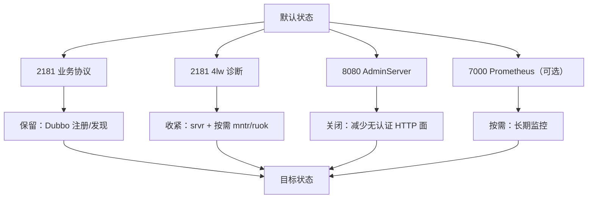

## 为什么注册中心也要收管理面？

“ZooKeeper 只是 Dubbo 的注册中心，内网用，应该没什么安全问题吧？”  
这是很常见的判断，但它漏掉了一个事实：**注册中心的管理面往往比业务面更容易被忽略**。

一个默认配置的 ZooKeeper 3.8.7 实例，至少有三条入口：

- 2181：业务客户端协议，Dubbo 的注册/发现走这里；
- 2181：四字命令，任何人只要能连上，就能尝试 `ruok`、`srvr`、`mntr` 等诊断命令；
- 8080：AdminServer，HTTP + JSON，默认监听所有网卡，默认没有内置登录认证。

它们的目的不同，风险也不同。业务面通常有 Dubbo/Curator 的客户端逻辑和 ACL 保护；管理面却经常是“默认开着、没人配置、没人审计”。如果 2181/8080 被扫描到，攻击者不一定能直接改数据，但至少可以：

- 通过 `conf`、`envi`、`cons`、`dump` 获取配置、环境和连接拓扑；
- 通过 `mntr` 推断集群状态和负载；
- 通过 `wchc`/`wchp` 在高负载时放大开销；
- 通过无认证的 HTTP 端点持续抓取管理数据。

所以“收口”不是把 ZooKeeper 关掉，而是**把管理面收紧到只保留运维真正需要的那几条**。本文给出一份面向“Dubbo 注册中心”场景的配置，并逐项验证影响面。



| 通路 | 默认状态 | 收口建议 | 对业务的影响 |
|------|----------|----------|--------------|
| 2181 客户端协议 | 开启 | 保留 | 无，必须保留 |
| 4lw | 默认只放行 `srvr` | 收紧到 `srvr` 或 `srvr,mntr,ruok` | 无，只影响管理命令 |
| AdminServer | 默认开启，监听 0.0.0.0 | 不需要 HTTP 管理就关闭；需要就改端口/绑回环 | 无，业务不走 8080 |
| Prometheus provider | 默认关闭 | 需要长期监控时启用 | 无，指标旁路 |
| JMX | 取决于 JVM 配置 | 本地排障可保留；远程按需加固 | 无，JVM 层旁路 |

> ### 💡 新人小结：收口不是“关服务”，是“关旁路”
>
> - 业务走 2181 的正门，不能关。
> - 4lw 和 AdminServer 是管理旁路，可以收紧。
> - Prometheus/JMX 是监控旁路，按需开启。
>
> **先分清“业务必需”和“管理可选”，再动手。**

---

## 先分清：哪些是业务，哪些是管理？

在改配置前，先把每条通路的职责写清楚，避免“关着关着把业务也关了”。

| 功能 | 走哪条通路 | 关闭管理面后 |
|------|------------|--------------|
| Dubbo 服务注册/发现 | 2181 二进制客户端协议 | 正常 |
| 临时节点、Watcher、会话心跳 | 2181 二进制客户端协议 | 正常 |
| 集群选举/数据同步 | 2888/3888 的 Zab 协议 | 正常 |
| `zkCli` 连接与读写 | 2181 二进制客户端协议 | 正常 |
| `zkServer.sh status` | 2181 的四字命令 `srvr` | 正常（`srvr` 始终保留） |
| 浏览器访问 `/commands/stat` | 8080 AdminServer | 不可用 |
| 抓 `/commands/mntr` 的监控 | 8080 AdminServer | 需要改走 4lw/ Prometheus |
| `mntr` 四字命令 | 2181 的四字命令 | 取决于白名单 |
| JMX 本地 jconsole | JVM 管理通道 | 正常 |
| Prometheus `/metrics` | 7000 MetricsProvider | 正常（若已启用） |

这张表解释了为什么“关 AdminServer 不影响 Dubbo”：**Dubbo 从来不走 8080**。它也解释了为什么“关 AdminServer 不等于关 4lw”：两者是独立通路，不能用一个开关代替另一个。

> ### 💡 新人小结：业务面和管理面是两条独立的路
>
> - 业务面：2181 二进制协议，注册/发现/会话都在这。
> - 管理面：4lw、AdminServer、JMX、Prometheus，各自独立。
> - 关管理面不会自动关业务，但可能让监控失联。
>
> **先画通路图，再写配置，最后逐条验证。**

---

## 配置一：关闭 AdminServer

### 为什么先关它

AdminServer 是 3.5.0 起内置的 Jetty HTTP 服务，默认监听 8080，默认没有内置登录认证。对于“只做注册中心、没有 HTTP 管理需求”的场景，它是最容易收口的一条旁路：

```properties
# zoo.cfg
admin.enableServer=false
```

官方文档给出的等价方式是 Java 系统属性 `zookeeper.admin.enableServer=false`；两种写法都指向同一个开关。本机复核使用 `zoo.cfg` 写法，重启后启动日志中没有 `Started AdminServer` 行，8080 也不再监听。

### 怎么验证

```text
# 1. 端口不再监听
netstat -ano | findstr LISTENING | findstr :8080

# 2. HTTP 端点不可达
curl -s -o /dev/null -w "%{http_code}\n" http://127.0.0.1:8080/commands/stat

# 3. 业务端口仍在
netstat -ano | findstr LISTENING | findstr :2181
```

期望结果：

| 检查项 | 关闭前 | 关闭后 |
|--------|--------|--------|
| 8080 监听 | 有 | 无 |
| `/commands/stat` | `200 application/json` | 连接失败/`000` |
| 2181 监听 | 有 | 有 |
| Dubbo 注册/发现 | 正常 | 正常 |

### 什么情况下不要关

- 监控明确抓取 `/commands/mntr`，且还没迁移；
- 运维依赖浏览器管理页做日常巡检；
- 你还没验证“关闭后业务与监控都正常”。

如果有上述情况，先改端口或绑定回环，而不是直接关闭：

```properties
admin.serverPort=9090
admin.serverAddress=127.0.0.1
```

> ### 💡 新人小结：关闭 AdminServer 是“拆查询屏”，不是“关机房”
>
> - 8080 只是 HTTP 管理面，Dubbo 不走它。
> - 关闭前先确认没有监控抓 `/commands/*`。
> - 关闭后业务端口 2181 必须仍然正常。
>
> **先迁移监控，再关闭；不要反过来。**

---

## 配置二：收紧 4lw

### 官方默认与 3.8.7 的实际行为

3.5.3 起，四字命令需要白名单。官方文档说默认只放行 `srvr`（`zkServer.sh` 会用到）；如果启用只读模式，还会加入 `isro`。本机在 3.8.7 上复核时发现一个更具体的实现细节：**`srvr` 会被无条件保留，即空白名单也仍然允许 `srvr`**。

这意味着：

- 你无法通过“把白名单置空”来关闭全部 4lw；
- 空白名单的实际效果是“只保留 `srvr`”；
- 想让 `mntr`/`ruok` 可用，必须显式写进白名单；
- 想彻底消除 2181 上的管理面，只能靠网络层限制来源，不能只靠白名单。

本机两组对照：

| 配置 | `ruok` | `mntr` | `srvr` |
|------|--------|--------|--------|
| `4lw.commands.whitelist=` | 拒绝 | 拒绝 | 允许 |
| `4lw.commands.whitelist=ruok` | 允许 | 拒绝 | 允许 |
| `4lw.commands.whitelist=srvr,ruok,mntr` | 允许 | 允许 | 允许 |
| `4lw.commands.whitelist=*` | 允许 | 允许 | 允许 |

对应的真实返回：

```text
# 空白名单
$ echo ruok | 2186
ruok is not executed because it is not in the whitelist.

$ echo srvr | 2186
Zookeeper version: 3.8.7-9085db92dd679e1e90a63bfe6ae6345ab6cbc4ae, built on 2026-09-03 17:57 UTC
...
Mode: standalone

# 只放行 ruok
$ echo ruok | 2189
imok

$ echo mntr | 2189
mntr is not executed because it is not in the whitelist.
```

### 推荐白名单

| 场景 | 白名单 | 说明 |
|------|--------|------|
| 只做注册中心，无监控 | `srvr` | 保留状态检查，关闭其余诊断 |
| 需要探活 | `srvr,ruok` | 增加 `ruok` |
| 需要指标采集 | `srvr,ruok,mntr` | 增加 `mntr` |
| 实验/受控排障 | `*` | 不建议长期使用 |

对于“Dubbo + ZooKeeper 注册中心”的常见生产场景，推荐：

```properties
admin.enableServer=false
4lw.commands.whitelist=srvr
```

如果已经有监控在抓 `mntr`，改成：

```properties
admin.enableServer=false
4lw.commands.whitelist=srvr,ruok,mntr
```

### 不要照抄“空白名单全关”

问答实录里曾建议：

```properties
# 不建议直接照抄
admin.enableServer=false
4lw.commands.whitelist=
```

它的预期是“4lw 一条都不放行”，但 3.8.7 实测仍允许 `srvr`。这不是坏事：`zkServer.sh status` 依赖它。正确的表述应该是：**空白名单 = 只保留 `srvr`**，而不是“全部关闭”。如果你确实需要更小的暴露面，请在网络层限制 2181 的来源，并接受 `srvr` 仍可用的事实。

> ### 💡 新人小结：白名单是“减法”，但减不到 `srvr`
>
> - 3.8.7 会强制保留 `srvr`，空白名单也不例外。
> - 要监控就显式加 `mntr`，不要指望默认全开。
> - 要“全关”只能靠网络层，不要靠白名单。
>
> **配置要按实测写，不要按旧资料的预期写。**

---

## 配置三：需要监控时启用 Prometheus

如果不想让监控依赖 4lw 或 AdminServer，可以启用 Prometheus MetricsProvider：

```properties
metricsProvider.className=org.apache.zookeeper.metrics.prometheus.PrometheusMetricsProvider
metricsProvider.httpHost=127.0.0.1
metricsProvider.httpPort=7000
metricsProvider.exportJvmInfo=true
```

- `metricsProvider.className` 启用 provider；
- `metricsProvider.httpHost` 默认 `0.0.0.0`，本机监控建议绑 `127.0.0.1`；
- `metricsProvider.httpPort` 默认 7000；
- `metricsProvider.exportJvmInfo` 默认 `true`，会额外导出 JVM 指标。

本机复核把端口改成 7086，验证：

```text
$ curl -s -o /dev/null -w "%{http_code} %{content_type}\n" http://127.0.0.1:7086/metrics
200 text/plain; version=0.0.4; charset=utf-8
```

响应开头：

```text
# HELP znode_count znode_count
# TYPE znode_count gauge
znode_count 5.0
```

Prometheus 抓取配置示例：

```yaml
scrape_configs:
  - job_name: zookeeper
    static_configs:
      - targets: ['10.0.0.11:7000', '10.0.0.12:7000', '10.0.0.13:7000']
```

注意：启用 provider 后，7000 是新增端口；它不影响 2181 业务，也不依赖 AdminServer。关闭 AdminServer 后，Prometheus 仍可工作；反过来，启用 Prometheus 也不代表 4lw 自动关闭。

> ### 💡 新人小结：Prometheus 是“另开一条监控专线”
>
> - 它不依赖 4lw，也不依赖 AdminServer。
> - 默认端口 7000，只在启用 provider 后存在。
> - 绑定回环还是内网，取决于 Prometheus 在哪台机器。
>
> **监控专线独立配置，别和业务/管理面混在一起。**

---

## 三份可抄的配置模板

### 模板 A：Dubbo 注册中心，最小管理面

```properties
tickTime=2000
dataDir=/data/zookeeper
clientPort=2181

# 关闭 HTTP 管理面
admin.enableServer=false

# 4lw 只保留状态检查
4lw.commands.whitelist=srvr
```

适用：只做注册中心，运维用 `zkServer.sh status` 或外部进程监控，不需要 HTTP 管理页。

### 模板 B：注册中心 + 4lw 监控

```properties
tickTime=2000
dataDir=/data/zookeeper
clientPort=2181

admin.enableServer=false
4lw.commands.whitelist=srvr,ruok,mntr
```

适用：已有监控/巡检脚本通过 `echo mntr | nc 2181` 采集，暂时不接 Prometheus。

### 模板 C：注册中心 + Prometheus

```properties
tickTime=2000
dataDir=/data/zookeeper
clientPort=2181

admin.enableServer=false
4lw.commands.whitelist=srvr

metricsProvider.className=org.apache.zookeeper.metrics.prometheus.PrometheusMetricsProvider
metricsProvider.httpHost=127.0.0.1
metricsProvider.httpPort=7000
metricsProvider.exportJvmInfo=true
```

适用：新部署或已有 Prometheus/Grafana，长期监控走 `/metrics`，4lw 只保留状态检查。

> ### 💡 新人小结：模板不是越严越好，而是“刚好够用”
>
> - 模板 A：最小暴露面，但没有指标采集。
> - 模板 B：保留 4lw 监控，适合旧工具。
> - 模板 C：监控走 Prometheus，管理面最少。
>
> **先选监控方式，再选模板；不要先关完再补监控。**

---

## 关闭后受影响清单

这张表把问答实录里的“影响面”按 3.8.7 的实际行为重排了一遍：

| 受影响项 | 原因 | 程度 | 处理 |
|----------|------|------|------|
| Dubbo 注册/发现 | 走 2181 二进制协议 | 无影响 | 不用改 |
| 临时节点/Watcher/会话 | 走 2181 二进制协议 | 无影响 | 不用改 |
| 集群选举/同步 | 走 2888/3888 | 无影响 | 不用改 |
| `zkServer.sh status` | 走 2181 的 `srvr` | 正常（`srvr` 保留） | 不用改 |
| Windows `zkServer.cmd status` | 3.8.7 脚本没有 status 子命令 | 本来就没有这个能力 | 用 `srvr` 或 `/commands/srvr` |
| 浏览器 `/commands/*` | AdminServer 被关闭 | 不可用 | 需要就改端口/绑回环 |
| 抓 `/commands/mntr` 的监控 | AdminServer 被关闭 | 失联 | 改走 4lw 或 Prometheus |
| 4lw `mntr` | 白名单未放行 | 不可用 | 加 `mntr` 到白名单 |
| JMX 本地 jconsole | 不经过 4lw/AdminServer | 正常 | 不用改 |
| Prometheus `/metrics` | 独立 provider | 正常（若启用） | 不用改 |

最重要的一行是 `zkServer.cmd status`：它不是“白名单置空后坏掉”，而是 3.8.7 的 Windows 脚本本来就没有这个子命令。把这一点写清楚，能避免很多无效排障。

> ### 💡 新人小结：影响面要按通路列，不要按“感觉”列
>
> - 业务：2181，正常。
> - 状态检查：`srvr`，正常。
> - HTTP 管理：8080，关闭后不可用。
> - 监控：看它走哪条通道，可能失联。
>
> **逐条写“走哪、关后怎样、怎么补”，比一句“没影响”可靠。**

---

## 上线步骤与回滚

### 上线步骤

1. **备份现有 `zoo.cfg`**，记录当前端口、白名单、AdminServer 状态。
2. **确认监控通道**：查监控配置里有没有 `8080`、`/commands/`、`mntr`、`7000`、JMX。
3. **先改配置，不重启业务客户端**：修改 `zoo.cfg`，保留原文件副本。
4. **滚动重启 ZooKeeper**：集群环境逐台重启，确认每次重启后 quorum 正常。
5. **验证端口**：2181 在监听；8080 按预期关闭/改端口；7000 按需监听。
6. **验证业务**：Dubbo 注册/发现、`zkCli` 读写、临时节点。
7. **验证监控**：按通道逐条请求；确认告警没有新增。
8. **观察一个完整告警周期**：不要重启完就结束，至少观察一次采集/告警周期。

### 回滚

如果业务或监控出现异常：

1. 恢复备份的 `zoo.cfg`；
2. 重启 ZooKeeper；
3. 确认 2181/8080 端口恢复；
4. 确认监控恢复；
5. 再分析是哪个配置项导致的问题。

```properties
# 回滚示例：先恢复 AdminServer，保留 4lw 收紧
admin.enableServer=true
admin.serverPort=8080
4lw.commands.whitelist=srvr,ruok,mntr
```

回滚不是失败，而是收口流程的一部分。尤其是注册中心，业务和监控的可用性优先于“配置看起来更安全”。

---

## 验证命令合集

```bash
# 1. 端口
netstat -ano | findstr LISTENING | findstr ":2181 :8080 :7000"

# 2. 4lw 状态
echo srvr | nc 127.0.0.1 2181
echo ruok | nc 127.0.0.1 2181
echo mntr | nc 127.0.0.1 2181

# 3. AdminServer（若开启）
curl -s -o /dev/null -w "%{http_code}\n" http://127.0.0.1:8080/commands/stat

# 4. Prometheus（若启用）
curl -s -o /dev/null -w "%{http_code}\n" http://127.0.0.1:7000/metrics

# 5. 业务
zkCli.sh -server 127.0.0.1:2181 ls /
```

Windows 上如果没有 `nc`，可以用 Git Bash 的 `/dev/tcp`，或在 AdminServer 开启时用 `curl` 请求 `/commands/srvr`。不要用 `zkServer.cmd status` 做验证，它在 3.8.7 中没有这个子命令。

---

## 要点总结

1. **收口的目标是管理旁路，不是业务主路**：2181 客户端协议必须保留；4lw、AdminServer、JMX、Prometheus 按需收紧。
2. **AdminServer 与业务无关**：关闭 8080 不影响 Dubbo 注册/发现、临时节点、Watcher、会话和集群选举。
3. **4lw 白名单不是“全有或全无”**：3.8.7 会强制保留 `srvr`，空白名单的实际效果是只留 `srvr`；需要 `mntr`/`ruok` 就显式加。
4. **推荐组合**：`admin.enableServer=false` + `4lw.commands.whitelist=srvr`；需要监控时加 `ruok,mntr`，或启用 Prometheus 7000。
5. **关闭前先迁移监控**：抓 `/commands/*` 的监控会在 AdminServer 关闭后失联；抓 `mntr` 的监控需要白名单；抓 `/metrics` 的监控需要 provider。
6. **Windows 没有 `zkServer.cmd status`**：3.8.7 的脚本只负责启动；状态检查用 `srvr` 或 `/commands/srvr`。
7. **验证要覆盖业务、端口、状态、监控四层**：只验证“8080 没了”不算完成；业务回归和监控回归才是收口成功的判据。

---

> ### 💡 新人小结：管理面收口学完了，记住这 4 点
>
> 1. **业务走 2181，管理走旁路**：关旁路不影响业务。
> 2. **AdminServer 和 4lw 分开配**：一个关，另一个不一定关。
> 3. **空白名单仍留 `srvr`**：3.8.7 的实际行为，别按旧资料写。
> 4. **先迁监控，再关管理面**：否则业务正常，监控先失联。
