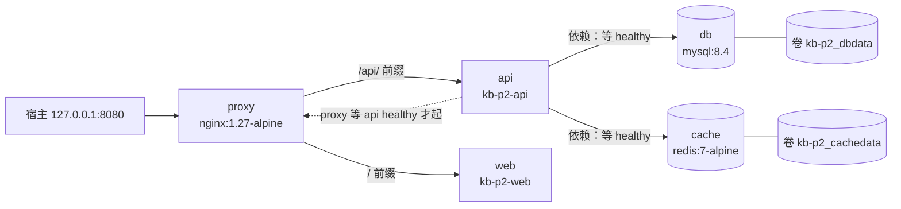

> **实战落点**：示例链第②段 · 一条命令起全栈（本篇就是第②段的落点，本机已跑通并留下逐条读数）
> **示例版本**：本篇直接产出 `示例/贯穿示例/` 下的 `compose.yaml`、`compose.override.yaml`、`compose.debug.yaml`、`.env`（模板 `.env.example`）与 `web/`；`api-service` 是 Go 写的占位服务（真实贯穿示例是 Spring Boot，原因见「与真实技术栈的差距」一节）。目录按段组织：段①在 `段1-依赖跑起来/`、段②的说明在 `段2-一条命令起全栈/`、段③在 `段3-服务自带源码/`
> **前置依赖**：[/docs/04-单机编排/定义/Compose语法基线与文件全字段参考/](/docs/04-单机编排/定义/Compose语法基线与文件全字段参考/)、[/docs/04-单机编排/启停/常用命令启动顺序与健康检查/](/docs/04-单机编排/启停/常用命令启动顺序与健康检查/)、[/docs/02-核心操作/接上去/端口映射数据管理与权限时区/](/docs/02-核心操作/接上去/端口映射数据管理与权限时区/)
> **本篇产出物**：一套能跑的三层 compose 文件（主干 + override + debug）+ 第②段判据的通过记录（冷启 18.4 秒、热启 7.1 秒、经 proxy 两个端点都 200、`down` 后数据仍在）+ `watch` 两档的真实耗时
> **拓展接口**：本篇的「网络与卷设计」在 6.2 生产编排里被推翻（换成显式外部网络与备份策略）；「override 自动合并」这条规则在 6.6 CI 里被复用（CI 只加载主干）；「`down -v` 删数据」在 7.2 症状索引里作为一条独立症状收录；**回指 10-存储专题**：[/docs/10-存储专题/配置与内容/配置应用内容覆盖与失效/](/docs/10-存储专题/配置与内容/配置应用内容覆盖与失效/)（10.5）、[/docs/10-存储专题/故障手册/存储故障手册二遮蔽与失效/](/docs/10-存储专题/故障手册/存储故障手册二遮蔽与失效/)（10.9）。
> **难度·耗时**：★★★ · 60 分钟（含动手，全套命令本机跑过一遍）
> **自测三题**：
> 1. `docker compose down` 之后 `docker ps` 仍能看到三个容器，最可能的原因是什么？该用哪条命令收干净？
> 2. 同目录下有 `compose.override.yaml` 和 `compose.debug.yaml`，为什么一个自动生效、一个不生效？
> 3. `watch` 的 `sync+restart` 与 `rebuild` 两档，各自在你机器上的实际代价由什么决定？

## 为什么要拆成三个文件，而不是在一个 `compose.yaml` 里改来改去

团队里最先出现的那个 compose 文件，往往就是开发自己的一份：

```text
「本地起 full stack，我要 3306 直通宿主方便用 Navicat 连。」
「好。」（改了 db.ports）
「CI 里也用它？」
「CI 不用那个端口，但我把 build 参数改了……现在 CI 挂在镜像构建上。」
「生产也用这个？」
「生产口令不能写死在里面，我用 ${DB_ROOT_PW}，然后……」
「然后线上有人忘了设环境变量，起不来。」
「而且昨天有人把改过的这份文件提交了，把 dev 的 3306 直通带上了生产。」
```

这条路的终点的确实存在的：**一份文件同时背三个环境的差异，差异靠人脑记**。多文件不是「更正式」，而是把「哪个文件在什么时候生效」变成工具规则，不再依赖记忆。

机制上有三件事各自独立，混在一起想就乱：

| 机制 | 解决什么 | 谁决定它生效 | 本机实测的边界 |
|---|---|---|---|
| 多文件合并（`-f` / 同名 override） | 环境差异分层 | 文件命名与加载顺序 | 同目录 `compose.override.yaml` 自动合并；`compose.debug.yaml` **不**自动合并 |
| `profiles` | 同一份文件里，哪些服务默认不起 | 命令行是否给 `--profile` | 不给 `--profile app` 时，`api`/`web`/`proxy` 在模型里根本不存在 |
| `.env` 插值 | 把端口、口令这类会变的值挪出文件 | 变量是否存在 | 变量缺失时 `:?` 会硬失败，普通引用只给空串 |

一个服务最终出现在模型里，要同时过**两道门**：它所在的那个文件被加载了，并且它的 profile 被点名了。本机把这两道门分开量了一次——`adminer` 这个服务同时写了 `profiles: ["debug"]`，文件叫 `compose.debug.yaml`（不会被自动加载）：

| 命令 | 模型里的服务 | 说明 |
|---|---|---|
| `docker compose config --services`（只加载主干 + 自动 override） | `cache db` | 应用层和调试层都不在 |
| `docker compose -f compose.yaml -f compose.debug.yaml config --services` | `cache db` | 文件加载了，但 `debug` 这道门没开 |
| `docker compose -f compose.yaml -f compose.debug.yaml --profile debug config --services` | `db adminer cache` | 两道门都过，`adminer` 出现 |
| `docker compose -f compose.yaml -f compose.debug.yaml --profile debug --profile app config --services` | `db adminer cache api web proxy` | 六个服务全入选 |

改文件之前 `adminer` 没写 `profiles` 那一行，第二条命令的结果是 `db adminer cache`——只靠 `-f` 就把它带进来了。这正是「以为环境隔离了、其实没有」的真实形态，所以示例文件里那行 `profiles: ["debug"]` 不是装饰。

> 💡 新人小结：**profiles 像会议室的门牌，不是门锁**。`profiles: ["app"]` 只是给服务挂了块「应用层」的牌子，默认这条命令不会把牌子念到；你喊 `--profile app`，它才把挂这块牌子的服务一起带走。所以「加了 profile 就默认不起」不是 Docker 记错了，而是你没报名字。类比之后接机制：Compose 在加载阶段按 `--profile` 过滤服务集合，被过滤掉的服务连配置模型都不进——下面第一条读数里 `config --services` 只列出两个服务，就是这个过滤的结果。

## 先看默认模型有多小：profiles 的实测边界

主干文件把 `api`、`web`、`proxy` 三个服务打上 `profiles: ["app"]`（见下一节），然后什么都不加：

```console
$ docker compose config --services
cache
db
```

加上 profile 才出现另外三个：

```console
$ docker compose --profile app config --services
cache
db
api
web
proxy
```

这条读数比看上去重要。它意味着：**`docker compose up`（不带 `--profile`）不会起应用层，`docker compose config --format json` 的模型里也没有 `api`**。上一轮我自己就踩在这里——脚本直接取 `services["api"]` 抛 `KeyError`，看着像配置文件坏了，其实是模型里根本没有这个键。同理，`pull` 也不看 profile：

```console
$ docker compose pull
 Image mysql:8.4 Pulling
 Image redis:7-alpine Pulling
 Image mysql:8.4 Pulled
 Image redis:7-alpine Pulled
```

只拉了 `db` 和 `cache` 两个镜像，`nginx:1.27-alpine` 与两个 `build` 服务都不在这条命令的职责里。CI 里想「预拉全部依赖」必须显式带上 profile，否则镜像缓存永远缺一块。

而 `compose.debug.yaml`（里面只有一个 `adminer`，用来演示调试面板）默认完全不参与：

```console
$ docker compose --profile debug config --services
cache
db

$ docker compose -f compose.yaml -f compose.debug.yaml --profile debug config --services
db
adminer
cache
```

原因是 Compose 只自动加载**两个**文件名：主干 `compose.yaml`（或 `compose.yml`、`docker-compose.yml`）与同目录的 `compose.override.yaml`（或 `compose.override.yml`、`docker-compose.override.yml`）。其它名字一律要 `-f` 点名，或者交给 `COMPOSE_FILE` 环境变量。所以团队里约定「多环境文件叫 `compose.<环境>.yaml`」的同时，必须同时约定**加载方式**：`-f compose.yaml -f compose.debug.yaml`，或 `COMPOSE_FILE=compose.yaml:compose.debug.yaml`（分隔符在 Linux 是 `:`，Windows 上要用 `;`，这一条本机未实测）。

> [!warning]
> 一旦你写了 `-f`，自动合并就没了。S4 那次反面实验用 `-f compose.yaml -f compose.badstart.yaml`，`config` 出来 `api.environment` 是 `{"DB_HOST":"db","REDIS_HOST":"cache","STRICT":"1"}`——override 里那句 `LOG_LEVEL: debug` 没跟上来。端口上的表现更直观，读自另一次 `-f compose.yaml -f compose.debug.yaml` 的真跑：那次 `docker ps` 里 `db` 的端口列是 `3306/tcp, 33060/tcp`（没有任何宿主映射），而自动合并的几次都是 `127.0.0.1:3307->3306/tcp`。排查「我明明改了 override 怎么没生效」，先看命令里有没有 `-f`。

## 三层文件各自放什么

本机的分工是这样落地的（完整文件在 `示例/贯穿示例/`）：

主干 `compose.yaml` 只放**三个环境都成立**的事实：

```yaml
name: kb-p2

services:
  db:
    image: mysql:8.4
    environment:
      MYSQL_ROOT_PASSWORD: ${DB_ROOT_PW:?在 .env 里设一个}
      MYSQL_DATABASE: kbdemo
    volumes:
      - dbdata:/var/lib/mysql
      # 段①交付的建表脚本挂进镜像入口：一条 up 之后表就在，不用再 exec 建表
      - ./段1-依赖跑起来/schema.sql:/docker-entrypoint-initdb.d/10-schema.sql:ro
    healthcheck:
      test: ["CMD", "mysqladmin", "ping", "-h", "127.0.0.1", "-uroot", "-p${DB_ROOT_PW}"]
      interval: 5s
      timeout: 3s
      retries: 20
      start_period: 20s
  # cache / api / web / proxy 见 4.9 完整实战一节
```

`compose.override.yaml` 只放**开发期收窄**的东西：

```yaml
services:
  api:
    environment:
      LOG_LEVEL: debug
    develop:
      watch:
        - action: rebuild
          path: ./api
  db:
    ports:
      - "127.0.0.1:3307:3306"
```

`compose.debug.yaml` 放**要点名才有**的东西（`adminer` 挂 8081，只在 `--profile debug` 时入选）。`.env` 放**不能进版本库的值**：

```ini
DB_ROOT_PW=local-dev-only
PROXY_PORT=8080
```

合并后的真实模型（`docker compose --profile app config --format json` 的节选）能直接读出「哪一句来自哪个文件」：

| 字段 | 合并后的值 | 来源 |
|---|---|---|
| `api.environment` | `{"DB_HOST":"db","LOG_LEVEL":"debug","REDIS_HOST":"cache"}` | `LOG_LEVEL` 来自 override |
| `db.ports` | `[{"mode":"ingress","host_ip":"127.0.0.1","target":3306,"published":"3307","protocol":"tcp"}]` | 来自 override（主干里 `db` 没有 `ports`） |
| `api.depends_on` | `{"cache":{"condition":"service_healthy","required":true},"db":{...}}` | 主干 |
| `proxy.ports` | `[{"mode":"ingress","target":80,"published":"8080","protocol":"tcp"}]` | `8080` 是 `.env` 的 `PROXY_PORT` 插值结果 |
| `networks` | `{"default":{"name":"kb-p2-net","ipam":{}}}` | 主干显式命名 |
| `volumes` | `{"cachedata":{"name":"kb-p2_cachedata"},"dbdata":{"name":"kb-p2_dbdata"}}` | 名字被加了项目前缀 |
| 顶层 `name` | `kb-p2` | 主干 |

`compose ls` 也会把两个文件都列出来，这是「override 到底有没有被合并进去」最快的自检：

```console
$ docker compose ls
 NAME                STATUS              CONFIG FILES
 kb-p2   running(5)  ...\compose.yaml,...\compose.override.yaml
```

## 同名字段怎么合并：规则不直觉，所以逐条量

这是最容易写错的一节。**映射类字段深合并、列表类字段按语义分两种**，「override 会覆盖主干」这句话在列表上不成立。下面每一行都是本机用一个两文件小样（主干 + override，服务只有一个 `s`）跑 `config --format json` 得到的：

| 字段 | 主干写 | override 写 | 合并结果 | 结论 |
|---|---|---|---|---|
| `ports` | `["8001:6379"]` | `["8002:6379"]` | 两条都在 | **追加**（按宿主端口去重，不是替换） |
| `volumes` | `base-vol:/data` | `over-vol:/extra` | 两条都在 | **追加** |
| `command` | `["redis-server","--appendonly","no"]` | `["redis-server","--maxmemory","64mb"]` | 只剩 override | **整体替换** |
| `environment` | `A=1, SHARED=base` | `B=2, SHARED=override` | `A=1, B=2, SHARED=override` | **按键合并**，同键后者胜 |
| `networks`（列表写法） | `[n1]` | `[n2]` | `n1` 与 `n2` 都在 | **并集** |
| `deploy.resources.limits` | `memory: 128m` | `cpus: "0.5"` | `memory:134217728` 与 `cpus:0.5` 都在 | **深合并**（映射逐层合并，`128m` 被规范化成字节） |

后果很具体：想用 override「改掉」一个端口而不是「再加一个」，靠删行不行——两文件都在时容器会同时监听 `8001` 与 `8002`。真要收窄，用 YAML 标签把整段列表强制替换：

```console
# 主干：ports: ["9001:80","9002:80"]，volumes: v1:/a 与 v2:/b，environment: KEEP=1 DROP=2
# override：ports: !override ["9100:80"]
$ docker compose config --format json
  !override 后 ports       = [{"mode":"ingress","target":80,"published":"9100","protocol":"tcp"}]
  !override 后 volumes     = null      # volumes: !override []
  !override 后 environment = null      # environment: !override {}
```

三条读数说明 `!override` 是**整段替换**而不是逐条比对，替换成空列表就等于删掉。反过来想用 `!remove` 精确摘掉一条：

```console
# override：ports: !remove "9002:80"
rc=1 cannot override services.s.ports
```

本机这一版（v5.5.1）不吃这个形状的 `!remove`——要按值摘除，得写成 `!remove` 加列表的形式再试，或者干脆用 `!override` 把留下的部分整段写出来。团队约定就一条：**列表类字段的「减」不靠猜测，写完必须用 `config` 看合并结果**。

> 💡 新人小结：**override 不是「改正主干」，是「往主干上贴便利贴」**。便利贴可以补充（`environment` 多了 `B=2`）、可以改写同一格（`SHARED` 从 `base` 变 `override`）、也能往一列清单里再加一行（`ports` 变两条），但不能凭空让原来那行消失——想让整张清单换掉，得写「整段替换」的记号（`!override`）。类比之后接机制：这些规则来自 compose-spec 对每种字段的合并语义定义，`config --format json` 就是那台能把规则讲清楚的机器。

> [!note]
> `deploy` 在本机是 1.28 之后重新启用的字段，但 `deploy.resources` 之外的 swarm 专属字段（`placement.constraints` 之类）在 compose v2 单机上被忽略——这条本机未实测，看到旧教程用 `deploy.placement` 调亲和性时按 swarm 语境判断。

## 一条命令起全栈：第②段判据长什么样

现在把主干、override、`.env` 合起来跑一次。判据必须写成能被机器回答的形式，四条缺一不可：

1. **一条命令**：`docker compose --profile app up -d --wait`，不预先 `create` 任何东西。
2. **全部就绪**：`ps` 表里每个带健康检查的服务都是 `healthy`。
3. **入口可达**：从宿主机经 `proxy` 打到 `api` 与 `web`，两个请求都 `200`。
4. **数据活过重起**：`down`（不带 `-v`）之后 `up -d --wait`，先前写入的数据还在。

第 1、2、3 条的读数：

```console
$ docker compose --profile app up -d --wait     # 用时 18.4 秒（冷，含两个 build）

$ docker compose ps
NAME            IMAGE               SERVICE   STATUS                    PORTS
kb-p2-api-1     kb-p2-api           api       Up 5 seconds (healthy)    8080/tcp
kb-p2-cache-1   redis:7-alpine      cache     Up 16 seconds (healthy)   6379/tcp
kb-p2-db-1      mysql:8.4           db        Up 16 seconds (healthy)   127.0.0.1:3307->3306/tcp
kb-p2-proxy-1   nginx:1.27-alpine   proxy     Up Less than a second     0.0.0.0:8080->80/tcp, [::]:8080->80/tcp
kb-p2-web-1     kb-p2-web           web       Up 16 seconds             80/tcp

$ curl -s http://127.0.0.1:8080/api/health
{"status":"UP","db":"UP","cache":"UP"}|http=200|耗时=0.003729s

$ curl -s -o /dev/null -w "首页 http=%{http_code}" http://127.0.0.1:8080/
首页 http=200 耗时=0.002235s
```

第 4 条的读数（先写两行数据，`down`，再 `up`）：

```console
$ docker compose exec db sh -c 'mysql -uroot -p… kbdemo -e "SELECT * FROM t_note ORDER BY id;"'
id	note
1	before-down
2	warm-start
```

四行都在，`down` 到 `up` 之间没有做过任何备份动作。这一条本轮只量了 MySQL：redis 侧的同一个键（`seg2`）是在重启**之后**才写进去的，所以「redis 的键活过 compose 级 `down`」这条在本批次里不算已验；它在第①段用容器级 `docker rm` 验过（见 [/docs/02-核心操作/接上去/端口映射数据管理与权限时区/](/docs/02-核心操作/接上去/端口映射数据管理与权限时区/) 的「实战切入」一节），挂载与卷类型完全相同，只是当时的删除粒度不同。

四个「用时」放在一起看，才知道 18.4 秒花在哪：

| 场景 | 命令 | 用时 | 差在哪 |
|---|---|---|---|
| 冷（卷是空的，两个服务要 build） | `up -d --wait` | 18.4 秒 | MySQL 首次初始化数据目录 + 两次 build |
| 热（卷已有数据，容器都在） | `up -d --wait` | 7.1 秒 | 只做「等到 healthy」，无创建无初始化 |
| 卷被删但镜像已 build | `up -d --wait` | 16.8 秒 | 又付了一次 MySQL 初始化 |
| 强制重建全部容器 | `up -d --wait --force-recreate` | 18.2 秒 | 五个容器重建 + 两轮健康等待 |

启动时间主要由**MySQL 的数据目录初始化**决定，不是 compose 本身慢。同一批取数里另有一组对照：把 `interval` 收到 2 秒、不设 `start_period`，MySQL 8.4 从容器起来到第一次探测通过是 **8.6 秒**，中间记录到 3 次失败探测（`FailingStreak` 走到 3，最后一次输出 `mysqld is alive`）。这里的 `start_period: 20s` 就是照着这个量级放的，细节见 [/docs/04-单机编排/启停/常用命令启动顺序与健康检查/](/docs/04-单机编排/启停/常用命令启动顺序与健康检查/)。

启动与流量的方向画出来是这样（`depends_on` 决定创建顺序，HTTP 流量方向是另一件事）：



## `down` 的三种收场：为什么不能凭手感写

`down` 在 04 篇里是最容易出事的一条命令，因为它同时决定「容器停不停」和「数据留不留」。本机三种写法的结果：

| 写法 | 结果 | 读数 |
|---|---|---|
| `down`（不带 `--profile`） | 只停掉模型里有的 `db`/`cache`；`api`/`web`/`proxy` 三个仍在跑，网络删不掉 | 用时 2.0 秒；随后 `docker ps` 列出三个 `Up` 容器，`docker network ls` 里 `kb-p2-net` 还在；`down` 的日志里出现 `Network kb-p2-net Resource is still in use` |
| `--profile app down --remove-orphans` | 五个容器全部停并删，网络删掉，卷保留 | 日志逐条 `Stopped`/`Removed`，最后 `Network kb-p2-net Removed` |
| `down -v` | 连卷一起删（数据没了），但同样漏掉 profile 服务，网络仍报「仍在使用」 | 用时 1.6 秒；`Volume kb-p2_dbdata Removed`；再 `up` 后 `ERROR 1146 (42S02) at line 1: Table 'kbdemo.t_note' doesn't exist`，redis `dbsize` 为 `0` |

两条结论要分开记：

- **profile 决定 `down` 的作用范围。** 起的时候带了 `--profile app`，停的时候也必须带；不带就是「只停我看得到的那两个」。补救办法是 `--remove-orphans`，它按项目标签把不属于当前模型的容器一起收掉。
- **`-v` 是删数据的开关，不是「清得更干净」的开关。** 上面的 `ERROR 1146` 就是它的回执：容器、网络、卷全部重建，MySQL 的数据目录是空的，表自然不存在。

> 💡 新人小结：`down` 像退房，`down -v` 像退房之后把房间重新装修一遍——两件事的费用不是一个量级，而且第二件不可撤销。类比之后接机制：`down` 删的是「项目派生的运行时对象」（容器、默认网络），`-v` 额外删掉 compose 声明的 named volume，而 named volume 是唯一活过容器生命周期的那份（02 篇里已经用备份命令验证过它的落点在 `/var/lib/docker/volumes/.../_data`，Windows 上挂在 WSL2 的 `/dev/sdd`）。

要留数据但清干净，用 `stop` + `start` 而不是 `down`：

```console
$ docker compose stop cache          # 容器保留，只是停了
$ docker compose ps --format "{{.Service}}\t{{.State}}\t{{.Health}}"
api	running	healthy
db	running	healthy
proxy	running
web	running
$ docker compose start cache         # 原容器原样起来
```

`stop`/`start` 不重建容器，因此配置改动不会生效——这一条与 4.4 里 `--no-recreate` 的读数同源。

## 热重载：`watch` 的三档与它们的真实代价

开发期最烦的是「改一行等三分钟」。Compose 的 `develop.watch` 把这件事分成三档，档位差别就是「要不要重建镜像」：

| 档位 | 做什么 | 适用 | 本机实测代价 |
|---|---|---|---|
| `sync` | 把改的文件推进容器，不动进程 | 解释型语言 + 自动重载（PHP、Node 带 `--reload`、Rails） | 未单独实测（示例里没有这种服务） |
| `sync+restart` | 推进文件，然后重启容器内进程 | 静态资源、需要重启才生效的纯配置文件 | 从落盘到 `curl` 看到新内容 **2.0 秒** |
| `rebuild` | 重新构建镜像并重建容器 | 需要编译的语言、依赖变化 | **4.1 秒**（本例的占位服务只有两层） |

`sync+restart` 那次的证据链：

```console
# watch 已在后台跑（docker compose --profile app watch --no-up）
# 宿主改 web/index.html，加一行 <p>watch-marker-…</p>
Watch enabled
Syncing service "web" after 1 changes were detected
 Container kb-p2-web-1 Restarting
 Container kb-p2-web-1 Started
service(s) ["web"] restarted

$ docker compose ps --format "{{.Service}}\t{{.Status}}"
api	Up 37 seconds (healthy)
cache	Up 29 seconds (healthy)
db	Up 29 seconds (healthy)
proxy	Up 31 seconds
web	Up 1 second          # 只有它被重启了
```

配置文件里对应这两档的写法：

```yaml
services:
  web:
    develop:
      watch:
        - action: sync+restart
          path: ./web/index.html
          target: /usr/share/nginx/html/index.html
  api:
    develop:
      watch:
        - action: rebuild
          path: ./api
```

`config` 里能看到被规范化后的形状（`target` 只在 `sync` 系需要，`rebuild` 不带它）：

```json
{"watch": [{"path": "…\\web\\index.html", "action": "sync+restart",
            "target": "/usr/share/nginx/html/index.html", "exec": {"command": null}}]}
```

`rebuild` 档的 4.1 秒要老实标注它不能外推：这个占位服务的 Dockerfile 只有 `FROM alpine` + `COPY` 一步，本机 `docker compose build --no-cache api` 是 **1.0 秒**，缓存命中是 **0.5 秒**。换成真实 Spring Boot，`rebuild` 里多出依赖解析与打包，量级完全不同——本轮没有 Maven 环境，那个数没量到，写进 4.8 的判据里作为待补项而不是结论。

> [!tip]
> `watch` 与 `up` 的关系：`docker compose up --watch` 与单独跑 `docker compose watch` 等价；`--no-up` 用于「栈已经起来了，只挂监视器」，本机的两次实测都是这么起的。`watch` 是**前台会话**，用脚本起它要注意 `docker` CLI 会派生 `docker-compose` 子进程，父进程被终止时子进程还活着并占着日志文件句柄——本轮就在这里踩过一次，目录删不掉，最后按子进程 pid 收的。

## Windows 下的 bind mount 与 HMR：现象、成因与解法

前端开发常见的一句抱怨是「容器里跑 Vite，改文件浏览器不热更」。三个独立的坑叠在一起，要分开验：

| 症状 | 成因 | 解法 | 本机状态 |
|---|---|---|---|
| 改文件完全没反应，容器内也不见新内容 | 挂载写错（路径大小写、Docker Desktop 文件共享未放行该盘） | 先 `docker compose exec web ls -l /app` 看容器里看到的到底是什么 | 未实测（示例的 `web` 是构建进镜像的静态文件，不是 bind mount） |
| 容器内文件变了，但监听器不触发 | Windows 侧的 9p/DrvFs 挂载不把 inotify 事件传进容器，只有数据变化可见 | Vite 打开轮询：`server.watch.usePolling = true`（配 `interval`，常见 300 毫秒起）；或改用 `develop.watch` 的 `sync` 由 compose 主动推 | 机制成立，**本轮未实测**；02 篇量到的「bind mount 走 9p、比命名卷慢一个量级」是同一条链上的另一环 |
| 浏览器连的是 `localhost:5173` 但 WebSocket 失败 | HMR 的 WS 端口/主机与 dev server 不一致：容器里监听 `127.0.0.1` 外面进不来 | `server.host = true` 监听所有网卡 + `ports` 把 5173 publish 出来 + 必要时 `server.hmr.clientPort = 5173`；`/api` 前缀交给 `proxy` 服务而不是 Vite 的 `proxy` | 未实测，属配置口径；给判据：浏览器 Network 里 WS 请求的目标地址应与 `docker compose port web 5173` 的读数一致 |

`docker compose port` 这条命令在排查第三种症状时最省事——它直接回答「compose 认为这个服务的外部地址是什么」，而不是让人去翻 `ps` 的 `PORTS` 列。Java 侧的对应做法（devtools + 挂载 `target/classes`、或直接让 IDE 跑在 `kb-p2-net` 上）同样只给口径，本轮没有 Java 容器可跑，标在本篇未验证项里。

> 💡 新人小结：文件共享挂载像**隔着一扇玻璃窗递东西**——东西（内容）你看得见也拿得到，但窗那边的人不知道你什么时候递的（事件传不过去）。所以「改文件不热更」常常不是没生效，是没人通知它。接机制：`usePolling` 就是让窗那边的人每隔几百毫秒自己探头看一眼，代价是 CPU 与延迟，换来行为可预测。

## 完整实战：五个服务的栈是怎么长出来的

主干文件完整贴一次（`api`/`web`/`proxy` 三个都挂在 `profiles: ["app"]` 下，因为它们是「应用层」，CI 预拉依赖时不该被卷进来）：

```yaml
services:
  cache:
    image: redis:7-alpine
    command: ["redis-server", "--appendonly", "yes"]
    volumes:
      - cachedata:/data
    healthcheck:
      test: ["CMD", "redis-cli", "ping"]
      interval: 5s
      timeout: 2s
      retries: 10

  api:
    build: ./api-service
    environment:
      DB_HOST: db
      REDIS_HOST: cache
    depends_on:
      db: { condition: service_healthy }
      cache: { condition: service_healthy }
    healthcheck:
      test: ["CMD", "wget", "-q", "-O", "-", "http://127.0.0.1:8080/api/health"]
      interval: 5s
      timeout: 3s
      retries: 12
      start_period: 5s
    profiles: ["app"]

  web:
    build: ./web
    profiles: ["app"]

  proxy:
    image: nginx:1.27-alpine
    ports:
      - "${PROXY_PORT:-8080}:80"
    volumes:
      - ./web/nginx.conf:/etc/nginx/conf.d/default.conf:ro
    depends_on:
      api: { condition: service_healthy }
      web: { condition: service_started }
    profiles: ["app"]

networks:
  default:
    name: kb-p2-net

volumes:
  dbdata:
  cachedata:
```

几个设计点的取舍，都对应上面某条读数：

- **入口只有一个。** 只有 `proxy` 暴露宿主端口（`${PROXY_PORT:-8080}`），`api` 与 `web` 的 `8080/tcp`、`80/tcp` 只在容器网络里。生产同理：宿主端口越少，能被打的洞越少。
- **`db` 的端口只在 override 里。** `127.0.0.1:3307:3306` 是开发期便利（避开本机已占用的 3306），绑 `127.0.0.1` 而不是 `0.0.0.0`；主干不带这个字段，CI 与生产加载主干就自然没有它。
- **`proxy` 对 `api` 用健康门、对 `web` 用 `service_started`。** nginx 起来时如果 upstream 名字解析不到会直接退出，`api` 是它必须等的那一个；`web` 只提供静态文件，`service_started` 够用。
- **卷名交给 compose 加前缀。** 实际落地的名字是 `kb-p2_dbdata`（`config` 的读数），所以手工 `docker volume rm` 之前要按这个名字找，不要写 `dbdata`。
- **`name: kb-p2` 必须写死。** 项目名会进卷名、网络名、容器名。中文目录名场景下 Compose 会把非法字符过滤掉，过滤空了就报 `project name must not be empty`——本轮在一个中文命名的临时目录里（文件内容与它完全相同、只是目录换成 ASCII 名的对照组正常通过）直接撞到过这条报错，加上 `name:` 就好。

复现清单（每条命令都跑过，预期读数在上文）：

```console
$ cd 示例/贯穿示例
$ (cd api-service && GOOS=linux GOARCH=amd64 CGO_ENABLED=0 go build -trimpath -o api .)   # 必须交叉编译成 Linux 二进制；产物不进版本库（.gitignore 里是 api-service/api）
$ docker compose config --services                       # 只应看到 cache 与 db
$ docker compose --profile app up -d --wait              # 冷 18.4 秒 / 热 7.1 秒
$ docker compose ps                                      # 三个 healthy，proxy/web 起来
$ curl -s http://127.0.0.1:8080/api/health               # {"status":"UP","db":"UP","cache":"UP"}
$ curl -s -o /dev/null -w "%{http_code}\n" http://127.0.0.1:8080/
$ docker compose exec db sh -c 'mysql -uroot -p"$DB_PW" kbdemo -e "SELECT 1;"'
$ docker compose down                                    # 注意：不带 --profile 会漏三个
$ docker compose --profile app up -d --wait              # 判据第 4 条：数据还在
$ docker compose --profile app watch                     # 改 web/index.html，约 2 秒可见
$ docker compose -f compose.yaml -f compose.debug.yaml \
    --profile app --profile debug up -d --wait            # 六个服务，本机 17.5 秒
$ curl -s http://127.0.0.1:8081/ | grep -o "<title>[^<]*</title>"
$ docker compose --profile app --profile debug down -v --remove-orphans   # 收干净，会删数据
```

最后一条命令之前跑的是调试层：`adminer:4` 起来后 `127.0.0.1:8081` 直接给回 `<title>Login - Adminer</title>`，而 `docker compose up --wait` 的日志里它自己也是 `Healthy`——可我在 `compose.debug.yaml` 里**没有**给它写健康检查。那是镜像自带的 `HEALTHCHECK` 在生效（与 4.6 的优先级读数同源：compose 不写，就用镜像的）。

## 与真实技术栈的差距

本篇的栈是**结构完整、内容占位**：网络、卷、健康门、profiles、插值、watch 全是真的；服务实现是占位的。差距清单写清楚，免得读者把占位的量级当成真实的：

| 位置 | 本篇 | 真实贯穿示例（第③段之后） | 影响哪个结论 |
|---|---|---|---|
| `api` | Go 单文件，两层镜像，`build` 1.0 秒 | Spring Boot + Maven 多阶段（3.7） | `rebuild` 档 4.1 秒不可外推 |
| `web` | 静态 HTML 进 nginx 镜像 | Vue3 + Vite dev server（`usePolling` 那段才有实测对象） | HMR 三条解法目前只有口径 |
| `db` | `mysql:8.4` 官方镜像 | MySQL 8.4 不变，但加 `configs` 挂载与初始化 SQL | 健康检查探测命令不变 |
| 口令 | `.env` 里一个开发值 | `configs`/`secrets` 或外部注入 | 4.6 里「明文进 `config` 输出」那条判据要重跑 |
| 就绪判据 | `mysqladmin ping` | 同一命令，但库表初始化完成后才算真的好 | 需要 `service_completed_successfully` 那条链路（见 4.5） |

## 常见误读

| 误读 | 实际 |
|---|---|
| 「`profiles` 是环境隔离，dev 和 prod 用不同 profile」 | profile 决定**一条命令带上哪些服务**，不是「配置分环境」。环境差异该走多文件；用 profile 装环境，会出现「prod 的 up 忘了 `--profile prod` 就少起一层」 |
| 「override 里没写的字段会被清掉」 | 映射类深合并、`command` 这类标量整体替换、`ports`/`volumes` 追加。override 不写，主干的值仍然在 |
| 「`compose.debug.yaml` 也会自动合并，名字长得像就行」 | 只有 `compose.override.*` / `docker-compose.override.*` 是自动的，其它文件名要 `-f` 或 `COMPOSE_FILE` |
| 「`down` 就是把这套东西停干净」 | 不带 `--profile` 的 `down` 会漏起 profile 服务，网络因「仍在使用」删不掉；`--remove-orphans` 才是兜底 |
| 「`down -v` 是更彻底的清理，可以当习惯用」 | `-v` 删 named volume，也就是删数据。上面那条 `ERROR 1146` 就是它的结果 |
| 「`watch` 的 `rebuild` 快，所以 Java 项目也可以这么写」 | 本例 4.1 秒来自两层 COPY 的占位镜像。真实 Java 的构建成本没在本轮量过 |
| 「`up --wait` 返回 0 就说明业务可用」 | `--wait` 等的是「健康检查通过」。健康检查口径写窄（只 ping TCP），它就只保证那一格 |

## 本篇不覆盖什么

按 W6 的规矩，本篇**故意不讲**的东西逐条点名去处——写「不覆盖」不是免责声明，是防止你在这一篇里找不存在的答案：

- 每个字段的完整语义与废弃项 → 见 **4.1**（`services` 字段速查在那一篇，本篇只用到其中一部分）
- 健康门、`--wait` 与启动顺序的参数 → 见 **4.6**（`healthcheck` 的参数定法在那一篇）
- 生产编排（外部网络、备份策略、回滚）→ 见 **6.4**（`部署三式` 与上生产准入清单在那一篇）
- Windows 侧绑定挂载为什么慢、慢在哪一层 → 见 **10.3**（`9p` 的跨系统语义代价在那一篇量到数字）
- 改了文件为什么不生效的存储侧成因 → 见 **10.5**（`遮蔽` 与四条注入路径的胜负规则在那一篇）
- CI 里怎么复用这套栈 → 见 **6.1**（`cache` 命中这件事在流水线那一篇重写）

## 要点总结

- 三个机制各管一件事：多文件管**环境差异**，`profiles` 管**一条命令带哪些服务**，`.env` 管**会变且不进版本库的值**。
- `profiles` 的过滤发生在模型加载阶段：不带 `--profile`，`config --services`、`pull`、`down` 全都看不到那些服务。这是本机最容易踩的一条。
- 同名字段的合并语义分三类（深合并 / 整体替换 / 追加），`ports` 与 `volumes` 是**追加**；写了 `-f` 就没有自动 override 合并。
- 第②段判据四条全部通过：一条命令起 5 个服务（冷 18.4 秒 / 热 7.1 秒）、三个带检查的服务 `healthy`、经 `proxy` 的 `/api/health` 与 `/` 都是 `200`（3.7 毫秒 / 2.2 毫秒）、`down` 后数据仍在。
- 启动时间由 MySQL 的数据目录初始化决定，不由 compose 决定：卷为空 16.8 秒、卷已用 7.1 秒，两次差的就是 MySQL 初始化那 8 秒量级。
- `down` / `down --remove-orphans` / `down -v` 是三件事：停可见服务、停全部服务、连数据一起删。写命令时按这三档想。
- `watch` 三档的实测代价：`sync+restart` 2.0 秒（纯静态文件），`rebuild` 4.1 秒（占位镜像）；`sync` 档与真实 Java/Node 的数字本轮没量到。
- Windows 下「改文件不热更」先分清是「数据没过去」还是「事件没过去」，后者用轮询或 `develop.watch` 的 `sync` 兜。

## 本篇未验证项

| 项 | 状态 | 说明 |
|---|---|---|
| `COMPOSE_FILE` 在 Windows 上的分隔符 | 未实测 | 正文按官方口径写 `;`，Linux 是 `:`；本轮全部用 `-f` |
| Vite 的 `usePolling` / `hmr.clientPort` 三件套能否让热更真的生效 | 未实测 | 示例的 `web` 没有 dev server，需要第③段之后的 Vue3 真服务才能验；判据已写在表里 |
| 容器内 inotify 事件在 9p 挂载上不传播 | 未实测（机制成立） | 需要镜像里跑 `inotifywait` 并对照宿主改动；已列为 4.8 的补测项 |
| Java（Spring Boot）走 `rebuild` 档的实际耗时 | 未实测 | 本机无 Maven 依赖缓存；占位服务的 4.1 秒不能替代 |
| Redis 的键活过 **compose 级** `down`（不带 `-v`） | 未实测 | 本轮那个键是在重启之后写的；容器级已在第①段验过，卷与挂载相同但删除粒度不同，下一步把它补进判据第 4 条 |
| `adminer` 经 `-f compose.debug.yaml` + `--profile debug` 真起并出登录页 | 已实测 | 六个服务 17.5 秒起齐，`127.0.0.1:8081` 回 `<title>Login - Adminer</title>`，`up --wait` 里它是 `Healthy`（镜像自带 `HEALTHCHECK`） |
| `!override` 收回追加列表 | 已实测 | `ports` 只剩 `9100`，`volumes`/`environment` 用 `!override {}` 变 `null` |
| `!remove` 摘掉列表中的**一条** | 未跑通 | 本机这一版对 `ports: !remove "9002:80"` 报 `cannot override services.s.ports`；`!remove` 配列表形式的写法没再试 |
