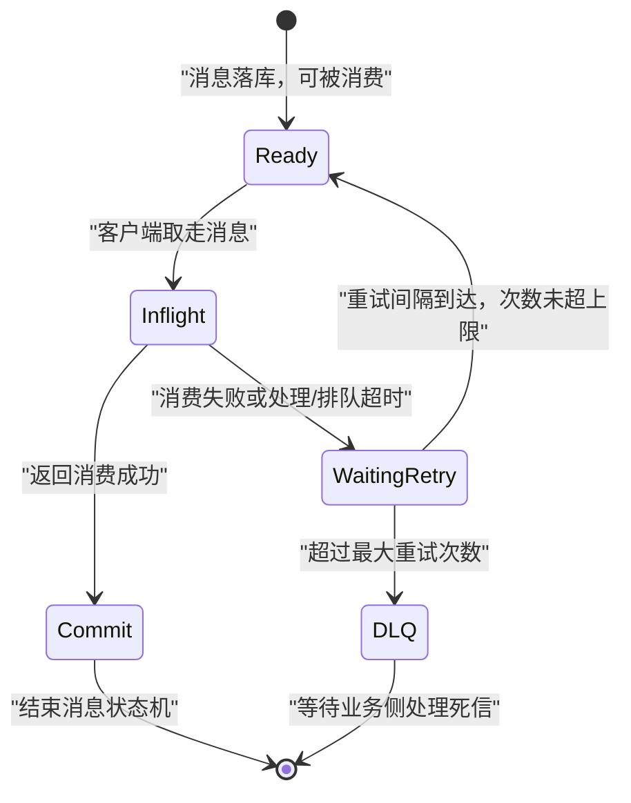
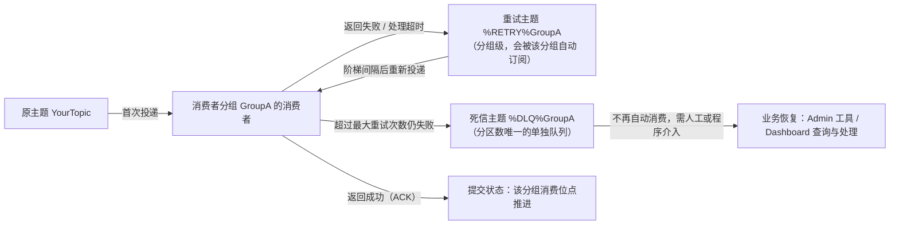

## 为什么需要消费重试与死信队列？（痛点引入）

下游处理消息时一定会失败：依赖的数据库主从切换、风控接口临时超时、本地事务状态还没写进库。没有重试机制时，这些失败只有两种结局，而且两种都不可接受。

1. **失败即丢**。监听器 catch 住异常、返回成功，消息进度照常推进——上游对类似做法的定性很明确：消息还未处理完成就返回消费成功结果时，「如果消息消费失败，Apache RocketMQ 服务端是无法感知的，因此不会进行消费重试」。这类丢法在日志里毫无痕迹。
2. **失败即死循环**。返回消费失败但不设次数上限，一条永远处理不掉的消息把 CPU 与日志刷满，还会挡住后面的消息（顺序消费场景）。上游的建议正是针对这个：**「建议通过减少重试次数 + 延长重试间隔来降低系统压力，避免出现无限重试或大量重试。」**

消费重试与死信队列是这套「失败之后怎么办」的完整答案：失败先按策略重投，重投到上限仍失败就转入死信队列兜底，既不静默丢、也不无限转。

| 维度 | 没有重试与死信 | 有重试与死信 |
|------|----------------|--------------|
| 临时性失败 | 直接丢数据，业务状态不一致 | 按阶梯间隔自动重投，多数自愈 |
| 永久性坏消息 | 反复处理反复失败，拖垮整组 | 超过最大次数进入死信队列，链路继续 |
| 失败可见性 | 只能靠日志翻找 | 死信主题可查（Admin 工具或 Dashboard） |
| 顺序语义 | 失败消息被跳过，顺序被打乱 | 顺序消费在客户端本地重试，不跳过 |
| 系统压力 | 无限重试打爆下游 | 步长递增 + 次数上限双重约束 |
| 兜底责任 | 无人接手 | 死信消息交由业务恢复流程处理 |

> ### 💡 新人小结：重试像「退货流程」，死信像「无主件仓库」
>
> 把一条消费失败的消息想成一件退货商品：
> - **重试**＝按规则再送一次：第一次隔 10 秒再送，第二次隔 30 秒，越送越稀疏（阶梯间隔），最多送 16 次（默认最大重试次数）。
> - **PushConsumer** 的退货节奏由**驿站排班表**定（消费者分组创建时的元数据 + SDK 内置阶梯）。
> - **SimpleConsumer** 的退货节奏由**你自己给的时限**定：取货时声明「这件我最多处理 30 秒」，超时没结就自动回到架上；嫌时间不够还能打电话改时限（修改不可见时间）。
> - **死信队列**＝超过次数还没送出去的件，被挪进「无主件仓库」（`%DLQ%` 分组名），不再自动派送，等人来认领处理。
>
> **一句话总结：重试负责「再给一次机会」，死信负责「机会用完后别把链路堵死」。**

**学习路线图**

```
痛点引入 → 重试的边界与触发条件 → 两种策略对照 → Push 状态机与阶梯步长 → Simple 不可见时间与改期 → %RETRY% 与 %DLQ% 运行机制 → 死信后的处理路径 → 4.x 与 5.0 差异 → 术语与误区
```

---

## 消费重试解决什么问题，以及不该用它解决什么

Apache RocketMQ 的消费重试主要解决的是**业务处理逻辑失败导致的消费完整性问题**，是一种为业务兜底的策略，**不应该被用作业务流程控制**。

上游给出的推荐与禁用场景，逐条保留：

| 场景分类 | 上游原文要点 | 判断依据 |
|----------|--------------|----------|
| ✅ 推荐使用 | 业务处理失败，且失败原因跟当前消息内容相关，比如该消息对应的事务状态还未获取到，预期一段时间后可执行成功 | 失败是暂时的，重投有意义 |
| ✅ 推荐使用 | 消费失败的原因不会导致连续性，即当前消息消费失败是小概率事件，不是常态化失败，后面的消息大概率会消费成功 | 对当前消息重试，避免进程阻塞 |
| ❌ 典型错误 | 消费处理逻辑中用消费失败做条件判断的结果分流 | 逻辑已预见该分支会大量出现，等于把重试当分支路由 |
| ❌ 典型错误 | 消费处理中用消费失败做处理速率限流 | 限流的目的是把超量消息暂时堆积在队列中削峰，而不是让消息进入重试链路 |

**消息重试的触发条件**只有两类：

1. **消费失败**：包括消费者返回消息失败状态标识，或抛出非预期异常。
2. **消息处理超时**：包括在 PushConsumer 中排队超时。

**重试策略的三个主要行为**：重试过程状态机（消息在重试流程中的状态与变化逻辑）、重试间隔（上一次消费失败或超时后，下次重新尝试消费的间隔时间）、最大重试次数（消息可被重试消费的最大次数）。

> [!NOTE] 分工边界
> 本文只写**消费侧**重试与死信。发送侧的客户端重试（同步／异步发送重试）与发送流控属于 04-message-features 的发送可靠性内容，数值与机制都不在这里讨论；两者唯一的交集是「重试」这个词，语义完全不同。

---

## 两种策略先对照：差异集中在哪

根据消费者类型不同，重试策略的内部机制和设置方法不同。上游的对照表如下（完整保留）：

| 消费者类型 | 重试过程状态机 | 重试间隔 | 最大重试次数 |
|------------|----------------|----------|--------------|
| PushConsumer | 已就绪、处理中、待重试、提交、死信 | 消费者分组创建时元数据控制；无序消息：阶梯间隔；顺序消息：固定间隔时间 | 消费者分组创建时的元数据控制 |
| SimpleConsumer | 已就绪、处理中、提交、死信 | 通过 API 修改获取消息时的不可见时间 | 消费者分组创建时的元数据控制 |

把差异再拆细一层：

| 对比维度 | PushConsumer 重试 | SimpleConsumer 重试 |
|----------|-------------------|---------------------|
| 是否有「待重试（WaitingRetry）」状态 | 有，PushConsumer 独有 | 无，只有 Ready／Inflight／Commit／DLQ |
| 间隔由谁决定 | 分组元数据 + 阶梯步长（无序）或固定间隔（顺序） | 取消息时设置的消费不可见时间（InvisibleDuration） |
| 触发方式 | 返回 `ConsumeResult.FAILURE` 或抛异常，或处理／排队超时 | 不回复 ACK，等不可见时间到后消息重新可见 |
| 能否逐条改期 | 上游未提供逐条改间隔的接口 | 可以，调 `ChangeInvisibleDuration` |
| 重试间隔的计算 | 阶梯表固定值（第 n 次对应固定间隔） | 消息重试间隔＝不可见时间 − 消息实际处理时长 |
| 超时的后果 | SDK 按消费超时处理，强制提交消费失败结果并进入重试判断 | 不可见时间到即视为超时，消息立即重新可见，可被再次取到 |
| 依据 | 5.0《消费重试》PushConsumer 节 | 5.0《消费重试》SimpleConsumer 节 |

> ### 💡 新人小结：Push 像「驿站按排班表重送」，Simple 像「你自报处理时限」
>
> - PushConsumer：你只管说「这件没搞定」（返回 FAILURE），**什么时候再送来是驿站排班表说了算**（阶梯间隔，10 秒 → 30 秒 → 1 分钟 → …）。
> - SimpleConsumer：取件时你先说「我需要 30 秒处理」，**这个 30 秒既是你的处理时限，也是下次能再拿到它的时间**；发现不够用，还能中途打电话改到 60 秒（改期立即生效，从调用接口那一刻重新计时）。
> - 两者的共同终点都一样：次数用完，进无主件仓库（死信）。
>
> **一句话总结：Push 的间隔写在排班表里，Simple 的间隔握在你自己手里。**

---

## PushConsumer 消费重试策略

### 状态机：五个状态，两个出口


| 状态 | 上游定义 | 谁会推动它 |
|------|----------|------------|
| Ready（已就绪） | 消息在服务端已就绪，可以被消费者消费 | 服务端 |
| Inflight（处理中） | 消息被消费者客户端获取，处于消费中还未返回消费结果的状态 | 客户端取走消息 |
| WaitingRetry（待重试） | **PushConsumer 独有**。消费者处理消息失败或消费超时时触发消费重试逻辑判断；若当前重试次数未达最大次数，消息变为待重试，经过重试间隔后重新变为已就绪可被重新消费 | 服务端按重试判断 |
| Commit（提交） | 消费成功的状态，消费者返回成功响应即可结束消息的状态机 | 客户端返回 SUCCESS |
| DLQ（死信） | 消费逻辑的最终兜底机制：若消息一直处理失败并不断重试，超过最大重试次数仍未成功，消息不再重试，被投递至死信队列 | 服务端达到次数上限 |

WaitingRetry 存在的理由上游写得很直白：**「多次重试之间，可通过重试间隔进行延长，防止无效高频的失败。」** 阶梯递增的步长就是这条设计意图的落地。

下图把状态机重画成可检索的形式（与官方截图对照阅读）：



图后解读：从 Inflight 出发只有两条路——成功（Commit）或失败（WaitingRetry）；WaitingRetry 再分两条路——间隔到了回到 Ready，或次数触顶进 DLQ。这条链路里**没有「丢弃」分支**，5.0《消费者分组》对重试策略的描述是「超过最大重试次数还没被成功消费，消息将被投递至死信队列或丢弃」，是否丢弃取决于分组设置，上游未给出默认取值。

### 时间轴：间隔由「消费耗时 + 重试间隔」共同决定


消息重试过程中，每次重试消息状态都会经过「已就绪 → 处理中 → 待重试」的变化，**两次消费间的间隔时间实际由消费耗时及重试间隔控制**，而消费耗时的最大上限受服务端系统参数控制，一般不应该超过上限时间。

```
一次重试周期的构成（依据 5.0《消费重试》时间轴描述）

① 取到消息: Inflight 开始计时
② 处理消息: 消费耗时（上限受服务端系统参数控制）
③ 返回失败或超时: 进入 WaitingRetry
④ 等待重试间隔: 由阶梯表决定（第 n 次重试对应固定值）
⑤ 间隔到达: 消息回到 Ready，可被重新消费
```

### 最大重试次数：3 次意味着投递 4 次

PushConsumer 的最大重试次数由消费者分组创建时的元数据控制。上游给的换算关系要记牢：

```java
// ========== 语义示例：最大重试次数 = 3 ==========
// 最大重试次数为 3 次，则该消息最多可被投递 4 次：
//   第 1 次 = 原始消息投递
//   第 2~4 次 = 3 次重试投递
// 输出: 一条始终失败的消息在链路上共出现 4 次消费机会，之后进入死信队列
// ❌ 不推荐：把最大重试次数当「消息总投递次数」来配 —— 实际总次数 = 配置值 + 1
```

参数解释：「最大重试次数」计的是**重试**次数，不含首次投递；它属于消费者分组的元数据（同组所有消费者共用），4.x 侧对应的客户端参数是 `maxReconsumeTimes`（4.x 客户端参数表默认值 -1，4.x《Push 消费》给出的并发消费默认值是 16 次，两个口径的出处见下文差异表）。

### 重试间隔阶梯表（上游条目逐行保留）

**无序消息（非顺序消息）**：重试间隔为阶梯时间，具体如下。

| 第几次重试 | 与上次重试的间隔时间 | 第几次重试 | 与上次重试的间隔时间 |
|-------|------------|-------|------------|
| 1     | 10秒        | 9     | 7分钟        |
| 2     | 30秒        | 10    | 8分钟        |
| 3     | 1分钟       | 11    | 9分钟        |
| 4     | 2分钟       | 12    | 10分钟       |
| 5     | 3分钟       | 13    | 20分钟       |
| 6     | 4分钟       | 14    | 30分钟       |
| 7     | 5分钟       | 15    | 1小时        |
| 8     | 6分钟       | 16    | 2小时        |

配套的两条说明同样来自上游：

- **若重试次数超过 16 次，后面每次重试间隔都为 2 小时。**
- 4.x《Push 消费》指出这套阶梯「与延迟消息第三个等级开始的时间完全一致」，并把并发消费的间隔范围概括为 **1 秒～2 小时，不支持自定义配置**。

**顺序消息**：重试间隔为固定时间。5.0《参数约束和建议》给出的取值是 **PushConsumer 重试间隔时长／顺序性投递：3000 毫秒**（非顺序性投递则走上表阶梯）。4.x 侧的等价开关是 `SuspendCurrentQueueTimeMillis`，可由业务自定义。

```java
// ========== 5.0 写法：触发重试只需返回失败结果 ==========
MessageListener messageListener = new MessageListener() {
    @Override
    public ConsumeResult consume(MessageView messageView) {
        System.out.println(messageView);
        // 输出: 该条消息被判定为消费失败，SDK 依据分组的重试策略安排下一次投递
        return ConsumeResult.FAILURE;   // 返回消费失败会自动重试，直至到达最大重试次数
    }
};
// ✅ 关键点：抛出非预期异常也会被 SDK 捕获，同样按消费失败处理并进入重试判断
// ❌ 不推荐：用返回 FAILURE 来做业务分支路由或限流（上游明确列为典型错误使用场景）

// ========== 4.x 写法：并发消费与顺序消费的两套返回值 ==========
return ConsumeConcurrentlyStatus.RECONSUME_LATER;   // 并发消费失败：交回服务端重投，期间继续消费后面的消息
context.setSuspendCurrentQueueTimeMillis(3000);      // 顺序消费：本队列暂停 3000 毫秒
return ConsumeOrderlyStatus.SUSPEND_CURRENT_QUEUE_A_MOMENT;   // 顺序消费失败：本地重试，不跳过该消息
// ✅ 推荐：顺序场景用 SUSPEND_CURRENT_QUEUE_A_MOMENT，避免跳过消息打乱顺序
// ❌ 不推荐：顺序场景返回 CONSUME_SUCCESS 吞掉失败 —— 顺序不保且失败被隐藏
```

参数解释：`ConsumeResult.FAILURE`／`ConsumeConcurrentlyStatus.RECONSUME_LATER`／`ConsumeOrderlyStatus.SUSPEND_CURRENT_QUEUE_A_MOMENT` 是三个版本／模式下的「消费失败」表达；`setSuspendCurrentQueueTimeMillis` 是顺序消费的本地暂停时长（示例取 3000 毫秒，与 5.0 顺序投递默认重试间隔同值）。4.x《Push 消费》对「重试间隔」的定位有一句关键说明：**「只在顺序消费中起作用」**——并发消费的间隔由阶梯表决定。

> ### 💡 新人小结：阶梯间隔是「劝退式重投」
>
> 想象你给一个总占线的号码回拨：
> - 第 1 次挂断后等 10 秒再打；第 2 次等 30 秒；第 3 次等 1 分钟……到第 16 次要等 2 小时。
> - 越失败间隔越长，是为了**防止无效高频的失败**（上游原话）。
> - 20 次以后每次固定 2 小时——不再指数式恶化，但也不会再密集骚扰。
> - 16 次还没通，就把这次通话记录归档到「待人工跟进」（死信队列）。
>
> **一句话总结：阶梯表不是惩罚，是把「重试风暴」摊平成一条可控的曲线。**

---

## SimpleConsumer 消费重试策略

### 状态机：少一个 WaitingRetry，多一个自己设的时限


| 状态 | 上游定义 |
|------|----------|
| Ready（已就绪） | 消息在服务端已就绪，可以被消费者消费 |
| Inflight（处理中） | 消息被消费者客户端获取，处于消费中还未返回消费结果的状态 |
| Commit（提交） | 消费成功的状态，消费者返回成功响应即可结束消息的状态机 |
| DLQ（死信） | 消费逻辑的最终兜底机制，超过最大重试次数仍未成功则不再重试，投递至死信队列；可通过消费死信队列的消息进行业务恢复 |

和 PushConsumer 策略的差别，上游写得很具体：**SimpleConsumer 消费者的重试间隔是预分配的**——每次获取消息时，消费者会在调用 API 时设置一个不可见时间参数 `InvisibleDuration`，即消息的最大处理时长；若消息消费失败触发重试，**不需要设置下一次重试的时间间隔，直接复用不可见时间参数的取值**。


### 间隔的计算：一条公式与两个算例

```
消息重试间隔 = 不可见时间 − 消息实际处理时长
```

| 算例（上游原文数值） | 不可见时间 | 实际处理耗时 | 结果 |
|----------------------|------------|--------------|------|
| 处理成功但返回失败 | 30 毫秒 | 10 毫秒即返回失败响应 | 距下次消息重试还需 20 毫秒，重试间隔即 20 毫秒 |
| 处理未完成即超时 | 30 毫秒 | 到 30 毫秒仍未完成且未返回结果 | 消息超时，**立即重试**，重试间隔为 0 毫秒 |

**取值范围**（与〈使用限制与参数约束〉同源，数值必须一致）：SimpleConsumer 最大不可见时间是**用户必填参数、无默认值**；取值范围建议**最小 10 秒、最大 12 小时**；「消费不可见时间指的是消息处理 + 失败后重试间隔的总时长，建议设置时取值比实际需要耗费的时间稍微长一些」。上游示例代码用的是 `Duration.ofSeconds(30)`。

### 改期：ChangeInvisibleDuration

由于不可见时间为预分配，可能和实际业务的消息处理时间差别较大，可以通过 API 接口修改不可见时间。例如预设消息处理耗时最多 20 毫秒，但实际业务中 20 毫秒内处理不完，可以修改消息不可见时间，延长处理时间，避免消息触发重试机制。


**修改消息不可见时间需要满足两个条件**（上游逐条列出）：

1. 消息处理未超时；
2. 消息处理未提交消费状态。

修改后**立即生效**：从调用 API 的时刻开始，重新计算消息不可见时间。

```java
// ========== ✅ 推荐写法（5.0）：取消息时给足时限，处理不完就改期，别让它超时重投 ==========
List<MessageView> messageViewList = simpleConsumer.receive(10, Duration.ofSeconds(30)); // 批量 10 条，不可见时间 30 秒
messageViewList.forEach(messageView -> {
    System.out.println(messageView);
    try {
        if (needMoreTime(messageView)) {
            // 满足两个前提才可改期：处理未超时、消费状态未提交
            simpleConsumer.changeInvisibleDuration(messageView, Duration.ofSeconds(60));
            // 注：上游只给出接口名 ChangeInvisibleDuration 与其可修改参数（消费不可见时间），未给出方法签名，
            //     调用形式以所用 SDK 版本的 API 为准；语义是「调用后立即生效，从调用时刻重新计算不可见时间」
            // 输出: 该消息的不可见时间从此刻起重新按 60 秒计算，避免因超时触发无谓重试
        }
        handle(messageView);
        simpleConsumer.ack(messageView);           // 处理成功：显式 ACK，结束消息状态机
    } catch (ClientException e) {
        logger.error("Failed to ack message, messageId={}", messageView.getMessageId(), e);
    }
});

// ========== ✅ 想重试时：什么都不用做 ==========
// 消费示例：使用 SimpleConsumer 消费普通消息，如果希望重试，只需要静默等待超时即可，服务端会自动重试。
messageViewList.forEach(messageView -> {
    System.out.println(messageView);
    // 如果处理失败，希望服务端重试，只需要忽略即可，等待消息再次可见后即可重试获取。
});

// ========== ❌ 不推荐写法（仅展示） ==========
// ❌ 明知处理不完还把不可见时间设成最小 10 秒：消息反复超时重投，同一批消息被反复处理
// ❌ 用「不 ACK」当限流手段：限流应通过延迟获取消息实现，而不是把消息推入重试链路
```

参数解释：`receive(batch, invisibleDuration)` 的第二个参数即 `InvisibleDuration`，一次设置同时决定「处理时限」与「失败后的重试间隔」；`changeInvisibleDuration(messageView, duration)` 用于修改该取值（接口名对应上游表格中的 `ChangeInvisibleDuration`，其可修改参数就是「消费不可见时间」，一般用于需要延长消息处理时长的场景）；`ack(messageView)` 无可修改参数，是结束消息状态机的唯一成功路径。

**SimpleConsumer 的三项适用场景**与重试直接相关，这里再对照一次：消息处理时长不可控、需要异步化与批量消费等高级定制、需要自定义消费速率——三者都靠「自己设不可见时间」这条能力兑现。

---

## %RETRY% 与 %DLQ%：重试与死信住在哪两个主题里

4.x《Push 消费》把这条链路讲得最具体，逐条保留：

```
并发消费失败后并不是投递回原 Topic，而是投递到一个特殊 Topic，
其命名为 %RETRY%ConsumerGroupName。
集群模式下并发消费每一个 ConsumerGroup 会对应一个特殊 Topic，并会订阅该 Topic。

如果产生了死信消息，那对应的 ConsumerGroup 的死信 Topic 名称为 %DLQ%ConsumerGroupName。
死信队列是死信 Topic 下分区数唯一的单独队列。
```

| 主题 | 命名规则 | 归属粒度 | 由谁产生 | 是否会被自动消费 | 依据 |
|------|----------|----------|----------|------------------|------|
| 重试主题 | `%RETRY%` + ConsumerGroupName | 每个消费者分组一个 | 并发消费失败的消息回投 | 会被该分组自动订阅并重投（间隔按阶梯） | 4.x《Push 消费》 |
| 死信主题 | `%DLQ%` + ConsumerGroupName | 每个消费者分组一个 | 超过最大重试次数仍失败的消息 | 死信队列的消息将不会再被消费（4.x 口径）；可通过消费死信队列的消息进行业务恢复（5.0 口径） | 4.x《Push 消费》＋5.0《消费重试》 |

命名约束还有一条常被忽略：`%RETRY%_`、`%DLQ%_` 都属于 **Topic 命名的特殊前缀**，业务自建主题不得使用（5.0《参数约束和建议》Topic 名称行的保留字符／特殊前缀清单）。

下图把「原主题 → 重试主题 → 死信主题」的流转画出来：



图后解读：

- 重试消息**不回到原主题**，而是回到分组专属的 `%RETRY%` 主题，因此同一分组的重试消息彼此可见、共享同一套阶梯与次数上限。
- `%RETRY%` 主题会被该分组自动订阅，这就是「原主题消费不到、但在重试主题里能看到堆积」这类现象的成因。
- 死信是**分组级**的：`%DLQ%ConsumerGroupName`，所以「哪个分组处理不了这条消息」在主题名上就写清楚了。

4.x 还有一个 Pull 场景特有的动作：由于 PullConsumer 没有管理消费的线程池和管理器，需要用户自己处理各种消费结果和拉取结果，因此需要投递到重试队列或死信队列时**需要显式调用 `sendMessageBack`**；回传消息时会带上 `maxReconsumeTimes` 的值，Broker 发现此消息已消费超过该值则投递到死信队列，否则投递到重试队列——此逻辑与 DefaultPushConsumer 一致，只是 PushConsumer 无需用户显式调用。

```java
// ========== 4.x 原始 Pull：失败消息要显式回传，否则不会进入重试/死信链路 ==========
// 语义：consumer.sendMessageBack(msg, delayLevel) —— 由 Broker 依据 maxReconsumeTimes 判定进重试队列还是死信队列
// ✅ 推荐：用 PullConsumer 时，把「处理失败」显式映射为一次回传调用
// ❌ 不推荐：PullConsumer 只返回失败但不回传 —— 消息既不进重试也不进死信，进度却可能已推进
```

---

## 死信之后：处理路径与观测

| 问题 | 上游答案 | 备注 |
|------|----------|------|
| 消息会立刻被丢弃吗 | 不会：达到最大重试次数仍失败时，「该消息不会立刻被丢弃，而是将其发送到该消费者对应的特殊队列中」，这类消息称死信消息（Dead-Letter Message），存储死信消息的特殊队列称死信队列（Dead-Letter Queue） | 5.0《消费者分组》另有一句「投递至死信队列**或丢弃**」，取决于分组设置，上游未给出默认值 |
| 死信消息还会被自动消费吗 | 4.x 口径：死信队列的消息将不会再被消费 | 指不会自动重投给原分组 |
| 那业务怎么恢复 | 5.0 口径：「您可以通过消费死信队列的消息进行业务恢复」 | 需要显式地对死信主题建立消费，而非等待自动重投 |
| 怎么查死信消息 | 可以利用 RocketMQ Admin 工具或者 RocketMQ Dashboard 上查询到对应死信消息的信息 | 死信主题名即 `%DLQ%ConsumerGroupName` |
| 死信队列的结构 | 死信队列是死信 Topic 下分区数唯一的单独队列 | 分区数为 1，运维视角上它是一个队列 |
| 位点重置会影响死信吗 | 重置消费位点功能只能重置对消费者可见的消息，不能重置定时中、重试等待中的消息 | 死信与重试等待中的消息都不在重置作用范围内 |

死信介入的顺序建议（依据上面每一条上游事实整理）：

```
① 发现死信: 监控 %DLQ%分组名 主题的消息量（Admin 工具 / Dashboard 可查死信消息）
② 定位原因: 查该消息在重试期间的失败记录，判断是永久性坏数据还是依赖故障
③ 选择路径: 依赖故障 → 修复后消费死信队列的消息做业务恢复；坏数据 → 修正数据后重新投递
④ 收口治理: 回调最大重试次数与间隔（减少重试次数 + 延长重试间隔），避免再次堆积死信
```

> [!NOTE] 版本适用：广播消费不提供失败重试
> 4.x《Push 消费》明确：「消息重试只针对集群消费模式生效；广播消费模式不提供失败重试特性，即消费失败后，失败消息不再重试，继续消费新的消息。」因此依赖 4.x 广播模式做本地缓存刷新的下游，失败只能靠自己的重扫逻辑兜底，不能指望重试链路。

---

## 4.x 与 5.0 的数值与口径对照

同一件事在两版文档里措辞不同，逐行列出，避免把某一版结论当通用结论：

| 项目 | 4.x 口径（出处） | 5.0 口径（出处） | 差异说明 |
|------|------------------|------------------|----------|
| 并发消费最大重试次数 | 默认值 16 次，取值无最大限制，建议使用默认值（《Push 消费》参数差别表）；客户端参数表 `maxReconsumeTimes` 默认值 -1（《客户端配置》） | 消息消费重试次数默认 16 次（《参数约束和建议》）；由消费者分组创建时的元数据控制（《消费重试》） | 数值一致（16）；4.x 客户端参数表的 -1 与 16 的换算关系上游未给出，本文不做推测 |
| 顺序消费最大重试次数 | 可通过 `MaxReconsumeTimes` 配置，取值无最大限制；未设置时默认最大重试次数为 `Integer.MAX`（《Push 消费》） | 上游顺序消息只描述「重试间隔为固定时间」，最大次数同样写为分组元数据控制 | 4.x 的 `Integer.MAX` 默认意味着顺序场景可能长期重试，需显式设上限 |
| 无序／非顺序消息重试间隔 | 按重试次数阶梯变化，取值范围 1 秒～2 小时，不支持自定义配置（《Push 消费》） | 阶梯间隔，同 16 行表；超过 16 次后每次间隔都是 2 小时（《消费重试》） | 阶梯取值完全一致（10 秒／30 秒／1 分钟…／2 小时） |
| 顺序消息重试间隔 | 可通过 `SuspendCurrentQueueTimeMillis` 自定义（《Push 消费》） | 顺序性投递：3000 毫秒（《参数约束和建议》） | 5.0 把顺序间隔收敛为固定口径；分组元数据仍写「重试间隔仅在 PushConsumer 消费类型下有效」 |
| 顺序消费失败的处理位置 | 先在客户端本地重试直到最大重试次数，避免消费失败的消息被跳过、打乱顺序消费（《Push 消费》） | 顺序消息保证同一消息组串行消费，前一条未提交状态则取不到后一条（《消费者负载均衡》） | 表达角度不同（客户端重试 vs 服务端锁顺序），结果一致：不跳过 |
| 并发消费失败后的投递去向 | 回投到 `%RETRY%ConsumerGroupName` 特殊主题，期间正常消费队列后面的消息（《Push 消费》） | 进入 WaitingRetry，经重试间隔后回到 Ready 重新消费（《消费重试》） | 5.0 用状态机描述，4.x 用主题名描述 |
| 重试的触发方式 | 返回 `RECONSUME_LATER`／`SUSPEND_CURRENT_QUEUE_A_MOMENT`，或 Pull 场景显式 `sendMessageBack`（《Push 消费》《客户端配置》） | 返回 `ConsumeResult.FAILURE`、抛非预期异常，或消费／排队超时（《消费重试》） | 5.0 把「排队超时」也写进触发条件 |
| SimpleConsumer 的对应物 | 4.x 无对应类型（LitePull 的重试需业务自己处理，如 `sendMessageBack`） | 不可见时间 `InvisibleDuration`＋`ChangeInvisibleDuration`；建议范围最小 10 秒、最大 12 小时，无默认值 | 5.0 新增能力 |
| 死信主题 | `%DLQ%ConsumerGroupName`，消息将不会再被消费，可用 Admin／Dashboard 查询（《Push 消费》） | 超过最大重试次数投递至死信队列，可通过消费死信队列的消息进行业务恢复（《消费重试》） | 5.0 补了「怎么恢复」，4.x 补了「怎么查」 |

---

## 常见误区与排查清单

| 现象 | 先查这一项 | 依据 |
|------|-----------|------|
| 消息反复重投、下游被打爆 | 最大重试次数是否被调得过大；是否用重试当限流 | 5.0 使用建议两条；参数约束「重试次数过大容易造成系统压力过量增加」 |
| 同一条消息被处理了很多遍 | 顺序消费是否用了默认 `Integer.MAX`；PushConsumer 是否频繁处理超时 | 4.x《Push 消费》；5.0《消费者分类》超时行为 |
| 消费失败但没进重试 | 是否提前返回成功；是否把消息丢到自定义线程后返回；是否广播模式；是否 Pull 未回传 | 5.0《消费者分类》错误方式一／二；4.x 广播不重试；`sendMessageBack` |
| 原主题正常、`%RETRY%` 主题堆积 | 该分组的重试消费是否在持续失败，看阶梯与次数 | `%RETRY%ConsumerGroupName` 命名与自动订阅机制 |
| 死信突然增长 | 依赖是否长时间故障；是否有坏数据被常态化失败命中 | 推荐使用场景（小概率失败）与错误场景（常态化失败）之分 |
| 想「重试」某条已进死信的消息 | 死信消息不再自动重投；靠消费死信队列或重新投递业务消息；位点重置对其无效 | 4.x／5.0 死信口径＋重置限制 |
| PushConsumer 排队也算超时 | 会：消息处理超时包括在 PushConsumer 中排队超时 | 5.0《消费重试》触发条件 |
| 超时后仍在处理 | 会：SDK 虽提交消费失败结果，但当前消费线程可能仍无法响应中断，还会继续处理消息 | 5.0《消费者分类》info 提示 |

---

## 术语与缩写速查（术语表）

| 术语 | 全称 | 含义（用自己的话） | 在本文中的角色 |
|------|------|--------------------|----------------|
| 消费重试 | Consume Retry | 消费失败或超时后，服务端按策略重新投递该消息 | 本文主线机制 |
| 重试间隔 | Retry Interval | 上一次消费失败或超时后，下次重新尝试消费的间隔时间 | Push 靠阶梯、Simple 靠不可见时间 |
| 最大重试次数 | Max Reconsume Times | 消息可被重试消费的最大次数；不含首次投递 | 触顶即进死信；默认 16 次 |
| WaitingRetry | 待重试状态 | PushConsumer 独有：失败或超时后等待重试间隔的状态 | 解释阶梯间隔的落点 |
| Ready / Inflight / Commit | 已就绪／处理中／提交 | 消息在重试状态机里的三个基础状态 | 两种消费者类型共有 |
| InvisibleDuration（不可见时间） | 消费不可见时间 | 消息被取走后对其他消费者不可见的时长＝处理 + 失败后重试间隔的总时长 | SimpleConsumer 重试间隔的唯一来源 |
| ChangeInvisibleDuration | 修改不可见时间接口 | 在消息未超时、未提交状态时改写其处理时限 | 「改期避免重试」的手段 |
| ACK / AckMessage | 确认消息 | 消费者处理成功后主动返回的消费成功响应 | Simple 结束状态机的动作 |
| ReceiveMessage | 取消息接口 | SimpleConsumer 主动从服务端取消息，需指定批量数与不可见时间 | 不可见时间的设参入口 |
| 阶梯间隔 | Stepped Interval | 第 1 次 10 秒、第 2 次 30 秒……第 16 次 2 小时的递增间隔表 | Push 非顺序消息的重试节奏 |
| 顺序消息重试 | Orderly Retry | 顺序消费失败不跳过消息，本地重试／前一条不提交则后一条取不到 | 与并发消费重试模型并列 |
| ConsumeConcurrentlyStatus | 并发消费状态（4.x） | `CONSUME_SUCCESS`／`RECONSUME_LATER` | 4.x 触发重试的返回值 |
| ConsumeOrderlyStatus | 顺序消费状态（4.x） | `SUCCESS`／`SUSPEND_CURRENT_QUEUE_A_MOMENT` | 顺序场景的失败表达 |
| SuspendCurrentQueueTimeMillis | 本队列暂停时长（4.x） | 顺序消费失败后本队列的等待时长 | 顺序重试间隔的自定义开关 |
| maxReconsumeTimes | 最大重投次数（4.x 参数） | 消费失败最多重新消费多少次才投递到死信队列（参数表默认 -1） | 4.x 侧的次数旋钮 |
| sendMessageBack | 消息回传（4.x Pull） | Pull 类消费者显式把失败消息交回 Broker 判定重试或死信 | Pull 场景的重试入口 |
| %RETRY% 主题 | 重试主题 | 命名为 `%RETRY%ConsumerGroupName`，分组级、会被该分组自动订阅 | 并发消费失败消息的实际去处 |
| DLQ / %DLQ% | Dead-Letter Queue／死信主题 | 重试耗尽后的消息去处，命名 `%DLQ%ConsumerGroupName`，分区数唯一的单独队列 | 消费侧最终兜底 |
| Dead-Letter Message | 死信消息 | 达到最大重试次数仍消费失败的消息 | 死信告警的对象 |
| 消费耗时 | Consume Duration | 从取到消息到返回结果的时间，上限受服务端系统参数控制 | 与重试间隔共同决定两次消费的间隔 |
| ConsumeTimeout | 消费最长超时时间（4.x） | 默认 15 分钟 | 4.x 侧触发「按超时处理」的阈值 |
| 消息重试次数（参数约束口径） | Consume Retry Times | 5.0《参数约束和建议》：默认 16 次 | 与 01-overview 限制表同源的同数值锚点 |

---

## 要点总结

1. **重试是业务兜底，不是流程控制**：只适合「与消息内容相关、预期一段时间后能成功」和「小概率失败」两类场景；用消费失败做条件分流或做限流都是上游点名的错误用法。
2. **触发重试有两条路**：返回失败状态（5.0 `ConsumeResult.FAILURE`／4.x `RECONSUME_LATER`、`SUSPEND_CURRENT_QUEUE_A_MOMENT`）或抛非预期异常；再加上「消费超时」这条隐式路径，且超时包含 PushConsumer 排队超时。
3. **两种策略的核心差异在间隔的决定权**：PushConsumer 由分组元数据 + 阶梯表决定（非顺序 16 行阶梯：10 秒→30 秒→…→2 小时，超过 16 次固定 2 小时；顺序投递 3000 毫秒），SimpleConsumer 由取消息时设置的不可见时间决定（重试间隔＝不可见时间 − 实际处理时长，可用 `ChangeInvisibleDuration` 在未超时未提交时改期，建议最小 10 秒、最大 12 小时、无默认值）。
4. **次数上限要按「+1」理解**：最大重试次数 3 次意味着消息最多被投递 4 次（1 次原始 + 3 次重试）；默认 16 次（4.x 与 5.0 同值），顺序消费在 4.x 未显式设置时默认 `Integer.MAX`。
5. **重试与死信都有名字**：失败消息进 `%RETRY%ConsumerGroupName`（分组级、自动订阅、按阶梯重投），耗尽次数后进 `%DLQ%ConsumerGroupName`（分区数唯一的单独队列）；死信消息不再被自动消费，可用 Admin 工具或 Dashboard 查询，并通过消费死信队列的消息做业务恢复；位点重置对定时中与重试等待中的消息无效。

---

> ### 💡 新人小结：消费重试与死信学完了，记住这 5 点
>
> 1. **先判断失败性质再决定重试**：小概率、可自愈的失败才交给重试；常态化失败要先修链路，别用重试硬扛。
> 2. **想清楚间隔握在谁手里**：用 Push 就接受阶梯表与 3000 毫秒顺序间隔；用 Simple 就自己设不可见时间，并记得「处理不完就改期，而不是让它超时」。
> 3. **配次数时记住加一**：`最大重试次数 + 1` 才是消息在链路上出现的总次数；默认 16 次够用，顺序场景别沿用 `Integer.MAX`。
> 4. **重试与死信的主题名就是排查线索**：`%RETRY%你的分组名` 堆积说明持续失败，`%DLQ%你的分组名` 增长说明有坏消息或长时间故障。
> 5. **死信不是终点而是交接点**：它不再自动重投，但可以被消费、可以被查询，业务恢复要从这里开始，同时回头收紧重试参数。
