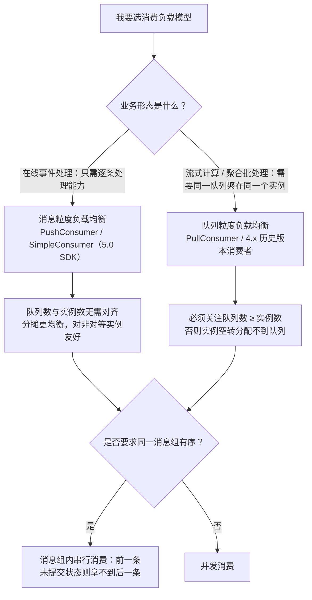
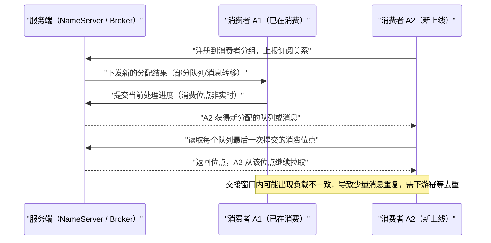

## 为什么需要负载均衡与消费进度管理？（痛点引入）

「加了 4 个消费者实例，吞吐一点没涨」和「重启后消息从三周前开始重放」，是消费侧最贵的两类事故，它们的根因分别落在负载均衡策略和消费位点机制上。

1. **扩容撞到天花板。** 4.x 的队列粒度语义下，一个队列只被一个消费者消费。主题只有 8 个队列，你却起了 12 个实例——4 个实例分不到队列，只能空转。RocketMQ Streams 文档里同样的一句话是：「计算实例总个数也不能大于消费总 MQ 个数，否则将有部分计算实例处于等待状态，消费不到数据。」
2. **快慢节点拖垮整组。** 机房分区延迟、实例物理规格不一致时，按队列分配的模型会让「慢消费者绑定的队列」堆积、快消费者空闲。上游把这列为消息粒度策略要解决的问题之一（「对非对等消费者更友好」）。
3. **扩缩容瞬间出现重复消息。** 上游明确：消费者上线或下线、服务端扩缩容等场景会触发短暂的重新负载均衡，此时可能存在负载不一致，出现少量消息重复；队列粒度还额外依赖「消费者和服务端的信息协商机制」，协商结果并非完全强一致。
4. **位点理解错了，回溯变成灾难。** 有人以为「消费过的消息被删掉了」，于是放弃回溯；有人在业务高峰期把位点重置到三周前，触发大量冷读，把存储压出抖动——上游的提醒是「重置后的历史消息大多属于存储冷数据，可能会造成系统压力上升，一般称为冷读现象」。

| 维度 | 不懂负载均衡与位点机制 | 懂了之后 |
|------|------------------------|----------|
| 扩容决策 | 加实例撞队列数上限，白加机器 | 队列数与实例数的关系按粒度模型计算 |
| 热点与堆积 | 部分实例堆积、部分空闲，只会重启 | 换消息粒度模型或调队列数，定位到具体队列 |
| 重复消息 | 当成随机 bug，靠重试硬扛 | 承认重平衡期必然少量重复，消费逻辑做幂等 |
| 故障恢复 | 认为消息消费过就没了，无法回溯 | 用重置消费位点回溯；知道哪些消息重置不到 |
| 权限治理 | 位点重置接口随便暴露 | 上游建议严格控制重置接口调用权限，避免高频无效重置 |
| 进度观测 | 说不清「堆积」是什么 | 堆积＝MaxOffset − ConsumerOffset |

> ### 💡 新人小结：负载均衡就是「拣货任务怎么派」
>
> 把仓库拣货想成消费消息：
> - **队列粒度**＝「一人一条货架」：货架（队列）数固定，货架比人少时有人站着等；同一条货架上的活永远归同一个人，所以他一次能推一车（批量、聚合友好）。
> - **消息粒度**＝「按件派单」：谁的推车空就丢一件给谁，货架归谁不重要；派单结果是随机的，但同一件不会被两个人抢（服务端对该件加锁直到处理成功或超时）。
> - **消费位点**＝「这本货架的进度页码」：进度是按**班组**（消费者分组）记的，不是按个人记，所以你换个人来接班，能从上一页接着干（跨消费者的消费进度恢复）。
> - **重平衡**＝「班组换人时重新派活」：交接的那几秒，可能有两件货被两人都拿过一次——所以要**扫码去重（幂等）**。
>
> **一句话总结：负载均衡决定「哪条消息归谁」，消费位点决定「下次从哪继续」，两者共同决定重复与堆积。**

**学习路线图**

```
痛点引入 → 广播与共享 → 两种负载粒度 → 顺序消息负载 → 重平衡触发与扩容 → 消息位点与消费位点 → 提交时机 → 重置位点 → 术语与误区
```

---

## 第一层：广播消费与共享消费

在 RocketMQ 领域模型中，同一条消息支持被多个消费者分组订阅；每个分组又可以初始化多个消费者。分组与消费者的两种组合，对应两种消费效果。


| 组合方式 | 结构 | 实现效果 | 上游给的典型场景 |
|----------|------|----------|------------------|
| 消费组间广播消费 | 每个消费者分组只初始化唯一一个消费者，各分组订阅相同的消息 | 单客户端级别的广播一对多推送 | 网关推送、配置推送 |
| 消费组内共享消费 | 每个分组下初始化多个消费者，共同分担分组内所有消息 | 分组内流量的水平拆分与均衡负载 | 微服务解耦 |

消费组间广播不涉及消费者负载均衡（每组只有一个消费者）；消费组内共享才需要「消息按哪种逻辑分配给哪个消费者」的答案，这个答案就是消费者负载均衡策略。

4.x 侧还有一个**开关级**的广播概念，别与上面混淆：

```java
// ========== 4.x：消费模式开关（MessageModel） ==========
consumer.setMessageModel(MessageModel.CLUSTERING);   // 集群模式（默认）：同一消费组内的消费者分担消费
consumer.setMessageModel(MessageModel.BROADCASTING); // 广播模式：消费组内每一个消费者都会消费全量消息
// 输出: 模式决定两件事 —— 是否组内分摊、以及消费位点存在哪里（见下文「提交时机」）
```

参数解释：`MessageModel.CLUSTERING` 是 4.x Push Consumer 的默认模式；上游对广播模式还有两条连带结论——**「消息重试只针对集群消费模式生效；广播消费模式不提供失败重试特性」**（4.x《Push 消费》），以及**「集群模式下消费位点由客户端提交给服务端保存，广播模式下消费位点由客户端自己保存」**（4.x《基础概念》）。这两条决定了广播模式的容灾与回溯能力天生弱一档，详见〈消费重试与死信队列〉。

| 对比项 | 消费组间广播（5.0 模型） | 消费组内共享（5.0 模型） | 4.x 广播模式（BROADCASTING） | 4.x 集群模式（CLUSTERING） |
|--------|--------------------------|--------------------------|------------------------------|----------------------------|
| 身份粒度 | 分组（每组一个消费者） | 分组（多消费者分摊） | 消费者实例（人手一份全量） | 分组（组内分摊） |
| 是否触发 rebalance | 否 | 是 | 上游描述：扩容不提升或降低消费能力 | 是 |
| 位点存储位置 | 服务端按分组记录 | 服务端按分组记录 | 客户端自己保存（`LocalFileOffsetStore`） | 提交服务端保存（`RemoteBrokerOffsetStore`） |
| 消费失败重试 | 分组级重试策略生效 | 分组级重试策略生效 | 不提供失败重试特性 | 提供重试 |
| 能否靠加实例提升吞吐 | 不涉及 | 能（受负载粒度约束） | 不能 | 能 |

> [!NOTE] 版本适用：4.x 的「广播模式」与 5.0 的「消费组间广播」不是同一层概念
> 4.x 用 `MessageModel` 在**一个分组内部**切换「组内分摊」与「人手一份」；5.0 的表述改为**分组与消费者的组合**（组间广播 + 组内共享）。5.0《消费者负载均衡》正文未提供 `MessageModel` 的等价开关写法，本文不做推测。升级时如果原本依赖 4.x 广播模式做本地缓存刷新，需要按 5.0 的「多分组各自一个消费者」重新表达。

---

## 第二层：两种负载均衡粒度

根据消费者类型不同，负载均衡策略分为两种模式：消息粒度负载均衡（PushConsumer 和 SimpleConsumer 默认负载策略）与队列粒度负载均衡（PullConsumer 默认负载策略）。



### 消息粒度负载均衡（5.0 SDK 默认）

**使用范围**：对于 PushConsumer 和 SimpleConsumer 类型的消费者，默认且仅使用消息粒度负载均衡策略。上游同时补了一句版本限定：上述说明指 5.0 SDK 下 PushConsumer 默认使用消息粒度负载均衡，对于 3.x／4.x 等 Remoting 协议 SDK 仍然使用队列粒度负载均衡；业务集成如无特殊需求，建议使用新版本机制。


**策略原理**：同一消费者分组内的多个消费者按消息粒度平均分摊主题中的所有消息——即同一个队列中的消息，可被平均分配给多个消费者共同消费。上图的示例是分组 Group A 中 A1、A2、A3 三个消费者共同消费同一队列 Queue1 中的多条消息。

上游对这条策略有两个重要提醒：

- **分配结果随机**：该策略保证同一队列的消息可被多个消费者共同处理，但消息分配算法结果是随机的，**不能指定消息被哪一个特定的消费者处理**。
- **不重复消费的依据是单条确认语义**：消息粒度的负载均衡机制基于内部的单条消息确认语义实现——消费者获取某条消息后，服务端会将该消息加锁，保证这条消息对其他消费者不可见，直到该消息消费成功或消费超时。因此即使多个消费者同时消费同一队列，也不会重复消费。

> [!NOTE] 术语口径：社区常说的「Pop」
> 本文用「消息粒度负载均衡」指称这套机制，因为上游文档使用的就是这个措辞，并且用「内部的单条消息确认语义 + 服务端对该条消息加锁直到消费成功或超时」解释其不重复的根据。社区与部分资料把这种「服务端逐条派发、单条确认」的取消息方式称为 Pop；上游 5.0 文档未使用「Pop」一词，本文不把它当作接口名或配置名引用。

**三个策略特点**（逐条对照上游）：

| 特点 | 上游说明 | 解决的历史痛点 |
|------|----------|----------------|
| 消费分摊更均衡 | 传统队列级策略下，队列数与消费者数不均衡时会出现部分消费者空闲或部分消费者处理过多；消息粒度无需关注两者相对数量 | 扩容撞队列数上限 |
| 对非对等消费者更友好 | 机房分区延迟、消费者物理资源规格不一致会导致处理能力不一致；按队列分配会出现部分堆积、部分空闲；消息粒度按需分配 | 快慢节点互拖 |
| 队列分配运维更方便 | 传统基于绑定队列的策略必须保证队列数 ≥ 消费者数，以免部分消费者获取不到队列而空转；消息粒度无需关注队列数 | 扩容前必须先算队列数 |

**适用场景**：同一队列内的消息离散地分布于多个消费者，适用于绝大多数在线事件处理场景——只需要基本的消息处理能力，对消息之间没有批量聚合诉求。反之，流式处理、聚合计算场景需要明确地对消息进行聚合、批处理时，更适合队列粒度策略。

```java
// ========== ✅ 推荐写法（5.0）：消息粒度负载无需任何额外设置 ==========
// 示例一：PushConsumer —— 只在监听器里处理消息，不关注消息负载均衡
MessageListener messageListener = new MessageListener() {
    @Override
    public ConsumeResult consume(MessageView messageView) {
        System.out.println(messageView);
        // 输出: MessageView 只读视图（主题、消息 ID、Tag、属性等）
        return ConsumeResult.SUCCESS;   // 返回状态即提交消费结果，服务端据此推进分组位点
    }
};
// 示例二：SimpleConsumer —— 主动获取消息处理并提交，会按订阅的主题自动获取，无需关注消息负载均衡
List<MessageView> messageViewList = null;
try {
    messageViewList = simpleConsumer.receive(10, Duration.ofSeconds(30));  // 批量 10 条，不可见时间 30 秒
    messageViewList.forEach(messageView -> {
        System.out.println(messageView);
        try {
            simpleConsumer.ack(messageView);       // 显式提交该条消息的消费结果
        } catch (ClientException e) {
            e.printStackTrace();
        }
    });
} catch (ClientException e) {
    // 如果遇到系统流控等原因造成拉取失败，需要重新发起获取消息请求。
    e.printStackTrace();
}

// ========== ❌ 不推荐写法（仅展示） ==========
// ❌ 试图靠队列名把某条消息「绑」给某个实例：消息粒度算法结果是随机的，上游明确不能指定消费者
// ❌ 把消息粒度当成限流手段：拉不到消息时返回失败让消息进重试链路（正确做法是延迟获取消息）
```

参数解释：`receive(10, Duration.ofSeconds(30))` 的两个参数分别是批量拉取消息数与消费不可见时间；`ack(messageView)` 是单条确认，正是「单条消息确认语义」在客户端接口上的体现；示例照搬上游数值（10 条、30 秒），实际取值按〈消费者类型与推拉模型〉的调优口径确定。

### 顺序消息下的负载机制

在顺序消息中，顺序性指同一消息组内多个消息之间的先后顺序。顺序消息场景下，消息粒度负载均衡策略还要保证同一消息组内的消息按服务端存储的先后顺序消费：不同消费者处理同一个消息组内的消息时，会严格按照先后顺序锁定消息状态，确保同一消息组的消息串行消费。


上图的示例：队列 Queue1 中有 4 条顺序消息，都属于同一消息组 G1，存储顺序为 M1 到 M4。消费过程中，前面的 M1、M2 被 Consumer A1 处理时，只要消费状态没有提交，A2 就无法并行消费后续的 M3、M4——必须等前面的消息提交消费状态后才能消费后面的消息。

| 维度 | 普通消息（消息粒度） | 顺序消息（消息组内串行） |
|------|----------------------|--------------------------|
| 同一队列能否多消费者并行 | 能，分配结果随机 | 同一消息组内不能并行，不同消息组可并行 |
| 前一条未提交时后一条 | 可以被别的消费者拿走 | 拿不到，必须等前一条提交状态 |
| 并行度的上限来源 | 消费者数量 | 消息组数量 |
| 依据 | 5.0《消费者负载均衡》策略原理 | 同上，顺序消息负载机制一节 |

### 队列粒度负载均衡（4.x／历史版本）

**使用范围**：对于历史版本（服务端 4.x／3.x 版本）的消费者，包括 PullConsumer、DefaultPushConsumer、DefaultPullConsumer、LitePullConsumer 等，默认且仅能使用队列粒度负载均衡策略。


**策略原理**：同一消费者分组内的多个消费者按队列粒度消费消息，即**每个队列仅被一个消费者消费**。上图示例中三个队列 Queue1、Queue2、Queue3 分配给两个消费者，每个队列只分配给一个消费者；因为队列数大于消费者数，消费者 A2 被分配了两个队列。**若队列数小于消费者数量，则会出现部分消费者无绑定队列的情况。**

队列粒度的负载均衡基于队列数量、消费者数量等运行数据进行统一的算法分配，把每个队列绑定到特定消费者；每个消费者按「取消息 → 提交消费位点 → 持久化消费位点」的消费语义处理消息，**取消息过程不提交消费状态**。因此为了避免消息被多个消费者重复消费，每个队列仅支持被一个消费者消费。

上游对这条策略还写了一个必须承认的缺陷：该策略依赖消费者和服务端的信息协商机制，RocketMQ 并不能保证协商结果完全强一致；因此在消费者数量、队列数量发生变化时，可能会出现短暂的队列分配结果不一致，从而导致少量消息被重复处理。

```java
// ========== 4.x 旧写法：队列粒度的分配策略可显式声明 ==========
consumer.setAllocateMessageQueueStrategy(new AllocateMessageQueueAveragely());
// 参数: AllocateMessageQueueAveragely = 平均分配策略（4.x 默认、最常见策略）
// 输出: 消费组内消费者按类似分页的策略均摊消费，队列被平摊到各实例

// ========== ❌ 不推荐写法（仅展示） ==========
// ❌ 不评估队列数就一味增加消费者：Topic 的总队列数小于消费者数量时，消费者分配不到队列，
//    即使消费者再多也无法提升消费能力（4.x《基础概念》原文）
// ❌ 同一分组内混用不同分配策略：组内分配结果互相打架
```

参数解释：`setAllocateMessageQueueStrategy` 接收一个分配策略实现；上游列出的可选策略包括**平均分配策略、机房优先分配策略、一致性 hash 分配策略**等，默认是平均分配。换策略只换实现类，不改消费逻辑。

### 「消费者扩容」三张官方图说明了什么

4.x《基础概念》用三张连续官方图说明扩容过程（图片与逐图解读已落在〈4.x 与 5.x 差异及迁移选型〉一文，本文只解读其结论与边界，避免重复贴图）：

| 官方图 | 上游对应的原话 | 结论 | 在 5.0 是否还成立 |
|--------|----------------|------|-------------------|
| 消费者扩容 1 | 「平均分配的算法下，可以通过增加消费者的数量来提高消费的并行度」 | 队列数充足时，加实例＝加并行度 | 成立（消息粒度更是按需分配） |
| 消费者扩容 2 | 继续增加消费者，消费并行度随之提升 | 扩容在队列数上限内线性有效 | 成立，但不再受队列数与实例数对齐约束 |
| 消费者扩容 3 | 「Topic 的总队列数小于消费者的数量时，消费者将分配不到队列，即使消费者再多也无法提升消费能力」 | 队列数是队列粒度模型下的扩容天花板 | **不再成立**：消息粒度策略「无需关注消费者和队列的相对数量」 |

这条边界值得单独记：**加实例之前，先确认自己在哪种粒度里。** 队列粒度下先算队列数；消息粒度下要算的是别的约束（消费线程数、本地缓存、单条确认语义）。

> ### 💡 新人小结：两种粒度像「包桌」和「散座」
>
> - **队列粒度＝包桌**：一桌（队列）只接待一位客人（消费者）。客人比桌子多，后来的人只能站着；一桌的菜（消息）全归一个人吃，所以他可以把整桌打包（批量、聚合）。
> - **消息粒度＝散座**：来一道菜就派给一个空位，座位和桌子没有绑定关系；同一道菜只会给一个人（服务端对这道菜加锁），所以同桌多人也不会重复上菜。
> - **顺序消息＝同一锅的菜必须按出锅顺序上**：前一锅那道菜没结（未提交状态），后一道就不会给任何人。
>
> **一句话总结：要批量聚合就包桌，要均衡弹性就散座；包桌人数不能超过桌数。**

---

## 第三层：rebalance 何时触发，触发后会怎样

| 触发场景 | 上游依据与措辞 | 后果 |
|----------|----------------|------|
| 消费者上线或下线 | 5.0《消费者负载均衡》使用建议：「在消费者上线或下线、服务端扩缩容等场景下，都会触发短暂的重新负载均衡动作」 | 短暂负载不一致，可能少量消息重复 |
| 服务端扩缩容 | 同上 | 同上 |
| 消费者崩溃或新消费者加入群组 | 4.x《基础概念》：会触发重平衡，重平衡后每个消费者可能分配到新的队列而不是之前处理的队列 | 需要读取每个队列最后一次提交的消费位点继续拉取 |
| 客户端提交给服务端的位点不是实时值 | 4.x《基础概念》：由于客户端提交给服务端的消费位点并不是实时的，所以重平衡就可能会导致消息少量重复 | 重平衡期重复消费，靠幂等兜住 |
| 频繁修改订阅关系 | 5.0《订阅关系》使用建议：频繁修改订阅关系可能导致客户端一直处于负载均衡调整和变更的过程，从而影响消息接收 | 长期处于调整状态，消息接收受影响 |

下图把一次「扩容触发重平衡」的过程画出来，重点在交接窗口里的位点读取动作。



图后解读：上游把这条链路的结果写成一句话的建议——**「针对消费逻辑做消息幂等去重处理」**，无论消息粒度还是队列粒度，无论 4.x 还是 5.0。幂等的实现手段（用 MessageKey 去重、用业务单号做唯一约束）属于 08-best-practice 的范畴，本文只说明**为什么这是必选项**。

社区实践参照：RocketMQ Streams 文档里对 rebalance 的描述与本节一致——「计算实例实质上是依赖了 Rocket-streams SDK 的 client，因此计算实例消费的 MQ 依赖 RocketMQ rebalance 分配」；缩容时「借助于 RocketMQ 集群消费模式下的 rebalance 功能，被消费的分片 MQ 会在计算实例之间重新分配」，并且**状态数据需要根据源数据分片 MQ 一并迁移**；扩容则是相反的过程。这说明重平衡不只是消息的搬迁，对有状态消费者还伴随状态迁移。

---

## 第四层：消费位点——进度到底记在哪

Apache RocketMQ 通过消费位点管理消费进度。要理解它，必须先把两个 Offset 分开：


| 术语 | 记的是什么 | 粒度 | 上游定义要点 |
|------|------------|------|--------------|
| 消息位点（MessageQueueOffset／Offset） | 某条消息在队列中的位置 | 消息 × 队列 | 消息按到达服务端的先后顺序存储在指定主题的多个队列中，每条消息在队列中都有一个唯一的 Long 类型坐标 |
| 消费位点（ConsumerOffset） | 某分组在某队列上消费到的最新一条消息的位置 | 分组 × 队列 | 每条消息被消费完成后不会立即在队列中删除，RocketMQ 基于每个消费者分组维护一份消费记录 |

三个关键推论，全部来自上游原文：

1. **队列逻辑上无限存储**：任意一个消息队列在逻辑上都是无限存储，即消息位点会从 0 到 Long.MAX 无限增加；通过主题、队列和位点就可以定位任意一条消息的位置。
2. **物理上会滚动删除**：队列中最早一条消息的位点是最小消息位点（MinOffset），最新一条是最大消息位点（MaxOffset）；由于服务端物理节点存储空间有限，RocketMQ 会滚动删除队列中存储最早的消息，因此最小与最大消费位点会一直递增变化。


3. **进度记在分组上，所以能跨消费者恢复**：消费位点的保存和恢复基于服务端存储实现，和任何消费者无关，因此 RocketMQ 支持跨消费者的消费进度恢复。消费者客户端离线后重新上线时，会严格按照服务端保存的消费进度继续处理消息；如果服务端保存的历史位点信息已过期被删除，此时消费位点向前移动至服务端存储的最小位点。


位点之间的大小关系直接就是「堆积」的定义：

| 关系 | 含义 | 表现 |
|------|------|------|
| `ConsumerOffset = MaxOffset` | 消费速度与生产速度一致，全部消息处理完成 | 无堆积 |
| `ConsumerOffset < MaxOffset` | 消费速度小于生产速度，部分消息未消费 | **两者之差即该队列中堆积的消息量** |
| `ConsumerOffset >= MinOffset` | 正常有效的消费位点必然大于等于最小消息位点 | 有效进度 |
| `ConsumerOffset < MinOffset` | 无效：要消费的消息已从队列删除、无法消费到 | 服务端会将消费位点**强制纠正**到合法的消息位点 |

**消费位点初始值**：消费位点初始值指消费者分组首次启动消费者消费消息时服务端保存的消费位点初值。5.x 明确定义为「消费者首次获取消息时，该时刻队列中的最大消息位点」，相当于消费者将从队列最新的消息开始消费。

> [!NOTE] 版本适用：初始位点口径在两版之间不同
> 服务端历史版本（4.x／3.x）：消息位点初始值受当前队列消息状态的影响。服务端 5.x 版本：明确定义为消费者获取消息时刻队列中的最大消息位点。因此从历史版本升级到 5.x 时，上游要求「自行对消费者首次启动时的情况做兼容性判断」。4.x 客户端侧的显式策略是 `consumeFromWhere`（默认 `CONSUME_FROM_LAST_OFFSET`）与 `consumeTimestamp`（默认半小时前），两者与 Tag／SQL92 过滤的关系见〈消息过滤：Tag 与 SQL92〉。

---

## 第五层：进度什么时候被提交

不同消费模型下，进度提交的时机与责任方不同；这张表是把前面几节事实按「提交时机」重新切了一刀。

| 模型／版本 | 提交动作 | 谁触发 | 上游依据 |
|------------|----------|--------|----------|
| 5.0 消息粒度（PushConsumer） | 监听器返回 `ConsumeResult` 后由 SDK 提交 | SDK | 消费结果按监听器返回结果判断，服务端据此更新消费进度 |
| 5.0 消息粒度（SimpleConsumer） | 业务主动调用 `ack` | 业务 | 单条确认语义；未 ack 且不可见时间到 → 重新可见 |
| 5.0 队列粒度语义（历史消费者） | 取消息 → 提交消费位点 → 持久化消费位点；**取消息过程不提交消费状态** | SDK／业务协作 | 5.0《消费者负载均衡》队列粒度策略原理 |
| 4.x 集群模式 | 客户端提交给服务端保存 | 客户端定时持久化 | 4.x《基础概念》；`persistConsumerOffsetInterval` 默认 5000 毫秒（客户端参数表） |
| 4.x 广播模式 | 客户端自己保存 | 客户端本地 | `OffsetStore` 默认策略：广播模式使用 `LocalFileOffsetStore`，集群模式使用 `RemoteBrokerOffsetStore`，不建议修改 |
| 4.x 原始 Pull | 必须手动 `updateConsumeOffset(mq, pullResult.getNextBeginOffset())` | 业务 | 4.x《Pull 消费》 |
| 4.x LitePull（Subscribe） | 默认自动提交位点 | SDK | 4.x《Pull 消费》：如果不额外设置，LitePullConsumer 默认是自动提交位点 |
| 4.x LitePull（Assign） | `setAutoCommit(false)` 后调 `commitSync()` | 业务 | 4.x《Pull 消费》Assign 示例 |

```java
// ========== ✅ 推荐写法（4.x LitePull Assign）：处理完再手动提交，提交点用 nextBeginOffset ==========
litePullConsumer.setAutoCommit(false);                 // 关闭自动提交，进度由业务决定推进到哪
litePullConsumer.assign(assignList);                   // 自行指定队列集合
litePullConsumer.seek(assignList.get(0), 10);          // 把首个队列起点设为位点 10（回溯场景）
while (running) {
    List<MessageExt> messageExts = litePullConsumer.poll();
    if (messageExts == null || messageExts.isEmpty()) {
        continue;                                       // 无消息时返回 null，必须先判空
    }
    handle(messageExts);                                // 业务真正处理完成之后再提交
    litePullConsumer.commitSync();                      // 同步提交位点：此刻之前的进度才算落账
}

// ========== ❌ 不推荐写法（仅展示） ==========
// ❌ 取到消息立刻 commitSync，再异步处理：处理失败时位点已推进，消息永久丢失
// ❌ 集群模式下把 persistConsumerOffsetInterval 调得过大：重平衡时未提交的进度会更多，重复量随之放大
```

参数解释：`seek(queue, offset)` 直接指定某队列的拉取起点（示例为 10）；`commitSync()` 是同步提交，提交的是当前分配队列上的消费位置；`poll()` 在无消息时返回 null，必须判空；`persistConsumerOffsetInterval` 是 4.x 客户端参数表中「作用于 Consumer，持久化消费进度的间隔」，默认 5000 毫秒——它是重平衡期重复消息量的直接旋钮之一。

---

## 第六层：重置消费位点——坐标语义与影响范围

若消费者分组的初始消费位点或当前消费位点不符合业务预期，可以通过重置消费位点调整消费进度。

**三种适用场景**（逐条保留上游口径）：

| 场景 | 上游描述 | 重置目标方向 |
|------|----------|--------------|
| 初始消费位点不符合需求 | 因初始位点为当前队列最大消息位点，客户端会直接从最新消息开始消费；若业务上线时需要消费部分历史消息，可通过重置消费位点功能消费到指定时刻前的消息 | 向**过去** |
| 消费堆积快速清理 | 下游性能不足或消费速度小于生产速度时产生大量堆积；若这部分堆积可以丢弃，可重置位点绕过堆积消息，减少下游处理压力 | 向**未来** |
| 业务回溯，纠正处理 | 业务消费逻辑异常导致消息被错误处理，可重置到历史指定位置实现消费回溯 | 向**过去** |

**两种重置坐标（功能能力）**：

```python
# ========== 重置消费位点的两种坐标语义（依据 5.0《消费进度管理》「重置功能」） ==========
def nearest_offset_to(timestamp):
    """占位实现：真实系统里由服务端按时间戳匹配「该时刻最接近的消费位点」。"""
    return 8_120_003          # 返回一个 Long 型消息位点坐标（此处为示例值）

def apply(group, topic, target):
    print(f"重置已提交：group={group}, topic={topic}, 目标位点={target}")
    return True               # 重置后消费者将直接从重置后的位点开始消费

def reset_offset(group, topic, *, offset=None, timestamp=None):
    """影响范围恒为：一个消费者分组 × 一个主题下的队列。"""
    if offset is not None:
        target, mode = offset, "按位点重置"          # 能力一：重置到队列中的指定位点（Long 型消息位点坐标）
    elif timestamp is not None:
        target, mode = nearest_offset_to(timestamp), "按时间重置"  # 能力二：重置到某时刻，服务端自动匹配最接近的位点
    else:
        raise ValueError("offset 与 timestamp 必须给一个")
    print(f"{mode}: group={group}, topic={topic}, 目标={target}")
    # 输出: 按时间重置: group=G1, topic=Trade_Topic, 目标=8120003
    return apply(group, topic, target)

# ========== ✅ 推荐：先判影响范围再执行 ==========
reset_offset("G1", "Trade_Topic", timestamp="2026-10-01 03:00:00")   # 回溯某天的错误处理
# 输出: 按时间重置: group=G1, topic=Trade_Topic, 目标=8120003
# 输出: 重置已提交：group=G1, topic=Trade_Topic, 目标位点=8120003

# ========== ❌ 不推荐（仅展示） ==========
# reset_offset("G1", "Trade_Topic", offset=0)   # 从队列最早位点全量重放：冷读 + 下游被打爆
# reset_offset("G1", "Trade_Topic", offset=9_999_999_999)  # 位点偏大属非法，服务端会纠正到合法范围
```

参数解释：`offset` 走「重置到队列中的指定位点」这条能力；`timestamp` 走「重置到某一时刻对应的消费位点」这条能力，服务端会**自动匹配到该时刻最接近的消费位点**（上游原文），所以时间点不需要精确命中某条消息；两个坐标轴分别对应「队列刻度轴」与「时间轴」，与 4.x `CONSUME_FROM_TIMESTAMP` 用的是同一根时间轴，但重置作用于已有进度、起点策略只作用于分组首次消费。

**两条使用限制（必须逐条评估）**：

| 限制 | 上游原文要点 | 工程后果 |
|------|--------------|----------|
| 冷读与权限 | 重置后消费者将直接从重置后的位点开始消费；回溯重置类场景中历史消息大多属于存储冷数据，可能造成系统压力上升（称为冷读现象）；建议严格控制重置消费位点接口的调用权限，避免无意义、高频次的重置 | 大范围向过去重置＝读放大，可能影响新消息读写性能 |
| 可见性边界 | 重置消费位点功能只能重置**对消费者可见的消息**，不能重置定时中、重试等待中的消息 | 定时消息未到投递时间、重试队列里等待重投的消息不会被这次重置影响 |

> ### 💡 新人小结：重置位点像「翻图书馆借还台账」
>
> - 书（消息）借出去后不会销毁，馆里只是按**团体会员**（消费者分组）记一页台账（消费位点）。
> - 台账翻回上个月（重置到过去）＝那批书可以重新借；翻到最新（重置到未来）＝之前的逾期单直接作废（跳过堆积）。
> - 台账不能翻到已被处理掉的最早期，因为书被剔旧了（`MinOffset` 之前的数据被滚动删除）——这时服务端会把台账强制纠正到现存最早那一页。
> - 正在配送途中的书（定时中、重试等待中的消息）不在台账翻动的适用范围里。
>
> **一句话总结：位点只是进度指针，重置它不动数据，但会决定「读多少冷数据」和「哪些消息不再被消费」。**

---

## 术语与缩写速查（术语表）

| 术语 | 全称 | 含义（用自己的话） | 在本文中的角色 |
|------|------|--------------------|----------------|
| Rebalance | 重新负载均衡／重平衡 | 分组内消费者集合或队列变化时，重新决定「谁负责哪些队列／哪些消息」 | 第三节主线，也是重复消息的成因窗口 |
| 消息粒度负载均衡 | Message-level Load Balancing | 同一队列的消息可被分组内多个消费者共同消费，按件派发 | 5.0 Push／Simple 的默认且唯一策略 |
| 队列粒度负载均衡 | Queue-level Load Balancing | 每个队列只被一个消费者消费，按货架派发 | PullConsumer 与 4.x 历史消费者的策略 |
| Pop | 社区对「服务端逐条派发 + 单条确认」取消息方式的称呼 | 上游对应措辞是消息粒度负载均衡与单条消息确认语义 | 术语表保留条目，不作为接口名使用 |
| 单条消息确认语义 | 单条加锁确认 | 消费者取走某条消息后服务端对其加锁，对其他消费者不可见直到消费成功或超时 | 消息粒度不重复消费的机制依据 |
| Inflight | 处理中 | 消息被客户端取走、尚未返回消费结果的状态 | 见〈消费重试与死信队列〉 |
| MinOffset | 最小消息位点 | 队列中最早一条消息的位点，随滚动删除持续增大 | 位点合法性下界 |
| MaxOffset | 最大消息位点 | 队列中最新一条消息的位点 | 堆积上界与消费位点初始值来源 |
| MessageQueueOffset | 消息位点 | 每条消息在队列里的唯一 Long 型坐标 | 与消费位点必须区分的第一组概念 |
| ConsumerOffset | 消费位点 | 某消费者分组在某队列消费过的最新一条消息的位点 | 消费进度的载体 |
| 消费位点初始值 | 首次启动位点 | 分组首次消费时服务端保存的位点起点 | 4.x 与 5.x 口径不同之处 |
| ConsumeFromWhere | 消费起点策略（4.x 参数） | 取值 CONSUME_FROM_LAST_OFFSET／FIRST_OFFSET／TIMESTAMP | 4.x 侧的起点表达，默认 LAST_OFFSET |
| 重置消费位点 | Reset Consumer Offset | 把分组的进度指针移动到指定位置或某时刻对应位点 | 回溯、清堆积、纠正处理三种场景 |
| 冷读 | Cold Read | 重置到过去后读取大量已落盘的存储冷数据造成压力上升 | 重置操作的主要风险 |
| MessageModel | 消费模式（4.x） | CLUSTERING（组内分摊）／BROADCASTING（人手一份） | 4.x 广播与集群的开关 |
| 消费组间广播 | 分组级广播 | 每个分组一个消费者，各分组订阅相同消息 | 5.0 对「一对多推送」的表达 |
| 消费组内共享 | 组内共享消费 | 分组内多消费者共同分担消息 | 负载均衡成立的前提 |
| OffsetStore | 消费进度存储器（4.x） | LocalFileOffsetStore（广播）／RemoteBrokerOffsetStore（集群） | 解释位点存哪里；上游标注不建议修改 |
| persistConsumerOffsetInterval | 持久化消费进度间隔（4.x） | 默认 5000 毫秒 | 决定未提交进度窗口宽度 |
| allocateMessageQueueStrategy | 队列分配策略（4.x） | 平均／机房优先／一致性 hash，默认平均分配 | 队列粒度扩容上限的算法来源 |
| commitSync / seek / setAutoCommit | LitePull 的提交与起点控制 | 手动提交、改队列起点、开关自动提交 | Assign 模式进度管理的三件套 |
| ack / receive | 5.0 SimpleConsumer 的确认与取消息 | 单条确认；批量取消息并设不可见时间 | 消息粒度进度提交的接口 |
| 消息堆积 | Message Accumulation | ConsumerOffset 与 MaxOffset 之差 | 位点关系表的可观测结论 |
| 幂等去重 | Idempotent Consumption | 下游按业务唯一键判重复，避免重复副作用 | 上游对两种粒度策略的统一要求 |

---

## 常见误区与排查清单

| 现象 | 先查这一项 | 依据 |
|------|-----------|------|
| 加实例不涨吞吐 | 队列粒度模型下队列数是否小于实例数 | 4.x《基础概念》／5.0 队列粒度策略原理 |
| 部分实例完全空闲 | 同上；或 Assign 模式被写死只取了部分队列 | 5.0 队列粒度；4.x LitePull Assign 示例 |
| 快慢实例互拖、部分队列堆积 | 是否在按队列分配；实例物理规格与网络延迟是否不一致 | 5.0 消息粒度「对非对等消费者更友好」 |
| 扩缩容后出现少量重复 | 属预期行为；确认下游是否做幂等 | 5.0 使用建议；队列粒度非强一致协商 |
| 重启后从头重放／从很久的过去开始 | 分组位点是否合法；是否被服务端纠正到 MinOffset；起点策略与初始值口径 | 5.0《消费进度管理》位点关系与初始值 |
| 观测到「消费了但堆积还在涨」 | 消费位点提交是否滞后（自动提交间隔、是否手动提交、是否处理前就提交） | 第五节提交时机表 |
| 重置到某时刻后仍漏一批消息 | 是否重置到定时中／重试等待中的消息（这部分不可重置） | 5.0《消费进度管理》使用限制 |
| 重置后系统抖动 | 是否大范围向过去重置引发冷读 | 同上 |
| 改了订阅关系后一直收不到消息 | 是否频繁修改订阅关系导致客户端一直处于负载均衡调整中 | 5.0《订阅关系》使用建议 |
| 广播模式重启后位点丢了 | 4.x 广播位点由客户端自己保存，容器重建即失效 | 4.x《基础概念》＋客户端参数表 OffsetStore 说明 |

---

## 要点总结

1. **先分清两种广播**：5.0 的「消费组间广播」是多分组各拿全量（每组一个消费者，不涉及负载均衡），4.x 的 `MessageModel.BROADCASTING` 是分组内人手一份（位点存客户端、不提供失败重试）；组内共享消费才是负载均衡策略的作用域。
2. **两种粒度对应两类业务**：消息粒度（5.0 SDK 下 Push／Simple 默认且仅可用）按件派发、服务端单条加锁，好处是分摊均衡、对非对等实例友好、不必关注队列数，但分配结果随机、不能指定消费者；队列粒度（PullConsumer 与 4.x 历史消费者）每个队列只归一个消费者，吞吐攒批性能好、适合流式聚合，代价是必须队列数 ≥ 实例数，且协商非强一致会带来短暂重复。
3. **重平衡是必然事件**：消费者上下线、服务端扩缩容、崩溃与新实例加入都会触发；上游的结论是**下游消费逻辑必须做幂等去重**，频繁修改订阅关系会让客户端长期处于负载均衡调整过程。
4. **进度记在分组、不记在实例**：消息位点是消息在队列里的 Long 坐标（0 到 Long.MAX 逻辑无限），消费位点是分组在某队列消费过的最新消息位置；`MaxOffset − ConsumerOffset` 就是堆积，`ConsumerOffset < MinOffset` 时服务端强制纠正；位点保存与恢复基于服务端，因此支持跨消费者恢复。
5. **提交时机与重置语义要成套理解**：集群模式由客户端提交服务端保存（4.x 默认每 5000 毫秒持久化），广播模式由客户端本地保存；取消息过程本身不提交消费状态；重置位点支持「按位点」与「按时刻（自动匹配最接近位点）」两种坐标，只作用于对消费者可见的消息，向过去重置要评估冷读影响并严格控制接口权限。

---

> ### 💡 新人小结：负载均衡与消费进度学完了，记住这 5 点
>
> 1. **扩容前先问粒度**：队列粒度看队列数，消息粒度看实例能力；「加机器不涨吞吐」八成是没算这条边界。
> 2. **要聚合就包桌，要均衡就散座**：流式批处理选队列粒度，在线事件处理选消息粒度；别指望消息粒度把某条消息钉给某个实例。
> 3. **重平衡必然带来少量重复**：幂等不是可选优化，是上游对两种策略共同的强制要求。
> 4. **进度是台账不是碎纸机**：消息消费完不删除，位点只是分组级进度指针；正因为如此，回溯、清堆积、纠正处理才都有解。
> 5. **重置位点是外科手术**：坐标只有两种（位点／时刻），范围只有「可见消息」，向过去一刀下去可能引发冷读，权限要收口。
