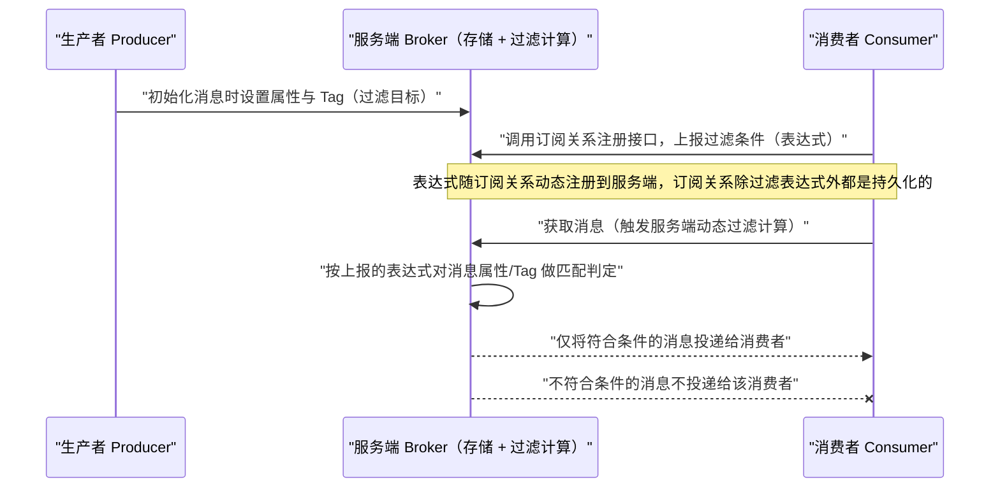
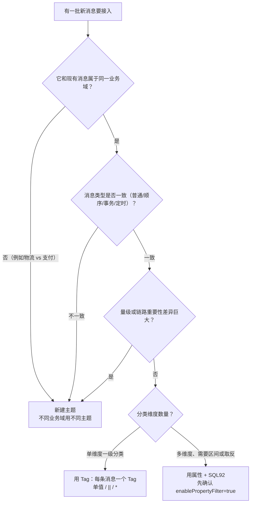

## 为什么需要消息过滤？（痛点引入）

消费者订阅了一个主题，就要承受这个主题的全部消息——这就是没有过滤时的第一性问题。三个真实会发生的场景：

1. **下游被无效消息淹没。** 交易主题里同时有订单、支付、物流三类消息，物流系统只关心物流消息，却要接收并丢弃另外两类的绝大多数流量；上游对此的定位很直接：「使用消息过滤功能，可以帮助消费者更高效地过滤自己需要的消息集合，避免大量无效消息投递给消费者，降低下游系统处理压力」。
2. **客户端筛选带来双倍成本。** 有人在监听器里写 `if (!msg.getTag().equals("TagA")) return SUCCESS;` 来自筛。这等于把全量消息的网络传输、SDK 反序列化、线程占用全付了一遍，再把不要的消息「确认成功」掉——一旦这样确认，这些消息在该分组的消费进度里就永久前进了。
3. **拆主题拆到失控。** 为了区分「杭州物流」和「上海物流」而新建两个主题，结果主题数量爆炸。上游给的口径是：**同一个业务域内的子集过滤用 Tag／属性；不同业务域的拆分用不同主题**——「Apache RocketMQ 主要解决的单个业务域即同一个主题内不同消息子集的过滤问题」。

| 维度 | 没有过滤能力 | 有服务端过滤 |
|------|--------------|--------------|
| 网络与客户端开销 | 全量消息投递到消费端再丢弃 | 只有符合条件的消息投递到消费端 |
| 下游处理压力 | 每个下游都要写一遍筛选逻辑 | 筛选条件写在订阅关系里，由服务端执行 |
| 业务分类方式 | 只能靠拆主题表达细分 | 主题之下还有 Tag（一级）与属性（多级）两层 |
| 权限与运维视角 | 主题数暴涨，资源难管理 | 主题保持稳定，细分靠过滤表达式 |
| 误删风险 | 客户端自筛时把不要的消息也确认成功，进度被推走 | 判定在服务端完成，消费者无需先接收再丢弃 |

> ### 💡 新人小结：消息过滤像小区门口的「按标签分拣架」
>
> 把主题想象成快递驿站的一条传送带，把过滤想象成传送带尽头的分拣架：
> - 生产者在包裹上贴标签（Tag）或写申报项（属性）——这是**贴标**动作，发生在寄件时。
> - 消费者到驿站登记「我只取贴了『生鲜』标的包裹」——这是**上报过滤条件**，发生在订阅时。
> - 驿站工作人员按登记条从传送带上把符合条件的包裹挑出来递给你——这是**服务端过滤计算**，发生在取消息时。
> - 「过滤」的含义是**把符合条件的投递给你**，而不是把匹配的扔掉（上游原文对定义做了这个反直觉的澄清）。
>
> **一句话总结：过滤条件在登记处、判定在服务端，不是你把包裹全搬回家再挑。**

**学习路线图**

```
痛点引入 → 过滤的定义与原理 → 服务端两段判定 → Tag 的表达力边界 → SQL92 语法全集 → 三种兜底裁决 → 过滤与消费起点 → 主题/Tag 拆分原则 → 误区排查
```

---

## 核心概念：过滤发生在哪、由谁判定

Apache RocketMQ 的消息过滤功能通过生产者和消费者对消息的属性、标签进行定义，并在服务端根据过滤条件进行筛选匹配，将符合条件的消息投递给消费者进行消费。


下图把这条链路按时序拆开，三个角色各自的职责一眼可见。



图后解读，三点必须记住：

1. **过滤条件由消费者上报，判定在服务端完成。** 上游基本概念页的措辞是「过滤规则的计算和匹配在 Apache RocketMQ 的服务端完成」。
2. **过滤表达式挂在订阅关系上**，而订阅关系按「消费者分组 × 主题」粒度管理，所以「谁过滤什么」是一个分组级事实，不是实例级事实。
3. **过滤条件是分组级事实**：订阅关系以消费者分组为粒度管理，且「除过滤表达式之外都是持久化的」（5.0 领域模型对订阅关系的表述），所以表达式会随消费者上报更新，其余订阅信息在服务端保留。上游未把「不符合条件的消息是否会推进该分组的消费进度」写成明文结论，本文不做推测；遇到「换了过滤条件收不到预期消息」时，按下文排查清单逐项核对消费起点、订阅关系一致性与表达式类型。

| 术语 | 全称 | 含义（用自己的话） | 在本文中的角色 |
|------|------|--------------------|----------------|
| Tag / 消息标签 | MessageTag | 主题层级之下对消息做细分的过滤标签，由生产者设置，每条消息允许设置一个 | 一级过滤维度，本文第一章主体 |
| SQL92 | SQL92 过滤／SQL 属性过滤 | 用 SQL92 语法写的过滤表达式，对消息属性做匹配 | 多维过滤维度，本文第二章主体 |
| 消息属性 | Property（Key-Value） | 生产者为消息设置的键值对，每条消息支持设置多个 | SQL92 的判定输入 |
| TAGS | Tag 在 SQL 语法中的属性名 | Tag 属于一种特殊的（系统）消息属性，在 SQL 语法中属性名为 `TAGS` | 让 SQL92 也能过滤 Tag 的桥梁 |
| FilterExpression | 过滤表达式对象（5.0） | 把「表达式字符串 + 过滤类型」打包成一个对象再订阅 | 5.0 三个消费者类型共用入口 |
| FilterExpressionType | 过滤类型枚举（5.0） | 取值 `TAG` 或 `SQL92`，决定服务端按哪种方式匹配 | 写错它就会把 SQL 当字符串精确匹配 |
| MessageSelector.bySql | SQL 选择器（4.x） | 4.x 订阅时包装 SQL 过滤表达式的工厂方法 | 4.x 旧写法对照 |
| enablePropertyFilter | Broker 端属性过滤开关 | 使用 SQL92 过滤时必须设为 true，上游默认值 false | SQL92 能生效的前置条件 |
| 精准匹配 | 精确字符串匹配 | Tag 过滤的匹配方式：订阅的 Tag 与消息 Tag 字符串相互匹配 | Tag 的表达力上限 |
| 全文过滤匹配 | TAG 过滤在服务端的描述口径 | 订阅关系文档对 TAG 过滤类型的表述 | 与 SQL 表达式求值并列的两段判定之一 |
| ConsumeFromWhere | 消费起点策略（4.x 参数） | 分组首次消费时从哪里开始的策略，取值 CONSUME_FROM_LAST_OFFSET／FIRST_OFFSET／TIMESTAMP | 与过滤叠加决定「第一条收到的消息」 |
| 订阅关系一致性 | Subscription Consistency | 同一消费者分组内所有消费者的订阅关系（含过滤表达式）必须一致 | 过滤失效事故的第一嫌疑 |
| 系统保留属性 Key | Reserved Property Key | 被 Tag、延时、重试等机制占用的属性名，自定义属性不得使用 | SQL92 属性命名的硬约束 |

---

## Tag 过滤：一级分类，表达力边界在哪

Tag 标签过滤是 RocketMQ 提供的基础消息过滤能力，基于生产者为消息设置的 Tag 标签进行匹配；过滤规则是**精准字符串匹配**。


### 三条规则与一个场景

上游给出的规则只有三条，逐条落地：

| 规则 | 表达式写法 | 语义 |
|------|-----------|------|
| 单 Tag 匹配 | `TagA` | 只有消息标签为 TagA 的消息符合匹配条件，会被发送给消费者 |
| 多 Tag 匹配 | `TagA||TagB||TagC` | 多个 Tag 之间为**或**关系，不同 Tag 间用两个竖线隔开；上游示例 `Tag1||Tag2||Tag3` 表示标签为 Tag1 或 Tag2 或 Tag3 的消息都满足匹配条件，都会被发送给消费者进行消费 |
| 全部匹配 | `*` | 主题下的所有消息都将被发送给消费者 |

电商交易场景（订单／支付／物流三类消息都发往 `Trade_Topic`）里，四个下游各自的需求正好覆盖这三条规则：支付系统只订阅支付消息（单 Tag），物流系统只订阅物流消息（单 Tag），交易成功率分析系统订阅订单和支付两个 Tag（多 Tag），实时计算系统订阅全量（星号）。

Tag 的设置约束照抄上游：**Tag 由生产者发送消息时设置，每条消息允许设置一个 Tag 标签；Tag 使用可见字符，建议长度不超过 128 字符。**

### 5.0 写法与 4.x 写法的对照案例

```java
// ========== ✅ 推荐写法（5.0）：发送端设置 Tag ==========
Message message = messageBuilder.setTopic("topic")
    //设置消息索引键，可根据关键字精确查找某条消息。
    .setKeys("messageKey")
    //设置消息Tag，用于消费端根据指定Tag过滤消息。该示例表示消息的Tag设置为"TagA"。
    .setTag("TagA")
    //消息体。
    .setBody("messageBody".getBytes())
    .build();
// 输出: 该消息落入 topic 的某个队列，其 Tag 属性为 "TagA"（一条消息只有一个 Tag）

// ========== ✅ 推荐写法（5.0）：订阅端三种表达式形态 ==========
String topic = "Your Topic";
// 只订阅消息标签为"TagA"的消息。
FilterExpression single = new FilterExpression("TagA", FilterExpressionType.TAG);
pushConsumer.subscribe(topic, single);
// 只订阅消息标签为"TagA"、"TagB"或"TagC"的消息（多 Tag 之间是「或」）。
FilterExpression multi = new FilterExpression("TagA||TagB||TagC", FilterExpressionType.TAG);
pushConsumer.subscribe(topic, multi);
// 使用Tag标签过滤消息，订阅所有消息（不做过滤）。
FilterExpression all = new FilterExpression("*", FilterExpressionType.TAG);
pushConsumer.subscribe(topic, all);
// 输出: 订阅关系被动态注册到服务端；控制台可见该分组的过滤类型为 TAG
```

```java
// ========== 旧写法（4.x）：subscribe 直接给字符串 ==========
consumer.subscribe("TagFilterTest", "TagA");        // 单 Tag
consumer.subscribe("TagFilterTest", "*");           // 全量
consumer.subscribe("TagFilterTest", "TagA||TagB");  // 多 Tag，用两个竖线分隔
// 输出: 与 5.0 等价的过滤条件，只是没有 FilterExpressionType 显式声明类型

// ========== ❌ 不推荐写法（仅展示，来自上游的错误示例） ==========
// 同一个消费者对同一个 Topic 多次订阅 Tag，以最后一次订阅为准：
consumer.subscribe("TagFilterTest", "TagA");
consumer.subscribe("TagFilterTest", "TagB");
// 结果（上游原文口径）：Consumer 只能订阅到 TagFilterTest 下 TagB 的消息，而不能订阅 TagA 的消息。
```

参数解释：`FilterExpression(表达式, 过滤类型)` 两个参数依次是过滤表达式字符串与 `FilterExpressionType`（`TAG`／`SQL92`）；4.x 的 `subscribe(topic, subExpression)` 只有两个参数，第二参数即 Tag 表达式字符串，没有显式的类型声明。`setKeys`／`Keys` 是给消息建哈希索引用的检索钩子，与过滤无关，别把它当过滤条件用。

### Tag 的表达力边界（能做什么、做不到什么）

| 诉求 | Tag 能否满足 | 该用什么 |
|------|--------------|----------|
| 主题内一级业务分类（订单／支付／物流） | ✅ 可以，单 Tag 精确匹配 | Tag |
| 同一消费者的多个分类（或关系） | ✅ 可以，`TagA||TagB` | Tag |
| 一条消息同时属于两个分类 | ❌ 不行，每条消息只允许设置一个 Tag | 属性（SQL92）或拆主题 |
| 按数值区间筛选（金额 > 30） | ❌ Tag 是字符串精准匹配 | SQL92 |
| 按「非某标签」筛选（取反） | ❌ Tag 规则只有单值、或、全匹配三种 | SQL92（`<>`、`NOT BETWEEN` 等） |
| 多维度组合（地域 且 类型） | ❌ 单维度表达 | SQL92（多属性 AND） |
| 跨业务域的消息拆分 | ❌ 上游不建议用 Tag 表达业务域 | 不同主题 |

> ### 💡 新人小结：Tag 是「一个贴纸位」，属性是「申报清单」
>
> - Tag 像行李箱上**唯一一张**行李牌：只有一张贴的位置，颜色必须完全一样才算匹配（精准字符串匹配）。
> - 属性像托运单上的**多栏申报项**：重量、易碎、目的地各占一栏，海关可以写「重量 > 30 且 目的地 ≠ 北京」这种复合条件（SQL92）。
> - 贴纸贴错颜色就是不算匹配——大小写、空格都算差异，这是「精准字符串匹配」的实际含义。
>
> **一句话总结：一级分类用 Tag，多维组合才上 SQL92；一个贴纸位装不下多个维度。**

---

## SQL92 过滤：属性级多维筛选

SQL 属性过滤是 RocketMQ 提供的高级消息过滤方式，通过生产者为消息设置的属性（Key）及属性值（Value）进行匹配。生产者发送消息时可以自定义消息属性，每个属性都是一个 Key-Value，**每条消息支持设置多个属性**。


前置条件只有一句，但极其容易漏：

```java
// ========== Broker 端配置（SQL92 生效的前置开关） ==========
# broker.conf
enablePropertyFilter=true      # 是否支持根据属性过滤；使用基于标准的 sql92 模式过滤消息则该参数必须设置为 true
# 输出: 未开启时，SQL92 订阅不会按预期投递；上游参数表标注该值默认为 false
```

参数解释：`enablePropertyFilter` 属于 Broker 侧配置，默认 false。上游 4.x 文档的说法是「开启属性过滤首先要在 Broker 端设置 `enablePropertyFilter=true`，该值默认为 false」，服务端参数表对同一参数的说明是「如果使用基于标准的 sql92 模式过滤消息则改参数必须设置为 true」。两个口径一致：**SQL92 默认不开启，要显式打开。**

### 语法表：上游条目逐行保留（不得抽样）

SQL 属性过滤使用 SQL92 语法作为过滤规则表达式。下表完整落地上游语法规范的全部 8 行，一条不漏。

| 语法 | 说明 | 示例 |
|------|------|------|
| `IS NULL` | 判断属性不存在。 | `a IS NULL`：属性 a 不存在。 |
| `IS NOT NULL` | 判断属性存在。 | `a IS NOT NULL`：属性 a 存在。 |
| `>`、`>=`、`<`、`<=` | 用于比较数字，**不能用于比较字符串**，否则消费者客户端启动时会报错。**说明**：可转化为数字的字符串也被认为是数字。 | `a IS NOT NULL AND a > 100`：属性 a 存在且值大于 100。<br>`a IS NOT NULL AND a > 'abc'`：错误示例，abc 为字符串，不能用于比较大小。 |
| `BETWEEN xxx AND xxx` | 用于比较数字，不能用于比较字符串，否则消费者客户端启动时会报错。等价于 `>= xxx AND <= xxx`，表示属性值在两个数字之间。 | `a IS NOT NULL AND (a BETWEEN 10 AND 100)`：属性 a 存在且值大于等于 10 且小于等于 100。 |
| `NOT BETWEEN xxx AND xxx` | 用于比较数字，不能用于比较字符串，否则消费者客户端启动会报错。等价于 `< xxx OR > xxx`，表示属性值在两个值的区间之外。 | `a IS NOT NULL AND (a NOT BETWEEN 10 AND 100)`：属性 a 存在且值小于 10 或大于 100。 |
| `IN (xxx, xxx)` | 表示属性的值在某个集合内。**集合的元素只能是字符串。** | `a IS NOT NULL AND (a IN ('abc', 'def'))`：属性 a 存在且值为 abc 或 def。 |
| `=`、`<>` | 等于和不等于。**可用于比较数字和字符串。** | `a IS NOT NULL AND (a = 'abc' OR a <> 'def')`：属性 a 存在且值为 abc 或值不为 def。 |
| `AND`、`OR` | 逻辑与、逻辑或。可用于组合任意简单的逻辑判断，**需要将每个逻辑判断内容放入括号内**。 | `a IS NOT NULL AND (a > 100) OR (b IS NULL)`：属性 a 存在且值大于 100，或属性 b 不存在。 |

三条容易忽略的硬限制，直接抄自语法表：

- 比较大小类语法（`>`／`>=`／`<`／`<=`、`BETWEEN`、`NOT BETWEEN`）**只用于数字**，误用字符串会在**消费者客户端启动时报错**（不是运行期静默失效）。
- 「可转化为数字的字符串也被认为是数字」——所以 `'123'` 参与数值比较是合法路径。
- `IN` 集合元素只能是字符串；`=`／`<>` 数字和字符串都可以；`AND`／`OR` 组合时每个判断要放进括号。

### 用法示例：发送设属性 + 订阅写表达式

```java
// ========== ✅ 推荐写法（5.0）：发送端同时设置 Tag 与自定义属性 ==========
Message message = messageBuilder.setTopic("topic")
    .setKeys("messageKey")                 // 消息索引键，用于事后精确查消息，与过滤无关
    .setTag("messageTag")                  // Tag：消费端可按 Tag 过滤
    // 消息也可以设置自定义的分类属性，例如环境标签、地域、逻辑分支。
    // 该示例表示为消息自定义一个属性，该属性为地域，属性值为杭州。
    .addProperty("Region", "Hangzhou")
    .setBody("messageBody".getBytes())
    .build();
// 输出: 该消息同时具备 Tag="messageTag" 与属性 Region="Hangzhou"，两条过滤维度都可被订阅

// ========== ✅ 推荐写法（5.0）：订阅端 SQL92 三种典型表达式 ==========
String topic = "topic";
// 只订阅地域属性为杭州的消息。
FilterExpression one = new FilterExpression("Region IS NOT NULL AND Region='Hangzhou'", FilterExpressionType.SQL92);
simpleConsumer.subscribe(topic, one);
// 只订阅地域属性为杭州且价格属性大于 30 的消息。
FilterExpression two = new FilterExpression("Region IS NOT NULL AND price IS NOT NULL AND Region = 'Hangzhou' AND price > 30", FilterExpressionType.SQL92);
simpleConsumer.subscribe(topic, two);
// 订阅所有消息（SQL92 的「全匹配」写法是常量 True，不是星号）。
FilterExpression all = new FilterExpression("True", FilterExpressionType.SQL92);
simpleConsumer.subscribe(topic, all);
// 输出: 服务端按表达式对每条消息的属性求值；属性缺失或类型不符时按下一节「兜底裁决」处理
```

参数解释：`FilterExpressionType.SQL92` 是把表达式交给 SQL 求值器的开关，写成 `TAG` 会把整串当 Tag 字符串精确匹配；`addProperty(key, value)` 与 4.x 的 `putUserProperties(key, value)` 是同一能力的两套接口名；自定义属性的 Key **不得使用系统保留属性 Key**，且属性 Key 与 Value 总长度建议不超过 16 KB（口径出自 5.0《参数约束和建议》）。

```java
// ========== 旧写法（4.x）：SQL92 用 MessageSelector.bySql 包装 ==========
Message msg = new Message("topic", "tagA", "Hello MQ".getBytes());
msg.putUserProperties("a", "1");                     // 设置自定义属性 a，属性值为 1
consumer.subscribe("SqlFilterTest",
    MessageSelector.bySql("(TAGS is not null and TAGS in ('TagA', 'TagB'))"
        + "and (a is not null and a between 0 and 3)"));
// 输出: 该订阅要求 Tag 属性存在且为 TagA 或 TagB，同时自定义属性 a 存在且落在 0~3 之间
// ❌ 不推荐（仅展示）：把 enablePropertyFilter 留作默认 false 就上线 SQL92 订阅——属性过滤不会按预期生效
```

### Tag 也能被 SQL92 表达

Tag 是一种系统属性，所以 SQL 过滤方式兼容 Tag 标签过滤；**在 SQL 语法中，Tag 的属性名称为 `TAGS`**。上面 4.x 示例里的 `TAGS in ('TagA', 'TagB')` 就是这个用法的官方样本。

### 服务端对「算不出来」的三种兜底裁决

由于 SQL 属性过滤是生产者定义属性、消费者写过滤条件，过滤条件的计算结果具有不确定性。上游给出服务端的三种处理方式，逐条保留：

| 情况 | 触发条件举例 | 服务端处理（上游原文口径） |
|------|--------------|-----------------------------|
| 异常情况处理 | 表达式计算抛异常，例如比较数字和非数字类型的值 | 消息默认被过滤，不会被投递给消费者 |
| 空值情况处理 | 表达式计算值为 null 或不是布尔类型；例如发送消息时未定义某个属性，订阅时却直接使用该属性 | 消息默认被过滤，不会被投递给消费者 |
| 数值类型不符处理 | 消息自定义属性为浮点型，但过滤条件中使用整数进行判断 | 消息默认被过滤，不会被投递给消费者 |

这条裁决表是「消息莫名收不到」类事故的关键解释器：**SQL92 的失败方向是「静默不投递」，而不是报错**。所以写表达式时把 `IS NOT NULL` 显式写全（上游示例全都这么写），是防御性写法而不是啰嗦。

### 关于「两段式过滤」的准确说法

上游文档对服务端过滤的描述集中在两个层次，本文只按这两个层次讲：

1. **匹配计算段**：消费者获取消息时触发服务端的动态过滤计算，服务端按上报的表达式类型进行匹配——`TAG` 过滤是「按照 Tag 字符串进行全文过滤匹配」，`SQL92` 过滤是「按照 SQL 语法对消息属性进行过滤匹配」。
2. **投递裁决段**：表达式求值结果不是 true 时（抛异常、值为 null、非布尔类型、数值类型不符），消息默认被过滤、不投递。

> [!NOTE] 上游未公开的实现细节，本文不做推测
> 「先按 Tag 哈希值粗筛、再按字符串精确匹配」这类 Broker 内部实现，在 4.x 与 5.0 的上游文档中都没有对应描述，本文不引入。上游给出的相关服务端参数只有名字与默认值：`enablePropertyFilter`（false）、`enableConsumeQueueExt`（是否启用 ConsumeQueue 扩展属性，false）、`bitMapLengthConsumeQueueExt`（ConsumeQueue 扩展过滤 bitmap 大小，112）；这三项的内部协同上游未展开，因此本文不解释其机制。

> ### 💡 新人小结：SQL92 像海关的申报单核验
>
> - 你把申报项填在单子上（生产者 `addProperty`），申报单栏目可以有很多栏（一条消息多个属性）。
> - 你给海关的放行规则是「重量 > 30 且 产地 = 杭州」（消费者写 SQL92 表达式）。
> - 海关核验有两种失败：单子**根本读不懂**（表达式抛异常／类型不符）和**该栏是空的**（属性不存在）——两种都**不放行**，但**不会通知你**（静默不投递）。
> - 所以放行规则里要先写「这栏必须有值」（`IS NOT NULL`），再写比较。
>
> **一句话总结：SQL92 的默认失败姿态是「不给你」，不是「告诉你错了」。**

---

## Tag 与 SQL92 的能力边界对比

| 对比项 | Tag 标签过滤 | SQL92 属性过滤 | 出处 |
|--------|--------------|----------------|------|
| 过滤目标 | 消息的 Tag 标签 | 消息的属性，包括用户自定义属性以及系统属性（Tag 是一种系统属性） | 5.0《消息过滤》分类对比表 |
| 过滤能力 | 精准匹配 | SQL 语法匹配 | 同上 |
| 适用场景 | 简单过滤场景、计算逻辑简单轻量 | 复杂过滤场景、计算逻辑较复杂 | 同上 |
| 一条消息可设置的分类数量 | 一个 Tag | 多个属性 | 5.0《消息过滤》Tag 标签设置／消息属性设置 |
| 关系运算 | 无（只有单值、或、全匹配） | `>`／`>=`／`<`／`<=`、`BETWEEN`、`NOT BETWEEN`（数字） | 5.0 SQL92 语法表 |
| 取反表达 | 不支持 | `<>`、`NOT BETWEEN`、`IS NULL` | 同上 |
| 集合表达 | `TagA||TagB`（或关系） | `IN ('abc','def')`（元素只能是字符串） | 4.x／5.0 Tag 规则＋SQL92 语法表 |
| 全匹配写法 | `*` | `True` | 5.0 两个「订阅所有消息」示例 |
| 是否需要服务端开关 | 上游未要求额外开关 | 需要 `enablePropertyFilter=true`（默认 false） | 4.x《Push 消费》＋4.x 服务端参数表 |
| 表达式失效的表现 | 字符串不相邻即不匹配，行为可预期 | 求值异常／空值／类型不符时**静默不投递** | 5.0《消息过滤》三条兜底裁决 |
| 4.x 写法 | `subscribe(topic, "TagA||TagB")` | `subscribe(topic, MessageSelector.bySql("..."))` | 4.x《Push 消费》 |
| 5.0 写法 | `new FilterExpression("TagA", FilterExpressionType.TAG)` | `new FilterExpression("...", FilterExpressionType.SQL92)` | 5.0《消息过滤》 |

迁移时的最小对照（同一诉求、两版写法）：

| 诉求 | 旧写法（4.x） | 新写法（5.0） | 行为差异 |
|------|---------------|---------------|----------|
| 只收 TagA | `consumer.subscribe("TagFilterTest", "TagA")` | `new FilterExpression("TagA", FilterExpressionType.TAG)` 再 `subscribe` | 语义一致；5.0 过滤类型显式化 |
| 只收 TagA 或 TagB | `subscribe("TagFilterTest", "TagA||TagB")` | `new FilterExpression("TagA||TagB", FilterExpressionType.TAG)` | 一致，两个竖线分隔 |
| 按属性区间筛 | `subscribe(t, MessageSelector.bySql("a is not null and a between 0 and 3"))` | `new FilterExpression("a IS NOT NULL AND (a BETWEEN 0 AND 3)", FilterExpressionType.SQL92)` | 5.0 不再提供 `MessageSelector`；仍需 Broker 开 `enablePropertyFilter` |
| 全量订阅 | `subscribe("TagFilterTest", "*")` | Tag：`new FilterExpression("*", TAG)`；SQL92：`new FilterExpression("True", SQL92)` | 全匹配符号不同，别把 `*` 写进 SQL92 表达式 |

---

## 过滤与消费起点（ConsumeFromWhere）的关系

新手最容易混淆的两件事：**从哪个位置开始扫**（消费起点）和**哪些消息会被给我**（过滤条件）。它们是两条独立规则，叠加后才决定「第一条收到的消息」。

| 维度 | 消费起点规则 | 过滤规则 |
|------|--------------|----------|
| 坐标轴 | 队列刻度轴／时间轴 | 消息内容轴 |
| 作用时机 | 分组首次消费时确定服务端保存的消费位点初值 | 每次取消息时触发服务端计算 |
| 相关配置 | 4.x `consumeFromWhere`（默认 `CONSUME_FROM_LAST_OFFSET`）、`consumeTimestamp`（默认半小时前）；5.0 消费位点初始值定义 | 5.0 `FilterExpression`、4.x `subscribe` 表达式／`MessageSelector` |
| 上游明文 | 5.x：消费位点初始值为消费者首次获取消息时该时刻队列中的最大消息位点；4.x／3.x：初始值受当前队列消息状态影响 | 消费者未设置过滤条件时，Topic 中所有消息都将被投递到消费端 |
| 挂载粒度 | 消费者分组（消费位点按分组记录） | 消费者分组 × 主题（订阅关系） |

4.x 对三种起点策略的原文描述（逐条保留）：

```
CONSUME_FROM_LAST_OFFSET  将会忽略历史消息，并消费之后生成的任何消息
CONSUME_FROM_FIRST_OFFSET 将会消费每个存在于 Broker 中的信息
CONSUME_FROM_TIMESTAMP    来消费在指定时间戳后产生的消息
```

把两条规则叠加，能得到三个实用结论（每条都只依赖上面的明文，不引入新假设）：

1. **新建分组 + `CONSUME_FROM_LAST_OFFSET` + Tag 过滤**：起点从队列最新消息开始，历史消息不参与扫描，因此历史上贴着目标 Tag 的消息不会补发。需要补历史时，手段是重置消费位点，不是改过滤表达式。
2. **新建分组 + `CONSUME_FROM_FIRST_OFFSET` + 过滤**：从队列最早消息开始扫，服务端逐条按表达式判定，符合的才投递——所以「全量回溯 + 只要某 Tag」是可以成立的组合，代价是全量扫描的读放大。
3. **`CONSUME_FROM_TIMESTAMP` 与「重置到某一时刻」共用时间轴语义**：起点策略按时间戳指定，重置位点也支持「重置到某一时刻对应的消费位点，服务端自动匹配该时刻最接近的位点」。差别是前者只作用于分组首次消费，后者作用于已有进度。

> [!NOTE] 版本适用：起点策略的接口只在 4.x 明确出现
> `consumeFromWhere`／`consumeTimestamp` 是 4.x 客户端参数表里的配置项（默认 `CONsumeFromWhere.CONSUME_FROM_LAST_OFFSET`、时间默认半小时前）。5.0《消费进度管理》把同一件事表述为「消费位点初始值」的定义，并明确 5.x 取值为「消费者获取消息时刻队列中的最大消息位点」，同时提醒从历史版本升级到 5.x 时需要自行做首次启动的兼容性判断。上游 5.0 参数页未给出 `ConsumeFromWhere` 枚举的对应写法，本文不做推测。

---

## 主题、Tag 还是属性：拆分决策

上游的使用建议是「合理划分主题和 Tag 标签」，判据三条，逐条保留：

| 判据 | 结论 | 典型例子（上游原文） |
|------|------|----------------------|
| 消息类型是否一致 | 不同类型的消息（如顺序消息和普通消息）需要使用不同的主题拆分，**无法通过 Tag 分类** | 顺序消息与普通消息不能同主题 |
| 业务域是否相同 | 不同业务域和部门的消息应拆到不同主题 | 物流消息和支付消息应该用两个不同主题；同主题内的普通物流与加急物流可用不同 Tag 区分 |
| 消息量级和重要性是否一致 | 量级规模差异巨大，或链路重要程度存在差异，应使用不同主题隔离拆分 | 高频低价值消息不要和关键消息挤在同一主题 |

下图是拆分决策的分叉。



图后解读：主题层解决「是不是同一件事」，Tag 层解决「这件事的第一级分法」，属性层解决「多个维度同时筛」。顺序放反的典型后果是主题爆炸（本该用 Tag 的细分被拆成主题）或过滤能力不够（本该拆业务域的两种类型挤在一个主题里，而消息类型又无法用 Tag 区分）。

---

## 过滤失效排查清单

| 现象 | 先查这一项 | 依据 |
|------|-----------|------|
| SQL92 订阅后一条消息都收不到 | Broker 的 `enablePropertyFilter` 是否为 true（默认 false） | 4.x《Push 消费》／服务端参数表 |
| SQL92 偶发收不到，日志无报错 | 表达式是否命中三种兜底裁决（抛异常／值为 null 或非布尔／数值类型不符） | 5.0《消息过滤》兜底处理段 |
| 客户端启动即报错 | 是否对字符串用了 `>`／`>=`／`<`／`<=`／`BETWEEN` | 5.0 SQL92 语法表 |
| 订阅后只收到最后一次的 Tag | 同一消费者对同一主题多次 `subscribe`，以最后一次为准 | 4.x《Push 消费》错误示例 |
| 同组部分实例收得到、部分收不到 | 组内过滤表达式是否一致（订阅关系一致性判定） | 5.0《消息过滤》／《订阅关系》 |
| 换了过滤表达式后收不到预期消息 | 新分组的首批消息是否已被起点策略跳过（详见〈消费者负载均衡与消费进度管理〉的重置位点）；判断口径以服务端登记的订阅关系为准 | 5.0《消费进度管理》消费位点初始值 |
| 换 SDK 后过滤全部失效 | 5.0 是否把 SQL 表达式配成了 `FilterExpressionType.TAG` | 5.0《消息过滤》示例 |
| 想收历史消息 | 消费起点策略与重置位点，而非过滤表达式 | 5.0《消费进度管理》／4.x 参数表 |

> [!NOTE] 分工说明
> 订阅关系不一致的**事故复盘与完整排查步骤**在 08-best-practice 的订阅一致性一文；本文只保留过滤层面的机制判定：过滤表达式是订阅关系的一部分，订阅关系按「消费者分组 × 主题」粒度管理，同组消费者的订阅关系（含过滤表达式）必须一致，否则可能导致部分消息消费不到。

---

## 要点总结

1. **过滤的定义是反直觉的**：「过滤」指把符合条件的消息**投递**给消费者，而不是把匹配到的消息扔掉；判定发生在服务端，由消费者在订阅时上报表达式。
2. **Tag 与 SQL92 各有天花板**：Tag 是精准字符串匹配、一条消息只能有一个、只支持单值／或／全匹配三种写法（`TagA`、`TagA||TagB`、`*`），建议长度不超过 128 字符；SQL92 面向多属性、区间、取反、集合等复杂条件，但必须先在 Broker 端打开 `enablePropertyFilter`（默认 false），Tag 在 SQL 中的属性名是 `TAGS`，全匹配写法是 `True` 而不是 `*`。
3. **SQL92 的失败是静默的**：表达式抛异常、计算值为 null 或非布尔、数值类型不符这三种情况，服务端一律「消息默认被过滤，不会被投递给消费者」——所以 `IS NOT NULL` 要显式写全。
4. **消费起点与过滤是两条正交规则**：起点（`CONSUME_FROM_*`／5.0 消费位点初始值）决定从队列哪个位置开始扫，过滤决定哪些消息被投递；补历史要靠重置消费位点，改表达式解决不了。
5. **拆分顺序：主题 → Tag → 属性**：业务域不同、消息类型不同、量级与重要性差异巨大时拆主题；同域一级分类用 Tag；多维度组合才上 SQL92。

---

> ### 💡 新人小结：消息过滤学完了，记住这 5 点
>
> 1. **别在监听器里自筛**：那是全量传输 + 双倍成本，还把不要的消息确认掉了。
> 2. **一个贴纸位 vs 一张申报单**：Tag 只能贴一张，属性可以写多栏；先把这个画面记住，边界自然就记住了。
> 3. **上 SQL92 先查开关**：`enablePropertyFilter=true`，默认是 false；表达式一定带 `IS NOT NULL`，否则静默丢消息。
> 4. **数字才谈大小，集合只装字符串**：`>`／`BETWEEN` 比较字符串会启动报错，`IN` 的元素只能是字符串。
> 5. **收不到历史不是过滤的锅**：先看消费起点与位点，再看表达式；组内表达式不一致才是头号嫌疑人。
