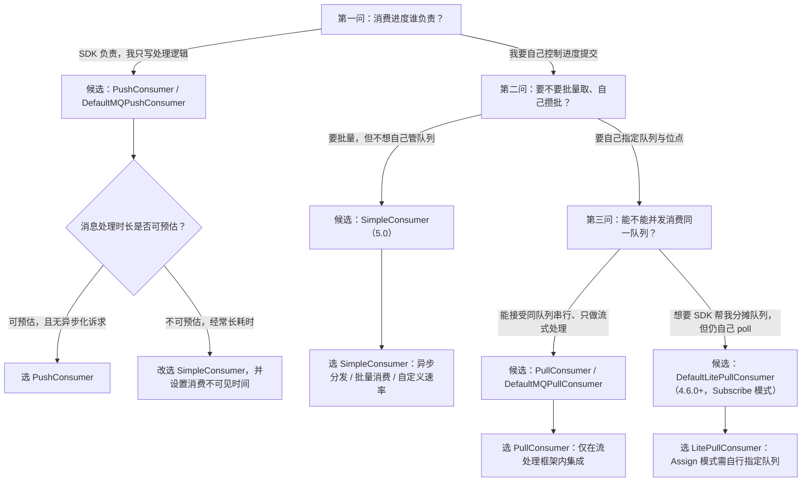

## 为什么需要区分消费者类型？（痛点引入）

同一个消费组，代码里换个消费者类，行为就完全不同。团队里最常见的四起事故都源于「不知道自己在用哪一类消费者」：

1. **扩容无效**：业务把 `DefaultLitePullConsumer` 用 `assign` 模式写死了一半队列，然后又起了 4 个实例，吞吐一点没涨——因为 Assign 模式没有自动负载均衡，队列是代码里自己挑的。
2. **消息重复一大片**：有人把 4.x 的 `DefaultMQPullConsumer` 和 Push 消费者挂在同一个 ConsumerGroup 里，5.0 文档对此的措辞是「生产环境中相同的 ConsumerGroup 下严禁混用 PullConsumer 和其他两种消费者，否则会导致消息消费异常」。
3. **重试静默失效**：开发在 PushConsumer 的监听器里把消息丢进自己的线程池后就返回 `ConsumeResult.SUCCESS`。上游明确写了这种做法的后果——「消息还未处理完成，就提前返回消费成功结果。此时如果消息消费失败，服务端是无法感知的，因此不会进行消费重试」。
4. **耗时不可控打爆内存**：批处理场景硬用 PushConsumer，靠阻塞监听器来控制速率；上游的提醒是「不建议阻塞监听器，因为它会阻塞线程池，并最终可能会终止消费进程」。

| 维度 | 不区分消费者类型的痛苦 | 按能力边界选型之后 |
|------|------------------------|--------------------|
| 扩容 | 加实例不加吞吐，还怀疑服务端有问题 | 明确哪类由 SDK 分摊、哪类由自己分摊 |
| 进度控制 | 位点在 SDK 手里 / 在自己手里搞混，重复与丢失各来一遍 | 按「要不要自己管进度」先分类再选类 |
| 批量与攒批 | 单条回调硬扛洪峰，或批量语义被 SDK 拆散 | 按「要不要批量」选择接口形态 |
| 耗时不可控的消息 | 触发超时重试，产生大量重复消息 | 换 SimpleConsumer，设置消费不可见时间 |
| 混类风险 | 同组混用 Pull 与其它类型导致消费异常 | 遵守上游「严禁混用」红线 |
| 排障 | 只会问「为什么消费不到」 | 先定位类型，再定位粒度与接口 |

> ### 💡 新人小结：三种消费者类型就是三种取餐方式
>
> 把消费消息想象成在餐厅吃饭：
> - PushConsumer = **服务员上菜到桌**：菜（消息）按你的节奏持续送到面前，你只负责吃并说「收到」；厨房什么时候炒、怎么排班，你不用管，但你也**不能自己进厨房**。
> - SimpleConsumer = **叫号自取**：你听到号（调用取消息接口）自己去柜台端餐，可以一次端 10 份，也可以慢慢端；柜台会告诉你「这份餐在 30 秒内归你，别人看不到」，超时会重新挂回取餐架。
> - PullConsumer = **自己进仓库按货架取货**：你指定货架（队列）、指定从第几件开始（位点）、指定取几件（批次），取走后货位账本也得你自己登记。
>
> **一句话总结：三种类型的差别不在「能不能收到消息」，而在「进度、批次、并发这三件事谁负责」。**

**学习路线图**

```
痛点引入 → 消费三阶段 → 能力矩阵 → 选型决策图 → Push 怎么调 → Simple 怎么用 → Pull 与混用红线 → 4.x/5.0 对应关系 → 误区与排查
```

---

## 消费行为被拆成三个阶段

Apache RocketMQ 的消费者处理消息时主要经过三个阶段：**消息获取 → 消息处理 → 消费状态提交**。三种消费者类型的差异，就是这三个阶段分别由谁来做。


| 阶段 | PushConsumer | SimpleConsumer | PullConsumer |
|------|--------------|----------------|--------------|
| 消息获取 | SDK 后台完成（长轮询线程拉取到 SDK 内置缓存队列） | 业务逻辑按需调用取消息接口 | 业务自行按队列拉取 |
| 消息处理 | 在消费监听器内同步处理，不允许再异步分发 | 业务自行分发（可异步、可批量） | 业务自行处理 |
| 消费状态提交 | SDK 按监听器返回结果提交 | 业务主动调用提交接口 | 业务选择性提交消费结果 |

上游对这三段还有一句约束值得单独记住：**「客户端 SDK 和消费逻辑的唯一边界是消费监听器接口」**（PushConsumer 一节）。这条边界决定了后面所有可靠性行为。

> [!NOTE] 与《领域模型全景与通信方式》的分工
> PushConsumer 的「推」其实是 SDK 长轮询拉，那段机制解释已在 02-core-concepts 的领域模型一文写完，本文不再重复类比与代码。本文只回答三个问题：**怎么用、怎么选、怎么调**。

---

## 能力 × 类型矩阵（选型第一张表）

下表把三类 5.0 消费者与三个 4.x 消费者类放在一起对比。「依据」列标注该结论出自哪个版本的上游文档，避免把 4.x 的行为写成通用结论。

| 能力项 | PushConsumer（5.0） | SimpleConsumer（5.0） | PullConsumer（5.0） | DefaultMQPushConsumer（4.x） | DefaultLitePullConsumer（4.6.0+） | DefaultMQPullConsumer（4.x） |
|--------|---------------------|-----------------------|---------------------|-------------------------------|-----------------------------------|------------------------------|
| 接口方式 | 监听器回调返回消费结果，仅允许在监听器范围内处理 | 业务自行实现处理并主动调接口返回结果 | 业务自行按队列拉取，可选择性提交 | 监听器回调（`registerMessageListener`） | `poll()` 轮询取消息 | `pull(mq, expression, offset, maxNums)` |
| 要不要自己管进度 | 不用，SDK 提交 | 要主动 `ack` | 要，选择性提交 | 不用，SDK 提交 | 默认可自动提交，可关 | **必须自己 `updateConsumeOffset`** |
| 能不能批量 | 批量入口由 `consumeMessageBatchMaxSize` 控制，默认 1 | 可以，取消息接口一次可取多条 | 可以，按队列按位点批量取 | 同左（默认 1） | 可以，`setPullBatchSize` | 可以，示例取 32 条 |
| 并发度由谁管 | SDK 管消费并发度 | 业务逻辑自行管理消费线程 | 业务逻辑自行管理消费线程 | SDK 线程池（`consumeThreadMin/Max`） | 业务自己循环 `poll` | 业务自己循环 `pull` |
| 负载均衡粒度 | 5.0 SDK 消息粒度；早期版本队列维度 | 消息粒度 | 队列粒度 | 队列维度（4.x 默认策略） | Subscribe 模式与 PushConsumer 一致；Assign 模式无自动负载均衡 | 自己挑队列，无自动负载均衡 |
| 接口灵活度 | 高度封装，不够灵活 | 原子接口，可灵活自定义 | 原子接口，可灵活自定义 | 高度封装 | 中等：Subscribe / Assign 两档 | 最底层，全手动 |
| 顺序性保障 | 分组设为顺序消费时，监听器严格按存储先后被调用 | 按存储先后取消息，前一条未提交就拿不到后一条 | 业务自己保证 | `MessageListenerOrderly` | 业务自己保证 | 业务自己保证 |
| 适用场景 | 无自定义流程的业务消息开发 | 高度自定义业务流程 | 仅推荐流处理框架集成 | 常规业务消费 | 需要控制拉取节奏的场景 | 原始拉取，自己更新位点 |
| 依据 | 5.0《消费者分类》对比表 | 5.0《消费者分类》SimpleConsumer 节 | 5.0《消费者分类》对比表 | 4.x《Push 消费》 | 4.x《Pull 消费》Lite Pull 节 | 4.x《Pull 消费》Pull Consumer 节 |

读表要点三条：

- **前三列是 5.0 的官方三分法**，后三列是 4.x 的对应实现类；两套名字不是同一批人取的，迁移时最容易看错。
- 上游把 PullConsumer 的定位写得很死：**「在实际使用场景中，PullConsumer 仅推荐在流处理框架中集成使用，大多数消息收发场景使用 PushConsumer 和 SimpleConsumer 就可以满足需求。」**
- 上游同时写了**「若您的业务场景发生变更，或您当前使用的消费者类型不适合当前业务，您可以选择在 PushConsumer 和 SimpleConsumer 之间变更消费者类型。变更消费者类型不影响当前 Apache RocketMQ 资源的使用和业务处理。」**——注意这句话只给了 Push 与 Simple 之间的互换，没把 PullConsumer 算进去。

---

## 选型决策图：三问定类型

选型只需要回答三个问题：**要不要自己管进度 → 要不要批量 → 能不能并发**。下图按这三问分叉。



图后解读：

- 第一个分叉把「SDK 托管进度」和「自己管进度」分开——这是三类消费者最本质的差异，其它差异（灵活度、批量、粒度）都是它的副作用。
- 图中 E 节点不是装饰：上游「使用建议」原文是「对于 PushConsumer 消费类型，需要严格控制消息的消费耗时……如果业务经常会出现一些预期外的长时间耗时的消息，建议使用 SimpleConsumer，并设置好消费不可见时间」。
- 落到 PullConsumer 这一支时，务必记住「同组严禁混用」这条红线；`DefaultLitePullConsumer` 的 Assign 模式则没有自动负载均衡机制，队列与位点全由代码决定。

---

## PushConsumer：怎么用、怎么选、怎么调

### 5.0 写法：Builder + 监听器

```java
// ========== ✅ 推荐写法（5.0）：PushConsumer 消费普通消息 ==========
ClientServiceProvider provider = ClientServiceProvider.loadService();
String topic = "YourTopic";
// 过滤表达式：按 Tag 过滤；换成 SQL92 见 05-consumption/消费模型/消息过滤Tag与SQL92.md
FilterExpression filterExpression = new FilterExpression("YourFilterTag", FilterExpressionType.TAG);
PushConsumer pushConsumer = provider.newPushConsumerBuilder()
    // 设置消费者分组：同一分组内的消费者共同分摊消息
    .setConsumerGroup("YourConsumerGroup")
    // 设置接入点：5.0 用 endpoints 而非 4.x 的 namesrvAddr
    .setClientConfiguration(ClientConfiguration.newBuilder().setEndpoints("YourEndpoint").build())
    // 设置预绑定的订阅关系：初始化阶段即可做权限与合法性校验
    .setSubscriptionExpressions(Collections.singletonMap(topic, filterExpression))
    // 设置消费监听器：消息处理必须在这里同步完成并返回结果
    .setMessageListener(new MessageListener() {
        @Override
        public ConsumeResult consume(MessageView messageView) {
            // 消费消息并返回处理结果。
            return ConsumeResult.SUCCESS;
        }
    })
    .build();
// 输出: 无显式控制台输出；消息持续进入监听器，返回值即消费结果（SUCCESS 会推进分组位点）
```

参数解释：

| 参数／方法 | 含义 | 注意 |
|-----------|------|------|
| `setConsumerGroup` | 消费者分组名，消费进度与重试策略按分组管理 | 分组是逻辑资源，需提前创建；命名 1~64 字符 |
| `setClientConfiguration(...setEndpoints...)` | 接入点，识别服务端集群 | 上游建议用域名而非 IP，防止节点变更无法热点迁移 |
| `setSubscriptionExpressions` | 预绑定订阅关系（主题 → 过滤表达式） | 未设置或主题动态变更时，服务端会动态补充校验 |
| `setMessageListener` | 消费监听器，PushConsumer 必须设置 | 上游约束：PushConsumer 类型的消费者消费消息时，客户端必须设置消费监听器 |
| `ConsumeResult.SUCCESS` / `FAILURE` | 消费成功／失败 | 抛异常等非预期失败按消费失败处理，进入重试判断 |

### 4.x 旧写法：同一个场景长什么样

```java
// ========== 旧写法（4.x）：DefaultMQPushConsumer + MessageListenerConcurrently ==========
DefaultMQPushConsumer consumer = new DefaultMQPushConsumer("please_rename_unique_group_name"); // 消费者组名，同组实例必须一致
consumer.setNamesrvAddr("localhost:9876");                                                      // NameServer 地址，多个用分号隔开
consumer.subscribe("TopicTest", "*");                                                           // 订阅主题，"*" 表示接收所有 Tag 的消息
consumer.registerMessageListener(new MessageListenerConcurrently() {                            // 并发消费：传 MessageListenerConcurrently
    @Override
    public ConsumeConcurrentlyStatus consumeMessage(List<MessageExt> msgs, ConsumeConcurrentlyContext context) {
        System.out.printf("%s Receive New Messages: %s %n", Thread.currentThread().getName(), msgs);
        // 输出: <线程名> Receive New Messages: [MessageExt 列表的 toString 形式]
        return ConsumeConcurrentlyStatus.CONSUME_SUCCESS;   // 消费成功
        // 消费失败请返回 ConsumeConcurrentlyStatus.RECONSUME_LATER（上游注释：不建议抛异常）
    }
});
consumer.start();
// 输出: Consumer Started.
```

4.x 的顺序消费与并发消费在 API 层面只有一处不同——传入的监听器实现不同：

```java
// ========== ✅ 顺序消费（4.x）：传 MessageListenerOrderly，同一队列串行处理 ==========
consumer.registerMessageListener(new MessageListenerOrderly() {            // 顺序消费：锁队列，逐条消费
    AtomicLong consumeTimes = new AtomicLong(0);
    @Override
    public ConsumeOrderlyStatus consumeMessage(List<MessageExt> msgs, ConsumeOrderlyContext context) {
        this.consumeTimes.incrementAndGet();
        if ((this.consumeTimes.get() % 2) == 0) {
            return ConsumeOrderlyStatus.SUCCESS;                             // 消费成功
        } else if ((this.consumeTimes.get() % 5) == 0) {
            context.setSuspendCurrentQueueTimeMillis(3000);                   // 本队列暂停 3000 毫秒后再试
            return ConsumeOrderlyStatus.SUSPEND_CURRENT_QUEUE_A_MOMENT;       // 消费失败（不跳过，避免打乱顺序）
        }
        return ConsumeOrderlyStatus.SUCCESS;
    }
});
// 输出: <线程名> Receive New Messages: [MessageExt 列表]；同一队列同一时刻只有一个线程在处理
```

参数解释：`ConsumeConcurrentlyStatus` 只有两档语义——`CONSUME_SUCCESS`（消费成功）与 `RECONSUME_LATER`（消费失败，一段时间后再重新消费）；`ConsumeOrderlyStatus` 对应 `SUCCESS` 与 `SUSPEND_CURRENT_QUEUE_A_MOMENT`。接口注释里还有一句常被忽略的提示：`msgs.size() >= 1`，`DefaultMQPushConsumer.consumeMessageBatchMaxSize=1`，可以改——这就是「PushConsumer 单条回调」的真正开关。

### 新旧写法逐维度对比

| 对比维度 | 旧写法（4.x `DefaultMQPushConsumer`） | 当前写法（5.0 `PushConsumer`） |
|----------|--------------------------------------|-------------------------------|
| 写法差异 | 构造 + `set` + `subscribe` + `registerMessageListener` + `start`，命令式五步 | Builder 链式一次 `build()`，订阅关系以 Map 预绑定 |
| 并发／顺序的表达 | 由监听器类型表达（`MessageListenerConcurrently` / `MessageListenerOrderly`） | 由消费者分组的投递顺序性统一配置（分组侧元数据） |
| 消费结果类型 | `ConsumeConcurrentlyStatus` / `ConsumeOrderlyStatus` 两套 | 统一为 `ConsumeResult`（SUCCESS／FAILURE） |
| 接入点配置 | `setNamesrvAddr` | `ClientConfiguration.setEndpoints` |
| 消息对象 | `MessageExt`（可读可取属性） | `MessageView`（只读消息视图） |
| 负载均衡粒度 | 队列维度 | 5.0 SDK 消息粒度（更均衡） |
| 可靠性重试 | SDK 完成，重试间隔与次数由参数控制 | SDK 完成，重试次数与死信由消费者分组元数据控制 |
| 迁移成本与兼容性风险 | 与 5.0 语义可对照，但「同组内消费行为一致性」在 4.x 需自己保证 | 需服务端 5.x；历史 SDK 连 5.x 服务端时以客户端接口设置为准 |
| 旧方案仍适用 | 存量 4.x 集群、需要 `setAllocateMessageQueueStrategy`（平均／机房优先／一致性 hash）显式换策略的场景 | 新接入、需要消息粒度负载与统一消费结果语义的场景 |

> [!NOTE] 版本适用：哪些结论只在 4.x 成立
> 4.x 的 Push 消费文档明确「RocketMQ Push Consumer 默认为集群模式，同一个消费组内的消费者分担消费」，且广播模式写作「消费组内的每一个消费者都会消费全量消息」；集群／广播通过 `consumer.setMessageModel(MessageModel.CLUSTERING)` 与 `MessageModel.BROADCASTING` 切换。
> 4.x 还可通过 `consumer.setAllocateMessageQueueStrategy(new AllocateMessageQueueAveragely())` 换分配策略（平均／机房优先／一致性 hash）。5.0 的分类页未提供这两个开关的对应写法，其负载策略描述改为「PushConsumer 和 SimpleConsumer 默认且仅使用消息粒度负载均衡策略」。

### 怎么调：4.x 侧参数与 5.0 侧默认值

4.x 的 Push 消费者可调项集中在客户端参数表（默认值照抄上游）：

| 参数 | 默认值（上游口径） | 作用 | ✅ 建议 / ❌ 反面 |
|------|--------------------|------|------------------|
| `consumeThreadMin` | 20 | 消费线程池 core size | ✅ 按下游资源压测结果调整；❌ 无依据拉到极大，线程上下文与内存同时膨胀 |
| `consumeThreadMax` | 64 | 消费线程池 max size | ✅ 与 `pullThresholdForQueue` 一起看；❌ 只调线程不调拉取阈值 |
| `pullBatchSize` | 32 | 一次最大拉取的批量大小 | ✅ 按消息大小与内存定；❌ 一次拉太多，消费失败时造成大批量消息重复 |
| `consumeMessageBatchMaxSize` | 1 | 批量消费的最大消息条数 | ✅ 需要攒批再调；❌ 为「性能」盲目放大，失败重试面变大 |
| `consumeTimeout` | 15，单位分钟 | 消费的最长超时时间 | ✅ 按真实 P99 处理时长设；❌ 放任监听器长时间阻塞 |
| `pullThresholdForQueue` | 100 | consume queue 流控阈值 | ✅ 与缓存内存一起评估；❌ 调大后堆内存吃紧 |
| `consumeConcurrentlyMaxSpan` | 2000 | 并发消费下单个队列允许的最大 offset 跨度，达到则触发流控 | ❌ 上游不建议把该机制当限流手段（详见消费重试一文） |
| `maxReconsumeTimes` | -1 | 消费失败后最多重新消费多少次才投递到死信队列 | 详见〈消费重试与死信队列〉，本文不展开数值 |
| `persistConsumerOffsetInterval` | 5000，单位毫秒 | 持久化消费进度的间隔 | 详见〈消费者负载均衡与消费进度管理〉 |

5.0 侧对应的运行时默认值写在参数约束表里：PushConsumer 本地缓存最大 1024 条 / 64 M；消费并发度默认 20 个线程；获取消息最大批次默认 32 条；请求超时时间默认 3000 毫秒、建议不超过 30000 毫秒。

> ### 💡 新人小结：PushConsumer 的调优旋钮分两层
>
> 把 PushConsumer 想成一条自助传送带：
> - `pullBatchSize`／本地缓存 = **一次从后厨拿几盘放到带上**；
> - `consumeThreadMin/Max` = **带子旁边站几个服务员**；
> - `consumeMessageBatchMaxSize` = **一次端给一桌几盘**（默认 1）；
> - `consumeTimeout` = **菜放多久没被端走就按失败重做**。
>
> **调优的正确顺序：先确认耗时与内存（会不会超时、会不会堆爆），再动批量与线程数。**

---

## SimpleConsumer：把控制权交回业务

SimpleConsumer 是接口原子型消费者：消息获取、消费状态提交、消费重试都由业务逻辑主动发起调用完成。

```java
// ========== ✅ 推荐写法（5.0）：SimpleConsumer 主动取消息、主动 ACK ==========
ClientServiceProvider provider = ClientServiceProvider.loadService();
String topic = "YourTopic";
FilterExpression filterExpression = new FilterExpression("YourFilterTag", FilterExpressionType.TAG);
SimpleConsumer simpleConsumer = provider.newSimpleConsumerBuilder()
        .setConsumerGroup("YourConsumerGroup")
        .setClientConfiguration(ClientConfiguration.newBuilder().setEndpoints("YourEndpoint").build())
        .setSubscriptionExpressions(Collections.singletonMap(topic, filterExpression))
        .setAwaitDuration(Duration.ofSeconds(1))   // 从服务端接受消息的最大等待时间
        .build();
try {
    // 主动获取消息：一次 10 条，每条消息的处理上限（消费不可见时间）30 秒
    List<MessageView> messageViewList = simpleConsumer.receive(10, Duration.ofSeconds(30));
    messageViewList.forEach(messageView -> {
        System.out.println(messageView);
        // 输出: MessageView 的字符串形式（含主题、消息 ID、Tag、属性等只读信息）
        try {
            simpleConsumer.ack(messageView);        // 处理成功后主动提交消费结果
        } catch (ClientException e) {
            logger.error("Failed to ack message, messageId={}", messageView.getMessageId(), e);
        }
    });
} catch (ClientException e) {
    // 如果遇到系统流控等原因造成拉取失败，需要重新发起获取消息请求。
    logger.error("Failed to receive message", e);
}

// ========== ❌ 不推荐写法（仅展示） ==========
// ❌ 取到消息后既不 ack 也不改不可见时间，只等着超时：会把「处理慢」变成「重试风暴」
// ❌ 在循环里不断新建 SimpleConsumer：上游明确不建议频繁创建和销毁消费者
```

参数解释：

| 接口／参数 | 含义 | 可修改项与注意 |
|-----------|------|----------------|
| `setAwaitDuration(Duration.ofSeconds(1))` | 从服务端接受消息的最大等待时间 | 取值由业务按延迟敏感度定；示例照搬上游 1 秒 |
| `receive(10, Duration.ofSeconds(30))` | 主动从服务端取消息 | 第 1 个参数＝批量拉取消息数；第 2 个参数＝**消费不可见时间**（消息最长处理耗时，也是消费失败时重试间隔的来源） |
| `ack(messageView)` | 消费成功后主动返回消费成功响应 | 无可修改参数；失败时「只需要不回复 ACK 响应，即可在消费不可见时间到达后触发消费重试」 |
| `ChangeInvisibleDuration` | 修改不可见时间，即控制重试间隔 | 可修改 `receive` 预设的取值；一般用于需要延长消息处理时长的场景 |
| 取消息返回空 | 上游说明：由于服务端存储为分布式，可能出现服务端实际有消息但返回为空 | 一般可通过重新发起 `ReceiveMessage` 调用或提高其并发度解决 |

SimpleConsumer 的三项适用场景照抄上游判断口径：**消息处理时长不可控**、**需要异步化／批量消费等高级定制**、**需要自定义消费速率**。它的顺序性保障是「按消息存储先后顺序获取消息；一组需要保持顺序的消息中，前面消息未处理完成，就获取不到后面的消息」。

---

## PullConsumer 与 4.x 的两种 Pull：进度真正在你手里

### 4.x 原始 Pull：自己构造队列、自己更新位点

```java
// ========== 4.x：DefaultMQPullConsumer，拉取与位点提交全部手动 ==========
DefaultMQPullConsumer consumer = new DefaultMQPullConsumer("please_rename_unique_group_name_5");
consumer.setNamesrvAddr("127.0.0.1:9876");
consumer.start();
try {
    MessageQueue mq = new MessageQueue();            // 队列对象：定位「哪个 Broker 的哪个主题的哪个队列」
    mq.setQueueId(0);
    mq.setTopic("TopicTest");
    mq.setBrokerName("jinrongtong-MacBook-Pro.local");
    long offset = 26;                                // 起始位点由业务自己给
    PullResult pullResult = consumer.pull(mq, "*", offset, 32);   // 队列 / 过滤表达式 / 位点 / 最大拉取条数
    // PullResult 的 PullStatus 四态：FOUND / NO_NEW_MSG / NO_MATCHED_MSG / OFFSET_ILLEGAL
    if (pullResult.getPullStatus().equals(PullStatus.FOUND)) {
        System.out.printf("%s%n", pullResult.getMsgFoundList());
        // 输出: 拉取到的消息列表（MessageExt 集合）
        consumer.updateConsumeOffset(mq, pullResult.getNextBeginOffset());   // 位点必须自己提交
    }
} catch (Exception e) {
    e.printStackTrace();
}
consumer.shutdown();
// ❌ 不推荐：只 pull 不调 updateConsumeOffset —— 下次重启会从头位点重复拉取
// ❌ 不推荐：把 offset 硬编码且不做边界校验 —— OFFSET_ILLEGAL 表示位点非法，可能偏大或偏小
```

参数解释：`pull(mq, expression, offset, maxNums)` 四个参数依次是队列、过滤表达式、拉取位点、最大拉取消息条数；`PullStatus` 四个取值的官方语义是 FOUND＝拉取到消息、NO_NEW_MSG＝没有发现新消息、NO_MATCHED_MSG＝没有匹配的消息、OFFSET_ILLEGAL＝传入的拉取位点非法（可能偏大或偏小）。不想手工构造队列时，可用 `consumer.fetchSubscribeMessageQueues("TopicTest")` 取回主题全部队列再挑。

### 4.x LitePull：Subscribe 与 Assign 两种模式

```java
// ========== ✅ 4.6.0+ Subscribe 模式：自动负载均衡 + 默认自动提交位点 ==========
DefaultLitePullConsumer litePullConsumer = new DefaultLitePullConsumer("lite_pull_consumer_test");
litePullConsumer.subscribe("TopicTest", "*");                 // 订阅主题，过滤表达式同 Push
litePullConsumer.setPullBatchSize(20);                        // 每次拉取的最大消息数量
litePullConsumer.start();
try {
    while (running) {
        List<MessageExt> messageExts = litePullConsumer.poll();   // 轮询接口：取到返回列表，取不到返回 null
        System.out.printf("%s%n", messageExts);
        // 输出: 取到消息时为 MessageExt 列表；无消息时为 null（判空后再处理，别直接 forEach）
    }
} finally {
    litePullConsumer.shutdown();
}

// ========== ✅ Assign 模式：无自动负载均衡，队列与位点自选 + 手动提交 ==========
DefaultLitePullConsumer litePullConsumer = new DefaultLitePullConsumer("please_rename_unique_group_name");
litePullConsumer.setAutoCommit(false);                        // 关闭自动提交位点，改为手动
litePullConsumer.start();
Collection<MessageQueue> mqSet = litePullConsumer.fetchMessageQueues("TopicTest");
List<MessageQueue> list = new ArrayList<>(mqSet);
List<MessageQueue> assignList = new ArrayList<>();
for (int i = 0; i < list.size() / 2; i++) {                   // 示例：只取前一半队列
    assignList.add(list.get(i));
}
litePullConsumer.assign(assignList);                          // 自行指定要拉取的队列
litePullConsumer.seek(assignList.get(0), 10);                 // 把第一个队列的拉取起点设为位点 10
try {
    while (running) {
        List<MessageExt> messageExts = litePullConsumer.poll();
        System.out.printf("%s %n", messageExts);
        litePullConsumer.commitSync();                        // 手动同步提交位点
    }
} finally {
    litePullConsumer.shutdown();
}
```

参数解释：`subscribe` 模式下同一消费组内多个 `DefaultLitePullConsumer` 会负载均衡消费，与 PushConsumer 一致；`assign` 模式没有自动负载均衡机制，需自行指定队列。`seek(queue, offset)` 用于把某个队列的拉取起点改成指定值（示例是 10）。`poll()` 与 `receive()` 的关键差别是：LitePull 取回的是 `MessageExt` 列表且位点可自动提交，SimpleConsumer 取回的是 `MessageView` 且必须显式 `ack`。

> [!NOTE] 版本适用：5.0 的 PullConsumer 小节上游未展开
> 5.0《消费者分类》页只在对比表中给出 PullConsumer 的能力（业务方自行按队列拉取、自行管理消费线程、队列粒度负载均衡、仅推荐流处理框架场景），其 PullConsumer 小节在上游只有标题、正文未展开内容。因此本文关于拉取接口、`PullStatus`、位点提交的代码与语义全部来自 4.x 文档，不要把它们当作 5.0 SDK 的接口签名使用。

---

## 4.x 类与 5.0 类型的对应关系

这张表是本文最需要留存的资产——迁移时按它对照，不要靠类名相似度猜。

| 4.x 实现类 | 引入版本 | 对应的 5.0 类型 | 进度管理 | 队列分配 | 关键接口差异 | 依据 |
|------------|----------|-----------------|----------|----------|--------------|------|
| `DefaultMQPushConsumer` | 4.x（存量） | `PushConsumer` | SDK 托管 | 队列维度（4.x）→ 消息粒度（5.0 SDK） | `MessageListenerConcurrently/Orderly` → `MessageListener` 返回 `ConsumeResult`；`MessageExt` → `MessageView` | 4.x《Push 消费》＋5.0《消费者分类》 |
| `DefaultLitePullConsumer` | **4.6.0** 推出 | 语义最接近 `SimpleConsumer`（同为「业务主动取消息」），但**不是同一套接口** | Subscribe 默认可自动提交；Assign 手动 `commitSync` | Subscribe 与 Push 一致；Assign 无自动负载均衡 | `poll()` 返回 `List<MessageExt>` → `receive(batch, invisibleDuration)` 返回 `List<MessageView>` + `ack()` | 4.x《Pull 消费》＋5.0《消费者分类》 |
| `DefaultMQPullConsumer` | 4.x 原始 Pull | `PullConsumer` | **完全手动**：`updateConsumeOffset` | 自己挑队列 | `pull(mq, expression, offset, maxNums)` + `PullStatus` 四态 | 4.x《Pull 消费》＋5.0《消费者分类》对比表 |

三处最容易读错的对应关系，显式写清：

1. **`DefaultLitePullConsumer` ≠ 5.0 `SimpleConsumer`。** 前者的位点是「自动提交／手动 `commitSync`」，后者的进度是「每条消息显式 `ack`」；前者无「不可见时间」概念，后者的重试间隔正是由不可见时间决定。两者只共享「业务主动取消息」这一层语义。
2. **`DefaultMQPushConsumer` 与 `PushConsumer` 才是一对。** 迁移时监听器要重写（结果类型与消息类型都变了），但「SDK 负责拉取与提交」这条不变。
3. **4.x 的 Pull 与 LitePull 是并存的两套类**，不是新旧替代：4.x《Pull 消费》原文把前者称为「比较原始的 `Pull Consumer`，不提供相关的订阅方法，需要调用 pull 方法时指定队列进行拉取，并需要自己更新位点」，后者「相比于原始的 Pull Consumer 更加简单易用」。

> ### 💡 新人小结：选类型像选驾照类别
>
> 把三类消费者想成驾照类别：
> - PushConsumer = **自动挡**：上手快、逻辑简单，但方向盘怎么转不由你细调。
> - SimpleConsumer = **手动挡**：起步、换挡、停车都由你踩，能开得精细，但忘踩离合就熄火（忘记 ack 或超时）。
> - PullConsumer = **货车牌照**：能拉大货、能自己规划路线（队列与位点），但绝大多数小车场景根本用不上，且**不能和前面两类混着开**。
>
> **一句话总结：先看要不要自己管进度，再看要不要批量与并发；管理类选 Push，精细类选 Simple，流处理才上 Pull。**

---

## 术语与缩写速查（术语表）

本文用到的每个专名都在下表逐个解释；「在本文中的角色」列说明它出现在哪一节，方便回查。

| 术语 | 全称 | 含义（用自己的话） | 在本文中的角色 |
|------|------|--------------------|----------------|
| PushConsumer | 推式消费者（5.0 类型名） | 由 SDK 后台取消息、回调监听器并提交消费结果的高度封装消费者 | 能力矩阵第一列；选型默认答案 |
| SimpleConsumer | 简单消费者（5.0 类型名） | 业务主动调接口取消息、主动 ACK 的原子接口型消费者 | 「要不要自己管进度」分支的第二答案 |
| PullConsumer | 拉式消费者（5.0 类型名） | 业务按队列自行拉取、可选择性提交消费结果的消费者 | 仅流处理框架集成的那一支 |
| DefaultMQPushConsumer | 4.x 推消费者实现类 | 4.x 里与 5.0 PushConsumer 对应的实现类 | 新旧写法对照的旧侧 |
| DefaultLitePullConsumer | 4.6.0 起的轻量拉消费者 | 提供 Subscribe／Assign 两种模式、用 `poll()` 取消息的 4.x 消费者 | 「LitePull 不等于 SimpleConsumer」那条对应关系 |
| DefaultMQPullConsumer | 4.x 原始拉消费者 | 无订阅方法、需自造队列并自提位点的 4.x 消费者 | 手动进度管理的最底层样本 |
| SDK | Software Development Kit，客户端开发包 | 内置长轮询线程、缓存队列与消费线程池的客户端库 | 解释「谁负责拉取与提交」的主语 |
| 长轮询 | Long Polling | SDK 内置线程向服务端持续取消息的机制 | 已在 02-core-concepts 展开，本文只作引用 |
| Reactor 线程模型 | Reactor | 上游对 PushConsumer 内部线程模型的称呼 | 解释监听器为何不能异步分发 |
| MessageListener / ConsumeResult | 消费监听器／消费结果 | 5.0 消费逻辑入口与其返回值（SUCCESS／FAILURE） | PushConsumer 可靠性边界的两端 |
| MessageListenerConcurrently | 并发消费监听器（4.x） | 处理并发投递消息的监听器实现，返回 `ConsumeConcurrentlyStatus` | 4.x 旧写法示例主体 |
| MessageListenerOrderly | 顺序消费监听器（4.x） | 处理顺序投递消息的监听器实现，返回 `ConsumeOrderlyStatus` | 顺序消费与并发消费的唯一 API 差异 |
| ConsumeConcurrentlyStatus | 并发消费状态 | `CONSUME_SUCCESS`／`RECONSUME_LATER` 两档返回值 | 决定消息是否进入重试链路 |
| ConsumeOrderlyStatus | 顺序消费状态 | `SUCCESS`／`SUSPEND_CURRENT_QUEUE_A_MOMENT` 两档返回值 | 顺序消费失败时不跳过的表达方式 |
| MessageView | 消息视图 | 面向开发视角的消息只读接口 | 5.0 三类消费者的取消息返回类型 |
| MessageExt | 消息扩展类（4.x） | 4.x 监听器与 `poll()`／`pull()` 返回的消息对象 | 4.x 示例里的消息载体 |
| receive / ack | 取消息接口／确认接口 | SimpleConsumer 主动取消息与主动返回消费成功的两个调用 | 「消费不可见时间」的设参入口 |
| ChangeInvisibleDuration | 修改不可见时间接口 | 修改取消息时预设的消费不可见时间，从而控制重试间隔 | SimpleConsumer 三项接口之一 |
| 消费不可见时间 | Invisible Duration／InvisibleDuration | 消息被取走后对其他消费者不可见的时长，即消息最长处理耗时 | Simple 与 Push 重试策略差异的根源 |
| AwaitDuration | 等待时长 | SimpleConsumer 从服务端接受消息的最大等待时间 | 5.0 示例中的 builder 参数 |
| poll | 轮询接口（4.x LitePull） | LitePull 取消息的调用，取到返回列表否则返回 null | 与 `receive()` 对照的接口 |
| assign / seek / commitSync | 指定队列／改起点／同步提交 | LitePull Assign 模式三个关键动作 | 说明 Assign 无自动负载均衡 |
| fetchMessageQueues / fetchSubscribeMessageQueues | 获取主题队列集合 | 分别用于 LitePull 与原始 Pull 拿回队列列表 | 自造队列前的取队列步骤 |
| PullResult / PullStatus | 拉取结果／拉取状态 | 原始 Pull 的返回体；状态为 FOUND／NO_NEW_MSG／NO_MATCHED_MSG／OFFSET_ILLEGAL | 判定拉取分支与位点合法性 |
| updateConsumeOffset | 更新消费位点（4.x 原始 Pull） | 由业务把下一条待拉取位点提交给服务端 | 「进度完全自己管」的落点 |
| consumeMessageBatchMaxSize | 批量消费最大消息条数 | 4.x 一次交给监听器的最大条数，默认 1 | Push 能否攒批的真正开关 |
| consumeThreadMin / consumeThreadMax | 消费线程池 core／max | 4.x 消费线程池大小，默认 20／64 | 并发度调优的两个旋钮 |
| consumeTimeout | 消费最长超时时间 | 4.x 消费超时上限，默认 15 分钟 | 超时触发重试的判据 |
| MessageModel | 消费模式（4.x） | `CLUSTERING`（集群）／`BROADCASTING`（广播）两种模式开关 | 解释「组内分担」与「人手一份」 |
| AllocateMessageQueueStrategy | 队列分配策略（4.x） | 平均／机房优先／一致性 hash 等可切换的分配算法 | 4.x 独有的负载策略旋钮 |
| ClientConfiguration / endpoints | 客户端配置／接入点 | 5.0 连接服务端的配置对象与接入地址 | 取代 4.x `setNamesrvAddr` |
| FilterExpression / FilterExpressionType | 过滤表达式／过滤类型 | 订阅时提交的过滤条件与其类型（TAG／SQL92） | 三类消费者共用；细节见消息过滤一文 |

---

## 混用红线与常见误区

| 场景 | ❌ 常见做法 | ✅ 按上游口径的做法 | 出处 |
|------|-------------|---------------------|------|
| 同组多类型 | 同一 ConsumerGroup 下同时跑 PullConsumer 与 PushConsumer | 严禁混用，否则消息消费异常；需要不同语义就分不同分组 | 5.0《消费者分类》danger 提示 |
| Push 内异步分发 | 监听器里把消息丢给自定义线程，立刻返回 SUCCESS | 所有消息必须以同步方式处理并在监听器返回结果；否则服务端无法感知失败，不触发重试 | 5.0《消费者分类》错误方式二 |
| Push 提前返回 | 消息没处理完就返回 SUCCESS | 同上，属于错误方式一，服务端无法感知失败 | 5.0《消费者分类》 |
| 耗时不可预估 | 继续用 PushConsumer，靠超时重试兜底 | 改用 SimpleConsumer 并设置好消费不可见时间 | 5.0《消费者分类》使用建议 |
| 顺序消费想提速 | 并发消费 + 业务自己排序 | 顺序消费传 `MessageListenerOrderly`；顺序处理的前提是遵循同步提交原则，自定义异步分发则无法保证顺序 | 4.x《Push 消费》＋5.0《消费者分类》 |
| 单进程狂建消费者 | 同配置在一个进程起多个实例「提并发」 | 上游建议：同一进程同一消费分组一般只需一个消费者实例 | 5.0《消费者（Consumer）》使用建议 |
| 每次收消息新建销毁 | 循环里 build／shutdown | 消费者是可复用底层资源（类似数据库连接池），否则服务端产生大量短连接请求 | 5.0《消费者（Consumer）》使用建议 |
| 拉取数量盲目放大 | 一次拉极大条数追求吞吐 | 上游提示「一次获取消息数量过大容易在消费失败时造成大批量消息重复」（获取消息最大批次默认 32 条） | 5.0《参数约束和建议》 |

排查起手式（按类型定位，再定位参数）：

1. 先确认进程里到底实例化了哪个类、哪个 SDK 版本：`DefaultMQPushConsumer` / `DefaultLitePullConsumer` / `DefaultMQPullConsumer` 属 4.x 语义，`PushConsumer` / `SimpleConsumer` / `PullConsumer` 属 5.x 语义。
2. 再确认同组是否只有一类消费者（红线项）。
3. 若用 PushConsumer 且出现重复消息：查监听器是否同步返回、是否有预期外长耗时、`consumeTimeout` 取值（4.x 默认 15 分钟）。
4. 若用 LitePull 的 Assign 模式：查 `fetchMessageQueues` 返回集合是否被各实例重复指定、`setAutoCommit` 与 `commitSync` 是否配对。
5. 若用 4.x 原始 Pull：查 `PullStatus` 是否只有 FOUND 分支处理、`updateConsumeOffset` 是否用 `getNextBeginOffset()` 提交。

---

## 要点总结

1. **三种类型只由三个问题区分**：消费进度谁负责（SDK／业务）、要不要批量、能不能并发同队列。5.0 给出 PushConsumer / SimpleConsumer / PullConsumer 三分法，绝大多数业务只需前两者，PullConsumer 仅推荐在流处理框架中集成。
2. **4.x 与 5.0 的对应关系要按表读**：`DefaultMQPushConsumer` → `PushConsumer` 是一对；`DefaultLitePullConsumer`（4.6.0 起）与 `SimpleConsumer` 只是同为「业务主动取消息」，接口与进度语义完全不同；`DefaultMQPullConsumer` → `PullConsumer`，位点全靠 `updateConsumeOffset` 自己提交。
3. **PushConsumer 的能力边界写在它的约束里**：客户端 SDK 与消费逻辑的唯一边界是消费监听器；未处理完就返回成功、或在监听器内二次异步分发，都会让服务端失去重试依据；消息处理时长不可预估时应改用 SimpleConsumer 并设置消费不可见时间。
4. **调优顺序是先耗时与内存、再批量与线程**：4.x 侧看 `consumeThreadMin/Max`（20／64）、`pullBatchSize`（32）、`consumeMessageBatchMaxSize`（1）、`consumeTimeout`（15 分钟）；5.0 侧看本地缓存 1024 条／64 M、并发度 20 线程、获取消息最大批次 32 条。
5. **两条红线不可越**：同一 ConsumerGroup 严禁混用 PullConsumer 与其它两种消费者；变更消费者类型只在 PushConsumer 与 SimpleConsumer 之间被上游描述为「不影响资源使用和业务处理」。

---

> ### 💡 新人小结：消费者类型学完了，记住这 5 点
>
> 1. **先问「进度谁管」**：这是三类消费者的分水岭，其它差异全是从它派生出来的。
> 2. **拿一张对照表再动手迁移**：`DefaultLitePullConsumer` 不等于 `SimpleConsumer`，类名像不代表接口像。
> 3. **Push 的可靠性靠同步返回**：监听器返回结果就是服务端的唯一依据；异步转发＝放弃重试。
> 4. **耗时不可控就换 Simple**：把「处理多久」变成自己设的参数（消费不可见时间），比靠超时重试划算。
> 5. **同组只放一类消费者**：混用 Pull 与 Push/Simple 是上游明写的严禁项，出现消费异常先查这条。
