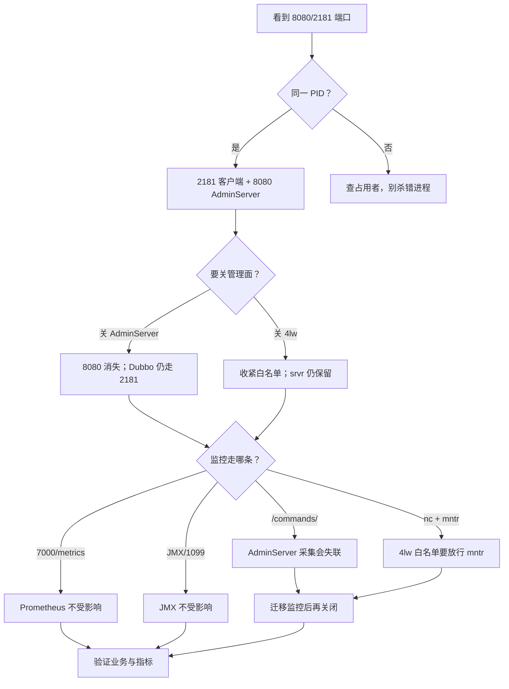

## 为什么会有这份问答实录？

这份 FAQ 来自一次真实的 ZooKeeper 部署排障：2026-10-25，Windows 单机部署 Apache ZooKeeper 3.8.7，作为 Dubbo 注册中心使用，涉及客户端端口 2181 和 AdminServer 端口 8080。

原始问答按“现场现象 → 原因 → 配置建议”组织，五个问题分别是：

1. 为什么启动后本地同时有 8080 和 2181 的端口占用？
2. 禁用 AdminServer 对 Dubbo 有什么影响？
3. 第三方监控是不是都通过 AdminServer 取数据？
4. 4lw 是什么，为什么要提供？
5. `zoo_sample.cfg` 里没有相关配置，怎么关闭，业务会不会受影响？

本文保留原始问答的主干，并在每个问题后加一段**站内核准**。核准的目的不是改写历史，而是把“当时回答里的经验判断”与“3.8.7 发行包的实际行为”分开：

| 读法 | 说明 |
|------|------|
| 原始回答 | 保留现场问题的语境、配置建议和影响面判断 |
| 站内核准 | 用 3.8.7 发行包文档、脚本和本机复核输出校正事实 |
| 完整文档 | 每个主题都有独立长文，本文只做 FAQ 入口 |

原始输出中的本机/远端地址做了脱敏，端口、状态、PID 和命令结构保留。

> ### 💡 新人小结：FAQ 不是“结论清单”，是“排障路径”
>
> - 先看问题对应的症状，再看原始判断。
> - 遇到版本相关结论，先看“站内核准”。
> - 需要完整背景时，顺着每题的链接进专题文档。
>
> **FAQ 用来快速定位，专题文档用来彻底理解。**

---

## 问题 1：为什么 ZooKeeper 启动后本地会同时有 8080 和 2181 的端口占用？

### 原始现场输出

```text
C:\Users\webtu>netstat -ano | findstr 8080
  TCP    0.0.0.0:8080           0.0.0.0:0              LISTENING       27604
  TCP    192.168.x.x:53611      198.51.100.10:8080     ESTABLISHED     13120
  TCP    [::]:8080              [::]:0                 LISTENING       27604

C:\Users\webtu>netstat -ano | findstr 2181
  TCP    0.0.0.0:2181           0.0.0.0:0              LISTENING       27604
  TCP    [::]:2181              [::]:0                 LISTENING       27604
```

### 原始回答

这两个端口都属于 ZooKeeper（PID 27604 是同一个进程），但用途不同：

| 端口 | 名称 | 用途 |
|------|------|------|
| 2181 | `clientPort` | 经典客户端端口，ZooKeeper 协议通信，Kafka、Dubbo、Curator 等客户端连接用 |
| 8080 | `admin.serverPort` | AdminServer 的 HTTP 管理端口，ZooKeeper 3.5.0 起内置的 Jetty HTTP 服务 |

从 ZooKeeper 3.5+ 开始，一个实例默认会监听这两个端口，是设计如此，不是异常。

原始回答还补充了两点：

1. 8080 输出里有一行是“假占用”：

   ```text
   TCP    192.168.x.x:53611      198.51.100.10:8080     ESTABLISHED     13120
   ```

   本地地址的端口是 53611，8080 出现在远端地址列。这是 PID 13120 的程序在连出到远程 8080，不是本地 8080 被占用。`findstr 8080` 把两列都匹配了，真正的监听者只有 PID 27604。

2. 如果不想让 ZooKeeper 占 8080，可以在 `zoo.cfg` 里：

   ```properties
   # 直接禁用管理端
   admin.enableServer=false

   # 或者换个端口
   admin.serverPort=9090

   # 还可以只绑定本机
   admin.serverAddress=127.0.0.1
   ```

   改完重启 ZooKeeper 生效。验证身份可跑 `tasklist /fi "PID eq 27604"`，会看到是一个 `java.exe`。

### 站内核准

| 核准项 | 结论 |
|--------|------|
| 8080 是 AdminServer | 正确；3.5.0 起内置，官方文档默认端口 8080 |
| 2181 是客户端端口 | 正确；样例配置常用 2181，本文实验使用 2182 |
| 两个端口同一个 PID | 正确；同一个 JVM 同时启动客户端服务和 Jetty AdminServer |
| `ESTABLISHED` 行的 8080 | 正确；那是远端端口，不是本机监听 |
| `admin.enableServer=false` | 正确；`zoo.cfg` 写法有效，本机复核启动日志中没有 `Started AdminServer` |
| `admin.serverAddress=127.0.0.1` | 正确；本机复核只监听回环地址 |

唯一需要补充的是：`2181/8080` 只是默认组合，不是固定组合。AdminServer 的端口由 `admin.serverPort` 决定；如果同机跑多个实例，必须错开。端口地图与 `netstat` 列含义见[端口地图与占用排查](/docs/02-getting-started/单机安装与首次操作/port-map-and-occupancy/)。

> ### 💡 新人小结：先分清“本地监听”和“远端连接”
>
> - `LISTENING` 行才是本机在这个端口开门。
> - 远端地址列里的端口，是对方服务的端口。
> - 同一个 PID 监听 2181 和 8080，是 ZooKeeper 的正常形态。
>
> **别被 `findstr` 的字符串匹配骗了，先看本地地址和状态。**

---

## 问题 2：禁用了 admin 会有什么效果？例如 Dubbo 会使用 ZK 作为注册中心。

### 原始回答

**对 Dubbo 零影响，放心禁用。**

Dubbo（以及任何用 Curator/原生 ZooKeeper 客户端的框架）连的是 2181 上的二进制客户端协议——注册临时节点、Watcher 订阅、会话心跳都走这条路。AdminServer 只是个 HTTP 管理面板，不参与任何客户端功能，两条通路完全独立。

禁用前后的对比：

| 功能 | 走哪条路 | 禁用后 |
|------|---------|--------|
| Dubbo 服务注册/发现 | 2181 客户端协议 | ✅ 完全正常 |
| Ephemeral 节点、Watcher、Session | 2181 客户端协议 | ✅ 完全正常 |
| 集群选举/数据同步（2888/3888） | Zab 协议 | ✅ 完全正常 |
| `zkCli.sh` 连接操作 | 2181 | ✅ 完全正常 |
| `zkServer.sh status` | 4lw `srvr` 命令（2181，默认白名单内） | ✅ 正常 |
| 浏览器/HTTP 查看状态 | AdminServer | ❌ 没了 |
| 通过 HTTP 抓取 `mntr`/`srvr` 的监控 | AdminServer 或 4lw | ⚠️ 需改用 4lw |

原始回答还建议：如果监控组件在抓 AdminServer 的 HTTP 端点，禁用后会失联；补救方式是启用 4lw 白名单：

```properties
admin.enableServer=false
# 按需放开 4lw（别在生产全开 *）
4lw.commands.whitelist=stat,ruok,mntr,srvr
```

之后 `echo mntr | nc localhost 2181` 就能拿到同样的监控数据。原始回答还提到：`4lw.commands.whitelist` 和 AdminServer 是互为替代的两个管理入口；3.5 之前只有 4lw，3.5 起官方推荐 AdminServer，并把 4lw 默认收紧为仅 `srvr`。

### 站内核准

| 核准项 | 结论 |
|--------|------|
| 禁用 AdminServer 不影响 Dubbo | 正确；Dubbo 走 2181 二进制协议，不走 8080 |
| 禁用后 `zkCli` 正常 | 正确；`zkCli` 也不经过 AdminServer |
| `zkServer.sh status` 正常 | 正确；它走 2181 的 `srvr`，3.8.7 会强制保留 `srvr` |
| `zkServer.cmd status` 正常 | **不准确**；3.8.7 的 `bin/zkServer.cmd` 没有 `status` 子命令，只负责前台启动 |
| 白名单从 3.5 开始 | **需精确到 3.5.3**；白名单是 3.5.3 引入的 |
| AdminServer 与 4lw 互相替代 | **部分正确**；功能上重叠，但配置上独立，关一个不会自动关另一个 |

重要差异：原始回答把 `zkServer.sh status` 和 `zkServer.cmd status` 并列。对 3.8.7 发行包来说，只有 Unix 的 `zkServer.sh` 有 `status` 分支，它内部用 `FourLetterWordMain` 发 `srvr`；Windows 的 `zkServer.cmd` 没有这个分支。Windows 上要检查状态，可以用：

```text
# 有 nc 时
echo srvr | nc 127.0.0.1 2181

# AdminServer 开启时
curl -s http://127.0.0.1:8080/commands/srvr
```

另外，“白名单收紧为仅 `srvr`”是官方文档的口径；3.8.7 的实现会把 `srvr` 强制保留，空白名单也不会关掉它。AdminServer 的配置、端点和关闭影响见[AdminServer 管理接口](/docs/03-cluster-operations/管理面与监控/adminserver-http/)。

> ### 💡 新人小结：关 8080 不影响 2181 的业务
>
> - Dubbo 注册/发现走 2181，不走 AdminServer。
> - 关 AdminServer 影响的是 HTTP 管理页和抓 `/commands/*` 的监控。
> - `zkServer.sh status` 走 `srvr`，`zkServer.cmd` 没有 `status`。
>
> **业务正常不等于监控正常；两条通路要分别验证。**

---

## 问题 3：一些第三方 ZK 监控软件是不是通过 admin 暴露的端点获取的数据？

### 原始回答

不全是——走 8080 Admin 端点的只是其中一派。原始回答根据 ZooKeeper 官方监控文档，把第三方监控获取数据分成四条通道：

| 通道 | 端口/方式 | 代表工具 | 原文的生态判断 |
|------|----------|----------|----------------|
| 4lw 四字命令 | 2181（`mntr`/`srvr`/`stat`） | Telegraf zookeeper 插件、多数 zookeeper exporter、Zabbix 社区模板、nc/telnet 脚本 | 经典主流 |
| AdminServer HTTP | 8080（`/commands/mntr` 等 JSON 端点） | 部分新版 exporter、自研巡检脚本、部分 Web 面板 | 少数派 |
| JMX | JVM MBean（1099 或自定义） | Datadog 集成、Zabbix JMX 模式、APM | 企业级常用 |
| Prometheus MetricsProvider | 7000（`metricsProvider.className` 开启） | Prometheus + Grafana | 3.6.0+ 官方推荐 |

原始回答还解释了为什么 4lw 反而常见：它早于 AdminServer 十几年出现，海量工具围绕 `echo mntr | nc host 2181` 编写，返回纯文本 KV，解析简单。

原始回答给出的判断方法：

- 配置里写 2181，且用 telnet/nc → 4lw；禁用 AdminServer 无影响，但白名单要放行 `mntr,srvr`；
- 配置里写 8080 或 URL 带 `/commands/` → AdminServer；禁用后会失联；
- 配置里写 7000 → Prometheus provider；无影响；
- 配置里提到 JMX/jolokia → 无影响。

原始回答还称：`zkServer.sh status`、`zkCli.sh` 这些官方工具走的是 2181 的 4lw `srvr`，禁用 AdminServer 后日常运维命令照常可用。

### 站内核准

| 核准项 | 结论 |
|--------|------|
| 监控不止 AdminServer 一条路 | 正确；4lw、AdminServer、JMX、Prometheus 都可能被使用 |
| 4lw 历史更久、脚本更通用 | 正确；官方文档也说 4lw 早于 AdminServer |
| 原文的“生态占比” | **不是官方统计**；属于经验判断，不能用来推断你的工具 |
| JMX 端口固定为 1099 | **不准确**；1099 是常见约定，不是 ZooKeeper 固定默认值；本地 jconsole 通过 attach，不需要先开 1099 |
| `zkServer.sh status` 走 `srvr` | 正确 |
| `zkCli.sh` 走 4lw `srvr` | **不准确**；`zkCli` 走的是 2181 的 ZooKeeper 客户端协议，不是四字命令 |
| 4lw 会被 AdminServer 替代 | 官方文档确实说 4lw 将逐步废弃，建议使用 AdminServer；但 3.8.7 仍保留 4lw |

因此，判断“关 AdminServer 会不会影响监控”，最可靠的方法不是问工具名，而是看监控配置里的**目标端口/URL**。四条通道的选择与验证见[四条监控通道](/docs/03-cluster-operations/管理面与监控/monitoring-channels/)。

> ### 💡 新人小结：别按工具名猜通道，按配置指纹判断
>
> - URL 带 `/commands/` → AdminServer。
> - 端口 7000 或 `/metrics` → Prometheus provider。
> - `nc`/`telnet` 发四字命令 → 4lw。
> - JMX/jolokia/1099 → JVM 管理通道。
>
> **工具可能支持多种模式，最终以配置文件为准。**

---

## 问题 4：4lw 是什么？为什么要提供？

### 原始回答

**4lw = Four Letter Words（四字命令）。**

它是 ZooKeeper 内置的一组管理诊断命令，每条命令恰好由 4 个字母组成，直接通过客户端端口（2181）以明文 TCP 发送。服务端读到连接的前 4 个字节，若是认识的单词就返回结果并断开——不需要握手、不需要客户端库、不走 ZooKeeper 二进制协议。

用法：

```bash
echo ruok | nc localhost 2181     # Linux
echo mntr | nc localhost 2181     # 拿监控指标
telnet localhost 2181             # 手动敲 srvr 回车
```

原始回答的常用命令表：

| 命令 | 作用 | 返回示例 |
|------|------|----------|
| `ruok` | “are you OK?” 探活 | `imok` |
| `stat` | 概要 + 连接列表 | 版本、mode、zxid、客户端 IP |
| `srvr` | 只返回概要（不含连接列表） | zk_version、mode、latency |
| `mntr` | 监控金矿，全量指标 KV | zk_avg_latency、zk_packets_received |
| `conf` | 当前生效配置 | tickTime、dataDir |
| `cons` | 当前所有连接详情 | IP:port、outstanding、sid |
| `dump` | 会话 + 临时节点（仅 leader） | session → ephemeral path |
| `wchs`/`wchc`/`wchp` | watcher 统计 | 按会话/按路径 |
| `envi` | JVM 环境 | classpath、内存 |
| `kill` | 直接关停服务端 | （危险） |

原始回答解释“为什么提供”：

1. 零依赖诊断：出问题时只需要 `telnet`/`nc`，敲 4 个字母就能确认“还活着吗、是不是 leader、延迟多少”；
2. 探活极其简单：`ruok` → `imok`，天然适合 Nagios、keepalived、shell 巡检；
3. 不额外开端口：搭客户端端口 2181 的便车，防火墙不用新放行；
4. 实现代价几乎为零：服务端只需读 4 字节做匹配，这也是命令必须正好 4 个字母的原因。

原始回答还解释了为什么后来收紧：4lw 无认证、无加密，任何人连上 2181 就能执行；`kill` 能直接关停服务，`wchc`/`wchp` 在 watcher 海量时开销巨大，`cons`/`dump`/`envi` 泄露连接拓扑、会话、环境信息。所以 3.5 起默认白名单只放行 `srvr`，其余禁用，同时推出 AdminServer。

### 站内核准

| 核准项 | 结论 |
|--------|------|
| 4lw 通过客户端端口明文发送 | 正确 |
| 服务端读前 4 个字节匹配 | 正确；这也是命令固定四字母的原因 |
| `kill` 是 3.8.7 可用的四字命令 | **不准确**；3.8.7 官方四字命令清单没有 `kill`，不要依赖它 |
| 3.5 起默认只放行 `srvr` | **需精确到 3.5.3**；白名单从 3.5.3 引入 |
| 空白名单等于全关 | **不准确**；3.8.7 会强制保留 `srvr`，空白名单实际只关掉 `srvr` 之外的命令 |
| `wchc`/`wchp` 开销大 | 正确；官方明确提示可能影响性能 |
| `cons`/`dump`/`envi` 泄露信息 | 正确；这些命令会输出连接、会话、环境等细节 |

3.8.7 的官方清单里，仍然值得重点关注的是 `wchc`/`wchp` 的性能开销、`cons`/`dump`/`envi` 的信息暴露，以及 `4lw.commands.whitelist=*` 的整体暴露面。`kill` 属于旧资料里的历史口径，不应作为 3.8.7 的关闭手段。

四字命令的完整清单、白名单实测和安全边界见[四字命令 4lw](/docs/03-cluster-operations/管理面与监控/four-letter-words/)。

> ### 💡 新人小结：4lw 是“零依赖诊断”，也是“零认证入口”
>
> - 好用的是不需要客户端库，`nc` 就能问。
> - 危险的是协议不认证，能连上 2181 就能试。
> - 3.8.7 默认只放行 `srvr`，但 `srvr` 会被强制保留。
>
> **先限制 2181 的来源，再谈放行哪几条命令。**

---

## 问题 5：3.8.7 的 zoo_sample.cfg 里没有 admin 和 4lw 相关内容，完全关闭它们要怎么配置？会不会对业务侧有影响？

### 原始回答

**为什么示例配置里没有这些项：** `zoo_sample.cfg` 只列最小必需加少数常用项，而 `admin.*` 和 `4lw.commands.whitelist` 都有内置默认值（`admin.enableServer` 默认 `true`、4lw 白名单默认仅 `srvr`），所以不写出来——不写不等于不存在。3.8.7 完整支持这两组参数（4lw 白名单自 3.5.3 引入），它们属于静态配置，直接加进 `zoo.cfg` 重启生效。

原始回答给出的“完全关闭”配置：

> 下面这段是原始回答，保留原样；其中把 4lw 白名单置空的做法在 3.8.7 上并不能全关，后文“站内核准”会给出修正版。先读核准，再照抄。

```properties
# 关闭 AdminServer（8080 不再监听）
admin.enableServer=false

# 4lw 白名单置空 = 一条四字命令都不放行
4lw.commands.whitelist=
```

原始回答的验证方式：重启后 `netstat -ano | findstr :8080` 应无输出；`echo ruok | nc localhost 2181` 会返回 `ruok is not executed because it is not in the whitelist.`。

原始回答对业务侧的判断：没有影响。Dubbo/Kafka/Curator 等所有客户端走 2181 的二进制协议，与 AdminServer（HTTP）和 4lw（诊断后门）是三条独立通路。关掉这两条，业务注册/发现/配置中心功能零影响。

原始回答的受影响清单：

| 受影响项 | 原因 | 程度 |
|---------|------|------|
| `zkServer.sh status` / `zkServer.cmd status` | 靠 4lw `srvr` 判断状态 | ⚠️ 白名单置空后必坏，报 “It is probably not running” 误判 |
| `ruok` 探活脚本 / `mntr` 监控采集 | 4lw 被禁 | 已有监控会失联 |
| 浏览器访问 `http://host:8080/commands/` | AdminServer 被禁 | HTTP 管理入口消失 |
| JMX（本地 jconsole） | 不经过这两条通路 | ✅ 仍可用 |

原始回答建议更稳妥的“关闭”是留一条 `srvr`：

```properties
admin.enableServer=false
4lw.commands.whitelist=srvr        # 仅供 zkServer status 使用；需监控则改成 srvr,mntr,ruok
```

原始回答的最终建议：

- 关 AdminServer（消除无认证 HTTP 面 + 释放 8080）；
- 4lw 只留 `srvr`（保住 `zkServer status`）；
- 业务无感，状态检查正常，顺带解决 8080 端口冲突；
- 以后接 Prometheus 时开启 `metricsProvider.*`（默认 7000），和这两项互不干扰。

### 站内核准

这一题是全文需要更正最多的一题：

| 原始结论 | 3.8.7 核准 |
|----------|------------|
| 白名单置空 = 一条四字命令都不放行 | **不成立**；空白名单实际仍允许 `srvr`，只拒绝 `ruok`/`mntr` 等其余命令 |
| 白名单置空后 `zkServer.sh status` 必坏 | **不成立**；`srvr` 被强制保留，`zkServer.sh status` 仍可用 |
| `zkServer.cmd status` 也依赖 `srvr` | **不成立**；3.8.7 的 Windows 脚本没有 `status` 子命令 |
| 4lw 被禁后监控一定失联 | 取决于监控走哪条通道；走 4lw 的会失联，走 7000/JMX 的不受影响 |
| 关 AdminServer 不影响业务 | **成立**；本机复核与官方文档一致 |
| JMX 不受影响 | **成立**；JMX 不经过 4lw/AdminServer |

本机复核的真实结果：

```text
# 配置：admin.enableServer=false，4lw.commands.whitelist=
$ echo ruok | 2186
ruok is not executed because it is not in the whitelist.

$ echo mntr | 2186
mntr is not executed because it is not in the whitelist.

$ echo srvr | 2186
Zookeeper version: 3.8.7-9085db92dd679e1e90a63bfe6ae6345ab6cbc4ae, built on 2026-09-03 17:57 UTC
...
Mode: standalone
Node count: 5
```

所以，“完全关闭 4lw”在 3.8.7 上做不到——至少 `srvr` 会保留。把白名单置空的实际效果是“只留 `srvr`”，这已经能满足“关闭 4lw 诊断面”的大部分需求；如果确实要连 `srvr` 都不让外部访问，只能在网络层限制 2181 的来源，而不能靠 `4lw.commands.whitelist`。

修正后的推荐配置：

```properties
# 关闭 AdminServer
admin.enableServer=false

# 只保留状态检查；需要监控再加 mntr/ruok
4lw.commands.whitelist=srvr
```

需要监控时：

```properties
admin.enableServer=false
4lw.commands.whitelist=srvr,ruok,mntr
```

或者改用 Prometheus：

```properties
admin.enableServer=false
4lw.commands.whitelist=srvr
metricsProvider.className=org.apache.zookeeper.metrics.prometheus.PrometheusMetricsProvider
metricsProvider.httpHost=127.0.0.1
metricsProvider.httpPort=7000
metricsProvider.exportJvmInfo=true
```

`zoo_sample.cfg` 里没有写这些项，不代表不支持；样例只列最小配置，默认值由服务端内置。完整的可抄模板和上线步骤见[管理面收口配置](/docs/04-reference/配置与工具/management-plane-hardening/)。

> ### 💡 新人小结：关闭管理面要按 3.8.7 的实际行为写
>
> - `admin.enableServer=false` 能关 8080，业务不受影响。
> - `4lw.commands.whitelist=` 不能全关 4lw，`srvr` 仍在。
> - `zkServer.cmd` 没有 `status`，别拿它验证关闭效果。
>
> **“置空”是减法，但减不掉 `srvr`；要验证，不要只看配置字面。**

---

## 附：关键结论速查

| 问题 | 原始一句话结论 | 3.8.7 站内核准 |
|------|----------------|----------------|
| 8080 哪来的？ | 3.5+ 内置 AdminServer 的 HTTP 管理端口，与 2181 客户端端口并存是设计行为 | 正确；默认端口 8080，可改可关 |
| 禁用 admin 影响 Dubbo 吗？ | 不影响，Dubbo 走 2181 二进制协议 | 正确；业务与监控要分别验证 |
| 监控软件都走 8080 吗？ | 少数派；主流是 4lw（2181），官方推荐 Prometheus provider（7000） | 通道判断正确；“主流/少数派”不是官方统计 |
| 4lw 是什么？ | 明文四字诊断命令，无认证有安全风险，3.5 起默认仅放行 `srvr` | 基本正确；白名单精确到 3.5.3；3.8.7 强制保留 `srvr` |
| 完全关闭怎么做？ | `admin.enableServer=false` + `4lw.commands.whitelist=` | 前半正确；后半不能全关，建议写 `srvr` |
| 关闭影响业务吗？ | 业务零影响；`zkServer status` 依赖 `srvr`，白名单置空会误报宕机 | 业务零影响正确；`srvr` 不会被置空；`zkServer.cmd` 没有 `status` |

---

## 原文与站内文档的对应关系

| 原始问题 | 展开后的完整文档 | 适合什么时候读 |
|----------|------------------|----------------|
| 2181/8080 并存、真假端口占用 | [端口地图与占用排查](/docs/02-getting-started/单机安装与首次操作/port-map-and-occupancy/) | 配端口、查冲突、看 `netstat` |
| 禁用 AdminServer 的影响 | [AdminServer 管理接口](/docs/03-cluster-operations/管理面与监控/adminserver-http/) | 改管理端口、关闭 HTTP 管理面 |
| 第三方监控走哪条通道 | [四条监控通道](/docs/03-cluster-operations/管理面与监控/monitoring-channels/) | 选监控方案、判断失联原因 |
| 4lw 的原理与白名单 | [四字命令 4lw](/docs/03-cluster-operations/管理面与监控/four-letter-words/) | 查四字命令、配白名单 |
| 关闭 AdminServer 与 4lw 的完整配置 | [管理面收口配置](/docs/04-reference/配置与工具/management-plane-hardening/) | 上线收口、写生产模板 |

---

## 把五问连起来：一条判断链



---

## 要点总结

1. **2181 和 8080 可以同时存在**：前者是客户端二进制协议，后者是 AdminServer 的 HTTP 管理面；同一个 JVM 监听两个端口是 3.5.0 起的设计。
2. **`netstat` 要看本地地址和状态**：`LISTENING` 行才是本机监听；`Foreign Address` 里的 8080 是远端端口，不是本机占用。
3. **禁用 AdminServer 不影响 Dubbo**：注册/发现、临时节点、Watcher、会话、集群选举都走 2181/2888/3888，不走 8080。
4. **监控不止 8080 一条路**：4lw（2181）、AdminServer（8080）、JMX（JVM）、Prometheus（7000）都可能被使用；按目标端口/URL 判断，不要按工具名猜。
5. **4lw 白名单从 3.5.3 开始**：默认只放行 `srvr`；3.8.7 会强制保留 `srvr`，空白名单不能“全关”。
6. **Windows 没有 `zkServer.cmd status`**：3.8.7 的 `.cmd` 只负责启动；状态检查用 `srvr` 或 AdminServer 的 `/commands/srvr`。
7. **关闭管理面要按通路验证**：业务、端口、状态、监控四层分别回归；只看到“8080 没了”不算收口完成。

---

> ### 💡 新人小结：这份 FAQ 学完了，记住这 4 点
>
> 1. **两个端口不是冲突**：2181 业务、8080 管理，同 PID 正常。
> 2. **关闭 8080 不动业务**：Dubbo 走 2181 二进制协议。
> 3. **4lw 不能靠置空全关**：3.8.7 仍保留 `srvr`。
> 4. **先迁监控再收口**：否则业务正常，监控先失联。
