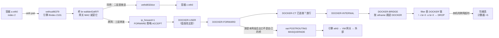
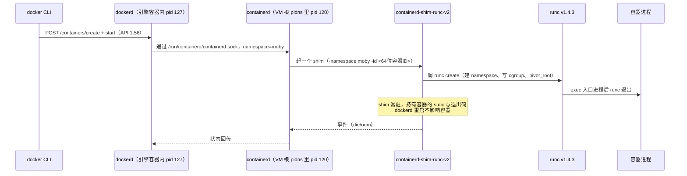

> **实战落点**：05 原理深入篇的收官四章。前面三章（5.1~5.3）讲清了「容器是一个被 namespace 与 cgroup 框住的进程」，5.4 讲清了「它的根文件系统是叠出来的」，这一篇补上最后两条腿：**包怎么进出**（5.5、5.6）与**谁把它拉起来、以什么身份拉起来**（5.7、5.8）。写完这一篇，第⑥站「原理」就没有欠账了。
> **本机基线**：Docker Engine `29.8.0` / API `1.56`、Compose `v5.5.1`、buildx `v0.37.0`、`runc 1.4.3`（`RuncCommit.ID=v1.4.3-0-gbb14dabe`）、`ContainerdCommit.ID=db8809540e1a7a9da5d518876894933ff55692ab`、`CgroupVersion=2` + `CgroupDriver=cgroupfs`、`Driver=overlayfs`、内核 `6.18.54.1-microsoft-standard-WSL2`、`NCPU=24`、`MemTotal=50475270144`；引擎形态是 `Docker Desktop (containerized)`（`Server.Platform.Name = Docker Desktop 4.91.0 (239619)`）。本篇取数跑了**七轮**（P / Q / Q2 / R / S / T / T2 / U / U2 / U3 里前八支脚本各答一部分），一次性对象一律 `kb27*` 前缀，跑完按名清净。
> **前置依赖**：[/docs/02-核心操作/接上去/端口映射数据管理与权限时区/](/docs/02-核心操作/接上去/端口映射数据管理与权限时区/)（2.5 的端口映射与网络基础）、[/docs/05-原理深入/隔离与资源/容器本质Namespace与Cgroups/](/docs/05-原理深入/隔离与资源/容器本质Namespace与Cgroups/)（5.1~5.3 的 namespace 与 cgroup，5.8 直接接它的 user namespace 那一格）、[/docs/05-原理深入/隔离与资源/联合文件系统与镜像分层/](/docs/05-原理深入/隔离与资源/联合文件系统与镜像分层/)（5.4，本篇 5.7 讲快照器时复用它）、[/docs/01-基础认知/为什么是容器/核心概念与架构总览/](/docs/01-基础认知/为什么是容器/核心概念与架构总览/)（1.2，5.7 的前置）
> **本篇产出物**：一张**桥与 veth 的对应关系表**（含 iflink 互指判据、`@名字` 为什么不可信）；**三条数据包路径的逐跳分析**（同网二层 / 出网 SNAT / 进来 DNAT）外加 DNS 那一跳的沙箱规则原文；**跨网被谁丢**的计数器证据与两条放行路；**六条转发链 + 两张表 + nft 视图**的读法表；overlay / macvlan / ipvlan / host / none / internal 的**本机可得性矩阵**（每条带报错原文）；**runc / containerd / shim 分工**在本机的可核对读数（两个 pid namespace 的对账）；`docker save` 与 OCI 包的结构差表；`user namespace` 映射读数与无 root 的四格限制；一份 **daemon.json 全文**（第一次可读）。
> **难度·耗时**：★★★ · 约 160 分钟（四章合计：5.5 五十分钟、5.6 三十五分钟、5.7 四十分钟、5.8 三十五分钟）
> **拓展接口**：本篇给的是机制与取证方法，**分段排查动作**在 [/docs/07-运维手册/按故障域排错/容器起不来与网络不通/](/docs/07-运维手册/按故障域排错/容器起不来与网络不通/)（7.4）；Windows/WSL2 侧的可见性与 `host.docker.internal` 的三种拼法在 [/docs/07-运维手册/按故障域排错/Windows与WSL2性能排查应急runbook与复盘/](/docs/07-运维手册/按故障域排错/Windows与WSL2性能排查应急runbook与复盘/)（7.7）；最小权限与 `--user`/capabilities 的落地清单在 [/docs/06-工程化与生产/交付链路/CI-CD中的Docker与安全基线/](/docs/06-工程化与生产/交付链路/CI-CD中的Docker与安全基线/)（6.2）；`--stop-timeout` 与部署策略在 [/docs/06-工程化与生产/运行基线/日志资源限制部署策略与回滚/](/docs/06-工程化与生产/运行基线/日志资源限制部署策略与回滚/)（6.3/6.4）；镜像格式与仓库侧的 OCI 分发在 [/docs/03-镜像构建/交出去/BuildKit私有仓库标签策略与构建排错/](/docs/03-镜像构建/交出去/BuildKit私有仓库标签策略与构建排错/)（3.9~3.12）；**为什么单机不够之后往哪走**在 [/docs/08-生态与附录/生态坐标/容器生态地图与Kubernetes衔接/](/docs/08-生态与附录/生态坐标/容器生态地图与Kubernetes衔接/)（8.1~8.3，含 Podman / nerdctl 的迁移成本）。
> **自测三题**：
> 1. 一台机器上两张自定义网，容器互相 ping 不通。你怎么用**一条命令 + 两个数字**证明「是那条 DROP 丢的」而不是路由坏了？
> 2. `docker run --network <网>:IP=172.28.0.5` 报 `invalid field key`。正确写法是什么？为什么容器里 `cat /sys/class/net/eth0/iflink` 出来的数字才是配对的凭据？
> 3. 这台引擎的 `--user 10001` 之后，`/proc/self/uid_map` 里还是 `0 0 4294967295`。这说明 user namespace 开了吗？那这台机器上真正拦住容器 root 的护栏是什么？

## 为什么要把这四章放在一起讲

四章是一根线上的四段：**数据包怎么出去**（5.5）、**单机为什么不够用**（5.6）、**容器是被谁拉起来的**（5.7）、**拉起它的那个身份能不能不是 root**（5.8）。它们共用同一套取证方法——进命名空间、读 sysfs、读规则、读配置文件——所以本篇的每条结论后面都跟着读数本身。

先看三条真实报错，它们都是本库自己踩过或读反过的：

```text
# 一：跨网按 IP 访问（批 17 与批 21 各撞过一次，现象一模一样）
wget: download timed out

# 二：macvlan 容器出网（批 21，父口没显式给的时候）
wget: can't connect to remote host (1.1.1.1): Network unreachable

# 三：指定一个"看得见二进制"的运行时（批 21，VM 里确实躺着 sysbox-runc）
docker: Error response from daemon: unknown or invalid runtime name: sysbox-runc
```

第一条在 7.4 里是分段排查的终点之一，但它到底被哪条规则丢掉，本库到批 21 才量出来（在 filter 表 `DOCKER` 链的一条 `DROP`，计数器当场对上）。第二条的本库旧说法要更正：批 21 里 Windows 侧 ping macvlan 容器打出「已发送 = 2，已接收 = 2（0% 丢失）」，看着像通，实际收到的两条是「无法访问目标主机」的 ICMP 错误——**Windows 的 ping 把不可达回复也计入"已接收"**。第三条说明"二进制存在"和"运行时注册"是两件事。

### 这四章在 05-原理深入 里的位置：内容要点与产出物

先给读者一张入口表。触发条件一列写的是"你什么时候会需要它"，前置依赖一列是"没读过哪一节会看不懂"。

| 章 | 触发条件（什么时候翻到这） | 前置依赖 | 难度·耗时 | 内容要点与产出物 |
|---|---|---|---|---|
| 5.5 网络底层实现 | 7.4 排查到「容器互通但出不去外网」时 | 2.5 端口映射与网络基础 | ★★★ · 50m | docker0 网桥、veth pair 的对应关系；三条数据包路径逐跳分析（本篇多加了 DNS 那一跳） |
| 5.6 跨主机网络概览 | 衔接 K8s 时 | 5.5 | ★★★ · 35m | overlay / macvlan / ipvlan 思路对比；为什么单机方案不够用。边界：本库到此为止，不讲 K8s 操作 |
| 5.7 容器运行时生态 | 衔接 K8s 或评估 Podman 时 | 1.2 镜像与容器的关系 | ★★★ · 40m | OCI 规范、runc / containerd / shim 分工；Docker 与 K8s 的关系；`docker save` 与 OCI 格式差异 |
| 5.8 无 root 容器 | 上生产前（第⑦段）与写 6.2 安全基线时 | 5.2 namespace 详解 | ⑥ · ★★★ · 35m | 用户命名空间映射原理；无 root 运行的收益与限制；rootless 的已知不可用场景 |

评估 Podman / nerdctl 这类替代方案的迁移成本，在 8.3；本篇只把"这一层到底是什么"讲清。


> 💡 新人小结：这一篇的所有读数都靠一个前提——**先进对命名空间**。`wsl -d docker-desktop` 落到的那个 shell 和「引擎自己待的那个网络命名空间」不是同一个：前者只有 `lo` 和一张 `eth0 172.17.40.166/20`，后者才有 `docker0`、每张自定义网的 `br-xxxx`、11 条 `veth`。本库批 17 记的那条「VM 侧读不到桥与 NAT 规则」不是软件限制，是站错了地方。
> 对应到操作：要看引擎侧的东西，就起一只 `--network host` 的容器（它进的就是引擎 netns）；要看进程树，就加 `--pid=host`；看别的容器的 netns，就 `nsenter -t <pid> -n`。这三把钥匙在本篇每一节都用到了。
> 类比失效的地方：命名空间不是"房间"而是"同一台机器上的两套门牌号体系"，同一个 `eth0` 名字在两个体系里可以是完全不同的网卡——所以下面凡是给接口名，都同时给它的 ifindex。

## 5.5 网络底层实现：docker0 网桥与 veth pair

### docker0 网桥与自定义网桥：名字就写着它是谁建的

默认那张 bridge 网络用的桥叫 `docker0`；每建一张自定义网络，引擎就在它的 netns 里新建一张桥，名字是 `br-` 加上这张网 NetworkID 的**前 12 位**——这一条在批 21 里连续三次复现：

```console
$ docker network inspect kb27u-n1 --format '{{.Id}}'
659d4ebd0a9e...（第一次）    →  桥名 br-659d4ebd0a9e
$ docker network inspect kb27t-n1 --format '{{.Id}}'
400766e58900...              →  桥名 br-400766e58900
$ docker network inspect kb27u-n2 --format '{{.Id}}'
310bcae89d6d...              →  桥名 br-310bcae89d6d
```

所以「这堆 `br-` 开头的桥哪张对应哪个网络」不是靠猜，`docker network inspect` 拿 ID 前 12 位一拼就是。Harbor 那套栈（段⑤）的桥是 `br-fd8f04a13d46`，对应网络 `harbor_harbor`，上面挂着 9 个 veth。

### veth pair：一对网卡的两头怎么对上

一只容器接进桥，用的是一条 **veth pair**（虚拟以太网设备对）：一头在容器 netns 里叫 `eth0`，另一头在引擎 netns 里叫 `veth<8位十六进制>` 并挂进桥。对上两头的办法是读 `iflink`——每条 veth 的 `iflink` 就是**对端的 ifindex**：

```console
$ docker exec kb27u-a sh -c 'ip -o link show eth0 | cut -d: -f1; cat /sys/class/net/eth0/iflink'
2
2101
$ docker exec kb27u-probe sh -c 'ip -o link show | grep "^2101:"'
2101: vethca96379@if2: <BROADCAST,MULTICAST,UP,LOWER_UP> mtu 1500 ... master br-ea9de42af97f ...
$ docker exec kb27u-probe sh -c 'cat /sys/class/net/vethca96379/iflink'
2
```

三只容器的完整对应（同一次取样，`kb27u-probe` 是 `--network host`，就在引擎 netns 里）：

| 容器 | 自己 netns 里 eth0 的索引 | eth0 的 iflink | 引擎 netns 里该索引的接口 | 挂在哪张桥 | 反指回来的 iflink |
|---|---|---|---|---|---|
| `kb27u-a` | 2 | 2101 | `vethca96379` | `br-ea9de42af97f` | 2 ✅ |
| `kb27u-b` | 2 | 2102 | `vethb4d6811` | `br-310bcae89d6d` | 2 ✅ |
| `kb27u-c` | 2 | 2103 | `vethd832dce` | `br-ea9de42af97f` | 2 ✅ |

四方的 netns inode 各不相同，这解释了为什么"同一个名字"是两套门牌号：

```console
kb27u-a      net:[4026533118]
kb27u-b      net:[4026533198]
kb27u-c      net:[4026533279]
kb27u-probe  net:[4026532222]   ← 引擎 netns（--network host）
```

> 💡 新人小结：veth pair 就像一截穿墙的双头水管：墙这边（容器 netns）接一个龙头叫 `eth0`，墙那边（引擎 netns）接另一个龙头叫 `vethxxxx`，水从这头进必然从那头出，中间没有第三口。
> 对应到机制：`/sys/class/net/eth0/iflink` 里那个数字是**对端在你自己之外那个 netns 里的 ifindex**；两边互相指，`2101 ↔ 2`。桥只认墙这边——引擎 netns 里那条 `vethxxxx` 才是桥口，`master br-xxxx` 就写在它身上。
> 类比失效处：水管里流的是水，这里流的是**以太网帧**，所以桥学的是 MAC 地址而不是 IP；一旦桥学到某 MAC 在哪个口，后续帧就不再泛洪（7.4 里抓包要在服务端容器里抓，原因同）。

### `vethca96379@if2` 里那个 `@名字` 是陷阱，不是对端容器的名字

`ip link` 打印 `A@ifB` 时，`@` 后面是**拿对端 ifindex 在"当前 netns"里查到的名字**。容器 eth0 在它自己 netns 里几乎都是 index 2，而本机引擎 netns 里 index 2 是 Docker Desktop 自己的 `services1`，于是所有容器的主机侧 veth 都显示成 `@services1`：

```console
$ docker exec kb27u-probe sh -c 'bridge link show' | grep br-ea9de42af97f
2101: vethca96379@services1: <BROADCAST,MULTICAST,UP,LOWER_UP> mtu 1500 master br-ea9de42af97f state forwarding priority 32 cost 2
2103: vethd832dce@services1: <BROADCAST,MULTICAST,UP,LOWER_UP> mtu 1500 master br-ea9de42af97f state forwarding priority 32 cost 2
```

认配对的**唯一可靠办法是比 ifindex**（上一节那张表）。`ip -d link` 里的 `link-netnsid 0` 也是同一个意思的另一种写法：对端在另一个 netns，需要 nsenter 才能看到那一头。

## 三条数据包路径逐跳分析

5.5 的产出物就是这一节。四条路径都跑在本机（`kb27u-*` 一次性对象，测完即删）。

### 路径一：同网容器互访（走二层，不经路由）

`kb27u-a` ping 同网的 `kb27u-c`：

```console
$ docker exec kb27u-a sh -c 'ping -c 2 -W 2 172.31.131.3'
2 packets transmitted, 2 packets received, 0% packet loss
round-trip min/avg/max = 0.076/0.082/0.089 ms
$ docker exec kb27u-a sh -c 'ip neigh show'
172.31.131.1 dev eth0 lladdr a6:d2:8c:25:3e:93 REACHABLE
172.31.131.3 dev eth0 lladdr de:6f:c3:b9:86:85 REACHABLE
$ docker exec kb27u-probe sh -c 'cat /sys/class/net/br-ea9de42af97f/address'
a6:d2:8c:25:3e:93
```

逐跳：容器 a 的协议栈发现 131.3 与自己同网段（`scope link`），于是**不查路由表**，直接 ARP；帧从 `eth0`（index 2）出来，从 `vethca96379` 落进桥；桥查 MAC 表（`bridge fdb show` 里 `de:6f:c3:b9:86:85 dev vethd832dce master br-ea9de42af97f`）决定只发给 c 那个口；c 的 eth0 收到。全程**没有任何三层转发**，也就没有 netfilter 的 FORWARD。两个必背读数：**邻居表里网关 131.1 的 MAC 就是桥自己的 MAC**（桥就是网关），以及学到的是对端容器自己的 MAC。

### 路径二：容器出公网（三层转发 + 一次 SNAT）

自定义网上的容器出网是通的（`wget http://1.1.1.1` 拿到 HTML），关键看 NAT 落在哪一跳：

```console
$ docker exec kb27u-probe sh -c 'iptables -t nat -S POSTROUTING' | grep 172.31.131
-A POSTROUTING -o br-ea9de42af97f -m addrtype --src-type LOCAL -j MASQUERADE
-A POSTROUTING -s 172.31.131.0/24 ! -o br-ea9de42af97f -j MASQUERADE
```

第二行就是机制：**源是这张网的网段、出口不是这张自己的桥**的包，一律 MASQUERADE。也就是说 SNAT 发生在**引擎 netns 的 POSTROUTING**，不是在 Windows 上，也不是在 VM 的外层。转发本身能被放行，因为 `FORWARD` 策略是 `ACCEPT`：

```console
$ docker exec kb27u-probe sh -c 'iptables -S FORWARD | head -3'
-P FORWARD ACCEPT
-A FORWARD -j DOCKER-USER
-A FORWARD -j DOCKER-FORWARD
$ docker exec kb27u-probe sh -c 'cat /proc/sys/net/ipv4/ip_forward'
1
```

到 Windows 侧再往外走，源地址会被 Docker Desktop 的网关服务再转一次：把 HTTP 镜子起在 Windows 上，容器里 `wget host.docker.internal:18500` 与 `wget 192.168.65.254:18500` 两种写法，镜子记到的客户端**都是 `peer=127.0.0.1:<随机口>`**（批 21 P 轮），而容器局域网内直接访问镜子时记到的是 `peer=192.168.3.103`。`192.168.65.254` 也不是随便的：它就是 daemon.json 里的 `host-gateway-ips`（下一节给全文）。

### 路径三：从外面进来的发布端口（DNAT，无 userland 代理）

```console
$ docker run -d --name kb27r-nginx -p 18511:80 nginx:1.27-alpine
$ curl -s -o NUL -w "HTTP=%{http_code}" http://127.0.0.1:18511/
HTTP=200
$ docker exec kb27r-probe sh -c 'iptables -t nat -S DOCKER'
-A DOCKER -p tcp -m tcp --dport 18511 -j DNAT --to-destination 172.17.0.2:80
```

`-p` 的实现就是这一条 DNAT，接在 `nat` 表的 `DOCKER` 链上，由 `-A PREROUTING -m addrtype --dst-type LOCAL -j DOCKER` 引进来——**匹配的是"目的地是本机某个地址"，所以它只管进来的连接**。`daemon.json` 里 `"userland-proxy": false`，意味着没有 `docker-proxy` 用户态进程插手，纯靠内核 NAT（这也解释了 7.7 那条「`-p 127.0.0.1:18452:80` 时 v6 回环上 `curl [::1]` 直接 rc=7」：DNAT 规则按 IPv4 匹配，v6 侧没有对应规则）。

同一条链上还能看见"发布端口"的两种变体：绑到 127.0.0.1 的会带上 `-d 127.0.0.1/32`，而 Harbor 的日志口多了一条成对的 MASQUERADE：

```text
-A DOCKER -d 127.0.0.1/32 -p tcp -m tcp --dport 1514 -j DNAT --to-destination 172.18.0.2:10514
-A POSTROUTING -s 172.18.0.2/32 -d 172.18.0.2/32 -p tcp -m tcp --dport 10514 -j MASQUERADE
```

第二条是发夹修正（容器访问自己发布的端口时把源也改掉），不是配置错误。

### 路径四：DNS 那一跳，127.0.0.11 在容器自己的 netns 里

自定义网络的 `resolv.conf` 指向 `127.0.0.11`，而 `127.0.0.11` 并不是"引擎远程服务"——**监听 socket 就在容器自己那个 netns 里**：

```console
$ docker exec kb27u-a sh -c 'nc -vz -w 2 127.0.0.11 53'
127.0.0.11 (127.0.0.11:53) open
$ docker exec kb27u-a sh -c 'grep -i "0B00007F" /proc/net/udp'
6274: 0B00007F:DFFE 00000000:0000 07 ...
$ docker exec kb27u-probe sh -c 'grep -ci "0B00007F" /proc/net/udp'
0
```

`0B00007F` 是 127.0.0.11 的小端十六进制，`DFFE` = 57342。53 端口是怎么被接到这个高位口的？得用一只有 `NET_ADMIN` 的容器才读得到（普通容器里 `iptables` 报 `Permission denied`，这是本机实测的边界），沙箱规则是这样：

```console
$ docker exec kb27v-dns sh -c 'iptables -t nat -S'
-N DOCKER_OUTPUT
-N DOCKER_POSTROUTING
-A OUTPUT -d 127.0.0.11/32 -j DOCKER_OUTPUT
-A POSTROUTING -d 127.0.0.11/32 -j DOCKER_POSTROUTING
-A DOCKER_OUTPUT -d 127.0.0.11/32 -p tcp --dport 53 -j DNAT --to-destination 127.0.0.11:38669
-A DOCKER_OUTPUT -d 127.0.0.11/32 -p udp --dport 53 -j DNAT --to-destination 127.0.0.11:57342
-A DOCKER_POSTROUTING -s 127.0.0.11/32 -p tcp --sport 38669 -j SNAT --to-source :53
-A DOCKER_POSTROUTING -s 127.0.0.11/32 -p udp --sport 57342 -j SNAT --to-source :53
```

对照：**默认 bridge 上的容器，沙箱 nat 表是空的**（只有四条 `-P ... ACCEPT`），它的 `resolv.conf` 里是 `nameserver 192.168.65.7`——这就是 2.5 说的「默认网络不能按名访问」的机制层原因：没有内嵌解析器，也没有 `--link` 之外的名字来源。



## 跨网不通是设计不是故障：那条 DROP 在 filter 表的 DOCKER 链

`kb27u-b` ping 隔壁网的 `kb27u-a`，超时；同网对照却是 0.08 毫秒。规则全量 dump（`iptables -S DOCKER`，**filter 表的那条 DOCKER 链**）：

```console
$ docker exec kb27u-probe sh -c 'iptables -S DOCKER'
-N DOCKER
-A DOCKER -d 172.18.0.10/32 ! -i br-fd8f04a13d46 -o br-fd8f04a13d46 -p tcp --dport 8443 -j ACCEPT
-A DOCKER -d 172.18.0.10/32 ! -i br-fd8f04a13d46 -o br-fd8f04a13d46 -p tcp --dport 8080 -j ACCEPT
-A DOCKER -d 172.18.0.2/32  ! -i br-fd8f04a13d46 -o br-fd8f04a13d46 -p tcp --dport 10514 -j ACCEPT
-A DOCKER ! -i docker0 -o docker0 -j DROP
-A DOCKER ! -i br-fd8f04a13d46 -o br-fd8f04a13d46 -j DROP
-A DOCKER ! -i br-ea9de42af97f -o br-ea9de42af97f -j DROP
-A DOCKER ! -i br-310bcae89d6d -o br-310bcae89d6d -j DROP
```

**"进入桥 X 的流量必须也从桥 X 出去"**——每张桥一条，跨桥必丢。nft 侧看到的是同一份东西（`iptables v1.8.10 (nf_tables)`，两套视图不是两套规则）：

```text
chain DOCKER {
    iifname != "docker0" oifname "docker0" counter packets 0 bytes 0 drop        # handle 29
    iifname != "br-fd8f04a13d46" oifname "br-fd8f04a13d46" ... drop              # handle 76
    iifname != "br-400766e58900" oifname "br-400766e58900" ... drop              # handle 370
}
```

计数器把这条链坐实（ping 5 个包，前后各存一份 `iptables-save -c` 求差）：

| 规则 | ping 前 | ping 后 | 增量 |
|---|---|---|---|
| `-A DOCKER-BRIDGE -o br-ea9de42af97f -j DOCKER` | 0 | 5 | **+5** |
| `-A DOCKER ! -i br-ea9de42af97f -o br-ea9de42af97f -j DROP` | 3 | 8 | **+5** |
| `-A DOCKER ! -i br-310bcae89d6d -o br-310bcae89d6d -j DROP` | 0 | 0 | 0 |

同时抓包能看清包死在哪一段：入口桥上**有**，出口桥上**一个都没有**——`FORWARD` 那三条 `-i br-X -j ACCEPT` 根本没被执行到，因为 `DOCKER-BRIDGE` 先按出口 `oifname` 跳进了 `DOCKER` 链。

```console
$ docker exec kb27u-probe sh -c 'cat /tmp/cap2.txt'     # 抓 b 所在的桥 br-310bcae89d6d
15:02:55.740701 62:ab:3c:ab:e0:fe > 5a:93:14:23:4e:6e, ethertype IPv4 (0x0800), length 98:
    172.31.132.2 > 172.31.131.2: ICMP echo request, id 57, seq 0, length 64
$ docker exec kb27u-probe sh -c 'cat /tmp/cap1.txt'     # 抓 a 所在的桥 br-ea9de42af97f
（只有 tcpdump 的 listening 头，零个包）
```

### 两条被支持的放行路，代价不同

| 走法 | 本机实测 | 代价 |
|---|---|---|
| **把容器接进两张网**（`docker network connect`） | a 多一个 `eth1 172.31.132.3`，`ping 172.31.132.2` → 0% 丢，RTT 0.079/0.087/0.095 ms，桥间 DROP **增量为 0**（i 与 o 同桥） | 要改编排；一张网一个 DNS 视图，服务名要写清是哪张网的别名 |
| **在 `DOCKER-USER` 加一条放行**（`-i br-B -o br-A -j ACCEPT`） | 同网段外的 a 也能收到，RTT 0.092/0.097/0.102 ms | 规则写在引擎 netns 里，**引擎重启 / 网络重建会没**；而且要接受"跨网隔离被自己关掉"这件事 |

`DOCKER-USER` 之所以能放行，是因为它挂在 `FORWARD` 的**最前面**（在 `DOCKER-FORWARD` 之前），ACCEPT 一旦命中，包根本走不到那条 DROP。这也是官方只认可这一个自定义挂点的原因——改别的链会被引擎的收敛逻辑覆盖。

> [!WARNING] 更正两处本库旧读数（2026-10-28，批 21）
> 1. **批 21 T 轮的脚本给了一条错的解说**。它在 `DOCKER-USER` 插了放行规则后打印「加了这条之后 a 还是收不到（因为 DROP 在 DOCKER 链更靠后）」，但它附的读数是 `round-trip min/avg/max = 0.092/0.097/0.102 ms`——**能打出 RTT 行就说明通了**。结论应以读数为准：`DOCKER-USER` 的 ACCEPT 有效。上一段那条表就是按读数写的。
> 2. **批 19 记的「Windows 侧 ping macvlan 容器已接收 2、0% 丢失」不是连通**。批 21 T2 轮把整段原文抓回来，看到那两条"回复"是 `来自 192.168.3.103 的回复: 无法访问目标主机。`——Windows 的 ping 把 ICMP 不可达错误也计入已接收。**判据要读响应体，不能只读统计行**（本库第 100 条那一族）。

## 转发规则的读法：六条链、两张表与 nft 侧

读规则前先记住一句话：**链名一样不代表链是同一条**。`nat` 表也有 `DOCKER` 链（DNAT 目标），`filter` 表也有 `DOCKER` 链（桥间隔离），两条同名、职责完全不同。本库批 21 的 S 轮就是因为只 dump 了 `DOCKER-CT/BRIDGE/INTERNAL/FORWARD/USER` 和 nat 表，错过了答案。

| 链 | 在哪个表 | 本机实测内容（自定义网各一条） | 谁写的 |
|---|---|---|---|
| `FORWARD` | filter | `-P FORWARD ACCEPT` → `-j DOCKER-USER` → `-j DOCKER-FORWARD` | 引擎初始化 |
| `DOCKER-USER` | filter | Docker Desktop 自己写了 6 条：`-i eth0 ACCEPT`、`-i eth1 ACCEPT`、`! -i eth0 -o services1` 的 3128/5555/53 放行 + 其余 tcp `REJECT icmp-port-unreachable` | **唯一给你改的地方** |
| `DOCKER-FORWARD` | filter | `-j DOCKER-CT` → `-j DOCKER-INTERNAL` → `-j DOCKER-BRIDGE`，再每张桥一条 `-i br-X ACCEPT`；`--internal` 网那条是 `-i br-X -o br-X ACCEPT`（**带出口限定**） | libnetwork |
| `DOCKER-CT` | filter | 每桥一条 `-o br-X -m conntrack --ctstate RELATED,ESTABLISHED -j ACCEPT`（回包放行） | libnetwork |
| `DOCKER-BRIDGE` | filter | 每桥一条 `-o br-X -j DOCKER`（按出口跳进隔离链） | libnetwork |
| `DOCKER-INTERNAL` | filter | 空（本机没有任何 internal 网时只有一条 `-N`） | libnetwork |
| `DOCKER` | filter | 发布端口的目的地址放行 + 每桥一条 `! -i br-X -o br-X DROP` | libnetwork |
| `PREROUTING`/`OUTPUT` | nat | `-A ... -m addrtype --dst-type LOCAL -j DOCKER`（进来的连接） | libnetwork |
| `POSTROUTING` | nat | 每网 `-s 本网段 ! -o 自己的桥 -j MASQUERADE` | libnetwork |
| `PREROUTING` | raw | `-A PREROUTING ... iifname != "lo" ip daddr 127.0.0.1 tcp dport 1514 drop`（Docker Desktop 加的，不让非回环来源碰它绑在 127.0.0.1 的口） | Docker Desktop |

`nft list tables` 只有 `ip filter / ip6 filter / ip nat / ip6 nat / ip raw` 五张表、ruleset 共 159 行——**没有独立的 nft 版 docker 表**，全是 iptables-nft 后端生成的。所以本机读规则的正确做法是：iptables 拿规则语义，`nft -a list ruleset` 拿 handle 与计数器，两者互为对照。

二层要不要过三层规则，取决于一个内核模块：

```console
$ docker exec kb27r-probe sh -c 'lsmod | grep -E "br_netfilter|bridge|stp"'
br_netfilter   28672  0
bridge        286720  1 br_netfilter
stp            12288  1 bridge
```

没有 `br_netfilter`，桥上转发的包就不进 `FORWARD`，那套隔离与放行规则全都无从谈起。

## 5.6 跨主机网络概览：overlay / macvlan / ipvlan 思路对比

### 本机可得性矩阵（每条都带原文）

| 驱动/形态 | 建网 | 起容器 | 通到哪一层 | 报错原文（不通时） |
|---|---|---|---|---|
| `bridge`（默认网络） | ✅ | ✅ | 同网按 IP；按名不行；能出网 | — |
| `bridge`（自定义网络） | ✅ | ✅ | 同网按 IP + 按名；能出网；**跨网被 DROP** | `wget: download timed out` |
| `host` | 不需要 | ✅ | 与引擎同一张 netns，直接看到 `docker0`、所有 `br-xxxx`、11 条 veth | `WARNING: Published ports are discarded when using host network mode` |
| `none` | 不需要 | ✅ | 只有 `lo`，什么都没接 | `wget: ... Network unreachable` |
| `macvlan` | ✅ | ✅ | **默认父口是一张 dummy，什么都不同**（见下节） | `Network unreachable`；ARP `FAILED` |
| `macvlan` + 显式父口 | ✅ | ✅ | **全通**：ping 网关 0.518/0.532/0.546 ms，`wget 1.1.1.1` 拿到 HTML | — |
| `ipvlan` | ✅ | ✅ | 网关 IP 在机器上不存在，出网也不通 | `Host is unreachable` |
| `overlay` | ❌ | — | — | `This node is not a swarm manager. Use "docker swarm init" ...` |
| `overlay2`（写错的驱动名） | ❌ | — | — | `plugin "overlay2" not found` |
| `--ingress`（本地作用域驱动） | ❌ | — | — | `Ingress network can only be global scope network` |

`docker network create` 对子网的写法也有一条硬限制，值得进坑表：

```console
$ docker network create --driver macvlan --subnet 192.168.3.200/24 kb27p-mac
Error response from daemon: invalid network config:
invalid subnet 192.168.3.200/24: it should be 192.168.3.0/24
```

### macvlan 在这台机器上不通的真正原因：默认父口是一张随网创建的 dummy

不指定 `-o parent=` 时，libnetwork 要给 macvlan 找一个父接口；本机找到的**不是真网卡**，而是一张随网络创建的 `dm-<NetworkID 前 12 位>`：

```console
$ docker exec kb27u-probe sh -c 'ip -d -o link show dev dm-0eddb7840c84'
2106: dm-0eddb7840c84: <BROADCAST,NOARP,UP,LOWER_UP> mtu 1500 ... promiscuity 1 ... dummy
$ docker exec kb27u-probe sh -c 'nsenter -t 27029 -n ip -d -o link show dev eth0'
eth0@if2115: <BROADCAST,MULTICAST,UP,LOWER_UP> mtu 1500 ... link-netnsid 0 ... macvlan mode bridge
```

`NOARP` 与 `dummy` 说明这张"父口"根本不会发 ARP；容器里 `ip route` 也**没有默认路由**，只剩一条本网段的 `scope link`。于是：

| 方向 | 本机读数 |
|---|---|
| 容器 → 网关 192.168.3.1 | `2 packets transmitted, 0 received, 100% loss`，邻居 `192.168.3.1 ... FAILED` |
| 容器 → 局域网那台 Windows 192.168.3.103 | `100% loss`，邻居 `FAILED` |
| 容器手动补默认路由 | `ip: RTNETLINK answers: Operation not permitted`（默认容器没有 `NET_ADMIN`） |
| 同宿主 bridge 容器 → macvlan 容器 | `100% loss` |
| 引擎 netns → macvlan 容器 | `100% loss` |
| Windows → macvlan 容器 | 「请求超时」+「来自 192.168.3.103 的回复: 无法访问目标主机」 |

把父口**显式**指到引擎 netns 里那张真网卡，macvlan 立刻是好的：

```console
$ docker network create --driver macvlan --subnet 192.168.65.0/24 --gateway 192.168.65.1 \
      --ip-range 192.168.65.226/28 -o parent=eth0 kb27x-m1
$ docker run --rm --network kb27x-m1 alpine:3.20 sh -c 'ping -c 2 192.168.65.1 | tail -2; wget -q -O- http://1.1.1.1 | head -c 40'
2 packets transmitted, 2 packets received, 0% packet loss
round-trip min/avg/max = 0.518/0.532/0.546 ms
<!DOCTYPE html>... Early iOS detection ...
```

结论要写成两句，一句都不能少：**"macvlan 在 Docker Desktop 上不可用"是错的**——可用，但默认父口让它在二层就死；显式 `-o parent=eth0` 后三层全通，代价是这张网直接接在引擎所在的内部网段（`192.168.65.0/24`）上，地址规划、隔离与端口暴露面都得重排。反过来，把父口指到**桥**上（`-o parent=docker0`）又是一条死路，路由直接标 `linkdown`：

```text
default via 172.17.99.1 dev eth0 linkdown ;172.17.99.0/24 dev eth0 ... linkdown ;
```

### ipvlan：mode 被记下了，但没生效；父口一张只能挂一张网

`-o ipvlan.mode=l3` 会被完整记进网络对象，但**容器里读到的设备仍是 `mode l2`**，连通性也没有任何变化：

```console
$ docker network inspect kb27x-i3 --format '{{json .Options}}'
{"ipvlan.mode":"l3","parent":"eth0"}
$ docker exec kb27x-ph sh -c 'nsenter -t 02377583... -n ip -d -o link show dev eth0'   # 简化书写
2117: eth0@if3: ... ipvlan mode l2 ...
```

l2 与 l3 两张网各起一只容器，读数完全一样（`ipvlan mode l2`、出网 `Host is unreachable`、ping 自己配的网关 `100% loss`）；两只容器的 MAC 还都等于父口 `eth0` 的 MAC `36:d0:8c:47:cc:49`——这正是 ipvlan 的定义特征（**多个从口共用父口 MAC**，所以它也天生不能做"同宿主两个 macvlan 互访"那种隔离）。另外 ipvlan 的网关 IP 是**没有任何接口承载的**（它不建桥），所以"ping 网关不通"在这里是设计，不是故障。

一条限制值得单独记：第二张指向同一个父口的 **ipvlan** 网建不出来，而 macvlan 可以——

```console
$ docker network create --driver ipvlan -o parent=eth0 ... 第二个
Error response from daemon: network di-0adb42912880 is already using parent interface eth0
```

（macvlan 两张网同指 `eth0` 各建了一次，都 `rc=0`。）

> 💡 新人小结：bridge / macvlan / ipvlan / overlay 的差别，用"小区"类比：bridge 是**小区内部交换机**（出去要过一道 NAT），macvlan 是**给每户发一个独立门禁卡**（在外部交换机眼里每户都是独立设备，但要求楼里真有一个能刷卡的门——本机的默认"门"是假的），ipvlan 是**多户共用一个门禁卡的 MAC**，overlay 是**在两个城市之间自己架一条专线**。
> 对应到机制：bridge 走二层 + 内核转发 + SNAT；macvlan/ipvlan 让容器直接挂到宿主物理口的二层上（跳过桥与 NAT，也因此依赖父口是真网卡、依赖交换机允许学习这些 MAC）；overlay 用 VXLAN 把二层"包在 UDP 里"跨机延伸，所以它需要集群控制面——本机 `docker network create --driver overlay` 直接报「This node is not a swarm manager」。
> 类比失效处：小区的门禁卡是外部可见的，而很多人以为 macvlan 容器"被 NAT 保护"——它恰恰**不被 NAT 保护**，直接暴露在同一二层网里，这是选它的主要代价。

## 为什么单机方案不够用（5.6 的落点，也是本库的边界）

把上面四张表合起来看，"单机不够"不是性能不够，而是**三条能力在单机上根本不存在**：

| 缺的能力 | 单机为什么给不了 | 本机证据 |
|---|---|---|
| 跨主机按名访问与 VXLAN 二层延伸 | overlay 属**全局作用域**驱动，需要集群控制面分配 VXLAN/VNI 并分发端点表 | `This node is not a swarm manager. Use "docker swarm init" ...` |
| 服务发现的多副本负载均衡 | `127.0.0.11` 内嵌解析器只认识**本引擎沙箱**里的端点；跨机端点没有来源 | 沙箱 nat 表 DNAT 到本机高位口，且 `getent hosts <对端>` 只在同网有记录 |
| 不依赖宿主二层的位置无关地址 | 自定义网彼此被 `! -i br-X -o br-X DROP` 隔离，跨网要么多宿主要么改 `DOCKER-USER` | 计数器 +5 那张表 |

> [!NOTE] 边界声明
> 本库到此为止，**不讲 K8s 操作**。为什么单机不够、概念怎么对照，落在 8.2《Kubernetes 衔接导读》；本篇只把"机制层为什么"给完。

## 5.7 容器运行时生态：OCI 规范与 runc / containerd / shim 分工

### 一次 `docker run` 到底经过谁



"分工"这条在**这台机器上是可核对的**，因为两层的进程分别在两个 pid namespace 里：

```console
$ wsl -d docker-desktop -u root -- ps -ef | grep -E "containerd|dockerd|shim"
  118 root  /usr/local/bin/containerd-stargz-grpc
  120 root  /usr/bin/containerd --config /etc/containerd/containerd.toml
  167 root  /usr/local/bin/dockerd --config-file /run/config/docker/daemon.json
  ...   root  /containerd-shim-runc-v2 -namespace moby -id ddc5bed169d0... -address /run/containerd/containerd.sock
```

而一只 `--privileged --pid=host` 的容器看到的是**引擎自己那个 pidns**：`/proc/1/cmdline` 是 `/initd`，`pidof dockerd` = 127，`/proc/127/exe -> /usr/bin/dockerd`。同一个 dockerd 在两个视图里 pid 不同、可执行路径不同——因为 Docker Desktop 的引擎是**容器化部署**的（`docker info` 的 `OperatingSystem` 原样写着 `Docker Desktop (containerized)`）。这解释了两件旧事：`wsl` 默认 shell 里 `containerd`/`runc`/`ctr` 全部 `not found`（PATH 里没有，不是没装），以及 `/run` 里看不到 `containerd` 目录。

`docker info` 把三层的归属直接给了字段：

```console
$ docker info --format '{{json .Containerd}}'
{"Address":"/run/containerd/containerd.sock","Namespaces":{"Containers":"moby","Plugins":"plugins.moby"}}
$ docker info --format '{{.DefaultRuntime}} {{.Driver}}'
runc overlayfs
$ docker info --format '{{json .Runtimes}}' 里注册的键
io.containerd.runc.v2, nvidia, runc
```

配合 `ContainerdCommit.ID=db8809540e1a7a9da5d518876894933ff55692ab`、`RuncCommit.ID=v1.4.3-0-gbb14dabe`、`InitCommit.ID=de40ad0`、`CgroupVersion=2`、`CgroupDriver=cgroupfs`。

### 二进制在 ≠ 运行时注册

引擎容器根里躺着这些可执行文件：

```text
containerd  containerd-shim-runc-v2  containerd-stargz-grpc  dockerd  runc  runcon  sysbox-fs  sysbox-mgr  sysbox-runc
```

`sysbox-runc` 是完整可用的二进制，但 `--runtime sysbox-runc` 报 `unknown or invalid runtime name`——因为 `daemon.json` 的 `runtimes` 里只注册了 `{"nvidia": {"path": "nvidia-container-runtime"}}`。**能不能用，取决于注册表，不取决于磁盘上有没有文件。**

顺带一条同样口径的读数：容器 inspect 里运行时字段的正确路径是 `.HostConfig.Runtime`，不是 `.Runtime.Name`：

```console
$ docker inspect --format '{{.HostConfig.Runtime}}' kb27q2-r
runc
$ docker inspect --format '{{.Runtime.Name}}' kb27q2-r
template parsing error: template: :1:57: executing "" at <.Runtime.Name>: map has no entry for key "Runtime"
```

### containerd 的落点（配置文件全文可读）

引擎容器里的 `/etc/containerd/containerd.toml` 共 43 行，关键行：

```ini
version = 2
root = "/var/lib/desktop-containerd/daemon"
state = "/var/run/desktop-containerd/daemon"
    "io.containerd.snapshotter.v1.aufs",     # 以下是被关掉的快照器
    "io.containerd.snapshotter.v1.btrfs",
    "io.containerd.snapshotter.v1.devmapper",
    "io.containerd.snapshotter.v1.zfs"
runtime_type = "io.containerd.runc.v2"
[plugins."io.containerd.runtime.v1.linux"]
  runtime_root = "/var/lib/docker/runc"
[stream_processors."io.containerd.processor.v1.diff.tar.zstd"]
  accepts = ["application/vnd.docker.image.rootfs.diff.tar.zstd"]
  path = "unzstd"
```

`docker info` 的 `Driver=overlayfs` 与 `DriverStatus=[[driver-type io.containerd.snapshotter.v1]]` 就是这套配置的对外表现（7.5 讲磁盘占用、5.4 讲分层时都用的是同一条事实）。

## docker save 与 OCI 格式差异

两种格式的差异**解开 tar 看条目名**就够了，不用猜：

| 产物 | 大小（本机） | 顶层条目 | 有 `manifest.json` 吗 | 有 `oci-layout`/`index.json` 吗 | `docker load` 认吗 |
|---|---|---|---|---|---|
| `docker save -o s.tar alpine:3.20` | 7,910,912 字节 / 20 个条目 | `blobs` `index.json` `manifest.json` `oci-layout` | ✅ | ✅ | ✅ |
| `docker buildx build --output type=oci,dest=o.tar` | 3,639,296 字节 / 8 个条目 | `blobs` `index.json` `oci-layout` | ❌ | ✅ | ✅（本机实测 `rc=0`，输出 `Loaded image: kb27s/fmt:oci`） |
| `docker buildx build --output type=docker` | — | 与 `docker save` 同构（含 `manifest.json`） | ✅ | ✅ | ✅ |

```console
$ tar -tf s.tar | awk -F/ '{print $1}' | sort -u
blobs
index.json
manifest.json
oci-layout
$ cat index.json 里的一条描述
{"mediaType":"application/vnd.oci.image.manifest.v1+json","digest":"sha256:b5461c5cf9be...","size":668,
 "annotations":{"io.containerd.image.name":"docker.io/kb27q/fmt:oci",
 "org.opencontainers.image.ref.name":...}}
```

要点三条：其一，**这一版 `docker save` 已经是 OCI 布局**（层在 `blobs/sha256/<摘要>`，不再是散 `layer.tar`；`repositories` 文件也没有了），但仍多带一份 `manifest.json` 兼容旧加载器；其二，`type=oci` 的包**没有** `manifest.json`，只有 `index.json`——这才是 OCI 与 docker 归档的实质差别；其三，同一镜像在两种包里层摘要一致，所以**换格式不改内容**。`docker save --help` 里没有 `--format` 旗标，只有 `-o/--output` 与 `--platform`，别去找"用 save 直接输出 OCI"的开关。

## Docker 与 K8s 的关系（一句话讲机制，不讲操作）

同一套 OCI 镜像与同一个 containerd，`dockerd` 用的是 `namespace=moby`，kubelet 走 CRI 插件用的是 `k8s.io`——**镜像格式与运行时是共用的，编排与网络模型不共用**。本机证据：`docker info .Containerd.Namespaces` 只有 `moby`/`plugins.moby`，VM 里没有 kubelet 相关二进制，Swarm 状态是 `inactive`（`{"LocalNodeState":"inactive","ControlAvailable":false}`）。K8s 侧删掉的是 dockershim 这一层适配，被删的是"kubelet 通过 Docker CRI shim 调用 dockerd"这条链，不是 Docker 镜像格式。往下的对照表与迁移差距在 8.2。

## 5.8 无 root 容器：用户命名空间映射原理

### 这台引擎默认**没有**开 user namespace 映射

容器里读映射表，三行就够：

```console
$ docker run --rm alpine:3.20 sh -c 'id -u; cat /proc/self/uid_map; cat /proc/self/gid_map'
0
         0          0 4294967295
         0          0 4294967295
```

`0 0 4294967295` 的意思是：**容器 uid 0 直接对应宿主 uid 0**，且 42 亿个 id 全量透传——也就是说容器里的 root 就是宿主上的 root（权限层面），只是被 capability、seccomp、`no-new-privileges` 这些机制收窄了（默认容器的 `CapEff` 是 `00000000a80425fb`，`Seccomp=2`、`Seccomp_filters=2`，见 5.2）。

`--userns` 这个旗标存在，但本机只接受一个值：

```console
$ docker run --rm --userns=host alpine:3.20 cat /proc/self/uid_map
         0          0 4294967295
$ docker run --rm --userns=private alpine:3.20 cat /proc/self/uid_map
docker: --userns: invalid USER mode
```

内核侧的能力是有的，缺的是 daemon 配置：

| 读数 | 本机值 | 含义 |
|---|---|---|
| `/proc/sys/user/max_user_namespaces` | 192509 | 允许创建 userns |
| `/proc/sys/kernel/unprivileged_userns_clone` | 文件不存在 | 这个开关是某些发行版补丁，本内核没有它（不影响 userns 可用性） |
| 普通容器里 `unshare -U true` | `unshare: unshare(0x10000000): Operation not permitted`，rc=1 | 默认 seccomp 档不允许非特权建 userns |
| privileged 容器里同一命令 | `CapEff: 000001ffffffffff` | 有全部 cap 时才有机会 |
| VM 里的 `/etc/subuid` | `cat: can't open '/etc/subuid': No such file or directory` | 没有次 uid 区间 → 既不能 userns-remap，也不能 rootless |

> 💡 新人小结：user namespace 像**一栋楼的两套门牌号**：租户在自己屋里叫"1 号房"，物业账本上其实是"3801 号"。映射表 `100000 0 65536` 读作"容器里的 0 号起，对应楼里的 100000 号起，共 65536 间"。
> 对应到机制：`/proc/self/uid_map` 三列分别是「容器内 uid 起点 / 宿主 uid 起点 / 区间长度」。本机读到的是 `0 0 4294967295`，即**没有翻译**——容器里的 root 在宿主账本上就是 root，所以本库 5.2/6.2 讲的 capability、只读根、`no-new-privileges` 才是这台机器上真正的护栏。
> 类比失效处：门牌号是"改名"，而 uid 映射会真的**改变文件属主的落盘数值**——同一个卷文件在映射前后的 `ls -n` 数字不一样，这也是 rootless 与 remap 模式下卷权限最容易翻车的地方（下面那格 `Permission denied` 是本机实测）。

## 无 root 运行的收益与限制（本机可量的那几格）

| 项 | 本机读数 | 判读 |
|---|---|---|
| `--user 10001` 生效 | `uid=10001 gid=0(root) groups=0(root)`；`uid_map` 仍是 `0 0 4294967295` | 换的是**宿主真实 uid**（透传），不是映射 |
| 非 root 往 root 拥有的命名卷写 | `touch: /d/x: Permission denied` | 卷属主没跟着变，这是最常见的首failure |
| 非 root + `--cap-drop ALL` 起 nginx | `rc=0` 但状态 `exited`，`nginx: [emerg] mkdir() "/var/cache/nginx/client_temp" failed (13: Permission denied)`，exit=1 | **失败原因是缓存目录，不是端口**——批 21 前有人把它当成"非 root 不能绑 80"的证据，这里更正 |
| 非 root 写 `/proc/sys` | `sh: can't create /proc/sys/vm/dirty_writeback_centisecs: Read-only file system` | `/proc/sys` 在容器里是只读挂载，`--sysctl` 只能改白名单里的键 |
| 非 root 能不能 ping | `1 packets transmitted, 1 received, 0% loss`，RTT 0.035 ms | 本机能发 ICMP（`net.ipv4.ping_group_range` 放行），"非 root 不能 ping"在这台机器上不成立 |
| `no-new-privileges` | `NoNewPrivs: 1`（加 `--security-opt no-new-privileges` 之后） | 设了这个位，setuid 提权与 cap 继承都被关掉 |

绑低位端口这件事，本机的可复现路径是**加回 `CAP_NET_BIND_SERVICE`**，而不是把 `--sysctl net.ipv4.ip_unprivileged_port_start=1024` 打开（后者只会让阈值更严，实测 nginx 照样 `exited`）。这条与 6.2 的最小权限五条相互引用。

## rootless 的已知不可用场景

本库只写"这台机器上能证明的"与"本机证不了的"，不含糊：

| 场景 | 本机状态 | 证据 |
|---|---|---|
| rootless 引擎 | **本机没有 rootless 引擎** | `docker info` 全文无 `rootless` 字样；`.Rootless` 字段不存在（`can't evaluate field Rootless in type system.dockerInfo`）；`SecurityOptions` 是 `["name=seccomp,profile=builtin","name=cgroupns"]` |
| `userns-remap` | 未开启 | `uid_map` 全量透传；daemon.json 20 个键里**没有** `userns-remap`（全文见下） |
| rootless 需要的前提 | 本机 VM 里不存在 | `/etc/subuid`、`/etc/subgid` 缺席（`can't open`） |
| 低端口、host 网络、`--privileged`、桥接网络这类 rootless 已知限制 | **本机未验证**（跑不了 rootless 引擎，也没有第二台 Linux） | 见本篇未验证项 |

### 顺手结清一条旧账：`docker stop` 默认宽限 3 秒的出处找到了

批 14 记下「默认宽限约 3 秒但原因本机读不到」，批 19 把读数钉死（`-t 1/5/30` → 1.28/5.26/30.26 秒，不给 `-t` → 3.2~3.5 秒）但仍标"出处读不到"。批 21 找到了读法：引擎容器是容器化部署，配置文件在**它的 mount namespace 里**，所以要借 `--pid=host` + `/proc/1/root/...` 去读：

```console
$ docker run --rm --privileged --pid=host alpine:3.20 \
      cat /proc/1/root/run/config/docker/daemon.json
{
  "allow-direct-routing": true,
  "builder": { "gc": { "defaultKeepStorage": "20GB", "enabled": true } },
  "containerd": "/run/containerd/containerd.sock",
  "default-network-opts": { "bridge": {"com.docker.network.enable_ipv4": "true",
                                       "com.docker.network.enable_ipv6": "false"} },
  "default-stop-timeout": 3,
  "experimental": false,
  "features": { "cdi": true, "containerd-snapshotter": true },
  "host-gateway-ips": ["192.168.65.254", "fdc4:f303:9324::254"],
  "hosts": ["fd://"],
  "insecure-registries": ["hubproxy.docker.internal:5555"],
  "ipv6": false,
  "log-format": "json",
  "mtu": 1500,
  "pidfile": "/run/desktop/docker.pid",
  "proxies": { "http-proxy": "http.docker.internal:3128", "https-proxy": "http.docker.internal:3128",
               "no-proxy": "hubproxy.docker.internal" },
  "runtimes": { "nvidia": { "path": "nvidia-container-runtime" } },
  "shutdown-timeout": 2,
  "storage-driver": "overlayfs",
  "swarm-default-advertise-addr": "192.168.65.3",
  "userland-proxy": false
}
```

`"default-stop-timeout": 3` —— 与批 19 量到的 3.2~3.5 秒对上了。这一份文件还一次性回答了三个旧问题：`host-gateway-ips` 就是 `host.docker.internal` 解析到的 `192.168.65.254`；`userland-proxy: false` 解释了 `-p` 只有 DNAT 没有用户态代理；`features.containerd-snapshotter: true` 与 `storage-driver: overlayfs` 就是 7.5 那条"数据在 containerd 快照里"的落点。**注意别把它和 `"shutdown-timeout": 2` 读混**：后者是**引擎自身退出**的等待上限，不是单容器宽限。

## 实战切入：把这套读法用在段⑤ 那套 Harbor 栈上

这一段不新建任何东西——**段⑤ 交付的 Harbor 栈此刻就在本机跑着**（9 个容器、网络 `harbor_harbor`），拿它当"真实对象"练本篇的六把钥匙。全部命令只读，测完不留痕。示例版本：Engine 29.8.0（API 1.56）、Docker Desktop 4.91.0(239619)、Compose v5.5.1。

| # | 你要读的东西 | 命令 | 本机实测值 |
|---|---|---|---|
| 1 | 这张网对应哪张桥 | `docker network inspect harbor_harbor --format '{{.Id}}'` 取前 12 位 | `br-fd8f04a13d46` |
| 2 | 几只容器接在桥上 | `docker exec <host网络容器> bridge link show \| grep br-fd8f04a13d46 \| wc -l` | 9 条，全部 `state forwarding priority 32 cost 2` |
| 3 | 发布端口实现 | `iptables -t nat -S DOCKER` | `-A DOCKER -p tcp --dport 8081 -j DNAT --to-destination 172.18.0.10:8080`、`--dport 8443 → 172.18.0.10:8443`、`-d 127.0.0.1/32 --dport 1514 → 172.18.0.2:10514` |
| 4 | 为什么 1514 只能本机访问 | `nft -a list ruleset` 找 raw 表 | `iifname != "lo" ip daddr 127.0.0.1 tcp dport 1514 ... drop` |
| 5 | Harbor 各服务之间的日志口 | `iptables -t nat -S POSTROUTING \| grep 10514` | `-A POSTROUTING -s 172.18.0.2/32 -d 172.18.0.2/32 -p tcp --dport 10514 -j MASQUERADE` |
| 6 | 跨网会不会通（Harbor 与你的开发网） | 在任一 harbor 容器里 `ping` 你自定义网上的容器 IP | 超时；引擎侧 `DOCKER` 链那条 DROP 计数增加（与前面同一机制） |

**看到什么算对**：1–5 每条都能对上本表的字符串；第 6 条**应当**超时——如果你的项目里确实需要"Harbor 与某张自定义网互通"，正确做法是把要访问它的那个服务 `docker network connect harbor_harbor <服务>`（多宿主），而不是往 `DOCKER-USER` 里加放行规则，因为后者关掉的是**全局**隔离，前者只影响那一只容器。这套读法同样适用于你手上的任何 compose 项目，`br-<NetworkID 前 12 位>` 是通用钥匙。

## 常见误读

| 误读 | 为什么错（本机证据） |
|---|---|
| 「`@` 后面的名字是对端容器」 | `vethca96379@if2` 里的 `@services1`/`@if2` 是**当前 netns 里按 ifindex 反查的结果**，比 index 才对 |
| 「跨网不通是防火墙配坏了」 | 是 libnetwork 写的 `! -i br-X -o br-X DROP`，ping 5 个包计数 +5；设计如此 |
| 「改 `DOCKER-FORWARD`/`DOCKER-BRIDGE` 来放行」 | 会被引擎收敛覆盖；`DOCKER-USER` 挂在 `FORWARD` 最前，ACCEPT 才走得到 |
| 「`nft` 和 `iptables` 是两套规则，得分别清」 | `iptables v1.8.10 (nf_tables)`，同一个后端的两个视图；`nft list tables` 只有那 5 张表 |
| 「`wsl -d docker-desktop` 里读不到桥，所以 Desktop 没做 NAT」 | 站错 netns；`--network host` 的容器里 `docker0`、`br-*`、11 条 veth 全在 |
| 「macvlan 在 Docker Desktop 上就是不能用」 | 默认父口是随网创建的 `dm-*`（dummy，NOARP），所以二层死；`-o parent=eth0` 后 ping 网关 0.5 ms、能出公网 |
| 「`ip -d` 显示 `mode l2` 就是我给的 l3 没被记下」 | 两件事都要说：Options 记成了 `{"ipvlan.mode":"l3"}`，但设备实际是 l2——**记下≠生效** |
| 「Windows ping 有已接收就是通」 | 「无法访问目标主机」也计入已接收；要读响应体 |
| 「`docker save` 出来一定是 docker 格式、OCI 要靠 buildx」 | 这一版 `save` 的包里同时有 `blobs/sha256/…`、`index.json`、`oci-layout`，只差一份 `manifest.json` |
| 「`--user` 之后文件属主会自动跟着变」 | 命名卷里 `touch` 直接 `Permission denied`；卷属主要自己在构建期 `--chown` 或在起容器前改 |
| 「非 root 起不来 nginx 是因为不能绑 80」 | 本机原文是 `mkdir() "/var/cache/nginx/client_temp" failed (13: Permission denied)`；端口那条路要 `CAP_NET_BIND_SERVICE` |
| 「`sysbox-runc` 在 VM 里所以能 `--runtime sysbox-runc`」 | `unknown or invalid runtime name`——注册表里没有 |
| 「`--dry-run`/`--help` 之类的输出能当存在性判据」 | 见 7.1 那条更正；本篇的字段/链名也全部按原文核对过 |

## 本篇不覆盖什么

按 W6 的规矩，本篇**故意不讲**的东西逐条点名去处——写「不覆盖」不是免责声明，是防止你在这一篇里找不存在的答案：

- 分段排查的动作顺序与报错原文 → 见 **7.4**（`分段排查` 那张表在那一篇，本篇给的是机制）
- Windows/WSL2 侧的可见性与 `host.docker.internal` 三种拼法 → 见 **7.7**（`host.docker.internal` 只解析不通的那格在那一篇）
- 端口映射与网络在命令层怎么用 → 见 **2.5**（`-p` 首讲与自定义网络的服务名解析在那一篇）
- Kubernetes 的操作与部署 → 见 **8.2**（`kompose` 与「K8s 操作另开库」的边界声明在那一篇）
- 容器文件系统与卷的落点 → 见 **10.3**（`Mountpoint` 要站对命名空间那格在那一篇）
- 资源限制与 OOM 归因 → 见 **5.3**（`memory.max` 三个口径三个数在那一篇）

## 要点总结

1. **认桥**：自定义网的桥名 = `br-` + NetworkID 前 12 位；默认网是 `docker0`。这是所有引擎侧读数的入口。
2. **认 veth**：容器 `eth0` 的 `/sys/class/net/eth0/iflink` 给出主机侧 veth 的 ifindex，主机侧同名文件的 `iflink` 反指回容器里的 index（本机三只容器全是 `2 ↔ 2101/2102/2103`）。`@名字` 不可信。
3. **三条数据包路径**：同网走二层（邻居里是**对端 MAC**，网关 MAC = 桥 MAC，RTT 0.08 ms 级）；出网走 FORWARD + `nat POSTROUTING` 的 `! -o 自己的桥 -j MASQUERADE`；进来走 `PREROUTING ... --dst-type LOCAL -j DOCKER` 的 DNAT，`userland-proxy: false` 所以没有用户态代理。
4. **DNS 那一跳在容器自己的 netns**：`127.0.0.11:53` 由沙箱内 `DOCKER_OUTPUT` 的 DNAT 转到随机高位口（本机 tcp 38669 / udp 57342），再由 `DOCKER_POSTROUTING` 把源端口 SNAT 回 53；默认 bridge 的沙箱 nat 表是空的。
5. **跨网隔离**由 filter 表 `DOCKER` 链每张桥一条的 `! -i br-X -o br-X DROP` 实现；放行路只有两条：**多宿主**（推荐，影响面单只容器）或 `DOCKER-USER`（全局，重启会没）。
6. **六条链一张表**读法：`DOCKER-CT`（回包）→ `DOCKER-INTERNAL` → `DOCKER-BRIDGE`（按出口跳 DOCKER）→ 每桥 `-i br-X ACCEPT`；`--internal` 的那条自带 `-o` 限定，且这类容器**根本没有默认路由**、外部域名 `SERVFAIL`。
7. **MTU 是网络级选项**：`-o com.docker.network.driver.mtu=1450` 同时改到容器 `eth0` 与桥（本机两侧都 1450）。
8. **5.6 的边界**：overlay 需要 swarm（本机拒绝），macvlan 可用但默认父口是 dummy、显式给父口才通、且失去 NAT 遮蔽，ipvlan 的 `mode` 选项在本机记下不生效、网关 IP 无人承载；**"单机不够"缺的是跨机端点分发与按名解析的全局视图，不是性能**。
9. **运行时分工可核对**：`dockerd → containerd(socket，namespace=moby) → containerd-shim-runc-v2（每容器一个，持 stdio/退出码） → runc v1.4.3`；Desktop 的引擎是容器化的，所以同一进程在 `wsl` 根 pidns 与 `--pid=host` 视图里 pid/路径都不同。
10. **格式差别就一条**：`type=oci` 的包没有 `manifest.json`，`docker save` 的有；两者 `docker load` 都认，层摘要一致。
11. **userns 默认不开**：`uid_map` 是 `0 0 4294967295`；`--userns=host` 可以、`private` 被拒；`max_user_namespaces=192509` 但普通容器 `unshare -U` 被 seccomp 拒；VM 里没有 `/etc/subuid`，所以 remap 与 rootless 都没有前提。
12. **无 root 的收益要配平**：卷属主、缓存目录、`/proc/sys` 只读、`CAP_NET_BIND_SERVICE` 这四格是实测会咬人的地方；`NoNewPrivs: 1` 生效后 setuid 与 cap 继承都关。
13. **配置文件是机制的最后一环**：`daemon.json` 全文第一次可读（`--privileged --pid=host` + `/proc/1/root/run/config/docker/daemon.json`），20 个键里 `"default-stop-timeout": 3` 直接对上批 19 的宽限读数。

## 本篇未验证项

| 未验证项 | 原因 | 对本篇结论的影响 |
|---|---|---|
| rootless 引擎的实际限制（低端口、host 网络、`--privileged`、cgroup v2 委派） | 本机只有这一个容器化引擎；起 rootless 需要改环境并动配置，与"不改 daemon 配置、不停 Docker Desktop"的约束冲突 | 5.8 只给"本机不是 rootless"的证据与前提缺席，具体限制不外推 |
| `userns-remap` 打开后的映射表与卷属主 | 需要写 daemon 配置并重启引擎 | `uid_map` 全量透传这条只描述当前状态，不承诺改配置后的行为 |
| overlay/VXLAN 跨机实测、`--subnet` 在多机上的分发 | 单机，且 `swarm init` 会改变本机引擎状态 | 5.6 的 overlay 行只到"本机拒绝 + 需要什么能力"为止 |
| macvlan 在真裸机 Linux + 可学习 MAC 的交换机上的表现 | 本机唯一"真"父口是 VM 内部网段 | 显式 parent 通到的是内部网段，不能推广到局域网/公网可达 |
| `ipvlan.mode=l3` 在别内核版本上是否生效 | 本机 6.18.54 的读数是"记下未生效" | 正文按"本机"限定书写，不写成通用结论 |
| `ip -d link show dev <主机侧 veth>` 打印 peer 字段 | 本机报 `Device "vethca96379" does not exist.`，与同一 netns 里 `bridge link show` 能列出它矛盾；换写法（sysfs `iflink`）已达成目的 | 配对表用 iflink 建立，不依赖这个字段 |
| K8s 侧的 CRI/containerd 共用表现 | 本机没有集群；VM 里没有 kube 相关二进制，`docker info .Swarm` 为 `inactive` | 只写到"为什么单机不够"，K8s 对照在 8.2 |
| 沙箱 nft 侧规则（`nft list ruleset` 在容器里） | 普通容器 `Operation not permitted`；带 `NET_ADMIN` 的对照容器只读到 nat 表 | DNS 那节给的是 nat 表原文，nft 视图缺一份 |
