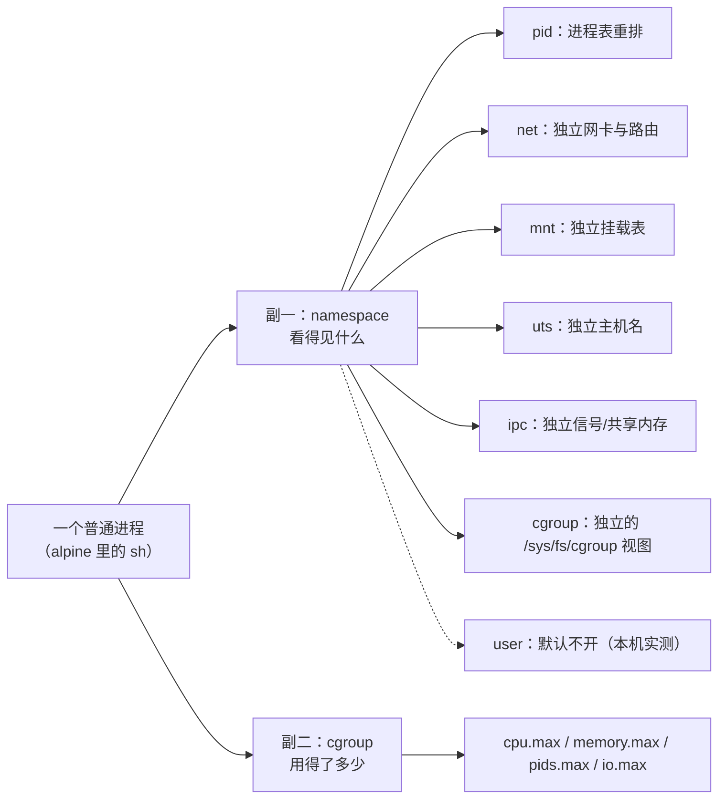
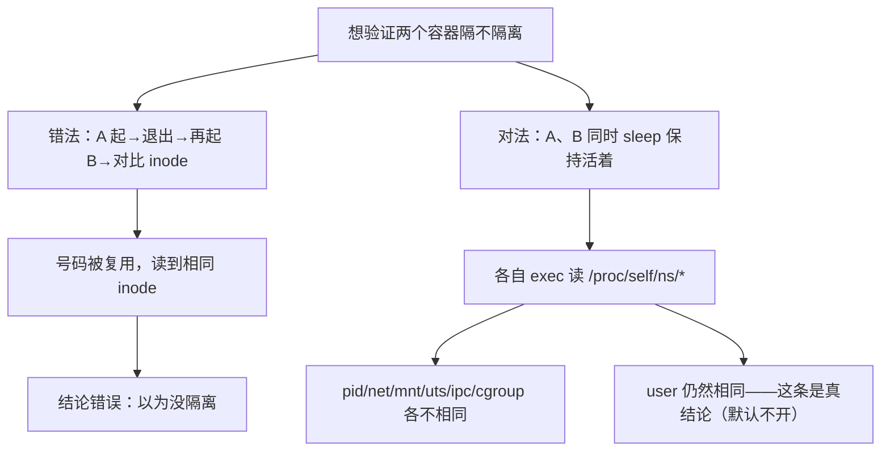

> **实战落点**：这一篇是站⑦所有资源与部署结论的地基。你在 [/docs/06-工程化与生产/运行基线/日志资源限制部署策略与回滚/](/docs/06-工程化与生产/运行基线/日志资源限制部署策略与回滚/) 里看到的「137 不一定是被杀死的、可能是等满宽限期后被 KILL 的」「`--memory` 和 `free` 不是一个口径」，机制都在这里；段②的健康检查与 `--wait`、段⑥的 CI 闸门同样落在这套语义上。
> **本机基线**：Docker Engine `29.8.0`、`CgroupVersion=2`、`CgroupDriver=cgroupfs`、`StorageDriver=overlayfs`、`Docker Root Dir=/var/lib/docker`、默认日志驱动 `json-file`、宿 VM 24 核 / `MemTotal 49292256 kB`。下文每一条读数都带这个基线，换一台机器（尤其换 rootless 或 cgroup v1）要重量。
> **前置依赖**：[/docs/02-核心操作/跑起来/进容器调试与状态查看/](/docs/02-核心操作/跑起来/进容器调试与状态查看/)、[/docs/05-原理深入/隔离与资源/联合文件系统与镜像分层/](/docs/05-原理深入/隔离与资源/联合文件系统与镜像分层/)
> **本篇产出物**：一个能整段拷走的 `unshare` 最小容器脚本（含它的六项 namespace 读数）、七种 namespace 的「一验一对」表、一张 Docker 旗标 → cgroup v2 文件 → 实测值的三列对照表、一份 137/143 成因判别表、一套「验证 namespace 时不要踩的假同坑」。
> **难度·耗时**：★★★ · 50 分钟（含动手：手搓一次迷你容器、量一次 OOM、读一次 throttling）
> **触发条件**：想建立整体心智模型时（建议站④之后）；排查「容器里看到的 CPU / 进程 / 主机名不对」时；cgroup 那一半是**站⑦之前必读、exit code 137 时必读**。
> **拓展接口**：5.4 的 overlayfs 是本篇 `mnt` 隔离的具体形态；5.5 的 veth/bridge 是 `net` 隔离往下的一层；5.8 的无 root 运行把本篇「user namespace：默认不开的那一个」往上抬；6.3 的资源基线与 6.4 的停机语义直接吃「内存：三个口径三个数」与「PID 1 的信号规则」两节的读数；**回指 10-存储专题**：[/docs/10-存储专题/落点与生命周期/容器启动停止与存储的关系/](/docs/10-存储专题/落点与生命周期/容器启动停止与存储的关系/)（10.4）、[/docs/10-存储专题/数据保护/内容损坏与修复/](/docs/10-存储专题/数据保护/内容损坏与修复/)（10.7）、[/docs/10-存储专题/故障手册/存储故障手册一容量与权限/](/docs/10-存储专题/故障手册/存储故障手册一容量与权限/)（10.8）。
> **自测三题**：
> 1. 你先起容器 A 让它跑完退出，再起容器 B，两个容器里 `readlink /proc/self/ns/pid` 一模一样。这能说明「Docker 没隔离 PID」吗？你要怎么改实验才能把它问清楚？
> 2. 一个容器 `docker stop` 要等 5 秒才停，退出码 137。给出两种可能的解释，并说出你用哪条命令在 30 秒内区分它们。
> 3. `docker run -m 64m` 之后，容器里 `free -m` 报 48137 MiB。谁在撒谎？你要看哪三个文件才能知道真实上限与真实用量？

## 为什么要把「容器」拆回一个进程来看

三个现场，都是「把容器当成一台小机器」带来的误判：

```text
「容器里 free -m 显示还有 46 GiB 空闲，我的进程怎么会 OOM？」
「内存上限是 64 MiB，/proc/meminfo 不隔离——free 看到的是那台 VM，不是你这份配额。」

「我 docker stop 了，进程怎么还在？——五秒后它自己就没了啊。」
「你的一号进程没接 SIGTERM。信号发了，内核丢了，直到宽限期结束才补 KILL。」

「我在容器里 ps 一下，怎么只有四个进程？我要看整个宿主怎么办？」
「PID namespace 给你重排了号。要看全部，得 --pid=host，不是 --privileged。」
```

它们有一个共同根源：**容器不是机器，是一个被两副枷锁捆住的进程**。一副是 namespace（决定它「看得见什么」），一副是 cgroup（决定它「用得了多少」）。把这两副枷锁拆开，上面三个问题各自只有一句话的答案；把它们当成黑盒，就会一路靠猜。

💡 新人小结（容器到底是什么）：把容器想成**酒店里的一间房**。房间里的客人（进程）能看到的走廊、电梯、门牌号都被单独布置过——这是 namespace；他能用的水电额度是房卡限定的——这是 cgroup。客人退房（进程退出），房间的布置立刻收回，隔壁房间完全不受影响；而酒店本身（内核）只有一份。所以「容器重启很快」不是因为机器小，是因为根本没有第二台机器。



一句话立论：**容器 = 受约束的进程**。本篇按这个拆法讲：先用三条机械证据把「容器=进程」钉死，再自己动手拼一个最小容器，然后逐个 namespace 给验证实验（含「inode 会复用」那个坑与 user namespace 的默认形态），最后逐个资源限制给落点文件与读数，收尾在「PID 1 的信号规则」。

## 容器就是一个带枷锁的进程：三条机械证据

证据一：**它的进程号在宿主机上真实存在，而且是宿主命名空间里的号**。

```console
docker run -d --name kb14g-victim alpine:3.20 sh -c 'hostname kb14-inside; sleep 400'
docker inspect --format '{{.State.Pid}}' kb14g-victim        REM 77486
docker top kb14g-victim
```

`docker top` 的原文（本机）：

```text
UID  PID    PPID   C  STIME  TTY  TIME  CMD
root 77486  77461  0  ...    ...        sleep 400
```

同一个数字 `77486` 出现在 `docker inspect` 和 `docker top` 两处，父进程是 `77461`（容器运行时的 shim，不是 dockerd 本身）。也就是说：**容器没有自己的进程表实体，它的那个 1 号进程在宿主侧是 77486 号**。

证据二：**它的 cgroup 位置直接写在 `/proc/<pid>/cgroup` 里**：

```text
0::/../6f36540043a8749a63cf99fc017d33cfd6b3bf4e5096057b08cdac31f6f184bd
```

`0::` 是 cgroup v2 的单行格式（只有一个层级），尾巴那串 64 位十六进制就是容器 id。这台机器上的容器不是被某个「容器引擎进程」虚拟出来的，而是挂在 cgroup 树的一个叶子目录下。

证据三：**从外面能用 `nsenter` 走进它的视角，走进去读到的 namespace inode 与它自己读到的一模一样**。

```console
REM 从另一个特权容器里，借 --pid=host 看到 77486，再切进它的各个命名空间
docker run --rm --privileged --pid=host alpine:3.20 nsenter -t 77486 -m -u -p -i -n -- sh -c ^
  'echo hostname=$(hostname) 进程数=$(ps | tail -n +2 | wc -l) 网卡数=$(ip -o link | wc -l)'
```

| 视角 | hostname | 容器内进程数 | 读到的 pid namespace |
|---|---|---|---|
| 从外面 `nsenter` 进 77486 | `6f36540043a8`（容器短 id） | 6 | `pid:[4026533213]` |
| 容器里自己 `readlink /proc/self/ns/pid` | 同上 | 同上 | `pid:[4026533213]` |

两个方向读到**同一个 inode**，说明「隔离」不是虚拟出来的错觉，而是这个进程确实处在一个和宿主不同的编号空间里。顺带一条容易忽略的读数：从外面看它的 `memory.max` 是 `max`——因为这个容器没设上限；cgroup 的账永远诚实，容器的显示层未必。

> [!NOTE]
> `docker top` 只给你看进程，不给你改任何东西；`nsenter` 反过来——它是「把容器当进程操作」的正解，也是排障时最被低估的一条命令。它的代价是需要 `--privileged --pid=host`，这在生产上属于「调试专用通道」，不要留在常驻容器里（见 [/docs/06-工程化与生产/交付链路/CI-CD中的Docker与安全基线/](/docs/06-工程化与生产/交付链路/CI-CD中的Docker与安全基线/) 的最小权限一节）。

## 手搓一个最小容器：一次 unshare 开四个 namespace

5.1 要求的产出物是**一个自己拼出来的最小容器进程**——下面这份脚本就是本轮真跑过的那一个，`sh` 版，任何 Linux（含容器内）都能执行：，`sh` 版，任何 Linux（含容器内）都能执行：

```sh
#!/bin/sh
# 迷你容器里跑的那段：一次 unshare 同时开 mnt/uts/pid/net 之后，这个进程看到的世界
hostname kb14-mini
echo 迷你hostname=$(hostname)
echo 迷你PID1=$(cat /proc/1/comm)
echo 迷你我自己=$$
echo 迷你进程数=$(ps | tail -n +2 | wc -l)
echo 迷你网卡数=$(ip -o link | wc -l)
echo 迷你ipv4条数=$(ip -o -4 addr show 2>/dev/null | wc -l)
mount -t tmpfs tmpfs /tmp && echo 迷你tmpfs挂载源=$(df /tmp | tail -1 | cut -c1-40)
echo 迷你ns:
for k in pid net mnt uts ipc user cgroup; do echo "  $k=$(readlink /proc/self/ns/$k)"; done
```

执行它（在容器里，因为需要特权才能新建 namespace）：

```console
docker run --rm --privileged -v ./m.sh:/m.sh:ro alpine:3.20 sh -c ^
  'echo 外面hostname=$(hostname); unshare -m -u -p -n -f --mount-proc sh /m.sh; echo 回到外面hostname=$(hostname)'
```

本机原文读数（一次跑完，左边是外面，右边是里面）：

| 观测项 | 外面（容器） | 迷你（unshare 之后） | 差在哪 |
|---|---|---|---|
| 主机名 | `86b6dee4374c` | `kb14-mini`，回到外面后恢复 | `uts` 生效 |
| 自己的 pid | 3 左右 | **1** | `pid` 生效，它成了这个空间的 init |
| `/proc/1/comm` | `sh`（宿主那个） | `sh`（迷你自己） | 同一份 `comm`，不同的 1 号 |
| 网卡数 | 2（`lo` + `eth0`） | 1（只剩 `lo`） | `net` 生效 |
| IPv4 地址条数 | 1 | **0** | 新网络空间连地址都没配 |
| `mount -t tmpfs /tmp` | —— | 成功（`tmpfs 24646128 0`） | `mnt` 生效，且这个挂载外面看不见 |
| `pid` inode | `[4026533289]` | `[4026533364]` | 换空间了 |
| `net` inode | `[4026533291]` | `[4026533365]` | 换空间了 |
| `mnt` inode | `[4026533286]` | `[4026533362]` | 换空间了 |
| `uts` inode | `[4026533287]` | `[4026533363]` | 换空间了 |
| `ipc` inode | `[4026533288]` | **`[4026533288]` 未变** | 没要求换 |
| `user` inode | `[4026531837]` | **`[4026531837]` 未变** | 加了 `-U` 才会换（见「user namespace：默认不开的那一个」） |
| `cgroup` inode | `[4026533290]` | **`[4026533290]` 未变** | 没要求换 |

这张表就是「容器 = 进程 + 几副枷锁」的完整证明：**你要求换哪个空间，就只有那个换**。Docker 做的事和这一行 `unshare` 没有本质区别，它只是把七个开关按固定组合拧好，再补上 cgroup、镜像、网络和停机逻辑。

反面样本也要留一条：不加 `--privileged` 直接跑 `unshare`，本机报的是——

```text
unshare: unshare(0x64020000): Operation not permitted
```

`0x64020000` 是内核回吐的 flags 位组合。这个错误的正确读法不是「命令写错了」，而是**新建 namespace 本身就是一种特权**；非特权用户走的是 `-U`（先开 user namespace，再在里面要别的），下面「user namespace：默认不开的那一个」会量到它的边界。

## 七种隔离逐个验：pid / net / mnt / uts / ipc / user / cgroup，每种配一个验证实验

💡 新人小结（namespace 是什么）：namespace 像**给每个人发一副单独编号更衣柜的钥匙圈**。柜子里的东西是同一批（内核对象没复制），但每人的号码牌从 1 开始、看不到别人的号码段。所以「看不见」不等于「不存在」——从外面拿正确的钥匙（`nsenter`）就能开。

本机 `docker info` 给出的安全相关项是 `SecurityOptions=[name=seccomp,profile=builtin name=cgroupns]`，注意 `cgroupns` 是作为一个特性列在里面的——cgroup namespace 是七种里最晚补齐的（内核 4.6），也是最容易被漏验的一个。

| namespace | 隔离的是什么 | 一个能跑的验证 | 本机读数 | Docker 默认开吗 |
|---|---|---|---|---|
| `pid` | 进程编号表与 `/proc` | `readlink /proc/self/ns/pid` 两个**同时活着**的容器对比 | `[4026533061]` vs `[4026533137]` | 开 |
| `net` | 网卡、路由、iptables、端口空间 | `ip -o -4 addr` 对比；或 `--network=container:X` 共享 | 共享后读到 `[4026532759]` 且地址是 `172.18.0.7/16`（被共享者的） | 开 |
| `mnt` | 挂载点表 | `readlink /proc/self/ns/mnt`；`mount -t tmpfs` 后外面看不到 | inode 不同；tmpfs 挂载仅里面可见 | 开 |
| `uts` | 主机名 | `hostname` 默认就是容器短 id；`--hostname` 可改 | `6f36540043a8` | 开 |
| `ipc` | System V 信号量/共享内存、POSIX mq | `readlink /proc/self/ns/ipc` | inode 不同 | 开 |
| `user` | uid/gid、能力、部分 `/proc` 权限 | 两个容器的 inode 是否相同 | **相同：`[4026531837]`，与宿主 VM 的 pid 1 一致** | **不开**（见「user namespace：默认不开的那一个」） |
| `cgroup` | `/sys/fs/cgroup` 的视图根 | `ls /sys/fs/cgroup \| wc -l` 两种模式对比 | private=71 个条目、host=77 个 | 开（本机 `cgroupns` 特性在册） |

### 验证 namespace 的坑：inode 会复用，跑完再比 = 假同

本机第一轮实验踩到的：先起 A、让它跑完退出，再起 B 同样跑完退出，两者 `readlink /proc/self/ns/*` 的**七个 inode 全同**。如果就此下结论「Docker 没做隔离」，就错了——namespace inode 由内核 pseudo-filesystem 分配，前一个被释放后号码会被复用。修正后的做法是**让两个容器同时活着**再横比，于是拿到了上表里不同的 `[4026533061]` / `[4026533137]`。



> [!TIP]
> 同一条纪律适用于一切「用标识符证明隔离」的实验：编号可能回收复用。要么让两个对象同时存在，要么换一个单调递增、不会复用的量（比如容器 id、进程的启动时间戳）。

`--privileged` 不等于「看见宿主进程」，这是很常见的一个想当然：

| 起的姿势 | 读到的 pid namespace | 容器内能看到的进程数 |
|---|---|---|
| 普通 `alpine` | `[4026533061]` | 4 |
| `--privileged` | `[4026533213]`（仍是自己的） | 4 |
| `--pid=host` | `[4026532282]`（宿 VM 的） | 95，且 `/proc/1/cmdline` = `/initd` |

`--privileged` 放开的是能力与设备限制，**不动 namespace 组合**；要改 pid 视图必须显式 `--pid=host` 或 `--pid=container:X`。

### 共享 namespace 的三条通道，各自的成功率不同

| 想要的共享 | 写法 | 本机结果 |
|---|---|---|
| 共享 PID | `--pid=container:harbor-core` | `rc=0`，读到 `[4026532757]`，与 harbor-core 自己的读数一致 |
| 共享网络栈 | `--network=container:harbor-core` | `rc=0`，`net` inode 相同，`ip -o -4 addr` 里出现被共享者的 `172.18.0.7/16` |
| 共享 IPC | `--ipc=container:harbor-core` | **`rc=125`**，原文：`failed to join IPC namespace: container 952d9f…: non-shareable IPC (hint: use IpcMode:shareable for the donor container)` |

第三条那个报错值得记：能不能被共享是**被共享者**的属性，不是你请求的姿势。K8s 里 Pod 内容器共享 IPC 是靠 pause 容器做的供体，正是因为它的 IPC 是 shareable 的。

`busybox` 里没有 `lsns`（本机原文：`busybox 里没有 lsns`）。所以在 alpine 系容器里做 namespace 取证，替代动作是 `readlink /proc/self/ns/<名>` 与 `readlink /proc/<宿主pid>/ns/<名>` 两个方向对读；要 `lsns` 得换 `util-linux` 齐全的镜像或直接在宿主上跑。

## user namespace：默认不开的那一个

本机三个对象读到的 `user` namespace inode 完全一致：

```console
docker exec kb14g-u1 sh -c 'readlink /proc/self/ns/user; id -u'   REM user:[4026531837] 0
docker exec kb14g-u2 sh -c 'readlink /proc/self/ns/user; id -u'   REM user:[4026531837] 0
docker run --rm --privileged alpine:3.20 sh -c 'echo VM的pid1=$(readlink /proc/1/ns/user)'
```

结论：**这台机器上的容器 root 就是宿主 VM 的 root**（uid 0 直接落在 VM 的 user namespace 里）。这也是「容器里 root 能改宿主挂载的文件」这类事故的根本原因——它不是逃逸技巧，是默认形态。

批 21 把这句话钉成了映射表读数（`/proc/self/uid_map` 与 `/proc/self/gid_map` 都是 `0 0 4294967295`，即**没有翻译**；`--userns=host` 可以、`--userns=private` 被 CLI 拒为 `invalid USER mode`；VM 里没有 `/etc/subuid`，所以 remap 与 rootless 连前提都不在）。三行读数、内核侧开关与「无 root 的四格限制」都在 [/docs/05-原理深入/网络与运行时/网络底层跨主机方案与运行时生态/](/docs/05-原理深入/网络与运行时/网络底层跨主机方案与运行时生态/) 的 5.8 两节里，本篇不重复。

那能不能自己开一个？能，但要清楚它给什么、不给什么：

| 动作 | 本机结果 | 说明 |
|---|---|---|
| `unshare -Uf -r sh -c 'id -u'`（特权容器里） | `id=0` | 新 user ns 里你确实是 0 号用户 |
| 紧接着 `hostname kb14-u1` | **`rc=1`，`hostname: sethostname: Operation not permitted`** | 改主机名要的是 **uts** namespace 的权限，不是 user 的 |
| 同一条命令跑三遍 | 三遍都是 `rc=1`、主机名不变 | 稳定复现，不是偶发 |
| 在特权容器里直接 `hostname kb14-plain` | `rc=0`，改名生效 | 它本来就在自己的 uts 里 |

这里要写一条自我更正：更早一轮我用 `echo can_set_hostname=$(hostname kb14x 2>&1; echo $?)` 的形式取数，读到过 `0`——那是**我自己脚本的引号嵌套**造成的错读（命令替换里的退出码被上层 echo 吞掉）。改成上面这种平铺写法后，三遍一致是 `rc=1`。教训不是「结论变了」，而是：**判据脚本里的引号嵌套会让读数说谎，验证类命令要平铺写、别在 `$()` 里再套一层带 `$?` 的引号。**

💡 新人小结（user namespace 到底解决什么）：普通 namespace 管「你看得见谁」，user namespace 管「你在法律上是谁」。开了它，房间里的你说自己是管理员（uid 0），但**酒店前台（宿主内核）知道你真名是 100000**——于是你能在自己房间里改门牌（uts 要单独开），却不能凭这个「管理员」身份去开别人的房间。Docker 默认不开它，rootless 模式和 5.8 的无 root 容器才是走这条路的答案。

## cgroup v2：CPU / 内存 / IO 限制原理落到哪些文件里

cgroup v2 与 v1 的差别，直接决定你排障时该 `cat` 哪个路径。本机容器里的挂载表与控制器：

```console
docker run --rm alpine:3.20 sh -c 'mount | grep cgroup; cat /sys/fs/cgroup/cgroup.controllers; cat /sys/fs/cgroup/cgroup.type'
```

```text
cgroup on /sys/fs/cgroup type cgroup2 (ro,nosuid,nodev,noexec,relatime,nsdelegate)
controllers=cpuset cpu io memory hugetlb pids rdma
cgroup.type=domain
```

三个读数各有含义：挂载是**只读**的（所以容器里 `echo ... > memory.max` 这类操作注定失败，改限额只能从外面 `docker update`，见「运行中改限额与 `/sys` 只读」一节）；控制器里没有 `blkio`（那是 v1 的名字，v2 叫 `io`）；`cgroup.type=domain` 说明它自己下面不能再长出「no-internal-task」型的子域。

Docker 旗标 → cgroup v2 文件的落点，本机逐条实测：

| Docker/compose 写法 | 落在哪个文件 | 实测值 |
|---|---|---|
| `--cpus 0.5` | `cpu.max` | `50000 100000`（配额/周期，微秒） |
| `--cpu-quota 50000` | `cpu.max` | `50000 100000`，与上面等价 |
| `--cpu-shares 256` | `cpu.weight` | `35`（默认 1024 时读到 `100`，**不是线性比例**） |
| `-m`/`--memory 64m` | `memory.max` | `67108864` |
| `-m 64m --memory-swap 64m` | `memory.swap.max` | `0`（等于禁 swap） |
| 只 `-m 64m` | `memory.swap.max` | `67108864`（**还能再换出 64 MiB**） |
| `--memory-reservation 64m` | `memory.low` | `67108864`（`memory.min` 保持 `0`） |
| `--pids-limit 32` | `pids.max` | `32` |
| `--device-write-bps /dev/sdb:1mb` | `io.max` | `8:16 rbps=max wbps=1048576 riops=max wiops=max` |
| `--oom-score-adj 500` | `/proc/self/oom_score_adj` | 生效；但 `--oom-score-adjust` 这个写法在 `run` 和 `update` 上都是 `unknown flag` |

> [!WARNING]
> `--cpu-shares` → `cpu.weight` 的映射在 v2 下是非线性的（256→35，1024→100）。凡是从 v1 时代抄来的「shares 翻倍就是权重翻倍」，在 v2 上要先重算再落文档。

## 内存：容器内存占用怎么看——三个口径三个数，137 从哪来

同一时间、同一个容器（`-m 128m`，进程握着一段 60 MB 的命令替换结果）：

| 你在哪看 | 读到的数 | 它其实是什么 |
|---|---|---|
| `/sys/fs/cgroup/memory.max` | `134217728` | 这份配额的上限（=128 MiB） |
| `/sys/fs/cgroup/memory.current` | `7430144` | **此刻**的占用（7.1 MiB） |
| `/sys/fs/cgroup/memory.peak` | `122191872` | **高水位**（116.5 MiB），逼近上限 |
| `docker stats` | `2.09MiB / 128MiB (1.63%)` | 又一个口径，比 `current` 还小 |
| 容器内 `free -m` 第二行 | `Mem: 48137 1162 46073 …` | 宿主 VM 的内存——**与宿主机 `free` 的口径差异**就在这里 |
| `/proc/meminfo` 的 `MemTotal` | `49292256 kB` | 同上，**/proc 不做内存隔离** |

💡 新人小结（为什么会看到四个数）：房间的电表（`memory.current`）、这个月用过的最大读数（`memory.peak`）、房卡限额（`memory.max`）、酒店总配电（`free`）。你关心「我这个进程会不会被断电」，只有前三个有用；第四个只是酒店规模。

- 定限额要看 `memory.peak`，不是 `memory.current`：本轮 `current` 只剩 7 MiB 而 `peak` 到过 116 MiB——**用量会随回收掉下去，历史峰值不会**。按 `current` 定限额，第一次高峰就会被 OOM。
- `memory.events` 是判据的来源：本机这条容器读到 `low 0 high 0 max 0 oom 0 oom_kill 0 oom_group_kill 0`。`oom_kill` 计数是不是 0，能区分「容器内存涨了」和「容器被杀过」。

真正把上限撞穿时（本机原文）：

```console
docker run -d --name kb14-mem -m 64m alpine:3.20 sh -c ^
  'echo memory.max=$(cat /sys/fs/cgroup/memory.max); x=$(yes | head -c 200000000); echo 拿到 ${#x} 字节'
docker inspect --format 'status={{.State.Status}} exit={{.State.ExitCode}} oomkilled={{.State.OOMKilled}}' kb14-mem
```

```text
status=exited exit=137 oomkilled=true err=""
容器日志只有一行：memory.max=67108864      ← 那句「拿到 … 字节」永远没打印出来
非 0 对照：同一镜像同一 cgroup，只拿 4 MB → rc=0，回显「3999999 字节存活」
```

这就是 137 的**第一种**成因：内核的 OOM Killer 直接选了它，`OOMKilled=true` 是唯一的区分证据。137 的第二种成因（宽限期后被补 KILL）在「PID 1 的信号规则」一节——**两者的处置完全不同**，一个是配额问题，一个是停机协议问题。

## CPU：从 --cpus 到 throttled_usec

同一份 busybox 死循环（1000 万次自增加法），本机三次：

| 限额 | 墙钟 | `cpu.max` | 结论 |
|---|---|---|---|
| 不限 | **16.4 秒** | `max 100000` | 基准线 |
| `--cpus 0.5` | **31.5 秒** | `50000 100000` | 约 2 倍，符合半核 |
| `--cpus 0.25` | **67.1 秒** | `25000 100000` | 约 4 倍 |

被限流的直接证据不是「变慢了」（那可能是噪声），而是 cgroup 里的计数：

```text
不限时：cpu.max = max 100000   nr_periods 0   nr_throttled 0   throttled_usec 0
0.5 跑完一整轮后：nr_periods 336   nr_throttled 335   throttled_usec 16737390
0.5 稳态（docker stats 采样时）：nr_periods 92   nr_throttled 92   throttled_usec 4550841
```

`nr_throttled / nr_periods` 接近 1（本机 335/336、92/92）意味着**每一个调度周期都被掐停过**，这就是 CPU throttling 的形态；`throttled_usec` 给了「总共被掐了多久」——16.7 秒，和墙钟上多出来的那 15.1 秒对得上。

`docker stats` 的百分比也能量：单个死循环 + `--cpus 0.5` → `CPU=50.39%`；两个死循环 + `--cpus 2` → `CPU=200.11%`。**stats 的分母是「核」，不是你的配额**——看到 50% 别以为只用了一半配额。

> [!WARNING]
> `nproc` 在限了 CPU 的容器里仍然报宿主核数：本机 `--cpus 0.5` 下读到 `nproc=24`。任何按 `nproc` 决定线程数的程序（线程池、`make -j`、GC）都会按 24 开，然后一起撞进 0.5 核的配额里被反复限流。Java 侧同理：本机 `-m 512m --cpus 0.5` 时 `-XX:+PrintFlagsFinal` 读到 `ActiveProcessorCount = -1`（未设置，由 JVM 自己按可见 CPU 推），而同一个 `-m 512m` 下默认堆被推到 `MaxHeapSize = 134217728`（=512 MiB 的 25%），说明**内存这一侧它是认配额的，CPU 那一侧不认**。

## IO 与 pids：这台机器上量不出的效果，多半是量法错了

IO 这条是本轮最需要「如实写」的，也是**这一篇里唯一被后续批次改过结论的实测**（批 14 的读数没记错，错在量法；更正见本节末尾那条 DANGER。同族的第一次更正是批 16 改掉「Go 二进制没装 `signal.Notify` 就当一号进程收不到 SIGTERM」那句外推）。策略**确实写进了 cgroup**：

```console
docker run --rm --device-write-bps /dev/sdb:1mb alpine:3.20 cat /sys/fs/cgroup/io.max
```

| 限制打在哪块盘 | `io.max` 里登记的条目 | 写 24 MiB 的墙钟 |
|---|---|---|
| `/dev/sda` | `8:0 … wbps=1048576 …` | 0.4 秒 |
| `/dev/sdb` | `8:16 … wbps=1048576 …` | 0.4 秒 |
| `/dev/sdc` | `8:32 … wbps=1048576 …` | 0.5 秒 |
| `/dev/sdd` | `8:48 … wbps=1048576 …` | 0.5 秒 |
| 不限（对照） | 空 | 0.4 秒 |

**登记了四条不同设备的限额，写入耗时和不限完全一样。** 三条旁证当时解释了「为什么看着不咬」：容器里的 `/dev` 只有 `core fd full mqueue null ptmx pts random shm stderr stdin stdout tty urandom zero`——**一个块设备节点都没有**，`--device-read-bps /dev/vda:1mb` 和 `/dev/sda1` 都直接报 `stat …: no such file or directory`；VM 侧倒是有 `sda 740272 / sdb 99300 / sdc 12582916 / sdd 1073741824`（1K 块）这些盘；而容器根是 overlay，`/proc/self/mountinfo` 第一行显示它的 lowerdir/upperdir 全在 `/var/lib/desktop-containerd/…` 之下。当时由此写的结论是「`io.max` 是一条写了但不作用于容器写入路径的策略」——**这条结论在批 19 被推翻了，上面那张表的读法要按下面三段改**。

> [!DANGER] 更正（2026-10-28，批 19 的区分性实验）
> **`io.max` 在这台机器上是咬的**。同一个脚本、同一台机器、同一块盘（`8:48` = `sdd`）、同一个限额（`1mb`），只差一个 `conv=fsync`：
> ```console
> 写 24 MiB 不带 fsync      -> 厘秒=1        ← 写完就返回，量到的是页缓存
> 写 24 MiB 带 conv=fsync   -> 厘秒=2402     ← 24 MiB ÷ 1 MB/s = 24 秒，对上了
> 不带限额的对照            -> 2 / 2 / 2 厘秒（带不带 fsync 都一样快）
> ```
> 上一轮那四个「0.4~0.5 秒」所以不成立，是三层条件同时被踩了：**(1) 计时不等落盘**（主因，见上）、**(2) 四块盘里只有 `sdd` 真在承接写入**（打在 `8:16` 上等于没打），**(3) 语法必须是 `设备路径:速率` 一个参数**（拆成两个参数当场 `rc=125 bad format: /dev/sdd`，`8:48:1mb` 也拒）。而 `io.stat` 早就把答案写在那里了——写 128 MB 之后 `8:48 rbytes=0 wbytes=134217728 rios=0 wios=33`，`8:64` 那行只有 `wios=1 wbytes=0`。
> **改掉的措辞**：不是「这台机器上 IO 限额不作用于容器写入路径」，而是「**限额作用于派发到底层设备的写；量它必须等落盘，并且设备要按 `io.stat` 认，不能按 `ls /dev` 认**」。容器 `/dev` 里没有块设备节点不影响登记，因为路径是 daemon 在 VM 侧解析的。完整读数与三条决策表在 [/docs/07-运维手册/按故障域排错/Windows与WSL2性能排查应急runbook与复盘/](/docs/07-运维手册/按故障域排错/Windows与WSL2性能排查应急runbook与复盘/)。

`--blkio-weight` 那条不受本次更正影响，仍然起不来（`io.weight: no such file or directory` = 当前 IO 调度器不提供 BFQ 权重通道）。仍然要在别的环境重测的，是「权重类」而不是「上限类」的 IO 限制。

pids 这一侧行为正常，但有个容易写错的点。`--pids-limit` 计的是**这个 cgroup 里同时存在的任务数**，`sh` 跑内建命令不额外占额度：

| 场景 | 本机结果 |
|---|---|
| `--pids-limit 1/2/3/8` 里跑 `sh -c 'echo ok'` | 四个都 `rc=0`（内建命令，不 fork） |
| `--pids-limit 40`，起 25 个 `sleep 120 &` | 全部起来，`docker stats` 报 `PIDs=26`，`pids.max=40` |
| `--pids-limit 120`，起 100 个 | 全起完，`pids.current=101` |
| `--pids-limit 32`（后调 40），硬起 200/300 个 | **`rc=2`**，`docker logs` 空，stderr：`sh: can't fork: Resource temporarily unavailable` |

最后一条就是 fork 炸弹被拦住的形态。它同时暴露一个取证陷阱：**脚本被 fork 失败打断后，后面的统计行根本不执行**——所以「拦住多少个」不能用自杀式脚本量，要读 `pids.max` / `pids.current`（或 `docker stats` 的 PIDs 列）这类外部账本。

## PID 1 的信号规则：为什么你的容器要等满宽限期

5.3 明写「exit code 137 时必读」。本机把信号能不能落到一号进程上量成了一张矩阵：

| 一号进程是谁 | 发什么 | 容器反应（逐秒采样） | 最终退出码 |
|---|---|---|---|
| `sleep 300`（无 handler） | `docker kill -s TERM` | **1~6 秒全是 running** | 仍在跑，补 KILL 才停 |
| `sleep 300`（无 handler） | `docker kill -s HUP` | 同上，6 秒无反应 | 仍在跑 |
| `sh` 且只 `trap … INT` | `docker kill -s TERM` | 仍然 running（处理器不是给 TERM 的） | 仍在跑 |
| `sh` 且 `trap … TERM; exit 7` | `docker kill -s TERM` | 1 秒内 exited | **7**（自己定的），日志有 `TERM跑了` |
| `docker-init`（`--init`） | `docker kill -s TERM` | 1 秒内 exited | **143** |
| `sleep 300` | `docker kill -s KILL` | 1 秒内 exited | **137** |

机制读法：**PID namespace 的 init 进程，收不到它没有处理器的终止信号**。这条规则有两个反直觉的推论，本机都验到了：

```console
docker run -d --name kb14c-selfkill alpine:3.20 sh -c 'kill -9 $$; echo 我还活着 pid=$$; sleep 3'
docker logs kb14c-selfkill      REM 我还活着 pid=1  ← 自我 SIGKILL 被丢掉了
```

```console
docker run -d --name kb14c-child alpine:3.20 sh -c 'sleep 60 & k=$!; kill -9 $k; wait $k; echo 子进程wait回rc=$?'
docker logs kb14c-child         REM 子进程wait回rc=137  （容器自己 exit=0）
```

也就是说：**137 出现在子进程身上时，容器整体退出码可以仍是 0**；而 1 号进程被 KILL 才会把容器推到 137。反过来推：看到 137，先问「死的是不是一号进程」。

于是 `docker stop` 的真实节奏是这样（同一个 `alpine sh -c 'sleep 600'` 容器，PID1 不接 TERM）：

| 停机命令 | 我这边墙钟 | daemon 侧 running→exit | 退出码 |
|---|---|---|---|
| `docker stop`（不写 `-t`） | 3.3 秒 | 5.0 秒 | 137 |
| `docker stop -t 1` | 1.2 秒 | 3.0 秒 | 137 |
| `docker stop -t 20` | 20.3 秒 | 22.0 秒 | 137 |
| `docker stop`（PID1 `trap TERM … exit 0`） | 0.3 秒 | —— | **0** |

三行 137 说明这台机器上的容器**没有一行是靠 SIGTERM 停下来的**：都是等满宽限期后被补 KILL。`-t 20` 那行的 22.0 秒减去 20 秒得到约 2 秒的固定开销，而默认那行 5.0 秒意味着**本机 `docker stop` 的默认宽限期表现为约 3 秒**，与 Docker 文档里那句「默认 10 秒」不一致。当时试图读 dockerd 的启动参数来定位差在哪，但 `wsl -d docker-desktop -- pidof dockerd` 返回空、`/etc/docker/daemon.json` 在那个 namespace 里不存在（dockerd 不在默认挂载视图内），**所以本库当时把它记成"读数可复现、原因未证实"**。

> [!NOTE] 更正（2026-10-28，批 21）
> 原因已经找到，而且当时那句「读不到」是**站错命名空间**造成的：引擎是容器化部署，它的配置文件在引擎自己的 mount namespace 里，路径不是 `/etc/docker/daemon.json` 而是 `/run/config/docker/daemon.json`。借一只 `--privileged --pid=host` 的容器读 `/proc/1/root/run/config/docker/daemon.json`，本机那份里写着 **`"default-stop-timeout": 3`** ——与量到的 3.2~3.5 秒对上，不是异常也不是隐藏默认值。全文与逐键解读、以及 `pidof dockerd` 为什么在两个 pid namespace 里给出不同数字（127 与 167），都在 [/docs/05-原理深入/网络与运行时/网络底层跨主机方案与运行时生态/](/docs/05-原理深入/网络与运行时/网络底层跨主机方案与运行时生态/) 的 5.7 与「顺手结清一条旧账」两节。

💡 新人小结（为什么容器「叫不动就打死」）：你按门铃（SIGTERM），屋里没人应——因为屋里那个人（一号进程）根本没装门铃线；酒店不能一直站着等，于是到点直接砸门（SIGKILL）。**加一根门铃线（`--init`，或自己在脚本里 `trap` 并转发）** 是唯一让「优雅停机」成立的办法。段②那套 compose 健康检查之所以能干净重启，是因为镜像里的程序自己处理了 TERM。

> **更正（段⑦ 复测，2026-10-28）**：上面那句「没装门铃线」是本篇的适用范围，但当时我把它当成所有程序的性质写了。段⑦ 拿六个格子重量，性质属于**程序**而不是内核给的口子——判据直接读 `/proc/1/status` 的 `SigCgt` 位图（TERM 是第 15 位 → `0x4000`）：
>
> | 一号进程 | `init` | `SigCgt` 里有 TERM 位吗 | 只发 SIGTERM 的结果 |
> |---|---|---|---|
> | busybox `sleep 600` | 无 | 没有（整串 `SigCgt:0000000000000000`） | 8 秒不退出，`stop -t 8` 到点补 KILL → **137** |
> | busybox `sh -c 'while :; do sleep 10; done'` | 无 | 没有（`SigCgt:0000000000010002`，只有 INT 与 CHLD） | 同上 → **137** |
> | 链上的 Go 二进制 `api`（没写 `signal.Notify`） | 无 | **有**（`SigCgt:fffffffd7fc1feff`） | **0.26 秒退出 143** |
> | 上面三种程序 | `init: true` | 一号进程换成 `docker-init` | 0.22~0.27 秒退出 143 |
>
> 所以规则是：**内核只豁免「没装 handler 且默认处置是终止」的信号对一号进程的作用**（任意 PID namespace 的 1 号都算，不只是宿主机 1 号）。busybox 的 `sleep`/`ash` 一个 handler 都不装，于是 TERM 被丢；Go 运行时几乎给所有信号都装了 handler，TERM 被接住后按约定自杀——**能 143 退出，不等于优雅关闭**（它没 drain 在途请求）。这条区分对本篇的用法只改一处判读：看到 143 别直接写「已优雅停机」，要看有没有请求半途断；`init: true` 的价值也从「救 TERM」挪到「回收僵尸 + 让脚本类镜像也接得住信号」。全表读数与命令在 `示例/贯穿示例/段7-生产形态与回滚/README.md`。

三条能直接用的修法：

| 情况 | 修法 | 代价（本机实测） |
|---|---|---|
| 镜像里是 shell 脚本 | `docker run --init` / compose `init: true` | 一号进程变成 `docker-init`（本机 `cat /proc/1/comm` = `docker-init`，脚本自己变成 7 号），TERM → 143，1 秒内退出 |
| 想快速停机而不是优雅 | `docker stop -t 2` | 本机 2.3~3.0 秒；被强杀的进程没有清理机会 |
| 常驻服务 | 让程序自己 `trap` 并 flush 后再退 | 本机 `trap … exit 7` 0.7 秒退出、退出码可控 |

## 运行中改限额与 `/sys` 只读

容器里 `/sys/fs/cgroup` 是 `ro` 挂载，改限额只能从外面：

```console
docker update --cpus 0.25 -m 64m --memory-swap 96m kb14h-upd
```

| 阶段 | `cpu.max` | `memory.max` | `memory.swap.max` |
|---|---|---|---|
| 起时（`--cpus 1 -m 256m`） | `100000 100000` | `268435456` | `268435456` |
| `docker update` 后 | `25000 100000` | `67108864` | `33554432` |

`--memory-swap 96m` 是**总额**（内存+交换），所以 `memory.max` 64 MiB 之后交换只剩 32 MiB = 33554432 字节，读数与算术自证一致。

两个失败样本同样留档：

```text
docker update --oom-score-adjust 500 kb14h-upd
  → rc=125  unknown flag: --oom-score-adjust            （正确写法是 --oom-score-adj，见上表）
docker update --cpus abc kb14h-upd
  → rc=125  invalid argument "abc" for "--cpus" flag: failed to parse abc as a rational number
```

> [!NOTE]
> 把限额改动留在 `docker update` 上是危险的：它不进 compose 文件、不进编排声明，容器一旦重建就回到文件里的值。运行中改只用于「先止血，再改声明」。

## 这些结论在 Docker Desktop 上的边界

本篇所有读数来自 Windows + Docker Desktop 的那台 Linux VM，至少四条不能原样搬到物理 Linux：

| 结论 | 换环境要重量的原因 |
|---|---|
| IO 限速只有「等落盘」才量得出（批 19 更正过这条） | 换环境要重量三件事：I/O 调度器提不提供权重通道（`io.weight` 在不在）、容器写入实际落到哪个 `major:minor`（直挂/直通时这台 VM 的 `8:48` 不复存在）、以及 `io.stat` 里有没有对应记账行 |
| 内存/CPU 的「宿主值」是 VM 的 | 物理机上 `/proc/meminfo`、`nproc` 就是真实宿主，泄漏面更大 |
| `docker stop` 默认宽限表现为约 3 秒 | 批 19 把「是不是宽限」钉死了（`-t 1/5/30` → 1.28/5.26/30.26 秒，不给 `-t` → 3.2~3.5 秒，固定开销约 0.25 秒），但**这个 3 从哪个配置来仍读不到**：`Config.StopTimeout` 为 `<nil>`，VM 里遍历 `/proc` 找不到 dockerd 的命令行，`%APPDATA%\Docker\settings.json` 不存在、`settings-store.json` 里没有相关键。物理部署要自己按同样方法量一遍 |
| user namespace 默认不开 | rootless、K8s 的 `hostUsers: false`、`--security-opt no-new-privileges` 组合都会改变这一形态 |
| cgroup 路径带 `docker/` 前缀 | Kubernetes 用 cgroupfs/systemd 驱动时前缀不同，脚本里写死路径会失效 |

## 本篇不覆盖什么

按 W6 的规矩，本篇**故意不讲**的东西逐条点名去处——写「不覆盖」不是免责声明，是防止你在这一篇里找不存在的答案：

- 镜像层的文件系统实现（overlayfs、白名单条）→ 见 **5.4**（`GraphDriver` 在本机给 null 那格在那一篇）
- 网络底层：桥、veth 与包怎么进出 → 见 **5.5**（`veth` 的配对判据在那一篇）
- 无 root 容器的映射原理与本机能不能用 → 见 **5.8**（`uid_map` 与 `/etc/subuid` 缺席那两格在那一篇）
- 生产上资源限制该怎么写、和谁冲突 → 见 **6.3**（`资源限制` 的三种写法与拒写规则在那一篇）
- IO 高与内存持续上涨的排查路径 → 见 **7.8**（`io.stat` 记的是真账那节在那一篇）

## 未验证项（这一篇没做的，别当已知）

| 项 | 状态 | 原因 |
|---|---|---|
| IO 限制在物理 Linux + BFQ 下是否生效 | 未验证 | 本机是 Docker Desktop；已证伪的只有「这台不行」 |
| `docker stop` 默认宽限期为什么是约 3 秒 | **本机读不到** | `pidof dockerd` 在 wsl 默认 namespace 里为空，`/etc/docker/daemon.json` 在该视图不存在 |
| `unshare -u`（单独新 uts）能否改主机名 | 读数不自洽 | 同一条命令里 `带uts_rc=0` 但主机名没变，怀疑是我脚本的引号嵌套，未按「user namespace」那节的平铺写法重跑 |
| `docker stats` 与 `memory.current` 的口径差 | 未拆 | 本轮只记录了两个数（2.09 MiB vs 7.43 MiB），没逐字段对齐 |
| rootless 模式下 user namespace 的形态 | 未验证 | 本机是 rootful VM |
| cgroup v1 环境下的文件路径与 `--cpu-shares` 映射 | 未验证 | 本机只有 v2 |
| K8s 的 `resources.requests` → `memory.min`/`cpu.weight` 的确切映射 | 未做 | 属站⑦之后的内容 |

## 要点总结

- 容器 = 一个进程 + 两副枷锁：namespace 决定看得见什么，cgroup 决定用得了多少。三条机械证据（`inspect .State.Pid` / `/proc/<pid>/cgroup` / `nsenter` 双向 inode 相同）在任何一台 Linux 上都能复现，「手搓迷你容器」就是一行 `unshare -m -u -p -n -f --mount-proc`。
- 验证隔离的实验纪律：**两个对象必须同时存在**。namespace inode 会回收复用，跑完再比会得到七个 inode 全同的假结论——本机真的踩过一次。
- 七种里 Docker 默认开六个，`user` 不开：三个不同对象的 `user` inode 与宿主 VM 的 pid 1 相同（本机 `[4026531837]`）。在 user ns 里 `id -u` 是 0，但改主机名仍需 uts（三遍一致 `rc=1`）。
- 限额的真实落点是 cgroup v2 的四个文件：`cpu.max`、`memory.max`/`memory.swap.max`/`memory.low`、`pids.max`、`io.max`。`--cpu-shares 256 → cpu.weight 35` 说明 v1 时代的线性直觉在 v2 失效。
- 内存四个数不矛盾：`memory.max` 是配额，`current` 是此刻，`peak` 是高水位（定限额看它），`free`/`nproc` 是宿主的、不隔离。撞穿配额的样子是 `exit=137` + `OOMKilled=true`，配一条「只拿 4 MB 能活」的非 0 对照。
- CPU 被限流要证 `nr_throttled/nr_periods`（本机 335/336）和 `throttled_usec`（16.7 秒 ≈ 墙钟多出的 15.1 秒），不是靠「感觉慢了」；`docker stats` 的百分比分母是核不是配额。
- IO 限制在本机**是生效的，但只有等落盘才量得出**：同一块盘同一个限额，`dd` 不带 fsync 是 1 厘秒、带 `conv=fsync` 是 2402 厘秒（24 MiB ÷ 1 MB/s）；语法必须是 `设备:速率` 一个参数，设备要按 `io.stat` 认而不是按 `ls /dev` 认（容器 `/dev` 里没有块设备节点，`--blkio-weight` 仍因 `io.weight` 文件不存在而起不来）。pids 限制正常，但被拦的脚本会以 `rc=2` 中断，统计要读外部账本（`pids.max`/`pids.current`/`docker stats`）。
- 137 有两种：`OOMKilled=true` 是被内核杀，`OOMKilled=false` + 等满宽限期是被补 KILL。根因是 **PID namespace 的 init 收不到没处理器的终止信号**——自我 `kill -9 $$` 会被丢（日志里那句「我还活着 pid=1」），`docker stop` 会白等。修法是 `--init`（一号进程变 `docker-init`，TERM → 143，1 秒内退）或让程序自己 `trap`。**「没处理器」是程序属性**：`/proc/1/status` 的 `SigCgt` 位图里有没有 TERM 位才算数，Go 运行时装了 handler，所以不加 `--init` 也会 143（段⑦ 的六格矩阵）。
