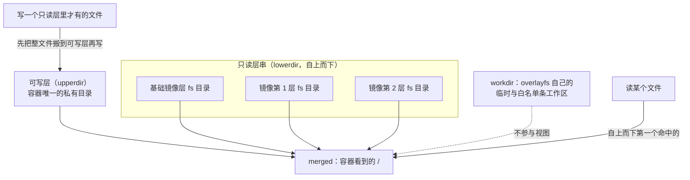

> **实战落点**：示例链段④的原理侧。3.5~3.8 那张「前后对照表」里有两列（体积、命中层数）在构建侧，但它们的**所以然**都在这一篇：层就是联合挂载里的一个只读目录，命中就是复用同一个目录，删文件不省空间是因为上面盖了一张白名单条。
> **示例版本**：本篇不新增链上文件。观测对象是链上 `示例/贯穿示例/api-service/` 的 `Dockerfile.v1` 与 `Dockerfile.v2` 产出的镜像，外加一个专门造出来做分层实验的四层样本镜像（`alpine:3.20` + 三条 `RUN`）。
> **前置依赖**：[/docs/03-镜像构建/养小养快/分层缓存多阶段构建与镜像瘦身/](/docs/03-镜像构建/养小养快/分层缓存多阶段构建与镜像瘦身/)、[/docs/02-核心操作/跑起来/镜像管理与容器生命周期/](/docs/02-核心操作/跑起来/镜像管理与容器生命周期/)、[/docs/05-原理深入/隔离与资源/容器本质Namespace与Cgroups/](/docs/05-原理深入/隔离与资源/容器本质Namespace与Cgroups/)
> **本篇产出物**：一张「容器里看到的东西 ↔ overlay 四个目录」逐项对照表；三个 Copy-up 计时读数并带上它们的分辨率限制；`whiteout`、目录不透明、跨层硬链接三个现场的可复现命令；containerd 镜像存储下 `GraphDriver` 取不到值时的三条替代取证路径
> **难度·耗时**：★★★ · 45 分钟（含动手）
> **拓展接口**：5.1/5.2/5.3（ Namespace 与 Cgroups）在本篇之后；7.3「磁盘占满与镜像拉取失败」的 `docker system df` 口径、以及 3.8 的镜像瘦身账，都直接引用本篇的层模型；2.1 里「删容器不删卷」的边界在本篇得到机制解释；**回指 10-存储专题**：[/docs/10-存储专题/基础/存储是什么与为什么会出现/](/docs/10-存储专题/基础/存储是什么与为什么会出现/)（10.1）、[/docs/10-存储专题/基础/五种存储形式的原理与取舍/](/docs/10-存储专题/基础/五种存储形式的原理与取舍/)（10.2）、[/docs/10-存储专题/落点与生命周期/存储形式在操作系统上的落点与验证/](/docs/10-存储专题/落点与生命周期/存储形式在操作系统上的落点与验证/)（10.3）。
> **自测三题**：
> 1. 同一个镜像起 50 个容器，磁盘上是 50 份文件系统还是 1 份？哪一条命令能证给你自己看？
> 2. 容器里 `rm` 掉一个 20 MB 的底层文件，宿主磁盘会掉 20 MB 吗？`docker diff` 会显示什么？
> 3. 为什么 `RUN echo pre-v2` 和 `RUN echo pre-v1` 两次构建之后，镜像层列表里会出现一个**一模一样**的层摘要？

## 为什么要先弄懂「一个容器由好几个只读目录拼出来」

三个现场，都属于「现象对不上直觉」：

```text
「我把镜像里那个 20 MB 的临时文件删了呀，重 build 之后镜像怎么还是大 20 MB？」
「你删它的那条 RUN 是单独一层。上一层把文件写进来，下一层把它标成不见——
 两层的字节都还在。」
「那我 `rm` 掉一个正在跑的容器里的日志文件，宿主的磁盘也没小啊。」
「同一个道理。可写层里那张『这条没了』的标记本身也要占地方，
 而且原来那份还在只读层里躺着。」
「行。那为什么同一台机器上 50 个容器只占 50 份小空间，不是 50 份完整系统？」
「因为那 50 个容器共用同一串只读目录，各自只多一个可写目录。」
```

这三段话的共同点是：**容器的根文件系统不是一个目录，是一次挂载**。看懂这一次挂载（谁是底、谁是面、写落在哪儿），上面三个「怎么都不对」会一次性解开；看不懂，就会把「镜像越建越大」「删文件不释放磁盘」「容器写第一下特别慢」当成三个互不相干的玄学问题。

所以本篇的顺序是：先把挂载行本身摊开（`lowerdir` / `upperdir` / `workdir` / `merged`），再看读与写各自走哪条路（写时复制的三个计时），然后处理三种「看不见但存在」的东西（遮蔽、`whiteout`、目录不透明），最后落到这台机器上一个很现实的问题：`docker inspect` 的 `GraphDriver` 已经是 `null` 了，那分层还能不能实地观察。



> 💡 新人小结：**镜像是一摞只读目录，容器是「这摞目录 + 你自己的一个可写目录」**。你在容器里看到的一切，是从上往下第一个出现的版本；你写下去的一切，都落在最上面那个可写目录里，底层的原件一个字节都没动。类比之后接机制：这不是 Docker 的约定，是内核里 `overlayfs` 这个文件系统的行为，所以它跟语言、跟镜像内容无关，`alpine` 与 `mysql` 一个规律。

## overlay 的四个名字：先看本机真实的挂载行

把样本镜像（`alpine:3.20` 底 + 三条 `RUN`）起成容器，在容器里看自己根目录那次挂载：

```console
/# grep -m1 -- '- overlay' /proc/self/mountinfo
467 347 0:89 / / rw,relatime - overlay overlay rw,
  lowerdir=/var/lib/desktop-containerd/daemon/io.containerd.snapshotter.v1.overlayfs/snapshots/1479/fs
          :.../snapshots/1478/fs:.../snapshots/1477/fs:.../snapshots/159/fs,
  upperdir=/var/lib/desktop-containerd/daemon/io.containerd.snapshotter.v1.overlayfs/snapshots/14xx/fs,
  workdir=.../snapshots/14xx/work
```

| 名字 | 本机值的样子 | 它装什么 | 谁能动它 |
|---|---|---|---|
| `lowerdir` | 冒号分隔的 4 个 `.../snapshots/<编号>/fs` | 镜像的每一层，外加基础快照；**越靠左越靠近视野顶部** | 只读。任何一次构建都不改老层，只加新层 |
| `upperdir` | 另一个 `snapshots/<编号>/fs` | 这个容器的可写层：新文件、改过的文件副本、删除标记 | 只有这个容器 |
| `workdir` | 同编号下的 `work` | overlayfs 的内部工作区（复制中途、白名单条的暂存） | 内核用，人别碰 |
| `merged` | 容器的 `/` | 上面三者合成出来的视图，也就是进程看到的世界 | 由内核维护 |

同一容器里的另外两条读数，用来确认「这不是我在脑补」：

```console
/# grep -c overlay /proc/mounts
1
/# df -h / | tail -1
overlay                1006.9G      3.9G    951.8G   0% /
```

`df` 那一行有两个信息量很大的细节：**文件系统类型显示 `overlay`**（不是 `ext4`/`xfs`，所以容量数字是整个 VM 数据盘的，不是这个容器的配额），以及**使用率 `0%`**——这一层的占用完全看不出这个容器写了多少；要看写入量得换 `docker ps -s`（本篇后面那条）。

> 💡 新人小结：把 `merged` 想成**前台展示柜**，`lowerdir` 是一排上锁的仓库（多个，越新的仓库摆得越高），`upperdir` 是你手边唯一能写字的桌面。顾客（进程）只看展示柜；要改一件仓库里的东西，得先把那件东西复印到桌面上再改——展示柜里于是显示你的复印件，仓库原件还留在原处。

## 读与写走的是两条路：三个计时读数

为了把「写第一下慢」量出来而不是讲出来，我在实验目录里造了一个样本镜像：一条 `RUN` 生成 `/low/f1 … /low/f200` 共 200 个小文件，另一条 `RUN` 建 `/low2/{a,b,c}`。起容器后做三轮，每轮 200 次操作，用 `/proc/uptime` 取时间（busybox 的 `date` 不认 `%N`，这是本机唯一有百分之一秒分辨率的可用时钟）：

| 轮次 | 操作形状 | 200 次总用时 | 折算单次 | 走的是哪条路 |
|---|---|---|---|---|
| R1 | 对 200 个**只读层里才有**的文件各追加一次 | `0.32` 秒 | 约 `1.6` 毫秒 | 每次都触发 Copy-up：先把整文件复制进可写层再写 |
| R2 | 再对这 200 个文件各追加一次（此时全在可写层） | `0.00` 秒 | 低于分辨率 | 直接写可写层，没有复制那一跳 |
| R3 | 对这 200 个文件各 `cat` 一次（只读） | `0.11` 秒 | 约 `0.55` 毫秒 | 读穿透到只读层，不产生副本 |

三条读数要连同它们的**口径限制**一起读，否则会用错：

- 分辨率是 `0.01` 秒，单条操作量不出来，所以每轮跑 200 次把差值放大到可测区间。R2 的 `0.00` 只能读成「小于 0.01 秒」，不能读成「零成本」。
- R1 与 R2 同形状（都是 shell 内建的重定向追加，不 fork 进程），这一对比才是干净的 Copy-up 增量：**同一批文件，第一次写比第二次写贵**。
- R3 掺了 200 次 fork `cat` 的开销，形状与 R1/R2 不同，**不能拿来算「读一个底层文件的成本」**；它只能支撑一个弱结论：读路径没有那一跳复制，所以总用时（`0.11` 秒）明显低于首次写（`0.32` 秒）。
- 文件都很小（5 字节的 `base`）。Copy-up 的成本与文件大小成正比，所以这条路线在「大文件首次写」上只会更贵，不会更便宜。这一点本篇没有量，标在未验证项里。

```bash
# 本机跑这三条读数用的脚本形状（容器内执行，可原样复现）
t(){ cut -d' ' -f1 /proc/uptime; }
a=$(t); i=1; while [ $i -le 200 ]; do echo x >> /low/f$i; i=$((i+1)); done; b=$(t)
c=$(t); i=1; while [ $i -le 200 ]; do echo x >> /low/f$i; i=$((i+1)); done; d=$(t)
echo "首次=$(echo $b $a | awk '{printf \"%.2f\", $1-$2}')s 再次=$(echo $d $c | awk '{printf \"%.2f\", $1-$2}')s"
```

> 💡 新人小结：**容器里「新建一个文件」几乎不要钱，「修改一个只读层里就有的文件」要付一次整文件复制的钱**。落到日常判断上有两条实用推论：应用别把日志/缓存写在镜像自带的目录树里（那里全是只读层），要写到挂载卷或专门的空目录；`--storage-opt size` 这类「给可写层设配额」的开关管的是写入**量**，管不到这一跳复制的**次数**。

## 遮蔽、删除与目录不透明：三种「看不见但存在」

**遮蔽（mask）**：上层出现同名文件，下层那份就再也看不见，但字节还在下层。

```console
/# echo overlay-wins > /low2/a && cat /low2/a
overlay-wins
```

**删除只读层里的文件 = 放一条白名单条（whiteout）**。`rm` 之后文件系统里那条记录长什么样，取决于能不能进到宿主目录（下一篇再讲怎么进），但 `docker diff` 这台机器上直接给得出结果：

```console
># docker diff kbkc
C /low2
A /low2/new
D /low2/a
D /low2/b
D /low2/c
C /low
C /low/f118
...
```

`D` 就是「这个路径在下面某层，被本容器删掉了」；`A` 是新增；`C` 是内容或元数据变了（上面那一串 `C /low/f118` 全是 R1 轮里被 Copy-up 过的文件）。

**目录级删除不是逐条白名单条，而是把整个目录标成不透明（opaque）**。本机现场：

```console
/# ls /low2 | tr '\n' ','      # 动手之前
a,b,c,
/# rm -rf /low2 && mkdir /low2 && echo new > /low2/new
/# ls /low2 | tr '\n' ','      # 删空同名目录再重建
new,
```

`a`、`b`、`c` 三个文件在只读层里一个都没少，但容器视图里已经看不到了——因为重建出来的 `/low2` 被打了不透明标记，overlay 在这个目录下**不再往下找**。

这三个机制合起来解释两个日常困惑：

| 困惑 | 机制 | 现场证据 |
|---|---|---|
| 「容器里删了大文件，宿主磁盘没小」 | 删除只在可写层放标记；原件仍在只读层的 `fs` 目录里 | `df -h /` 使用率不变；`docker ps -s` 可写层反而涨了 |
| 「镜像里 `RUN rm` 了临时文件，镜像还是大」 | 删它的那条 `RUN` 自己是一层，它上一层已经把字节写进来了 | 3.5 那篇的 A/B：两条 `RUN` 建后删 = `33,103,030` 字节，同一条 `RUN` 内建后删 = `12,106,519` 字节 |

> 💡 新人小结：**在容器文件系统里，「没有」是一种要占地方的状态**。删除不是抹掉，而是盖一张「这里当它不存在」的条子；条子在可写层，原件在只读层，谁都没走。想让字节真的走，只有两条路：构建时把「生成」和「清掉」放进同一条 `RUN`（那一层里从来没出现过它），或者运行期把数据放在卷里、随卷一起删。

## 跨层硬链接：两个 inode、两份内容

样本镜像里故意做了件事：第一条 `RUN` 生成 `/low/f1`，第三条 `RUN` 执行 `ln /low/f1 /low/dup`——同一个目录里的两个名字，跨了两层。

```console
/# ls -i /low/f1 /low/dup
54113 /low/f1
54335 /low/dup
/# echo x >> /low/f1; wc -c < /low/f1; wc -c < /low/dup
9
5
```

如果它们真是同一个 inode，`f1` 被追加后 `dup` 也应该读到 9 字节。本机读到的是 **9 与 5**，inode 号也早就不同（`54113` 与 `54335`）。也就是说：**跨层的「硬链接」在建镜像时就已经不是硬链接了**，`ln` 只是复制了一份出来。

这条对排错有个直接用处：任何依赖「同一个 inode = 同一份数据」的逻辑（增量备份工具、`rsync --link-dest` 型快照、包管理器的去重目录），在镜像层之间都不可靠。别把去重寄望于镜像分层，要寄望于卷或外部存储。

> 💡 新人小结：分层给的是**内容**的合成，不是** inode 语义**的合成。同一个目录里两个名字跨层时，它们在合并视图里已经是两个文件；你以为在改一个，其实只改到了当前这层那一份。

## GraphDriver 实地观察：这台机器上它给的是 null

清单 5.4 要求「GraphDriver 实地观察」。按经典 overlay2 的写法，应该是 `docker inspect` 读 `.GraphDriver.Data.{LowerDir,UpperDir,MergedDir,WorkDir}`，然后拿这些路径去 `ls`，看白名单条长什么样。**本机这条路断了**，读数如下：

```console
># docker info --format 'storage-driver={{.Driver}} root={{.DockerRootDir}}'
storage-driver=overlayfs root=/var/lib/docker
># docker info --format '{{json .DriverStatus}}'
[["driver-type","io.containerd.snapshotter.v1"]]
># docker inspect --format '{{json .GraphDriver}}' kboc
null
```

三条读数连起来是一件事：这台 Docker Desktop 用的是 **containerd 镜像存储**，`storage-driver` 报的是 `overlayfs`（不是老文档里的 `overlay2`），而 `GraphDriver` 这个字段整个是 `null`——因为层的位置现在归 containerd 的 snapshotter 管，快照编号直接出现在挂载行里（`.../io.containerd.snapshotter.v1.overlayfs/snapshots/1479/fs`）。

所以「实地观察」要换三条能走通的路：

| 想确认什么 | 本机能走通的命令 | 实测拿到什么 |
|---|---|---|
| 层由哪些目录合成 | 容器内 `grep -m1 -- '- overlay' /proc/self/mountinfo` | 4 个 `lowerdir` + 1 个 `upperdir` + 1 个 `workdir`，路径里带 snapshot 编号 |
| 每层的身份 | `docker image inspect --format '{{json .RootFS}}' <镜像>` | `{"Type":"layers","Layers":["sha256:08bc4e53…","sha256:00564ce8…","sha256:39d129de…"]}` |
| 本容器改了什么 | `docker diff <容器>` + `docker ps -s` | `C /d`、`A /d/two`、`D /d/one`、`D /a.txt`；可写层 `12.3kB (virtual 8.52MB)` |

顺手把「能不能从容器里看到宿主目录」也试了三种，结论是**能看到 VM 的目录树，但看不到 `overlay2` 那套布局**：

```console
># docker run --rm -v /var/lib/docker:/host:ro alpine:3.20 ls /host
buildkit containers engine-id image network plugins rootfs runtimes stats swarm tmp volumes
># docker run --rm -v /var/lib/desktop-containerd:/host:ro alpine:3.20 ls /host
daemon
># docker run --rm --privileged --pid=host alpine:3.20 nsenter -t 1 -m -- ls /var/lib
cni containerd containerd-stargz-grpc desktop-containerd docker dpkg machine-id mutagen nfs wasm
```

第一条尤其值得记住：**`/var/lib/docker` 底下没有 `overlay2` 目录**，所以网上所有「去 `/var/lib/docker/overlay2/<id>/diff` 看层」的教程，在这台机器上一开始就找不到路径。要按 snapshot 编号去 `desktop-containerd` 那棵树里翻，路径是 `.../io.containerd.snapshotter.v1.overlayfs/snapshots/<编号>/fs`。

> 💡 新人小结：**别把某一条 inspect 字段当判据**。`GraphDriver` 在 overlay2 时代是好用的，在 containerd 存储下就是 `null`；同样的问题（层在哪儿）现在有两个更稳的入口——容器里的挂载行，和镜像的 `RootFS.Layers`。查到字段为空时，先问「是不是换了存储实现」，再问「是不是 Docker 坏了」。

## commit 与层的身份：diffID 不是缓存键

`docker commit` 是最能证明「可写层就是未来某一层」的操作。本机把改动过的容器提交成新镜像，层列表从 4 变 5，前 4 个摘要一字不变：

```console
># docker commit -c 'CMD ["sleep","900"]' kbkc kbkc-mit
sha256:2a2901febcd7fea24c4fd882789257fed2211cf931cf987def48c8bd53d9587a
># docker image inspect --format '{{json .RootFS.Layers}}' kbk        # 4 层
># docker image inspect --format '{{json .RootFS.Layers}}' kbkc-mit   # 5 层，前缀完全相同
```

`history` 里也能看到那条新层：顶行是 `831kB|sleep 900`（提交时带上的 `CMD` 与可写层内容），下面依次是 `12.3kB|RUN /bin/sh -c ln /low/f1 /low/dup`、`20.5kB|RUN for f in a b c …`、`831kB|RUN mkdir -p /low /low2 …`、`0B|CMD ["/bin/sh"]`、`8.47MB|ADD alpine-minirootfs-3.20.10-x86_64.tar.gz …`。

同一次实验里还撞出一个容易看错的现象。另一组样本里，两条内容完全不同的 `RUN`（`echo pre-v1` 与 `echo pre-v2`）在两个镜像的层列表里给出的摘要**都是** `5f70bf18a086…`：

```console
无 --link 的镜像各层摘要前 12 位：08bc4e534116 5f70bf18a086 62639f680021 5f70bf18a086
有 --link 的镜像各层摘要前 12 位：08bc4e534116 5f70bf18a086 a7048a520b6c 5f70bf18a086
```

因为这两条 `RUN` 只往 stdout 打字、没在文件系统里留下任何东西，它们的层内容都是「空目录树」，摘要自然相同。**层的身份（diffID）按内容算，构建缓存的键按「这一步能看到什么」算**，两套口径不同：同样的空层可以来自完全不同的 `RUN` 文本，而 `RUN` 文本一变、它之后的步骤就全部重跑（3.5 那张缓存矩阵讲的是后者，本节讲的是前者）。看到「层摘要重复」别急着说 Docker 出 bug，先想这一步是不是没落盘。

> 💡 新人小结：两个「层的名字」要分清：**diffID**（这层装了什么，纯内容哈希，跨镜像可相同）和**缓存键**（这条指令要重跑吗，含它能看到的前后文）。前者解释为什么不同镜像能共享层、为什么同一个摘要会重复出现；后者解释为什么改一行 `RUN` 文本后面的层要全部重建。

## 与 3.5 的对应关系：机制怎么变成工程账

把两篇的读数并排放在一起，分层缓存的收益与代价就有了物理解释：

| 3.5/3.8 侧的现象 | 本篇（5.4）里的机制 | 本机证据 |
|---|---|---|
| 底镜像不变时，多个镜像共享同一批层 | `lowerdir` 里那份 `fs` 目录是共享的，只有最上面 `upperdir` 私有 | `alpine` 1 层 `12,102,484` 字节 → 加一条 `RUN echo` 的镜像 2 层 `12,106,466` 字节，层列表前缀相同 |
| 一条 `RUN` 建 20 MB 再删，镜像仍大 20 MB | 删是放标记，写是把 20 MB 落进那一层 | `33,103,030` 与 `12,106,519` 字节之差 ≈ 那 20 MB |
| 依赖层放前面、业务代码 `COPY` 放后面 | 命中缓存 = 直接复用同一个已存在的 `fs` 目录，不重新解包 | 链上 `Dockerfile.v2` 改 `main.go` 后 `COPY go.mod`、`go mod download` 两层 `CACHED` |
| 多阶段最终镜像里没有编译器 | 只有被 `COPY --from` 挑进运行阶段的那个文件成为新层；构建阶段根本不产镜像层 | `--target build` 那层 `508,480,388` 字节，最终镜像 `13,513,788` 字节 |
| `docker buildx du` 报的 `Shared` 那一列 | 被多个目标引用的层字节 | `Shared: 131.7MB Private: 16.38kB Reclaimable: 131.8MB` |

> 💡 新人小结：读优化类章节时可以先问一句「**这在 overlay 那四个目录里对应什么**」。答得上来（多一层 / 复用同一层 / 只是盖了标记），那个优化就不是背下来的口诀；答不上来，多半是这条「优化」在你的机器上根本没有可观测效果。

## 实战切入：三个必须当场能答的问题

**问题一：这台机器上磁盘到底被谁吃了。**

```console
># docker system df
TYPE            TOTAL     ACTIVE    SIZE      RECLAIMABLE
Images          11        0         1.924GB   1.825GB (94%)
Containers      0         0         0B        0B
Local Volumes   0         0         0B        0B
Build Cache     52        15        988.1MB   27.07MB
```

两个口径陷阱：`--format` 在这台 29.8 上不好使（`{{.Total}}`、`{{.Count}}` 都报 `can't evaluate field … in type *formatter.diskUsageImagesContext`，只能先出表再看）；`Images` 那行的 `SIZE` 是**按层去重后**的占用，跟 `docker images` 逐镜像列出的数不可直接相加——同一个底层被 10 个镜像用着，`system df` 只算一次。

**问题二：这个容器到底写了多少。**

```console
># docker ps -s --filter name=kbkc --format '{{.Size}}'
836kB (virtual 10.2MB)
```

`836kB` 是可写层（`upperdir`）的真实占用；`virtual 10.2MB` 是「算上它底下所有只读层」的视图大小，别拿后者做容量规划。给可写层设上限的正规写法是 `--storage-opt size=…`，但本机有个必须知道的例外：

```console
># docker run --rm --storage-opt size=10G alpine:3.20 sh -c 'df -h / | tail -1'
overlay                1006.9G      3.3G    952.3G   0% /
># docker run --rm alpine:3.20 sh -c 'df -h / | tail -1'
overlay                1006.9G      3.3G    952.3G   0% /
```

命令**返回 0**（没报错），`df` **一模一样**。所以在这台 containerd 存储的 Docker Desktop 上，`--storage-opt size` 是接受了但不改变可见容量；要限容量得走 Cgroups/卷配额那条路（5.3 与 6.4），别把它当已生效的防线。

**问题三：为什么我的镜像比同事的大一倍。** 顺序是：`docker history --format '{{.Size}}|{{.CreatedBy}}' <镜像>` 从上往下看哪一层异常，再决定是「合并 `RUN` 把垃圾留在同一层」（3.8）、还是「多阶段别把构建工具带进来」（3.7）。同一条 `RUN echo` 只加 `3,982` 字节、一条 `dd 20MB` 加 `21MB`，这两条量级差是判断「这层正常不正常」的尺子。

## 常见误读

| 误读 | 实际 |
|---|---|
| 「容器有一份自己独占的文件系统副本」 | 只读层共享，私有的是 `upperdir`。50 个容器不会复制 50 份系统 |
| 「`rm` 掉容器里的文件就释放了磁盘」 | 只留一条标记，原件仍在只读层；`df` 不变，`docker ps -s` 反而变大 |
| 「构建时 `RUN rm` 了临时文件，镜像就不含它」 | 只有在**同一条 `RUN`** 里生成并删除才不留痕；分开两条是 `33,103,030` 与 `12,106,519` 的差 |
| 「`docker inspect .GraphDriver` 为空说明 Docker 坏了」 | 这台是 containerd 镜像存储（`storage-driver=overlayfs`），该字段是 `null`；改用挂载行与 `RootFS.Layers` |
| 「`/var/lib/docker/overlay2/<id>/diff` 一定能翻到层」 | 本机 `/var/lib/docker` 下没有 `overlay2`；层在 `desktop-containerd/…/snapshots/<编号>/fs` |
| 「层摘要一样就是同一个 Dockerfile 建的」 | 空层摘要恒为 `5f70bf18a086…`，两条完全不同的 `RUN echo` 会给同一个值 |
| 「`--storage-opt size=10G` 报错才算支持与否」 | 它返回 0 且 `df` 不变——静默不生效比报错更难发现 |
| 「跨层的 `ln` 是硬链接，改一个另一个跟着变」 | 本机实测 inode 不同（`54113` / `54335`），内容也不同（9 与 5 字节） |
| 「`df -h /` 的 `0%` 说明容器没写东西」 | 那是整个 VM 数据盘的用量；容器写入看 `docker ps -s` |

## 本篇不覆盖什么

按 W6 的规矩，本篇**故意不讲**的东西逐条点名去处——写「不覆盖」不是免责声明，是防止你在这一篇里找不存在的答案：

- 层缓存的工程账与瘦身手段 → 见 **3.5** 与 **3.7**（`COPY --from` 与 cache mount 的取舍在那两节）
- 命名卷、绑定挂载、tmpfs 的落点差异 → 见 **10.2** 与 **10.3**（`命名卷` 的预填充规则与物理落点在那两篇）
- 删了镜像磁盘为什么没小、清理决策 → 见 **7.5**（`system df` 的列读法与不可清理项在那一篇）
- Dockerfile 每条指令怎么影响层 → 见 **3.1**（`RUN` 一条一行一层在那一篇）
- 仓库端的层复用与去重 → 见 **3.10**（`imagetools` 与摘要那节在那一篇）

## 要点总结

- 容器的根是一次 **overlay 联合挂载**：多个 `lowerdir`（镜像层，只读）+ 一个 `upperdir`（本容器可写）+ 一个 `workdir`（内核自用）合成 `merged`（进程看到的 `/`）。本机挂载行里这些路径带的是 containerd snapshot 编号。
- 读路径自上而下取第一个命中；写只落在可写层。改一个只读层里已有的文件要先 **Copy-up**：本机 200 次首次追加 `0.32` 秒、同一批第二次 `0.00` 秒（分辨率 0.01 秒），成本在「整文件复制」那一下，所以日志和缓存别写进镜像自带的目录树。
- 删除是**加标记**：文件级是 whiteout（`docker diff` 里的 `D`），目录级重建同名目录会把下层内容整体遮住（本机 `/low2` 从 `a,b,c` 变成只剩 `new`）。这就是「删了不释放空间」和「`RUN rm` 不瘦身」的同一根因。
- 层的身份（diffID）与缓存键是两套口径：不落盘的 `RUN` 共享同一个空层摘要 `5f70bf18a086…`，但文本一改，它之后的步骤照样全部重跑。
- 这台机器（Docker 29.8 + Docker Desktop）用 **containerd 镜像存储**，`GraphDriver` 是 `null`，`/var/lib/docker` 下没有 `overlay2`。观察分层改走三条路：容器内 `mountinfo`、镜像 `RootFS.Layers`、`docker diff` / `docker ps -s`。
- `docker commit` 把可写层变成新层（本机 4 层 → 5 层，前缀完全一致），这条最能说明「可写层就是未来的镜像层」，也说明为什么提交出来的镜像不该进生产。
- `--storage-opt size=10G` 在本机返回 0 却不改变 `df`，属于**静默不生效**；容量防线要落到卷与 Cgroups 那一侧。
- 与 3.5/3.8 的账要连起来读：共享底层省的是解包与磁盘（`alpine` 1 层 `12,102,484` → 加一层 `12,106,466`），多阶段省的是「构建阶段根本不进镜像层」（`508,480,388` 与 `13,513,788`）。

## 本篇未验证项

| 项 | 状态 | 原因 |
|---|---|---|
| Copy-up 对**大文件**的首次写代价 | 未测 | 本机只量了 5 字节小文件的批量放大。机制上应与文件大小成正比，但没有读数就别当结论用 |
| whiteout 与 opaque 标记在宿主目录里的原始形态（`c 0 0 .wh.xxx`、`.wh..wh..opq`） | 未取到 | 经典路径 `/var/lib/docker/overlay2/*/diff` 在本机不存在，`GraphDriver` 为 `null`；改按 snapshot 编号进 `desktop-containerd` 那棵树去 `ls` 需要先在 VM 里定位对应 snapshot，本篇没走完这步 |
| `--link` 带来的层复用收益 | 未证实 | 本机三个改动样本（改 COPY 源、改前置 `RUN`、改后置 `RUN`）里加不加 `--link` 的步骤命中与层数都没差别；且我用 `RootFS.Layers` 的 diffID 做判据本身就是错口径——空层摘要与指令文本无关 |
| containerd 存储下 snapshot 编号 ↔ 镜像层的对应表 | 未做 | 需要按 `snapshots/<编号>` 逐个 `ls` 比对内容，且这棵树在 VM 里，脚本化路径比经典 overlay2 长 |
| `--storage-opt size` 在别的存储驱动/内核上的行为 | 未测 | 本机只证了「这里静默不生效」，不能推成通用结论 |
| musl 与 glibc 在 DNS 上的差异 | 本机未复现 | alpine(musl) 与 `mysql:8.4` 互相 `getent hosts` 都正常拿到 IPv4；顺带纠正一条常见说法：`mysql:8.4` 的底层是 **Oracle Linux 9.8 + glibc 2.34**，不是 Debian。相关行在 3.8 里按「未在本机复现」写 |
